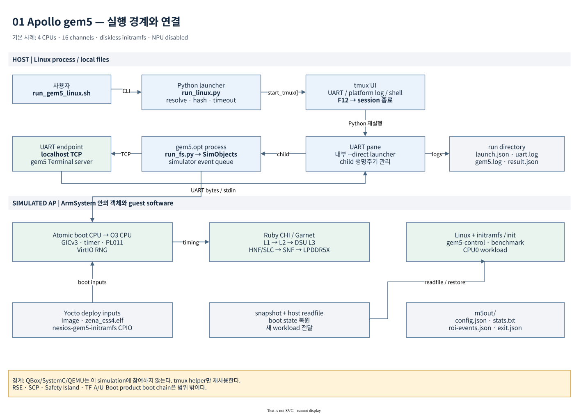

# Apollo gem5 기술 문서

Apollo의 **AP domain Linux** 및 **standalone SI CL1 Zephyr** gem5 구성을 설명한다.
문서 기준일은 **2026-10-24**다. 현재 checkout의 코드·Yocto metadata, v26 build/boot 검증과 보존된 v4
benchmark 실행 증거를 기준으로 작성했다. 기술 용어와 실제 API·파일·CLI 이름은 English로 유지한다.

AP 구성은 Cortex-A720AE·DSU·CMN-S3AE·LPDDR5X의 **uncalibrated proxy**다.
RSE·SCP·Safety Island를 포함하는 Apollo full-system QBox 구성이나 silicon의
cycle accuracy를 제공한다고 해석하지 않는다. standalone SI CL1은 AP와 별도 process에서
실행하며 자세한 범위는 [SI CL1 guide](si-cl1-zephyr-guide.md)를 따른다.
`PASS`는 명시된 모델·실행 조건에 대한 판정이다.

## 읽는 순서

| 문서 | 주요 내용 | 먼저 읽을 독자 |
|---|---|---|
| [Architecture](architecture.md) | static 구성, 주소·IRQ, boot·checkpoint·ROI의 dynamic flow | 플랫폼 통합·아키텍처 담당자 |
| [Model design](model-design.md) | CPU pipeline, cache/DSU, Ruby CHI/Garnet, DRAM, 설계 제약 | 모델 개발·성능 분석 담당자 |
| [Build guide](build-guide.md) | `--gem5`, Yocto graph, native/target toolchain, externalsrc | 이미지 빌드 담당자 |
| [Source 및 artifact 구조](source-and-artifacts.md) | Git ownership, source entry point, deploy·run·snapshot 파일 | 소스 수정·문제 분석 담당자 |
| [Run guide](run-guide.md) | tmux/UART/F12, CLI, workload 주입, checkpoint/resume | 실행·자동화 담당자 |
| [Benchmark guide](benchmark-guide.md) | 내장 cache/DRAM, lmbench·tinymembench·STREAM, ROI와 수치 해석 | 측정·비교 담당자 |
| [Interleave / 16-core 시험](interleave-16core-results.md) | 64/512/1024 B channel stripe와 multicore workload 검증 | memory 성능 분석 담당자 |
| [Orin hardware 비교](orin-validation-results.md) | 같은 benchmark의 실제 보드 실행, clock·affinity·prefetch 비교 조건 | hardware/model 정합성 담당자 |
| [Orin bandwidth 개선](orin-bandwidth-tuning.md) | 공개 STREAM/BabelStream 실측값 재현, OpenMP·cluster affinity·working set 비교 | hardware memory 성능 측정 담당자 |
| [Orin 기반 gem5 재측정](orin-informed-benchmark-results.md) | random cache sweep, multicore read/copy/triad, prefetch A/B와 ROI 검증 | benchmark/model 개발 담당자 |
| [SI CL1 측정 결과](si-cl1-benchmark-results.md) | memory 12 cases, IRQ 48 samples, realtime 32 jobs, exact ROI replay | 성능 분석 담당자 |
| [SI CL1 Zephyr](si-cl1-zephyr-guide.md) | standalone Cortex-R82AE, Yocto/QBox/gem5, memory/realtime 측정 | Safety Island 개발 담당자 |
| [Power/thermal model](power-model-guide.md) | Offline energy, SCMI/DVFS, online RC 및 ROI accounting | power/model 개발 담당자 |
| [v26 stable rebase](stable-rebase-validation.md) | upstream stable 이력, 호환성 수정과 build/boot 검증 | 모델 유지보수 담당자 |
| [검증 및 유지보수](validation.md) | evidence 수준, 확인 명령, provenance, 변경 시 검증 범위 | 리뷰·회귀 시험 담당자 |
| [Automotive 활용 조사](automotive/README.md) | AD workload, memory 간섭, architecture 탐색, 실행 절차와 calibration 범위 | Automotive SoC·자율주행 성능 설계 담당자 |

## 현재 기본 구성

| 항목 | 기본값과 의미 |
|---|---|
| gem5 baseline | upstream stable v26.0.0.0 (`fed0e07e930f`) |
| Host build | Yocto `gem5-native`, ARM ISA + Ruby CHI를 지원하는 host executable |
| Guest build | `gem5-apollo-guest`, Yocto AArch64 target compiler |
| Machine / image | `apollo-qvp` / `nexios-gem5-initramfs` |
| CPU | 4 CPUs, cluster당 4 CPUs; launcher는 4 또는 16만 허용 |
| Boot CPU → measurement CPU | `AtomicSimpleCPU` → guest marker에서 O3로 전환 |
| Profile | `configs/zena_cmn/profiles/a720ae_documented.yaml` |
| Cache | core별 L1I/L1D 64KiB, private L2 512KiB, cluster별 DSU L3 4MiB |
| Fabric | Ruby CHI + Garnet, 6×4 mesh, HNF 8개, 총 SLC proxy 4MiB |
| Memory | 2GiB RAM, LPDDR5X proxy 16 channels 기본값 |
| Boot inputs | Linux `Image`, 별도 PSCI firmware, gem5가 생성한 DTB, 전용 CPIO |
| Storage | 기본 diskless; WIC는 `--bsp` 또는 명시적 `--rootfs`에서만 연결 |
| Interactive 실행 | tmux의 UART·platform log·shell pane, F12 종료 |
| Checkpoint | diskless Atomic boot, CPU switch 이전 상태만 저장 |

YAML은 기본 parameter 위에 merge된다. 표의 숫자를 YAML 한 파일만 보고 재구성하지 말고
[Model design](model-design.md)의 effective parameter와 실행별 `m5out/config.json`을 확인한다.



## 첫 실행

아래 명령은 workspace root(`/build/arm/arm-auto-solutions`)에서 실행한다.
기존 build configuration을 사용하는 경우 먼저 [Build guide](build-guide.md)의 확인 절차를 따른다.

```sh
./yocto_build.sh --gem5 --keep-conf
./run_gem5_linux.sh --dry-run
./run_gem5_linux.sh
```

기존 snapshot을 사용한 반복 시험은 [Run guide](run-guide.md)의 compatibility 조건을
먼저 확인한다. 이미지·kernel·model 변경 후 예전 snapshot을 임의로 재사용하지 않는다.

## 검증된 범위와 문서 관계

- 2026-10-24 upstream stable v26 rebase 후 native/image build, fresh Linux boot,
  checkpoint 저장 및 O3 cache workload 복원을 검증했다. [검증 보고서](stable-rebase-validation.md)를 참조한다.

- 2026-10-22 v4 image에서 boot checkpoint 저장과 세 benchmark의 복원 실행을 완료했다.
  v4 수치는 보존 로그를 재분석한 결과다. 후속 interleave / 16-core 시험 상태와
  새로운 실행 증거는 [별도 보고서](interleave-16core-results.md)에 기록한다.
- [실측 전체 표와 해석](../apollo-gem5-benchmark-results.md)은 해당 실행의 고정 보고서다.
  이 문서 모음은 현재 구성과 재현 절차를 다룬다.
- [Boot 성능 조사](../apollo-gem5-boot-performance.md)는 최소 kernel 등 아직 A/B 실측하지 않은
  개선 후보를 포함한다. 후보를 현재 구현으로 간주하지 않는다.
- [기존 통합 기록](../apollo-gem5.md)은 초기 통합·검증의 이력을 보존한다.
  [QBox/FVP 프로젝트](../qbox-fvp-emulation-project.md)는 별도의 full-system 작업 범위다.

## 도면

각 도면은 native draw.io 원본과 Markdown용 SVG를 함께 제공한다.
도면의 기본 사례는 **4 CPU / 16 channels / NPU disabled / diskless**다.

| 도면 | 편집 원본 | 목적 |
|---|---|---|
| 01 System context | [draw.io](diagrams/01-system-context.drawio) | host process, guest, AP model 경계 |
| 02 Memory hierarchy | [draw.io](diagrams/02-memory-hierarchy.drawio) | CPU/cache/DSU/home/memory 연결과 bypass 구분 |
| 03 Boot 및 checkpoint | [draw.io](diagrams/03-boot-checkpoint.drawio) | 초기 부팅·저장·복원·readfile 순서 |
| 04 ROI sequence | [draw.io](diagrams/04-roi-sequence.drawio) | guest marker, CPU switch, statistics 경계 |
| 05 Build pipeline | [draw.io](diagrams/05-build-pipeline.drawio) | native/target build 및 deploy consumer |

주소·수치·신호의 근거는 각 장의 source link를 따른다. 도면은 소스에서 도출한 설명이며,
도면을 렌더링했다는 사실이 해당 traffic 또는 boot의 검증을 대신하지 않는다.
