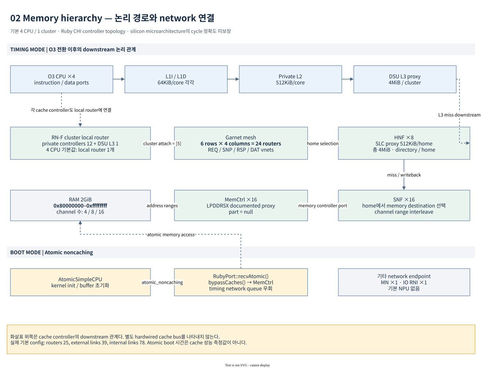

# Apollo gem5 static / dynamic architecture

이 문서는 `run_gem5_linux.sh`가 실제로 구성하는 Apollo **AP-only Linux** 모델을
설명한다. 기준일은 2026-10-22이며, 현재 소스와 보존된
`benchmarks-v4-stream/m5out/config.json`, `resolved-profile.json`, `manifest.json`을
대조했다. 설계 설명의 `SOURCE`는 구현에서 확인한 사실, `RUNTIME`은 해당 실행에서
관측한 사실, `UNVERIFIED`는 현재 증거로 확인하지 않은 범위를 뜻한다.

이 모델은 Cortex-A720AE / DSU-120AE / CMN-S3AE / LPDDR5X를 연구하기 위한
`UNCALIBRATED_PROXY`이다. Linux 실행 및 cache / DRAM sensitivity study에 사용할 수
있으나, 실물 Zena CSS의 cycle accuracy, safety, power, secure boot 또는 FVP와의
동등성을 보증하지 않는다. 상세 parameter의 의미와 한계는
[model design](model-design.md)에 이어진다.

## 1. System context와 실행 경계


[편집 가능한 diagram source](diagrams/01-system-context.drawio)

하나의 host gem5 process 안에서 Arm CPU, Ruby CHI controllers, Garnet network,
DRAM controller, AP peripheral과 guest Linux를 실행한다. QBox / QEMU / SystemC와
co-simulation하는 구성이 아니다. QBox와 공유하는 부분은 Apollo Yocto kernel 등의
입력 artifact와 host tmux UI helper이다.

| 경계 | 현재 구현 | 해당 경계에서 보장하지 않는 것 |
| --- | --- | --- |
| Host orchestration | Python launcher가 입력 확인, CPIO 준비, gem5 실행, UART 수집, 결과 판정을 수행 | guest code를 host에서 실행한 결과와의 성능 동등성 |
| AP execution | ArmAtomicSimpleCPU로 Linux boot, guest marker로 ArmO3CPU 전환 | Cortex-A720AE RTL의 pipeline 재현 |
| Coherent memory | Ruby CHI / Garnet, private L1/L2, cluster L3, HNF SLC, SNF | 실제 CMN-S3AE register map, physical channel, vendor snoop filter의 완전한 재현 |
| AP I/O | GICv3, PL011, GenericTimer, PL031, VirtIORng; 선택 시 virtio block | 전체 Apollo peripheral / interrupt source coverage |
| Firmware | simulation용 EL3 PSCI monitor | RSE → SCP → TF-A → U-Boot 제품 boot chain 및 secure firmware |
| Guest | Apollo Yocto `Image` + `nexios-gem5-initramfs` | product rootfs의 systemd 서비스 / PFDI / full-system qualification |
| 제외 domain | RSE, SCP, MCP, Safety Island는 이 launcher가 생성하지 않음 | cross-domain IRQ, HIPC/RPMsg, reset/power coordination |

현재 full-system이라는 gem5 용어는 kernel을 포함한 OS 실행 방식이다. Apollo 전체
SoC를 구성한다는 의미는 아니다. 일반 실행의 NPU도 `NOT_PRESENT`다. 별도 NPU
profile에 대한 source capability는 이 AP-only 기본 경로의 활성 장치와 구분한다.

구성 entry는 [run_linux.py](../../scripts/gem5/run_linux.py)의 `main()`과
[run_fs.py](../../hsoc-stack/tools/gem5/configs/zena_cmn/run_fs.py)의 `main()`이다.
`configs/example/arm/zena_css.py`에도 다른 AP example이 있으나 현재 launcher는
`configs/zena_cmn/run_fs.py`를 실행한다. example 쪽의 classic cache / XBar 선택지를
현재 Ruby topology와 혼합해 해석하면 안 된다.

## 2. 구성 계층과 ownership

| 계층 | 주요 소스 / symbol | 생성하거나 결정하는 것 |
| --- | --- | --- |
| Host launcher | [scripts/gem5/run_linux.py](../../scripts/gem5/run_linux.py): `resolve`, `prepare_initrd`, `main` | deploy 선택, `gem5.opt` command, readfile, snapshot contract, logs |
| FS assembly | [run_fs.py](../../hsoc-stack/tools/gem5/configs/zena_cmn/run_fs.py): `main` | `ArmSystem`, CPU pair, device, Ruby, DTB, event loop |
| AP platform | [ZenaCSS.py](../../hsoc-stack/tools/gem5/src/dev/arm/ZenaCSS.py): `ZenaCSS` | RAM / MMIO / IRQ / MPIDR / minimal DTB |
| Parameter contract | [parameters.py](../../hsoc-stack/tools/gem5/configs/zena_cmn/parameters.py): `load_parameters`, `validate` | default + selected profile + CLI override의 검증된 값 |
| CPU profile | [cpu_profile.py](../../hsoc-stack/tools/gem5/configs/zena_cmn/cpu_profile.py): `create_cpu`, `ap_release`, `cache_id_registers` | CPU queues, FU pool, supported ISA release, cache ID |
| Cache hierarchy | [cluster_rnf.py](../../hsoc-stack/tools/gem5/configs/zena_cmn/cluster_rnf.py): `ZenaClusterRNF`, `DSUL3Controller` | core별 L1/L2, cluster별 non-home L3 |
| Coherence assembly | [ruby_system_builder.py](../../hsoc-stack/tools/gem5/configs/zena_cmn/ruby_system_builder.py): `build_ruby` | RNF / HNF / SNF / MN / IO RNI, sequencer, downstream 관계 |
| Network placement | [chi_topology.py](../../hsoc-stack/tools/gem5/configs/zena_cmn/chi_topology.py): `build_topology`, `place_node_type` | CustomMesh router / link / network interface |
| DRAM backend | [memory_backend.py](../../hsoc-stack/tools/gem5/configs/zena_cmn/memory_backend.py): `build_memory_backend` | channel당 native `MemCtrl` / `DRAMInterface`, fingerprint |
| Guest lifecycle | [roi_control.py](../../hsoc-stack/tools/gem5/configs/zena_cmn/roi_control.py): `RoiControl` | CPU switch, stats reset / dump, ROI 상태 검사 |
| Snapshot | [checkpoint.py](../../hsoc-stack/tools/gem5/configs/zena_cmn/checkpoint.py) | 지원 범위 검사, checkpoint 저장, 완료 metadata |
| Guest control | [control.c](../../scripts/gem5/control.c), [init](../../hsoc-stack/yocto/meta-hsoc-auto-solutions/recipes-core/initrdscripts/nexios-gem5-init/init) | checkpoint / readfile / ROI marker와 `/init` 실행 순서 |

이 경계에서 root repository는 orchestration과 문서를 소유한다. gem5 core / model은
`hsoc-stack/tools/gem5` nested repository, Yocto recipe는
`hsoc-stack/yocto/meta-hsoc-auto-solutions` nested repository가 소유한다.

## 3. Static CPU / cache / interconnect topology



[편집 가능한 diagram source](diagrams/02-memory-hierarchy.drawio)

### 3.1 기본 실행 값

Launcher의 기본값은 **4 CPU / 1 cluster / 16 DRAM channels**이다.
선택 profile은
[a720ae_documented.yaml](../../hsoc-stack/tools/gem5/configs/zena_cmn/profiles/a720ae_documented.yaml)이며,
`default.yaml`의 16 CPU 값을 `--cpus 4` override가 덮어쓴다. 따라서 YAML 한 파일만
보고 기본 launcher가 16 CPU로 실행된다고 판단하지 않는다.

| 구성 | 기본 launcher에서 해석된 값 |
| --- | --- |
| CPU / Ruby / mesh clock | 각각 2 GHz |
| Boot CPU / memory mode | ArmAtomicSimpleCPU / `atomic_noncaching` |
| ROI CPU / memory mode | ArmO3CPU / `timing` |
| Core group | cluster당 4 CPU, 기본 1 cluster |
| Cache line | 64 bytes |
| L1I / L1D | core당 각각 64 KiB, 4-way |
| L2 | core당 512 KiB, 8-way, inclusive, prefetch off |
| DSU L3 proxy | cluster당 4 MiB, 16-way, **non-home** intermediate cache |
| HNF / SLC | HNF 8개, 각각 512 KiB / 16-way, 총 4 MiB |
| Garnet mesh | 6 rows × 4 columns + cluster당 RNF local router 1개 |
| Memory | 2 GiB, 16 × 16-bit LPDDR5X-8533 sensitivity channels |
| NPU / timing DVM / DMT / DCT | 모두 disabled |

`RUNTIME`: v4 STREAM 실행의 object graph는 CPU 4개, 대기 중인 ROI CPU 4개,
RNF 1개, HNF 8개, SNF 16개, MN 1개, DRAM controller 16개다. Garnet은 router
25개, external link 39개, directed internal link 78개다. external endpoint 39개는
`4×(L1I+L1D+L2) + DSU L3 + 8 HNF + 16 SNF + MN + IO RNI`로 구성된다.

16 CPU를 선택하면 4 clusters / 4 DSU L3가 생성되고 firmware도
`zena_css16.elf`로 바뀐다. 16 CPU Linux boot / benchmark 결과를 이 4 CPU 증거로
대체하지 않는다(`UNVERIFIED`). lower-level parser에 8 CPU 선택지가 있더라도
Apollo launcher와 배포된 firmware 계약은 **4 또는 16**이다.

### 3.2 Logical hierarchy와 network 연결

core마다 instruction / data용 `RubySequencer`가 별도로 있다.
`CPUSequencerWrapper.connectCpuPorts()`가 `icache_port`를 instruction sequencer에,
나머지 cached port와 MMU 관련 cached port를 data sequencer에 연결한다.
`ZenaClusterRNF`는 L1I/L1D의 downstream을 해당 core의 L2로, 각 L2의 downstream을
같은 cluster의 DSU L3로, DSU L3의 downstream을 global HNF 집합으로 설정한다.

이 화살표는 **CHI controller의 logical downstream 관계**다. L1/L2/L3 사이를
모두 dedicated direct wire로 연결한 모델은 아니다. 같은 RNF의 각 controller는
RNF local router에 external link로 연결되며, 이를 통해 local transaction도
network / controller latency 영향을 받는다. DSU L3는 별도 Home이 아니므로
최종 coherence Home은 주소에 따라 선택된 HNF이다.

HNF는 directory / SLC를 제공하고, 더 아래의 SNF 집합으로 memory request를
전달한다. 기본 NPU-disabled 경로에서는 SNF 하나에 `MemCtrl` 하나가 직접
연결된다. `CHI_MN`은 DVM 관련 node이며, 기본값에서는 timing DVM traffic을
활성화하지 않는다. `CHI_RNI_IO`는 full-system I/O memory request 진입점이다.

근거: [CHI_config.py](../../hsoc-stack/tools/gem5/configs/ruby/CHI_config.py)의
`CPUSequencerWrapper`, `CHI_RNF`, `CHI_HNF`, `CHI_SNF_MainMem`와
[CustomMesh.py](../../hsoc-stack/tools/gem5/configs/topologies/CustomMesh.py)의
`distributeNodes`, `_createRNFRouter`.

### 3.3 Physical address 선택과 channel 관계

RAM은 하나의 contiguous range이며 HNF stripe는 cache line 크기인 64 bytes다.
DRAM channel stripe는 기본 64 bytes, 선택 가능한 값은 64/512/1024 bytes다.
[address_map.py](../../hsoc-stack/tools/gem5/configs/zena_cmn/address_map.py)의
`striped_ranges()`와 `validate_ranges()`가 range alignment, 용량 합, 중복 없는
선택자를 검증한다.

```text
home_id    = (PA >> 6) & 7
channel_id = (PA >> log2(interleave_bytes)) & (channels - 1)
XOR        = disabled
```

기본 64-byte stripe / 16 channels일 때 주소 bit `[9:6]`이 channel을, `[8:6]`이 Home을 고른다.
따라서 Home h의 line은 channel h 또는 h+8로 간다. 8 channels에서는 Home과
channel 번호가 같고, 4 channels에서는 Home h가 channel `h & 3`에 대응한다.
512/1024-byte stripe에서는 channel bit가 `[12:9]` / `[13:10]`으로 바뀌어,
각 Home이 전체 16 channels로 요청을 전달할 수 있다.
이는 입력 주소에 대한 고정 stripe 함수이며, 실물 CMN SAM / DMC address mapping의
재현으로 해석하지 않는다.

총 capacity는 channel 수를 바꿔도 2 GiB다. 기본 16채널에서는 channel당
128 MiB, 8채널에서는 256 MiB, 4채널에서는 512 MiB가 노출된다. 이 값은 default
model의 synthetic density이며 실제 LPDDR5X package의 die 수 / density와 다르다.

## 4. AP address map, interrupt, DT contract

### 4.1 Memory와 image placement

| 대상 | Guest physical address / 범위 | 용도 |
| --- | --- | --- |
| RAM | `0x80000000` 이상, `0x100000000` 미만 | 총 2 GiB |
| Kernel Image | `RAM_BASE + arm64 Image.text_offset` | raw header의 entry / memory size에 따라 ELF wrapper 생성 |
| Initramfs | `0xc0000000` | 압축 해제한 CPIO를 loader가 guest RAM에 배치 |
| DTB | `0xf0000000` | gem5가 생성한 AP-only DTB |
| EL3 firmware | `0xffe00000` 이상, `0x100000000` 미만 | 2 MiB, DT `reserved-memory` / `no-map` |
| CPU release area | firmware base + `0x10000` | `ArmFsLinux.cpu_release_addr` 설정; 실제 SMP 제어는 monitor의 PSCI |

Firmware는 이 설정에서 별도 ROM controller로 연결되지 않고 RAM aperture 안에
로드된다. `reserved-memory`는 Linux allocator로부터 보존하는 장치이며, EL3
memory isolation이나 hardware security controller를 모델링하지 않는다.

[prepare_kernel()](../../hsoc-stack/tools/gem5/configs/zena_cmn/kernel_image.py)는
raw arm64 `Image` payload를 변경하지 않고 ELF64 `PT_LOAD` segment로 감싼다.
Image magic / little-endian / size / 2 MiB RAM alignment / initrd overlap을
검사한다. kernel symbols를 만들어 넣지 않으므로 symbol 기반 panic / delay hook과
source-level debugging은 matching `vmlinux`를 사용하는 경우와 다르다.

### 4.2 MMIO와 IRQ number domain

아래 INTID는 gem5 `ArmSPI(num=...)`에 들어가는 **absolute interrupt ID**다.
DT의 SPI index는 `INTID - 32`, PPI index는 `INTID - 16`이다.

| 장치 | Base / 크기 | Absolute INTID | DT interrupt cells의 index |
| --- | --- | --- | --- |
| GIC Distributor | `0x20800000` / `0x10000` | — | `arm,gic-v3` |
| GIC Redistributor | `0x20880000` / `cpus × 0x40000` | — | stride `0x40000` |
| GIC maintenance | system register interface | PPI 25 | PPI 9 |
| PL011 UART | `0x1a400000` / `0x1000` | SPI 84 | SPI 52 |
| PL031 RTC | `0x300d0000` / `0x1000` | SPI 300 | SPI 268 |
| VirtIORng | `0x30030000` / `0x200` | SPI 290 | SPI 258 |
| TimingVirtIOBlock, optional | `0x30020000` / `0x200` | SPI 289 | SPI 257 |
| Architected timer EL3 physical | system registers | PPI 29 | PPI 13 |
| Architected timer EL1 physical | system registers | PPI 30 | PPI 14 |
| Architected timer EL1 virtual | system registers | PPI 27 | PPI 11 |
| Architected timer EL2 NS physical | system registers | PPI 26 | PPI 10 |

GIC는 `it_lines=512`, `gicv4=True`를 사용한다. DT는 Linux에 `arm,gic-v3`로
기술하며 CPU interface는 system register 방식이다. 이 설정값만으로 GIC-720AE
전체 구현이나 GICv4 / virtualization runtime 검증을 주장하지 않는다. 이 경로는
ITS 장치를 생성하지 않는다.

SystemCounter / GenericTimer / firmware의 CNTFRQ는 모두 125 MHz다. UART / RTC용
DT fixed clock은 24 MHz이며, RTC 초기 날짜는 model 설정의 `01/01/2024`다.
이를 host wall clock 동기화나 실물 clock tree로 해석하지 않는다.

### 4.3 CPU identity와 DT topology

`ZenaCSS.affinity(cpu)`의 공식은 다음과 같다.

```text
MPIDR affinity = ((cpu // 4) << 16) | ((cpu % 4) << 8)
CPU 0..3      = 0x00000, 0x00100, 0x00200, 0x00300
CPU 4..7      = 0x10000, 0x10100, 0x10200, 0x10300
```

DT `/cpus`의 `reg`, `cpu-map`, gem5 `cpu_affinities`, firmware의 CPU index decode가
이 계약을 공유한다. CPU DT compatible은 generic `arm,arm-v8`이고 enable-method는
`psci` / `smc`다. A720AE performance profile과 architectural MIDR identity는
별개이며 A720AE MIDR을 위장하지 않는다.

`ZenaCSS.write_dtb()`가 실제 생성한 장치만 기술한 뒤
[device_tree.py](../../hsoc-stack/tools/gem5/configs/zena_cmn/device_tree.py)의
`add_cache_topology()`가 core별 L1 property, private L2 node, shared L3 node와
`next-level-cache`를 추가한다. HNF SLC는 CPU의 L4 cache로 광고하지 않는다.
최종 `system.dts` / `system.dtb`가 해당 실행의 확인 대상이며 QBox DTB는 사용하지 않는다.

## 5. Dynamic boot와 workload flow


[편집 가능한 diagram source](diagrams/03-boot-checkpoint.drawio)

### 5.1 Host 준비와 instantiate

1. Launcher가 `gem5-native.json`, kernel, dedicated initramfs, CPU 수에 맞는
   firmware, profile을 찾고 실제 경로와 SHA256를 기록한다. runtime compilation은 없다.
2. initramfs gzip을 host에서 해제하여 실행별 `initrd.cpio`를 만든다. 일반 dedicated
   image의 workload는 host `guest-init.sh`를 `--readfile`로 넘긴다.
3. `run_fs.py`가 raw Image를 필요 시 ELF로 감싸고 `validate_images()`로 firmware
   CPU count / boot data 충돌 등을 검증한다.
4. `ArmSystem`, boot CPU와 switched-out O3 CPU, I/O, Ruby, native DRAM backend를
   생성하고 DTB / resolved profile / manifest를 기록한다.
5. `m5.instantiate()`가 object graph와 image state를 준비한다. restore 모드이면
   snapshot state를 로드한다. 이어 `m5.simulate()` event loop에 진입한다.

### 5.2 EL3 monitor → Linux → `/init`

모든 CPU는 `0xffe00000`의 `_start`에서 AArch64 EL3로 시작한다.
`ArmFsLinux`가 x0에 DTB, x3에 kernel physical entry를 준다.
[boot.S](../../hsoc-stack/tools/gem5/system/arm/bootloader/zena_css/boot.S)의
`_start`는 per-CPU stack / exception vector / CNTFRQ / GIC system-register
interface를 설정하고 `monitor_boot()`를 호출한다. Primary CPU는 DTB를 x0에
보존하여 non-secure EL2로 진입하며, secondary CPU는 EL3에서 대기한다.

Linux의 PSCI `CPU_ON` SMC가 secondary entry와 context를 전달하면 monitor가
MPIDR, entry alignment와 RAM 범위를 검사하고 대기 CPU를 release한다. Guest timer,
interrupt, SMP와 userspace는 이 AP-only DT를 기준으로 동작한다. firmware는
PSCI VERSION / FEATURES / CPU_ON / CPU_OFF / AFFINITY_INFO level 0 / SYSTEM_OFF
subset만 제공한다. default firmware의 SYSTEM_RESET / CPU_SUSPEND는 미지원이다.

`rdinit=/init`로 dedicated init script가 실행된다. `/proc`, `/sys`, `/dev`,
`/dev/pts`, `/run` mount가 성공하면 `NEXIOS_GEM5_INITRAMFS_READY`를 출력한다.
이후 checkpoint 요청 처리 → readfile 수신 → workload 실행 또는
`nexios-gem5#` interactive shell 순서다. mount 실패는 별도의 FAILED marker와
failure shell로 진입하므로 READY / prompt 종류를 구분한다.

일반 boot는 `ArmAtomicSimpleCPU`의 `atomic_noncaching`이다. CPU memory access는
`RubyPort::MemResponsePort::recvAtomic()`에서 주소에 해당하는 memory controller
interface로 전달한다. **이 단계는 timing CHI packet / cache contention 측정이 아니다.**
이미지 로딩과 VirtIORng의 functional access도 timed CPU access와 구분한다.

### 5.3 UART와 IRQ의 실행 흐름

Guest의 PL011 MMIO write는 CPU의 I/O port → `IOXBar` → `Pl011` → `Terminal`로
전달된다. Terminal TCP port에 host launcher가 연결해 `uart.log`를 기록하며,
non-headless 모드에서는 tmux UART pane에서 입력도 전송한다. UART receive / timer /
RTC / virtio interrupt는 장치 → GIC → CPU interrupt interface로 전달된다.

`gem5.log`는 host simulator stdout / stderr이고 `uart.log`는 guest console이다.
`m5out/system.platform.terminal`도 Terminal dump로 남는다. 첫 UART banner와
첫 Linux banner는 서로 다른 milestone이다. Atomic kernel initialization 중
출력이 오랫동안 없다는 이유만으로 CPU가 멈췄다고 판정하지 않는다.

### 5.4 Atomic → O3 → ROI

`RoiControl.handle()`은 `workbegin` code `0x5a535743`를 switch 요청으로 처리한다.
`m5.switchCpus()`는 모든 boot / ROI CPU pair를 전환하고 phase를 `warmup`으로
옮긴다. 이후 `workbegin(0)`이 `m5.stats.reset()`을 호출하여 `roi_begin`,
`workend(0)`이 `m5.stats.dump()`를 호출하여 `roi_end`가 된다.

`apollo-bench`는 CPU0에 pin하고 Atomic 상태에서 working set 초기화 후 O3로
전환하며, 1 warm-up pass 뒤 본 측정을 시작한다. 반면
`gem5-control run COMMAND`는 CPU0에 pin한 후 switch / begin을 실행하고
`fork` / `exec` / `waitpid` 전체를 감싼다. 그러므로 외부 tool의 whole-command ROI는
allocation, calibration, kernel 실행도 포함한다. 두 ROI scope를 같은 것으로
비교하지 않는다. Marker 앞뒤의 `DSB SY`는 O3 memory request와 marker의 ordering을
명시한다. 자세한 state machine은 [model design](model-design.md#6-roi-state-machine과-measurement-contract)을 참조한다.

### 5.5 종료 판정

Dedicated workload script는 `APOLLO_WORKLOAD_EXIT=<status>`를 출력하고 power-off를
요청한다. BusyBox `poweroff`가 없으면 kernel sysrq power-off를 사용한다.
EL3 monitor의 PSCI SYSTEM_OFF가 `ZENA_GEM5_PSCI_SYSTEM_OFF`를 출력한 뒤 `m5_exit`를
실행한다. Simulator는 이 exit를 tick limit, panic, 잘못된 ROI 순서와 구분한다.

`BOOT_OBSERVED`는 headless launcher가 shell / login prompt를 관측하고 종료한
결과이며 workload PASS와 다르다. F12는 host가 managed session / simulator를
종료하는 UI 기능으로 guest의 정상 PSCI shutdown 검증을 대체하지 않는다.

## 6. Snapshot architecture와 재사용 한계

Snapshot 지점은 dedicated `/init`가 mount와 READY 출력을 마친 뒤, workload
readfile을 읽기 전이다. `gem5-control checkpoint`가 `m5_checkpoint` pseudo-op을
발행하면 host event loop가 drain / checkpoint 저장을 수행하고 종료한다. 완성된
snapshot에는 `m5.cpt`, guest RAM image, `apollo-checkpoint.json`, `launcher.json`이
포함된다. Snapshot 경로는 신규 경로여야 하며 partial 결과도 덮어쓰지 않는다.

Restore는 checkpoint pseudo-op 다음 instruction에서 재개하므로 kernel boot를
다시 수행하지 않는다. 이어서 새 host readfile을 읽기 때문에 같은 snapshot에서
서로 다른 workload를 실행할 수 있다. 각 restore는 동일 저장 RAM으로 돌아가며,
이전 restore 실행이 만든 `/run` 파일은 다음 restore에 누적되지 않는다.

| 조건 | 현재 처리 |
| --- | --- |
| 저장 state | Atomic CPU, `atomic_noncaching`, ROI 전 `boot` phase |
| Boot image | diskless dedicated initramfs |
| Native / guest image 일치 | gem5 binary, kernel, firmware, decompressed initrd, profile hash 검사 |
| Model 일치 | `configs/zena_cmn/*.py` hash, resolved profile, CPU/channel 수, bootargs 검사 |
| Workload 교체 | readfile은 동일성 hash에서 제외하여 restore마다 새 command 허용 |
| O3 중 저장 / warm-cache 재사용 | 미지원 |
| WIC / TimingVirtIOBlock | 저장·복원 거부; backend serialization 자체가 미지원 |
| NPU | checkpoint에서 disabled 필수 |
| Machine / model 변경 | 새 snapshot 필요 |

Snapshot에는 kernel memory와 filesystem contents가 저장된다. 따라서 image를
새로 빌드한 뒤 이전 snapshot에 package가 추가됐다고 생각해서는 안 된다.
restore 때 kernel banner가 다시 안 나오는 것은 정상이다. `--max-ticks`는 restore
시점 tick을 포함하는 절대 simulated tick 상한이므로 snapshot tick보다 커야 한다.

`RUNTIME`: v4 image의 snapshot에서 lmbench / tinymembench / STREAM을 각각 복원하고
O3 / ROI / exit를 확인한 기록이 있다. 상세 수치는
[기존 benchmark 결과](../apollo-gem5-benchmark-results.md)에 보존되어 있다.
이는 해당 4 CPU diskless 경로의 실행 증거이며 16 CPU, 다른 profile, product login,
O3 checkpoint의 검증으로 확장하지 않는다.

## 7. 소스 capability와 active path를 구분하는 기준

| Source capability | Apollo 기본 launcher 활성 상태 | 검증상 주의 |
| --- | --- | --- |
| Direct timing boot | lower-level `run_fs.py --boot-mode timing` 가능 | 기본 wrapper는 Atomic; boot 시간 / 통계가 달라짐 |
| 16 CPU | firmware와 launcher 선택 지원 | 현재 대표 Linux benchmark는 4 CPU |
| 4 / 8 DRAM channels | launcher 선택 지원 | 총 2 GiB 유지, topology / snapshot 계약 변경 |
| WIC virtio block | `--rootfs` 또는 BSP 호환 경로에서 연결 | snapshot과 함께 사용 불가 |
| Hynix / Micron DRAM candidate | 별도 profile에서 선택 가능 | 현재 default memory part가 아님 |
| NPU / SMMU model | 별도 profile / lower-level 구현 존재 | 기본 AP benchmark는 NPU 없음; checkpoint 미지원 |
| Software warm reset firmware | 별도 classic AP example에 구현 존재 | 현재 Ruby `run_fs.py`의 default firmware 계약 밖 |
| Roofline / multi-ROI | lower-level `--roofline`, 별도 workload 경로 | 일반 launcher의 single-ROI 판정과 다름 |

현재 실행의 사실은 **선택 profile 이름 → `resolved-profile.json` → `config.json` →
UART / ROI / stats / exit** 순서로 확인한다. 파일이 존재하는 것과 실행에서 해당
장치·mode가 사용된 것은 서로 다른 증거다.
