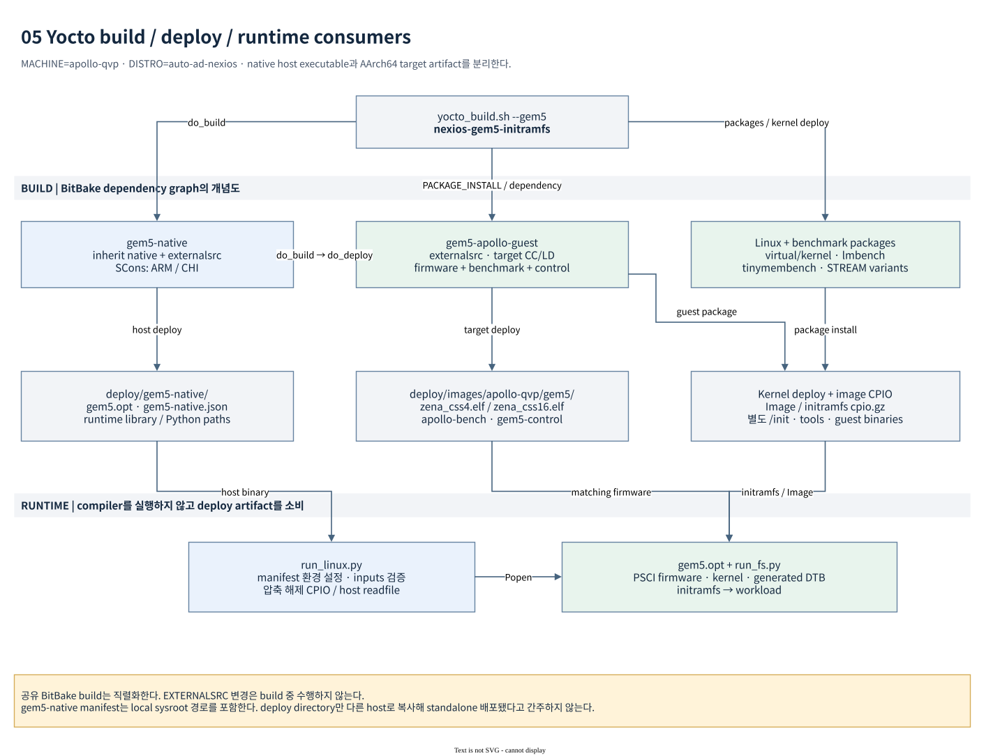

# Apollo gem5 build guide

이 문서는 workspace root에서 Yocto로 host simulator, AArch64 guest 도구,
Linux kernel, 전용 initramfs를 준비하는 절차를 설명한다. 현재 지원 entrypoint는
[`yocto_build.sh`](../../yocto_build.sh)의 `--gem5`이며, 실행 launcher는 build를
수행하지 않는다. 전체 파일 배치는 [source와 artifact 구조](source-and-artifacts.md),
실행은 [run guide](run-guide.md)를 참고한다.

## 1. 현재 build 구성과 소유권

2026-10-22에 실제 `build/conf`와 배포 image의 `.testdata.json`을 확인했다.
다음 값은 이 workspace의 확인 시점 값이며 다른 checkout의 설정을 대신하지 않는다.

| 항목 | 확인값 / 의미 |
|---|---|
| `MACHINE` | `apollo-qvp` |
| `DISTRO` | `auto-ad-nexios` |
| `RD_ASPEN_VARIANT` | `cfg2` |
| `PC_CPUS_COUNT_DEFAULT` | `4` |
| `TMPDIR` | `${TOPDIR}/tmp_baremetal`, 현재 `build/tmp_baremetal` |
| `TEMPLATECONF` | `hsoc-stack/yocto/meta-hsoc-auto-solutions/conf/templates/apollo-qvp` |
| `BUILD_SYS` | `x86_64-linux` |
| `TARGET_SYS` / `TARGET_ARCH` | `aarch64-poky-linux` / `aarch64` |
| `DEFAULTTUNE` / `TUNE_FEATURES` | `cortexa720` / `aarch64 crypto cortexa720` |
| `virtual/kernel` provider | `linux-yocto-rt`, `auto-ad-nexios.conf`에서 선택 |
| image format | `cpio.gz` |

`BBLAYERS`에는 owned `meta-hsoc-auto-solutions`, `meta-hsoc-bsp`와 reference
`meta-zena-css-bsp`, `meta-zena-css-safety-island`, `meta-arm`,
`meta-arm-toolchain`, `meta-bluechi`, `meta-cassini-distro`, `meta-clang`,
`meta-ewaol`, `meta-openembedded/{meta-filesystems,meta-networking,meta-oe,
meta-perl,meta-python}`, `meta-ptx`, `meta-secure-core` 계열,
`meta-security`/`meta-parsec`, `meta-virtualization`, `meta-zephyr-core`,
Poky `meta`/`meta-poky`, `sw-ref-stack/yocto/meta-arm-auto-solutions`가 들어 있다.
실제 절대 경로의 기준은 `build/conf/bblayers.conf`다.

Product recipe와 upstream package 확장은
[`meta-hsoc-auto-solutions`](../../hsoc-stack/yocto/meta-hsoc-auto-solutions)에 둔다.
Linux/provider와 source-root 정의는
[`meta-hsoc-bsp/conf/layer.conf`](../../hsoc-stack/yocto/meta-hsoc-bsp/conf/layer.conf),
외부 `layers/`의 lmbench/tinymembench recipe는 원본을 유지하고 owned layer의
`.bbappend`에서 patch한다. `arm-zena-css/`는 reference이며 수정 대상으로 삼지 않는다.

## 2. Build dependency와 toolchain



[편집 가능한 draw.io source](diagrams/05-build-pipeline.drawio)

| Recipe | 수행하는 build | 결과 / dependency |
|---|---|---|
| `gem5-native` | host compiler + SCons로 `ARM/gem5.opt` | native simulator, native runtime manifest; `do_build`가 `gem5-apollo-guest:do_deploy`에 의존 |
| `gem5-apollo-guest` | Yocto target `${CC}`/`${LD}`로 AArch64 firmware와 C program | `zena_css4.elf`, `zena_css16.elf`, `apollo-bench`, `apollo-memory-bench`, `gem5-control` |
| `nexios-gem5-init` | 전용 shell script 설치 | `/init`, `/usr/bin/gem5-workload`; BusyBox와 guest package에 runtime 의존 |
| `lmbench` | meta-oe recipe + owned `-E` patch | `lat_mem_rd`, `bw_mem` 등 |
| `tinymembench` | meta-oe recipe + owned runtime-option patch | `tinymembench` |
| `stream` | pinned upstream STREAM C source, target compiler | 공식 기본조건 `/usr/bin/stream` alternatives |
| `stream-gem5-cache` | 같은 STREAM source, array size compile flag 변경 | 독립 binary `stream-gem5-cache`, deploy 사본 |
| `nexios-gem5-initramfs` | package install + CPIO/gzip image 생성 | `do_build`가 `gem5-native:do_build`, `virtual/kernel:do_deploy`에 의존 |

### Native와 target의 구분

[`gem5-native.bb`](../../hsoc-stack/yocto/meta-hsoc-auto-solutions/recipes-devtools/gem5/gem5-native.bb)는
`inherit scons pkgconfig externalsrc deploy native`를 사용한다. `ARM`은 시뮬레이션할
guest ISA이며 `gem5.opt` 자체는 현재 host인 x86-64에서 실행한다.
Native sysroot의 Python, libpng, zlib, PyYAML 등을 사용한다. SCons가 compiler를
단일 executable로 probe하고 libelf가 `cc`를 호출하므로 `${B}/host-tools/cc`와
`c++` wrapper가 `${BUILD_CC}`, `${BUILD_CXX}`를 실행한다.

`build_opts/ARM`의 ARM ISA/Ruby/CHI 설정을 base defconfig로 삼고
`USE_CAPSTONE=n`, `USE_SYSTEMC=n`,
`USE_KVM=n`, `--without-tcmalloc`을 적용한다. 따라서 현재 recipe에는 KVM boot
가속이나 SystemC/QBox process 연동이 없다. Native 설치본은 Yocto sysroot에서
필요한 공유 library/Python을 찾도록 manifest와 함께 사용한다.

[`gem5-apollo-guest.bb`](../../hsoc-stack/yocto/meta-hsoc-auto-solutions/recipes-devtools/gem5/gem5-apollo-guest.bb)는
native recipe가 아닌 target recipe다. 실제 target tune은 Cortex-A720지만, guest
helper는 명시적으로 `-march=armv8-a -mno-outline-atomics`를 사용한다.
`apollo-bench`와 `apollo-memory-bench`는 `-static -pthread`, `gem5-control`은 `-static`과 gem5의 공식
`util/m5/src/abi/arm64/m5op.S`를 함께 link한다. Standalone firmware는 pointer
authentication 초기화를 하지 않으므로 firmware compile에만
`-mbranch-protection=none`을 추가한다. 이 firmware는 전체 TF-A/U-Boot boot chain을
대신하는 gem5 AP용 작은 PSCI monitor다.

### Externalsrc와 재현성

두 gem5 recipe는 같은 `EXTERNALSRC = "${HSOC_APOLLO_GEM5_SRC}"`를 읽으며
기본 경로는 `hsoc-stack/tools/gem5`다. `EXTERNALSRC_BUILD = "${WORKDIR}/build"`와
빈 `EXTERNALSRC_SYMLINKS`로 source tree에 Yocto build symlink를 만들지 않는다.
Native와 target recipe의 `${WORKDIR}`가 다르므로 build output도 분리된다.

`scripts/gem5/benchmark.c`, `scripts/gem5/control.c`는 gem5 submodule 바깥에 있어
guest recipe의 `do_compile[file-checksums]`에 명시한다. Root C source 변경도
BitBake task signature에 반영된다. `externalsrc`는 checkout의 현재 내용을
build하므로 dirty source를 release 재현성의 기준으로 삼으면 안 된다. Root와
nested repository revision, local diff, build configuration, binary hash를 함께
보관한다. STREAM source와 license는 recipe SHA256으로 고정한다.

## 3. Build 전 확인

아래 명령은 모두 workspace root에서 실행한다.

```sh
git status --short
git -C hsoc-stack/tools/gem5 status --short --branch
git -C hsoc-stack/yocto/meta-hsoc-auto-solutions status --short --branch
git -C hsoc-stack/yocto/meta-hsoc-bsp status --short --branch
cat build/conf/templateconf.cfg
rg -n 'MACHINE|DISTRO|TMPDIR|RD_ASPEN_VARIANT|PC_CPUS_COUNT' build/conf/local.conf
cat build/conf/bblayers.conf
pgrep -af 'bitbake|bitbake-server'
```

동일 build directory를 사용하는 다른 BitBake build와 직렬화한다. 진행 중인
build의 source, recipe, `build/conf`를 바꾸지 않는다. 이미 checkout된 repository를
업데이트할 때에는 root가 pin한 gem5 revision과 현재 local 변경을 먼저 확인한다.

Host에는 이 workspace의 Yocto host requirements와 Python 3가 필요하다. 실행 때
tmux를 쓰려면 host `tmux`도 필요하다. 별도 host `aarch64-linux-gnu-gcc`는 launcher의
필수 조건이 아니다. Target compiler는 Yocto dependency graph가 제공한다.

## 4. 전체 image build

```sh
./yocto_build.sh --machine apollo-qvp --gem5 --keep-conf
```

`--gem5`는 `nexios-gem5-initramfs`를 선택한다. `--bsp`, 다른 explicit target 또는
`--machine apollo-fvp`와 함께 사용할 수 없다. 일반 `./yocto_build.sh`는
`nexios-image`, `--bsp`는 `nexios-bsp-initramfs`이며 gem5 전용 이미지와 다르다.

`--keep-conf`를 생략하면 script가 **기존 `BUILD_DIR/conf`를 지우고 template에서
재생성**한다. 현재 local configuration을 유지할 때에는 위 명령처럼 명시한다.
`--dry-run`도 BitBake 호출 이전의 환경 초기화와 resource conf 작성을 실행하므로
아래처럼 `--keep-conf`와 함께 사용한다. 이것은 완전한 filesystem read-only dry run은 아니다.

```sh
./yocto_build.sh --machine apollo-qvp --gem5 --keep-conf --dry-run
```

새 build directory가 필요한 경우 다음처럼 분리한다. 기존 build directory에서
machine을 바꾸기보다 machine별 artifact와 conf를 분리하는 편이 검증에 유리하다.

```sh
BUILD_DIR="$PWD/build-gem5" ./yocto_build.sh --machine apollo-qvp --gem5
./run_gem5_linux.sh --build-dir "$PWD/build-gem5" --dry-run
```

`APOLLO_BUILD_THREADS`는 BitBake task 병렬도, `APOLLO_PARALLEL_MAKE`는 각 recipe의
compile 병렬도를 제어한다. ARM generated instruction source의 C++ compile은
메모리를 많이 사용한다. Host 여유에 맞춰 두 값을 함께 제한한다.

```sh
APOLLO_BUILD_THREADS=2 APOLLO_PARALLEL_MAKE=-j2 \
  ./yocto_build.sh --machine apollo-qvp --gem5 --keep-conf
```

Resource 값은 `build/conf/apollo-bitbake-resources.conf`에 생성되고 `bitbake -R`로
적용된다. `APOLLO_AUTO_RESOURCE_LIMITS=0`은 자동 설정을 끄지만 별도로 지정한
thread 관련 환경변수가 있으면 script가 다시 resource conf를 생성한다.

## 5. 부분 build와 입력 확인

```sh
# Native simulator와 guest deploy 준비
./yocto_build.sh --keep-conf gem5-native

# Firmware / guest helper만 재생성
./yocto_build.sh --keep-conf gem5-apollo-guest

# 단일 recipe 문제의 최초 task부터 확인
./yocto_build.sh --keep-conf -c compile gem5-apollo-guest

# Guest package 변경을 실제 initramfs에 반영
./yocto_build.sh --gem5 --keep-conf
```

`gem5-apollo-guest`를 build하는 것만으로 기존 `cpio.gz`가 갱신되지는 않는다.
Image에 설치된 binary를 바꾸려면 image build까지 완료한다. Snapshot은 image의
메모리 내용을 포함하므로 이후 새로운 checkpoint를 생성한다.

실제 override/provider/경로를 조사할 때에는 같은 환경에서 BitBake 값을 확인한다.
다음도 다른 BitBake build가 없을 때 실행한다.

```sh
(
  export TEMPLATECONF="$PWD/hsoc-stack/yocto/meta-hsoc-auto-solutions/conf/templates/apollo-qvp"
  . layers/poky/oe-init-build-env build >/dev/null
  MACHINE=apollo-qvp bitbake -e gem5-native > /tmp/apollo-gem5-native.env
  MACHINE=apollo-qvp bitbake-layers show-appends
)
rg '^(EXTERNALSRC|EXTERNALSRC_BUILD|WORKDIR|B|DEPLOY_DIR_IMAGE|BUILD_SYS|CC|CXX)=' \
  /tmp/apollo-gem5-native.env
```

## 6. Image contents와 완료 판정

[`nexios-gem5-initramfs.bb`](../../hsoc-stack/yocto/meta-hsoc-auto-solutions/recipes-core/images/nexios-gem5-initramfs.bb)의
`PACKAGE_INSTALL`은 `base-files base-passwd busybox nexios-gem5-init
gem5-apollo-guest lmbench tinymembench stream stream-gem5-cache`다. 필요한 libc,
libtirpc, Perl 등은 package dependency로 함께 설치된다. Image feature와
recommendation을 줄이고 dm-verity/overlayfs rootfs 전환을 비활성화한다.
Product systemd service를 부팅하는 image가 아니다.

```sh
readlink -f build/tmp_baremetal/deploy/images/apollo-qvp/nexios-gem5-initramfs-apollo-qvp.cpio.gz
cat build/tmp_baremetal/deploy/images/apollo-qvp/nexios-gem5-initramfs-apollo-qvp.manifest
cat build/tmp_baremetal/deploy/gem5-native/gem5-native.json
file build/tmp_baremetal/deploy/gem5-native/gem5.opt \
     build/tmp_baremetal/deploy/images/apollo-qvp/gem5/zena_css4.elf \
     build/tmp_baremetal/deploy/images/apollo-qvp/gem5/gem5-control
./run_gem5_linux.sh --dry-run
```

2026-10-22에 확인한 최종 image는
`nexios-gem5-initramfs-apollo-qvp-20261022031446.cpio.gz`이며 8,367,466 bytes다.
`.manifest`에는 lmbench `3.0+a9`, tinymembench `0.4.9+git0+a2cf6d7e38`,
STREAM/stream-gem5-cache `5.10`이 기록돼 있다. 빌드 성공 이후의 guest 실행 검증은
[validation](validation.md)과 [benchmark guide](benchmark-guide.md)에 분리한다.

## 7. Build 문제 진단

| 증상 | 먼저 확인할 사항 / 조치 |
|---|---|
| `missing .../gem5/zena_css4.elf` | guest deploy 누락. `gem5-apollo-guest` build 후 image 갱신 여부도 확인 |
| `missing ...nexios-gem5-initramfs...cpio.gz` | 일반 product image만 build했는지 확인. `--gem5 --keep-conf` 수행 |
| `cc1plus` 종료, host OOM | kernel log와 실패 recipe task log를 확인하고 task/compile 병렬도 축소 |
| Native Python/library loading 실패 | `gem5-native.json`에 적힌 recipe-sysroot-native가 남아 있는지 확인. 바이너리 단독 복사 여부 확인 |
| Externalsrc 수정이 반영되지 않음 | 실제 `EXTERNALSRC`, root C source checksum dependency, 해당 recipe task log 확인 |
| Image에 이전 guest binary가 남음 | deploy와 rootfs packaging은 다른 단계. image build 및 새 snapshot 수행 |
| lmbench/tinymembench 옵션이 없음 | `bitbake-layers show-appends`, 최종 package/image manifest, 실제 부팅한 snapshot의 image hash 확인 |

Task 진단은 `${WORKDIR}/temp/log.do_*`와 `run.do_*`에서 최초 실패 task를 찾는
방식으로 한다. Routine 대응으로 `downloads`, `sstate-cache`, `TMPDIR` 전체를
지우지 않는다. Shared build input을 바꾸기 전에 진행 중인 build가 없는지 확인한다.
