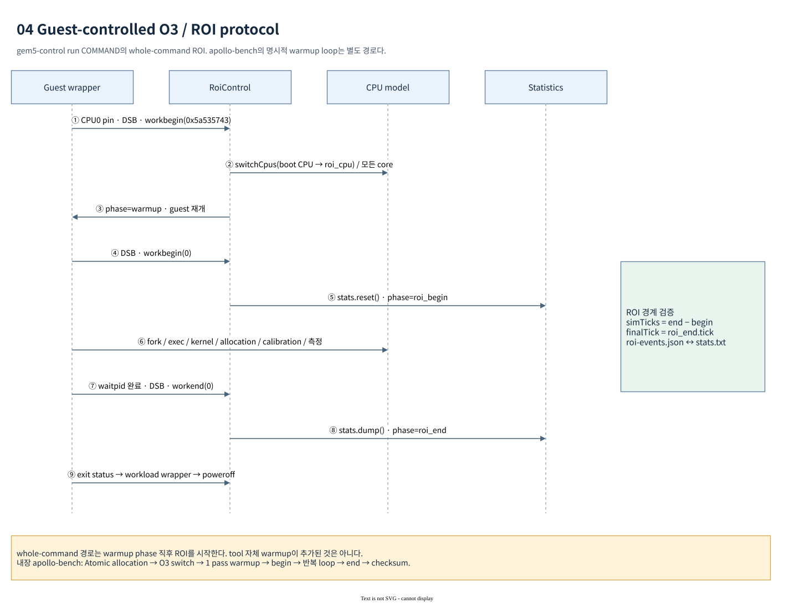

# Apollo gem5 model design과 parameter 해석

이 문서는 Apollo AP-only gem5의 CPU / cache / CHI / Garnet / DRAM model이 어떻게
구성되고, 어떤 값이 실험 입력이며, 무엇을 성능 결과로 해석할 수 있는지 설명한다.
기준일은 2026-10-22다. [architecture](architecture.md)의 topology와 boot contract를
전제로 하며 실제 구현의 symbol과 실행 artifact를 기준으로 한다.

## 1. 설계 목적과 fidelity boundary

현재 모델의 목적은 Apollo Yocto AArch64 userspace를 Linux 위에서 실행하고,
CPU / cache / interconnect / DRAM의 가정을 명시한 상태로 workload의 변화와
bottleneck을 조사하는 것이다. 기본 profile의 qualification은
`UNCALIBRATED_PROXY`, DRAM은 `UNCALIBRATED_SENSITIVITY_MODEL`이다.

| 표현 | 이 문서에서의 의미 | 의미하지 않는 것 |
| --- | --- | --- |
| A720AE documented execution profile | generic ArmO3CPU에 queue baseline과 일부 문서 기반 SIMD timing 적용 | 전체 A720AE dispatch / issue / branch / memory pipeline 복제 |
| DSU L3 proxy | 4-core cluster에 shared intermediate CHI cache를 배치 | DSU-120AE RTL, power state, safety mechanism 재현 |
| CMN proxy | Ruby CHI controller와 Garnet mesh로 coherence / contention 시뮬레이션 | CMN-S3AE의 모든 protocol extension / register / physical channel 재현 |
| LPDDR5X-8533 | 기존 LPDDR5 interface에서 bus 관련 timing을 변경한 native DRAM model | 특정 Apollo BOM의 controller / PHY / die / board 검증 |
| Linux runtime PASS | 선택 workload, ROI, guest 종료가 정해진 검사를 통과 | 전체 product boot, multicore scalability, 실물 점수의 qualification |

문서나 profile에 `documented`라는 이름이 있어도 모든 parameter가 문서에서 나온
것은 아니다. 예를 들어 O3 queue baseline, cache latency / bank, placement,
TBE / VC depth는 여전히 모델 가정이다. 해당 선택을 바꾸면 sensitivity 결과를
얻을 수 있으나 이를 실물 튜닝 효과로 직접 옮길 수는 없다.

## 2. Parameter resolution과 fail-fast 설계

### 2.1 값이 결정되는 순서

[parameters.py](../../hsoc-stack/tools/gem5/configs/zena_cmn/parameters.py)의
`load_parameters()`는 다음 순서로 값을 정한다.

1. [default.yaml](../../hsoc-stack/tools/gem5/configs/zena_cmn/profiles/default.yaml)의
   전체 schema / baseline을 읽는다.
2. 선택한 profile의 부분 mapping을 recursive merge한다.
3. `run_fs.py`가 `--cpus`, `--channels` 등에서 만든 explicit override를 적용한다.
4. `validate()`로 type / geometry / count / supported mode를 검사한다.
5. 최종 mapping을 실행별 `resolved-profile.json`에 기록한다.

기본 launcher는
[a720ae_documented.yaml](../../hsoc-stack/tools/gem5/configs/zena_cmn/profiles/a720ae_documented.yaml)을
선택하고 `--cpus 4 --channels 16`을 전달한다. 선택 profile은 CPU execution
profile, SLC 4 MiB, 6×4 mesh 및 placement를 변경한다. `default.yaml` 자체의
16 CPU / 4×4 mesh / 8 MiB SLC가 현재 launcher 기본값은 아니다.

각 artifact의 역할은 다음과 같다.

| Artifact | 확인하는 사실 |
| --- | --- |
| `launch.json` | host가 선택한 artifact path, 실제 command, SHA256, workload |
| `m5out/resolved-profile.json` | defaults / profile / CLI merge 이후의 project parameter |
| `m5out/config.ini`, `config.json` | inherited native default까지 해석된 SimObject parameter / port |
| `m5out/manifest.json` | native version, source / image provenance, memory fingerprint, qualification |
| `m5out/roi-events.json` | 실행한 phase와 simulated tick |
| `m5out/stats.txt` | 실제 ROI에서 계측된 counters / durations |

기존 snapshot을 재현할 때 profile 파일만 보존하는 것으로 충분하지 않다. native
version default와 Python model source도 object graph와 timing을 바꿀 수 있다.

### 2.2 주요 검증 계약

`UniqueLoader`는 duplicate YAML key와 string이 아닌 key를 거부한다. `_merge()`는
unknown parameter와 baseline type이 다른 값을 거부한다. `validate()`는 다음을
확인한다.

- `cores == clusters × cores_per_cluster`; DSU / local router / Linux cluster 수 일치.
- FS 경로의 `cores_per_cluster == 4`; launcher firmware는 4 / 16 CPU만 허용.
- line size 64 bytes, channel 수 4 / 8 / 16, capacity 2048 MiB, Home 수 8.
- SLC total = HNF 수 × HNF당 capacity; cache set 수는 power-of-two.
- cache bank 수가 power-of-two이며 set 수 이하.
- mesh placement ID가 범위 안에 있고, node 종류별로 개수와 uniqueness가 맞음.
- custom memory module / class는 함께 지정; 누락 시 다른 DRAM으로 fallback하지 않음.
- NPU presence / shared backend attachment 설정 간 일치.
- DT는 생성 경로만 허용; `full_system.dtb`로 외부 DTB를 주입하지 않음.

`benchmark.*` YAML 값은 설계 계약 metadata이며 현재 guest 실행량 override가 아니다.
실제 횟수 / 크기는 launcher와 benchmark CLI에서 바꾼다. YAML 1.1에서 `off`는
boolean으로 읽힐 수 있으므로 `cache.l2.prefetch: 'off'`처럼 string을 유지한다.

## 3. CPU design

### 3.1 Atomic CPU와 O3 CPU의 역할

[cpu_profile.py](../../hsoc-stack/tools/gem5/configs/zena_cmn/cpu_profile.py)의
`create_cpu()`는 boot용 `ArmAtomicSimpleCPU`, ROI용 `ArmO3CPU`를 생성한다.
두 CPU set은 같은 architectural identity / clock / workload를 공유하며,
O3는 처음에 `switched_out=True`다. CPU switch는 register / thread context를
넘겨 Linux 실행을 이어 가는 동작이며, 재부팅이 아니다.

| O3 항목 | 현재 입력값 | 모델 의미 |
| --- | ---: | --- |
| Clock | 2 GHz | guest CPU time scale |
| ROB | 192 entries | in-flight instruction capacity baseline |
| IQ | 128 entries | native instruction queue capacity |
| Load queue | 32 entries | native IEW writeback window와의 호환 baseline |
| Store queue | 64 entries | store buffering baseline |
| Execution profile | `a720ae_documented` | 아래 shared FP/SIMD pool 선택 |
| MIDR impersonation | false | generic Arm identity 유지 |
| SVE VL | 128-bit (`sve_vl=1`) | 현재 Cortex-A720-tuned userspace ABI에 필요한 설정 |

`LQEntries`를 늘릴 때 `create_cpu()`는 native IEW의
`(forwardComSize + 1) × wbWidth` writeback slot 상한을 검사한다. Merged Ruby load
response가 같은 시점에 완료되어 이 window를 초과하는 구성을 단순히 허용하지
않는다. 이 제한은 실물 A720AE load queue 크기를 측정한 결과가 아니다.

### 3.2 Execution unit approximation

[a720ae_fu.py](../../hsoc-stack/tools/gem5/configs/zena_cmn/a720ae_fu.py)의
`create_execution_pool()`는 native FP_ALU / FP_MultDiv / SIMD_Unit opClass들을
**두 개의 shared FP/SIMD FU**로 합친다. `SimdFloatAdd` latency 2 cycles,
`SimdFloatMultAcc` latency 4 cycles를 적용하며 pipelined로 설정한다.

이 값은 해당 source의 A720AE SOG reference에 근거한 좁은 mapping이다. Broad
opClass에 같은 latency가 적용되고, FMLA accumulator-specific forwarding은
native `OpDesc`로 별도 표현하지 않는다. Scalar FP와 다른 SIMD가 두 pipe를 공유하는
것도 가정이다. Integer / predicate / matrix / LSU 등은 native FU mapping을
유지하므로 전체 pipeline 폭이나 scheduling이 A720AE와 같다고 해석하지 않는다.

### 3.3 ISA exposure와 cache identification

`ap_release()`는 generic Armv8 release에서 현재 decoder가 완전히 지원하지 않는
`FEAT_PMULL`을 제거하고 Yocto userspace의 unconditional SVE / SVE2 instruction을
위해 해당 extension을 추가한다. 이 설정은 guest가 미구현 instruction을 선택하는
것을 줄이는 ABI 계약이며 전체 A720AE ISA qualification이 아니다.

2026-10-26 BTI 수정: 현재 model은 `FEAT_BTI`를 구현/광고하지 않으며
`ID_AA64PFR1_EL1.BT=0`이다. 이 경우 네 BTI encoding은 architectural NOP로
decode한다. 기존 `WarnUnimplemented`의 `IsNonSpeculative` 처리에 따른
인위적인 O3 stall을 제거한 것이며, guarded-page/BTYPE 검사나 BTI 보안 기능을
추가한 것은 아니다. Compiler의 `-mbranch-protection=standard`는 유지한다.
PAC는 별도 instruction implementation을 사용하며 BTI NOP 처리와 구분한다.
현재 AP full-system release에는 `FEAT_PAuth`도 포함되지 않는다. Compiler의
PAC 명령 존재만으로 Linux의 PAC 보호가 활성화됐다고 판단하지 않는다.
별도 PAuth-enabled fixture의 인증/오류 검증은 AP 기본 설정의 보호 기능 검증과
분리하여 보고한다.

`cache_id_registers()`는 CLIDR / CCSIDR에 L1 split, L2 unified, L3 unified
geometry를 설정한다. Cache maintenance와 noncoherent DMA 관련 kernel 판단이
실제 구성과 어긋나지 않게 하기 위한 것이다. CPU-visible cache ID와 DT cache
node는 모두 같은 profile 값을 사용한다. 이 목록에 HNF SLC를 CPU L4로 넣지는 않는다.

## 4. Cache / CHI / Garnet design

### 4.1 Cache controller와 resource model

[cluster_rnf.py](../../hsoc-stack/tools/gem5/configs/zena_cmn/cluster_rnf.py)의
`cache_template()`가 RubyCache geometry와 resource latency를 구성한다.
`DSUL3Controller`는 native `CHI_L2Controller`를 상속하여 inclusive intermediate
cache의 snoop / directory machinery를 재사용한다.

| Level | Scope / capacity | Associativity | Tag / data latency | Tag / data banks | Request TBE |
| --- | --- | ---: | ---: | ---: | ---: |
| L1I | core / 64 KiB | 4 | 1 / 1 cycles | 1 / 1 | 16 |
| L1D | core / 64 KiB | 4 | 1 / 2 cycles | 1 / 1 | 16 |
| L2 | core / 512 KiB | 8 | 2 / 6 cycles | 2 / 2 | 32 |
| DSU L3 | cluster / 4 MiB | 16 | 2 / 10 cycles | 4 / 4 | 128 |
| HNF SLC | Home / 512 KiB | 16 | 2 / 10 cycles | 2 / 2 | 64 |
| SNF | channel memory endpoint | — | native memory controller path | — | 64 |

위 latency는 cache array parameter다. CPU에서 관측하는 load latency에는 controller
request / response / state machine, local / mesh network, queueing, arbitration,
TLB 및 CPU scheduling 비용도 들어간다. 예를 들어 L1D data latency 2 cycles를
2 GHz에서 1 ns로 바꾼 값이 benchmark의 최종 L1 latency는 아니다.

기본 `resource_stalls=true`이며 bank resource contention이 반영된다. Instruction
sequencer outstanding은 16, data sequencer outstanding은 64다. Request TBE 외에
snoop / replacement / DVM용 TBE는 pinned native default를 사용한다. 표의 TBE를
controller의 모든 in-flight 자원 합계로 해석하지 않는다.

기본 L2는 inclusive이며 prefetch는 off다. 선택 가능한 `stride`는 gem5
`StridePrefetcher(degree=1, distance=0, on_write=False, on_inst=False)`를 연결하며
Arm vendor prefetch algorithm의 모델은 아니다. `exclusive_data`, Simple network,
`integrated_private_pipeline`, latency diagnostic profile은 별도 실험 경로다.
현재 v4 결과의 default active 설정과 구분한다.

### 4.2 Home와 coherence transaction

[ruby_system_builder.py](../../hsoc-stack/tools/gem5/configs/zena_cmn/ruby_system_builder.py)의
`build_ruby()`는 CHI-enabled binary인지 확인하고 다음 관계를 만든다.

```text
CPU I/D sequencers
  → L1I / L1D controllers
  → private L2
  → cluster DSU L3 (not Home)
  → PA-selected HNF (directory + allocating SLC)
  → PA-selected SNF
  → native MemCtrl / DRAMInterface
```

Cache hit는 해당 level에서 data를 돌려주고, miss / ownership request는 downstream
controller로 전달된다. HNF는 다른 requester가 가진 line 상태에 따라 snoop와
response / data completion을 조정한다. SLC miss가 실제 DRAM access로 이어지는
경우 SNF가 native memory request를 발행한다. 이 논리 흐름에서 각 단계는 같은
64-byte line에 대한 coherence 상태와 in-flight TBE를 관리한다.

기본값 `DMT=false`, `DCT=false`는 direct memory transfer / direct cache transfer
경로를 사용하지 않는 baseline이다. 별도 profile이나 lower-level CLI로 변경할 수
있지만 현재 benchmark의 경로와 동일하지 않다. `slc_mode=directory_only`도
선택 가능하며 HNF allocation controls를 끄지만, 기본값은 `allocate`다.

### 4.3 Virtual network와 router placement

[CHI-cache.sm](../../hsoc-stack/tools/gem5/src/mem/ruby/protocol/chi/CHI-cache.sm)과
[CHI-mem.sm](../../hsoc-stack/tools/gem5/src/mem/ruby/protocol/chi/CHI-mem.sm)은
각각 input / output MessageBuffer를 다음 vnet에 연결한다.

| Vnet | Message 역할 | Garnet buffer 분류 |
| ---: | --- | --- |
| 0 | request | control |
| 1 | snoop | control |
| 2 | response | control |
| 3 | data | data (`vnet_type=response`) |

기본 network는 32-byte flit, control message size 8 bytes, data channel size
32 bytes, vnet당 VC 4개, control VC depth 4 flits, data VC depth 8 flits다.
이 수치는 gem5 model의 flow control 자원이다. CMN의 physical request / response /
snoop / data wire 폭을 그대로 복제한 표가 아니다.

Mesh router ID는 `row × 4 + column`이다. 6×4 grid의 mesh router ID는 0..23이며
RNF local router는 그 뒤에 추가된다. 기본 4 CPU에서는 local router 24가 mesh
router 5에 붙는다. 16 CPU profile의 cluster attachment는 `[5, 6, 17, 18]`이다.

| Node | 기본 / 선택 placement |
| --- | --- |
| RNF cluster | `[5]`; 16 CPU에서는 `[5, 6, 17, 18]` |
| HNF 0..7 | `[0, 3, 5, 10, 13, 18, 20, 23]` |
| SNF 0..15 | `[0, 1, 2, 3, 4, 6, 8, 10, 13, 15, 17, 19, 20, 21, 22, 23]` |
| 8 / 4 channel SNF | 위 list에서 각각 every 2nd / 4th entry |
| MN / IO RNI / optional DMA RNI | mesh router 0 |

[CustomMesh.py](../../hsoc-stack/tools/gem5/configs/topologies/CustomMesh.py)는 grid
internal link와 RNF local-router pair를 생성한다. Garnet에서는 local router도
1-cycle latency를 사용한다. Mesh router / router link / node link도 기본 1 cycle이다.
`GarnetNetwork.num_rows=0`은 RNF local router가 붙어 전체 graph가 직사각형만으로
표현되지 않으므로 table routing을 사용한다는 뜻이지, mesh가 없다는 뜻이 아니다.

### 4.4 Functional, Atomic, timing access의 차이

| Access 종류 | 주요 entry | 사용 시점 | 통계 해석 |
| --- | --- | --- | --- |
| Functional | `RubyPortProxy`, `PortProxy`, Ruby functional access | image load, m5 readfile, VirtIORng descriptor/data | timed DMA / CHI bandwidth로 해석하지 않음 |
| Atomic noncaching | `RubyPort::MemResponsePort::recvAtomic()` | Linux boot / snapshot 전 | caches를 bypass하며 detailed network contention을 측정하지 않음 |
| Timing | Ruby sequencer → CHI controllers → Garnet → SNF | O3 workload | 실제 사용한 ROI와 hierarchy counters를 함께 해석 |

Atomic 경로의 `recvAtomic()`은 `bypassCaches()`를 확인한 뒤 PA에 맞는 memory
controller interface로 전달한다. MMIO는 PIO port로 보낸다. 같은 `RubySystem`
object가 존재한다는 이유만으로 boot가 timing coherence network를 통과했다고
판단할 수 없다. 기본 `timing_dvm=false`도 architectural TLBI의 functional
효과 자체를 끄는 설정과 다르다.

## 5. LPDDR5X memory design

### 5.1 단일 backend와 기본 class

[memory_backend.py](../../hsoc-stack/tools/gem5/configs/zena_cmn/memory_backend.py)는
`system.mem_ctrls`가 이미 있으면 실패한다. 하나의 native backend를 한 번만
생성하여 CPU CHI와 optional shared-memory client가 같은 RAM을 바라보도록 한다.
기본 NPU-disabled 경로에서 SNF당 MemCtrl 하나를 직접 연결한다.

Default DRAM class는
[zena_css_models.py](../../hsoc-stack/tools/gem5/configs/example/arm/zena_css_models.py)의
`LPDDR5X_8533_1x16_BG_BL32`다. 이는 native `LPDDR5_6400_1x16_BG_BL32`를
상속하여 CK / bus timing 일부를 바꾸고 array / read / write / refresh latency는
기존 absolute timing을 유지한다. Data rate를 높였다는 이유로 tCL / tCWL까지
비례 축소하지 않는다.

| 항목 | Active model 값 / 의미 |
| --- | --- |
| Nominal data rate | 8533 MT/s class, WCK:CK 4:1 가정 |
| Channel width | 16 bits, device 1개 / rank, rank 1개 / channel |
| Channel count / capacity | 기본 16 / 총 2 GiB |
| Geometry | 16 banks / 4 bank groups, rowbuffer 2 KiB |
| Burst | BL32, native LPDDR5 burst scheduling |
| Address mapping | `RoRaBaCoCh`, 외부 channel striping은 PA 64/512/1024-byte 단위; 기본 64 |
| Page policy | `close_adaptive` |
| Scheduler | `frfcfs` |
| Read / write buffer | native resolved 값 각각 64 entries(v4 config) |
| Physical power / PHY | calibrated model 없음 |

Source `tCK=0.9375ns`는 gem5 tick resolution으로 quantize된다. 보존된 v4
`config.json`에서는 1 ps tick 기준 938 ticks다. Profile의 decimal 입력값과
최종 SimObject 값의 차이를 숨기지 않고 `config.ini/json`을 보존한다.

Default timing의 대표 값은 tCL / tCWL 21.25 ns, tRCD / tRP 18 ns,
tRAS 42 ns, tRFC 210 ns다. 이 값들은 해당 실행에서 해석된 inherited model
parameter이며 target DRAM의 measured latency가 아니다. Controller / queueing /
refresh / cache를 모두 포함한 CPU access time과도 다르다.

### 5.2 Address range와 용량 유지

Home stripe는 항상 64 bytes이며 Home select는 `(PA >> 6) & 7`이다.
Channel select는 `(PA >> log2(interleave_bytes)) & (channels - 1)`로,
`--interleave-bytes 64/512/1024`에 따라 shift가 6/9/10으로 달라진다.
`validate_ranges()`는 동일 aperture의
complete disjoint selector를 검사하고 native `AddrRange::isSubset`로 sample을
교차 확인한다. 이는 mapping correctness 검사이며 DRAM performance 검사는 아니다.

`preserve_device_geometry=false`가 기본값이므로 channel 수에 맞춰 synthetic
`device_size`를 지정한다. 4 / 8 / 16 channels 비교에서 memory capacity는 2 GiB로
고정하고 bandwidth / parallelism 가정을 바꾼다. Clock, workload working set,
cache hierarchy가 같다는 조건도 별도로 유지해야 비교가 의미 있다.

### 5.3 Optional documented candidates

| Profile / module | 제공하는 정보 | Active default와의 차이 |
| --- | --- | --- |
| [a720ae_hynix_documented.yaml](../../hsoc-stack/tools/gem5/configs/zena_cmn/profiles/a720ae_hynix_documented.yaml) / [lpddr5x_hynix.py](../../hsoc-stack/tools/gem5/configs/zena_cmn/lpddr5x_hynix.py) | H58G56CK8BX146 candidate의 selected mode, parameter provenance / derivation | 별도 custom class, preserve geometry; Apollo BOM 확인 아님 |
| [a720ae_part_partial.yaml](../../hsoc-stack/tools/gem5/configs/zena_cmn/profiles/a720ae_part_partial.yaml) / [lpddr5x_documented.py](../../hsoc-stack/tools/gem5/configs/zena_cmn/lpddr5x_documented.py) | Micron candidate의 geometry / refresh subset | unlisted timing inherited; target silicon qualification 아님 |
| Default `a720ae_documented.yaml` | CPU documented execution + mesh / SLC layout override | memory part 선택 없음, synthetic LPDDR5X sensitivity class |

이름이 비슷하더라도 위 세 경로는 다르다. 현재 v4 `manifest.json`의
`memory_part_provenance.part`는 null이며 `preserve_device_geometry=false`다.
Hynix / Micron 문서값을 적용한 실행으로 보고해서는 안 된다.

`build_memory_backend()`는 resolved DRAM / controller parameter를 정렬한 JSON의
SHA256 fingerprint와 qualification / part / source / exposed bytes를 기록한다.
특정 candidate를 선택해도 native decoder row count, target DMC, WCK resync,
PHY training, temperature / refresh / power 등은 별도 검증 대상이다.

## 6. ROI state machine과 measurement contract



[편집 가능한 diagram source](diagrams/04-roi-sequence.drawio)

### 6.1 Phase transition

[roi_control.py](../../hsoc-stack/tools/gem5/configs/zena_cmn/roi_control.py)의
`RoiControl`은 guest marker를 해석하여 strict state machine을 유지한다.

| 현재 phase | Event / code | 수행 동작 | 다음 phase |
| --- | --- | --- | --- |
| `boot` | `workbegin(0x5a535743)` | Atomic이면 모든 CPU pair를 O3로 switch | `warmup` |
| `warmup` | `workbegin(0)` | `m5.stats.reset()` | `roi_begin` |
| `roi_begin` | `workend(0)` | `m5.stats.dump()` | `roi_end` |
| `boot` 또는 `roi_end` | 정상 exit event | single-ROI 종료 허용 | 완료 |
| 나머지 순서 | 중복 switch / begin / end | RuntimeError | 실패 |

`roi-events.json`에는 각 transition의 tick이 기록된다. Single-ROI mode에서
warmup 도중 종료되거나 ROI end 없이 종료되는 것은 완료로 보지 않는다. 일반 boot는
ROI가 없는 `boot` phase 종료를 허용한다. 별도 `multi_roi` mode는 양수 case ID와
중복 case 검사 및 완료 후 warmup 복귀를 사용하지만 root launcher의 기본 측정
계약은 single-ROI다.

### 6.2 두 가지 benchmark scope

| 실행 방식 | 초기화 / warm-up | ROI 범위 | 적절한 해석 |
| --- | --- | --- | --- |
| `apollo-bench --mode cache/dram` | Atomic allocation / init → O3 switch → 1 warm-up pass | 본체 loop와 내부 barrier; 이후 checksum 출력 | 정해진 kernel의 useful bytes 또는 dependent loads / ROI duration |
| `gem5-control run TOOL ...` | CPU0 pin 후 switch / begin; 별도 cache warm-up 없음 | fork, exec, loader, kernel, allocation, calibration, tool 측정, wait까지 | whole-command counters와 tool 내부 score를 분리 |

[benchmark.c](../../scripts/gem5/benchmark.c)는 CPU0에 pin하고 cache 모드에서는
64-byte node의 randomized pointer ring, DRAM 모드에서는 contiguous `uint64_t`
read loop를 사용한다. Initialization / warm-up / checksum 검증은 본 측정 loop와
분리한다. `APOLLO_BENCH_RESULT`의 checksum / expected / `host=false`와 ROI
stats가 함께 맞아야 model measurement로 인정한다.

[control.c](../../scripts/gem5/control.c)의 `run_command()`는 CPU0 affinity를
설정하고 `DSB SY`로 marker를 serialize한다. Child의 exit status나 signal 종료를
parent가 회수한 뒤 ROI end를 발행하고 같은 오류를 반환한다. 따라서 tool 실행
실패를 단순 marker 존재로 PASS 처리하지 않는다. Switch는 모든 configured CPU에
적용되지만 실제 tool process는 CPU0에 pin되어 있다. Single-thread benchmark를
16-core aggregate throughput으로 해석해서는 안 된다.

외부 tool을 단순 `--workload command --command 'lat_mem_rd ...'`로 실행하면
O3 marker가 없으므로 기본 Atomic CPU에 남는다. O3 측정은
`gem5-control run lat_mem_rd ...`처럼 명시적으로 요청해야 한다.

### 6.3 통계 해석에서 지켜야 할 경계

- `stats.txt`에는 ROI dump와 종료 dump가 같이 들어갈 수 있다. 관련 block의
  `simTicks`와 `roi_end.tick - roi_begin.tick`을 맞춰 선택한다.
- CPU/cache counters는 whole-command / kernel-only 어느 scope인지 먼저 표시한다.
  lmbench의 개별 working set 점수와 command 전체 hit ratio는 같은 구간이 아니다.
- lmbench latency는 absolute dependent-load latency, tinymembench latency는
  baseline을 뺀 additional latency다. 같은 ns 단위만 보고 값을 직접 빼지 않는다.
- STREAM은 read + write useful bytes, tinymembench copy는 copied bytes를 보고한다.
  tool별 GB/s 정의와 memory controller actual traffic을 구분한다.
- `stream-gem5-cache`의 1.5 MiB total arrays는 cluster L3에 들어가는 축소 시험이다.
  이 값을 off-chip DRAM의 sustainable bandwidth로 보고하지 않는다.
- 짧은 duration / 한 번의 반복은 실행 시간을 줄이지만 variance / precision 한계가
  있다. current model score를 upstream default benchmark score와 구분한다.

검사 구현은 [benchmark.py](../../scripts/gem5/benchmark.py)의 built-in result
summary와 [summarize_tools.py](../../scripts/gem5/summarize_tools.py)의 external
tool parser를 참조한다. `host_seconds`는 simulator wall time이며 guest simulated
seconds나 benchmark가 보고하는 guest time과 별도 값이다.

## 7. I/O와 checkpoint 설계 제약

### 7.1 Device data path

VirtIORng는 항상 생성되며 descriptor / data를 Ruby-aware system port를 통해
functional하게 처리한다. 이는 kernel CRNG와 userspace를 진행시키기 위한 entropy
source이며 timing DMA traffic이나 hardware random source의 보안 성질을 나타내지
않는다.

Optional `TimingVirtIOBlock`은 WIC를 `RawDiskImage(read_only=True)` 위
`CowDiskImage(read_only=False)`로 연결한다. 원본 image writeback 대신 in-memory
COW를 사용하고 DMA port는 `CHI_RNI_DMA`를 통해 coherent memory에 연결한다.
Default request latency 10 µs, bandwidth 100 MiB/s, flush latency 100 µs는 model
parameter다. Diskless dedicated image에는 이 device 자체가 없다.

Optional NPU-enabled 경로는 SNF memory side와 native MemCtrl 사이 shared
`NoncoherentXBar`를 사용한다. CPU Home domain 바깥의 client이므로 noncoherent DMA
visibility / cache maintenance의 별도 검증이 필요하다. Source capability 설명이며
기본 AP benchmark runtime의 일부가 아니다.

### 7.2 Snapshot의 두 단계 compatibility 검사

[run_linux.py](../../scripts/gem5/run_linux.py)의 `checkpoint_contract()`는 다음을
검사하는 launcher-level 계약을 만든다.

- native gem5 binary, original kernel, firmware, selected profile SHA256.
- 최종 decompressed initrd SHA256.
- `configs/zena_cmn/*.py` 파일별 SHA256.
- CPU 수, channel 수, bootargs.

[run_fs.py](../../hsoc-stack/tools/gem5/configs/zena_cmn/run_fs.py)는 resolved
profile, original kernel / firmware / initrd SHA256, command line을 model-level
contract로 검사한다. [checkpoint.py](../../hsoc-stack/tools/gem5/configs/zena_cmn/checkpoint.py)의
`read_metadata()`는 schema 1, COMPLETE, boot phase, atomic_noncaching, `m5.cpt`
존재를 요구한다. 저장 성공 후 launcher contract도 완료 파일로 기록한다.

Compatibility hash는 현재 구현이 다루는 위 입력에 대한 검사다. Workspace 모든
파일이나 host dynamic library 전체를 증명하는 포괄적인 reproducible-build
attestation은 아니다. Model / native toolchain / sysroot를 변경하는 경우 기존
snapshot의 재사용 여부를 별도로 판단하고 입력 artifact를 보존한다.

`m5.checkpoint()`는 simulator drain / writeback 이후 상태를 저장하며, 이 구현은
cache가 detailed timing으로 사용되기 전의 diskless Atomic 지점만 허용한다.
O3 ROB / warm-cache phase, block serialization, NPU state, arbitrary topology
migration을 지원한다고 확대 해석하지 않는다.

## 8. 변경 시 확인해야 할 consumer와 검증 순서

| 바꾸는 항목 | 함께 확인할 consumer | 필요한 증거 |
| --- | --- | --- |
| CPU 수 / affinity | firmware ELF symbol, ZenaCSS DT, `cpu_affinities`, cluster counts | guest online CPU 수와 SMP runtime |
| Cache geometry | RubyCache, CLIDR/CCSIDR, DT `next-level-cache`, benchmark working set | resolved config + cache counters + checksum |
| Cache latency / TBE | CHI controller resource / native defaults / queue progress | bounded runtime, deadlock 여부, 동일 ROI 비교 |
| Home / channel mapping | `AddrRange`, HNF ranges, SNF placement, capacity | mapping 검사 + 실제 channel traffic |
| DRAM class | custom module/class, geometry, fingerprint, page policy | native resolved params + 동일 workload comparison |
| ISA release / CPU FU | Yocto ABI, decoder, dynamic loader, benchmark instruction stream | AArch64 runtime execution; compile success만으로 판정하지 않음 |
| Checkpoint / init flow | init recipe, `control.c`, root launcher, model contract | 새 image boot-save-restore, mismatch rejection, workload exit |
| Benchmark CLI patch | recipe, packaged binary, image, snapshot, parser | final image binary 확인 + fresh snapshot + tool output |

Source-level unit test, native model directed test, Linux boot / workload runtime,
physical hardware calibration은 서로 다른 evidence tier다. 현재 문서는 소스와
보존된 v4 Linux 실행을 대조한 기술 설명이며 새로운 성능 실행이나 실물 보정을
수행한 기록이 아니다. 기존 측정의 입력·숫자·한계는
[benchmark 결과](../apollo-gem5-benchmark-results.md)에서 확인한다.
