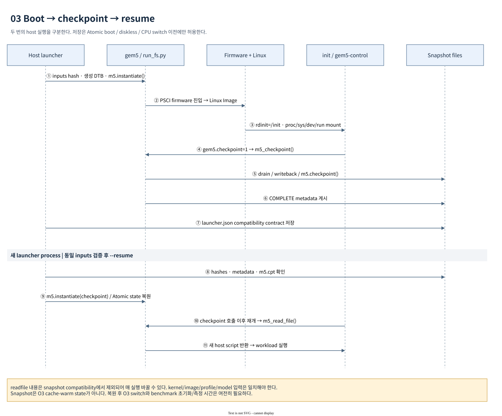

# Apollo gem5 실행과 운영 guide

모든 예시는 workspace root에서 실행한다. 기본 launcher는 dedicated
`nexios-gem5-initramfs`와 같은 Apollo kernel `Image`를 사용해 AP domain만 부팅한다.
실행 전에 [build guide](build-guide.md)로 artifact를 준비한다. Launcher 실행 중에는
AArch64 compile을 수행하지 않는다.

## 1. 최초 실행

```sh
./run_gem5_linux.sh --help
./run_gem5_linux.sh --dry-run
./run_gem5_linux.sh
```

`--dry-run`은 file resolution과 옵션 validation을 수행하고 JSON을 출력한다.
Simulator나 tmux는 시작하지 않는다. 다음 기본값을 사용한다.

| 입력 | 기본값 |
|---|---|
| build directory | `build/` |
| deploy directory | `build/tmp_baremetal/deploy/images/apollo-qvp/` |
| simulator | `build/tmp_baremetal/deploy/gem5-native/gem5.opt`; 없으면 submodule `build/ARM/gem5.opt` |
| firmware | deploy의 `gem5/zena_css4.elf` |
| kernel | deploy의 `Image` |
| initramfs | deploy의 `nexios-gem5-initramfs-apollo-qvp.cpio.gz` |
| disk | 연결하지 않음 |
| CPUs / DRAM channels | 4 / 16 |
| DRAM channel stripe | 64 bytes; 512/1024 선택 가능 |
| profile | `hsoc-stack/tools/gem5/configs/zena_cmn/profiles/a720ae_documented.yaml` |
| workload | `boot` |
| timeout | host 7,200초 |
| max ticks | `10^15`, simulated absolute tick 상한 |
| tmux session | `apollo-gem5` |

기본 bootargs는 `console=ttyAMA0,115200 earlycon=pl011,0x1a400000 rdinit=/init`이다.
`run_fs.py` 직접 실행의 default command line과 다르므로 root launcher를 기준으로
재현한다. Root launcher는 임의의 `lpj` 값을 넣지 않는다.

## 2. tmux, UART, process lifecycle


[편집 가능한 draw.io source](diagrams/01-system-context.drawio)

기본 실행은 상단 UART pane, 하단 왼쪽 platform log pane, 하단 오른쪽 작업용 shell로
분할한다. UART pane에서 guest shell에 입력할 수 있고 `uart.log`에 수신 bytes를
저장한다. Platform pane은 `gem5.log`를 `tail -n +1 -F`로 보여 준다.

실행 구조는 다음과 같다.

1. `run_gem5_linux.sh`가 Python launcher를 exec한다.
2. Launcher가 input을 확인하고 공유 `start_tmux()`에 gem5용 `console_command`를 전달한다.
3. UART pane에서 같은 launcher를 내부 옵션 `--direct`로 다시 실행한다. 이 process가
   output directory를 만들고 gem5 child의 stdout/stderr를 `gem5.log`로 연결한다.
4. Child는 `configs/zena_cmn/run_fs.py`를 실행한다. Root launcher가 선택한 TCP port의
   Terminal에 localhost connection을 만들어 UART를 수신하고 terminal stdin을 전달한다.
5. Child가 종료하거나 timeout/panic/관측 종료 조건이 성립하면 UART connection을 닫고
   살아 있는 child에 terminate를 보낸다. 5초 내 종료하지 않으면 kill 후 wait한다.
6. 정상 후처리 경로에서 `result.json`을 기록한다. tmux pane은 `remain-on-exit`로
   유지되어 로그를 확인할 수 있다.

**F12**는 해당 session을 종료한다. Session 전용 key table을 사용하므로 다른
session의 F12 binding을 바꾸지 않는다. UART launcher는 SIGHUP/SIGTERM을 받아
`run()`의 cleanup으로 child를 종료한다. F12는 정상 guest shutdown/benchmark 완료
명령이 아니므로 중단 시 `result.json` 생성이 보장되지는 않는다.

```sh
# Session만 생성하고 현재 terminal은 유지
./run_gem5_linux.sh --session apollo-gem5-shell --no-attach
tmux attach-session -t apollo-gem5-shell

# Headless: UART는 stdout과 uart.log에 기록; tmux/interactive stdin 미사용
./run_gem5_linux.sh --headless --workload smoke \
  --out-dir build/qbox-apollo-qvp/gem5/my-smoke
```

동명 tmux session이나 기존 output directory가 있으면 덮어쓰지 않고 거부한다.
새 session 이름과 새 `--out-dir`을 사용하거나 기존 session에 attach한다.
`--direct`는 tmux 내부 재실행을 위한 옵션이므로 일반 사용자 entrypoint로 쓰지 않는다.

## 3. Guest boot와 workload dispatch



[편집 가능한 draw.io source](diagrams/03-boot-checkpoint.drawio)

초기 CPU는 `ArmAtomicSimpleCPU`, memory mode는 `atomic_noncaching`이다. Firmware와
kernel이 부팅한 뒤 `/init`가 `/proc`, `/sys`, `/dev`, `/dev/pts`, `/run`을 준비하고
`NEXIOS_GEM5_INITRAMFS_READY`를 출력한다. 이후 checkpoint 요청 처리, readfile 수신,
workload 실행 또는 `nexios-gem5#` shell 진입 순서다. Mount나 readfile에 실패하면
`NEXIOS_GEM5_INITRAMFS_FAILED`와 failure shell을 제공하며 launcher는 실패를 감지한다.

| `--workload` | 실행 내용 | 성공 판정 |
|---|---|---|
| `boot` | initramfs shell | headless는 shell/login 관측 후 `BOOT_OBSERVED`; service qualification은 아님 |
| `smoke` | CPU online 수 확인 후 `APOLLO_SMOKE=PASS` 출력 | child exit 0, timeout 없음, workload exit 0 |
| `cache` | `apollo-bench --mode cache` | checksum + ROI lifecycle/tick/statistics 검사 |
| `dram` | `apollo-bench --mode dram` | checksum + ROI lifecycle/tick/statistics 검사 |
| `dram-multicore` | pinned NEON read, 기본 총 64 MiB | checksum + ROI + worker별 O3 instructions + channel별 traffic |
| `command` | shell command 또는 host script를 readfile로 전달 | child exit 0, timeout 없음, `APOLLO_WORKLOAD_EXIT=0` |

자동 workload script는 online CPU 수가 요청값과 같은지 검사한다. Disk를 연결했다면
`/dev/vda`의 첫 8 sectors를 읽는다. 종료 시 `sync` 후 `poweroff -f`를 사용하며 해당
BusyBox applet이 없으면 `/proc/sysrq-trigger`의 `o`로 power off한다. 현재 kernel은
`CONFIG_MAGIC_SYSRQ=y`다. 실패 exit code도 UART marker에 남는다.

`--workload command`만으로 일반 프로그램이 O3/ROI를 사용하지는 않는다. External
benchmark에는 `gem5-control run`을 붙인다. 이 wrapper는 CPU0 affinity를 설정하고
switch marker, ROI begin, fork/exec/wait, ROI end를 수행한다. ROI에 process 시작,
kernel, allocation, calibration도 포함된다. 같은 run에서 wrapper를 여러 번 호출하면
single-ROI state machine의 중복 switch로 거부되므로 **한 resume에 측정 명령 하나**를
실행한다. Tool별 조건은 [benchmark guide](benchmark-guide.md)를 참고한다.

```sh
./run_gem5_linux.sh --workload cache --passes 16 --headless \
  --out-dir build/qbox-apollo-qvp/gem5/my-cache
./run_gem5_linux.sh --workload dram --size-kib 16384 --passes 1 --headless \
  --out-dir build/qbox-apollo-qvp/gem5/my-dram
./run_gem5_linux.sh --workload command \
  --command 'cat /proc/cpuinfo; cat /proc/meminfo' --headless \
  --out-dir build/qbox-apollo-qvp/gem5/my-inspect
```

Script에 여러 setup 명령이 필요하면 host file을 전달한다. `--command-file`은 파일
내용을 guest shell에서 실행하며 host shell에서 실행하지 않는다. 실행할 파일은
사용자가 신뢰하는 workload여야 한다.

```sh
cat > /tmp/apollo-gem5-command.sh <<'EOF'
set -eu
cat /proc/uptime
gem5-control run stream-gem5-cache
EOF
./run_gem5_linux.sh --workload command \
  --command-file /tmp/apollo-gem5-command.sh --headless \
  --out-dir build/qbox-apollo-qvp/gem5/my-stream
```

## 4. 옵션과 지원 범위

| 옵션 | 의미 / 제약 |
|---|---|
| `--build-dir PATH` | 기본 deploy root 계산에 사용 |
| `--deploy-dir PATH` | machine deploy directory 직접 지정; native directory는 그 상위 `deploy/gem5-native`로 계산 |
| `--gem5 PATH` | 사전 build한 host simulator; 기본 native 경로와 일치하고 manifest가 있으면 native env 적용 |
| `--kernel PATH`, `--initrd PATH` | kernel과 newc CPIO 또는 gzip CPIO override |
| `--bootloader PATH` | 4/16 CPU 계약에 맞는 사전 build firmware override |
| `--benchmark PATH` | cache/dram에서 실행 image에 덧붙일 binary; checkpoint/resume과 병용 불가 |
| `--rootfs PATH` | virtio block disk 연결; base read-only, guest write는 in-memory COW |
| `--bsp` | `nexios-bsp-initramfs` CPIO와 WIC을 쓰는 호환 경로 |
| `--cpus 4\|16` | 4-core cluster 단위 firmware 계약; 8은 root launcher에서 지원하지 않음 |
| `--channels 4\|8\|16` | DRAM channel 수; 기본 16 |
| `--interleave-bytes 64\|512\|1024` | DRAM channel stripe; Home-node stripe 64 B 유지 |
| `--workers 1\|4\|8\|16` | dram-multicore worker 수; 기본 CPU 수, CPU 수 이하 |
| `--profile PATH` | model parameter YAML; compatibility contract에도 포함 |
| `--size-kib N` | 내장 workload size, 1..262144; dram-multicore는 전체 workers 합계이며 1024의 배수 |
| `--passes N` | 내장 workload pass 수, 1..1024; 기본 2; dram-multicore는 1/2/4/8 |
| `--command TEXT`, `--command-file PATH` | `--workload command`에 필수이며 둘은 상호 배타 |
| `--bootargs TEXT` | Linux command line 교체; 자동 workload/checkpoint에는 필요한 rdinit/checkpoint 인자를 launcher가 추가 |
| `--timeout SECONDS` | 양의 유한 host deadline; simulator 시작 이후 시간 |
| `--max-ticks N` | 양수, simulated absolute tick 상한; 복원 tick보다 커야 함 |
| `--out-dir PATH` | 존재하지 않는 새 결과 directory |
| `--session NAME`, `--no-attach` | tmux 이름/attach 제어 |
| `--headless` | tmux 없이 실행, boot는 prompt 관측 후 종료 |
| `--dry-run` | resolve한 input JSON 출력 후 종료; resume compatibility 전체 실행 검증을 대신하지 않음 |

`--bsp`는 BSP initramfs와 `nexios-bsp-initramfs-apollo-qvp.wic`를 자동 선택한다.
자동 workload용 `/apollo-init` 및 필요 benchmark를 별도 CPIO overlay로 덧붙인다.
Dedicated initramfs는 `/init`가 readfile을 읽으므로 script 자체를 CPIO에 넣지 않는다.
원본 `cpio.gz`와 WIC은 수정하지 않는다. `--rootfs`는 disk를 추가하는 옵션이며
dedicated `/init`에 product rootfs 전환 또는 systemd boot를 추가하지 않는다.

## 5. Checkpoint 저장과 resume

첫 boot에서 READY 직후, O3 switch 이전의 Atomic 상태를 저장한다. Snapshot path는
기존 directory여서는 안 된다. 저장한 파일을 실행마다 복사할 필요 없이 여러 새 run의
read-only 복원 입력으로 사용할 수 있다.

```sh
# 한 번만 수행: kernel/initramfs boot와 snapshot 저장
./run_gem5_linux.sh --headless \
  --checkpoint build/qbox-apollo-qvp/gem5/my-boot-snapshot \
  --out-dir build/qbox-apollo-qvp/gem5/my-checkpoint-save

# 같은 snapshot에서 UART shell로 복원
./run_gem5_linux.sh \
  --resume build/qbox-apollo-qvp/gem5/my-boot-snapshot \
  --session apollo-gem5-resume \
  --out-dir build/qbox-apollo-qvp/gem5/my-resume-shell

# 새 workload를 readfile로 전달하며 복원
./run_gem5_linux.sh --headless \
  --resume build/qbox-apollo-qvp/gem5/my-boot-snapshot \
  --workload command --command 'gem5-control run lat_mem_rd -N 1 -E 200 1 64' \
  --out-dir build/qbox-apollo-qvp/gem5/my-resume-lmbench
```

Checkpoint 저장 성공은 save run의 `result.json`에서 `CHECKPOINT_SAVED`, snapshot의
`apollo-checkpoint.json`에서 `COMPLETE`, 그리고 `m5.cpt`/`launcher.json` 존재로
확인한다. 중간 실패의 일부 파일만 남은 directory도 자동 덮어쓰기하지 않는다.

Restore는 `/init`의 `gem5-control checkpoint` 다음 instruction부터 진행한다.
`readfile`은 그 이후에 실행하므로 매번 새 host workload를 받을 수 있다. RAM에
저장된 이전 명령 실행 결과나 이후 run의 임시 파일은 다음 독립 restore에 누적되지
않는다. Kernel boot banner가 다시 나오지 않는 것은 정상이다.

Compatibility 검사는 두 단계다.

- Launcher는 gem5 binary, 원본 kernel, firmware, profile, gzip 해제 후 실행용 CPIO,
  `configs/zena_cmn/*.py`의 SHA256, CPU/channel 수와 bootargs를 비교한다.
- Model은 resolved profile, kernel/firmware/initrd hash와 command line의 boot contract를
  비교하고 COMPLETE/diskless/Atomic checkpoint policy를 확인한다.

Readfile 내용은 snapshot 계약에서 제외되므로 workload를 바꿀 수 있다. 반대로 image
package를 업데이트하거나 model parameter를 바꾸면 snapshot을 재생성해야 한다.
Current launcher의 `--dry-run`은 input file 존재 확인까지만 하므로 restore 호환성을
증명하지 않는다.

지원 범위는 **diskless Atomic boot, NPU disabled, ROI 이전**이다. `--checkpoint`와
`--resume`은 상호 배타이며 `--bsp`, `--rootfs`, `--benchmark` override와 병용할 수
없다. 저장은 `--workload boot`만 허용한다. O3 실행 중 checkpoint, WIC device 상태
복원, NPU checkpoint, 16 CPU Linux restore는 현재 검증된 경로에 포함되지 않는다.
Simulator model 생성과 RAM restore 시간이 있으므로 resume이 0초에 완료되는 것은 아니다.

## 6. UART와 결과 확인

```sh
cat build/qbox-apollo-qvp/gem5/my-smoke/result.json
cat build/qbox-apollo-qvp/gem5/my-smoke/boot-timings.json
tail -n 80 build/qbox-apollo-qvp/gem5/my-smoke/uart.log
tail -n 80 build/qbox-apollo-qvp/gem5/my-smoke/gem5.log
```

UART가 보이지 않으면 `gem5.log`의 build/input/model instantiate 오류부터 확인한다.
`m5out/system.platform.terminal`은 TCP connect 전에 출력한 bytes도 기록하므로
`uart.log`보다 먼저 나온 내용을 찾을 때 함께 읽는다. 임의의 `/dev/tty*`에 host
serial terminal을 연결할 필요는 없다. Guest PL011 출력은 gem5 Terminal의 TCP를
통해 launcher로 전달된다.

2026-10-22 v4 snapshot 저장 run에서 `first_uart`는 26.18초,
`linux_start`는 178.58초, `initramfs_ready`는 1,664.00초,
snapshot 저장 완료는 1,682.36초였다. 이 값은 해당 host 실행의 관측값이며 SLA가
아니다. `linux_start`는 UART에서 `Booting Linux on physical CPU`를 관측한 시간이다.
실제 kernel entry나 simulated guest time과 구분한다. 이전 shell resume 시험은
약22초였지만 image/model/host load에 따라 달라진다.

| 증상 | 확인 순서 |
|---|---|
| 오래도록 UART가 없음 | `gem5.log` fatal/error → process 생존/host timeout → terminal file → boot milestone |
| CPU switch가 발생하지 않음 | 일반 shell command인지 확인; 내장 workload 또는 `gem5-control run` 사용 |
| `duplicate CPU switch marker` | 한 run에서 `gem5-control run`을 반복하거나 nested marker workload를 감쌌는지 확인; 새 restore 사용 |
| `checkpoint inputs changed` | 원본 image/kernel/profile/model/native binary와 topology 비교; 새 snapshot 생성 |
| `max-ticks must exceed restored checkpoint tick` | max ticks가 resume 기준 상대 시간이 아닌 absolute 상한임을 확인 |
| `APOLLO_WORKLOAD_EXIT`가 0이 아님 | UART의 최초 guest 오류와 명령 exit code 확인 |
| `result.json`이 없고 pane이 종료됨 | F12/signal 중단, launcher 초기 오류, model fatal 여부 확인; 성공으로 분류하지 않음 |
| WIC을 지정했으나 product login 없음 | dedicated `/init`에는 switch_root가 없음; block attach와 product boot는 별도 계약 |

Command의 `PASS`는 명령 exit 검증이다. Benchmark 수치의 타당성은 별도로
`summarize_tools.py`와 ROI/statistics evidence를 확인한다. Default AP model은
`UNCALIBRATED_PROXY`이며 실제 A720AE/DSU/CMN-S3AE/LPDDR5X 실리콘 성능을
보증하지 않는다.
