# Project Apollo Build Architecture

**Phase 1 기술 세미나 · 2026-10-16 · Apollo QVP / Nexios 구성**

Apollo의 빌드 아키텍처는 **Arm RD-Aspen의 다중 도메인 펌웨어 통합을 유지하면서, HSOC 로컬 소스·Nexios 이미지 정책·QBox 실행 환경을 하나의 BitBake 의존성 그래프로 결합**한다. 산출물은 펌웨어 저장 매체, OS 부팅 디스크, 호스트 가상 플랫폼으로 나뉘며 `.qboxconf`가 이들의 실행 조합을 지정한다.

읽는 순서는 **실행할 SW → 이를 선택하는 metadata → source/toolchain → 이미지 조립 → 호스트 실행**이다. [컴포넌트별 SW·Source Architecture](components/README.md), [컴포넌트·산출물 연결표](ENGINEERING-MAP.md), [설계 근거](SOURCES.md)를 함께 제공한다.

**[draw.io 전체 편집본 — 27페이지](apollo-build-architecture.drawio)** · 흰 배경과 흰 도형을 사용하는 white 테마다. 본문의 SVG도 편집 정보를 포함한다. 앞 12페이지는 전체 빌드 구조, C01–C15는 컴포넌트별 SW·소스 구조다.

| 빌드 축 | 만들어지는 것 | 실행 위치 |
|---|---|---|
| Firmware | RSE/CL0/CL1/AP firmware와 ROM/OTP/Flash | 서로 다른 Arm CPU·보안 도메인 |
| OS image | kernel·modules·initramfs·UKI·WIC | AP Linux / 제품 사용자 공간 |
| Native platform | QBox·libqemu·모델 모듈·Lua | 개발 호스트 |

세 축은 같은 BitBake 그래프에서 만난다. **동일 툴체인·동일 rootfs·동일 CPU에서 실행되는 하나의 프로그램은 아니다.**

## 1. Software Architecture — 실행 도메인과 인터페이스

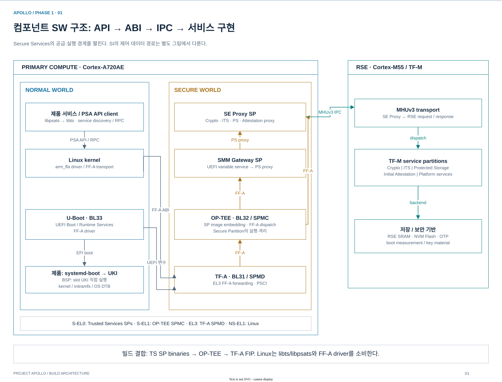

*AP Normal/Secure 경계와 RSE 서비스 경계를 구분했다. API 호출, FF-A ABI, MHUv3 IPC가 각각 어느 계층을 연결하는지 표시한다. RAS SP 등 보조 SP는 빌드 연결표에 별도 수록했다.*

| 실행 영역 | 컴포넌트와 책임 | 다른 도메인과의 계약 |
|---|---|---|
| AP Normal world | Linux PREEMPT_RT, Nexios 서비스, `libpsats`/`libts`; 부팅 시 U-Boot BL33 | FF-A 보안 호출, PSCI 전원 관리, SCMI 성능 제어, HIPC |
| AP Secure world | TF-A BL31: EL3/SPMD; OP-TEE BL32: S-EL1 SPMC; Trusted Services SP | SE Proxy가 RSE 서비스에 중계. SMM Gateway가 UEFI 변수 서비스를 제공 |
| RSE / Cortex-M55 | TF-M 부트 체인·runtime, Root of Trust, Crypto/ITS/PS/Attestation | MHUv3 기반 AP 보안 IPC, SCMI를 통한 CL0 협력, 이미지 인증·로딩 |
| SI CL0 / Cortex-R82AE | SCP-firmware, CMN 초기화, PPU·전력·클록, PFDI monitor | SCMI platform-side, AP/CL1 기동 및 시스템 관리 |
| SI CL1 / Cortex-R82AE | Zephyr SMP, OpenAMP, HIPC, PFDI agent | AP와 공유 메모리·vring 및 MHUv3 doorbell로 통신 |

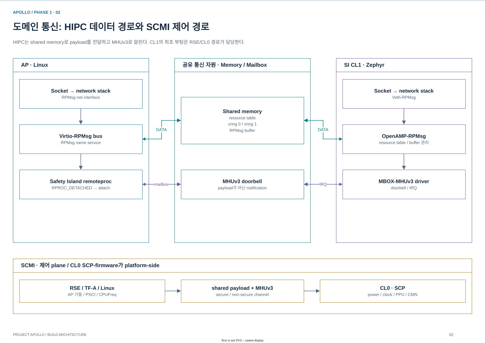

*HIPC의 공유 메모리 데이터 경로와 SCMI의 전력·성능 제어 경로. remoteproc 아래의 mailbox는 CL1 부팅 이미지 전송기가 아니라 이미 실행 중인 원격 도메인과 연결하는 수단이다.*

세 가지 연결은 서로 다른 계층의 계약이다.

- **보안 서비스:** `application → libpsats/libts → Linux FF-A → TF-A → OP-TEE → SE Proxy → MHUv3 → TF-M`. UEFI 변수는 `U-Boot → SMM Gateway → SE Proxy → RSE Protected Storage`로 전달된다.
- **시스템 관리:** PSCI 경로는 TF-A를 거쳐 CL0의 SCMI 서비스로 연결된다. Linux CPUFreq의 SCMI 경로와 RSE의 AP 기동 요청도 CL0가 처리한다.
- **HIPC:** 데이터는 shared-memory의 resource table·vring·RPMsg buffer를 사용하고, MHUv3는 알림을 전달한다. Linux remoteproc은 **독립 부팅된 CL1에 attach**하며 CL1의 최초 부팅 주체가 아니다.

현재 QVP의 기본 CPU idle은 WFI이고 PSCI idle은 별도 opt-in이다. 인터페이스가 구현되어 있다는 사실과 모든 경로가 기본 활성이라는 주장은 구분한다. [근거 S1–S3](SOURCES.md#s1-소프트웨어-도메인과-통신)

각 컴포넌트는 **Component SW Architecture / Source Architecture / Build Architecture / Deploy artifacts**의 네 절로 설명한다. 그림 왼쪽은 subsystem·호출/데이터 경로, 오른쪽은 source 영역·Apollo 확장점이며, 본문은 recipe·task 의존성과 산출물의 배치 위치·소비자까지 연결한다.

| 상세 문서 | 구성요소 | 주요 연결 |
|---|---|---|
| [Primary Compute](components/primary-compute.md) | Linux, U-Boot, TF-A, OP-TEE | PSCI/SCMI/FF-A, 슬롯 선택, BL2/BL31, SP embedding·dispatch |
| [System Management](components/system-management.md) | TF-M, SCP, Zephyr, HSOC module, vMCU | SPM/PSA, module framework, HIPC/PFDI, board hook, TC397 companion |
| [Virtual Platform](components/virtual-platform.md) | QEMU/libqemu, QBox, Apollo overlay | QOM/TCG/MemoryRegion, TLM/DMI, CCI, SoC/VP/board |
| [Build Integration](components/build-integration.md) | HSOC BSP·제품 레이어, 보존 Buildroot | source registry, component adapter, UKI/WIC, qboxconf |

## 2. Boot Architecture — 참조 부트 계약과 QVP 구현

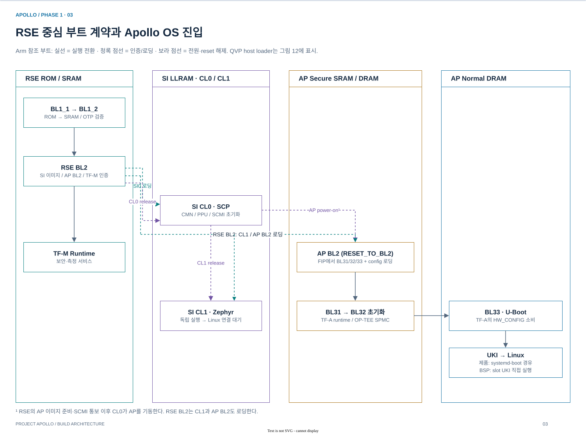

*Arm 참조의 주요 부트 계약. 이미지 인증·적재, 실행 전환, CPU 전원/reset 해제를 구분한다. 아래의 QVP host loader 동작까지 합쳐 현재 실행 구조를 해석해야 한다.*

| 단계 | 생산·소비 관계 | 빌드 시 보존해야 할 연결 |
|---|---|---|
| RSE 초기 부팅 | ROM BL1_1 → SRAM BL1_2 → RSE BL2 | ROM/OTP/Flash의 이미지·인증 정보 일치 |
| 타 도메인 준비 | RSE BL2가 SI CL0·CL1, AP BL2, TF-M runtime을 인증·적재 | TF-M, SCP, Zephyr, TF-A 산출물을 펌웨어 조립 recipe에 집계 |
| 도메인 기동 | RSE가 CL0를 시작하고, CL0가 CL1 및 준비된 AP를 기동 | 메모리 로딩과 PPU/reset-release 순서 유지 |
| AP 부팅 | AP BL2가 FIP를 읽어 BL31/BL32/BL33와 설정 DTB를 로딩 | U-Boot·OP-TEE → TF-A FIP 생성 의존성 |
| OS 진입 | 제품: U-Boot → systemd-boot → UKI; BSP: U-Boot → slot UKI → Linux | UKI의 kernel/initramfs/cmdline/OS DTB와 WIC root 슬롯 일치 |

**현재 QVP에는 별도의 host loader가 참여한다.** RSE의 ROM/OTP/provisioning 초기화, SI0/CL1의 PPU `power_on_load → loader.reset → SRAM 적재`, AP BL2의 ELF 기반 `.data` 복원 및 stack/BSS/xlat 초기화가 VP에 구현되어 있다. 참조 설계의 인증·로딩 화살표만으로 QVP 내부 동작 전체를 설명할 수 없다. [실제 입력 → loader → 메모리 대응](ENGINEERING-MAP.md#입력-파일과-실제-소비자)

**DTB는 두 역할로 나뉜다.** TF-A의 `HW_CONFIG`는 초기 펌웨어와 U-Boot가 소비한다. Apollo의 Linux용 `apollo-qvp-saturn-v.dtb`는 UKI에도 포함한다. 초기 펌웨어 FDT와 OS DTB를 같은 파일·같은 메모리 맵으로 가정하지 않는다. [근거 S4](SOURCES.md#s4-부트와-펌웨어-조립)

## 3. Yocto Architecture — 참조 metadata 재사용과 Apollo 정책

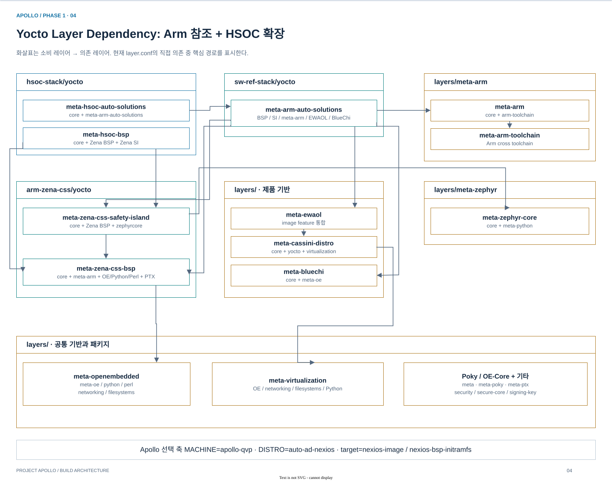

*현재 `layer.conf`에서 확인한 저장소별 주요 의존성. SI→Zena BSP→meta-arm, Automotive→EWAOL→Cassini, HSOC→참조 레이어의 관계를 표시한다. 공통 core와 일부 세부 의존은 노드 안에 표기했다.*

| 제어 축 | Apollo의 구현 | 의미 |
|---|---|---|
| 레이어 집합 | `build/conf/bblayers.conf` | Arm BSP/SI, Automotive 참조, 외부 기능 레이어, HSOC 두 레이어를 함께 파싱 |
| Machine | `apollo-qvp.conf`가 `fvp-rd-aspen.conf`를 `require`; `fvp-rd-aspen` override 유지 | 참조 머신의 공통 동작을 재사용하면서 `KMACHINE`, firmware, WKS 등을 QVP로 확장 |
| Distro | `auto-ad-nexios.conf`가 `cassini.conf`를 `require` | `virtual/kernel = linux-yocto-rt`, 제품 기능·저장 정책 선택 |
| Image | `nexios-image`는 `ewaol-image` 상속 | 패키지 집합에 UKI A/B·verity·WIC·QBox 실행 정보를 결합 |
| 조건부 확장 | HSOC product의 `BBFILES_DYNAMIC` | EWAOL·Python·integrity·virtualization 등 해당 collection이 있을 때 확장 활성화 |

`meta-hsoc-bsp`는 `core`, `meta-zena-css-bsp`, `meta-zena-css-safety-island`에 의존한다. `meta-hsoc-auto-solutions`는 `core`, `meta-arm-auto-solutions`에 의존하며 명시 우선순위는 12다. **레이어 우선순위는 recipe 선택의 한 요소이며, MACHINE override·class 상속·provider 선택을 대체하지 않는다.**

설정 결합은 U-Boot에서 드러난다. QVP defconfig의 직접 UKI 부팅 경로에 Nexios 제품 fragment가 합쳐져 `systemd-boot.scr` 우선 경로가 된다. 스크립트를 읽지 못하면 직접 UKI/fallback 경로가 남는다. **소스 코드만 읽거나 defconfig만 읽어서는 최종 부팅 정책을 알 수 없다.** [실제 설정 결합](ENGINEERING-MAP.md#4-u-boot-구성의-결합-사례)

현재 설정 파일은 `apollo-qvp / auto-ad-nexios / cfg2`, AP CPU 기본 수 4, `TMPDIR=${TOPDIR}/tmp_baremetal`이다. 템플릿은 HSOC의 `conf/templates/apollo-qvp`다. Arm 참조의 kas 진입 대신 root wrapper가 이 템플릿과 Poky 환경을 사용한다. [근거 S5](SOURCES.md#s5-yocto-레이어와-설정)

## 4. Source Architecture — 코드 소유권과 빌드 규칙

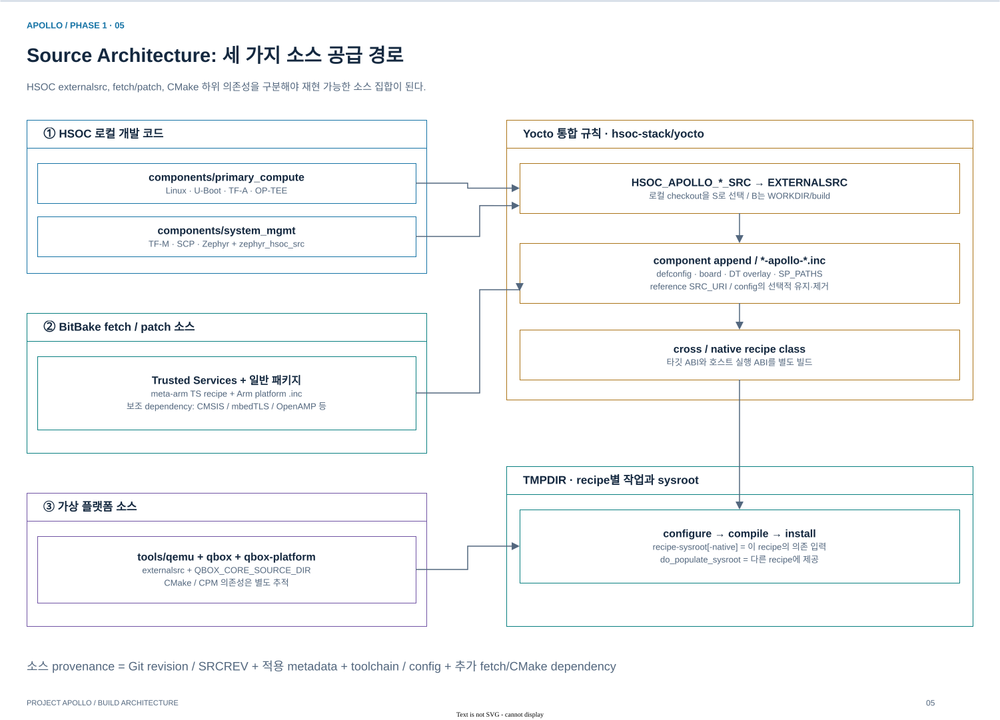

*로컬 checkout, BitBake fetch/patch, native CMake 의존성을 구분한다. Trusted Services와 Zephyr의 Arm sample/module은 모든 코드를 HSOC externalsrc로 묶을 수 없는 사례다.*

| 소스 구역 | 주요 코드 | Yocto 접점 |
|---|---|---|
| 외부 OSS | recipe가 지정한 upstream revision과 보조 라이브러리 | `SRC_URI`/`SRCREV`, fetch/unpack/patch |
| `hsoc-stack/components/primary_compute/` | Linux, U-Boot, TF-A, OP-TEE | `HSOC_APOLLO_*_SRC` → component별 `*-apollo-common.inc` |
| `hsoc-stack/components/system_mgmt/` | TF-M, SCP, Zephyr kernel 및 HSOC board/module; sample app은 Arm 참조 소스 | `externalsrc`, board/overlay/module 설정 |
| `hsoc-stack/tools/` | `qbox` core, `qbox-platform` overlay, `qemu`/libqemu | `qbox-apollo-qvp-native`, `qbox-libqemu-native` |
| `*/yocto/`, `layers/` | recipe, append, class, machine, distro | 코드 선택·툴체인·구성·패키징·배포의 정책 |

로컬 코드 선택은 `meta-hsoc-bsp/conf/layer.conf`에서 중앙 정의한다. **Trusted Services는 upstream fetch/patch 경로**이며 TF-M이 export한 FWU interface header도 소비한다. Zephyr는 로컬 kernel·HSOC board/module·Arm sample/module·추가 CMSIS/libmetal/OpenAMP를 조합한다.

| 도메인 | 툴체인 계열 | 빌드 입력 경계 |
|---|---|---|
| AP | AArch64 target cross | Linux/bootloader/secure firmware별 config·ABI |
| RSE | `gcc-arm-none-eabi-native` | Cortex-M55 TF-M platform |
| SI CL0 | `gcc-aarch64-none-elf-native` | SCP product/firmware target |
| SI CL1 | `zephyr-sdk-native` | board·Kconfig·devicetree·module |
| Host | native compiler | QBox executable 및 libqemu/model `.so` |

`externalsrc`는 기본 fetch/unpack/patch를 대체하며 현재 class는 `SSTATE_SKIP_CREATION=1`을 설정한다. 보조 `git-dependency`는 남긴다. 따라서 참조 patch 자동 재적용이나 모든 로컬 component의 sstate 복원을 전제하지 않는다. [소스·recipe·산출물 10개 연결표](ENGINEERING-MAP.md#1-component--recipe--artifact--consumer)

커널도 단순 경로 치환이 아니다. Apollo common include는 참조 kernel metadata 일부를 제거하고 로컬 defconfig와 선택 fragment를 `do_kernel_configme`에서 적용한다. 따라서 재현 단위는 **소스 revision + metadata revision + machine/distro 설정 + defconfig/fragment**다. [근거 S6](SOURCES.md#s6-로컬-소스-통합)

## 5. Build Artifacts — 세 종류의 산출물

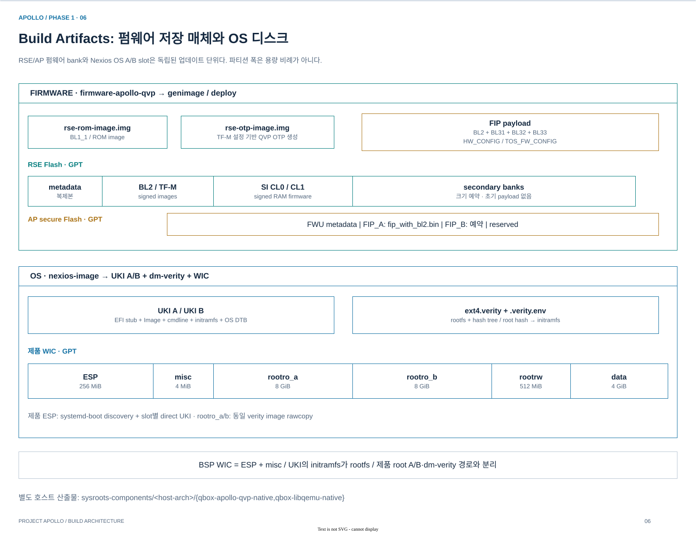

*저장 매체별 레이아웃. RSE primary/AP FIP_A는 초기 이미지로 채우고 secondary/FIP_B는 예약한다. OS root A/B는 동일 verity 이미지로 양쪽을 채운다. 폭은 용량 비례가 아니다.*

### 5.1 펌웨어: 여러 컴포넌트의 결과를 저장 매체로 조립

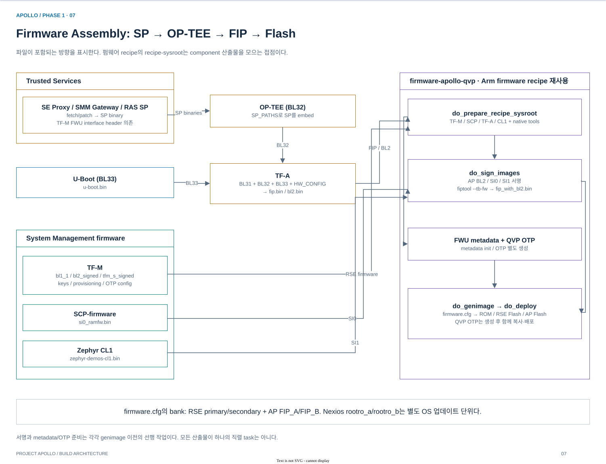

`firmware-apollo-common.inc`는 Arm의 `firmware-fvp-rd-aspen.bb`를 직접 재사용한다. TS의 UUID별 SP ELF/manifest가 OP-TEE에 embed되고, OP-TEE(BL32)와 U-Boot(BL33)가 TF-A FIP에 들어간다. 펌웨어 recipe는 TF-M·SCP·Zephyr 산출물도 sysroot에 집계한다. `do_sign_images`는 AP BL2와 SI 이미지를 서명하고 `fiptool update`로 `fip_with_bl2.bin`을 구성한다. FWU metadata와 payload를 사용해 `genimage`가 flash/ROM 이미지를 조립하고, 별도 생성한 QVP OTP를 함께 배포한다.

| 산출물 | 구조 / 소비자 |
|---|---|
| `rse-rom-image.img`, `rse-otp-image.img` | raw ROM/OTP; RSE 초기 부트 입력. QVP OTP는 TF-M 설정 기반으로 생성 |
| `rse-flash-image.img` | GPT; RSE BL2·TF-M·SI0·SI1 이미지와 primary/secondary bank |
| `ap-flash-image.img` | GPT; FWU metadata 및 FIP bank |
| `si0_ramfw.bin`, `zephyr-demos-cl1.bin` | 개별 펌웨어 산출물; 이미지 조립과 runner의 이미지 매핑에 사용 |

ROM은 BL1_1과 DMA ICS의 raw 배치이고, QVP OTP는 TF-M `CMakeCache.txt`/`otp_config.pickle`에서 별도 생성한 64 KiB 이미지다. [파일 offset·초기 bank 채움 정책](ENGINEERING-MAP.md#3-firmware-저장-매체의-초기-내용)

### 5.2 OS: UKI와 rootfs를 슬롯 계약으로 연결

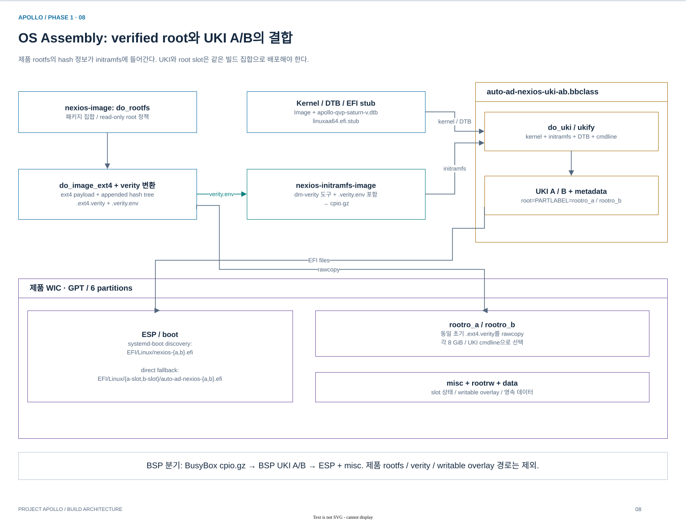

제품은 `rootro_a/b`에 같은 초기 `.ext4.verity`를 **rawcopy**한다. 파일시스템을 다시 생성하면 뒤에 붙은 verity hash payload와 일치하지 않기 때문이다. 생성된 `.verity.env`는 별도 `nexios-initramfs-image`에 들어가며, 이 initramfs가 verified root를 연다. UKI A/B의 cmdline은 각각 `root=PARTLABEL=rootro_a/b`를 선택한다.

| 구분 | `nexios-image` | `nexios-bsp-initramfs` |
|---|---|---|
| 목적 | 제품 사용자 공간 | BSP·드라이버 점검 환경 |
| 루트 | verity 보호 root A/B + `rootrw` + `data` | UKI에 포함된 BusyBox initramfs |
| 디스크 | ESP 256 MiB / misc 4 MiB / root A·B 각 8 GiB / rootrw 512 MiB / data 4 GiB | ESP + misc |
| 추가 결과 | `.ext4.verity`, `.verity.env`, 제품 UKI A/B | `.cpio.gz`, BSP UKI A/B |

RSE 인증 체인, AP 펌웨어 검증, UEFI 서명, dm-verity는 각각 다른 보호 구간이다. Apollo UKI class는 first-boot 기본 정책으로 **unsigned UKI**를 선택하며, 명시적으로 `UEFI_SECURE_BOOT=1`을 설정하면 키·인증서를 요구한다. A/B 레이아웃이 존재한다는 사실만으로 업데이트 복구나 end-to-end 보안 검증 완료를 뜻하지 않는다.

제품 `nexios-image`의 ESP에는 systemd-boot discovery용 `EFI/Linux/nexios-{a,b}.efi`와 직접 부팅 fallback용 `EFI/Linux/{a-slot,b-slot}/auto-ad-nexios-{a,b}.efi`가 함께 들어간다. BSP는 slot UKI를 직접 부팅한다. kernel/DTB 파일이 deploy에 있어도 이 full-system 경로는 **WIC의 UKI를 통해 OS를 실행**한다.

### 5.3 Host native: deploy 이미지와 별도로 존재하는 실행 환경

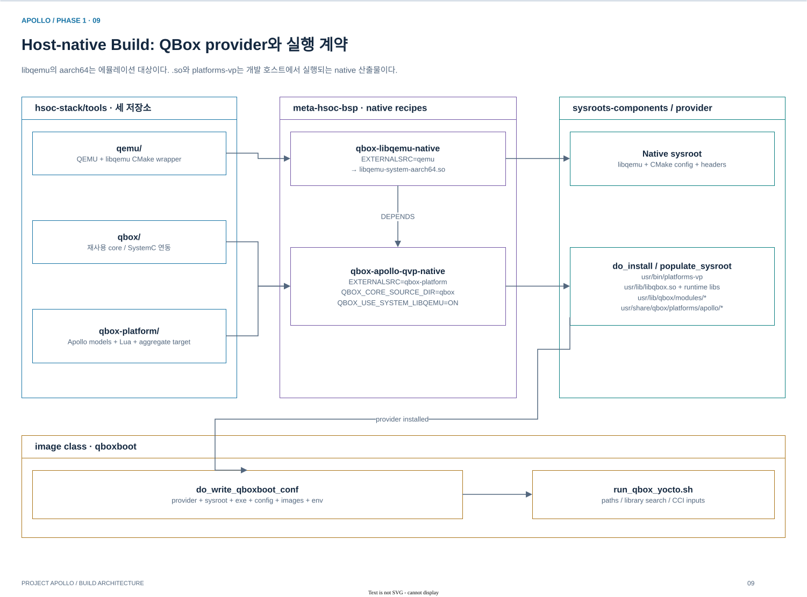

| 위치 (`build/tmp_baremetal/` 기준) | 내용 |
|---|---|
| `deploy/images/apollo-qvp/` | 펌웨어, Image/DTB, WIC/UKI, `.qboxconf`, manifest |
| `sysroots-components/<host-arch>/qbox-apollo-qvp-native/` | `platforms-vp`, QBox 라이브러리·모듈, 설치된 Lua |
| `sysroots-components/<host-arch>/qbox-libqemu-native/` | libqemu |
| `work/…/recipe-sysroot[-native]`, `work/…/temp/` | 태스크 의존 환경, 빌드 중간 결과와 로그 |

`.qboxconf`는 `provider`, `sysroot`, `exe`, `config`, `images`, `env`를 기록한다. provider는 절대 경로, image는 deploy 기준 경로다. 일부 ELF/provisioning 입력은 launcher가 deploy·WORKDIR에서 보완하므로, **실행 입력 집합은 deploy + native provider/sysroot + 필요한 보조 파일**이다. [근거 S4·S7·S8](SOURCES.md#s7-uki-rootfs와-디스크-조립)

## 6. `yocto_build.sh` — 태스크 그래프의 구성

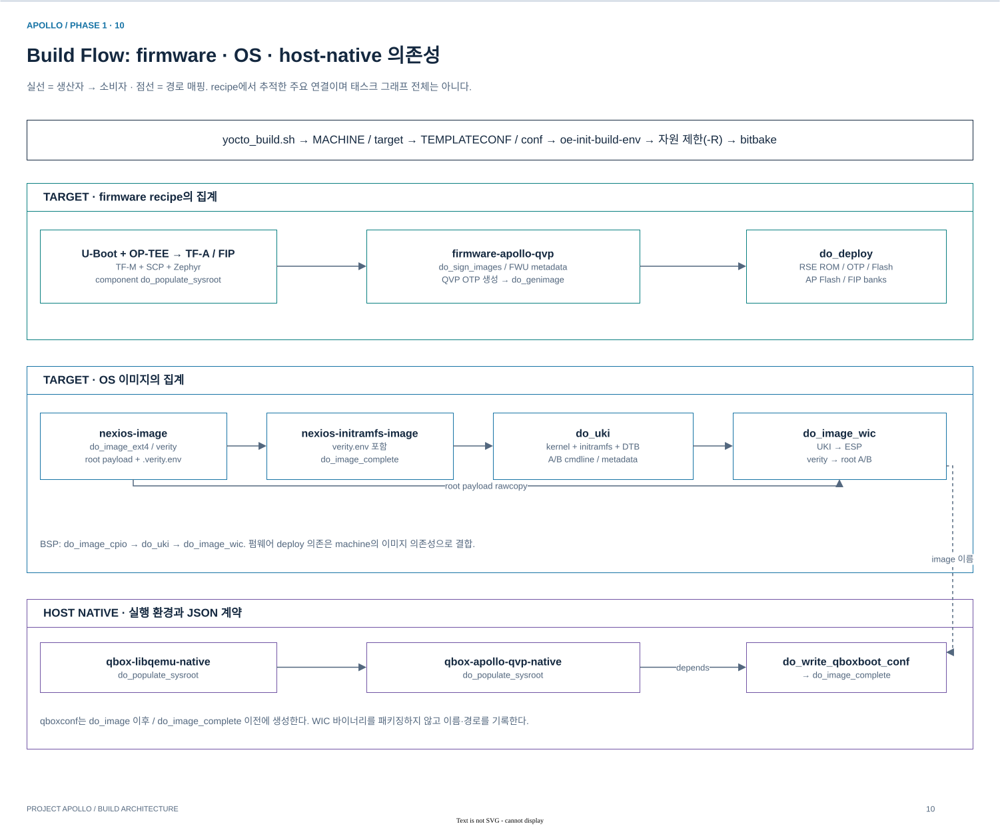

*wrapper 이후의 세 경로: target firmware, OS 이미지, host native provider. recipe에서 추적한 주요 의존성으로, 실제 실행에서 sstate·서명·소스 변경에 따른 task 선택은 별도다.*

| 경계 | 실제 동작 |
|---|---|
| 명령 → 설정 | 기본 machine `apollo-qvp`, 기본 target `nexios-image`; `--bsp`는 `nexios-bsp-initramfs` |
| 설정 → BitBake | `TEMPLATECONF` 선택 → conf 준비 → `oe-init-build-env` → 자원 제한 conf를 `-R`로 전달 |
| 펌웨어 집계 | component sysroot → 서명/FWU metadata/OTP → genimage → deploy |
| 제품 OS 조립 | rootfs/verity → verity 정보 포함 initramfs → A/B UKI; UKI와 rootfs가 WIC에 집계 |
| BSP OS 조립 | `do_image_cpio → do_uki → do_image_wic` |
| 실행 환경 연결 | QBox provider의 `do_populate_sysroot` → `do_write_qboxboot_conf`; image의 `do_image` 이후, `do_image_complete` 이전 |

```bash
./yocto_build.sh                       # 제품 이미지와 의존 산출물
./yocto_build.sh --bsp                 # BSP 이미지와 의존 산출물
./yocto_build.sh --keep-conf           # 로컬 설정 유지
./yocto_build.sh -c compile u-boot     # 명시적 컴포넌트 태스크
```

QBox provider에는 기본 `do_compile → do_check → do_install` 검증 단계가 있다. `QBOX_APOLLO_RUN_UNIT_TESTS=1`이며 명시 제외된 느린·불안정 테스트는 통과한 테스트로 집계하지 않는다. `qbox` core 소스도 별도 checksum으로 configure/compile 변경 추적에 포함한다.

기본 호출은 `build/conf`를 재생성한다. 명시적 target/`-c`는 설정을 유지하며, `--dry-run`도 설정 초기화·파일 쓰기를 수행한다. 같은 build 디렉터리를 사용하는 BitBake 작업은 직렬화해야 한다. QVP image의 `do_build`에는 `ukiboot` 및 외부 vMCU용 Zephyr/QEMU/SIL Kit의 deploy 의존성도 연결된다. [근거 S9](SOURCES.md#s9-빌드-진입점과-task-연결)

## 7. `run_qbox_yocto.sh` — 실행 계약과 프로세스 경계

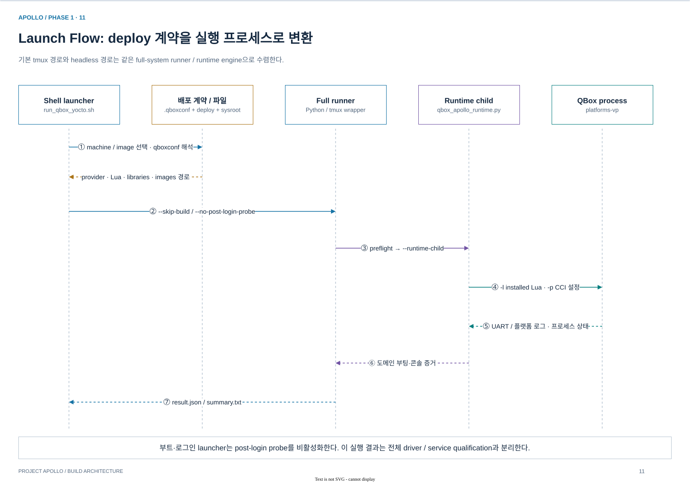

*배포 계약의 해석과 실행 감독의 분리. 기본 tmux와 headless는 같은 full runner에 수렴한다.*

```text
run_qbox_yocto.sh
  ├─ 기본: run_qbox_apollo_fvp_full_tmux.sh ─┐
  └─ --headless ───────────────────────────┤
                      run_qbox_apollo_fvp_full.py
                        → full.py --runtime-child
                          → qbox_apollo_runtime.main()
                          → platforms-vp -l <installed Lua> -p <CCI parameters>
```

`.qboxconf`에서 provider·공유 라이브러리·Lua·이미지를 해석한 뒤, launcher가 디스크 및 RSE 상태를 준비한다. 기본 Lua는 `platforms/apollo/apollo-qvp-saturn-v.lua`이며 **Yocto provider에 설치된 사본**을 사용한다. 소스 checkout만 수정한 상태와 실행 중인 사본의 변경은 동일하지 않다.

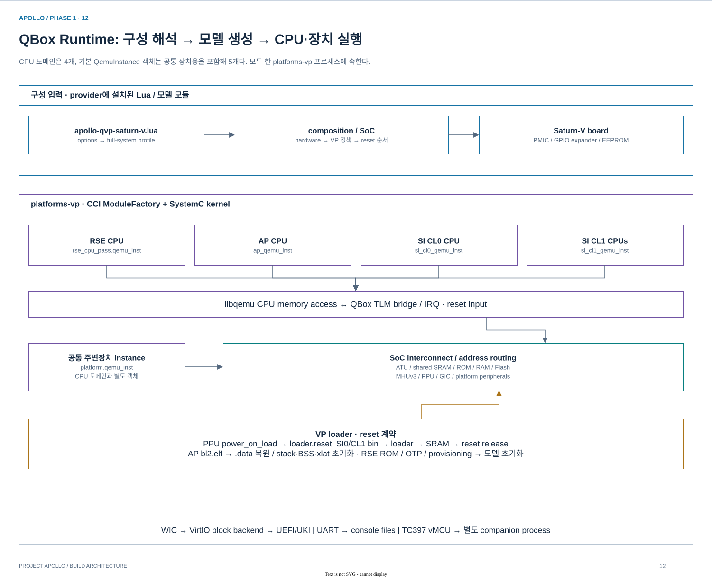

*CPU용 4개 QemuInstance에 공통 주변장치 instance를 더한 현재 구성. `rse_cpu_pass`는 Container이며 별도 프로세스가 아니다. VP의 loader도 SystemC 모델 구성에 참여한다.*

- **VP:** 실행 이미지·정책·콘솔·디버그를 적용한다. **SoC:** RSE/AP/SI와 fabric, 하드웨어 맵을 구성한다. **Board:** Saturn-V 외부 연결을 구성한다.
- **QEMU/libqemu:** AP/RSE/CL0/CL1 CPU instance 및 공통 장치 instance를 제공한다. **CCI ModuleFactory:** `moduletype`으로 모델을 생성한다. **SystemC/TLM:** memory transaction·IRQ·reset·PPU load 순서를 연결한다.
- 외부 vMCU는 별도 companion 프로세스다. BSP의 기본 tmux 경로는 TC397 companion을 시작하며 `--no-vmcu`로 제외할 수 있다.

```bash
./run_qbox_yocto.sh                    # 제품 / tmux
./run_qbox_yocto.sh --bsp              # BSP / tmux
./run_qbox_yocto.sh --bsp --headless   # BSP / headless
```

| 입력·상태 | 실행 시 처리 |
|---|---|
| WIC | 기본은 원본 사용; `--copy-disks`에서 사본 생성. BSP + UART vMCU는 별도 `*-vmcu.wic`에 `apollo.vmcu=1`을 주입 |
| AP Flash / OTP | runtime writable 사본 |
| RSE Flash | lock/fingerprint를 갖는 영속 상태; 호환 갱신 시 PS/ITS 보존 |
| SI bin/ELF | PPU-triggered SRAM 적재; CL1 ELF entry로 RVBAR 결정 |
| AP `bl2.elf` | reset loader가 data/BSS/stack/xlat 초기화 |
| `.qboxconf` kernel/DTB | kernel은 metadata; DTB는 존재 확인·identity 전달. 실제 OS payload는 UKI에서 소비 |

기본은 TCG 기반 실행이며 SRAM DMI·RSE hotpath 등의 가속을 사용한다. PASS 이후에도 keep-running 정책에 따라 child가 QBox와 로그 reader를 유지한다. [경로 계약·loader·상태 정책](ENGINEERING-MAP.md#5-qboxconf--launcher--실행-입력)

실행 증거는 기본적으로 `build/qbox-apollo-qvp/yocto-apollo-qvp-<timestamp>/`에 저장한다. `qbox-platform.log`, RSE/AP/SI별 콘솔, `result.json`, `summary.txt`, `si-cl1-boot.json`으로 최초 실패 도메인과 부팅 결과를 추적한다.

Launcher는 `--skip-build` 및 `--no-post-login-probe`를 전달한다. 이 경로의 부트·로그인 성공과 canonical Python runner의 post-login qualification은 별도 결과다. [근거 S10](SOURCES.md#s10-launcher와-qbox-구성)

## 8. 변경이 전파되는 경계

| 변경 | 소비자까지 갱신할 경로 |
|---|---|
| Linux / OS DTB | Image·DTB → UKI; modules → 제품 rootfs 또는 BSP initramfs; 최종 WIC |
| SP / OP-TEE / U-Boot | SP embedding → TF-A FIP → AP Flash |
| TF-M / SCP / CL1 | firmware 서명·조립 → Flash + runner가 쓰는 bin/ELF |
| QEMU / QBox / Lua | native build → provider install/sysroot → 실제 실행 `.so`/Lua |

이 경계가 Phase 1 빌드 통합의 핵심이다. 원본 코드 변경, 이미지 생성, 실제 실행 파일 선택은 각각 확인해야 한다. [전체 변경 영향표](ENGINEERING-MAP.md#6-변경의-전파-범위)

새 BitBake 파싱·이미지 빌드·부팅은 수행하지 않았다. 개별 기능의 PASS, 업데이트 복구, 보안 qualification, 물리적 타이밍 및 FVP/실리콘 동등성은 해당 시험 결과를 별도 인용해야 한다.
