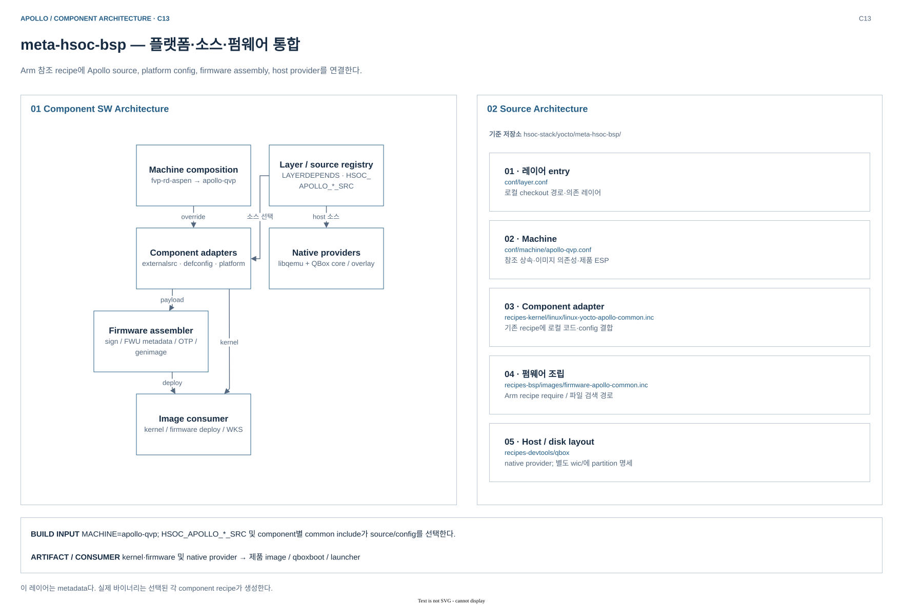
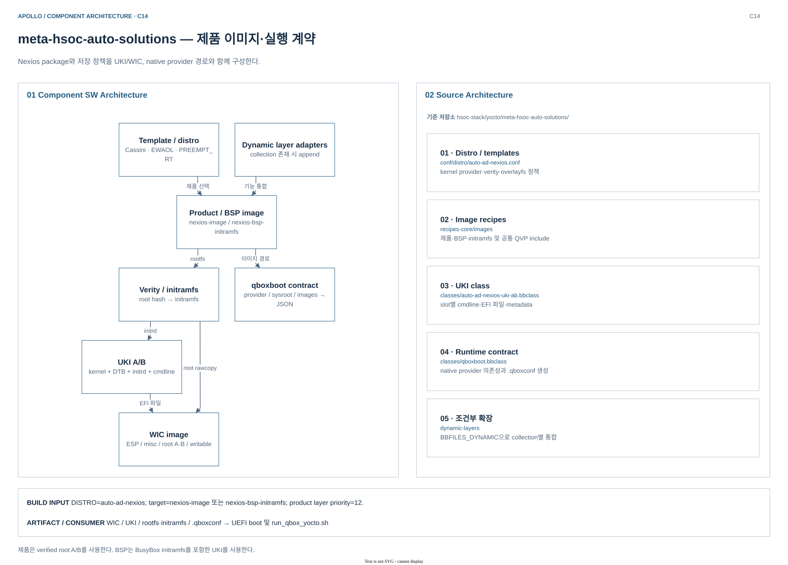
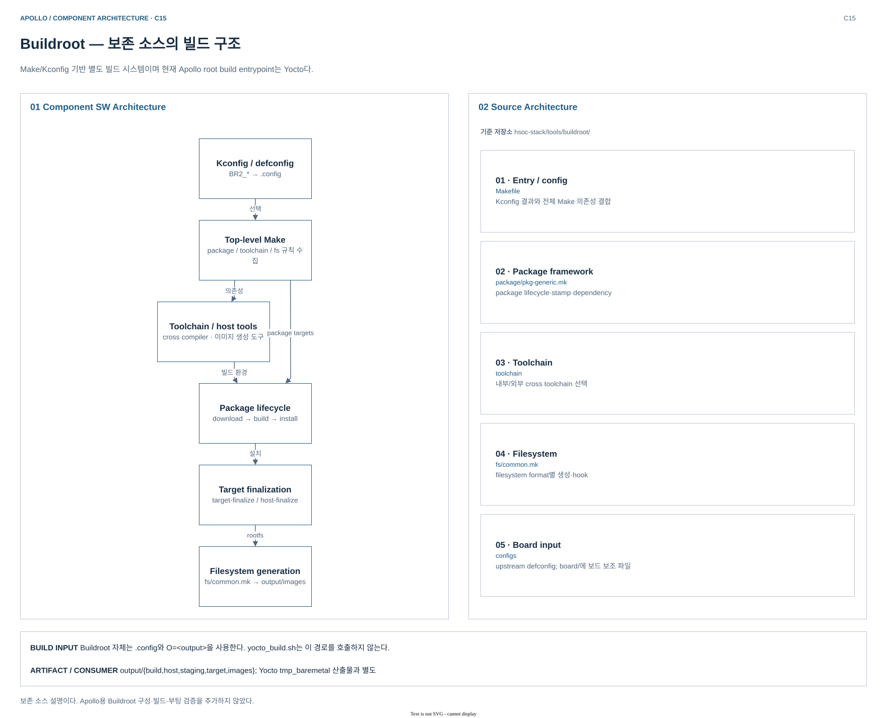

# Build Integration Component Architecture

[Build Architecture로 돌아가기](../README.md) · [컴포넌트 색인·경로 표기](README.md)

Yocto 레이어는 실행 바이너리가 아니라 컴포넌트 선택·구성·조립을 정의하는 빌드 소프트웨어다. 두 HSOC 레이어와 보존 소스인 Buildroot의 책임을 구분한다.

## meta-hsoc-bsp — 플랫폼과 로컬 소스 통합

Arm 참조 machine/recipe를 재사용하면서 Apollo 소스, 플랫폼 설정, 펌웨어 조립 및 native 가상 플랫폼을 선택한다.

### Component SW Architecture

| SW 구성 요소 | 책임 | 입력 → 소비자 |
|---|---|---|
| Layer 등록·source registry | 참조 레이어 의존성, 로컬 checkout 위치 정의 | `HSOC_APOLLO_*_SRC` → component include |
| Machine 구성 | RD-Aspen 공통 설정 + QVP override | `MACHINE` → kernel·firmware·WKS 선택 |
| Component adapter | externalsrc·defconfig·platform·dependency 결합 | Linux/U-Boot/TF-A/TF-M/SCP/Zephyr/OP-TEE recipe |
| Firmware assembler | 참조 서명·genimage 및 QVP OTP 생성 연결 | component 출력 → ROM/OTP/Flash |
| Native provider | libqemu, QBox core/overlay의 호스트 빌드 | `.so`·`platforms-vp`·설치 Lua → launcher |
| WIC layout | partition label·크기·rawcopy 정책 | 제품 image class → WIC |

### Source Architecture

| Source area | 대표 파일 / 디렉터리 | 역할 |
|---|---|---|
| 공통 등록 | [conf/layer.conf](../../../../hsoc-stack/yocto/meta-hsoc-bsp/conf/layer.conf) | `LAYERDEPENDS`, `HSOC_APOLLO_*_SRC` |
| Machine | [conf/machine/apollo-qvp.conf](../../../../hsoc-stack/yocto/meta-hsoc-bsp/conf/machine/apollo-qvp.conf) | 참조 상속, firmware deploy 및 제품 ESP 파일 |
| Component 통합 | [Linux common](../../../../hsoc-stack/yocto/meta-hsoc-bsp/recipes-kernel/linux/linux-yocto-apollo-common.inc), [firmware common](../../../../hsoc-stack/yocto/meta-hsoc-bsp/recipes-bsp/images/firmware-apollo-common.inc) | 소스·설정 선택과 조립 의존성 |
| Host 도구 | [recipes-devtools/qbox](../../../../hsoc-stack/yocto/meta-hsoc-bsp/recipes-devtools/qbox) | native compile/install/sysroot |
| 디스크 구조 | [wic](../../../../hsoc-stack/yocto/meta-hsoc-bsp/wic) | 제품/BSP 파티션 명세 |

### Build Architecture

| 빌드 단계 | 구성·의존성 | 결과 |
|---|---|---|
| Metadata 선택 | `layer.conf` → `apollo-qvp.conf` → 참조 `fvp-rd-aspen.conf`; `fvp-rd-aspen` override 유지, `KMACHINE=apollo-qvp` | 공통 Arm recipe에 Apollo 설정 적용 |
| Component 빌드 | `HSOC_APOLLO_*_SRC` → common include의 `EXTERNALSRC`; `${B}`와 toolchain은 각 recipe가 선택 | AP/RSE/SI firmware와 kernel을 각각 빌드 |
| Firmware 조립 준비 | `firmware-apollo-qvp`의 sysroot에 TF-M·TF-A·SCP·CL1 출력 집계 | `do_sign_images`, `do_init_psa_fwu_metadata`, `do_generate_rse_otp_image`의 입력 |
| 매체 조립 | 위 준비 task가 모두 `do_genimage`에 선행; `firmware.cfg`의 offset·bank layout 적용 | ROM/OTP/Flash 이미지 → `do_deploy` |
| Host provider | `qbox-libqemu-native` → `qbox-apollo-qvp-native`의 compile/install/populate_sysroot | 제품 `.qboxconf`가 참조할 실행 파일·모델·Lua |

근거: [Apollo firmware recipe](../../../../hsoc-stack/yocto/meta-hsoc-bsp/recipes-bsp/images/firmware-apollo-qvp.bb), [참조 조립·서명 task](../../../../arm-zena-css/yocto/meta-zena-css-bsp/recipes-bsp/images/firmware-fvp-rd-aspen.bb), [QBox provider](../../../../hsoc-stack/yocto/meta-hsoc-bsp/recipes-devtools/qbox/qbox-apollo-qvp-native.bb). 레이어 전체에 하나의 컴파일러나 `${B}`가 있는 구조가 아니다.

### Deploy artifacts

레이어 자체의 실행 바이너리는 없다. 아래 파일은 이 레이어가 선택·확장한 recipe의 출력이다.

| 생산 recipe / 산출물 | 배치 위치 | 소비자 |
|---|---|---|
| `firmware-apollo-qvp`: `rse-rom-image.img`, `rse-otp-image.img` | `${DEPLOY_DIR_IMAGE}/` | QVP RSE ROM·OTP 초기화 |
| 같은 recipe: `rse-flash-image.img`, `ap-flash-image.img` | `${DEPLOY_DIR_IMAGE}/` | RSE firmware bank 및 AP FIP backing image |
| Kernel: `Image`, `apollo-qvp-saturn-v.dtb`; component별 `.bin/.elf` | deploy 또는 firmware sysroot; 각 component 절 참조 | UKI, firmware assembler, QVP loader |
| Native provider: `platforms-vp`, `libqbox.so`, model `.so`, Lua | `${COMPONENTS_DIR}/${BUILD_ARCH}/qbox-apollo-qvp-native/usr/` | `.qboxconf`를 읽은 launcher |

`wic/*.wks.in`은 이미지 조립 입력이다. 최종 WIC의 생산자는 아래 제품 image recipe다.

## meta-hsoc-auto-solutions — Nexios 제품과 실행 계약

플랫폼 위에 이미지 패키지·저장 정책·UKI 부팅·검증 프로파일을 결합한다.

### Component SW Architecture

| SW 구성 요소 | 책임 | 입력 → 소비자 |
|---|---|---|
| Template / distro | BBLAYERS, kernel provider, 제품 기능 선택 | Cassini + EWAOL 호환 설정 → recipe 파싱 |
| Product / BSP image | 패키지 집합과 initramfs 구성 | `nexios-image` 또는 `nexios-bsp-initramfs` |
| Verity / storage | 읽기 전용 root와 writable 영역 결합 | `.ext4.verity`·환경 정보 → initramfs·WIC |
| UKI A/B class | kernel·initramfs·DTB·slot cmdline 조립 | UKI A/B → ESP |
| qboxboot class | provider·sysroot·images의 JSON 계약 | `.qboxconf` → `run_qbox_yocto.sh` |
| Dynamic layers / tests | 존재하는 collection에 대한 append와 OEQA 구성 | feature·recipe 확장 및 검증 입력 |

### Source Architecture

| Source area | 대표 파일 / 디렉터리 | 역할 |
|---|---|---|
| 제품 선택 | [conf/distro/auto-ad-nexios.conf](../../../../hsoc-stack/yocto/meta-hsoc-auto-solutions/conf/distro/auto-ad-nexios.conf) | PREEMPT_RT·verity·overlayfs·시험 suite |
| 이미지 | [recipes-core/images](../../../../hsoc-stack/yocto/meta-hsoc-auto-solutions/recipes-core/images) | 제품/BSP/initramfs recipe·append |
| 이미지 변환 | [auto-ad-nexios-uki-ab.bbclass](../../../../hsoc-stack/yocto/meta-hsoc-auto-solutions/classes/auto-ad-nexios-uki-ab.bbclass) | UKI·cmdline·metadata·ESP 파일 |
| 실행 계약 | [qboxboot.bbclass](../../../../hsoc-stack/yocto/meta-hsoc-auto-solutions/classes/qboxboot.bbclass) | image와 native provider의 경로 기록 |
| 조건부 통합 | [conf/layer.conf](../../../../hsoc-stack/yocto/meta-hsoc-auto-solutions/conf/layer.conf), [dynamic-layers](../../../../hsoc-stack/yocto/meta-hsoc-auto-solutions/dynamic-layers) | `BBFILES_DYNAMIC`, priority 12 |

### Build Architecture

| 빌드 단계 | 입력·task 관계 | 조립 책임 |
|---|---|---|
| 제품 선택 | `auto-ad-nexios` + `nexios-image`; `--bsp`는 `nexios-bsp-initramfs` | 제품 패키지 집합 또는 BSP BusyBox 환경 선택 |
| 제품 rootfs | `do_rootfs` → ext4/verity 변환; verity 정보 → `nexios-initramfs-image` | root hash를 포함한 initramfs 생성 |
| UKI A/B | kernel·OS DTB·EFI stub·initramfs → `do_uki`; BSP는 자신의 `do_image_cpio` 뒤에 실행 | slot별 cmdline의 `*.efi`와 metadata 생성 |
| WIC | `do_uki` → `do_image_wic` → `do_image_complete` | ESP·misc 및 제품 root A/B·writable 파티션 조립 |
| 실행 계약 | `do_write_qboxboot_conf`는 image task 뒤, image complete 앞; `qbox-apollo-qvp-native:do_populate_sysroot` 의존 | deploy 파일과 native provider 경로를 JSON으로 연결 |

근거: [제품 recipe](../../../../hsoc-stack/yocto/meta-hsoc-auto-solutions/recipes-core/images/nexios-image.bb), [제품 append](../../../../hsoc-stack/yocto/meta-hsoc-auto-solutions/recipes-core/images/nexios-image.bbappend), [제품 initramfs](../../../../hsoc-stack/yocto/meta-hsoc-auto-solutions/recipes-core/images/nexios-initramfs-image.bb), [BSP recipe](../../../../hsoc-stack/yocto/meta-hsoc-auto-solutions/recipes-core/images/nexios-bsp-initramfs.bb). BSP는 verity rootfs를 만들지 않으며, UKI 안의 initramfs로 실행한다.

### Deploy artifacts

아래 이름은 `${DEPLOY_DIR_IMAGE}`의 고정 이름 또는 날짜를 제외한 링크 이름이다.

| 산출물 | 제품 / BSP | 후속 소비자 |
|---|---|---|
| `nexios-image-apollo-qvp.wic` / `nexios-bsp-initramfs-apollo-qvp.wic` | 각각 제품 / BSP | QBox VirtIO block → UEFI → UKI |
| `nexios-image-apollo-qvp.ext4.verity`와 `.ext4.verity.env` | 제품 | WIC의 root A/B와 initramfs의 dm-verity 설정 |
| `nexios-initramfs-image-apollo-qvp.cpio.gz` / `nexios-bsp-initramfs-apollo-qvp.cpio.gz` | 각각 제품 / BSP | 해당 UKI의 initrd payload |
| `auto-ad-nexios-{a,b}.efi` / `nexios-bsp-initramfs-{a,b}.efi` 및 각 `.metadata` | 각각 제품 / BSP | WIC ESP의 slot 디렉터리; 제품은 systemd-boot용 alias도 추가 |
| `nexios-{image,bsp-initramfs}-apollo-qvp.qboxconf`, 같은 prefix의 `.manifest` | 제품 / BSP | launcher 경로 해석, 포함 패키지 추적 |

`.qboxconf`는 native provider를 내장하지 않는다. WIC·firmware와 함께 [native provider/sysroot](virtual-platform.md)의 설치 결과가 있어야 실행할 수 있다.

## Buildroot — 보존 중인 별도 빌드 시스템

`hsoc-stack/tools/buildroot`에는 Make/Kconfig 기반 빌드 소스가 보존되어 있다. 현재 root 진입점 `yocto_build.sh`는 Poky 환경과 BitBake를 호출한다.

### Component SW Architecture

| SW 구성 요소 | 책임 | 연결 |
|---|---|---|
| Kconfig / defconfig | toolchain·package·filesystem 선택 | `.config` → Make 변수 |
| Package infrastructure | 다운로드·빌드·설치 의존성 | `generic-package` 등 → package target |
| Toolchain / host tools | cross 환경·이미지 생성 도구 준비 | host·staging → target package |
| Target finalization | target 디렉터리와 package 설치 결과 정리 | `target-finalize` → rootfs 생성 |
| Filesystem generator | 형식별 filesystem image 생성 | `fs/common.mk` → `output/images/` |

### Source Architecture

| Source area | 대표 파일 / 디렉터리 | 역할 |
|---|---|---|
| 빌드 entry | [Makefile](../../../../hsoc-stack/tools/buildroot/Makefile), [Config.in](../../../../hsoc-stack/tools/buildroot/Config.in) | 설정 해석·전체 dependency 구성 |
| 패키지 규칙 | [package/pkg-generic.mk](../../../../hsoc-stack/tools/buildroot/package/pkg-generic.mk) | package lifecycle·stamp·dependency |
| 툴체인 | [toolchain](../../../../hsoc-stack/tools/buildroot/toolchain) | 내부/외부 cross toolchain 통합 |
| 이미지 조립 | [fs/common.mk](../../../../hsoc-stack/tools/buildroot/fs/common.mk) | rootfs 공통 생성·hook |
| 보드 설정 | [configs](../../../../hsoc-stack/tools/buildroot/configs), [board](../../../../hsoc-stack/tools/buildroot/board) | upstream board별 입력 |

### Build Architecture

| 단계 | 소스에 정의된 흐름 | 생성·소비 관계 |
|---|---|---|
| 설정 | board defconfig → `.config`; `O=<output>`이면 별도 출력 루트 | Kconfig의 `BR2_*`가 package·toolchain·filesystem 선택 |
| Package 빌드 | 최상위 Make → package infrastructure; download/extract/patch/configure/build/install | host 도구, cross sysroot, target tree를 구분 |
| Target 정리 | `target-finalize`가 package 설치와 `host-finalize`에 의존 | filesystem 생성에 쓸 디렉터리 준비 |
| 이미지 생성 | 선택된 `rootfs-*` target → `target-post-image`; `all → world`가 이를 요청 | filesystem image 생성 후 board별 post-image 처리 |

이는 보존된 Buildroot의 일반 빌드 구조다. 현재 Apollo에 사용할 defconfig나 이미지 형식을 새로 선택한 것은 아니다.

### Deploy artifacts

`O`를 지정하지 않은 기본 `output/` 기준이다. Yocto의 `do_deploy`나 `.qboxconf` 생성 단계는 없다.

| 출력 위치 | 내용 | 소비자·상태 |
|---|---|---|
| `output/images/rootfs.<type>` | 선택한 filesystem 이미지; 압축 확장자는 설정에 따름 | board별 boot/flash 도구; 현재 Apollo용 결과는 미검증 |
| `output/images/`의 kernel·bootloader | 해당 package를 선택한 경우에만 생성 | board가 정의한 부팅 매체 |
| `output/host/`, `output/staging` | host 도구와 target development sysroot | package 빌드 입력; 장치에 배포할 rootfs가 아님 |
| `output/target/`, `output/build/` | 설치 tree 및 package 작업 파일 | 이미지 생성·디버그용 중간 결과 |

현재 Apollo의 지원 빌드 흐름에 Buildroot를 연결하거나 별도 Apollo Buildroot 구성을 검증한 것은 아니다.
