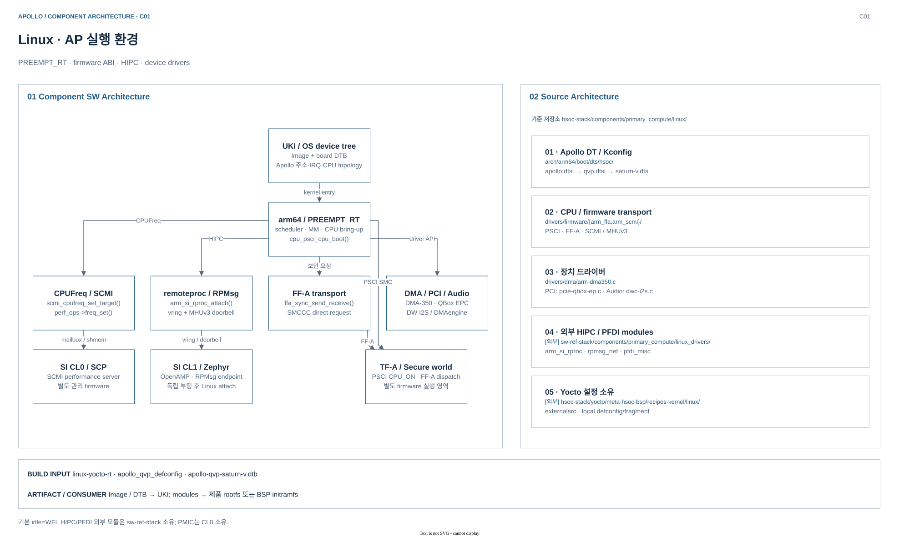
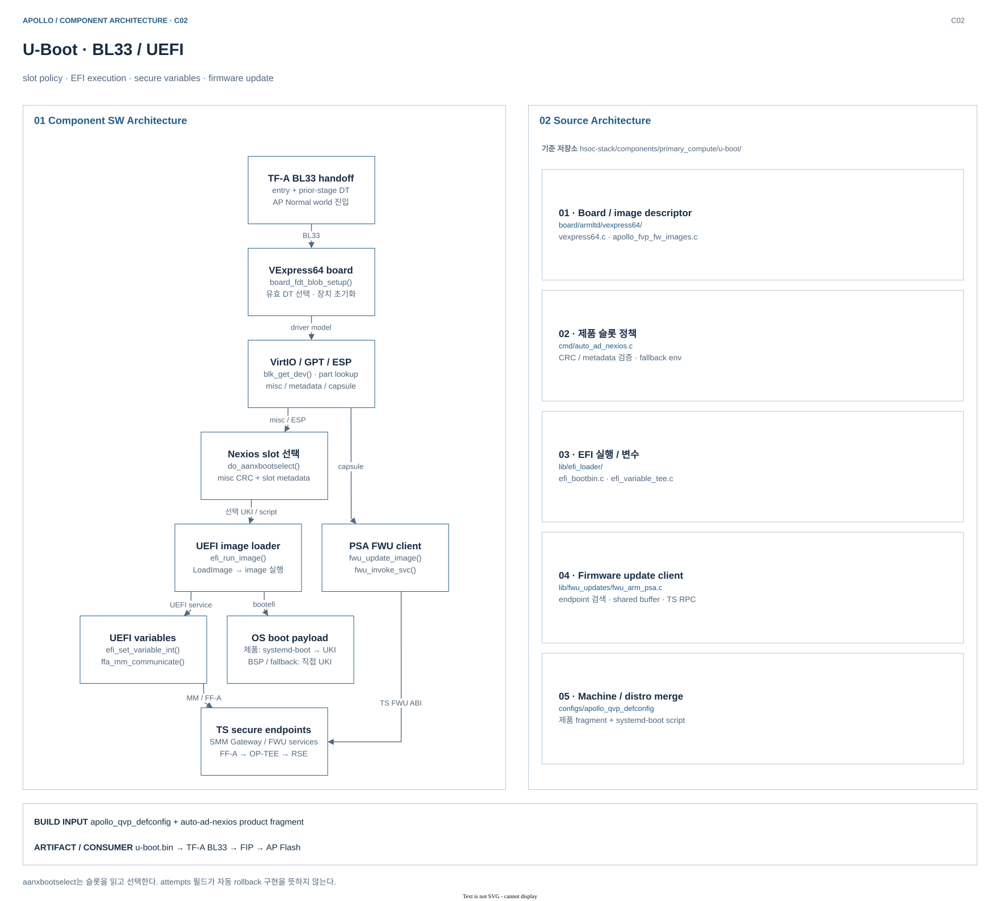
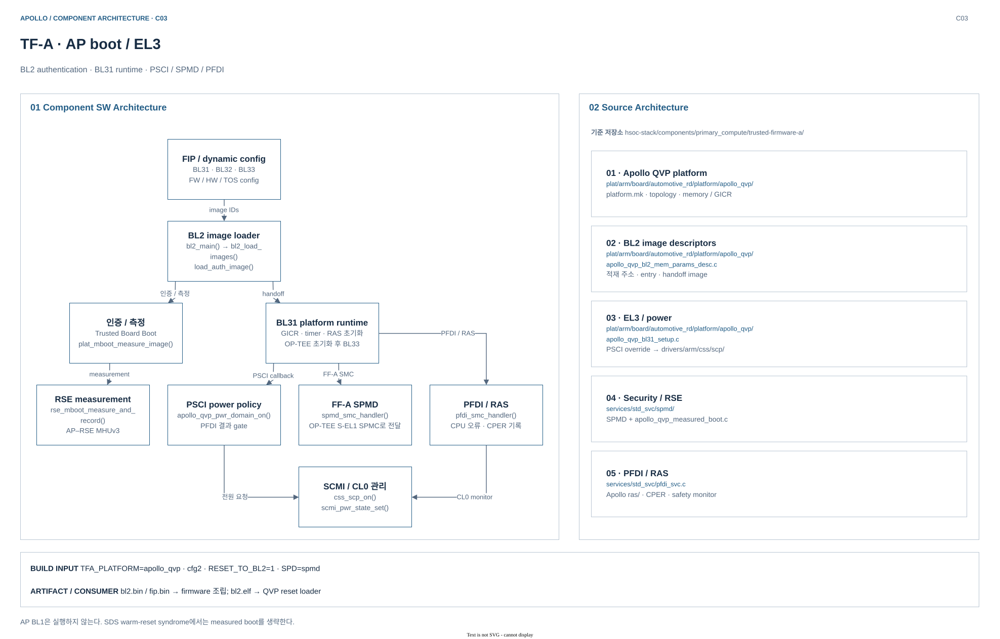
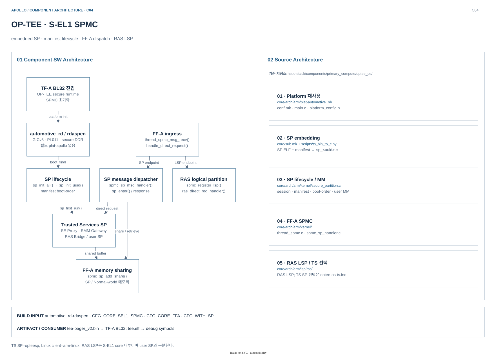

# Primary Compute — 컴포넌트 내부 구조

[Build Architecture](../README.md) · [컴포넌트 색인·경로 표기](README.md) · [구현 연결표](../ENGINEERING-MAP.md)

AP의 Linux·U-Boot·TF-A·OP-TEE를 실제 함수와 소스 경계로 연결한다. 아래 경로 표는 각 컴포넌트 소스 루트를 기준으로 하며, 외부 모듈·Yocto 설정은 별도 표시한다. 구조와 설정의 정적 분석이며 실행 검증 결과를 뜻하지 않는다.

## 1. Linux — AP 실행 환경과 도메인 간 드라이버

Linux는 PREEMPT_RT 커널에서 제품 사용자 공간을 실행하고, PSCI·SCMI·FF-A·HIPC를 각 담당 펌웨어에 연결한다.

### Component SW Architecture

| SW subsystem | 책임 | 실제 연결 |
|---|---|---|
| arm64 / PREEMPT_RT | AP CPU 기동·스케줄링·메모리 관리 | `cpu_psci_cpu_boot()` → `psci_ops.cpu_on()` → TF-A |
| CPUFreq / SCMI | 성능 요청을 CL0 정책에 전달 | `scmi_cpufreq_set_target()` → `perf_ops->freq_set()` → mailbox |
| FF-A transport | 보안 endpoint 검색·직접 메시지·공유 메모리 | `ffa_sync_send_receive()` → `ffa_msg_send_direct_req()` → SMCCC |
| HIPC | 실행 중인 CL1에 attach하고 RPMsg 네트워크 제공 | `arm_si_rproc_attach()`; `arm_si_rproc_kick()` → MHUv3; payload는 vring |
| DMA / I/O | DMA-350, PCI endpoint, DW I2S 등 장치 노출 | DMAengine·PCI EPC·ASoC 공통 API → QVP 장치 모델 |
| PFDI client | CPU별 시험 요청을 EL3 서비스에 전달 | 외부 `pfdi_misc`의 `arm_pfdi_ioctl()` → CPU worker → SMC |

**도메인 연결:** CPUFreq는 SCMI mailbox로 CL0에 요청하고, CPU on/off는 PSCI를 통해 TF-A에 요청한다. 두 경로를 하나의 전원 드라이버로 합치지 않는다.
HIPC에서는 `RPROC_DETACHED` 상태의 CL1에 연결한다. Linux가 CL1 부트 이미지를 처음 적재하는 구조가 아니다.

### Source Architecture

| Source area | 대표 파일 | Apollo에서의 역할 |
|---|---|---|
| DT / 구성 | [apollo-qvp-saturn-v.dts](../../../../hsoc-stack/components/primary_compute/linux/arch/arm64/boot/dts/hsoc/apollo-qvp-saturn-v.dts), [apollo_qvp_defconfig](../../../../hsoc-stack/components/primary_compute/linux/arch/arm64/configs/apollo_qvp_defconfig) | `apollo.dtsi → apollo-qvp.dtsi → board .dts`; 주소·IRQ·mailbox·활성 장치와 RT 구성 |
| CPU / 성능 | [arch/arm64/kernel/psci.c](../../../../hsoc-stack/components/primary_compute/linux/arch/arm64/kernel/psci.c), [drivers/cpufreq/scmi-cpufreq.c](../../../../hsoc-stack/components/primary_compute/linux/drivers/cpufreq/scmi-cpufreq.c) | 표준 PSCI/SCMI core에 플랫폼 DT를 결합 |
| 펌웨어 transport | [arm_ffa/driver.c](../../../../hsoc-stack/components/primary_compute/linux/drivers/firmware/arm_ffa/driver.c), [arm_scmi/transports/mailbox.c](../../../../hsoc-stack/components/primary_compute/linux/drivers/firmware/arm_scmi/transports/mailbox.c), [arm_mhuv3.c](../../../../hsoc-stack/components/primary_compute/linux/drivers/mailbox/arm_mhuv3.c) | FF-A ABI와 SCMI mailbox/doorbell 구현 |
| QVP 장치 접점 | [arm-dma350.c](../../../../hsoc-stack/components/primary_compute/linux/drivers/dma/arm-dma350.c), [pcie-qbox-ep.c](../../../../hsoc-stack/components/primary_compute/linux/drivers/pci/controller/pcie-qbox-ep.c) | DMAengine 및 QBox EPC의 MMIO·IRQ 경계 |
| 외부 Linux modules | [arm_si_rproc.c](../../../../sw-ref-stack/components/primary_compute/linux_drivers/arm_si_rproc_mod/src/arm_si_rproc.c), [rpmsg_net.c](../../../../sw-ref-stack/components/primary_compute/linux_drivers/rpmsg_net_mod/src/rpmsg_net.c), [pfdi_misc.c](../../../../sw-ref-stack/components/primary_compute/linux_drivers/pfdi_misc_mod/src/pfdi_misc.c) | **`sw-ref-stack` 소유**; HSOC kernel 내부 소스가 아니며 별도 module recipe가 빌드 |

### Build Architecture

| 항목 | 현재 빌드 계약 |
|---|---|
| Recipe / include | `virtual/kernel=linux-yocto-rt`; [linux-yocto-rt_6.18.bb](../../../../arm-zena-css/yocto/meta-zena-css-bsp/recipes-kernel/linux/linux-yocto-rt_6.18.bb) → [linux-yocto.inc](../../../../layers/poky/meta/recipes-kernel/linux/linux-yocto.inc), HSOC bbappend → [QVP include](../../../../hsoc-stack/yocto/meta-hsoc-bsp/recipes-kernel/linux/linux-yocto-apollo-qvp.inc) → common |
| Source / build | [common include](../../../../hsoc-stack/yocto/meta-hsoc-bsp/recipes-kernel/linux/linux-yocto-apollo-common.inc)의 `externalsrc`: `${S}=hsoc-stack/components/primary_compute/linux`, `${B}=${WORKDIR}/build` |
| 구성 task | `do_kernel_configme()`가 `apollo_qvp_defconfig` 및 선택 fragment를 적용; `KCONFIG_MODE=alldefconfig`. OS DTB는 `hsoc/apollo-qvp-saturn-v.dtb` |
| Toolchain / 선행 입력 | AArch64 kernel ABI; [kernel-arch](../../../../layers/poky/meta/classes-recipe/kernel-arch.bbclass)의 `KERNEL_CC/KERNEL_LD`, `CROSS_COMPILE=${TARGET_PREFIX}`. cross compiler/binutils·`bc/bison-native`; BTF 구성 전 `pahole-native:do_populate_sysroot` |
| Task / 후속 빌드 | [kernel class](../../../../layers/poky/meta/classes-recipe/kernel.bbclass): `do_compile → do_shared_workdir → do_compile_kernelmodules`; `do_install` 뒤 package/sysroot를 만들고 `do_deploy`. 외부 HIPC/PFDI 모듈은 이 kernel staging을 쓰는 별도 recipe |

### Deploy artifacts

| 파일 / 출력 | 배치 위치 | 후속 소비자 |
|---|---|---|
| `Image`, `Image-apollo-qvp.bin` | `${DEPLOY_DIR_IMAGE}`; 버전 포함 kernel image의 alias | 제품/BSP UKI의 Linux payload |
| `apollo-qvp-saturn-v.dtb` | `${DEPLOY_DIR_IMAGE}`; [kernel-devicetree](../../../../layers/poky/meta/classes-recipe/kernel-devicetree.bbclass)가 vendor 경로를 제거해 배포 | UKI에 포함할 OS device tree |
| `modules-apollo-qvp.tgz` | `${DEPLOY_DIR_IMAGE}`; kernel recipe가 설치한 모듈 archive | 모듈 배포용 묶음. 별도 recipe의 HIPC/PFDI 모듈 전체를 포함하는 archive는 아님 |
| `kernel-module-*` 패키지의 `*.ko` | target의 `${nonarch_base_libdir}/modules/${KERNEL_VERSION}/` | image package 선택에 따라 제품 rootfs/BSP initramfs에 설치 |
| `Module.symvers`, `kernel-abiversion`, `.config` | `${STAGING_KERNEL_BUILDDIR}`; **deploy가 아닌 빌드 인계** | 외부 모듈의 ABI·symbol version·Kbuild 입력 |

**경계:** 기본 idle은 WFI이며 PSCI idle은 opt-in이다. Saturn-V DTS에서 TPS6594/PMIC 제어는 SI CL0 소유로 남겨 둔다.

## 2. U-Boot — 슬롯 선택과 UEFI 실행·서비스

U-Boot는 TF-A의 BL33으로 실행되어 OS 슬롯을 선택하고, UEFI 실행 환경과 보안 변수·firmware update client를 제공한다.

### Component SW Architecture

| SW subsystem | 책임 | 실제 연결 |
|---|---|---|
| Board / 초기 DT | 이전 단계의 DT를 검증하고 장치 모델 초기화 | `board_fdt_blob_setup()` → TF-A 제공 DT 또는 유효한 내장 DT |
| Block / filesystem | VirtIO disk의 GPT·ESP·misc 접근 | `blk_get_dev()` / `part_get_info_by_name()` / `fs_load_alloc()` |
| Nexios slot selector | misc header/CRC와 슬롯 metadata 검증 | `do_aanxbootselect()` → `aanx_uki`·fallback 환경변수 |
| UEFI image loader | systemd-boot 또는 UKI의 PE/COFF 실행 | `bootefi` → `efi_run_image()` → `efi_load_image()` / `do_bootefi_exec()` |
| UEFI variables | SMM 변수 요청을 보안 partition으로 중계 | `efi_set_variable_int()` → `mm_communicate()` → `ffa_mm_communicate()` |
| PSA FWU client | capsule 이미지 전송·staging·accept 요청 | `fwu_update_image()` → `fwu_invoke_svc()` → `ffa_sync_send_receive()` |

**OS 경로:** `virtio scan → aanxbootselect → 제품 boot script → systemd-boot → UKI`; script 로드 실패 시 직접 UKI/fallback 경로를 사용한다. BSP ESP는 직접 slot UKI 경로다.
`aanxbootselect`는 misc의 `active_slot`과 metadata를 읽고 선택한다. 구조체에 `attempts` 필드가 있다는 사실만으로 boot-attempt 갱신이나 자동 rollback 구현을 주장하지 않는다.

### Source Architecture

| Source area | 대표 파일 | Apollo에서의 역할 |
|---|---|---|
| Board | [vexpress64.c](../../../../hsoc-stack/components/primary_compute/u-boot/board/armltd/vexpress64/vexpress64.c), [apollo_fvp_fw_images.c](../../../../hsoc-stack/components/primary_compute/u-boot/board/armltd/vexpress64/apollo_fvp_fw_images.c) | VExpress64 초기화 재사용; QVP도 `CONFIG_APOLLO_FVP_FW_IMAGES`로 firmware image descriptor 선택 |
| OS 슬롯 정책 | [cmd/auto_ad_nexios.c](../../../../hsoc-stack/components/primary_compute/u-boot/cmd/auto_ad_nexios.c) | misc CRC·`slot=A/B` metadata 검증, 유효 fallback 선택 |
| UEFI 실행 / 변수 | [efi_bootbin.c](../../../../hsoc-stack/components/primary_compute/u-boot/lib/efi_loader/efi_bootbin.c), [efi_variable_tee.c](../../../../hsoc-stack/components/primary_compute/u-boot/lib/efi_loader/efi_variable_tee.c) | EFI image 실행 및 MM shared buffer/FF-A 전달 |
| Firmware update | [lib/fwu_updates/fwu_arm_psa.c](../../../../hsoc-stack/components/primary_compute/u-boot/lib/fwu_updates/fwu_arm_psa.c) | TS FWU endpoint 검색·공유 버퍼·요청/응답 검증 |
| Machine + 제품 설정 | [apollo_qvp_defconfig](../../../../hsoc-stack/components/primary_compute/u-boot/configs/apollo_qvp_defconfig), [제품 fragment](../../../../hsoc-stack/yocto/meta-hsoc-bsp/recipes-bsp/u-boot/files/apollo-qvp-auto-ad-nexios.cfg), [boot script](../../../../hsoc-stack/yocto/meta-hsoc-bsp/recipes-bsp/u-boot/files/auto-ad-nexios-systemd-boot.cmd) | defconfig의 직접 UKI 정책에 Nexios systemd-boot 우선 정책을 merge |

### Build Architecture

| 항목 | 현재 빌드 계약 |
|---|---|
| Recipe / include | [u-boot_2025.01.bb](../../../../layers/poky/meta/recipes-bsp/u-boot/u-boot_2025.01.bb) + [Arm include](../../../../arm-zena-css/yocto/meta-zena-css-bsp/recipes-bsp/u-boot/u-boot-fvp-rd-aspen.inc)가 `PV=2026.01+git…`를 설정; HSOC bbappend → [QVP include](../../../../hsoc-stack/yocto/meta-hsoc-bsp/recipes-bsp/u-boot/u-boot-apollo-qvp.inc) → common |
| Source / build | `externalsrc`: `${S}=hsoc-stack/components/primary_compute/u-boot`, `${B}=${WORKDIR}/build`; Kbuild에 `O=${B}` 전달 |
| 구성 task | [do_configure](../../../../layers/poky/meta/recipes-bsp/u-boot/u-boot-configure.inc)가 `apollo_qvp_defconfig`와 제품 fragment를 merge; [Apollo common](../../../../hsoc-stack/yocto/meta-hsoc-bsp/recipes-bsp/u-boot/u-boot-apollo-common.inc)은 capsule 인증서 경로를 `.config`에 반영 |
| Toolchain / 선행 입력 | [u-boot.inc](../../../../layers/poky/meta/recipes-bsp/u-boot/u-boot.inc)의 `CROSS_COMPILE=${TARGET_PREFIX}`로 AArch64 firmware 생성; host 도구는 `BUILD_CC`. `dtc/bc/openssl/efitools-native` 및 Python ELF 도구 의존 |
| Task / 인계 | `do_configure → do_compile → do_install → do_deploy`; compile 전에 capsule 인증서 생성. TF-A의 `do_compile`은 **`u-boot:do_deploy`**에 의존. 제품 `.scr`은 별도 [boot-script recipe](../../../../hsoc-stack/yocto/meta-hsoc-bsp/recipes-bsp/u-boot/auto-ad-nexios-systemd-boot-script.bb)가 `u-boot-mkimage-native`로 생성 |

### Deploy artifacts

| 파일 / 출력 | 배치 위치 | 후속 소비자 |
|---|---|---|
| `u-boot.bin`, `u-boot-apollo-qvp.bin` | `${DEPLOY_DIR_IMAGE}`; `u-boot-apollo-qvp-${PV}-${PR}.bin`의 alias | TF-A `BL33` 입력 → FIP |
| `boot.scr`, `u-boot-initial-env` | `${DEPLOY_DIR_IMAGE}`; machine/version 파일의 alias | 참조 machine의 boot script와 기본 환경 snapshot. 제품 ESP handoff는 아래 companion script 사용 |
| `capsule_cert_apollo-qvp.crt`, `.key` | `${DEPLOY_DIR_IMAGE}` | [capsule recipe](../../../../arm-zena-css/yocto/meta-zena-css-bsp/recipes-bsp/images/uefi-capsule-fvp-rd-aspen.bb)의 payload 인증서·서명 키 입력 |
| `auto-ad-nexios-systemd-boot.scr` | companion recipe → `${DEPLOY_DIR_IMAGE}` → 제품 ESP | U-Boot가 로드하는 제품 systemd-boot handoff script |
| `u-boot` ELF | `${B}/u-boot`; **빌드 디렉터리 심볼** | GDB/debugger. 현재 `UBOOT_ELF` 기본값은 비어 있어 `u-boot.elf`의 deploy를 전제하지 않음 |

**경계:** `CONFIG_EFI_SECURE_BOOT=y`는 검증 기능의 빌드 여부다. 현재 제품 UKI의 unsigned 기본 정책 및 실제 키 등록 상태와 구분한다.

## 3. TF-A — AP 인증 부트와 EL3 runtime

TF-A는 RSE가 준비한 AP BL2에서 시작하여 후속 이미지를 인증·적재하고, BL31에서 PSCI·FF-A dispatcher·PFDI/RAS를 제공한다.

### Component SW Architecture

| SW subsystem | 책임 | 실제 연결 |
|---|---|---|
| BL2 image loader | FIP의 image/config를 읽어 메모리에 적재 | `bl2_main()` → `bl2_load_images()` → `load_auth_image()` |
| Trusted / measured boot | 인증 체인과 RSE 측 측정 기록 | `plat_get_rotpk_info()`; `plat_mboot_measure_image()` → `rse_mboot_measure_and_record()` |
| BL31 platform | GIC redistributor·timer·CPU별 RAS 및 runtime 진입 | `bl31_platform_setup()` → Arm common setup / QVP GICR / RAS setup |
| PSCI / SCMI | AP CPU 상태를 CL0 관리 서비스와 동기화 | `apollo_qvp_pwr_domain_on()` → PFDI 결과 확인 → `css_scp_on()` → SCMI |
| SPMD | NS/secure endpoint 사이 FF-A 호출 전달 | `spmd_smc_handler()` → OP-TEE S-EL1 SPMC |
| PFDI / RAS | EL3 시험 서비스·오류 처리·CPER 기록 | `pfdi_smc_handler()` 및 `apollo_qvp_ras.c`; CL0 monitor는 별도 firmware |

**부트와 runtime:** `RESET_TO_BL2=1`, `NEED_BL1=0`이다. AP TF-A BL1을 추가 실행하는 체인으로 그리면 안 된다. BL2의 image descriptor가 BL31·BL32·BL33 메모리/entry를 연결하고, BL31이 OP-TEE 초기화 후 U-Boot에 제어를 넘긴다.
PSCI CPU_ON은 PFDI 결과가 `SUCCESS` 또는 `NOT_RUN`인 경우에만 `css_scp_on()`으로 내려가도록 Apollo override가 적용된다.

### Source Architecture

| Source area | 대표 파일 | Apollo에서의 역할 |
|---|---|---|
| Platform / build | [platform.mk](../../../../hsoc-stack/components/primary_compute/trusted-firmware-a/plat/arm/board/automotive_rd/platform/apollo_qvp/platform.mk) | A720AE·MHUv3·GICv3, cfg1/cfg2/RTL variant, FW/HW/TOS config payload 선택 |
| BL2 handoff | [apollo_qvp_bl2_mem_params_desc.c](../../../../hsoc-stack/components/primary_compute/trusted-firmware-a/plat/arm/board/automotive_rd/platform/apollo_qvp/apollo_qvp_bl2_mem_params_desc.c), [bl2_image_load_v2.c](../../../../hsoc-stack/components/primary_compute/trusted-firmware-a/bl2/bl2_image_load_v2.c) | image ID·적재 주소·secure 속성·다음 handoff 연결 |
| EL3 / power | [apollo_qvp_bl31_setup.c](../../../../hsoc-stack/components/primary_compute/trusted-firmware-a/plat/arm/board/automotive_rd/platform/apollo_qvp/apollo_qvp_bl31_setup.c), [css_pm_scmi.c](../../../../hsoc-stack/components/primary_compute/trusted-firmware-a/drivers/arm/css/scp/css_pm_scmi.c) | PSCI callback override, SCMI 채널·전원 요청, GICR/runtime setup |
| 보안 호출 / RSE | [spmd_main.c](../../../../hsoc-stack/components/primary_compute/trusted-firmware-a/services/std_svc/spmd/spmd_main.c), [apollo_qvp_measured_boot.c](../../../../hsoc-stack/components/primary_compute/trusted-firmware-a/plat/arm/board/automotive_rd/platform/apollo_qvp/apollo_qvp_measured_boot.c), [apollo_qvp_rse_comms.c](../../../../hsoc-stack/components/primary_compute/trusted-firmware-a/plat/arm/board/automotive_rd/platform/apollo_qvp/apollo_qvp_rse_comms.c) | FF-A dispatch와 AP–RSE mailbox 기반 measurement 전달 |
| Safety / diagnostics | [pfdi_svc.c](../../../../hsoc-stack/components/primary_compute/trusted-firmware-a/services/std_svc/pfdi_svc.c), [apollo_qvp_ras.c](../../../../hsoc-stack/components/primary_compute/trusted-firmware-a/plat/arm/board/automotive_rd/platform/apollo_qvp/ras/apollo_qvp_ras.c) | PFDI SMC ABI와 CPU RAS/CPER 경로 |

### Build Architecture

| 항목 | 현재 빌드 계약 |
|---|---|
| Recipe / include | `trusted-firmware-a`의 [공통 include](../../../../layers/meta-arm/meta-arm/recipes-bsp/trusted-firmware-a/trusted-firmware-a.inc) + [Arm include](../../../../arm-zena-css/yocto/meta-zena-css-bsp/recipes-bsp/trusted-firmware-a/trusted-firmware-a-fvp-rd-aspen.inc) + [Apollo QVP include](../../../../hsoc-stack/yocto/meta-hsoc-bsp/recipes-bsp/trusted-firmware-a/trusted-firmware-a-apollo-qvp.inc) |
| Source / build | [Apollo common](../../../../hsoc-stack/yocto/meta-hsoc-bsp/recipes-bsp/trusted-firmware-a/trusted-firmware-a-apollo-common.inc)의 `externalsrc`: `${S}=hsoc-stack/components/primary_compute/trusted-firmware-a`, `${B}=${WORKDIR}/build`; 출력은 `${B}/apollo_qvp/debug` |
| 구성 / ABI | `TFA_PLATFORM=apollo_qvp`, `TFA_BUILD_TARGET=TFA_INSTALL_TARGET="bl2 fip"`, `DEBUG=1`, `SPD=spmd`, `SPMD_SPM_AT_SEL2=0`. `CROSS_COMPILE=${TARGET_PREFIX}`의 AArch64 freestanding firmware; target libc에 링크하지 않음 |
| 선행 이미지 / 도구 | `optee-os:do_populate_sysroot`의 `tee-pager_v2.bin`을 BL32로, `u-boot:do_deploy`의 `u-boot.bin`을 BL33으로 사용. `dtc/openssl/cot-dt2c-native`와 준비된 mbedTLS submodule 사용 |
| Task / 인계 | configure는 no-op; `do_compile`이 `bl2`, `fip` Make target 실행 → `do_install`이 `/firmware` 구성 → `do_populate_sysroot`와 `do_deploy`. firmware 조립 recipe는 **sysroot `/firmware`**를 소비 |

### Deploy artifacts

| 파일 / 출력 | 배치 위치 | 후속 소비자 |
|---|---|---|
| `bl2-apollo_qvp.bin` / `bl2.bin` | `${DEPLOY_DIR_IMAGE}` 및 소비 recipe의 `${RECIPE_SYSROOT}/firmware/` | [firmware 조립](../../../../arm-zena-css/yocto/meta-zena-css-bsp/recipes-bsp/images/firmware-fvp-rd-aspen.bb)이 BL2 서명·FIP 결합에 사용 |
| `fip-apollo_qvp.bin` / `fip.bin` | 같은 deploy/sysroot 위치 | BL31·BL32·BL33·config를 담은 입력 FIP; firmware recipe가 최종 flash용 FIP로 조립 |
| `bl2-apollo_qvp.elf` / `bl2.elf` | 같은 deploy/sysroot 위치 | QVP AP reset loader의 BL2 보조 입력 및 심볼 |

`BL31`은 FIP에 포함되지만, 현재 `TFA_INSTALL_TARGET`에는 없다. `${B}/apollo_qvp/debug/bl31/bl31.elf` 같은 내부 출력을 모두 deploy 파일로 일반화하지 않는다.

**경계:** QVP measured-boot 코드는 SDS warm-reset syndrome에서 측정을 생략한다. 모든 reset마다 새 측정이 수행된다는 의미로 설명하지 않는다.

## 4. OP-TEE — S-EL1 SPMC와 Secure Partition 실행

OP-TEE는 BL32로 기동하여 Trusted Services SP를 격리·초기화하고, TF-A SPMD에서 전달된 FF-A 요청을 해당 endpoint로 배분한다.

### Component SW Architecture

| SW subsystem | 책임 | 실제 연결 |
|---|---|---|
| automotive_rd platform | secure memory·GICv3·PL011 초기화 | `boot_primary_init_intc()` / `plat_console_init()`; `rdaspen` flavor |
| SP 이미지 결합 | ELF와 manifest를 OP-TEE binary에 포함 | `SP_PATHS` → `ts_bin_to_c.py --sp --manifest` → `sp_<uuid>.c` |
| SP lifecycle | manifest를 읽고 session·주소공간·boot-order 구성 | `sp_init_all()` → `sp_init_uuid()` → `sp_first_run()` |
| FF-A SPMC ingress | endpoint·직접 요청·RX/TX 메시지 처리 | `thread_spmc_msg_recv()` → `handle_direct_request()` |
| SP 실행 / 공유 메모리 | SP 전환과 memory-share 접근 범위 관리 | `spmc_sp_msg_handler()` → `sp_enter()`; `spmc_sp_add_share()` |
| RAS logical partition | privileged RAS injection 요청 처리 | `ras_lsp_init()` → `spmc_register_lsp()` → `ras_direct_req_handler()` |

**요청 경로:** `TF-A SPMD → thread_spmc_msg_recv() → SP dispatch → SE Proxy / SMM Gateway / RAS Bridge`. 이 SP의 서비스 코드는 TS recipe가 공급하며, OP-TEE는 실행·격리·통신을 담당한다.
`sp_init_all()`은 manifest의 `boot-order`로 정렬된 session을 시작한다. `SP_PATHS` 문자열 순서만을 최종 SP 실행 순서로 해석하지 않는다.

### Source Architecture

| Source area | 대표 파일 | Apollo에서의 역할 |
|---|---|---|
| 재사용 platform | [plat-automotive_rd/conf.mk](../../../../hsoc-stack/components/primary_compute/optee_os/core/arch/arm/plat-automotive_rd/conf.mk), [main.c](../../../../hsoc-stack/components/primary_compute/optee_os/core/arch/arm/plat-automotive_rd/main.c) | 별도 `plat-apollo` 없이 `automotive_rd-rdaspen` 사용; S-EL1 SPMC·secure DDR·GIC 선택 |
| Embedded SP 생성 | [core/sub.mk](../../../../hsoc-stack/components/primary_compute/optee_os/core/sub.mk), [ts_bin_to_c.py](../../../../hsoc-stack/components/primary_compute/optee_os/scripts/ts_bin_to_c.py) | SP ELF/DTB를 압축된 C payload로 변환해 core에 링크 |
| SP lifecycle / MM | [secure_partition.c](../../../../hsoc-stack/components/primary_compute/optee_os/core/arch/arm/kernel/secure_partition.c) | manifest·session·user address space·`boot_final(sp_init_all)` |
| FF-A dispatcher | [thread_spmc.c](../../../../hsoc-stack/components/primary_compute/optee_os/core/arch/arm/kernel/thread_spmc.c), [spmc_sp_handler.c](../../../../hsoc-stack/components/primary_compute/optee_os/core/arch/arm/kernel/spmc_sp_handler.c) | NW/LSP/SP 요청 분기, direct response 및 memory sharing |
| RAS LSP / 외부 SP 선택 | [lsp_ras_inject.c](../../../../hsoc-stack/components/primary_compute/optee_os/core/arch/arm/lsp/ras/lsp_ras_inject.c), [optee-os-ts.inc](../../../../layers/meta-arm/meta-arm/recipes-security/optee/optee-os-ts.inc) | kernel logical partition과 TS SP의 build-time 선택을 구분 |

### Build Architecture

| 항목 | 현재 빌드 계약 |
|---|---|
| Recipe / include | [optee-os_4.7.0.bb](../../../../arm-zena-css/yocto/meta-zena-css-bsp/recipes-security/optee/optee-os_4.7.0.bb) → [optee-os.inc](../../../../layers/meta-arm/meta-arm/recipes-security/optee/optee-os.inc); Arm [RD-Aspen include](../../../../arm-zena-css/yocto/meta-zena-css-bsp/recipes-security/optee/optee-os-fvp-rd-aspen.inc)와 HSOC source include 결합 |
| Source / build | [Apollo source include](../../../../hsoc-stack/yocto/meta-hsoc-bsp/recipes-security/optee/optee-os-apollo-common.inc)의 `externalsrc`: `${S}=hsoc-stack/components/primary_compute/optee_os`, `${B}=${WORKDIR}/build`; Make에 `O=${B}` 전달 |
| 구성 / ABI | `OPTEEMACHINE=automotive_rd-rdaspen`, `CFG_CORE_FFA=y`, `CFG_WITH_SP=y`. [optee.inc](../../../../layers/meta-arm/meta-arm/recipes-security/optee/optee.inc)의 `OPTEE_ARCH=arm64`; core/TA 모두 `CROSS_COMPILE_*=${HOST_PREFIX}`의 AArch64 도구 사용 |
| 선행 SP / 도구 | `ts-sp-se-proxy`, `ts-sp-smm-gateway`, `ts-sp-ras-inject-bridge`가 sysroot에 공급한 `/usr/opteesp/bin/<uuid>.stripped.elf`와 manifest를 `SP_PATHS`로 결합. `dtc-native`, Python ELF·crypto 도구 의존 |
| Task / 인계 | `do_compile`이 `make all` 및 SP→C embedding 수행 → `do_install`이 firmware·TA 분리 → `do_populate_sysroot`로 TF-A 입력 준비; `do_deploy`는 install 후 `optee/`에 복사 |

### Deploy artifacts

| 파일 / 출력 | 배치 위치 | 후속 소비자 |
|---|---|---|
| `tee-pager_v2.bin` | `${DEPLOY_DIR_IMAGE}/optee/` 및 TF-A `${RECIPE_SYSROOT}${nonarch_base_libdir}/firmware/` | 현재 TF-A의 BL32 입력; embedded TS SP 포함 |
| `tee.bin`, `tee-header_v2.bin`, `tee-pageable_v2.bin`, `tee-raw.bin` | `${DEPLOY_DIR_IMAGE}/optee/`; [link.mk](../../../../hsoc-stack/components/primary_compute/optee_os/core/arch/arm/kernel/link.mk)가 생성하는 다른 binary 형식 | 함께 배포되지만 현재 BL32 선택은 `tee-pager_v2.bin` |
| `tee.elf` | `${DEPLOY_DIR_IMAGE}/optee/` | OP-TEE core 디버그 심볼 |
| 빌드된 TA의 `<uuid>.elf` | `${DEPLOY_DIR_IMAGE}/optee/ta/` | TA 디버그 심볼; TS SP ELF와 별개 |
| 빌드된 TA의 `<uuid>.ta` | `optee-os-ta` 패키지 → target `${nonarch_base_libdir}/optee_armtz/` | 해당 패키지를 선택한 image의 TA 로딩; `deploy/optee/ta`에 복사하는 파일이 아님 |

빌드 입력은 `TS do_populate_sysroot → OP-TEE SP embedding → TF-A FIP` 순서로 전달된다. SP 서비스 변경은 OP-TEE와 최종 FIP까지 갱신해야 실행 이미지에 반영된다.

**경계:** TS SP는 `TS_ENV=opteesp`, Linux client `libts/libpsats`는 `TS_ENV=arm-linux`이다. RAS LSP는 S-EL1 core 안의 논리 partition으로, 격리된 user SP와 실행 위치가 다르다.
