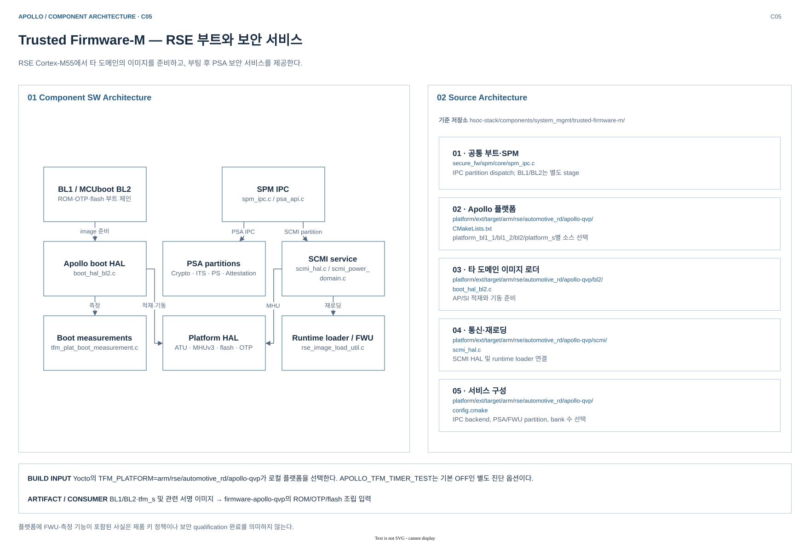
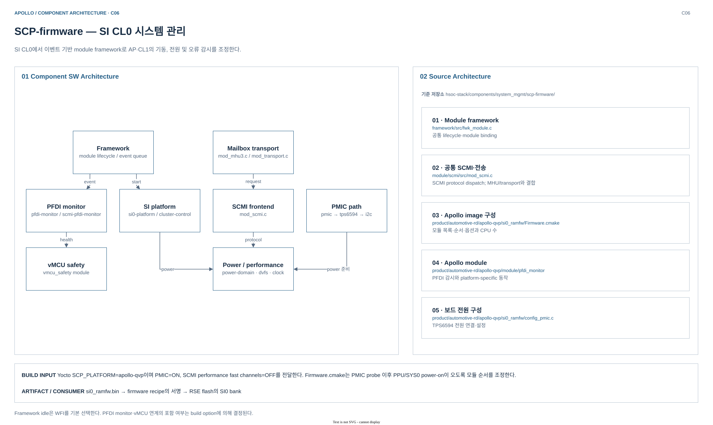
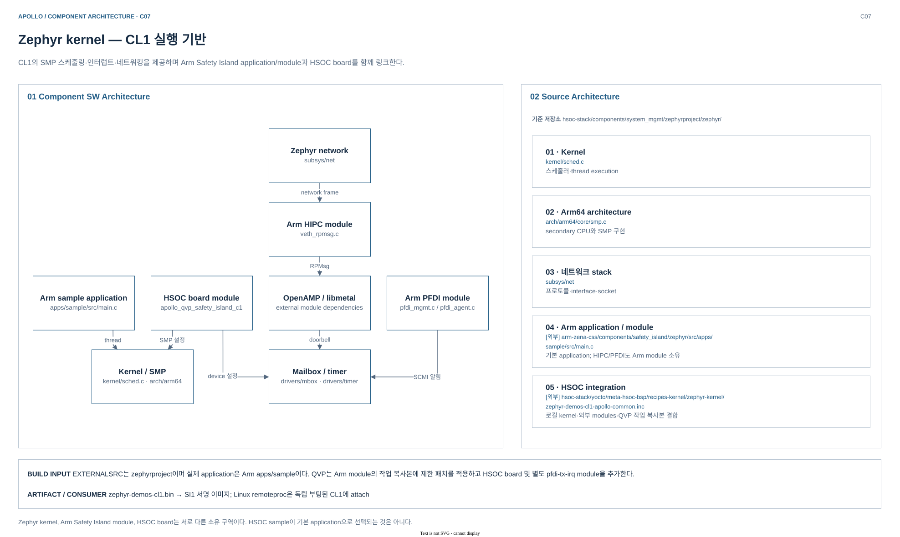
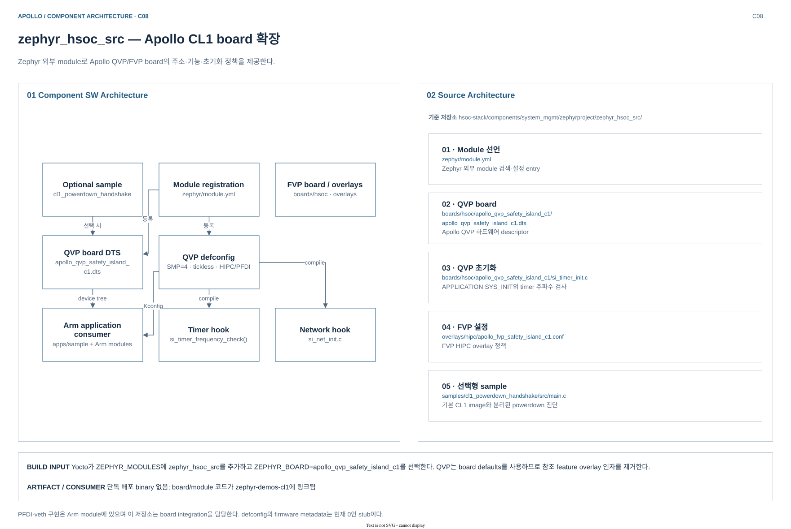
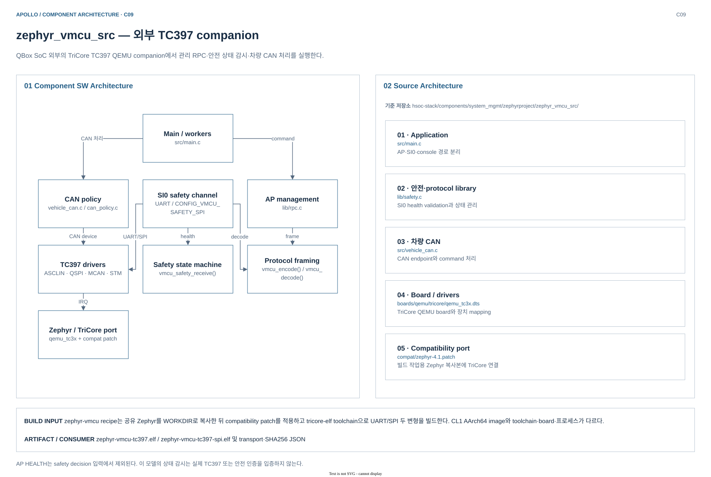

# System Management Component Architecture

[Build Architecture로 돌아가기](../README.md) · [컴포넌트 색인·경로 표기](README.md)

RSE·SI CL0·SI CL1·외부 vMCU의 코드 경계를 분리한다. 아래 구조는 현재 소스/recipe의 선택 경로이며 새 빌드·부팅 결과가 아니다.

## Trusted Firmware-M — RSE 부트와 보안 서비스

RSE Cortex-M55에서 타 도메인의 이미지를 준비하고, 부팅 후 PSA 보안 서비스를 제공한다.

### Component SW Architecture

| SW subsystem | 책임 | 인터페이스 / 연결 |
|---|---|---|
| BL1 / MCUboot BL2 | ROM·OTP·flash 부트 체인 | 인증·복호화 후 다음 stage 진입 |
| Apollo boot HAL | boot_hal_bl2.c | SI 이미지와 AP BL2 적재 |
| SPM IPC | spm_ipc.c / psa_api.c | partition isolation·PSA 호출 전달 |
| PSA partitions | Crypto · ITS · PS · Attestation | AP의 SE Proxy 요청 처리 |
| SCMI service / Platform HAL | scmi_hal.c / scmi_power_domain.c; ATU · MHUv3 · flash · OTP | CL0와 기동·reset 협력; 플랫폼 주소·저장소·알림 |
| Runtime loader / FWU / Boot measurements | rse_image_load_util.c; tfm_plat_boot_measurement.c | runtime 재로딩·FWU bank 처리; stage 측정값 전달 |

### Source Architecture

| Source area | 대표 파일 / 디렉터리 | 역할 |
|---|---|---|
| 공통 부트·SPM | [spm_ipc.c](../../../../hsoc-stack/components/system_mgmt/trusted-firmware-m/secure_fw/spm/core/spm_ipc.c) | IPC partition dispatch; BL1/BL2는 별도 stage |
| Apollo 플랫폼 | [CMakeLists.txt](../../../../hsoc-stack/components/system_mgmt/trusted-firmware-m/platform/ext/target/arm/rse/automotive_rd/apollo-qvp/CMakeLists.txt) | platform_bl1_1/bl1_2/bl2/platform_s별 소스 선택 |
| 타 도메인 이미지 로더 | [boot_hal_bl2.c](../../../../hsoc-stack/components/system_mgmt/trusted-firmware-m/platform/ext/target/arm/rse/automotive_rd/apollo-qvp/bl2/boot_hal_bl2.c) | AP/SI 적재와 기동 준비 |
| 통신·재로딩 | [scmi_hal.c](../../../../hsoc-stack/components/system_mgmt/trusted-firmware-m/platform/ext/target/arm/rse/automotive_rd/apollo-qvp/scmi/scmi_hal.c) | SCMI HAL 및 runtime loader 연결 |
| 서비스 구성 | [config.cmake](../../../../hsoc-stack/components/system_mgmt/trusted-firmware-m/platform/ext/target/arm/rse/automotive_rd/apollo-qvp/config.cmake) | IPC backend, PSA/FWU partition, bank 수 선택 |

### Build Architecture

| 항목 | 선택·경계·의존성 |
|---|---|
| 선택 | `trusted-firmware-m` + Arm RD-Aspen include + `trusted-firmware-m-apollo-qvp.inc`; `TFM_PLATFORM=arm/rse/automotive_rd/apollo-qvp`; 별도 timer 진단 `APOLLO_TFM_TIMER_TEST=OFF` |
| 소스 / 작업 경계 | `S=hsoc-stack/components/system_mgmt/trusted-firmware-m`, `B=${WORKDIR}/build`; 보조 CMSIS/MCUboot/TF-M extras 등은 `${UNPACKDIR}/git/` |
| Toolchain / ABI | `gcc-arm-none-eabi-native`, GNUARM toolchain; Cortex-M55 / Armv8.1-M, Linux ABI와 별도인 bare-metal image |
| 선행 dependency | CMake/Ninja·Python crypto 도구·`trusted-firmware-m-scripts-native`; `do_apply_local_src_patches`는 `quilt-native:do_populate_sysroot`에 의존 |
| Task | unpack → 보조 소스 patch → configure → compile → install; `/firmware` sysroot와 deploy로 분기. configure는 BL1 개발 키를 `${B}/externalsrc-keys`에 복사 |

### Deploy artifacts

| 파일 / 결과 | 배치 위치 | 후속 소비자 |
|---|---|---|
| `bl1_1.bin`, `rom_dma_ics.bin` | `${D}/firmware` → sysroot 및 `${DEPLOY_DIR_IMAGE}` | firmware recipe의 RSE ROM 조립 입력 |
| `bl2_signed.bin`, `tfm_s_signed.bin` | 동일 component sysroot/deploy | RSE flash의 TF-M primary bank 입력 |
| `combined_provisioning_message.bin`, `enc_key_s.b64` | 동일 component sysroot/deploy | provisioning 및 host image 서명·암호화 입력 |
| `tfm_interface/include/tfm_fwu_impl_info.h` 등 interface header | `${D}${includedir}/tfm_interface` → TS recipe sysroot | Trusted Services의 FWU interface 구성 |
| `bl1_2.elf`, `bl2.elf` | `${B}/bin/`; 현재 install/deploy 목록에는 없음 | QVP launcher가 WORKDIR에서 찾는 RSE symbol·가속 보조 입력 |

최종 `rse-rom-image.img`·`rse-otp-image.img`·`rse-flash-image.img`는 **별도 `firmware-apollo-qvp` recipe**가 조립해 `${DEPLOY_DIR_IMAGE}`에 배포한다. [TS의 header 소비](../../../../arm-zena-css/yocto/meta-zena-css-bsp/recipes-security/trusted-services/ts-fvp-rd-aspen.inc)와 [launcher의 ELF 탐색](../../../../run_qbox_yocto.sh)은 서로 다른 전달 경로다.

빌드 근거: [trusted-firmware-m-apollo-common.inc](../../../../hsoc-stack/yocto/meta-hsoc-bsp/recipes-bsp/trusted-firmware-m/trusted-firmware-m-apollo-common.inc), [trusted-firmware-m-fvp-rd-aspen.inc](../../../../arm-zena-css/yocto/meta-zena-css-bsp/recipes-bsp/trusted-firmware-m/trusted-firmware-m-fvp-rd-aspen.inc), [trusted-firmware-m.inc](../../../../layers/meta-arm/meta-arm/recipes-bsp/trusted-firmware-m/trusted-firmware-m.inc).

플랫폼에 FWU·측정 기능이 포함된 사실은 제품 키 정책이나 보안 qualification 완료를 의미하지 않는다.

근거: [trusted-firmware-m-apollo-qvp.inc](../../../../hsoc-stack/yocto/meta-hsoc-bsp/recipes-bsp/trusted-firmware-m/trusted-firmware-m-apollo-qvp.inc), [config.cmake](../../../../hsoc-stack/components/system_mgmt/trusted-firmware-m/platform/ext/target/arm/rse/automotive_rd/apollo-qvp/config.cmake).

## SCP-firmware — SI CL0 시스템 관리

SI CL0에서 이벤트 기반 module framework로 AP·CL1의 기동, 전원 및 오류 감시를 조정한다.

### Component SW Architecture

| SW subsystem | 책임 | 인터페이스 / 연결 |
|---|---|---|
| Framework | module lifecycle / event queue | init·bind·start·event dispatch |
| SCMI frontend | mod_scmi.c | TF-A/Linux/RSE protocol 요청 |
| Mailbox transport | mod_mhu3.c / mod_transport.c | MHUv3와 shared-memory message |
| Power / performance | power-domain · dvfs · clock | PPU 전환·주파수 제어 |
| SI platform / PFDI monitor | si0-platform / cluster-control; pfdi-monitor / scmi-pfdi-monitor | CMN 초기화·AP/CL1 기동; AP/CL1 상태·timeout 감시 |
| PMIC path / vMCU safety | pmic → tps6594 → i2c; vmcu_safety module | 전원 초기화 후 SYS0 기동; 외부 companion에 안전 상태 전달 |

### Source Architecture

| Source area | 대표 파일 / 디렉터리 | 역할 |
|---|---|---|
| Module framework | [fwk_module.c](../../../../hsoc-stack/components/system_mgmt/scp-firmware/framework/src/fwk_module.c) | 공통 lifecycle·module binding |
| 공통 SCMI·전송 | [mod_scmi.c](../../../../hsoc-stack/components/system_mgmt/scp-firmware/module/scmi/src/mod_scmi.c) | SCMI protocol dispatch; MHU/transport와 결합 |
| Apollo image 구성 | [Firmware.cmake](../../../../hsoc-stack/components/system_mgmt/scp-firmware/product/automotive-rd/apollo-qvp/si0_ramfw/Firmware.cmake) | 모듈 목록·순서·옵션과 CPU 수 |
| Apollo module | [pfdi_monitor](../../../../hsoc-stack/components/system_mgmt/scp-firmware/product/automotive-rd/apollo-qvp/module/pfdi_monitor) | PFDI 감시와 platform-specific 동작 |
| 보드 전원 구성 | [config_pmic.c](../../../../hsoc-stack/components/system_mgmt/scp-firmware/product/automotive-rd/apollo-qvp/si0_ramfw/config_pmic.c) | TPS6594 전원 연결·설정 |

### Build Architecture

| 항목 | 선택·경계·의존성 |
|---|---|
| 선택 | `scp-firmware_2.15.0.bb` + RD-Aspen/Apollo include; `SCP_PRODUCT_GROUP=automotive-rd`, `SCP_PLATFORM=apollo-qvp`, `FW_TARGETS=si0`, `FW_INSTALL=ramfw`; PMIC=ON, SCMI performance fast channels=OFF |
| 소스 / 작업 경계 | `S=hsoc-stack/components/system_mgmt/scp-firmware`, `B=${WORKDIR}/build`; 실제 CMake tree는 `${B}/ramfw/si0` |
| Toolchain / ABI | `gcc-aarch64-none-elf-native`, `SCP_TOOLCHAIN=GNU`; Cortex-R82AE의 AArch64 bare-metal firmware |
| 선행 dependency | CMake/Ninja 및 native cross compiler를 recipe sysroot에 준비; `Firmware.cmake`의 module 목록·순서와 `config_*.c`를 결합. PMIC probe 후 PPU/SYS0 power-on |
| Task | configure → compile → install → deploy; `${D}/firmware`를 populate_sysroot하여 firmware 조립 recipe에도 공급 |

Framework idle은 WFI가 기본이다. PFDI monitor·vMCU 연계는 build option으로 선택한다.

### Deploy artifacts

| 파일 / 결과 | 배치 위치 | 후속 소비자 |
|---|---|---|
| `apollo-qvp-si0-bl2.bin/.elf` | `${B}/ramfw/si0/bin/` | SCP 컴파일 결과; do_install의 원본 |
| `si0_ramfw.bin`, `si0_ramfw.elf` | `${D}/firmware` → sysroot 및 `${DEPLOY_DIR_IMAGE}` | bin은 firmware 집계·runner 매핑, ELF는 심볼 디버깅 |
| `signed_si0_ramfw.bin` → `rse-flash-image.img` | firmware recipe 서명 작업 영역 → `${DEPLOY_DIR_IMAGE}`의 flash | SCP recipe 밖에서 서명·조립; RSE가 SI0 bank 인증·적재 |

빌드 근거: [scp-firmware_2.15.0.bb](../../../../layers/meta-arm/meta-arm/recipes-bsp/scp-firmware/scp-firmware_2.15.0.bb), [scp-firmware-fvp-rd-aspen.inc](../../../../arm-zena-css/yocto/meta-zena-css-bsp/recipes-bsp/scp-firmware/scp-firmware-fvp-rd-aspen.inc).

근거: [scp-firmware-apollo-qvp.inc](../../../../hsoc-stack/yocto/meta-hsoc-bsp/recipes-bsp/scp-firmware/scp-firmware-apollo-qvp.inc), [Firmware.cmake](../../../../hsoc-stack/components/system_mgmt/scp-firmware/product/automotive-rd/apollo-qvp/si0_ramfw/Firmware.cmake).

## Zephyr kernel — CL1 실행 기반

CL1의 SMP 스케줄링·인터럽트·네트워킹을 제공하며 Arm Safety Island application/module과 HSOC board를 함께 링크한다.

### Component SW Architecture

| SW subsystem | 책임 | 인터페이스 / 연결 |
|---|---|---|
| Arm sample application | apps/sample/src/main.c | 현재 CL1 application entry |
| Kernel / SMP | kernel/sched.c · arch/arm64 | thread·IRQ·멀티코어 실행 |
| Zephyr network | subsys/net | IPv4·TCP/UDP·shell/zperf |
| Arm HIPC module | veth_rpmsg.c | OpenAMP RPMsg 기반 Ethernet |
| OpenAMP / libmetal / Mailbox / timer | external module dependencies; drivers/mbox · drivers/timer | vring·shared-memory transport; MHUv3 doorbell·시스템 tick |
| Arm PFDI module / HSOC board module | pfdi_mgmt.c / pfdi_agent.c; apollo_qvp_safety_island_c1 | 감시 작업·CL0 상태 보고; DTS·Kconfig·초기화 hook |

### Source Architecture

| Source area | 대표 파일 / 디렉터리 | 역할 |
|---|---|---|
| Kernel | [sched.c](../../../../hsoc-stack/components/system_mgmt/zephyrproject/zephyr/kernel/sched.c) | 스케줄러·thread execution |
| Arm64 architecture | [smp.c](../../../../hsoc-stack/components/system_mgmt/zephyrproject/zephyr/arch/arm64/core/smp.c) | secondary CPU와 SMP 구현 |
| 네트워크 stack | [net](../../../../hsoc-stack/components/system_mgmt/zephyrproject/zephyr/subsys/net) | 프로토콜·interface·socket |
| Arm application / module | [main.c](../../../../arm-zena-css/components/safety_island/zephyr/src/apps/sample/src/main.c) | 기본 application; HIPC/PFDI도 Arm module 소유 |
| HSOC integration | [zephyr-demos-cl1-apollo-common.inc](../../../../hsoc-stack/yocto/meta-hsoc-bsp/recipes-kernel/zephyr-kernel/zephyr-demos-cl1-apollo-common.inc) | 로컬 kernel·외부 modules·QVP 작업 복사본 결합 |

### Build Architecture

| 항목 | 선택·경계·의존성 |
|---|---|
| 선택 | `zephyr-demos-cl1.bb` → `zephyr-app-si.inc` → `zephyr-sample.inc`/`zephyr-image.inc`; Apollo common/QVP include가 board·module을 덮어씀 |
| 소스 / 작업 경계 | `S=hsoc-stack/components/system_mgmt/zephyrproject`, `ZEPHYR_BASE=${S}/zephyr`, `B=${WORKDIR}/build`; application은 `${WORKDIR}/apollo-safety-island/apps/sample` |
| Toolchain / ABI | 현재 `zephyr` distro feature가 참조 machine include의 `ZEPHYR_TOOLCHAIN_VARIANT=zephyr`를 활성화; `zephyr-sdk-native`의 AArch64 toolchain으로 CL1 RTOS image 생성 |
| 선행 dependency | Zephyr SDK·CMake/Ninja·gperf/Python 도구 + CMSIS/libmetal/OpenAMP; Arm module 복사·패치는 `do_prepare_apollo_hipc`에서 configure 전에 수행; HSOC board와 별도 `pfdi-tx-irq` module 추가 |
| Task | configure(DTS/Kconfig/module 선택) → compile → install(`/firmware`, PN으로 rename) → deploy; sysroot binary는 firmware 조립에도 공급 |

### Deploy artifacts

| 파일 / 결과 | 배치 위치 | 후속 소비자 |
|---|---|---|
| `zephyr.bin`, `zephyr.elf` | `${B}/zephyr/` | CL1 compile 결과; install의 원본 |
| `zephyr-demos-cl1.bin`, `zephyr-demos-cl1.elf` | `${D}/firmware` → sysroot 및 `${DEPLOY_DIR_IMAGE}` | firmware 집계/runner image map 및 심볼 디버깅 |
| `signed_safety_island_cl1.bin` → `rse-flash-image.img` | firmware recipe 서명 작업 영역 → deploy flash | RSE가 CL1 image를 적재; CL0가 실행을 기동 |
| `.config`, `zephyr.dts` | `${B}/zephyr/`; 기본 deploy 대상 아님 | board/module의 최종 설정 확인 |

빌드 근거: [zephyr-image.inc](../../../../layers/meta-zephyr/meta-zephyr-core/recipes-kernel/zephyr-kernel/zephyr-image.inc), [zephyr-toolchain-zephyr.inc](../../../../layers/meta-zephyr/meta-zephyr-core/recipes-kernel/zephyr-kernel/zephyr-toolchain-zephyr.inc), [fvp-rd-aspen-zephyr.inc](../../../../arm-zena-css/yocto/meta-zena-css-safety-island/conf/machine/include/fvp/fvp-rd-aspen-zephyr.inc).

Zephyr kernel, Arm Safety Island module, HSOC board는 서로 다른 소유 구역이다. HSOC sample이 기본 application으로 선택되는 것은 아니다.

근거: [zephyr-demos-cl1-apollo-common.inc](../../../../hsoc-stack/yocto/meta-hsoc-bsp/recipes-kernel/zephyr-kernel/zephyr-demos-cl1-apollo-common.inc), [zephyr-demos-cl1-apollo-qvp.inc](../../../../hsoc-stack/yocto/meta-hsoc-bsp/recipes-kernel/zephyr-kernel/zephyr-demos-cl1-apollo-qvp.inc).

## zephyr_hsoc_src — Apollo CL1 board 확장

Zephyr 외부 module로 Apollo QVP/FVP board의 주소·기능·초기화 정책을 제공한다.

### Component SW Architecture

| SW subsystem | 책임 | 인터페이스 / 연결 |
|---|---|---|
| Module registration | zephyr/module.yml | board_root·dts_root·Kconfig 등록 |
| QVP board DTS | apollo_qvp_safety_island_c1.dts | CPU·메모리·MHU 장치 연결 |
| QVP defconfig | SMP=4 · tickless · HIPC/PFDI | 선택 기능·버퍼·clock 설정 |
| Timer hook | si_timer_frequency_check() | CNTFRQ와 125 MHz 설정 대조 |
| Network hook / FVP board / overlays | si_net_init.c; boards/hsoc · overlays | interface·VLAN·IPv4 초기화; FVP 별도 board·feature 조합 |
| Optional sample / Arm application consumer | cl1_powerdown_handshake; apps/sample + Arm modules | 전원 handoff 진단용 application; board 설정을 소비하는 실제 CL1 image |

### Source Architecture

| Source area | 대표 파일 / 디렉터리 | 역할 |
|---|---|---|
| Module 선언 | [module.yml](../../../../hsoc-stack/components/system_mgmt/zephyrproject/zephyr_hsoc_src/zephyr/module.yml) | Zephyr 외부 module 검색·설정 entry |
| QVP board | [apollo_qvp_safety_island_c1.dts](../../../../hsoc-stack/components/system_mgmt/zephyrproject/zephyr_hsoc_src/boards/hsoc/apollo_qvp_safety_island_c1/apollo_qvp_safety_island_c1.dts) | Apollo QVP 하드웨어 descriptor |
| QVP 초기화 | [si_timer_init.c](../../../../hsoc-stack/components/system_mgmt/zephyrproject/zephyr_hsoc_src/boards/hsoc/apollo_qvp_safety_island_c1/si_timer_init.c) | APPLICATION SYS_INIT의 timer 주파수 검사 |
| FVP 설정 | [apollo_fvp_safety_island_c1.conf](../../../../hsoc-stack/components/system_mgmt/zephyrproject/zephyr_hsoc_src/overlays/hipc/apollo_fvp_safety_island_c1.conf) | FVP HIPC overlay 정책 |
| 선택형 sample | [main.c](../../../../hsoc-stack/components/system_mgmt/zephyrproject/zephyr_hsoc_src/samples/cl1_powerdown_handshake/src/main.c) | 기본 CL1 image와 분리된 powerdown 진단 |

### Build Architecture

| 항목 | 선택·경계·의존성 |
|---|---|
| 선택 | 독립 recipe 없음. `zephyr-demos-cl1-apollo-common.inc`가 `HSOC_APOLLO_ZEPHYR_HSOC_SRC`를 `ZEPHYR_MODULES`에 포함; `ZEPHYR_BOARD=apollo_qvp_safety_island_c1` |
| 소스 / 작업 경계 | `zephyrproject/zephyr_hsoc_src`는 source module; 별도 B 없이 CL1의 `${WORKDIR}/build`에서 함께 구성·컴파일 |
| Toolchain / ABI | CL1의 Zephyr SDK/AArch64 ABI를 공유; `module.yml`의 board_root/dts_root와 Kconfig가 board를 등록 |
| Task / dependency | CL1 do_configure가 board DTS·defconfig를 해석하고 CMakeLists가 timer/net init 소스를 선택; QVP board defaults 사용으로 참조 feature overlay 인자 제거. module tree는 configure/compile checksum 입력 |
| 선택형 sample | `samples/cl1_powerdown_handshake`는 별도 application을 선택할 때만 빌드하며 기본 recipe의 Arm sample을 대체하지 않음 |

### Deploy artifacts

| 파일 / 결과 | 배치 위치 | 후속 소비자 |
|---|---|---|
| 독립 `.bin/.elf` 없음 | 별도 DEPLOY_DIR_IMAGE entry 없음 | board/module은 CL1 image의 일부로 링크 |
| `zephyr-demos-cl1.bin/.elf`에 포함된 board 초기화 | CL1 recipe의 sysroot 및 `${DEPLOY_DIR_IMAGE}` | timer/net SYS_INIT와 board device 구성을 소비 |
| 병합 `.config`, `zephyr.dts` | CL1 `${B}/zephyr/`; build 중간 산출물 | QVP board 선택과 기능 활성화 근거; 별도 배포 image 아님 |

빌드 근거: [zephyr-demos-cl1-apollo-common.inc](../../../../hsoc-stack/yocto/meta-hsoc-bsp/recipes-kernel/zephyr-kernel/zephyr-demos-cl1-apollo-common.inc), [module.yml](../../../../hsoc-stack/components/system_mgmt/zephyrproject/zephyr_hsoc_src/zephyr/module.yml).

PFDI·veth 구현은 Arm module에 있으며 이 저장소는 board integration을 담당한다. defconfig의 firmware metadata는 현재 0인 stub이다.

근거: [CMakeLists.txt](../../../../hsoc-stack/components/system_mgmt/zephyrproject/zephyr_hsoc_src/boards/hsoc/apollo_qvp_safety_island_c1/CMakeLists.txt), [apollo_qvp_safety_island_c1_defconfig](../../../../hsoc-stack/components/system_mgmt/zephyrproject/zephyr_hsoc_src/boards/hsoc/apollo_qvp_safety_island_c1/apollo_qvp_safety_island_c1_defconfig).

## zephyr_vmcu_src — 외부 TC397 companion

QBox SoC 외부의 TriCore TC397 QEMU companion에서 관리 RPC·안전 상태 감시·차량 CAN 처리를 실행한다.

### Component SW Architecture

| SW subsystem | 책임 | 인터페이스 / 연결 |
|---|---|---|
| Main / workers | src/main.c | message queue·mutex·shell 제어 |
| AP management | lib/rpc.c | AP 명령·reply·epoch/sequence |
| SI0 safety channel | UART / CONFIG_VMCU_SAFETY_SPI | CL0 safety health 수신 |
| Safety state machine | vmcu_safety_receive() | 상태·timeout·GPIO 검증 |
| Protocol framing / CAN policy | vmcu_encode() / vmcu_decode(); vehicle_can.c / can_policy.c | 고정 frame·검증·직렬화; CAN 입력·정책 처리 |
| TC397 drivers / Zephyr / TriCore port | ASCLIN · QSPI · MCAN · STM; qemu_tc3x + compat patch | QEMU 장치 MMIO·IRQ; thread·timer·interrupt 기반 |

### Source Architecture

| Source area | 대표 파일 / 디렉터리 | 역할 |
|---|---|---|
| Application | [main.c](../../../../hsoc-stack/components/system_mgmt/zephyrproject/zephyr_vmcu_src/src/main.c) | AP·SI0·console 경로 분리 |
| 안전·protocol library | [safety.c](../../../../hsoc-stack/components/system_mgmt/zephyrproject/zephyr_vmcu_src/lib/safety.c) | SI0 health validation과 상태 관리 |
| 차량 CAN | [vehicle_can.c](../../../../hsoc-stack/components/system_mgmt/zephyrproject/zephyr_vmcu_src/src/vehicle_can.c) | CAN endpoint와 command 처리 |
| Board / drivers | [qemu_tc3x.dts](../../../../hsoc-stack/components/system_mgmt/zephyrproject/zephyr_vmcu_src/boards/qemu/tricore/qemu_tc3x.dts) | TriCore QEMU board와 장치 mapping |
| Compatibility port | [zephyr-4.1.patch](../../../../hsoc-stack/components/system_mgmt/zephyrproject/zephyr_vmcu_src/compat/zephyr-4.1.patch) | 빌드 작업용 Zephyr 복사본에 TriCore 연결 |

### Build Architecture

| 항목 | 선택·경계·의존성 |
|---|---|
| 선택 | `zephyr-vmcu.bb`, `inherit externalsrc python3native deploy`; `BOARD=qemu_tc3x`, `COMPATIBLE_MACHINE=apollo-qvp` |
| 소스 / 작업 경계 | `S=hsoc-stack/components/system_mgmt/zephyrproject/zephyr_vmcu_src`, `B=${WORKDIR}/build`; 공통 Zephyr는 `${WORKDIR}/zephyr`에 복사하고 compatibility patch 적용 |
| Toolchain / ABI | `tricore-toolchain-native`의 `tricore-elf-` cross compiler; Zephyr `cross-compile` variant, AArch64 CL1과 다른 TriCore ELF |
| 선행 dependency | TriCore toolchain·CMake/Ninja·DTC/gperf·patch/Python 도구; `do_prepare_vmcu`는 prepare_recipe_sysroot 후, configure 전 실행 |
| Task | configure가 `${B}`와 `${B}/spi` 생성 → 두 variant compile → deploy; `do_install[noexec]`, AP rootfs 설치 없이 companion ELF 배포 |

### Deploy artifacts

| 파일 / 결과 | 배치 위치 | 후속 소비자 |
|---|---|---|
| `zephyr-vmcu-tc397.elf` | `${DEPLOY_DIR_IMAGE}` | TC397 companion의 UART safety variant |
| `zephyr-vmcu-tc397-spi.elf` | `${DEPLOY_DIR_IMAGE}` | TC397 companion의 SPI safety variant |
| 각 `.elf.json` | 동일 deploy 위치 | `safety_transport`와 ELF SHA256; runner/검증의 artifact 식별 |
| `${B}/zephyr/zephyr.elf`, `${B}/spi/zephyr/zephyr.elf` | recipe build tree; do_deploy가 rename/copy | AArch64 CL1 이미지·RSE flash와 독립된 TriCore firmware |

빌드 근거: [zephyr-vmcu.bb](../../../../hsoc-stack/yocto/meta-hsoc-auto-solutions/recipes-kernel/zephyr-vmcu/zephyr-vmcu.bb).

AP HEALTH는 safety decision 입력에서 제외된다. 이 모델의 상태 감시는 실제 TC397 또는 안전 인증을 입증하지 않는다.

근거: [zephyr-vmcu.bb](../../../../hsoc-stack/yocto/meta-hsoc-auto-solutions/recipes-kernel/zephyr-vmcu/zephyr-vmcu.bb), [main.c](../../../../hsoc-stack/components/system_mgmt/zephyrproject/zephyr_vmcu_src/src/main.c).
