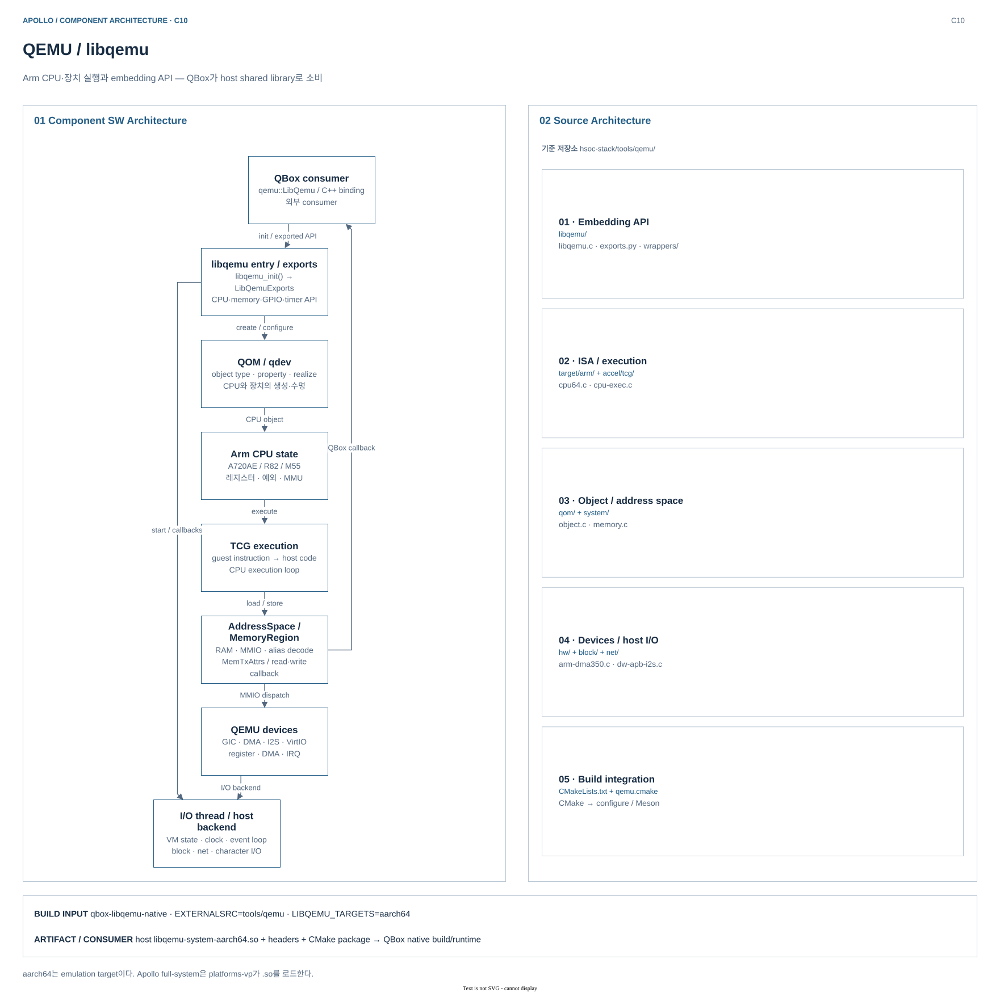
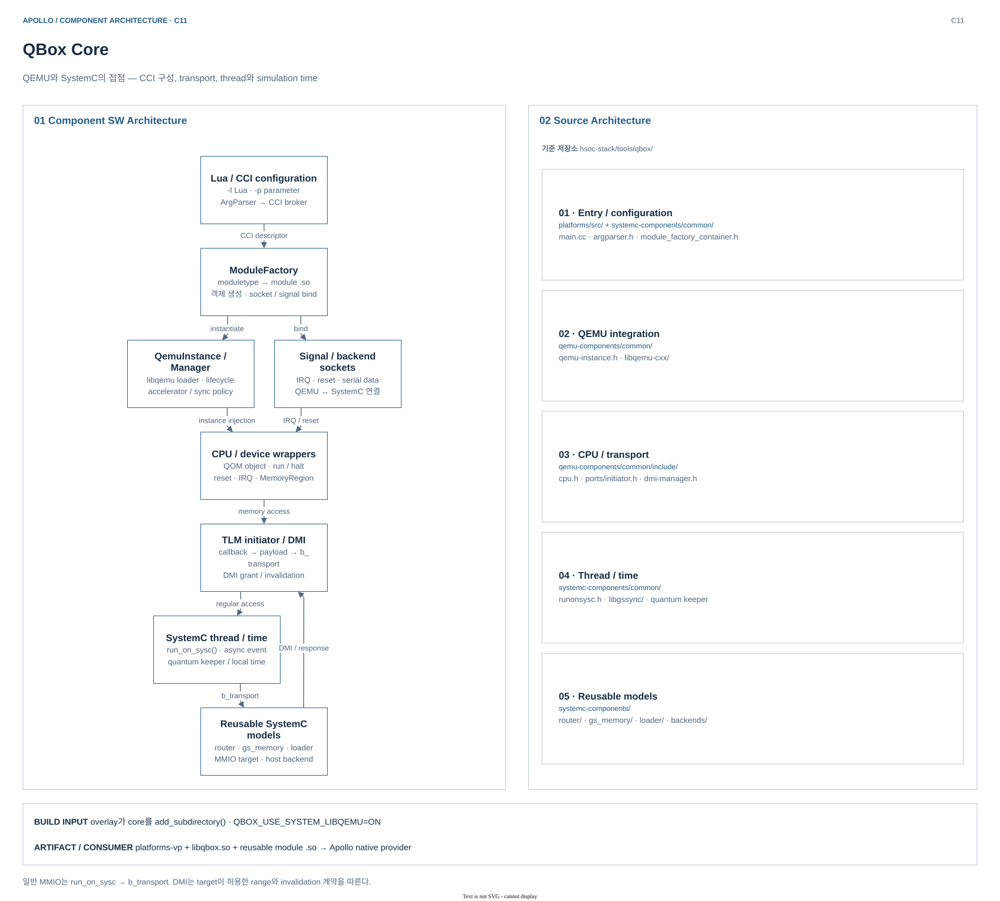
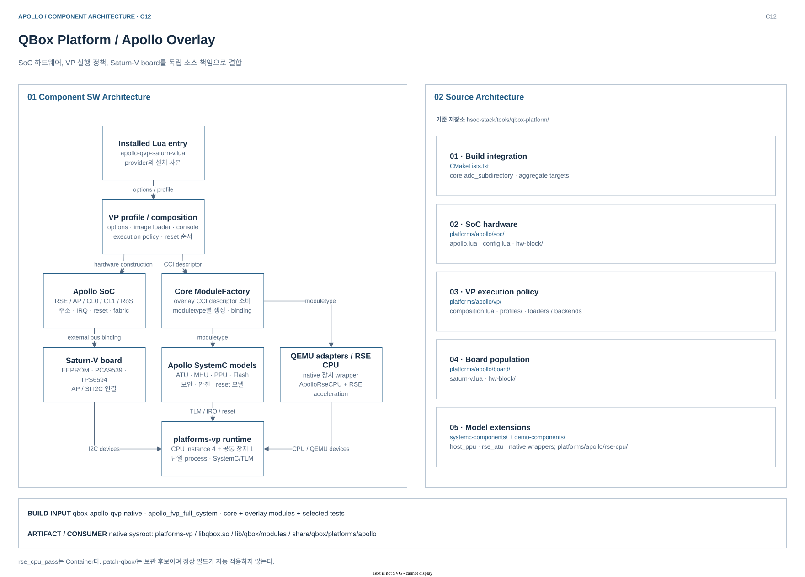

# Virtual Platform — QEMU, QBox, Apollo Overlay

[Build Architecture](../README.md) · [컴포넌트 색인·경로 표기](README.md)

`QEMU/libqemu`는 CPU·QEMU 장치 실행, `QBox`는 SystemC 연결·시간 관리, `qbox-platform`은 Apollo 모델·배치를 담당한다. Buildroot는 별도로 보존한 소스이며 기본 root 빌드 경로는 `yocto_build.sh`의 Yocto workflow다.

아래 설치 경로는 현재 `build/tmp_baremetal`의 x86_64 호스트 구성을 기준으로 한다. `${WORKDIR}`는 recipe별 작업 디렉터리이며, 소스 checkout·빌드 디렉터리·설치된 provider는 서로 다른 경로다.

## 1. QEMU / libqemu

Arm 명령어와 장치 동작을 실행하고, QBox가 이를 라이브러리 API로 생성·제어하도록 제공한다.

### Component SW Architecture

| 내부 subsystem | 책임 | 인터페이스·소비자 |
|---|---|---|
| libqemu entry / exports | `libqemu_init()`에서 I/O thread를 시작하고 `LibQemuExports` 함수 테이블 반환 | QBox의 `qemu::LibQemu`가 shared library를 로드 |
| QOM / qdev | CPU·장치 type 등록, property 설정, realize와 객체 수명 관리 | `object_new`, property API, device wrapper |
| Arm CPU / TCG | CPU 상태·예외·시스템 레지스터와 guest 명령 변환·실행 | AP A720AE, SI R82, RSE M55 wrapper |
| MemoryRegion / AddressSpace | RAM·MMIO·alias의 주소 해석과 접근 속성 전달 | `MemoryRegionOps` read/write callback ↔ QBox TLM bridge |
| QEMU device models | GIC·DMA·I2S·VirtIO 등의 레지스터, IRQ, DMA 동작 | QOM property, MemoryRegion, GPIO/IRQ API |
| I/O thread / host backend | timer·VM 상태·block/net/character backend 처리 | libqemu callback 및 QEMU event loop |

일반 메모리 접근은 `TCG → AddressSpace → MemoryRegion`을 거친다. QEMU에 등록한 QBox MMIO 영역에 도달하면 read/write callback으로 빠져나가 SystemC/TLM 모델을 호출한다.

### Source Architecture

기준: `hsoc-stack/tools/qemu/`

| 소스 영역 | 대표 파일 | 역할 |
|---|---|---|
| `libqemu/` | [libqemu.c](../../../../hsoc-stack/tools/qemu/libqemu/libqemu.c), [exports.py](../../../../hsoc-stack/tools/qemu/libqemu/exports.py) | embedding entry, 함수 테이블 생성, callback 계약 |
| `target/arm/`, `accel/tcg/` | [cpu64.c](../../../../hsoc-stack/tools/qemu/target/arm/tcg/cpu64.c), [cpu-exec.c](../../../../hsoc-stack/tools/qemu/accel/tcg/cpu-exec.c) | Arm CPU 정의와 TCG 실행 loop |
| `qom/`, `system/` | [object.c](../../../../hsoc-stack/tools/qemu/qom/object.c), [memory.c](../../../../hsoc-stack/tools/qemu/system/memory.c) | 객체 type/property와 주소 공간 |
| `hw/`, `block/`, `net/` | [arm-dma350.c](../../../../hsoc-stack/tools/qemu/hw/dma/arm-dma350.c), [dw-apb-i2s.c](../../../../hsoc-stack/tools/qemu/hw/audio/dw-apb-i2s.c) | 장치 모델과 호스트 I/O backend |
| CMake → QEMU configure | [qemu.cmake](../../../../hsoc-stack/tools/qemu/qemu.cmake) | libqemu용 configure/Meson 빌드 연결 |

### Build Architecture

| 빌드 경계 | 실제 구성 |
|---|---|
| Recipe / source / build | `qbox-libqemu-native`; `EXTERNALSRC=hsoc-stack/tools/qemu`, `B=${WORKDIR}/build`. CMake 진입 파일은 `${WORKDIR}/qbox-libqemu-native-cmake`에 복사하고 실제 QEMU는 원본 소스에서 빌드 |
| Host ABI | `native` class의 호스트 compiler 사용; 현재 결과는 x86-64 ELF. `LIBQEMU_TARGETS=aarch64`는 **emulation target**이며 guest AArch64 ABI의 `.so`를 뜻하지 않음 |
| Configure / target | CMake `libqemu` interface → ExternalProject `qemu`; `configure --target-list=aarch64-softmmu -Dlibqemu=true --disable-download` → QEMU 빌드. 내부 build는 `${B}/qemu-prefix/src/qemu-build` |
| Dependency | `glib-2.0-native`, `dtc-native`, `meson-native`, 공통 slirp/pixman/zlib 및 PACKAGECONFIG의 SDL/OpenGL 의존; `keycodemapdb`는 별도 고정 revision으로 fetch |
| Install / sysroot | `${B}/qemu-prefix`의 내부 설치 결과를 `do_install`이 `${D}` 아래에 집계; `do_populate_sysroot`가 component sysroot에 배치하고 QBox recipe의 `recipe-sysroot-native`에 제공 |

근거: [libqemu recipe](../../../../hsoc-stack/yocto/meta-hsoc-bsp/recipes-devtools/qbox/qbox-libqemu-native.bb), [native 공통 설정](../../../../hsoc-stack/yocto/meta-hsoc-bsp/recipes-devtools/qbox/qbox-native-common.inc), [ExternalProject와 install](../../../../hsoc-stack/tools/qemu/qemu.cmake).

### Deploy artifacts

설치 경로 기준: `build/tmp_baremetal/sysroots-components/x86_64/qbox-libqemu-native/usr/`. 아래는 호스트 의존 산출물이며 firmware/OS deploy 이미지가 아니다.

| 상대 경로 | 산출물 | 소비자 |
|---|---|---|
| `lib/libqemu-system-aarch64.so` | QEMU embedding shared library | QBox `QemuInstance` / `qemu::LibQemu` |
| `include/libqemu/` | export API·wrapper·공유 type header | QBox C++ binding의 compile |
| `lib/cmake/libqemu/` | `libqemuConfig.cmake`, `libqemu-targets.cmake` 등 | core의 `find_package(libqemu CONFIG REQUIRED)` |

QBox 빌드 소비 사본은 `build/tmp_baremetal/work/x86_64-linux/qbox-apollo-qvp-native/1.0/recipe-sysroot-native/usr/`에 구성된다. 실행 시에는 launcher/runtime이 provider 의존 library 경로도 추가한다.

근거: [Yocto provider](../../../../hsoc-stack/yocto/meta-hsoc-bsp/recipes-devtools/qbox/qbox-libqemu-native.bb), [MemoryRegion wrapper](../../../../hsoc-stack/tools/qemu/libqemu/wrappers/memory.h), [QBox API 소비자](../../../../hsoc-stack/tools/qbox/qemu-components/common/src/libqemu-cxx/libqemu-cxx.cc).

기본 Apollo full-system 실행은 `qemu-system-*` CLI에 독립 machine을 띄우는 방식이 아니라 `platforms-vp`가 libqemu를 로드하는 방식이다.

## 2. QBox Core

QEMU CPU·장치를 SystemC/TLM 컴포넌트와 결합하고, CCI 구성·메모리 접근·스레드 및 시뮬레이션 시간의 경계를 관리한다.

### Component SW Architecture

| 내부 subsystem | 책임 | 인터페이스·소비자 |
|---|---|---|
| ArgParser / CCI / ModuleFactory | Lua와 `-p`를 CCI로 해석하고 `moduletype`별 모듈 생성·binding | `platforms-vp`, Apollo Lua descriptor |
| QemuInstanceManager / QemuInstance | libqemu loader·instance 초기화와 accelerator/sync 정책 보유 | CPU·QEMU device wrapper에 instance 주입 |
| CPU / device wrappers | QOM CPU·장치를 생성하고 reset·IRQ·실행 제어를 SystemC에 노출 | `cpu_arm_*`, `QemuCpu`, signal sockets |
| TLM initiator / DMI | QEMU callback을 payload로 변환; `b_transport`와 DMI mapping/invalidation 처리 | router·memory·MMIO target |
| Thread / time synchronization | QEMU thread의 일을 SystemC context에서 수행하고 local time 동기화 | `run_on_sysc`, quantum keeper, async event |
| 공통 SystemC 모델 | 주소 라우팅·메모리·loader·console·signal 연결 | `router`, `gs_memory`, `loader`, backend socket |

일반 MMIO는 `QEMU callback → payload → run_on_sysc() → b_transport()`로 전달된다. DMI를 허용한 target은 별도의 mapping과 invalidation 계약을 사용하며 모든 MMIO가 DMI로 바뀌는 것은 아니다.

### Source Architecture

기준: `hsoc-stack/tools/qbox/`

| 소스 영역 | 대표 파일 | 역할 |
|---|---|---|
| `platforms/`, common factory | [main.cc](../../../../hsoc-stack/tools/qbox/platforms/src/main.cc), [module_factory_container.h](../../../../hsoc-stack/tools/qbox/systemc-components/common/include/module_factory_container.h) | CCI broker·top container 생성과 `sc_start()` |
| `qemu-components/common/` | [qemu-instance.h](../../../../hsoc-stack/tools/qbox/qemu-components/common/include/qemu-instance.h), [libqemu-cxx.cc](../../../../hsoc-stack/tools/qbox/qemu-components/common/src/libqemu-cxx/libqemu-cxx.cc) | QEMU instance와 C export API의 C++ binding |
| CPU / transport | [cpu.h](../../../../hsoc-stack/tools/qbox/qemu-components/common/include/cpu.h), [ports/initiator.h](../../../../hsoc-stack/tools/qbox/qemu-components/common/include/ports/initiator.h) | CPU lifecycle, payload·DMI·응답 상태 변환 |
| common synchronization | [runonsysc.h](../../../../hsoc-stack/tools/qbox/systemc-components/common/include/runonsysc.h), [qkmultithread.cc](../../../../hsoc-stack/tools/qbox/systemc-components/common/src/libgssync/qkmultithread.cc) | SystemC thread 진입과 시간 동기화 |
| `systemc-components/` | [router.h](../../../../hsoc-stack/tools/qbox/systemc-components/router/include/router.h), [gs_memory.h](../../../../hsoc-stack/tools/qbox/systemc-components/gs_memory/include/gs_memory.h) | 플랫폼과 독립적인 공통 버스·메모리 모델 |

### Build Architecture

| 빌드 경계 | 실제 구성 |
|---|---|
| Recipe / source / build | core와 overlay는 **같은 `qbox-apollo-qvp-native` recipe**에 결합. recipe의 `S`는 `tools/qbox-platform`, core source는 `QBOX_CORE_SOURCE_DIR=tools/qbox`; `${B}=${WORKDIR}/build` 아래 `qbox-core/`에서 core 구성 |
| Host ABI | `native` class의 host C/C++ compiler; 현재 `platforms-vp`, `libqbox.so`, module은 x86-64 ELF |
| Configure / target | overlay가 `add_subdirectory(core)` 수행. `QBOX_USE_SYSTEM_LIBQEMU=ON`, `RelWithDebInfo`; `apollo_fvp_full_system` target이 core의 `qbox`, `platforms-vp`, 필요한 device/model target을 의존성으로 빌드 |
| Dependency / check | libqemu는 native sysroot의 CMake package로 탐색. SystemC·CCI·fmt·rpclib 등은 core CMake가 결합; provider `do_check`는 선택 core/platform unit test 수행 |
| Install / sysroot | provider의 `do_install`이 core executable·library·필요 module을 골라 설치하고 `do_populate_sysroot`로 공통 provider에 배치. core만의 별도 Apollo deploy image는 없음 |

근거: [동일 native recipe](../../../../hsoc-stack/yocto/meta-hsoc-bsp/recipes-devtools/qbox/qbox-apollo-qvp-native.bb), [core CMake](../../../../hsoc-stack/tools/qbox/CMakeLists.txt), [overlay의 core 결합](../../../../hsoc-stack/tools/qbox-platform/CMakeLists.txt), [sysroot staging](../../../../layers/poky/meta/classes-global/staging.bbclass).

### Deploy artifacts

설치 경로 기준: `build/tmp_baremetal/sysroots-components/x86_64/qbox-apollo-qvp-native/usr/`. 동일 provider 안에 다음 core 산출물과 다음 절의 Apollo 산출물이 함께 존재한다.

| 상대 경로 | 산출물 | 소비자 |
|---|---|---|
| `bin/platforms-vp` | SystemC `sc_main`·CCI 기반 실행기 | launcher/runtime child |
| `lib/libqbox.so` | libqemu C++ binding·공통 runtime | 실행기와 device/model module |
| `lib/qbox/modules/{router,gs_memory,cpu_arm_cortexA720AE}.so` 등 | 선택한 공통 모델·CPU wrapper | ModuleFactory의 `moduletype` 해석 |
| `lib/libsystemc.so*`, `lib/libcci-config.so*`, `lib/liblua.so` 등 | native 실행 의존 library | host dynamic loader / QBox runtime |

근거: [core CMake](../../../../hsoc-stack/tools/qbox/CMakeLists.txt), [ArgParser](../../../../hsoc-stack/tools/qbox/systemc-components/common/include/argparser.h), [native provider](../../../../hsoc-stack/yocto/meta-hsoc-bsp/recipes-devtools/qbox/qbox-apollo-qvp-native.bb).

QBox core는 실행·연결 기구를 제공하고 Apollo의 주소 맵·보드 구성·펌웨어 파일 선택은 overlay가 담당한다.

## 3. QBox Platform — Apollo Overlay

공통 QBox 위에 Apollo의 SoC 하드웨어 모델, 가상 실행 정책, Saturn-V 보드 구성을 결합한다.

### Component SW Architecture

| 내부 subsystem | 책임 | 인터페이스·소비자 |
|---|---|---|
| Entry / composition | options 해석 → SoC 생성 → VP 적용·reset 순서 확정 → board 연결 | `apollo-qvp-saturn-v.lua`, full-system profile |
| SoC | RSE/AP/CL0/CL1·RoS·system management의 주소·IRQ·reset·fabric 구성 | `soc.create/config`, `platform.*` CCI hierarchy |
| VP | 이미지 loader·console·TCG/sync 정책·가속·VirtIO·debug 적용 | host file/env → CCI parameter·socket |
| Board | EEPROM·PCA9539·TPS6594 등 외부 장치를 버스에 연결 | AP/SI I2C socket; test loopback은 VP 소유 |
| Apollo 모델·QEMU wrapper | ATU·MHU·PPU·보안/안전 모델과 native 장치 adapter 제공 | TLM target/initiator, IRQ/reset signal, libqemu |
| Core ModuleFactory 계약 | overlay가 제공한 `moduletype`·module `.so`·Lua를 core가 생성·연결 | 단일 `platforms-vp` 안의 CPU 도메인별 instance |

현재 구성은 CPU용 4개와 공통 주변장치용 1개의 QemuInstance를 사용한다. RSE의 `rse_cpu_pass`는 `Container`이며 이름이 별도 프로세스를 의미하지 않는다.

### Source Architecture

기준: `hsoc-stack/tools/qbox-platform/`

| 소스 영역 | 대표 파일 | 역할 |
|---|---|---|
| CMake integration | [CMakeLists.txt](../../../../hsoc-stack/tools/qbox-platform/CMakeLists.txt) | core·추가 모델 결합, `apollo_fvp_full_system` aggregate target |
| `platforms/apollo/soc/` | [apollo.lua](../../../../hsoc-stack/tools/qbox-platform/platforms/apollo/soc/apollo.lua) | 도메인별 `hw-block` 생성과 하드웨어 연결 |
| `platforms/apollo/vp/` | [composition.lua](../../../../hsoc-stack/tools/qbox-platform/platforms/apollo/vp/composition.lua) | 실행 정책·artifact·loader·reset 참여자 적용 |
| `platforms/apollo/board/` | [saturn-v.lua](../../../../hsoc-stack/tools/qbox-platform/platforms/apollo/board/saturn-v.lua) | 보드 부품과 SoC 버스 연결 |
| SystemC / QEMU extensions | [host_ppu.h](../../../../hsoc-stack/tools/qbox-platform/systemc-components/host_ppu/include/host_ppu.h), [apollo_rse_cpu.h](../../../../hsoc-stack/tools/qbox-platform/platforms/apollo/rse-cpu/src/apollo_rse_cpu.h) | Apollo 장치 상태기계와 RSE CPU·router·가속 결합 |

### Build Architecture

| 빌드 경계 | 실제 구성 |
|---|---|
| Recipe / source / build | `qbox-apollo-qvp-native`; `EXTERNALSRC=hsoc-stack/tools/qbox-platform`, `B=${WORKDIR}/build`. core는 별도 checkout을 subdirectory로 결합하고 core 변경 checksum도 configure/compile 입력에 포함 |
| Host ABI / configure | `native` class의 x86_64 host 구성; `QBOX_CORE_SOURCE_DIR`, `QBOX_USE_SYSTEM_LIBQEMU=ON`, `CMAKE_BUILD_TYPE=RelWithDebInfo`를 CMake에 전달 |
| Target / check | `OECMAKE_TARGET_COMPILE=apollo_fvp_full_system`; `QBOX_APOLLO_REQUIRED_TARGETS`의 core·overlay module을 집계. 기본 `do_compile → do_check → do_install`이며 느린·불안정 test의 명시 제외는 별도 정책 |
| Dependency | `qbox-libqemu-native`, `asio-native`, `elfutils-native`, `git-native`, `libzip-native` 및 공통 native 의존. CPM configure는 네트워크가 허용되어 있어 source checkout만으로 모든 의존이 닫히지는 않음 |
| Install / sysroot | `do_install`이 필요한 module `.so`와 `platforms/apollo` 데이터 트리를 복사하고 provider manifest 생성; `do_populate_sysroot` 후 image의 `do_write_qboxboot_conf`가 이 설치 경로를 기록 |

근거: [provider recipe / install / check](../../../../hsoc-stack/yocto/meta-hsoc-bsp/recipes-devtools/qbox/qbox-apollo-qvp-native.bb), [native 공통 설정](../../../../hsoc-stack/yocto/meta-hsoc-bsp/recipes-devtools/qbox/qbox-native-common.inc), [aggregate target](../../../../hsoc-stack/tools/qbox-platform/CMakeLists.txt), [qboxboot task 의존](../../../../hsoc-stack/yocto/meta-hsoc-auto-solutions/classes/qboxboot.bbclass).

### Deploy artifacts

설치 경로 기준: `build/tmp_baremetal/sysroots-components/x86_64/qbox-apollo-qvp-native/usr/` — core와 같은 provider다.

| 상대 경로 | 산출물 | 소비자 |
|---|---|---|
| `lib/qbox/modules/{ApolloRseCPU,host_ppu,rse_atu,qemu_cc3xx}.so` 등 | Apollo 전용 model·QEMU adapter | core ModuleFactory와 `platform.*` 객체 |
| `share/qbox/platforms/apollo/apollo-qvp-saturn-v.lua` 및 `soc/`, `vp/`, `board/` | 설치된 entrypoint와 구성 트리 | `platforms-vp -l` 및 Lua `dofile()` |
| `share/qbox/qbox-apollo-qvp-provider.env` | provider·aggregate target·required target 기록 | 설치 결과 추적 |

`.qboxconf` 자체는 image class가 `build/tmp_baremetal/deploy/images/apollo-qvp/`에 생성한다. launcher는 여기에 기록한 provider 설치 사본과 recipe native sysroot를 사용하므로, checkout만 수정한 상태와 실행 환경 갱신은 구분한다.

근거: [full-system profile](../../../../hsoc-stack/tools/qbox-platform/platforms/apollo/vp/profiles/full-system.lua), [provider install](../../../../hsoc-stack/yocto/meta-hsoc-bsp/recipes-devtools/qbox/qbox-apollo-qvp-native.bb), [qboxconf reader](../../../../scripts/run/qbox_qboxconf_common.sh).

`patch-qbox/`는 보관한 후보이며 정상 빌드가 자동 적용하지 않는다. Saturn-V 회로도 동등성 및 물리 타이밍은 이 구조 설명의 검증 범위가 아니다.
