# Apollo Interrupt SW Implementation Report

## 1. Overview

### 1.1 Purpose and Scope

Apollo의 Interrupt Controller HW, QVP 전달 경로, Domain별 SW 초기화·ISR·후속 처리를 설명한다.

- **시스템 용도:** Automotive AD의 I/O 완료, CPU 간 통지, Timer 만료, safety 오류를 SW에 전달한다.
- **대상:** AP Linux·TF-A·U-Boot·OP-TEE, Safety Island CL0 SCP, CL1 Zephyr, RSE TF-M.
- **구현 범위:** GIC/NVIC, IP interrupt 배선, QBox signal socket·QEMU backend, driver·ISR·Scheduler 연계.

### 1.2 Interrupt Summary

**IP는 interrupt 원인을 생성하고, Controller는 전달 우선순위·대상을 선택하며, SW handler는 원인을 처리한다.** Pending, ISR 진입, 작업 완료는 서로 다른 상태다.

| Domain / SW | Controller / 경로 | 주요 처리 |
|---|---|---|
| AP / Linux | GIC Group1NS | Device ISR·IRQ thread·completion·Task wakeup |
| AP / TF-A | GIC Group0 / Group1S routing | EL3 EHF dispatch·SPMD secure 전환 |
| AP / U-Boot | AArch64 exception vectors | 현재 generic IRQ/FIQ handler는 panic; 일반 I/O는 driver별 polling |
| AP / OP-TEE | GIC Group1S / native IRQ | 등록된 Secure handler dispatch |
| SI CL0 / SCP | GIC Group0 / FIQ | 관리 IP ISR·framework event·Timer callback |
| SI CL1 / Zephyr | GIC Group1 / IRQ | ISR table·workqueue·Thread wakeup |
| RSE / TF-M | Cortex-M55 NVIC | Secure IRQ·SPM signal·partition 처리 |

### 1.3 Glossary

| 용어 | 의미 |
|---|---|
| INTID / virq | GIC architectural interrupt 번호 / Linux의 논리 IRQ 번호 |
| SGI / PPI / SPI | Software Generated / Private Peripheral / Shared Peripheral Interrupt |
| LPI / ITS | Locality-specific Peripheral Interrupt / MSI를 LPI·대상 PE로 변환하는 Interrupt Translation Service |
| GICD / GICR | Distributor / Redistributor register 영역 |
| CPU interface | CPU별 priority mask·group enable·acknowledge·completion 인터페이스 |
| NVIC / IRQn | M-profile controller / 외부 interrupt 번호; exception 번호는 IRQn+16 |
| Pending / Active | 전달 대기 / CPU가 acknowledge하여 처리 중인 상태 |
| Acknowledge / EOI / Deactivate | Interrupt 선택 / priority 처리 종료 / active 상태 해제 |
| Level / Edge | Source level 유지 / 신호 전이로 pending 생성 |
| ISR / Deferred work | Interrupt 문맥의 handler / Thread·event queue로 이관한 처리 |
| SLIH / FLIH | TF-M의 Second-Level / First-Level Interrupt Handling |
| Multiview / FMU | GIC programming view 분리 / Fault Management Unit |
| QVP / FVP | Apollo QBox Virtual Platform / Arm Fixed Virtual Platform |

## 2. Hardware Architecture

### 2.1 System Architecture — Automotive AD System

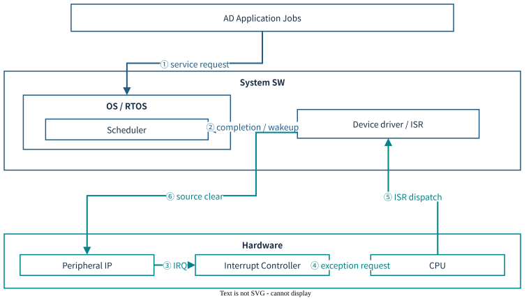

- **IP:** 수신·전송 완료·Timer 만료·오류 상태에서 interrupt를 생성한다.
- **Controller / CPU:** Enable·group·priority·routing·CPU mask 조건에 따라 exception을 전달한다.
- **System SW:** ISR이 source를 처리하고 필요 시 event·workqueue·대기 Task에 통보한다. Scheduler는 ready Task의 실제 실행을 결정한다.

### 2.2 AP Domain Interrupt Controller

**HW는 4 clusters × 4 CPUs = 16 PE**, 현재 QVP 기본 구성은 AP 4 CPU다. AP는 공유 SPI, PE별 SGI/PPI, ITS를 경유하는 LPI를 구분한다.

#### 2.2.1 GIC-720AE Hardware

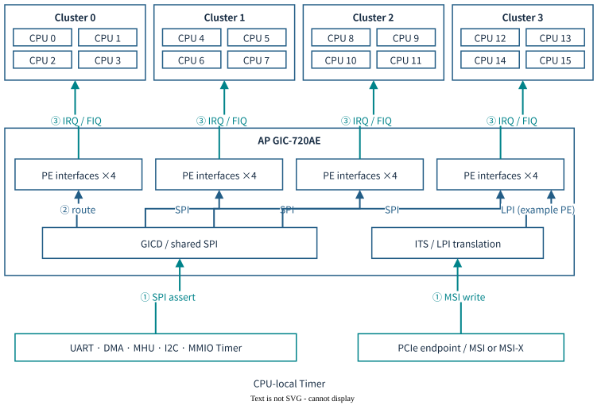

도면 상세 설명

- **PE interfaces ×4**: PE interfaces ×4 / SGI / PPI · priority
- **GICD / shared SPI**: GICD / shared SPI / Enable · Group · Priority · Affinity
- **ITS / LPI translation**: ITS / LPI translation / DeviceID · EventID → target PE
- **CPU-local Timer**: CPU-local Timer / PMU / RAS → same PE PPI · SGI: CPU system register → target PE

- **Distributor:** 공유 SPI의 enable·pending·group·priority·target affinity를 관리한다.
- **PE별 상태:** SGI/PPI는 CPU별로 독립적이다. 같은 Timer PPI 번호라도 각 CPU가 별도의 pending·active 상태를 가진다.
- **CPU interface:** Priority mask·group enable을 적용하고 IRQ/FIQ 전달, acknowledge, priority drop·deactivate를 담당한다.
- **ITS:** PCIe MSI의 DeviceID/EventID를 LPI와 target PE로 변환한다.

그림은 register와 interrupt 전달의 논리 구조다. GIC-720AE의 물리 GCI는 SGI/PPI와 core stream을 담당하며, GICR 주소 공간 전체를 단일 물리 GCI 블록으로 해석하지 않는다.

**Register map — AP runtime View1**

| 영역 | Base / 접근 | 주요 register와 역할 |
|---|---|---|
| GICD | `0x20800000` | `CTLR` +0x0000, `ISENABLERn` +0x0100, `IROUTERn` +0x6000+8×INTID: SPI enable·affinity |
| GICR | `0x20880000 + PE_index×0x40000` | RD frame의 `WAKER` +0x0014; SGI frame(+0x10000)의 `IGROUPR0` +0x0080·`ISENABLER0` +0x0100 |
| GITS | `0x20840000` | ITS enable·command queue·translation table 설정 |
| CPU interface | `MRS/MSR` | `ICC_PMR_EL1`, `ICC_IGRPEN*`, `ICC_IAR*`, `ICC_EOIR*`, `ICC_DIR_EL1` |

GICR의 PE 선택은 affinity와 frame 식별값을 확인한다. 위 stride는 AP register 배치이며 Linux CPU 번호를 무조건 MMIO index로 사용한다는 뜻이 아니다.

**Interrupt map — 대표 source**

| 종류 | Architectural INTID | Source / 대상 |
|---|---|---|
| SGI | 0–15 | CPU가 요청하는 PE 간 interrupt |
| PPI | 27 / 30 / 26 / 29 | Virtual / NS physical / hypervisor / secure Timer; 해당 PE |
| PPI | 23 / 25 / 17 | PMU / virtual maintenance / RAS; 현재 AP wrapper 배선 |
| SPI | 81 / 84 / 85 | NS MMIO Timer / UART0 / UART1 |
| SPI | 152 / 153 | CL1 HIPC PBX ACK / MBX receive |
| SPI | 311 / 352 | DMA0 / I2C0; 현재 Apollo peripheral 배선 |
| SPI | 332–335 | PCIe INTx |
| LPI | OS가 할당 | PCIe MSI/MSI-X → ITS → target PE |

**Interrupt 발생 Flow**

1. IP가 status·mask에 따라 SPI를 assert하거나 MSI message를 전송한다.
2. GIC가 pending·group·priority·routing을 평가해 target PE를 선택한다. PPI는 해당 PE에 고정된다.
3. CPU interface가 실행 상태와 mask 조건에 따라 IRQ/FIQ exception을 요청한다.
4. CPU의 IAR read로 acknowledge한다. IP 원인 해제와 EOIR/DIR의 active 완료는 별도 동작이다.

#### 2.2.2 PCIe MSI / ITS / LPI

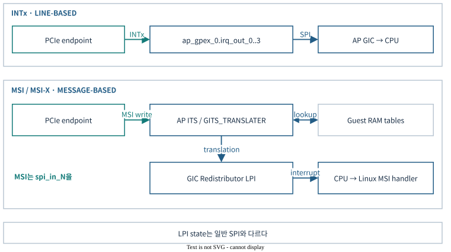

도면 상세 설명

- **PCIe endpoint**: PCIe endpoint / INTA..D / swizzle
- **ap_gpex_0.irq_out_0..3**: ap_gpex_0.irq_out_0..3 / SPI300..303 → INTID332..335
- **AP GIC → CPU**: AP GIC → CPU / level / device cause clear
- **PCIe endpoint**: PCIe endpoint / MSI address / EventID data / requester_id = DeviceID
- **AP ITS / GITS_TRANSLATER**: AP ITS / GITS_TRANSLATER / base 0x20840000 / TRANSLATER 0x20850040
- **Guest RAM tables**: Guest RAM tables / Device / ITT / Collection / MAPD · MAPC · MAPTI
- **GIC Redistributor LPI**: GIC Redistributor LPI / LPI ID ≥ 8192 · target PE / PROPBASER / PENDBASER
- **CPU → Linux MSI handler**: CPU → Linux MSI handler / IAR → LPI pending bit clear / EOIR priority drop
- **MSI는 spi_in_N을**: MSI는 spi_in_N을 / 통과하지 않는다.
- **LPI state는 일반 SPI와 다르다**: LPI state는 일반 SPI와 다르다 / LPI acknowledge는 pending table bit를 지운다. SPI의 active bitmap / DIR 설명을 그대로 적용하지 않는다.

INTx는 `ap_gpex_0 → SPI300..303`을 사용한다. MSI/MSI-X는 **requester DeviceID + EventID → ITS translation → target PE LPI** 경로다. Guest가 RAM의 Device/ITT/Collection과 LPI property/pending table을 설정한다.

LPI acknowledge는 pending-table bit를 clear한다. 일반 SPI의 active bitmap·DIR 설명을 그대로 적용하지 않는다. PCIe endpoint·MSI capability·guest ITS 설정이 함께 필요하다. [ITS 소스·범위](SOURCES.md#s8)

#### 2.2.3 Automotive Enhanced — Multiview / FMU

**GIC-720AE의 Multiview와 FMU(Fault Management Unit)**를 정리한다. GIC view는 CPU timer bank나 MMIO timer frame 번호와 별개다.

##### Multiview — AP는 실행용 View1 하나 사용

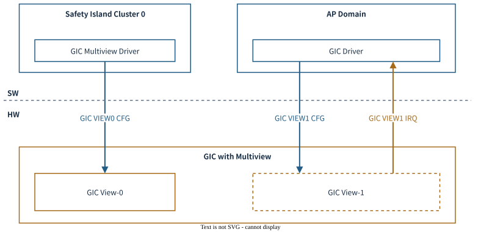

Multiview는 GIC의 interrupt·Redistributor를 서로 다른 SW 실행 환경에 할당하는 기능이다. **AP는 관리용 View0 + 실행용 View1**, SI는 **관리용 View0 + CL0 View1 + CL1 View2**로 구성한다.

| Domain | View0: 관리 | 실행용 view | Interrupt 할당 |
|---|---|---|---|
| AP | SI CL0의 SCP가 CMN 설정 이후 구성 | 모든 AP PE를 View1에 할당 | CPU timer PPI는 해당 PE의 Redistributor에 연결; NS MMIO timer INTID81은 View1에 할당 |
| SI | SI CL0의 SCP가 구성 | CL0 → View1, CL1 → View2 | 각 cluster의 CPU timer PPI는 해당 실행 환경에서 처리 |

| AP GIC 접근 영역 | GICD base | GICR 시작 주소 |
|---|---|---|
| View0 관리 영역 | `0x20000000` | `0x20080000` |
| View1 실행 영역 | `0x20800000` | `0x20880000` |

- **설정:** SCP의 `ap_redistributor_map`은 16개 PE descriptor를 모두 View1로 지정한다. 이는 지원 범위의 설정표이며 현재 AP CPU 4개 구성과 구분한다.
- **배선:** QVP는 단일 QEMU AP GIC와 SystemC `ap_gic_multiview` 관리 영역을 연결한다. View0 접근을 backend로 전달하며 AP용 View2 실행 환경은 생성하지 않는다.
- **번호 구분:** MMIO Secure frame1 / Non-secure frame0은 GIC View1 / View0을 뜻하지 않는다. NS MMIO timer의 INTID81 할당을 CPU-local PPI 할당으로 해석하면 안 된다.

SI QVP는 CL0·CL1에 별도 QEMU GIC backend를 사용한다. 이 모델 구성과 관리 register 구현만으로 실제 GIC-720AE의 view 간 격리·동적 재할당 동등성을 입증하지 않는다. [설계·SCP·Lua 근거](SOURCES.md#automotive-enhanced)

##### FMU — GIC-720AE 내부 오류 수집·보고

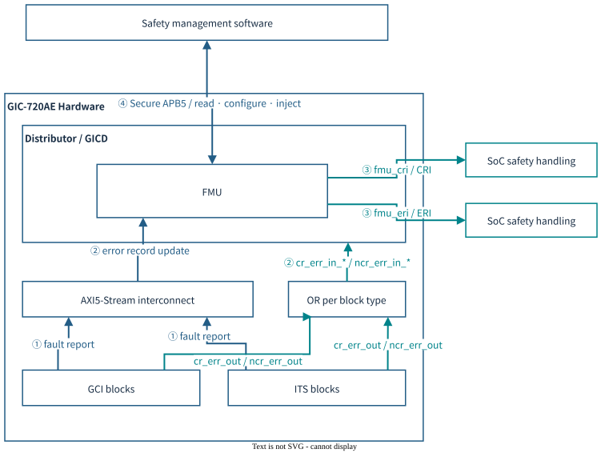

도면 상세 설명

- **FMU**: FMU / Error records · Protection control / Fault injection / clear
- **SoC safety handling**: SoC safety handling / Critical error
- **SoC safety handling**: SoC safety handling / Non-critical error
- **AXI5-Stream interconnect**: AXI5-Stream interconnect / Fault report
- **OR per block type**: OR per block type / critical / non-critical
- **GCI blocks**: GCI blocks / Protection mechanisms / fault collator
- **ITS blocks**: ITS blocks / Protection mechanisms / fault collator

**FMU는 GIC Distributor(GICD) 내부 블록**이다. GIC의 보호 회로가 검출한 오류를 수집하며, 정상 device SPI/PPI 전달과는 별도 경로로 동작한다.

| 경로 | 역할 |
|---|---|
| GIC block → AXI5-Stream → FMU | 보호 회로의 오류 정보를 전달하고 block type별 error record에 기록 |
| `cr_err_out` / `ncr_err_out` | 같은 block type의 출력을 각각 OR하여 GICD의 `cr_err_in_*` / `ncr_err_in_*`로 반환 |
| `fmu_cri` / `fmu_eri` | Critical / non-critical 오류를 SoC safety 경로에 통보 |
| Secure APB5 | SW의 error record 조회·보호 기능 설정·fault injection·오류 clear |

**오류 처리 Flow**

1. GCI·ITS 등 내부 블록의 protection mechanism이 오류를 검출한다.
2. Fault collator가 AXI5-Stream으로 오류를 보고하며, 별도 오류 wire도 GICD로 전달한다.
3. FMU가 error record와 reporting enable에 따라 CRI 또는 ERI를 출력한다.
4. Safety SW가 APB5로 원인을 조회하고 복구·clear한다. 원격 블록의 오류 wire는 SW가 오류를 clear할 때까지 유지된다.

Error record는 GICD·Wake Request·SPI Collator·GCI·ITS·FMU의 block type별 critical/non-critical pair로 구성한다. FMU는 별도 reset을 사용하므로 GIC functional reset 동안 record를 유지할 수 있다. [GIC-720AE TRM §6.1, Figure 6-2](https://documentation-service.arm.com/static/679b9c8f27eda361ad4ee88f)

**Apollo QVP:** 위 그림은 GIC-720AE HW 구조다. 현재 AP/SoC Lua에는 AP GIC 내부 FMU의 전용 instance·내부 오류 입력 배선이 확인되지 않는다. `ap_clN_ni710ae_fmu`는 별도의 NoC FMU이며, 이 그림의 GIC FMU를 대신하지 않는다.

#### 2.2.4 AP Domain Interrupt QVP 구현

| 구성 | 모델 / 연결 | 역할 |
|---|---|---|
| GIC / ITS | `ap_gic` / `ap_gic_its`, `ap_qemu_inst` 소유 | QEMU interrupt 상태·priority·routing 및 MSI translation |
| CPU | `ap_cpu_n` | `irq/fiq/virq/vfiq_out_n` → 같은 CPU의 입력 |
| SPI | `spi_in_N` | Architectural INTID = N+32 |
| PPI | `ppi_in_cpu_C_N` | N은 offset이 아닌 architectural INTID |
| Multiview | `ap_gic_multiview` → backend | View0 설정 영역과 View1 runtime 주소 연결 |

QVP의 GIC revision·입력 수는 모델 설정값이다. GIC-720AE의 물리 timing·fault detection 기능 전체를 뜻하지 않는다. Signal 전달 경계는 Chapter 3에서 설명한다.

### 2.3 Safety Island Domain Interrupt Controller

Arm 설계의 SI는 **한 GIC의 여러 programming view**로 CL0와 CL1을 분리한다. CL0는 관리용 실행 PE, CL1은 4 CPU 실행 환경이다. CL0 DCLS pair는 독립 SW 실행 CPU 두 개로 세지 않는다.

#### 2.3.1 GIC-720AE Hardware

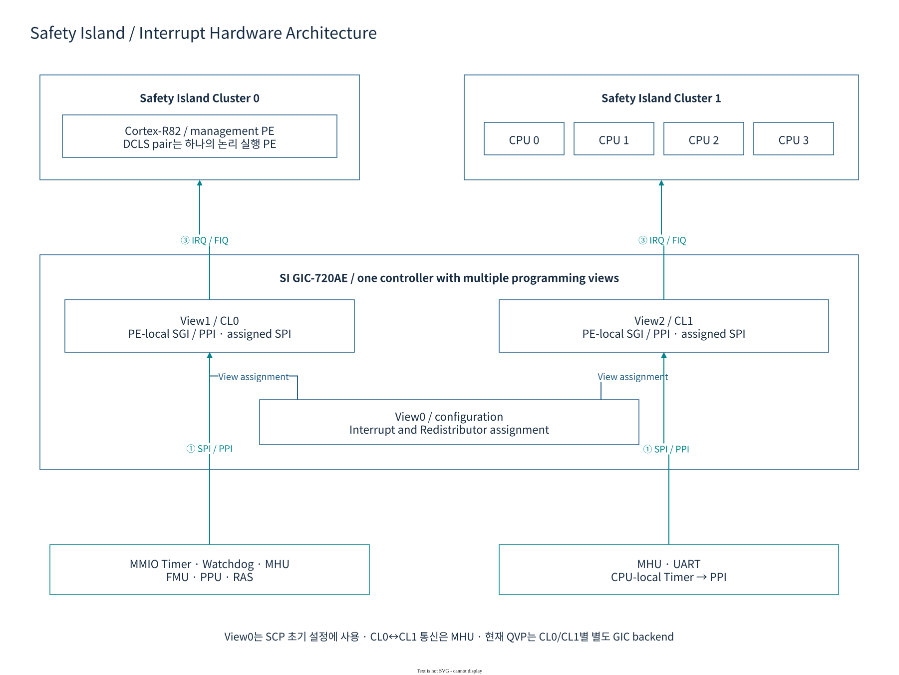

도면 상세 설명

- **Cortex-R82 / management PE**: Cortex-R82 / management PE / DCLS pair는 하나의 논리 실행 PE
- **View1 / CL0**: View1 / CL0 / PE-local SGI / PPI · assigned SPI
- **View2 / CL1**: View2 / CL1 / PE-local SGI / PPI · assigned SPI
- **View0 / configuration**: View0 / configuration / Interrupt and Redistributor assignment
- **MMIO Timer · Watchdog · MHU**: MMIO Timer · Watchdog · MHU / FMU · PPU · RAS
- **MHU · UART**: MHU · UART / CPU-local Timer → PPI

- **View0:** SCP가 interrupt와 Redistributor의 실행 view를 할당한다.
- **View1 / View2:** 각각 CL0 / CL1이 자신의 interrupt 상태를 설정·처리한다.
- **CPU-local PPI:** 각 R82의 Timer가 해당 PE의 PPI로 전달된다.
- **관리 SPI:** CL0는 MHU·FMU·PPU·RAS를 수집하며, CL1은 자신의 MHU·UART를 처리한다.

**Register map**

| 접근 영역 | GICD base | GICR 시작 / 배치 | 용도 |
|---|---|---|---|
| View0 | `0x30000000` | `0x30040000` | SCP boot 설정 |
| CL0 View1 | `0x30100000` | `0x30140000` | CL0 runtime |
| CL1 View2 | `0x30200000` | `0x30260000 + n×0x20000` | CL1 CPU별 runtime |
| CPU interface | `MRS/MSR` | `ICC_*` | CL0 Group0/FIQ, CL1 Group1/IRQ 처리 |

GICD·GICR의 enable·priority·pending·group register 역할은 AP와 같다. Base·Redistributor stride·view 소유권은 SI 설정을 따른다.

**Interrupt map — HW 계약과 QVP 연결 구분**

| 대상 | INTID | Source / 의미 |
|---|---|---|
| CL0 / CL1 PPI | 27 | Virtual Timer, PE별 독립 상태 |
| CL0 / CL1 PPI | 20 | HW: Secure EL2 physical Timer; 현재 QVP: physical output 연결 |
| CL0 / CL1 PPI | 19 | HW: reserved; 현재 QVP: hypervisor output 연결 |
| CL0 / CL1 PPI | 29 | Secure PL1 Timer 번호; 현재 R82 guest의 CNTPS 정상 접근 불가 |
| CL0 SPI | 34 / 37 / 40 | MMIO Timer / watchdog WS0 / UART |
| CL0 SPI | 97 / 99 / 105 / 107 | AP NS SCMI / AP Secure SCMI / RSE / CL1 PFDI receive |
| CL0 SPI | 128 / 129 | FMU critical / non-critical |
| CL1 SPI | 39 / 72 / 73 / 82 | UART / HIPC ACK / HIPC receive / PFDI ACK |

**Interrupt 발생 Flow**

1. IP의 SPI 또는 PE-local PPI가 pending 상태를 만든다.
2. View 할당과 group·priority·enable에 따라 CL0 또는 CL1의 대상 PE로 전달한다.
3. CL0는 Group0/FIQ, CL1은 Group1/IRQ의 acknowledge·handler·completion 경로로 처리한다.

CL0↔CL1 MHU interrupt와 각 cluster 내부 SGI를 구분한다. PPI19/20의 현재 QVP 연결은 HW source 의미와 일치하지 않으며, 상세 Timer 차이는 [Timer SI Hardware](../timer/README.md#231-arm-generic-timer)에 정리했다.

#### 2.3.2 Automotive Enhanced — Multiview / FMU

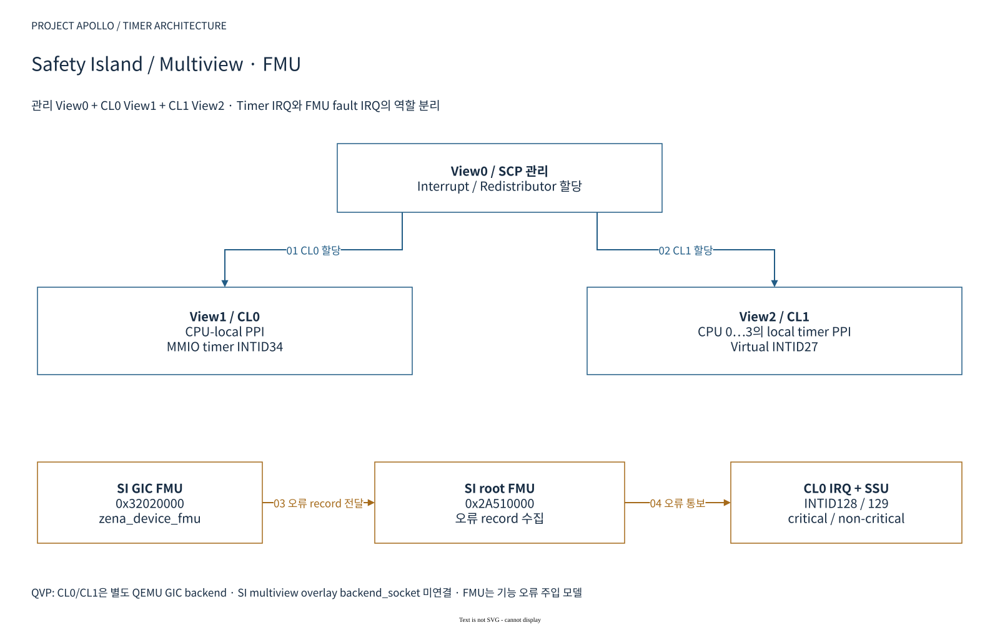

도면 상세 설명

- **View0 / SCP 관리**: View0 / SCP 관리 / Interrupt / Redistributor 할당
- **View1 / CL0**: View1 / CL0 / CPU-local PPI / MMIO timer INTID34
- **View2 / CL1**: View2 / CL1 / CPU 0…3의 local timer PPI / Virtual INTID27
- **SI GIC FMU**: SI GIC FMU / 0x32020000 / zena_device_fmu
- **SI root FMU**: SI root FMU / 0x2A510000 / 오류 record 수집
- **CL0 IRQ + SSU**: CL0 IRQ + SSU / INTID128 / 129 / critical / non-critical

##### Multiview

| View | 소유·용도 | Interrupt 연결 |
|---|---|---|
| View0 | CL0의 SCP가 초기 설정에 사용 | Interrupt·Redistributor의 실행 view 할당 |
| View1 | CL0 실행 환경 | CL0 CPU-local PPI와 MMIO timer INTID34 |
| View2 | CL1 실행 환경 | CL1 각 CPU의 timer PPI |

Arm 설계는 SI GIC의 여러 programming view로 실행 환경을 분리한다. 현재 QVP는 **CL0·CL1에 별도 QEMU GIC backend**를 두며 `si_gic_multiview`가 관리 register를 모델링한다. SI overlay의 `backend_socket`은 연결되지 않아, AP의 backend forwarding 구성과 동일하게 설명하면 안 된다.

##### FMU — Fault Management Unit

| 구성 | 주소 / 출력 | 역할 |
|---|---|---|
| SI GIC FMU | `0x32020000` | QVP `si_cl0_gic_fmu`의 오류 record를 상위 FMU로 전달 |
| SI root FMU | `0x2A510000` | 여러 오류 source를 수집하는 `si_cl0_fmu` |
| Critical / non-critical IRQ | INTID128 / 129 | CL0에 오류 통보; SSU에도 별도 신호 전달 |

Timer 만료 PPI·INTID34와 FMU 오류 interrupt는 별도 경로다. QVP의 FMU record·주입 경로는 GIC 내부 ECC/parity 검출이나 timer 고장 검출의 구현을 뜻하지 않는다. [Multiview·FMU 근거](SOURCES.md#automotive-enhanced)

#### 2.3.3 Safety Island Domain Interrupt QVP 구현

| 구성 | CL0 | CL1 |
|---|---|---|
| QemuInstance | `si_cl0_qemu_inst` | `si_cl1_qemu_inst` |
| GIC backend | `si_cl0_gic` | `si_cl1_gic` |
| 실행 CPU | `si_cl0_cpu_0` | `si_cl1_cpu_0..3` |
| Runtime view 주소 | View1 | View2 |
| Timer 입력 | CPU별 PPI27/20/19/29 | CPU별 PPI27/20/19/29 |

QVP는 별도 GIC backend 두 개를 사용한다. `si_gic_multiview`의 관리 register와 backend 간 동적 분할·재할당은 하나의 공유 물리 GIC와 같지 않다. 이 차이를 포함한 전체 비교는 Chapter 3에 정리했다.

### 2.4 RSE Domain Interrupt Controller

RSE는 **Cortex-M55 ×1과 NVIC**를 사용한다. 외부 peripheral IRQ와 CPU 내부 exception을 함께 arbitration하며, GIC의 SPI/PPI·ITS/LPI 구조를 적용하지 않는다.

#### 2.4.1 Cortex-M55 / NVIC Hardware

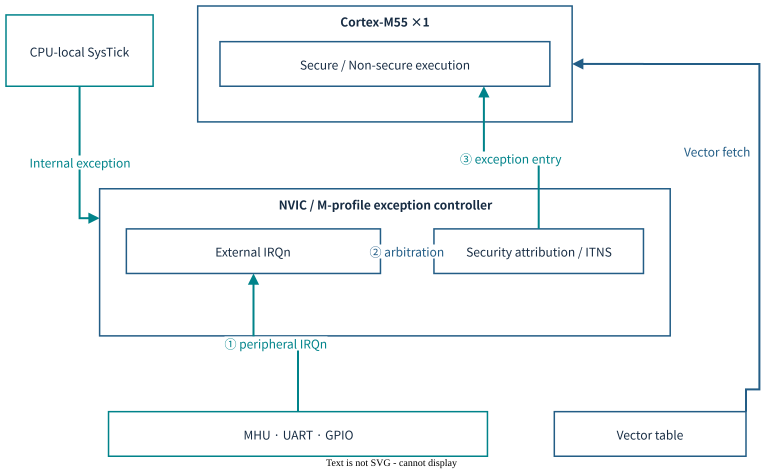

도면 상세 설명

- **Secure / Non-secure execution**: Secure / Non-secure execution / Vector fetch · exception entry / return
- **External IRQn**: External IRQn / Enable · Pending · Active · Priority
- **Security attribution / ITNS**: Security attribution / ITNS / Priority arbitration · nesting
- **CPU-local SysTick**: CPU-local SysTick / S / NS · exception 15
- **MHU · UART · GPIO**: MHU · UART · GPIO / Timestamp TIMER0–3 · Watchdog
- **Vector table**: Vector table / VTOR_S / VTOR_NS

- **외부 IRQ:** Source별 enable·pending·active·priority를 관리한다.
- **Security attribution:** ITNS로 외부 IRQ의 Secure/Non-secure target을 선택한다. Peripheral 보안 접근 설정과 IRQ enable은 별도다.
- **Exception entry:** 우선순위와 mask 조건을 통과한 요청에 대해 context stacking·vector fetch·handler 진입을 수행한다.
- **Exception return:** Active 상태를 종료하고 이전 실행 문맥으로 복귀한다. Level 원인이 남아 있으면 다시 pending될 수 있다.
- **내부 exception:** SysTick·PendSV·SVCall 등은 외부 IRQn을 사용하지 않는다.

**Register map — SCS / NVIC**

| 영역 / register | 접근 | 역할 |
|---|---|---|
| SCS | `0xE000E000` | NVIC·SCB·SysTick을 포함한 CPU system-control 영역 |
| NVIC `ISER` / `ICER` | Memory-mapped | 외부 IRQ enable / disable |
| NVIC `ISPR` / `ICPR` / `IABR` | Memory-mapped | Pending 설정·해제 / active 조회 |
| NVIC `IPR` / `ITNS` | Memory-mapped | Priority / Secure·Non-secure target |
| SCB `VTOR` / `ICSR` | 보안 상태별 접근 규칙 | Vector base / exception 상태·제어 |
| `PRIMASK` / `BASEPRI` / `FAULTMASK` | CPU special registers | Exception masking·priority threshold |

**Interrupt map — 현재 Apollo 연결**

| Source | External IRQn | Exception 번호 |
|---|---:|---:|
| Host UART / watchdog WS1 | 0 | 16 |
| Watchdog WS0 | 1 | 17 |
| Timestamp TIMER0 / 1 / 2 | 3 / 4 / 5 | 19 / 20 / 21 |
| Timestamp TIMER3 | 27 | 43 |
| GPIO OR output | 34 | 50 |
| Monitor MHU / AP Secure MHU | 41 / 45 | 57 / 61 |
| CL0→RSE MHU | 139 | 155 |
| Secure / Non-secure SysTick | 외부 IRQn 없음 | 15 |

**Interrupt 발생 Flow**

1. Peripheral 출력이 NVIC external IRQn을 assert한다.
2. NVIC가 pending·enable·priority·target security와 CPU mask를 평가한다.
3. M55가 해당 vector로 진입한다. 외부 exception 번호는 IRQn+16이다.
4. Handler가 source를 처리한 후 exception return으로 active 상태를 종료한다. TF-M partition의 `psa_eoi()`는 별도의 SW protocol이다.

#### 2.4.2 RSE Domain Interrupt QVP 구현

| 구성 | 모델 / 경로 | 의미 |
|---|---|---|
| CPU / NVIC | `rse_cpu_pass.cpu_0.cpu.nvic` | M55 내부 NVIC, external IRQ 160개 구성 |
| 외부 SystemC IP | `rse_cpu_pass → plugin_pass → irq_in_N` | QBox signal 중계 후 NVIC 입력 |
| Local Timestamp Timer | 같은 QemuInstance → NVIC | TIMER0–3의 직접 IRQ 연결 |
| SysTick | CPU-local Secure / NS SysTick | 외부 signal socket 없이 exception 발생 |
| GPIO | `rse_gpio_irq_or → IRQn34` | 여러 GPIO source의 명시적 OR 합성 |

160개 입력은 controller 수용 범위이며 활성 source 수가 아니다. IRQ0의 UART·watchdog 다중 bind와 crypto/DMA 미연결 항목은 [상세 배선표](WIRING-MAP.md)에 정리했다.

### 2.5 Subsystem별 HW 구성 요약

| Domain | Controller | HW 실행 topology | Interrupt 분류 | 실행 환경 분리 |
|---|---|---|---|---|
| AP | AP GIC-720AE / ITS | 4 clusters × 4 PE | SGI·PPI·SPI·LPI | Group·EL·View1 |
| SI CL0 | SI GIC-720AE Multiview | Management PE ×1 | SGI·PPI·SPI | View1 |
| SI CL1 | SI GIC-720AE Multiview | 4 PE | SGI·PPI·SPI | View2 |
| RSE | M55 NVIC | M55 ×1 | External IRQ·CPU exception | Secure / Non-secure target |

#### Controller 물리 블록과 Register Interface

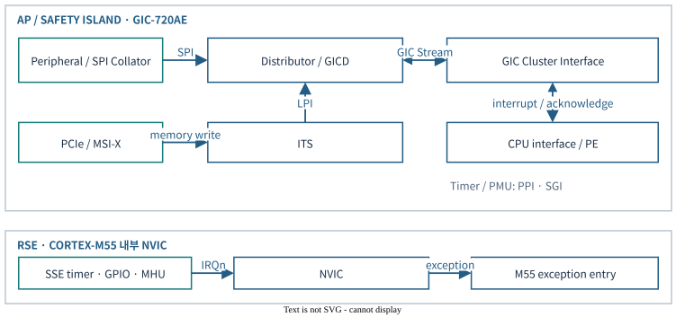

도면 상세 설명

- **Peripheral / SPI Collator**: Peripheral / SPI Collator / UART · MHU · watchdog · GPIO / 공유 IRQ 입력
- **Distributor / GICD**: Distributor / GICD / SPI routing · LPI state / GICR의 non-SGI page 기능 포함
- **GIC Cluster Interface**: GIC Cluster Interface / PE별 SGI·PPI / 우선순위 선택 / GICR SGI page 기능
- **PCIe / MSI-X**: PCIe / MSI-X / DeviceID + EventID
- **ITS**: ITS / GITS_TRANSLATER / message → LPI / target PE
- **CPU interface / PE**: CPU interface / PE / ICC_* system registers / IRQ / FIQ · IAR / EOIR / DIR
- **SSE timer · GPIO · MHU**: SSE timer · GPIO · MHU / external IRQn
- **NVIC**: NVIC / priority · pending · active · ITNS
- **M55 exception entry**: M55 exception entry / vector fetch / stacking / EXC_RETURN

| 블록 | 소유하는 상태·역할 | SW 접점 |
|---|---|---|
| GIC Distributor | 공유 SPI의 enable·pending·priority·target affinity; GIC-720AE의 LPI 기능 | `GICD_*`, `GICD_IROUTER` |
| GIC Cluster Interface, GCI | CPU 인접 SGI·PPI 관리, 전달할 IRQ 선택, core stream 연결 | PE별 `GICR` SGI page |
| CPU interface | priority mask·preemption·group enable·acknowledge·completion | `ICC_PMR`, `ICC_IAR`, `ICC_EOIR`, `ICC_DIR` |
| ITS | DeviceID/EventID를 LPI와 대상 PE로 변환 | `GITS_*`, guest RAM command/table |
| M55 NVIC | RSE exception의 priority·pending·active·Secure target | `ISER/ISPR/IPR/ITNS`, vector table |

## 3. QVP Interrupt Implementation

### 3.1 Implementation Overview

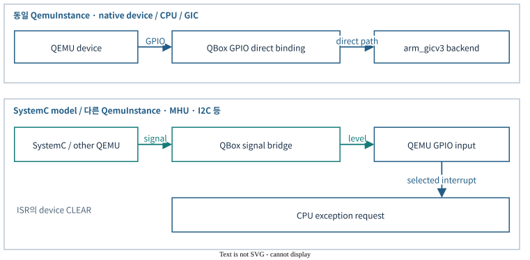

도면 상세 설명

- **QEMU device**: QEMU device / qemu_set_irq(level)
- **QBox GPIO direct binding**: QBox GPIO direct binding / 같은 instance의 Qemu signal socket
- **arm_gicv3 backend**: arm_gicv3 backend / input handler → pending / update
- **SystemC / other QEMU**: SystemC / other QEMU / IP event → IRQ level
- **QBox signal bridge**: QBox signal bridge / QEMU output은 SystemC queue로 defer / input 측은 target QEMU BQL 확보
- **QEMU GPIO input**: QEMU GPIO input / qemu_set_irq / gicv3_set_irq / enable · priority · affinity 판정
- **CPU exception request**: CPU exception request / GIC irq_out / fiq_out → CPU irq_in / fiq_in / ARM_CPU interrupt request → guest vector
- **ISR의 device CLEAR**: ISR의 device CLEAR / → IP 출력 LOW / → 같은 전달 경로로 반영

| 계층 | 실제 책임 | 대표 소스 / 함수 |
|---|---|---|
| IP model | status·mask에서 IRQ level 계산 | `dw_apb_i2c::update_irq → drive_irq` |
| QBox signal socket | bind, thread 경계, 대상 libqemu lock | `QemuInitiatorSignalSocket`, `QemuTargetSignalSocket` |
| GIC wrapper | CCI→QOM 속성, MMIO·SPI/PPI·CPU output 노출 | `arm_gicv3::end_of_elaboration` |
| QEMU GIC | pending/active, priority, group, affinity | `gicv3_set_irq → gicv3_dist_set_irq → gicv3_update` |
| CPU interface / CPU | 전달 가능성 판정, IRQ/FIQ, exception request | `gicv3_cpuif_update → arm_cpu_set_irq` |

| 항목 | Arm Zena CSS / FVP 참조 구조 | Apollo QVP 구현 |
|---|---|---|
| Controller | GIC-720AE·RSE NVIC 중심의 platform 설계 | QEMU GICv3/ITS·M55 NVIC와 QBox wrapper |
| SI Multiview | 한 GIC의 View0 관리·View1 CL0·View2 CL1 | CL0·CL1별 GIC backend와 별도 관리 register 모델 |
| AP Multiview | View0 관리·View1 실행 | 관리 모델의 backend forwarding + 단일 AP GIC |
| IP→CPU 전달 | Platform model의 interrupt 연결 | Native QEMU GPIO 또는 SystemC signal socket 경유 |
| Fault reporting | FMU 계층·critical/non-critical 오류 전달 | 구현된 record·주입·배선 범위로 제한 |

### 3.2 Signal Delivery and Interrupt State

**I2C0의 실제 경로:** `raw & mask → SC_METHOD(drive_irq) → spi_in_320 → target BQL → qemu_set_irq → INTID352 → GIC route/priority → CPU IRQ`. Lua의 연결선과 C++/QEMU callback을 함께 추적한 결과다. [상세 소스](SOURCES.md#s3)

- **같은 QemuInstance:** QEMU GPIO를 직접 연결할 수 있다. GIC→소속 CPU가 대표 사례다.
- **QEMU→SystemC/다른 instance:** `run_on_sysc(..., wait=false, defer=true)`로 queue에 넘긴다. 대상 QEMU 입력은 그 instance의 BQL을 확보한다.
- **SystemC→QEMU:** target signal callback이 BQL 아래 GPIO handler를 호출한다. 모든 IRQ가 동일한 왕복·지연을 갖지는 않는다.

QVP의 bool 신호는 논리 assert/deassert이다. TRM의 active-low 전기 신호나 CDC·배선 지연까지 모델링한 것으로 읽지 않는다.

### 3.3 Wake / Reset / Diagnostic Injection

| 경로 | 현재 동작 | 해석 경계 |
|---|---|---|
| AP wake | GIC `wake_request_out_n → core PPU.wakeup`; CPU WFI→PPU powerdown | WAKER 처리와 물리 power handshake 지연은 다름 |
| Reset | AP/SI QemuInstance의 pending·active reset + multiview shadow reset | backend와 overlay는 reset 소유자가 다름 |
| 선택적 SI IRQ 주입 | owner 검사 → 실제 CL0/CL1 GIC `runtime_set_spi(INTID−32)` | 명령 적용 성공만으로 ISR 수행을 판정하지 않음 |

[Wake·reset 소스](SOURCES.md#s3)

### 3.4 Multiview Implementation and Limitations

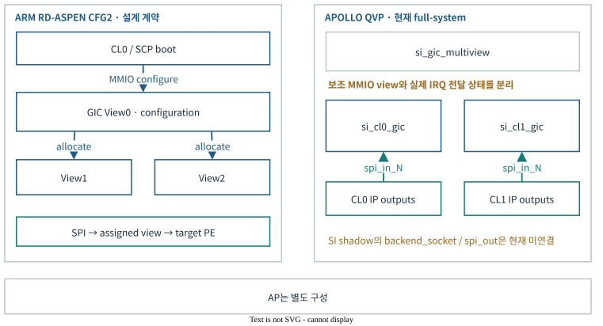

도면 상세 설명

- **CL0 / SCP boot**: CL0 / SCP boot / View0에서 SPI·PE의 view 배정
- **GIC View0 · configuration**: GIC View0 · configuration / GICD_IVIEWR / GICR_VIEWR / View0 group enable은 상위 mask
- **View1**: View1 / CL0 / SCP runtime
- **View2**: View2 / CL1 / Zephyr SMP
- **SPI → assigned view → target PE**: SPI → assigned view → target PE / 실제 ownership·routing은 동일 GIC 자원 안에서 결정
- **si_gic_multiview**: si_gic_multiview / CFGID · IVIEWR · 일부 View0 보조 창 / backend_redist_count = 0
- **si_cl0_gic**: si_cl0_gic / QEMU backend / 1 PE / GICD 0x30100000 / View0 alias 0x30000000
- **si_cl1_gic**: si_cl1_gic / QEMU backend / 4 PE / GICD 0x30200000 / GICR 0x30260000 + stride
- **CL0 IP outputs**: CL0 IP outputs / MHU · FMU · PPU · timer
- **CL1 IP outputs**: CL1 IP outputs / HIPC MHU · UART
- **AP는 별도 구성**: AP는 별도 구성 / ap_gic_multiview의 View0는 AP backend_socket으로 연결된다. / SI의 분리 구현을 AP에 그대로 일반화하지 않는다.

| 항목 | Apollo QVP 구현 |
|---|---|
| AP | 단일 QEMU GIC·ITS와 View0 관리 overlay; backend forwarding 연결 |
| SI | CL0·CL1 별도 QEMU GIC; View0 관리 shadow의 backend socket 미연결 |
| View 변경 | SI IVIEWR 저장만으로 실제 IP 배선 전체가 다른 backend로 이동하지 않음 |
| Power | AP WAKER→PPU wake 신호 연결; ChildrenAsleep 즉시 반영, SI 관리 PWRR은 RAZ/WI |
| Safety | FMU record·오류 주입 제공; 물리 lockstep·ECC 검출과 별개 |
| Timing | SystemC event·QEMU scheduling으로 전달; 전기 polarity·CDC·배선 지연 모델이 아님 |

SI QVP의 physical/hyp Timer 출력은 INTID20/19에 배선된다. 이를 기본 SI HW 표의 CNTHPSIRQ/reserved 분류와 동일시하지 않는다. [모델 구성](SOURCES.md#s3) · [배선 상세](WIRING-MAP.md)

## 4. Interrupt Software Architecture

### 4.1 Software Architecture Overview

**초기화는 source와 handler를 연결하고, ISR은 interrupt 원인을 처리하며, 후속 작업은 해당 SW의 실행 문맥으로 이어진다.** Device source clear와 controller 완료는 별도 책임이다.

| 단계 | 책임 | 주의점 |
|---|---|---|
| Source 설정 | Device mask·status·interrupt enable | GIC/NVIC enable과 별개 |
| Controller 설정 | Group·priority·trigger·routing·enable | CPU의 exception mask도 허용되어야 함 |
| Handler 등록 | INTID/IRQn과 ISR 연결 | Linux virq는 INTID와 다른 번호 |
| ISR | 원인 확인·data/FIFO 처리·source clear | Level 원인이 남으면 다시 pending될 수 있음 |
| Controller 완료 | EOI/deactivate 또는 exception return | Device transaction 완료와 별개 |
| 후속 실행 | IRQ thread·workqueue·framework event·partition signal | IRQ 횟수와 packet·작업 수는 1:1이 아님 |

### 4.2 AP Domain — Linux·TF-A·U-Boot·OP-TEE

Group1NS는 Linux, Group1S는 Secure EL1, Group0는 EL3 처리 경로로 구분한다. 실제 IRQ/FIQ routing은 group·실행 security state·EL 설정에 따른다.

#### 4.2.1 Linux Interrupt Architecture

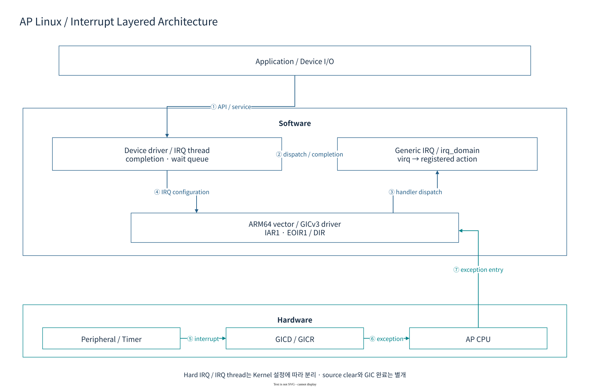

도면 상세 설명

- **Device driver / IRQ thread**: Device driver / IRQ thread / completion · wait queue
- **Generic IRQ / irq_domain**: Generic IRQ / irq_domain / virq → registered action
- **ARM64 vector / GICv3 driver**: ARM64 vector / GICv3 driver / IAR1 · EOIR1 / DIR

| 계층 | 역할 |
|---|---|
| Device driver | DT IRQ 조회, handler 등록, device status 처리·source clear |
| Generic IRQ / irq_domain | INTID→virq mapping, flow handler, IRQ thread·oneshot 관리 |
| GICv3 driver | Distributor·Redistributor·CPU interface 설정과 acknowledge·EOI |
| ARM64 entry | CPU exception에서 GIC handler로 연결 |
| Application / Scheduler | Completion·wait queue에 의해 ready 상태로 전환된 Task 실행 |

##### 4.2.1.1 Interrupt Initialization

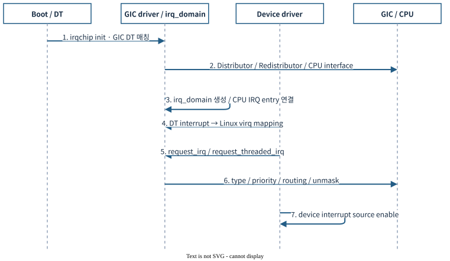

1. IRQ chip 초기화가 DT의 GIC node와 driver를 연결한다.
2. GIC driver가 Distributor와 boot CPU의 Redistributor·CPU interface를 설정한다.
3. `irq_domain`을 만들고 CPU IRQ entry를 연결한다. Secondary CPU는 CPU별 초기화 경로를 따른다.
4. Device driver가 DT interrupt specifier를 Linux virq로 변환한다.
5. `request_irq()` 또는 `request_threaded_irq()`로 handler를 등록한다.
6. IRQ core와 GIC driver가 type·routing·enable 상태를 구성한다.
7. Device driver가 IP 내부 interrupt source를 enable한다. 세부 순서는 개별 driver에 따른다.

##### 4.2.1.2 Handler / Completion API

| API / 상태 | 역할 |
|---|---|
| `request_irq()` / `request_threaded_irq()` | Hard handler / thread handler 등록 |
| `enable_irq()` / `disable_irq()` | Linux IRQ delivery 제어; device source mask와 별개 |
| `IRQ_HANDLED` / `IRQ_NONE` | Handler가 자기 device 원인을 처리했는지 보고 |
| `IRQ_WAKE_THREAD` | Primary handler가 등록된 IRQ thread 실행 요청 |
| `complete()` / wait queue | I/O를 기다리는 Task에 완료 통보 |

##### 4.2.1.3 Level Interrupt Sequence

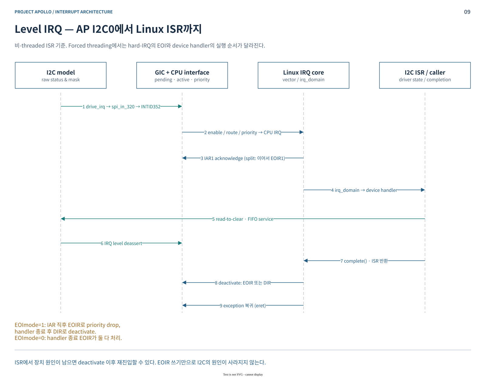

도면 상세 설명

- **I2C model**: I2C model / raw status & mask
- **GIC + CPU interface**: GIC + CPU interface / pending · active · priority
- **Linux IRQ core**: Linux IRQ core / vector / irq_domain
- **I2C ISR / caller**: I2C ISR / caller / driver state / completion
- **EOImode=1: IAR 직후 EOIR로 priority drop,**: EOImode=1: IAR 직후 EOIR로 priority drop, / handler 종료 후 DIR로 deactivate. / EOImode=0: handler 종료 EOIR가 둘 다 처리.

1. I2C status와 mask가 조건을 만족하면 source level을 assert한다.
2. GIC가 enable·group·priority·routing 조건을 평가하여 CPU에 IRQ를 전달한다.
3. `gic_handle_irq()`가 IAR1을 읽고 INTID를 acknowledge한다.
4. IRQ domain과 flow handler가 등록된 device handler로 dispatch한다.
5. I2C ISR이 TX abort 원인을 먼저 저장하고 원인별 `IC_CLR_*` read·FIFO 처리를 수행한다.
6. 전송 완료이면 `complete(cmd_complete)`로 대기 Task에 통보한다.
7. IRQ 처리를 마치고 exception에서 복귀한다. Task 실행은 Scheduler가 결정한다.

**EOI 순서:** 비-threaded 경로의 EOImode1은 IAR 직후 EOIR1, handler 종료 후 DIR이다. EOImode0은 handler 종료 시 EOIR1로 priority drop·deactivate를 함께 수행한다. Forced IRQ threading/PREEMPT_RT에서는 실제 device 처리가 IRQ thread로 이동하므로 도면의 hard-IRQ 순서를 그대로 적용하지 않는다. [Linux 소스](SOURCES.md#s4)

#### 4.2.2 TF-A Interrupt Architecture

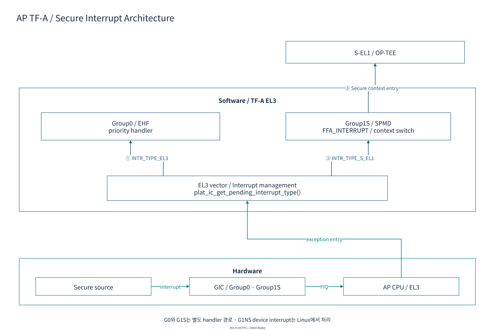

도면 상세 설명

- **Group0 / EHF**: Group0 / EHF / priority handler
- **Group1S / SPMD**: Group1S / SPMD / FFA_INTERRUPT / context switch
- **EL3 vector / Interrupt management**: EL3 vector / Interrupt management / plat_ic_get_pending_interrupt_type()

TF-A는 GIC security·EL routing을 설정하고, EL3 handler와 Secure EL1 SPMC로 interrupt를 분배한다. Apollo의 `spmd` 구성은 과거 `opteed` 경로와 구분한다.

##### 4.2.2.1 Initialization / Routing

| 설정 | 역할 |
|---|---|
| Platform GIC 초기화 | GICD/GICR base·interrupt property와 per-CPU interface 구성 |
| `plat_ic_*` | Pending type·ID, acknowledge·EOI, enable·priority 등의 platform interface |
| EHF | Group0 interrupt를 등록된 priority handler로 dispatch |
| SPMD / S-EL1 SPMC | Secure interrupt 전달을 위한 FF-A context 전환 |
| Apollo runtime setup | Warm reboot SGI 설정; graceful-reset 구성에서 EHF handler 등록 |

`plat_spmd_handle_group0_interrupt()`의 Apollo 구현은 `-1`을 반환하는 stub이다. 이를 일반 Group0 device ISR 구현으로 설명하지 않는다. EHF의 등록 handler와 구분한다.

##### 4.2.2.2 Secure Interrupt Sequence

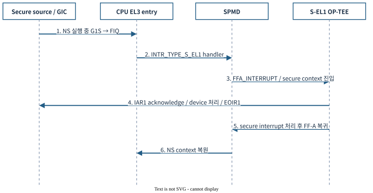

1. Non-secure 실행 중 G1S가 발생하면 routing에 따라 EL3 FIQ로 진입한다.
2. EL3 interrupt management가 Secure EL1 interrupt handler를 선택한다.
3. SPMD가 `FFA_INTERRUPT`로 S-EL1 SPMC context에 진입한다.
4. OP-TEE가 native GIC handler와 device ISR로 원인을 처리한다.
5. Secure interrupt 처리 후 FF-A 경로로 복귀한다.
6. SPMD가 중단된 Non-secure context를 복원한다.

G0의 EHF dispatch와 G1NS의 Linux 처리는 이 Sequence에 포함하지 않는다. [TF-A·SPMD 소스](SOURCES.md#s4)

#### 4.2.3 U-Boot Interrupt Architecture

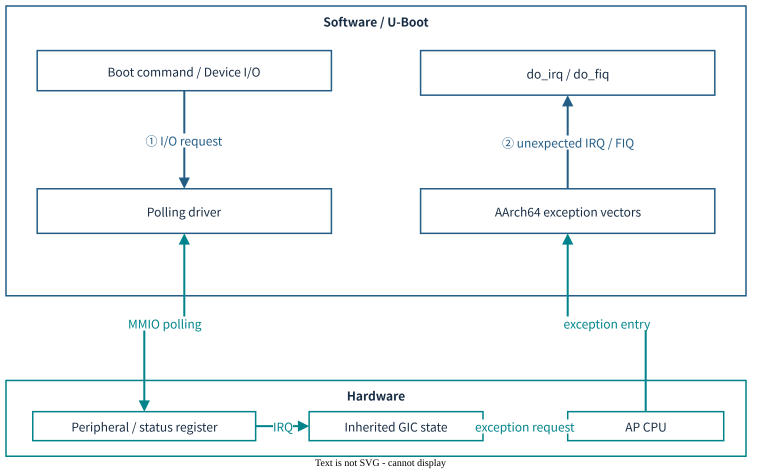

도면 상세 설명

- **Polling driver**: Polling driver / status read / timeout
- **do_irq / do_fiq**: do_irq / do_fiq / register dump → panic

현재 AArch64 generic 구현은 **일반 IRQ 등록·dispatch 서비스를 제공하지 않는다.** `enable_interrupts()`는 no-op이며 `do_irq()`·`do_fiq()`는 register 정보를 출력하고 panic한다.

##### 4.2.3.1 Initialization / Driver Operation

| 구성 | 동작 |
|---|---|
| `interrupt_init()` | `enable_interrupts()` 호출 후 성공 반환; generic 함수는 GIC 초기화 없음 |
| Driver I/O | 해당 driver의 status polling·timeout 사용 여부에 따름 |
| IRQ/FIQ vector | `do_irq()` / `do_fiq()` 예외 진단 경로 |
| OS handoff | Linux는 자체 IRQ chip·driver 초기화를 수행; U-Boot handler table을 인계받지 않음 |

##### 4.2.3.2 Polling / Exception Sequence

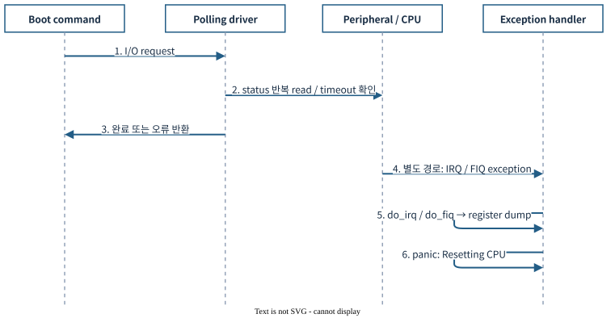

1. Boot command가 driver에 I/O를 요청한다.
2. Polling driver는 device status와 timeout을 확인한다.
3. 완료 또는 오류를 caller에 반환한다.
4. 별도 IRQ/FIQ exception이 전달되면 exception vector로 진입한다.
5. `do_irq()`·`do_fiq()`가 register 상태를 출력한다.
6. Panic 경로로 종료한다. 이를 정상 I/O completion으로 판정하지 않는다.

EFI·다른 architecture의 interrupt 구현을 Apollo의 이 generic 경로에 합치지 않는다. [U-Boot 소스](SOURCES.md#uboot-interrupt)

#### 4.2.4 OP-TEE Interrupt Architecture

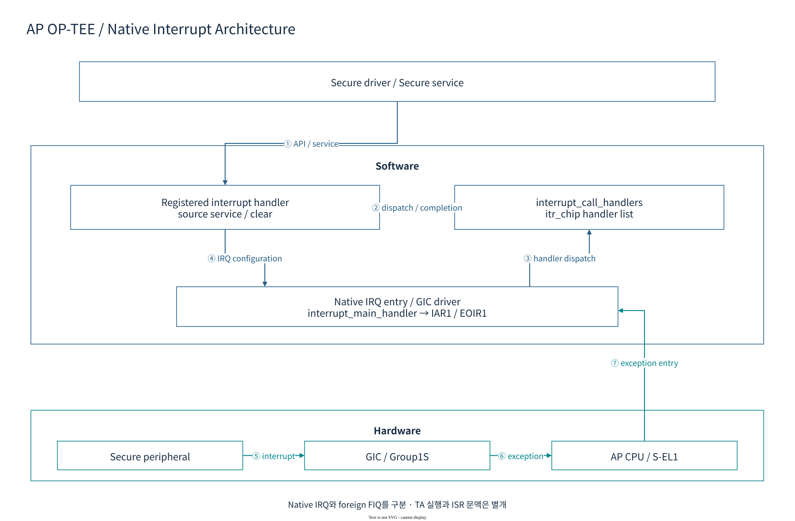

도면 상세 설명

- **Registered interrupt handler**: Registered interrupt handler / source service / clear
- **interrupt_call_handlers**: interrupt_call_handlers / itr_chip handler list
- **Native IRQ entry / GIC driver**: Native IRQ entry / GIC driver / interrupt_main_handler → IAR1 / EOIR1

OP-TEE는 native IRQ를 등록된 Secure handler에 전달한다. 현재 ARM64 설정에서 IRQ는 native, FIQ는 foreign이며 두 처리 경로는 다르다.

##### 4.2.4.1 Initialization / Handler API

| 구성 | 역할 |
|---|---|
| `boot_primary_init_intc()` | RD-Aspen에서 `gic_init_v3(0, GICD_BASE, GICR_BASE)` 호출 |
| GIC driver / `itr_chip` | Controller operations와 handler 목록 연결 |
| `interrupt_add_handler*()` | Secure device handler 등록 |
| `interrupt_enable()` / `interrupt_disable()` | 등록된 source의 delivery 제어 |
| Device handler | Peripheral status 확인·처리·source clear |

##### 4.2.4.2 Native IRQ Sequence

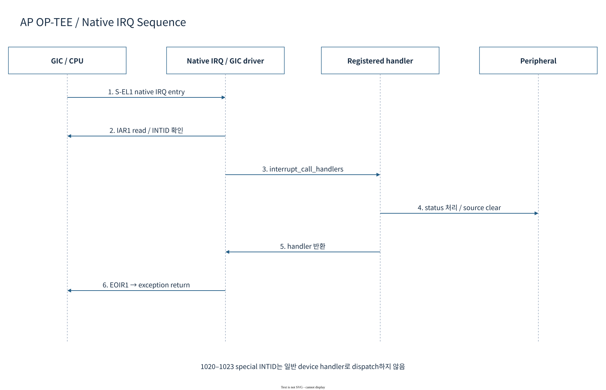

1. S-EL1 native IRQ entry가 `interrupt_main_handler()`를 호출한다.
2. `gic_native_itr_handler()`가 IAR1에서 INTID를 읽는다.
3. 유효 ID는 `interrupt_call_handlers()`로 전달한다. 1020–1023 special ID는 일반 device ISR로 dispatch하지 않는다.
4. Device handler가 원인을 처리하고 source를 clear한다.
5. Handler가 GIC driver로 반환한다.
6. EOIR1을 기록하고 exception에서 복귀한다.

TA 실행과 ISR은 다른 문맥이다. 특정 Secure device의 handler 등록·enable은 해당 driver의 초기화 조건을 따른다. [OP-TEE 소스](SOURCES.md#s4)

### 4.3 Safety Island CL0 — SCP Interrupt Architecture

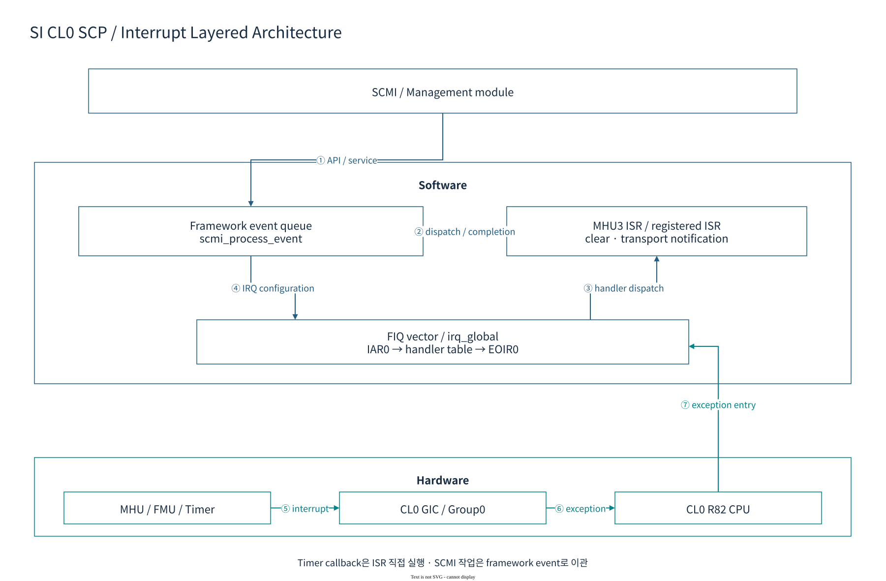

도면 상세 설명

- **Framework event queue**: Framework event queue / scmi_process_event
- **MHU3 ISR / registered ISR**: MHU3 ISR / registered ISR / clear · transport notification
- **FIQ vector / irq_global**: FIQ vector / irq_global / IAR0 → handler table → EOIR0

CL0는 single-security GIC의 **Group0/FIQ**를 사용한다. `irq_global()`이라는 함수명은 IRQ vector를 뜻하지 않는다.

#### 4.3.1 Interrupt Initialization

| 단계 | 처리 |
|---|---|
| Multiview | SCP가 View0에서 CL0 View1·CL1 View2 소유 설정 |
| GIC module | DS=1, Group0·affinity routing·CPU IGRPEN0 설정 |
| Framework / driver | `fwk_interrupt_set_isr*()`로 ISR·context 등록 |
| Enable | Controller IRQ enable과 MHU channel mask 설정을 별도로 수행 |

#### 4.3.2 ISR / Deferred Processing

| 경로 | 실행 문맥 |
|---|---|
| MHU3 ISR | Doorbell clear·transport 통지 |
| SCMI service | `fwk_put_event()` 이후 framework dispatcher에서 처리 |
| Timer callback | `timer_isr()` 안에서 직접 실행; 자동 deferred 처리 아님 |
| FMU driver | Fault record 탐색·acknowledge; 정상 I/O interrupt와 별도 source |

#### 4.3.3 MHU Interrupt Sequence

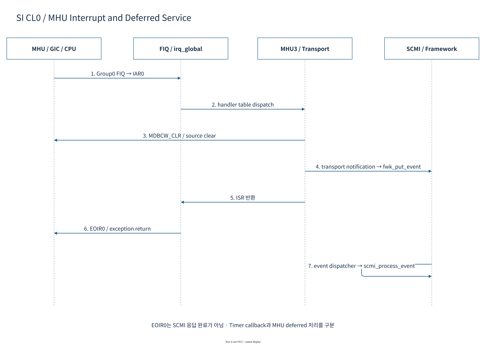

1. MHU interrupt가 GIC Group0/FIQ로 들어가 `irq_global()`에서 IAR0를 읽는다.
2. Handler table이 MHU3 ISR을 호출한다.
3. ISR이 `MDBCW_CLR`로 doorbell source를 clear한다.
4. Transport·SCMI 경로가 `fwk_put_event()`로 후속 작업을 게시한다.
5. ISR이 반환한다.
6. GIC 경로가 EOIR0를 기록하고 exception에서 복귀한다.
7. Framework dispatcher가 SCMI event를 처리한다.

EOIR0는 SCMI 응답 payload의 완료가 아니다. [SCP 소스](SOURCES.md#s5)

### 4.4 Safety Island CL1 — Zephyr Interrupt Architecture

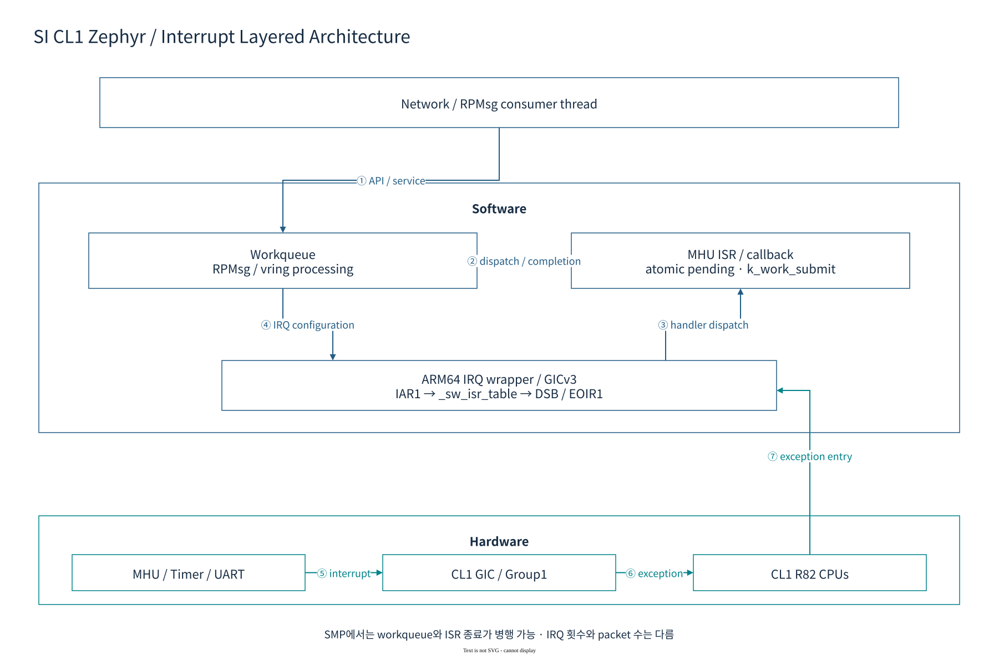

도면 상세 설명

- **Workqueue**: Workqueue / RPMsg / vring processing
- **MHU ISR / callback**: MHU ISR / callback / atomic pending · k_work_submit
- **ARM64 IRQ wrapper / GICv3**: ARM64 IRQ wrapper / GICv3 / IAR1 → _sw_isr_table → DSB / EOIR1

Zephyr는 GICv3 IRQ를 `_sw_isr_table`로 dispatch한다. MHU callback은 workqueue에 작업을 게시하고, Timer IRQ는 Kernel timeout 처리를 호출한다.

#### 4.4.1 Interrupt Initialization

| 단계 | 처리 |
|---|---|
| `PRE_KERNEL_1` | `arm_gic_init()`이 Distributor·boot CPU Redistributor·CPU interface 설정 |
| Secondary CPU | `arm_gic_secondary_init()`으로 CPU별 interface 구성 |
| Device init | `IRQ_CONNECT`로 ISR 연결 후 `irq_enable()` |
| Peripheral enable | MHU mask·Timer mask 등 device source를 별도 설정 |

#### 4.4.2 Handler / Workqueue

| 처리 | 책임 |
|---|---|
| IRQ wrapper | IAR1·ISR table dispatch·DSB·EOIR1 |
| MHU driver | Callback 실행 후 `rx_complete`로 수신 doorbell clear |
| Apollo veth callback | Atomic pending event 갱신·`k_work_submit()` |
| Workqueue | Attach/detach 또는 normal kick 처리; vring·RPMsg consumer 연결 |
| Scheduler | Wake된 Thread와 workqueue Thread의 실행 선택 |

#### 4.4.3 MHU / RPMsg Sequence

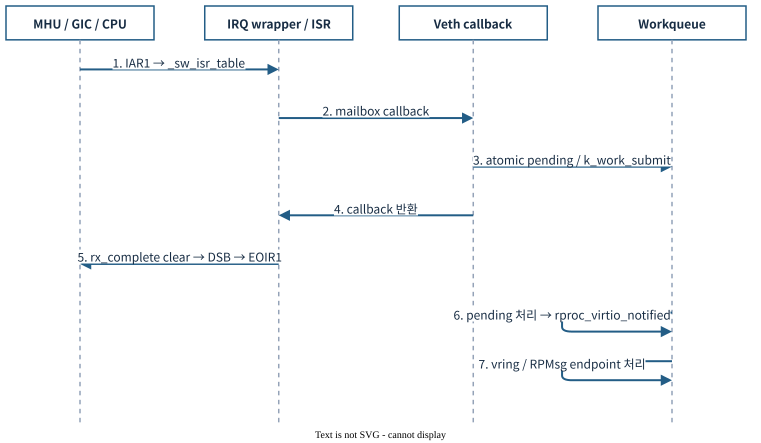

1. IRQ wrapper가 IAR1을 읽고 MHU ISR을 dispatch한다.
2. Driver가 수신 callback을 호출한다.
3. Callback이 pending event를 저장하고 work를 submit한다.
4. Callback이 ISR로 반환한다.
5. Driver가 `rx_complete`를 수행하고 wrapper가 DSB·EOIR1로 완료한다.
6. Workqueue가 pending event를 읽고 normal notify이면 `rproc_virtio_notified()`를 호출한다.
7. Vring·RPMsg endpoint 처리가 이어진다.

SMP에서는 6–7이 5 이전에도 실행될 수 있다. Pending bitset은 여러 통지를 합칠 수 있으므로 IRQ 횟수와 packet 수를 1:1로 비교하지 않는다. [Zephyr·적용 패치](SOURCES.md#s6)

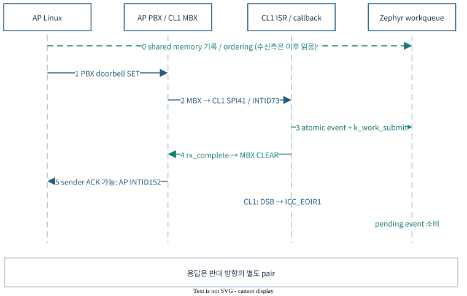

도면 상세 설명

- **AP Linux**: AP Linux / shared memory / virtqueue
- **AP PBX / CL1 MBX**: AP PBX / CL1 MBX / apollo_ap_to_si_cl1
- **CL1 ISR / callback**: CL1 ISR / callback / GIC INTID73
- **Zephyr workqueue**: Zephyr workqueue / OpenAMP / RPMsg
- **pending event 소비**: pending event 소비 / rproc_virtio_notified / → endpoint callback
- **응답은 반대 방향의 별도 pair**: 응답은 반대 방향의 별도 pair / CL1 PBX → AP MBX: AP 수신 INTID153 / CL1 송신 ACK INTID72 / ACK interrupt는 sender enable 조건에 따르며, protocol 응답 메시지와 구분한다.

Doorbell SET 전에 payload/vring을 공개한다. Receiver CLEAR가 sender ACK 조건을 만들며 sender IRQ는 별도 enable/mask를 따른다. **Doorbell ACK와 protocol 응답 payload는 다른 완료**다.

### 4.5 RSE Domain — TF-M Interrupt Architecture

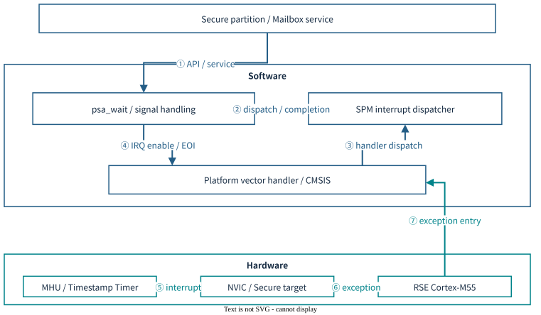

도면 상세 설명

- **psa_wait / signal handling**: psa_wait / signal handling / psa_eoi · RPC service
- **SPM interrupt dispatcher**: SPM interrupt dispatcher / SLIH disable / signal
- **Platform vector handler / CMSIS**: Platform vector handler / CMSIS / NVIC target · priority · enable

TF-M은 NVIC security attribution과 partition IRQ 할당을 연결한다. Apollo mailbox는 **SLIH**를 사용하며 Secure target 설정과 IRQ enable은 별도 단계다.

#### 4.5.1 Interrupt Initialization

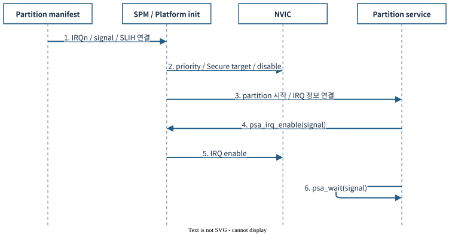

1. Manifest가 IRQn·signal·SLIH handler 정보를 지정한다.
2. Platform init이 priority·Secure target을 설정하고 IRQ를 disable한다.
3. SPM이 partition과 IRQ 정보를 연결한다.
4. Partition service가 `psa_irq_enable(signal)`을 요청한다.
5. SPM이 해당 NVIC IRQ를 enable한다.
6. Partition은 `psa_wait()`로 signal을 기다린다. Peripheral source enable은 device driver가 담당한다.

공통 target 설정은 ITNS를 NS로 초기화한 뒤 MPC/PPC/SAM 등 필요한 source를 Secure로 설정한다. Mailbox도 source별 Secure attribution을 적용한다.

#### 4.5.2 SLIH / Completion API

| API / 동작 | 역할 |
|---|---|
| Platform ISR | Peripheral/SFCP 수신 후 `spm_handle_interrupt()` 호출 |
| SLIH dispatch | IRQ disable·partition signal 설정·필요 시 scheduling |
| `psa_wait()` | Partition signal 대기 |
| `psa_eoi()` | Signal 해제·NVIC pending clear·IRQ 재활성화 |
| Exception return | NVIC active 상태 완료; `psa_eoi`와 다른 동작 |

#### 4.5.3 Secure Mailbox Sequence

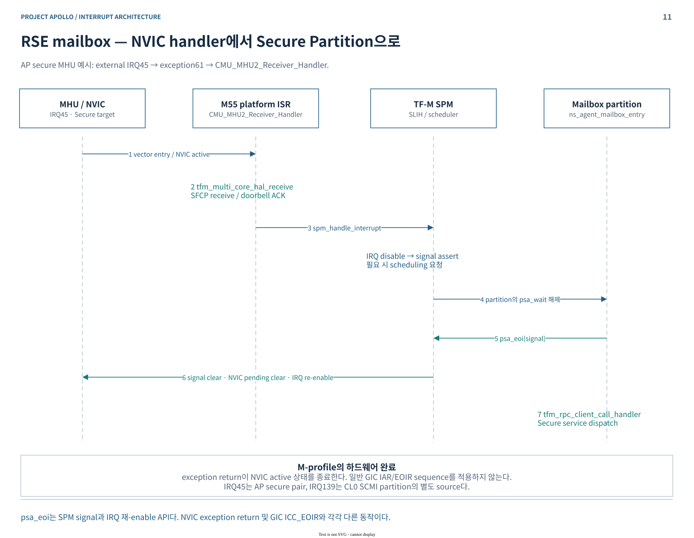

도면 상세 설명

- **MHU / NVIC**: MHU / NVIC / IRQ45 · Secure target
- **M55 platform ISR**: M55 platform ISR / CMU_MHU2_Receiver_Handler
- **TF-M SPM**: TF-M SPM / SLIH / scheduler
- **Mailbox partition**: Mailbox partition / ns_agent_mailbox_entry
- **2  tfm_multi_core_hal_receive**: 2  tfm_multi_core_hal_receive / SFCP receive / doorbell ACK
- **IRQ disable → signal assert**: IRQ disable → signal assert / 필요 시 scheduling 요청
- **7  tfm_rpc_client_call_handler**: 7  tfm_rpc_client_call_handler / Secure service dispatch
- **M-profile의 하드웨어 완료**: M-profile의 하드웨어 완료 / exception return이 NVIC active 상태를 종료한다. 일반 GIC IAR/EOIR sequence를 적용하지 않는다. / IRQ45는 AP secure pair, IRQ139는 CL0 SCMI partition의 별도 source다.

1. AP Secure MHU가 RSE IRQn45, exception61로 전달된다.
2. `CMU_MHU2_Receiver_Handler()`가 SFCP 수신 처리를 수행한다.
3. `spm_handle_interrupt()`가 SLIH IRQ를 disable하고 mailbox signal을 게시한다.
4. Partition의 `psa_wait()`가 signal을 반환한다.
5. 현재 `ns_agent_mailbox_entry`는 `psa_eoi()`로 IRQ를 재활성화한다.
6. 이어서 `tfm_rpc_client_call_handler()`가 요청을 처리한다.

CL0에서 오는 IRQn139는 별도 SCMI partition source다. Source clear·NVIC active 종료·partition EOI·RPC 완료를 하나의 동작으로 합치지 않는다. [TF-M 소스](SOURCES.md#s7)

## 5. Test and Verification

### 5.1 Verification Overview

기존 Apollo image의 IRQ 경로를 Domain별로 확인한다. 결과에는 image·ELF 식별값, 실행 명령, UART/GDB log를 함께 기록한다.

| 판정 | 의미 |
|---|---|
| PASS / FAIL | 실행 결과가 기대 조건 충족 / 불충족 |
| NOT RUN | 아직 실행하지 않음 |
| N/A | 해당 image에 필요한 driver·service·시험 기능이 없음 |

Breakpoint는 처리 경로 확인에 사용한다. IRQ latency·응답 시간은 breakpoint를 제거한 별도 측정으로 구분한다. IRQ 횟수는 packet·request 수와 일치하지 않을 수 있다.

### 5.2 AP Domain — Linux

**실행 환경:** AP shell, `/proc/interrupts`, 필요 시 Linux ELF와 AP GDB. Device 시험은 현재 image에서 probe된 장치를 선택한다.

| Test ID | 검증 항목 / 방법 | 기대 결과 | 실제 결과 | 판정 | 로그 / 측정값 |
|---|---|---|---|---|---|
| LIN-01 | `/proc/interrupts`의 GIC·arch_timer·사용 중 device IRQ 확인 | 등록 handler와 CPU별 IRQ count 표시 | — | NOT RUN | — |
| LIN-02 | Console 입력 전후 UART IRQ count 비교 | 실제 입력에 따라 해당 IRQ count 증가 | — | NOT RUN | — |
| LIN-03 | 동작 중 device handler에서 status 처리·source clear 관찰 | 등록 ISR 수행, source 해제 후 지속적인 재진입 없음 | — | NOT RUN | — |
| LIN-04 | `/proc/irq/<virq>/smp_affinity_list`와 CPU별 count 비교 | 해당 SPI의 유효 affinity CPU에서 처리 | — | NOT RUN | — |

LIN-04는 SPI에 적용한다. Timer PPI와 managed IRQ의 affinity 제약을 일반 device SPI와 혼동하지 않는다. UART polling console만 사용하는 image에서는 LIN-02를 N/A로 기록한다.

### 5.3 AP Domain — TF-A / U-Boot / OP-TEE

**실행 환경:** 각 firmware ELF·AP GDB·UART. Secure interrupt는 image에 실제 등록된 producer와 handler가 있을 때 확인한다.

| Test ID | 검증 항목 / 방법 | 기대 결과 | 실제 결과 | 판정 | 로그 / 측정값 |
|---|---|---|---|---|---|
| TFA-01 | BL31 platform setup과 GIC 초기화 함수 관찰 | AP GIC runtime view 및 CPU interface 초기화 | — | NOT RUN | — |
| TFA-02 | 기존 G1S source 발생 시 SPMD handler 관찰 | NS context에서 Secure context로 전달 및 복귀 | — | NOT RUN | — |
| UBT-01 | Console·기존 device 명령 실행, polling driver 경로 관찰 | 정상 I/O 완료, `do_irq()` / `do_fiq()` 진입 없음 | — | NOT RUN | — |
| OPT-01 | `boot_primary_init_intc()` → `gic_init_v3()` 관찰 | OP-TEE GIC chip 초기화 | — | NOT RUN | — |
| OPT-02 | 등록된 Secure source 발생 시 native handler 관찰 | IAR1 → 등록 handler → EOIR1 실행 | — | NOT RUN | — |

UBT-01은 boot 단계의 정상 I/O 경로 확인이다. IRQ handler 등록·dispatch 시험으로 판정하지 않는다. TFA-02·OPT-02는 해당 Secure source가 없는 image에서 N/A다.

### 5.4 Safety Island CL0 — SCP

**실행 환경:** SCP ELF·CL0 GDB·UART와 기존 SCMI 요청 경로.

| Test ID | 검증 항목 / 방법 | 기대 결과 | 실제 결과 | 판정 | 로그 / 측정값 |
|---|---|---|---|---|---|
| SCP-01 | GIC 초기화 및 `irq_global()` 관찰 | Group0 enable, IAR0 INTID에 해당하는 등록 ISR 진입 | — | NOT RUN | — |
| SCP-02 | 기존 SCMI 요청 중 MHU ISR·transport notification 관찰 | Doorbell source clear 및 framework event 게시 | — | NOT RUN | — |
| SCP-03 | 같은 요청의 `scmi_process_event()`와 응답 관찰 | ISR 밖에서 요청 처리 후 requester에 응답 | — | NOT RUN | — |

SCMI client의 기존 정상 요청을 사용한다. `EOIR0` 실행만으로 SCMI 응답 완료를 판정하지 않는다.

### 5.5 Safety Island CL1 — Zephyr

**실행 환경:** Zephyr ELF·CL1 GDB·UART. MHU 시험에는 현재 image의 AP↔CL1 HIPC/RPMsg 통신을 사용한다.

| Test ID | 검증 항목 / 방법 | 기대 결과 | 실제 결과 | 판정 | 로그 / 측정값 |
|---|---|---|---|---|---|
| ZEP-01 | `arm_gic_init()`와 secondary CPU 초기화 관찰 | 활성 CPU별 Redistributor·CPU interface 초기화 | — | NOT RUN | — |
| ZEP-02 | 기존 AP↔CL1 traffic에서 MHU ISR·callback 관찰 | 등록 callback 실행, pending 기록 및 work 제출 | — | NOT RUN | — |
| ZEP-03 | 같은 traffic의 workqueue·RPMsg 수신 관찰 | Worker에서 vring 처리 및 endpoint로 전달 | — | NOT RUN | — |

MHU callback·workqueue를 사용하는 veth 구성이 필요하다. SMP에서는 worker가 ISR 종료 전에 실행될 수 있으므로 둘의 완료 순서를 고정 조건으로 두지 않는다.

### 5.6 RSE Domain — TF-M

**실행 환경:** TF-M runtime ELF·RSE GDB·UART와 기존 AP↔RSE Secure mailbox 요청.

| Test ID | 검증 항목 / 방법 | 기대 결과 | 실제 결과 | 판정 | 로그 / 측정값 |
|---|---|---|---|---|---|
| TFM-01 | Platform IRQ 초기화와 partition enable 관찰 | 해당 MHU IRQ의 Secure target·priority·enable 설정 | — | NOT RUN | — |
| TFM-02 | 기존 mailbox 요청 중 MHU ISR·SLIH 관찰 | NVIC exception 진입, IRQ disable 및 partition signal 게시 | — | NOT RUN | — |
| TFM-03 | `psa_wait()` 복귀 → `psa_eoi()` → RPC 처리 관찰 | Signal 소비·IRQ 재활성화 및 mailbox 응답 완료 | — | NOT RUN | — |

NVIC pending bit만으로 ISR·partition 실행을 판정하지 않는다. Timer self-test의 pending 관찰 결과는 이 mailbox 시험 결과에 포함하지 않는다.

다이어그램 원본: [draw.io 전체 32페이지](apollo-interrupt-architecture.drawio).

관련 문서: [Timer SW Implementation Report](../timer/README.md) · [QVP Architecture](../qbox/README.md) · [상세 배선표](WIRING-MAP.md) · [소스 참조](SOURCES.md).
