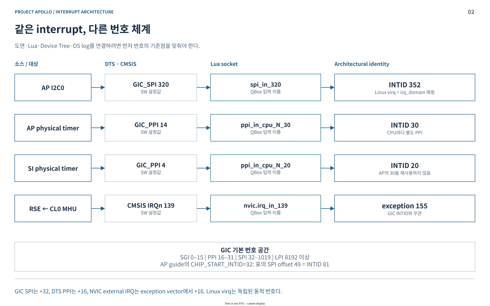
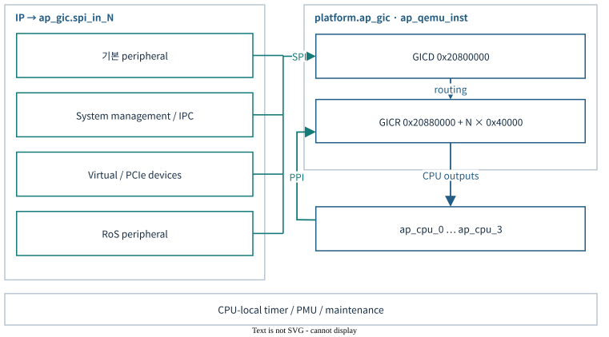
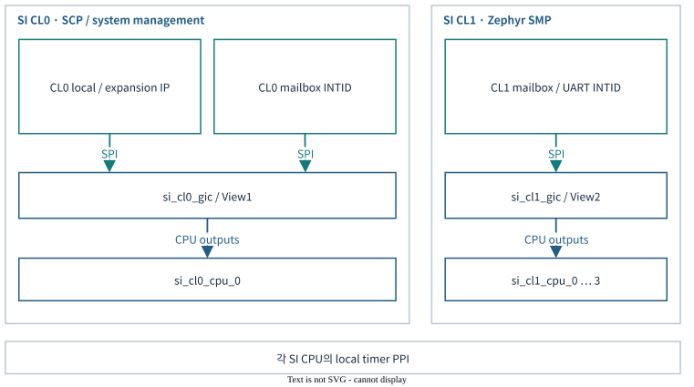
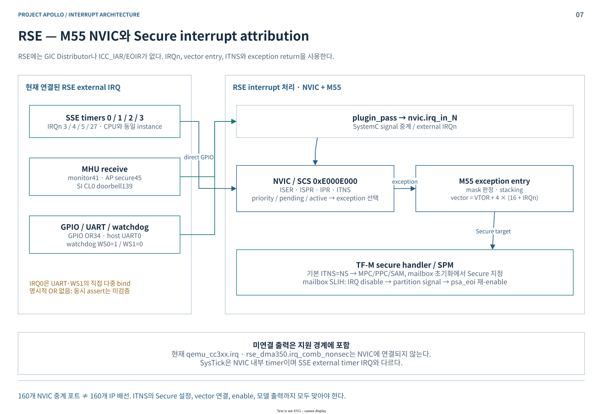
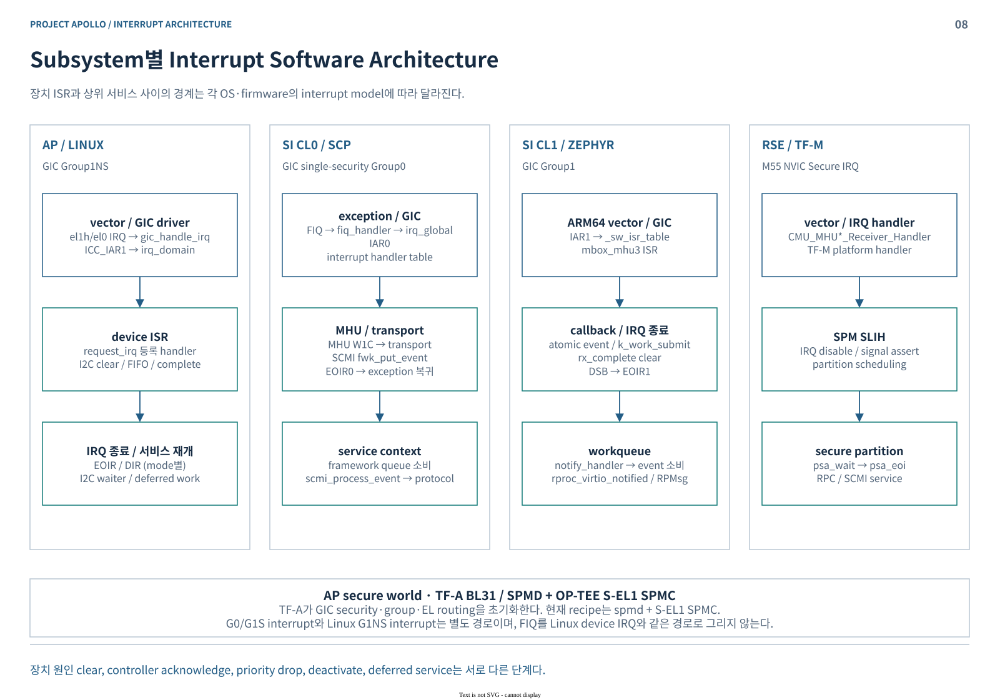

# Project Apollo Interrupt Architecture

**Phase1 기술 세미나 · 2026-10-16 · Apollo QVP / Cfg2**

Apollo의 인터럽트 구조를 **HW 계약 → QVP 모델 → 실제 배선 → firmware/OS → ISR 이후 처리** 순서로 설명한다. 현재 소스와 최종 Lua 구성을 조사했으며, 이번 문서 작업에서 부팅·IRQ 주입을 새로 수행하지는 않았다.

- **AP·SI CL0·SI CL1은 GIC, RSE는 M55 내부 NVIC**를 사용한다.
- **QVP의 SI는 별도 QEMU GIC 두 개**로 동작한다. Arm의 단일 GIC 멀티뷰 설계와 구현 경계를 구분한다.
- **Device clear, acknowledge, EOI, deactivate는 다른 동작**이다. 이 차이가 재진입·IRQ storm·IPC 정지 분석의 출발점이다.

[배선 상세표](WIRING-MAP.md) · [소스 근거·검증 범위](SOURCES.md) · [편집 가능한 draw.io 원본 — 12장](apollo-interrupt-architecture.drawio)

모든 도면은 white 테마의 native draw.io 객체로 작성했다. 본문의 SVG도 draw.io 편집 정보를 포함한다. **파랑: controller/CPU**, **청록: IP·데이터/서비스 처리**, **회색: 구성·보조 상태**를 나타낸다.

## 1. Interrupt Controller HW 구조

### 1.1 GIC-720AE와 NVIC의 역할

| 블록 | 소유하는 상태·역할 | SW 접점 |
|---|---|---|
| GIC Distributor | 공유 SPI의 enable·pending·priority·target affinity; GIC-720AE의 LPI 기능 | `GICD_*`, `GICD_IROUTER` |
| GIC Cluster Interface, GCI | CPU 인접 SGI·PPI 관리, 전달할 IRQ 선택, core stream 연결 | PE별 `GICR` SGI page |
| CPU interface | priority mask·preemption·group enable·acknowledge·completion | `ICC_PMR`, `ICC_IAR`, `ICC_EOIR`, `ICC_DIR` |
| ITS | DeviceID/EventID를 LPI와 대상 PE로 변환 | `GITS_*`, guest RAM command/table |
| M55 NVIC | RSE exception의 priority·pending·active·Secure target | `ISER/ISPR/IPR/ITNS`, vector table |

**GICR 주소 공간과 물리 GCI는 같은 개념이 아니다.** GIC-720AE는 SGI page 기능을 GCI에, 나머지 GICR page 기능을 Distributor에 둔다. 일반적인 “CPU마다 GICR 박스 하나” 그림만으로 실제 블록 배치를 설명하면 이 차이를 놓친다. [Arm GIC-720AE TRM §2.1·3.2](https://documentation-service.arm.com/static/679b9c8f27eda361ad4ee88f)

| Apollo domain | CPU / firmware | 현재 QVP controller | 주요 주소 |
|---|---|---|---|
| AP | A720AE, 기본 4 PE / TF-A·OP-TEE·Linux | `ap_gic` + `ap_gic_its` | GICD `0x20800000`, ITS `0x20840000`, GICR `0x20880000 + n×0x40000` |
| SI CL0 | R82 ×1 / SCP-firmware | `si_cl0_gic` | View1 GICD `0x30100000`, GICR `0x30140000` |
| SI CL1 | R82 ×4 / Zephyr SMP | `si_cl1_gic` | View2 GICD `0x30200000`, GICR `0x30260000 + n×0x20000` |
| RSE | M55 ×1 / TF-M | `rse_cpu_pass.cpu_0.cpu.nvic` | SCS/NVIC `0xE000E000` |

AP의 PE 수는 runner 설정이다. CL0의 물리 DCLS pair를 QVP의 독립 SW 실행 CPU 두 개로 세지 않는다. [구성 근거](SOURCES.md#s2)

### 1.2 IRQ 번호를 읽는 규칙

| 표현 | 의미 | Apollo 예 |
|---|---|---|
| `spi_in_N` / DTS `GIC_SPI N` | SPI 시작점 32를 뺀 index | I2C0: `320 → INTID352` |
| `ppi_in_cpu_C_N` | CPU C의 **architectural INTID** | AP physical timer: `N=30` |
| DTS `GIC_PPI P` | PPI 시작점 16을 뺀 index | AP `14→30`, SI `4→20` |
| Linux `virq` | `irq_domain`이 할당한 OS 번호 | `/proc/interrupts` 번호를 INTID로 단정하지 않음 |
| NVIC `irq_in_N` / CMSIS IRQn | M-profile external IRQ 번호 | RSE `IRQn139 → exception155` |

SGI는 동일 GIC backend의 PE 간 system-register 요청이다. **CL0↔CL1의 통신은 MHU를 사용**한다. LPI는 message 경로이며 `spi_in_N`으로 들어오지 않는다. [번호·배선 근거](WIRING-MAP.md)

## 2. ARM Zena CSS FVP와 Apollo QVP 비교

### 2.1 SI 멀티뷰: 설계 계약과 현재 구현

Arm Cfg2에서 CL0의 SCP는 **View0로 SPI·PE ownership을 설정**한다. 이후 CL0는 View1, CL1은 View2를 사용한다. 이는 하나의 SI GIC 자원을 나누는 모델이다. [Arm 설계 문서](../../../arm-zena-css/documentation/design/components.rst) · [원본 Multiple Views 도면](../../../arm-zena-css/documentation/images/si_gic_multiple_view.svg)

현재 QVP의 `si_gic_multiview`는 CFGID·IVIEWR·VIEWR 등의 관리 레지스터를 보강한다. 실제 IRQ는 `si_cl0_gic`와 `si_cl1_gic`로 직접 전달된다. **SI shadow의 backend/socket mux가 연결되지 않았으므로 IVIEWR 변경만으로 실제 IP 배선 전체가 재할당되지는 않는다.** AP의 multiview는 backend forwarding이 연결되어 있어 SI와 다르다. [구현 근거](SOURCES.md#s3)

| 비교 항목 | Arm CSS / FVP 참조 계약 | 현재 Apollo QVP |
|---|---|---|
| AP interrupt model | GIC-720AE programmer’s view | QEMU GIC + ITS + Apollo view 보강 |
| SI Cfg2 | 단일 SI GIC의 View0/1/2 | CL0·CL1 별도 QEMU GIC + 관리 shadow |
| 기본 전달 | SPI/PPI/SGI, priority·group·affinity | QEMU가 architectural 상태와 CPU 출력을 처리 |
| Wake / power | GICR·GCI와 power-control 계약 | AP WAKER→PPU wake 연결; ChildrenAsleep은 즉시 반영 |
| PWRR | GIC-720AE 전원 제어 register | SI View0 해당 창은 RAZ/WI; power-down FSM으로 해석 불가 |
| ITS·가상화 | 제품 capability와 FVP 구성에 따름 | AP LPI/GICv4.1 property 및 VLPI 코드 존재; 실제 guest 검증과 구분 |
| RAS / FuSa | 물리 오류 검출·보호 메커니즘은 HW 계약 | 기능 모델·일부 register 모델; lockstep·ECC 검출·안전 등급 동등성 근거 아님 |
| 시간 | FVP 자체도 functional model | SystemC event + QEMU scheduling; IRQ latency의 실기 동등성 미측정 |

SI timer도 구분해야 한다. QVP/CL1 DTS는 physical PPI20·hyp PPI19를 사용한다. CSS guide의 기본 SI 표에서는 19가 reserved, 20이 CNTHPSIRQ로 표기된다. **AP timer 번호나 기본 SI 표를 Cfg2 전체에 기계적으로 적용하지 않는다.** [대조표](WIRING-MAP.md)

## 3. Apollo QVP QBox의 Interrupt 구현

### 3.1 상태 소유와 callback 경로

| 계층 | 실제 책임 | 대표 소스 / 함수 |
|---|---|---|
| IP model | status·mask에서 IRQ level 계산 | `dw_apb_i2c::update_irq → drive_irq` |
| QBox signal socket | bind, thread 경계, 대상 libqemu lock | `QemuInitiatorSignalSocket`, `QemuTargetSignalSocket` |
| GIC wrapper | CCI→QOM 속성, MMIO·SPI/PPI·CPU output 노출 | `arm_gicv3::end_of_elaboration` |
| QEMU GIC | pending/active, priority, group, affinity | `gicv3_set_irq → gicv3_dist_set_irq → gicv3_update` |
| CPU interface / CPU | 전달 가능성 판정, IRQ/FIQ, exception request | `gicv3_cpuif_update → arm_cpu_set_irq` |

**I2C0의 실제 경로:** `raw & mask → SC_METHOD(drive_irq) → spi_in_320 → target BQL → qemu_set_irq → INTID352 → GIC route/priority → CPU IRQ`. Lua의 연결선과 C++/QEMU callback을 함께 추적한 결과다. [상세 소스](SOURCES.md#s3)

- **같은 QemuInstance:** QEMU GPIO를 직접 연결할 수 있다. GIC→소속 CPU가 대표 사례다.
- **QEMU→SystemC/다른 instance:** `run_on_sysc(..., wait=false, defer=true)`로 queue에 넘긴다. 대상 QEMU 입력은 그 instance의 BQL을 확보한다.
- **SystemC→QEMU:** target signal callback이 BQL 아래 GPIO handler를 호출한다. 모든 IRQ가 동일한 왕복·지연을 갖지는 않는다.

QVP의 bool 신호는 논리 assert/deassert이다. TRM의 active-low 전기 신호나 CDC·배선 지연까지 모델링한 것으로 읽지 않는다.

### 3.2 Wake·reset·diagnostic injection

| 경로 | 현재 동작 | 해석 경계 |
|---|---|---|
| AP wake | GIC `wake_request_out_n → core PPU.wakeup`; CPU WFI→PPU powerdown | WAKER 처리와 물리 power handshake 지연은 다름 |
| Reset | AP/SI QemuInstance의 pending·active reset + multiview shadow reset | backend와 overlay는 reset 소유자가 다름 |
| 선택적 SI IRQ 주입 | owner 검사 → 실제 CL0/CL1 GIC `runtime_set_spi(INTID−32)` | 명령 적용 성공만으로 ISR 수행을 판정하지 않음 |

현재 소스에는 과거 `gic720ae_power_bridge`가 없다. 현재 wake/reset 배선을 기준으로 설명한다. [근거](SOURCES.md#s3)

## 4. CPU·Controller·IP Interrupt Wiring

### 4.1 AP

AP는 peripheral SPI, PE별 timer/PMU PPI, ITS LPI를 구분한다. GIC의 `irq/fiq/virq/vfiq_out_n`은 같은 `ap_cpu_n`의 입력으로 연결된다. 최종 `audio.connect`는 AP DMA/I2S를 native QEMU 모델로 교체하면서 IRQ bind를 유지한다.

대표값은 **UART INTID84/85, I2C0 INTID352, virtio-blk0 INTID289, native DMA0 INTID311**이다. 전체 SPI source-output 배선은 AP68·CL0 41·CL1 4개이며, 범위별 상세는 [배선표](WIRING-MAP.md)에 정리했다.

### 4.2 Safety Island

CL0는 MHU·FMU·AP PPU·RAS 등 관리 이벤트를 받는다. CL1은 HIPC MHU와 UART를 자신의 GIC에서 처리한다. **같은 INTID 값도 controller가 다르면 다른 interrupt**다.

| 데이터 방향 | 수신측 IRQ | 송신측 ACK IRQ |
|---|---|---|
| AP → CL1 | CL1 INTID73 | AP INTID152 |
| CL1 → AP | AP INTID153 | CL1 INTID72 |
| RSE → CL0 | CL0 INTID105 | 해당 PBX IRQ 미연결 |
| CL0 → RSE | RSE IRQn139 | 해당 PBX IRQ 미연결 |
| CL1 → CL0 PFDI | CL0 INTID107 | CL1 INTID82 |

**PBX는 송신 frame, MBX는 수신 frame**이다. PBX의 IRQ는 상대 수신 IRQ가 아니라 로컬 ACK 알림이다. MHU pair마다 양 끝의 interrupt 번호와 enable 조건이 다르다.

### 4.3 RSE와 board IRQ

외부 RSE IP 출력은 `rse_cpu_pass → plugin_pass → M55 NVIC`로 중계한다. Local SSE timer는 같은 QemuInstance의 NVIC에 직접 연결된다. 중요한 연결·미연결 경계는 다음과 같다.

| 항목 | 현재 배선의 의미 |
|---|---|
| RSE MHU | monitor IRQ41, AP secure IRQ45, CL0 IRQ139 |
| RSE crypto / DMA | 선택된 `qemu_cc3xx.irq`, `rse_dma350.irq_comb_nonsec`는 NVIC 미연결 |
| RSE IRQ0 | host UART와 watchdog WS1이 직접 다중 bind; 명시적 OR 없음. 동시 assert 시 level 간섭 가능성은 정적 추론이며 미검증 |
| SI TPS6594 | `int_n → si_cl0_pmic_gpio.gpio_in_0`까지만 연결; GPIO IRQ의 GIC bind 없음 |
| AP PCA9539 | `int_n → host_smd_gpio.gpio_in_1 → AP INTID225`; 위 PMIC 경로와 다름 |
| AP↔RSE host MHU | MMIO pair는 있으나 AP 측 GIC IRQ bind 없음. 양방향 IRQ IPC로 일반화 불가 |

## 5. Subsystem별 Interrupt Software Architecture

### 5.1 AP — Linux와 secure firmware

**Linux:** DT의 IRQ specifier → GIC `irq_domain` → Linux virq → driver `request_irq` 등록이다. 실행 시 ARM64 vector가 `gic_handle_irq`로 들어가 IAR1의 INTID를 읽고 등록 handler로 dispatch한다.

**TF-A / OP-TEE:** BL31이 GIC 초기화와 secure group·EL routing을 담당한다. 현재 Apollo recipe는 **`TFA_SPD=spmd`, S-EL1 SPMC 구성의 OP-TEE**다. 따라서 과거 `opteed` 경로를 현재 secure IRQ 처리로 대체해서 설명하지 않는다. OP-TEE의 현재 ARM64 설정은 IRQ를 native, FIQ를 foreign interrupt로 분류한다.

Non-secure 실행 중 G1S가 발생하면 **EL3 FIQ → SPMD → `FFA_INTERRUPT` → S-EL1 OP-TEE**로 넘긴다. OP-TEE native handler가 IAR1·등록 ISR·EOIR1을 처리한다. G0는 Apollo의 EL3 EHF 경로로 dispatch하며 등록 handler가 EOI를 책임진다.

Linux의 G1NS와 secure G0/G1S는 별도 경로다. “FIQ=항상 특정 OS”라는 고정 규칙 대신 **group·현재 security state·EL routing**을 함께 확인한다. [AP 소스](SOURCES.md#s4)

### 5.2 SI CL0 — SCP-firmware

**현재 MHU 경로:** `FIQ vector → fiq_handler → irq_global → IAR0 → handler table → MHU3 ISR → transport → SCMI event`.

CL0는 single-security GIC의 **Group0/FIQ**를 사용한다. `irq_global`이라는 함수명은 IRQ vector를 뜻하지 않는다. ISR은 MHU doorbell을 clear하고, `fwk_put_event`로 넘긴 SCMI 서비스는 framework dispatcher 문맥에서 실행된다. EOIR0는 GIC 처리를 완료하며 SCMI 응답 완료와 같지 않다. [SCP 소스](SOURCES.md#s5)

### 5.3 SI CL1 — Zephyr / OpenAMP

`ARM64 vector → IAR1 → _sw_isr_table → mbox_mhu3 ISR → callback → rx_complete clear → DSB → EOIR1`로 이어진다.

Apollo의 실제 Yocto veth 패치는 data notify뿐 아니라 attach/detach 이벤트도 **atomic pending event + `k_work_submit`**로 넘긴다. 일반 data notification은 workqueue에서 `rproc_virtio_notified`를 호출하고, vring·RPMsg endpoint 처리로 이어진다. SMP에서는 submit 이후 workqueue 실행과 ISR 종료가 병행할 수 있다. upstream/reference callback만 읽으면 적용 후 경로를 놓친다. [Zephyr·적용 패치](SOURCES.md#s6)

### 5.4 RSE — TF-M / NVIC / SPM

TF-M의 공통 target 초기화는 ITNS를 NS로 설정한 뒤 MPC/PPC/SAM을 Secure로 돌린다. Mailbox 초기화도 해당 IRQ의 Secure target·priority를 설정한다. **Secure attribution과 interrupt enable은 별도 설정**이다.

Apollo mailbox manifest는 **SLIH**를 선택한다. Platform ISR은 `spm_handle_interrupt`를 호출하고, SPM은 IRQ를 잠시 disable한 뒤 Secure Partition에 signal을 전달한다. Partition의 `psa_eoi`는 signal·pending을 정리하고 IRQ를 다시 enable한다. NVIC의 active 종료는 M55 exception return 계약을 따른다. [TF-M 소스](SOURCES.md#s7)

## 6. Interrupt Sequence — HW에서 SW까지

### 6.1 AP level IRQ와 완료 순서

GIC가 전달하려면 **source pending + interrupt enable + group enable + 유효 target + priority/CPU mask 조건**이 모두 맞아야 한다. Pending bit가 1이라는 사실만으로 CPU가 ISR에 진입했다고 판단하지 않는다.

| 동작 | 바꾸는 상태 |
|---|---|
| IP status/mask → assert | level source 조건 또는 edge pending latch |
| `ICC_IAR*` read | 선택된 INTID acknowledge; 일반 SGI/PPI/SPI를 active로 전환 |
| Device ISR clear | IP의 원인을 해소하고 source level을 낮춤 |
| `ICC_EOIR*` write | running priority 종료; EOImode0이면 deactivate도 수행 |
| `ICC_DIR` write | EOImode1의 별도 deactivate |

Linux GIC driver는 split EOI 경로를 지원한다. **비-threaded ISR 기준으로 EOImode1이면 IAR 직후 EOIR, handler 종료 후 DIR**이다. Combined 경로는 handler 종료의 EOIR가 두 역할을 수행한다. 실행 모드를 확인하지 않고 하나의 고정 순서로 단정하지 않는다.

I2C ISR은 원인별 `IC_CLR_*`를 읽고 FIFO를 처리한다. TX abort 원인은 clear 전에 저장한다. 전송 종료의 `complete(cmd_complete)`는 ISR 내부에서 발생한다. **Forced IRQ threading/PREEMPT_RT에서는 primary handler가 IRQ thread를 깨운 뒤 hard-IRQ 종료에서 EOIR/DIR을 수행할 수 있다.** 실제 I2C clear·completion은 IRQ thread에서 처리되므로 도면의 비-threaded 순서와 다르다. [현 GIC/OS 구현](SOURCES.md#s4) · [Arm GIC software overview §6.4](https://developer.arm.com/-/media/Arm%20Developer%20Community/PDF/Learn%20the%20Architecture/GICv3_v4_overview.pdf?revision=65f91645-cd52-4795-952b-f01095ff5ef8)

### 6.2 AP↔CL1 MHU / RPMsg

**Payload/vring 공개 → doorbell SET → receiver ISR → deferred work**가 요청 흐름이다. Receiver CLEAR가 sender ACK 조건을 만들며, sender IRQ는 별도 mask/enable 설정에 따른다. **Doorbell ACK와 protocol 응답 payload는 서로 다른 완료**다. [MHU·OpenAMP 소스](SOURCES.md#s6)

### 6.3 RSE secure mailbox / SLIH

AP secure 수신은 **IRQn45 → exception61 → `CMU_MHU2_Receiver_Handler`**다. SFCP 수신 뒤 SPM이 mailbox signal을 전달한다. 현재 `ns_agent_mailbox_entry`는 `psa_wait → psa_eoi → tfm_rpc_client_call_handler` 순서다. CL0의 IRQn139는 별도 SCMI partition source다.

`psa_eoi`를 GIC의 EOIR write나 NVIC exception return과 같은 화살표로 합치지 않는다. [RSE sequence 근거](SOURCES.md#s7)

### 6.4 PCIe MSI / ITS / LPI

INTx는 `ap_gpex_0 → SPI300..303`을 사용한다. MSI/MSI-X는 **requester DeviceID + EventID → ITS translation → target PE LPI** 경로다. Guest가 RAM의 Device/ITT/Collection과 LPI property/pending table을 설정한다.

LPI acknowledge는 pending-table bit를 clear한다. 일반 SPI의 active bitmap·DIR 설명을 그대로 적용하지 않는다. AP의 ITS·GICv4.1 코드 존재와 실제 PCIe traffic·vPE migration 검증은 별개다. [ITS 소스·범위](SOURCES.md#s8)

---

세미나의 핵심 확인점은 **어느 controller의 어느 번호인가 → 실제 wire가 연결됐는가 → group/priority/CPU mask가 허용하는가 → 누가 원인을 clear하는가 → ISR 뒤 어느 문맥에서 처리하는가**이다. 구체적인 배선·미연결 항목은 [WIRING-MAP](WIRING-MAP.md), 조사 기준과 검사 결과는 [SOURCES](SOURCES.md)에 둔다.
