# Apollo Linux Kernel Implementation Report

<a id="overview"></a>

## 1. Overview

### 1.1 Purpose and Scope

Apollo AP Domain의 Linux Kernel Component를 **소스·빌드 → 초기화 → PREEMPT_RT → BSP/Driver → Userspace 부팅** 순서로 설명한다.

- **Kernel 책임:** CPU scheduling, memory·interrupt·device 관리, process·filesystem·network 서비스 제공.
- **대상 소스:** `hsoc-stack/components/primary_compute/linux`와 Apollo Yocto kernel·image metadata.
- **연계 범위:** TF-A/U-Boot의 Kernel handoff, SCP·Zephyr·TF-M 인터페이스, initramfs와 systemd 시작.
- **실행 대상:** Apollo QVP는 Device Tree·장치·검증 환경을 제공하는 Machine이다. Kernel 구조의 주체는 Linux다.

### 1.2 Linux Kernel Component Summary

| 항목 | Apollo 구성 |
|---|---|
| Architecture / Source version | ARM64 / 현재 소스 `6.18.5` |
| Yocto provider | `auto-ad-nexios`의 `virtual/kernel` → `linux-yocto-rt` |
| Configuration | `apollo_qvp_defconfig`, `CONFIG_PREEMPT_RT=y` |
| Platform description | `hsoc/apollo-qvp-saturn-v.dts` 및 공통 DTSI |
| Boot interface | UEFI/UKI → Kernel Image·DTB·command line·외부 initramfs |
| BSP userspace | `nexios-bsp-initramfs`: BusyBox `/init`·selftest·shell |
| Product userspace | `nexios-image`: 초기 rootfs 준비 → systemd·서비스 |
| 주요 산출물 | `Image`, DTB, `.ko`, `vmlinux`, `System.map`; image 단계에서 UKI·WIC 구성 |

PREEMPT_RT·SMP·HIGH_RES_TIMERS는 기존 build `.config`에서도 확인된다. 이 build 설정과 현재 source revision의 일치 여부는 8장의 image 대조 항목으로 관리한다.

### 1.3 Glossary

| 용어 | 의미 |
|---|---|
| BSP | Machine의 CPU·memory·device를 Kernel에 연결하는 설정과 driver 구성 |
| DT / DTB | Device Tree source / boot 시 전달하는 binary hardware description |
| Kconfig / Defconfig | 설정 의존성 정의 / 선택값의 기본 목록 |
| Built-in / Module | Kernel Image에 포함 / 실행 중 적재하는 `.ko` |
| Initcall | Kernel subsystem·driver 초기화 함수의 단계별 등록 체계 |
| PREEMPT_RT | Kernel의 선점 가능 구간을 확대하고 IRQ·locking 동작을 조정하는 구성 |
| Hard IRQ / IRQ thread | Interrupt exception 문맥 / scheduler가 실행하는 interrupt handler thread |
| PI | Priority Inheritance; lock owner가 대기 task의 우선순위를 상속 |
| PSCI / SCMI / FF-A | CPU power / system control / secure-world 통신 인터페이스 |
| Initramfs / Rootfs | 초기 RAM filesystem archive / process가 보는 root filesystem |
| UKI | EFI stub·Kernel·initramfs·command line 등을 묶은 Unified Kernel Image |
| systemd-boot / systemd | Kernel 이전의 UEFI boot manager / Kernel 이후의 PID 1 service manager |

<a id="stack"></a>

## 2. AP Domain Software Stack Overview

### 2.1 Application·System Service·Linux Kernel 구성

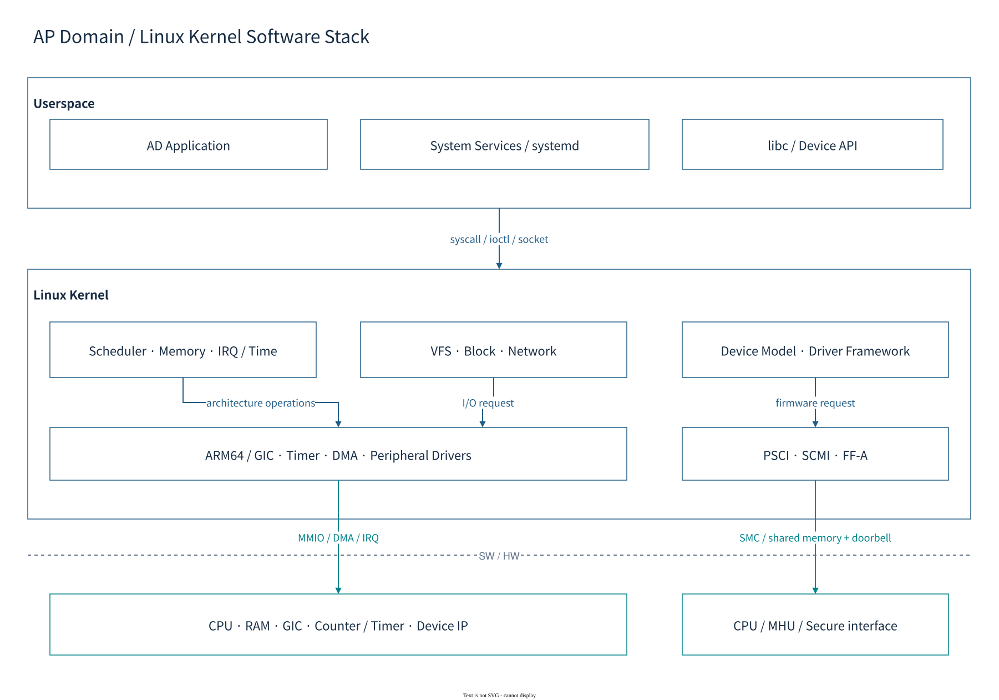

- Application은 syscall·device API·socket을 사용한다.
- System service는 process·device·network 정책을 관리한다.
- Linux는 Kernel core, subsystem framework, device driver를 통해 HW 자원을 제공한다.
- Firmware는 부팅 뒤에도 PSCI·FF-A 등 호출 경로에 남는다. U-Boot의 device driver는 Linux driver와 별개다.

### 2.2 Linux Kernel의 역할과 책임

| 영역 | Kernel 구성 / 역할 | Userspace 접점 |
|---|---|---|
| CPU / Task | Scheduler, process/thread, affinity, cgroup | `sched_*`, process API, cgroupfs |
| Memory | Virtual memory, page allocator, slab, mapping | `mmap`, page fault, `/proc` |
| Interrupt / Time | IRQ domain·handler, clocksource·clockevent, hrtimer | Device completion, clock/sleep API |
| Filesystem / Storage | VFS, filesystem, block layer, device mapper | File I/O, mount, block device |
| Network | Socket, protocol stack, netdev | BSD socket, netlink |
| Device | Bus·driver model, MMIO·DMA·IRQ resource | `/dev`, sysfs, subsystem API |

### 2.3 TF-A·U-Boot·Secure Firmware 인터페이스

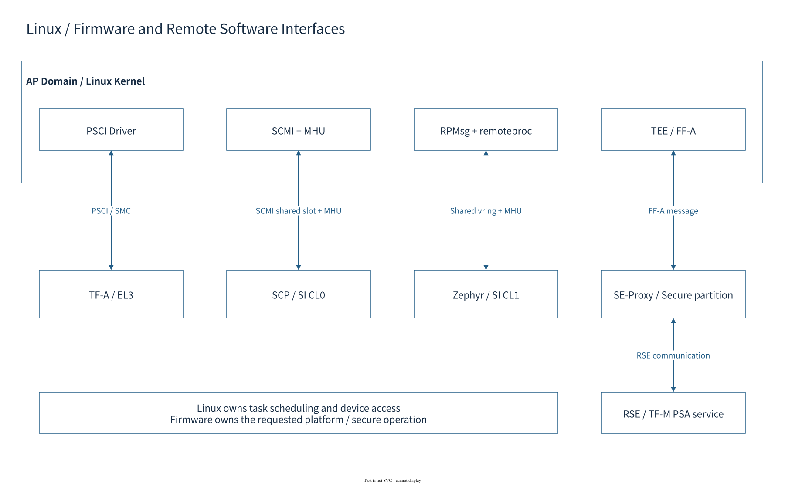

| 상대 Component | Interface | Linux 관점의 역할 |
|---|---|---|
| TF-A | PSCI / SMC | CPU on/off·suspend·system reset 요청 |
| U-Boot / EFI | Image·FDT·EFI handoff | Kernel 시작 상태와 boot data 전달 |
| OP-TEE / Secure partitions | FF-A, TEE subsystem | Secure service 호출과 shared-memory 관리 |
| RSE TF-M | Secure proxy를 경유한 PSA service | 보안 서비스의 실제 실행 주체 |

TF-A·SCP의 내부 전원 제어는 Kernel scheduler가 수행하지 않는다. Linux는 표준 firmware interface로 요청하고 결과를 처리한다.

### 2.4 SCP·Zephyr·TF-M과의 통신 인터페이스

| 경로 | Linux stack | 데이터와 알림 |
|---|---|---|
| Linux ↔ SCP | SCMI protocol → mailbox transport → `arm_mhuv3` | SCMI shared slot + doorbell |
| Linux ↔ Zephyr | Network → `rpmsg_net` → VirtIO/RPMsg → `arm_si_rproc` | Shared vring/buffer + MHU kick |
| Linux → RSE | Userspace PSA → FF-A → SE-Proxy → RSE | Secure service request/reply |

Mailbox transfer ACK는 SCMI·RPMsg·PSA의 서비스 완료가 아니다. 상세 protocol은 [Mailbox Report](../mailbox/README.md#software)에 정리한다.

<a id="source"></a>

## 3. Linux Kernel Source and Build Architecture

### 3.1 Source Repository 및 Directory Structure

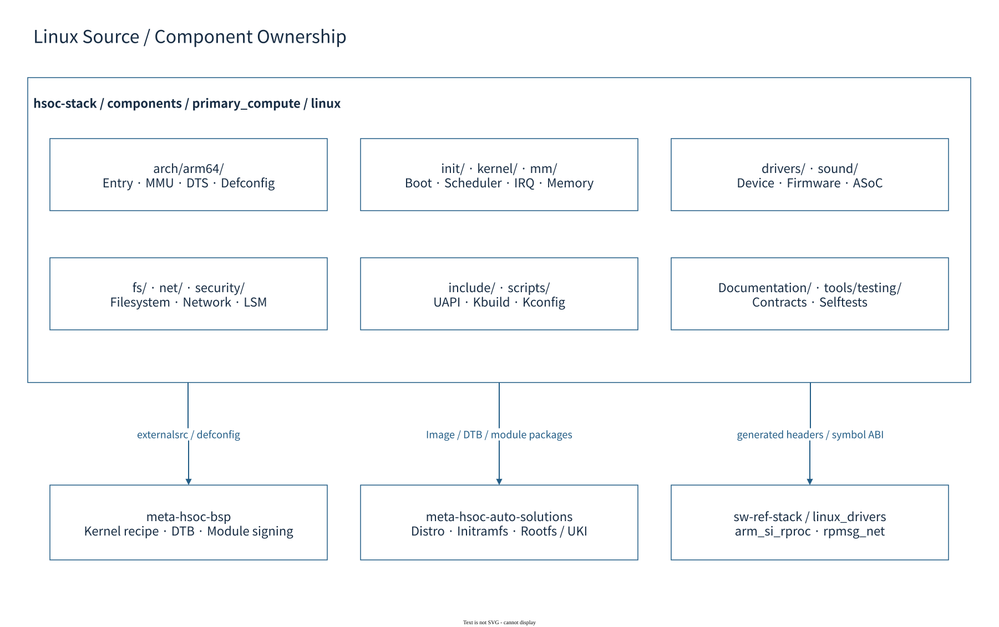

```text
hsoc-stack/components/primary_compute/linux/
├── arch/arm64/              # Entry, exception, CPU, MMU, DT
│   ├── kernel/
│   ├── mm/
│   ├── boot/dts/hsoc/       # Apollo DT/DTSI
│   └── configs/             # Apollo defconfig
├── init/                    # start_kernel, initcall, PID 1
├── kernel/                  # Scheduler, IRQ, time, locking, modules
├── mm/                      # Generic memory management
├── drivers/                 # Device / firmware / bus drivers
├── fs/                      # VFS, filesystems, executable loading
├── net/                     # Socket / network stack
├── sound/                   # ALSA / ASoC / DesignWare I2S
├── security/                # LSM / security policy hooks
├── include/                 # Kernel internal API, UAPI
├── scripts/                 # Kconfig, build, module signing
├── tools/testing/selftests/ # Subsystem selftests
└── Documentation/           # Boot ABI, PREEMPT_RT, driver contracts
```

### 3.2 ARM64 Architecture Code

| Source | 책임 |
|---|---|
| `arch/arm64/kernel/head.S` | Primary/secondary entry, 초기 page table·MMU 전환 |
| `arch/arm64/kernel/setup.c` | `setup_arch()`, FDT·memory·architecture 초기화 |
| `arch/arm64/kernel/smp.c` | Secondary CPU boot·online 처리 |
| `arch/arm64/kernel/psci.c` | ARM64 CPU operations와 PSCI 연결 |
| `arch/arm64/kernel/entry.S`, `entry-common.c` | Exception entry·IRQ·syscall 처리 |
| `arch/arm64/mm/` | ARM64 page table·cache·TLB·fault 처리 |

### 3.3 Kernel Core·Subsystem·Device Driver 구성

| Layer | 대표 Source | 역할 |
|---|---|---|
| Boot | `init/main.c`, `init/initramfs.c` | Kernel 초기화와 userspace 실행 |
| Scheduling | `kernel/sched/` | Fair·RT·Deadline scheduling, wakeup·context switch |
| IRQ / Time | `kernel/irq/`, `kernel/time/`, `kernel/softirq.c` | IRQ flow·threading·timer·deferred processing |
| Locking | `kernel/locking/` | Mutex, spinlock, rtmutex, PI |
| Device model | `drivers/base/`, `drivers/of/` | Device 등록, match·probe, supplier dependency |
| HW driver | `drivers/irqchip/`, `clocksource/`, `mailbox/` 등 | Register 접근과 subsystem operation 제공 |

### 3.4 Apollo Platform Code 및 Device Tree

DT include 구조는 `apollo-qvp-saturn-v.dts → apollo-qvp.dtsi → apollo.dtsi → apollo-pinctrl.dtsi`다.

- **공통 SoC:** CPU topology·GIC·Timer·MHU·peripheral 주소와 interrupt.
- **Machine 설정:** Memory·reserved-memory·device status·idle policy.
- **Board 설정:** Saturn-V의 활성 device, chosen·console·boot 기본값.
- **외부 모듈:** HIPC·PFDI의 일부 Linux consumer는 `sw-ref-stack` source와 별도 module recipe를 사용한다.

`CONFIG_NR_CPUS=512`는 compile-time 최대값이다. DT의 16 CPU node, command line의 `nr_cpus`, firmware가 기동한 CPU와 실제 online CPU 수는 각각 구분한다.

### 3.5 Kconfig·Defconfig·PREEMPT_RT 설정

| 설정 | Source 설정 / 의미 |
|---|---|
| `CONFIG_PREEMPT_RT=y` | RT preemption·locking·IRQ 동작 선택 |
| `CONFIG_HIGH_RES_TIMERS=y` | High-resolution timer 지원 |
| `CONFIG_NO_HZ_IDLE=y` | Idle CPU의 불필요한 주기 tick 억제 |
| `CONFIG_HZ_100=y` | Scheduler tick 기준 100Hz; timer 최소 분해능을 뜻하지 않음 |
| `CONFIG_SMP=y` | 다중 CPU 지원 |
| `CONFIG_MODULE_SIG_FORCE=y` | 신뢰되지 않은 module 서명 거부 |
| `CONFIG_INITRAMFS_SOURCE=""` | 기존 build config에서 built-in archive 미지정; 외부 initramfs 사용 |

Defconfig는 입력이다. Kconfig 의존성·선택 fragment가 반영된 `${B}/.config`가 compile 설정이며, 실행 중 Kernel과는 image revision을 맞춰 확인한다.

### 3.6 Yocto Recipe·Patch·External Module 통합

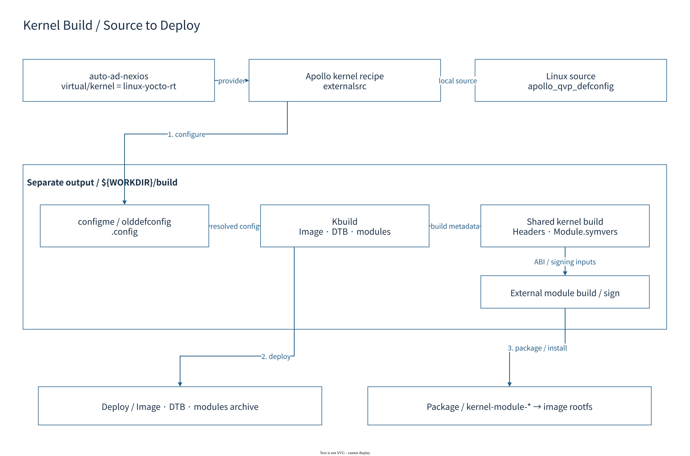

1. Distro가 `linux-yocto-rt` provider를 선택한다.
2. `linux-yocto%.bbappend → linux-yocto-apollo-qvp.inc → linux-yocto-apollo-common.inc`가 `externalsrc`로 로컬 Linux source와 `${WORKDIR}/build`를 연결한다.
3. `do_kernel_configme()`가 `apollo_qvp_defconfig`를 적용한다. 선택 fragment가 있으면 merge 후 `olddefconfig`를 수행한다.
4. Compile·shared-workdir·deploy·package 단계가 Image·DTB·module과 외부 module build 입력을 만든다.
5. Image recipe가 필요한 module package와 initramfs/rootfs를 설치한다.

기존 reference의 일부 kmeta feature는 owned recipe에서 제거하고 source/defconfig로 관리한다. `.scc` 이름의 존재만으로 활성 driver를 판단하지 않는다. External module은 동일 Kernel의 generated headers·`Module.symvers`·서명 입력을 사용한다.

### 3.7 Build and Deploy Artifacts

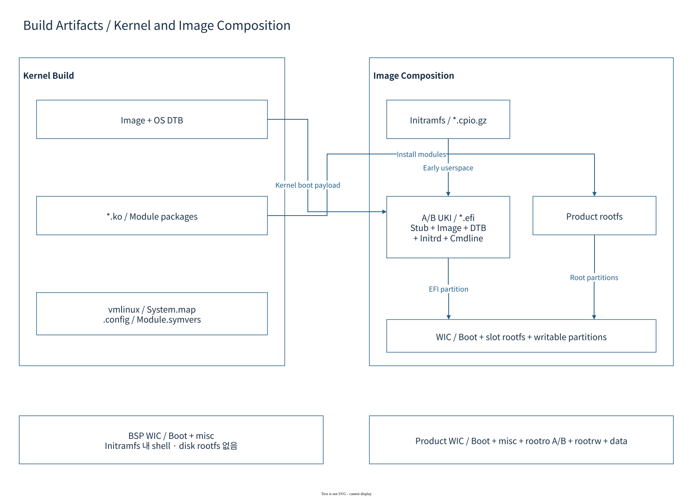

| 산출물 | 생성 / 소비 |
|---|---|
| `Image` | ARM64 executable Kernel; EFI stub/UKI가 boot |
| `apollo-qvp-saturn-v.dtb` | Kernel용 OS DTB; UKI에 포함 |
| `modules-apollo-qvp.tgz` | 배포 module archive; image 설치용 package와 구분 |
| `*.ko` | Module package → rootfs의 `/lib/modules/<release>/` 또는 usrmerge 대응 경로 |
| `vmlinux`, `System.map` | Symbol·debug·분석용; UKI payload의 `Image`와 용도 구분 |
| `.config`, `Module.symvers` | 설정 기록·external module ABI/build 입력 |
| `*.cpio.gz` | Image recipe가 생성하는 initramfs archive |
| A/B `*.efi` UKI | EFI stub + Kernel + initramfs + DTB + slot별 command line |
| `*.wic` | Boot partition·rootfs·기타 partition을 조합한 disk image |

Kernel build와 image composition은 별도 단계다. Initramfs·systemd·WIC는 Linux source tree가 직접 생성하는 application image가 아니다.

<a id="boot"></a>

## 4. Linux Kernel Boot Architecture

### 4.1 TF-A → U-Boot → Linux → Userspace Boot Flow

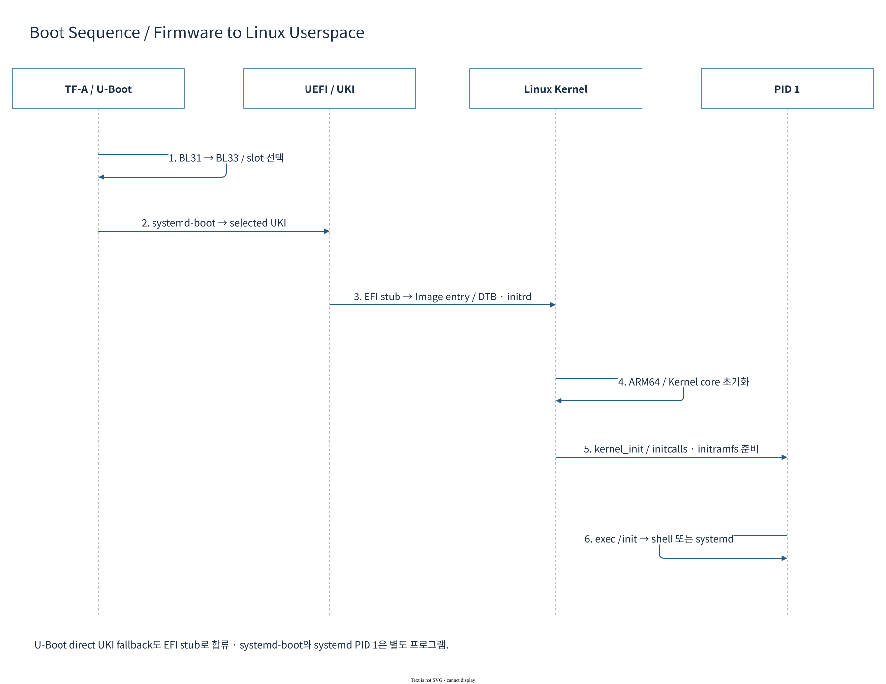

1. TF-A가 AP 초기화와 Secure runtime을 준비하고 BL33 U-Boot으로 진입한다.
2. U-Boot이 boot device와 slot을 선택한다.
3. 기본 script 경로는 **systemd-boot → UKI/EFI stub → Linux**다. 별도 direct UKI fallback 경로도 존재한다.
4. Linux가 CPU·memory·IRQ·scheduler·device를 초기화한다.
5. Initramfs를 rootfs에 풀고 PID 1에서 `/init`을 실행한다.
6. BSP는 shell, product image는 실제 rootfs 전환 후 systemd로 이어진다.

**systemd-boot는 Kernel 이전에 실행되며 systemd PID 1과 다른 프로그램이다.**

### 4.2 Bootloader–Kernel Interface

| 입력 / 조건 | Kernel의 처리 |
|---|---|
| `Image` | ARM64 entry와 executable code |
| DTB | RAM·reserved memory·CPU·device·interrupt·chosen 정보 |
| Command line | `console`, `root`, `rdinit`, `nr_cpus` 등 정책 |
| External initramfs | Boot metadata의 start/end로 전달; Kernel이 cpio archive 해제 |
| EFI handoff | EFI stub가 memory map·FDT·initrd를 준비하고 architecture entry로 전환 |
| ARM64 entry state | Boot ABI의 exception level·MMU·cache·interrupt 조건 준수 |

Native ARM64 Image entry의 `x0`는 DTB physical address이고 `x1..x3`은 0이다. EFI application 진입 ABI와 이 register 계약은 다르며 EFI stub가 중간 변환을 담당한다.

Apollo UKI는 **Kernel용 DTB**를 포함한다. TF-A가 U-Boot에 넘기는 초기 firmware FDT와 이를 무조건 동일시하지 않는다.

### 4.3 ARM64 Entry 및 Early Initialization

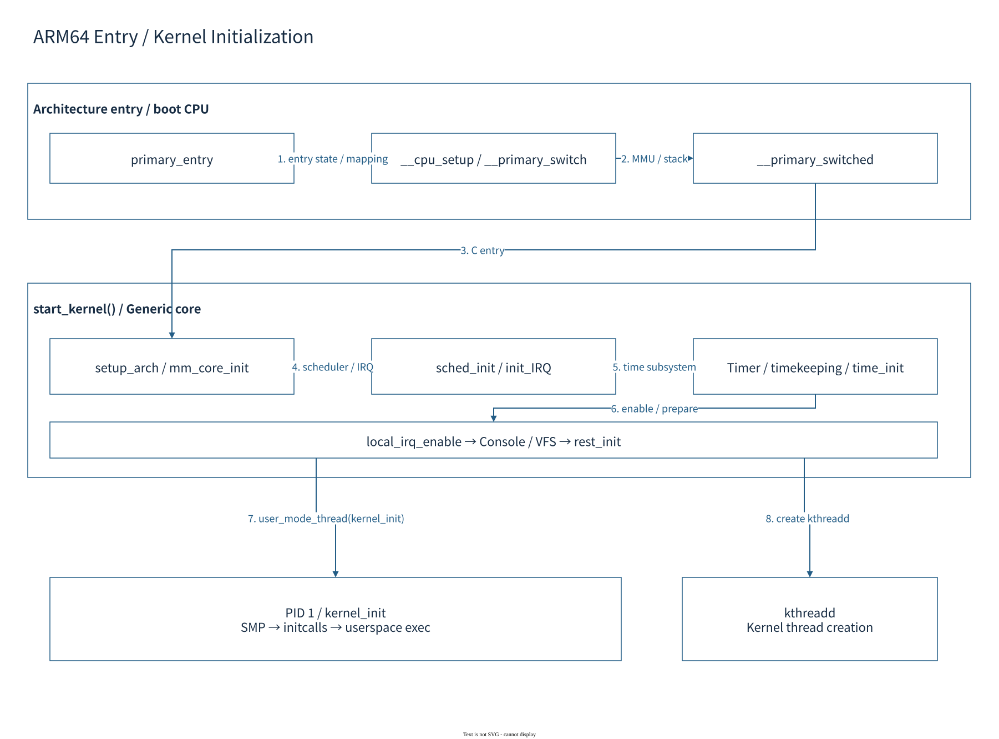

| 단계 | 주요 처리 |
|---|---|
| `primary_entry` | Boot arguments·entry 상태 보존, 초기 실행 환경 구성 |
| 초기 page table / MMU | Kernel VA mapping·exception level 준비, C entry 조건 확보 |
| `__primary_switched` | Stack·초기 task context 설정 후 `start_kernel()` |
| `start_kernel()` → `setup_arch()` | FDT·memory·CPU feature·architecture 설정 |

초기 console은 정규 driver probe 전에 진단 출력을 제공할 수 있다. 초기 boot 장애와 rootfs/service 장애는 마지막으로 완료된 stage로 구분한다.

### 4.4 Memory Management 초기화

- FDT/EFI의 RAM 정보와 reserved 영역을 받아 early allocation을 준비한다.
- `memblock`으로 early reservation·allocation을 관리한다.
- Page table·zone·page allocator·slab 등 runtime memory 관리로 전환한다.
- Initramfs와 Kernel init section은 각각의 수명에 따라 처리·회수한다.

Reserved memory는 일반 page allocator에서 제외할 수 있다. DMA buffer의 CPU virtual address, physical address, device DMA address는 같은 값이라고 가정하지 않는다.

### 4.5 Interrupt·Timer·Scheduler 초기화

| 영역 | 초기화 결과 |
|---|---|
| Scheduler | Boot CPU runqueue·idle task·scheduling 기반 준비 |
| IRQ | Architecture IRQ init, GIC/IRQ domain·exception dispatch 준비 |
| Time | Counter clocksource, per-CPU timer clockevent, timekeeping·hrtimer 준비 |
| Deferred processing | Softirq·worker·kernel thread 실행 기반 구성 |

`start_kernel()`에서는 scheduler 초기화가 일반 device driver probe보다 먼저 진행된다. GIC·architectural timer처럼 early OF 초기화를 사용하는 controller를 모두 platform-driver `probe()` 경로로 그리지 않는다.

### 4.6 SMP 및 Secondary CPU Bring-up

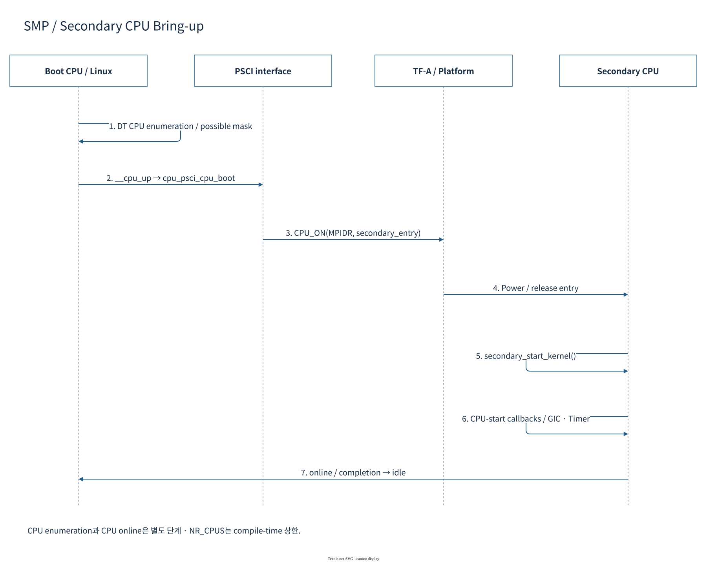

1. Kernel이 DT CPU node·affinity와 boot method를 확인한다.
2. CPU bring-up 경로에서 PSCI `CPU_ON`으로 secondary entry를 전달한다.
3. TF-A/platform firmware가 대상 CPU를 기동한다.
4. Secondary CPU가 `secondary_entry → secondary_start_kernel()`로 진입한다.
5. CPU별 상태·interrupt/timer·hotplug callbacks를 준비하고 online 상태와 idle loop로 전환한다.

SCP의 power 제어와 Kernel의 CPU online 처리는 서로 다른 단계다. `nr_cpus`·`maxcpus`·possible/present/online mask의 의미도 구분한다.

### 4.7 Initcall·Driver Initialization

- `rest_init()`는 `kernel_init` task(PID 1)와 `kthreadd`를 만들고 boot task는 idle로 진입한다.
- PID 1의 `kernel_init_freeable()` 경로에서 SMP·기본 subsystem·initcall을 진행한다.
- Initcall level은 초기화 순서를 제공하지만 device supplier가 준비되었음을 모두 보장하지 않는다.
- Driver는 clock·reset·regulator·IRQ domain 등 supplier가 없으면 `-EPROBE_DEFER`로 probe를 미룰 수 있다.

### 4.8 Initramfs와 PID 1 실행

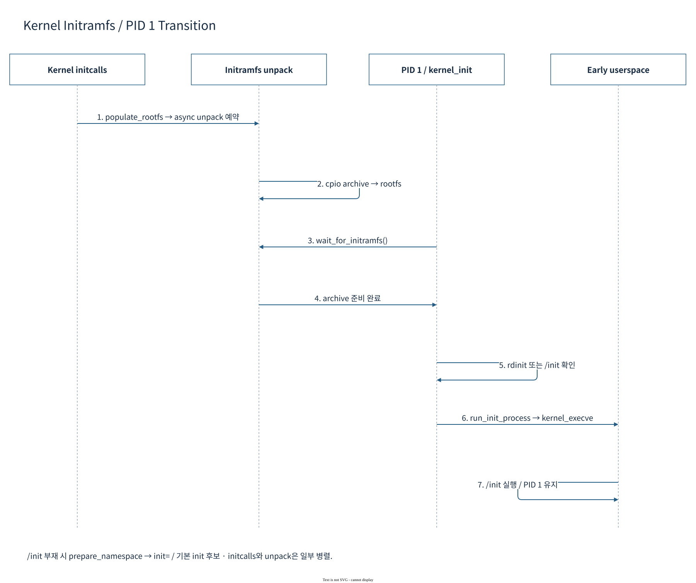

1. `populate_rootfs()`가 archive unpack을 예약한다.
2. `wait_for_initramfs()`가 unpack 완료를 보장한다.
3. `/init` 또는 `rdinit=` 경로가 있으면 early userspace를 실행한다.
4. Early init이 없으면 Kernel의 namespace/root mount 경로를 거쳐 `init=` 또는 기본 init 후보를 시도한다.
5. `run_init_process()` → `kernel_execve()`가 PID 1을 userspace program으로 전환한다.

Initramfs unpack은 asynchronous일 수 있다. 다른 initcall과의 실행을 단순한 완전 직렬 순서로 가정하지 않는다. `/init` 이후 filesystem 전환과 서비스 시작은 7장에서 다룬다.

<a id="rt"></a>

## 5. Linux Kernel PREEMPT_RT Architecture

### 5.1 PREEMPT_RT 적용 목적과 구성

PREEMPT_RT는 긴 비선점 구간을 줄이고 IRQ·lock contention을 scheduler가 관리할 수 있게 한다. Application의 deadline이나 모든 driver의 bounded latency를 자동으로 보장하지는 않는다.

| Apollo 설정 | 효과 |
|---|---|
| `PREEMPT_RT=y` | RT locking·preemption 경로 |
| `IRQ_FORCED_THREADING=y` | 기존 build에서 강제 IRQ threading 기반 확인 |
| `HIGH_RES_TIMERS=y` | Tick보다 세밀한 deadline 예약 |
| `NO_HZ_IDLE=y`, `HZ=100` | Idle tick 억제와 기본 tick 기준 |

### 5.2 Kernel Preemption Model

- 일반 Kernel code의 선점 가능 구간을 확대한다.
- Sleep 가능한 lock을 사용하는 구간은 priority와 blocking 관계를 scheduler가 처리한다.
- `raw_spinlock`, IRQ-disabled 구간, low-level entry code는 여전히 비선점·atomic 제약을 갖는다.
- Device latency, memory contention, firmware call 대기까지 모두 제거하는 구성은 아니다.

### 5.3 Threaded IRQ 및 Deferred Processing

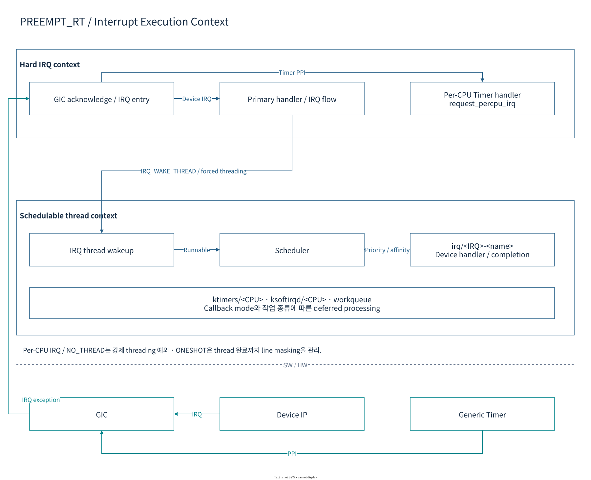

1. Hard IRQ entry와 controller acknowledge는 exception 문맥에서 수행한다.
2. 강제 threading 대상 handler는 IRQ thread를 깨우고 scheduler가 실행한다.
3. Thread handler가 device 상태·buffer·completion을 처리한다.
4. `IRQF_ONESHOT`을 사용하는 경로는 thread 완료까지 해당 interrupt line을 mask하는 계약을 따른다.

`IRQF_NO_THREAD`, per-CPU IRQ 등은 강제 변환 대상에서 제외된다. 이미 `IRQF_ONESHOT`을 지정한 요청도 강제 변환을 건너뛰지만, 명시적인 threaded handler일 수 있다. **Generic Timer PPI를 일반 device IRQ thread와 같은 경로로 표현하지 않는다.**

Softirq도 RT 문맥 규칙을 따른다. 모든 deferred work가 하나의 thread로 합쳐지는 것은 아니며, IRQ thread·`ksoftirqd/<CPU>`·workqueue를 구분한다. 이 소스의 timer thread 이름은 `ktimers/<CPU>`다.

### 5.4 Locking·RT Mutex·Priority Inheritance

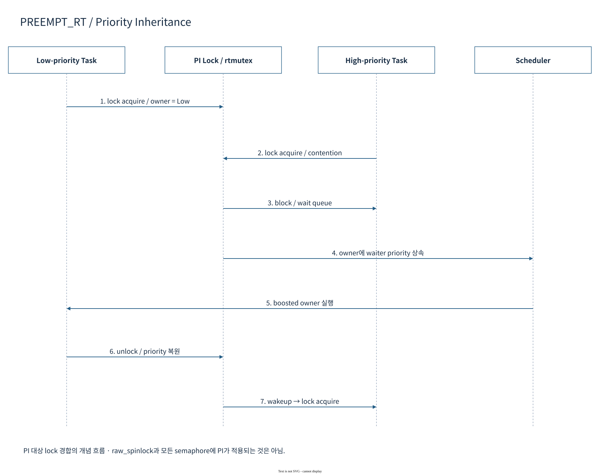

| Lock | PREEMPT_RT에서의 의미 |
|---|---|
| `spinlock_t` | RT-mutex 기반의 선점 가능한 locking; 일반 spinlock의 atomic 가정을 그대로 적용할 수 없음 |
| `raw_spinlock_t` | Low-level atomic critical section; 짧게 유지 |
| `mutex` / `rtmutex` | Task 문맥의 blocking; RT의 mutex는 rtmutex 기반 PI 경로 사용 |
| `local_lock_t` | Local data 보호를 명시; RT에서는 실제 locking 구현 사용 |

높은 우선순위 task가 lock에서 block되면 PI 대상 lock owner의 priority를 올려 inversion을 줄인다. PI는 잘못된 lock 순서·deadlock·무한 대기를 해결하지 않는다. `_irqsave`라는 이름만 보고 RT의 `spinlock_t`가 항상 hard IRQ를 disable한다고 가정하지 않는다.

### 5.5 RT Scheduling Policy·Priority·CPU Affinity

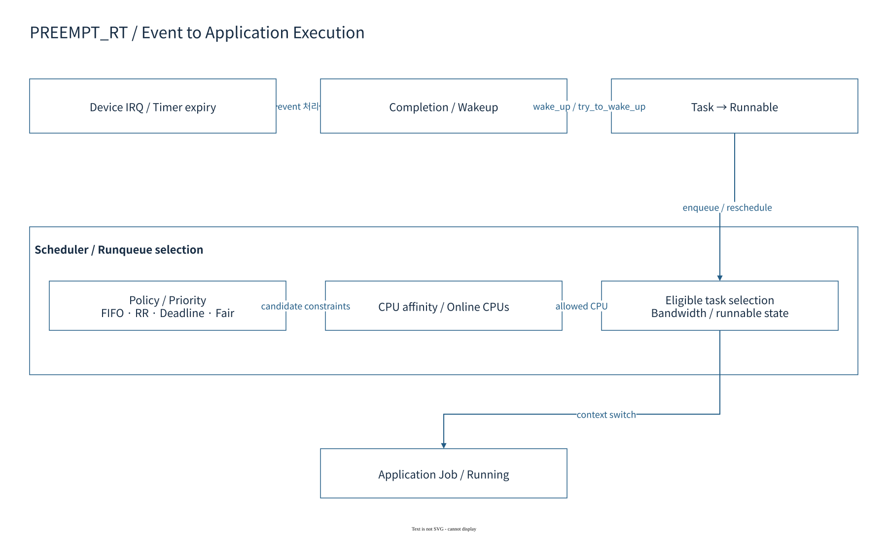

| 항목 | 사용 관점 |
|---|---|
| `SCHED_FIFO` | 높은 RT priority 우선; block·yield·더 높은 priority task에 의해 전환 |
| `SCHED_RR` | 같은 priority의 runnable RT task 사이 time slice |
| `SCHED_DEADLINE` | Runtime·deadline·period와 admission control 기반 |
| CPU affinity | Task·IRQ thread의 허용 CPU를 설정; firmware CPU topology와 별개 |
| Wakeup / dispatch | Ready 상태 전환과 실제 CPU 실행은 별도 시점 |

Application priority만 높이고 이를 깨우는 IRQ thread나 worker를 낮게 두면 응답 경로가 지연될 수 있다. RT bandwidth·cgroup·CPU affinity 정책은 실제 실행 설정과 함께 기록한다.

### 5.6 High-Resolution Timer·Sleep·Wakeup

- Clocksource는 시간 조회, clockevent는 다음 interrupt 예약을 담당한다.
- Hrtimer callback의 hard/soft 실행 방식은 timer mode와 RT 구현에 따른다.
- Sleep·timeout 만료는 task를 runnable로 만들며 즉시 실행을 보장하지 않는다.
- `HZ=100`은 모든 timer가 10ms 단위로만 동작한다는 뜻이 아니다.

세부 Linux API·vDSO·Timer sequence는 [Timer Report](../timer/README.md#software)를 참조한다.

### 5.7 Driver 구현 시 RT 고려사항

- Hard IRQ에는 sleep 가능한 API를 사용하지 않는다. Threaded handler에서도 driver의 locking·context 계약을 확인한다.
- MMIO polling과 firmware call에는 완료 조건·timeout을 둔다.
- `raw_spinlock` 구간에서 긴 register polling·메모리 복사를 피한다.
- DMA·shared-memory publish ordering과 cache maintenance를 RT 설정으로 대체하지 않는다.
- 측정에는 IRQ thread priority, affinity, workload, Kernel config를 함께 기록한다. QVP의 guest latency를 silicon worst-case latency로 해석하지 않는다.

<a id="bsp"></a>

## 6. Apollo BSP / Device Driver Architecture

### 6.1 BSP 및 Driver 구성 요약

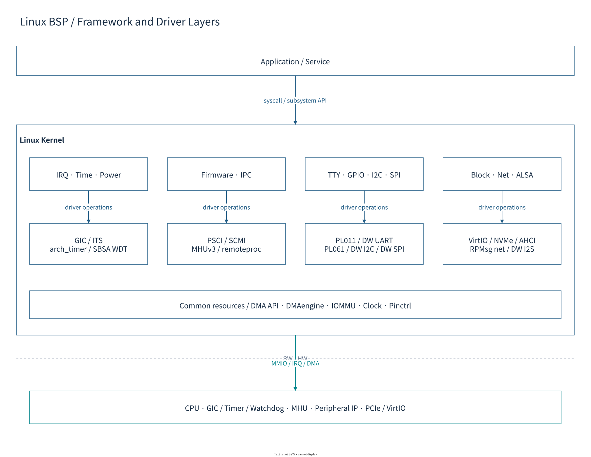

Apollo BSP는 **DT의 resource description + Kconfig 선택 + Kernel subsystem driver + image의 module 설치**로 구성된다. HW node 존재·driver 포함·probe 성공·실제 I/O 성공은 각각 확인한다.

### 6.2 Device Tree·Device Model·Driver Binding

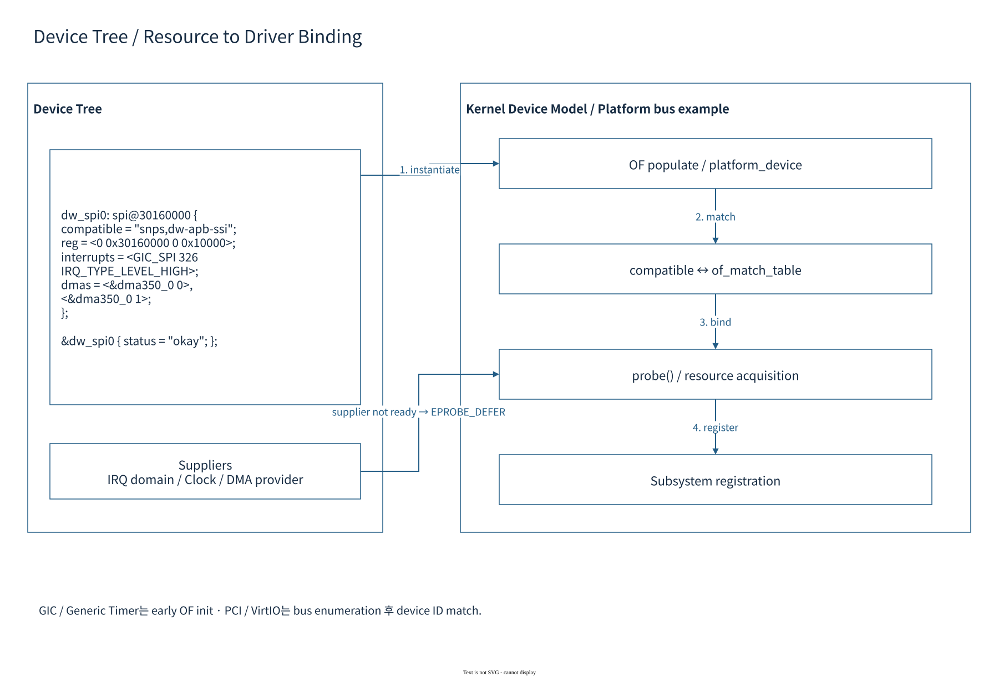

1. Architecture 초기화가 FDT를 해석하고 live device tree를 구성한다.
2. OF/platform·AMBA 등 bus 경로가 사용 가능한 device node를 등록한다.
3. Bus가 `compatible`·ID와 driver의 match table을 비교한다.
4. Probe가 MMIO·IRQ·clock·reset·DMA resource를 얻는다.
5. Driver가 subsystem에 장치를 등록하고 userspace interface가 나타난다.

그림은 `apollo.dtsi`의 `dw_spi0`와 board의 `status = "okay"` override를 발췌했다. MMIO `0x30160000`, SPI offset `326`, DMA-350 channel `0/1`이 driver resource로 전달된다.

PCI와 VirtIO는 bus discovery·device ID로 enumerate한다. 모든 Linux device가 DT node와 1:1로 생성되는 것은 아니다. `status = "okay"`도 probe 성공을 보장하지 않는다.

### 6.3 CPU·PSCI·SCMI·Power Management

| 구성 | Linux 구현 / 역할 |
|---|---|
| PSCI | `drivers/firmware/psci/`; CPU lifecycle 요청 |
| SCMI | `drivers/firmware/arm_scmi/`; protocol discovery·transport·performance |
| CPUfreq | SCMI consumer와 cpufreq framework; policy·frequency 요청 |
| CPUidle | Idle-state policy; Apollo Machine DTSI 기본은 architectural WFI, PSCI deep idle은 선택 구성 |
| CPU topology | DT CPU affinity·cache·capacity와 scheduler topology 연결 |

CPUfreq state 조회가 항상 MHU transaction을 발생시키는 것은 아니다. Cache·transport·protocol 경로를 구분한다.

### 6.4 Interrupt Controller·Timer·Watchdog

| Driver | 주요 구현 | Linux 접점 |
|---|---|---|
| GICv3 / ITS | `drivers/irqchip/irq-gic-v3*.c` | IRQ domain, SPI/PPI, PCI MSI/LPI |
| ARM architectural timer | `drivers/clocksource/arm_arch_timer.c` | Clocksource·clockevent·per-CPU Timer IRQ |
| SBSA Generic Watchdog | `drivers/watchdog/sbsa_gwdt.c` | Watchdog framework·`/dev/watchdog*` |

Controller의 EOI와 device 원인 clear는 별개다. Watchdog은 timeout·refresh·reset 경로를 갖는 HW 장치이며 RT scheduler 감시와 구분한다.

[Interrupt](../interrupt/README.md#software) · [Timer](../timer/README.md#software) · [Watchdog](../watchdog/README.md)

### 6.5 Mailbox·Remoteproc·RPMsg

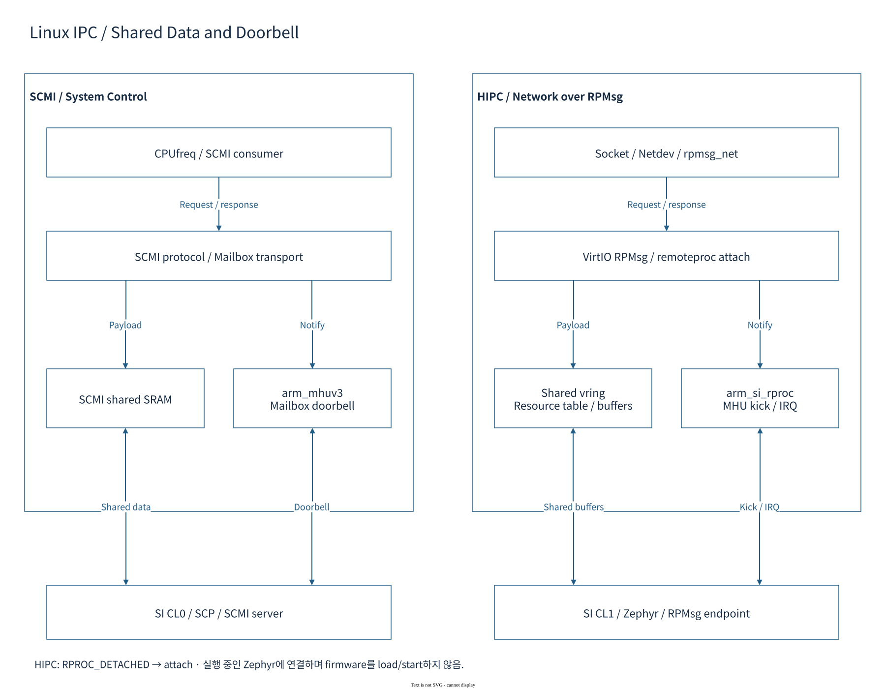

- MHU controller: `drivers/mailbox/arm_mhuv3.c`.
- SCMI: shared request/response의 token·FREE를 확인하고 protocol consumer에 결과를 전달한다.
- HIPC: `arm_si_rproc`가 이미 실행 중인 CL1에 attach하고 VirtIO/RPMsg를 연결한다.
- `rpmsg_net`은 RPMsg message와 Linux network packet을 변환한다.

Linux의 remoteproc framework가 일반적으로 firmware load를 지원하더라도, Apollo HIPC의 DETACHED attach 경로에서 Linux가 Zephyr를 load/start하는 것은 아니다.

### 6.6 UART·GPIO·I2C·SPI

| 기능 | Driver 계열 | Subsystem 접점 |
|---|---|---|
| UART | AMBA PL011, DesignWare 8250 | Console·TTY·serial port |
| GPIO | PL061, PCA953x expander | GPIO character device·IRQ domain |
| I2C | DesignWare platform | I2C adapter·client driver·regmap |
| SPI | DesignWare MMIO | SPI controller·client driver·transfer queue |

Pin control·clock·reset·interrupt와 상대 device binding까지 충족해야 I/O가 가능하다. UART console 사용과 일반 serial client의 port 소유권도 구분한다.

### 6.7 DMA·IOMMU·Reserved Memory

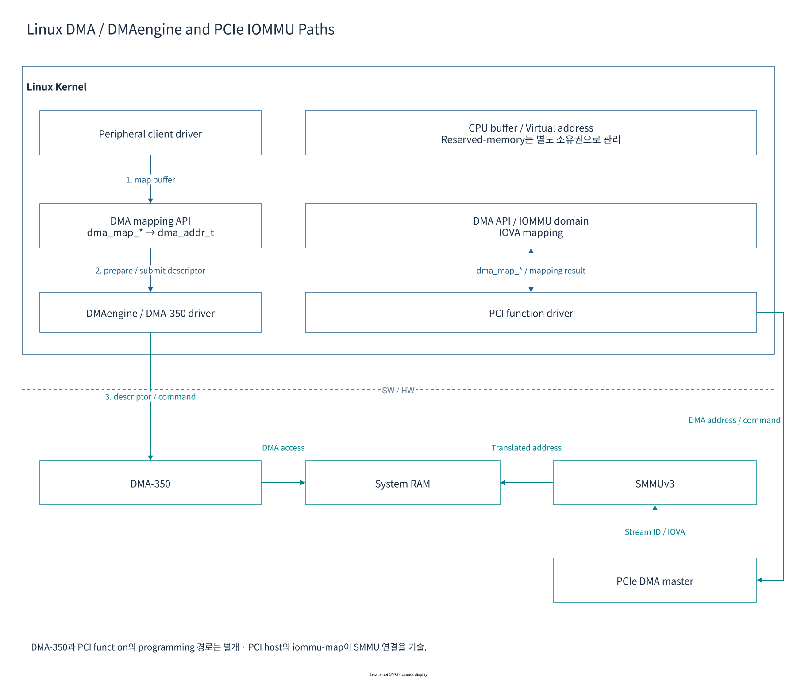

- Driver는 DMA API로 device-visible address와 mapping 수명을 관리한다.
- SMMUv3는 stream ID·IOMMU domain·page table로 device 접근을 변환한다.
- DMA-350 controller driver는 DMAengine channel과 descriptor를 제공한다.
- Reserved memory는 HIPC·firmware shared buffer 등 특정 소유권을 가진다.

`dma_addr_t`를 CPU pointer로 사용하거나 임의 physical address를 device에 전달하지 않는다. `dma-coherent`, cache maintenance, memory barrier, IOMMU mapping은 서로 다른 계약이다.

### 6.8 PCIe·VirtIO·Storage·Network·Audio

| 영역 | 구성 / Driver | 데이터 경로 |
|---|---|---|
| PCIe | Generic ECAM host + GIC ITS | PCI enumeration → BAR·IRQ/MSI → function driver |
| VirtIO | MMIO / PCI transport | Virtqueue → device backend |
| Storage | VirtIO block, NVMe, SATA AHCI, filesystem | VFS → filesystem → block layer → device |
| Network | VirtIO net, RPMsg net | Socket → network stack → netdev |
| Audio | ASoC DesignWare I2S + PCM/DMA 연결 | ALSA stream → DAI/PCM → I2S·DMA |

VirtIO device는 Linux에서 표준 device driver로 다룬다. QVP host model 내부 구조는 이 보고서의 Kernel architecture와 분리한다.

### 6.9 Built-in Driver와 Loadable Module

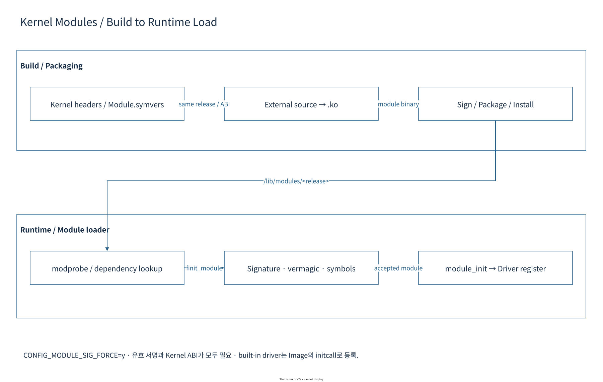

| 구성 | 부팅·적재 조건 |
|---|---|
| Built-in `=y` | Image에 link; 해당 initcall/early-init 경로로 등록 |
| Module `=m` | `.ko` package 설치, dependency·modalias·명시적 modprobe 필요 |
| External module | 동일 Kernel release·ABI·generated headers·symbol version 사용 |
| Module signing | `MODULE_SIG_FORCE=y`; Kernel이 신뢰하는 서명 필요 |

`modprobe`는 dependency를 해석하지만 누락된 module package를 생성하지 않는다. 서명된 module도 symbol/ABI 불일치로 실패할 수 있다. Apollo BSP init은 HIPC·PFDI modules를 명시적으로 요청한다.

| Driver / 주요 Kconfig | 선택값 | 구성 |
|---|---|---|
| `ARM_GIC_V3`, `ARM_GIC_V3_ITS`, `ARM_ARCH_TIMER` | `y` | IRQ·시간 기반 |
| `ARM_PSCI_FW`, `ARM_SCMI_PROTOCOL`, `ARM_SCMI_CPUFREQ` | `y` | Firmware·CPU power/performance |
| `ARM_MHU_V3`, `ARM_SBSA_WATCHDOG` | `y` | Mailbox·HW watchdog |
| `SERIAL_AMBA_PL011`, `SERIAL_8250_DW` | `y` | PL011 console·DW UART |
| `GPIO_PL061`, `GPIO_PCA953X`, `PINCTRL_HSOC` | `y` | GPIO·pin control |
| `I2C_DESIGNWARE_PLATFORM`, `EEPROM_AT24`, `SPI_DW_MMIO` | `y` | I2C·EEPROM·SPI |
| `ARM_DMA350`, `ARM_SMMU_V3` | `y` | DMAengine·IOMMU |
| `PCI_HOST_GENERIC`, `PCIE_QBOX_EPC` | `y` | PCI host / 별도 endpoint controller |
| `VIRTIO_MMIO`, `VIRTIO_PCI`, `VIRTIO_BLK`, `VIRTIO_NET` | `y` | VirtIO transport·function |
| `BLK_DEV_NVME`, `SATA_AHCI`, `SND_DESIGNWARE_I2S` | `y` | Storage·audio |
| `RTC_DRV_PL031`, `OPTEE`, `ARM_TSTEE`, `ARM_FFA_TRANSPORT` | `y` | RTC·secure service |
| `RPMSG_VIRTIO`, `DMATEST` | `m` | RPMsg transport·DMA test module |
| `arm_si_rproc`, `rpmsg_net` | External `.ko` | `sw-ref-stack` source·별도 recipe |

선택값은 native defconfig와 기존 build config 기준이다. AP의 활성 watchdog node는 SBSA GWDT다. SP805·TPS6594 driver의 build 설정만으로 AP에 해당 장치가 연결됐다고 판단하지 않는다.

<a id="userspace"></a>

## 7. Root Filesystem and Userspace Boot

### 7.1 BSP Initramfs / Yocto Rootfs 구성 비교

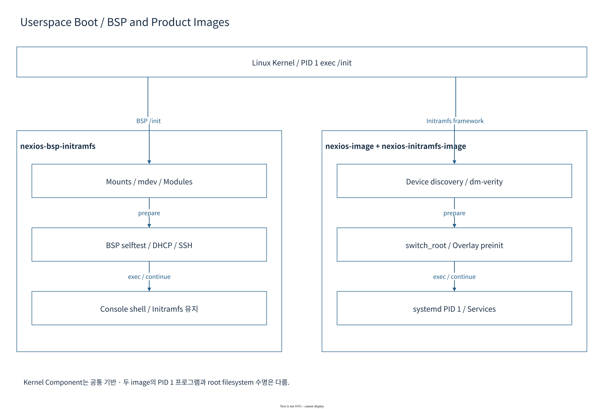

| 항목 | BSP image | Product image |
|---|---|---|
| Recipe | `nexios-bsp-initramfs` | `nexios-image` + `nexios-initramfs-image` |
| 초기 실행 | BusyBox 기반 `/init` | Initramfs framework `/init` |
| Root filesystem | Initramfs 자체를 유지 | Disk rootfs로 `switch_root` |
| PID 1 최종 경로 | Console shell | Overlay preinit → systemd |
| Boot argument | `rdinit=/init`, BSP selftest는 `root=` 부재 검사 | Slot별 `root=PARTLABEL=rootro_a/b`, `ro` |
| Writable data | RAM 기반 /run 등 | `/rootrw`, `/data`, `/etc` overlay |
| 목적 | Driver·BSP bring-up·smoke test | System service·application 실행 |

### 7.2 BSP Initramfs: `/init` → Device 설정 → Shell

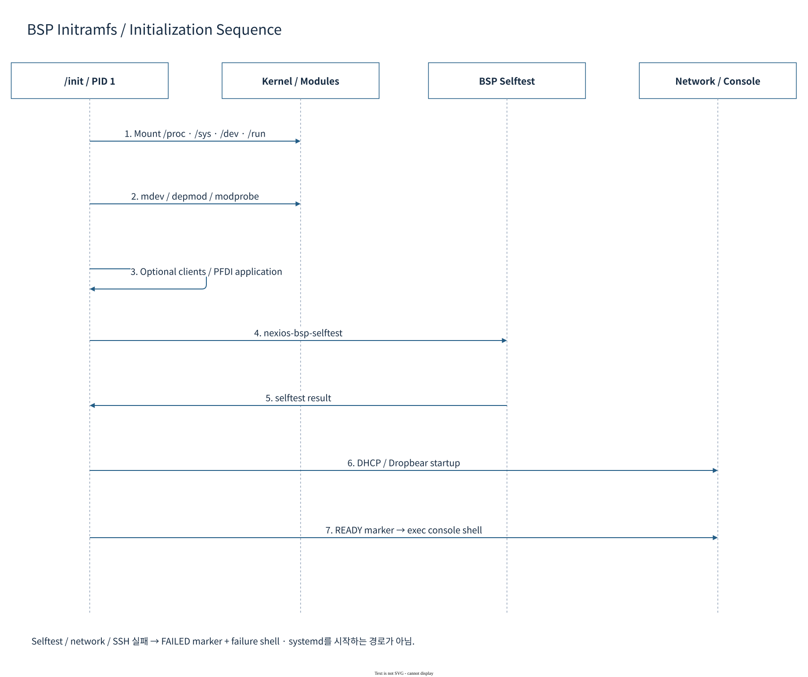

1. `/proc`, `/sys`, `/dev`, `/run`을 mount하고 debugfs/configfs를 준비한다.
2. `mdev -s`, `depmod -a`로 device node·module dependency를 준비한다.
3. `virtio_rpmsg_bus`, `arm_si_rproc`, `rpmsg_net`, `pfdi_misc`를 modprobe한다.
4. 구성에 따라 vMCU client·PFDI application을 시작한다.
5. BSP selftest가 CPU 수·Timer IRQ·watchdog·storage·RPMsg 등 기본 상태를 검사한다.
6. Network DHCP와 Dropbear SSH를 준비한다.
7. `NEXIOS_BSP_INITRAMFS_READY` 출력 후 console shell로 exec한다.

Selftest·network·SSH 실패 경로는 `NEXIOS_BSP_INITRAMFS_FAILED`와 failure shell로 이어진다. Module의 SKIP 출력과 selftest 전체 성공 판정은 별개다.

### 7.3 Yocto Initramfs: Root Device 준비 및 Rootfs 전환

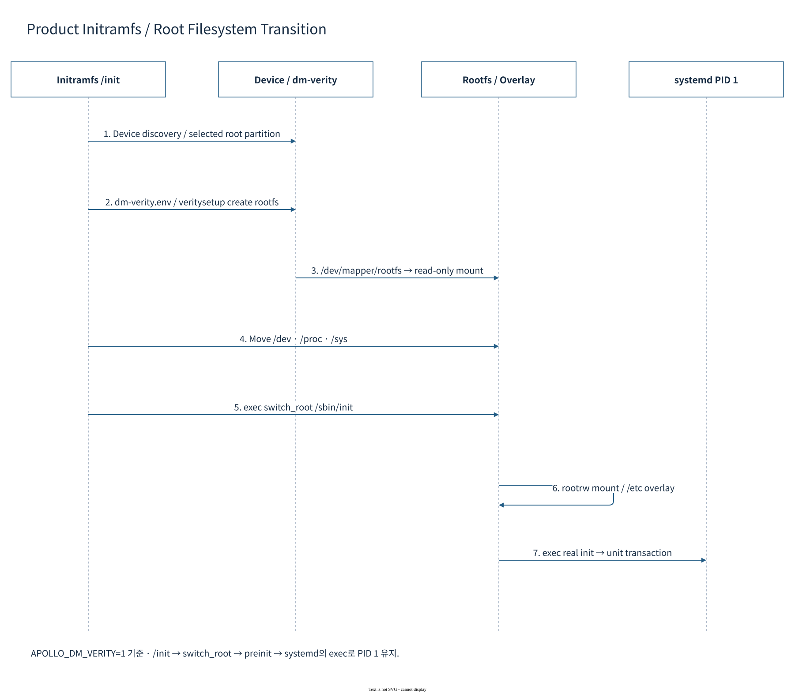

기본 `APOLLO_DM_VERITY=1` 구성을 기준으로 한다.

1. Initramfs framework가 boot arguments와 device discovery를 준비한다.
2. Dm-verity module이 selected root device와 `dm-verity.env`를 읽는다.
3. `veritysetup`이 `/dev/mapper/rootfs`를 구성하고 rootfs를 read-only mount한다.
4. Finish module이 `/dev`, `/proc`, `/sys`를 새 root로 이동한다.
5. `switch_root`가 새 root의 `/sbin/init`을 실행한다.
6. Overlay preinit이 `LABEL=rootrw`와 `/etc` overlay를 준비하고 실제 init으로 exec한다.

`APOLLO_DM_VERITY=0`은 별도 image 정책이다. Kernel의 dm-verity driver, userspace `veritysetup`, root hash metadata는 함께 일치해야 한다.

### 7.4 systemd PID 1 및 Boot Targets

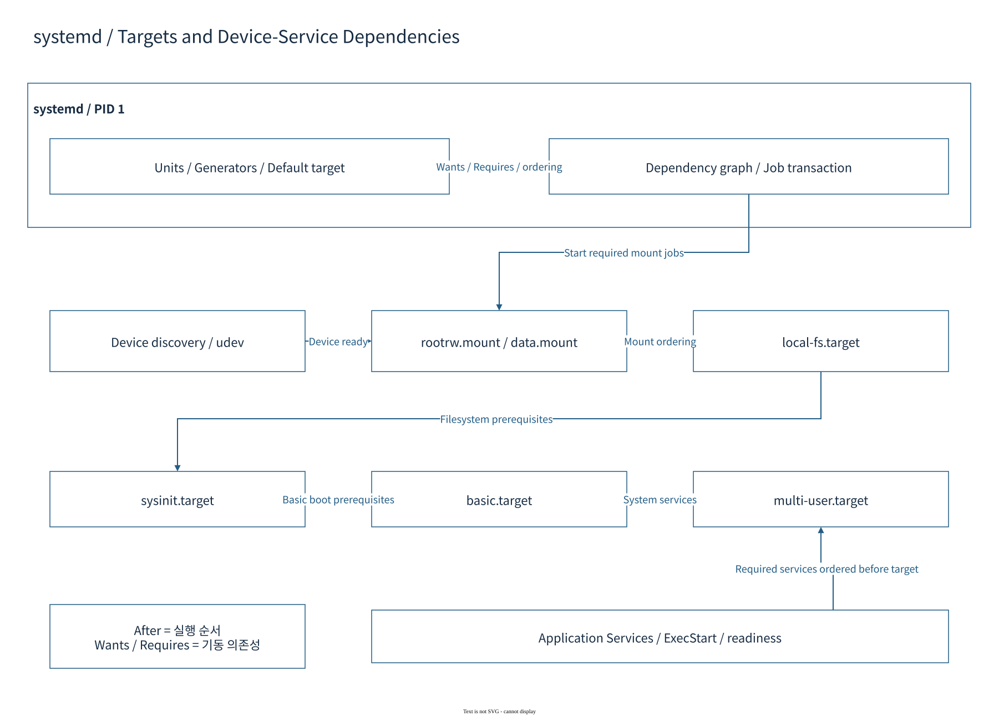

- Systemd가 unit·generator 결과와 default target의 dependency를 읽어 job transaction을 구성한다.
- `sysinit.target`, `basic.target`, `multi-user.target`은 부팅의 동기화 지점이다.
- Mount·device·service job은 의존성이 허용하는 범위에서 병렬 실행된다.
- `After=`는 ordering이며, 상대 unit을 기동하려면 `Wants=`/`Requires=` 등 별도 dependency가 필요하다.

그림은 일반적인 target 진행과 Apollo storage unit의 관계다. 최종 default target·활성 서비스는 image에 설치된 unit과 enable 상태로 결정된다.

### 7.5 Device Discovery·Module Loading·Service Dependencies

| 구성 | 역할 |
|---|---|
| Kernel uevent / sysfs | Device 추가·변경 정보 제공 |
| udev | Device event 처리·node 정책·modalias 기반 module 연결 |
| Module loading | Dependency·서명·ABI 확인 후 driver 등록 |
| `rootrw.mount`, `data.mount` | Apollo writable storage; `local-fs.target`에 연결 |
| Service ordering | 필요한 filesystem·network·device 준비 뒤 application 실행 |

Apollo는 `systemd-resolved`·`systemd-timesyncd`에 `After=var-volatile-lib.service` drop-in을 설치한다. `/var/lib` 준비와 service state 접근의 순서를 맞추기 위한 설정이다.

### 7.6 Application Service 시작

- 실행 파일 설치, unit 설치, enable/default dependency가 모두 필요하다.
- `ExecStart` 성공과 service의 실제 ready 상태는 `Type=`·readiness protocol에 따라 다르다.
- Device open·IPC endpoint 연결·network 준비 실패는 journal과 subsystem 상태를 함께 확인한다.
- Application 시작 정책은 userspace 책임이며 Kernel initcall 순서로 제어하지 않는다.

<a id="validation"></a>

## 8. Test and Verification

### 8.1 검증 환경 및 결과 기록

시험 대상 image와 `Image`·DTB·modules·symbol ELF의 revision을 맞춘다. QVP full boot를 실행 환경으로 사용하며, 아래 runtime 시험은 이번 문서 작성에서 **NOT RUN**이다.

`PASS`: 기대 결과 충족 / `FAIL`: 불충족 / `NOT RUN`: 미실행 / `BLOCKED`: 선행 조건 문제 / `N/A`: 해당 구성에 미적용.

| 문서 검토 항목 | 결과 |
|---|---|
| Source version·defconfig·Yocto provider 및 externalsrc 연결 | 소스 대조 완료 |
| 기존 build config의 PREEMPT_RT·SMP·Timer 설정 | 설정 확인; runtime 판정과 분리 |
| Kernel boot·BSP `/init`·rootfs 전환 경로 | 소스 대조 완료 |

### 8.2 Kernel Configuration·Boot·SMP 검증

| Test ID | 검증 항목 / 방법 | 기대 결과 | 실제 결과 | 판정 | 로그 / 측정값 |
|---|---|---|---|---|---|
| LNX-BOOT-01 | `uname -r`, `/proc/version`, boot log와 배포 config 대조 | Kernel release·설정·image 일치 | — | NOT RUN | — |
| LNX-BOOT-02 | `/proc/cmdline`, DT model, root/init 설정 확인 | 선택 image의 boot data 적용 | — | NOT RUN | — |
| LNX-BOOT-03 | `/sys/devices/system/cpu/{possible,present,online}`와 CPU 수 비교 | Boot policy에 맞는 CPU online | — | NOT RUN | — |
| LNX-BOOT-04 | Boot log의 IRQ·timer·driver init 및 PID 1 확인 | Kernel init과 userspace 진입 완료 | — | NOT RUN | — |

### 8.3 PREEMPT_RT 동작 검증

| Test ID | 검증 항목 / 방법 | 기대 결과 | 실제 결과 | 판정 | 로그 / 측정값 |
|---|---|---|---|---|---|
| LNX-RT-01 | Kernel config의 `PREEMPT_RT`, `HIGH_RES_TIMERS` 확인; `/sys/kernel/realtime` 제공 시 조회 | RT 구성 확인 | — | NOT RUN | — |
| LNX-RT-02 | `/proc` task 목록에서 `irq/*`, `ktimers/*` 확인 | 대상 IRQ·timer thread 존재 | — | NOT RUN | — |
| LNX-RT-03 | 사용 가능한 `chrt`/`taskset`으로 지정 task의 policy·affinity 조회 | 실행 설정과 요구 정책 일치 | — | NOT RUN | — |

`autosd/customization/rt/`에는 cyclictest·timerlat·osnoise 관련 도구가 있다. AutoSD용이므로 Yocto image에서의 도구 설치와 적용 조건을 먼저 확인한다.

Latency 시험에는 workload·priority·affinity·측정 도구를 별도로 고정한다. 단순 boot 성공이나 IRQ thread 존재를 deadline 검증 결과로 기록하지 않는다.

### 8.4 Device Driver 기능 검증

| Test ID | 검증 항목 / 방법 | 기대 결과 | 실제 결과 | 판정 | 로그 / 측정값 |
|---|---|---|---|---|---|
| LNX-DRV-01 | BSP selftest·기존 platform-device profile | 필요한 device와 기본 상태 확인 | — | NOT RUN | — |
| LNX-DRV-02 | 기존 `cpufreq`, `cpuidle` profile | 선택 정책과 firmware interface 동작 | — | NOT RUN | — |
| LNX-DRV-03 | 기존 HIPC profile의 양방향 packet 시험 | RPMsg endpoint·payload 송수신 성공 | — | NOT RUN | — |
| LNX-DRV-04 | Module load log·`lsmod`·서명 오류 확인 | 필요한 modules 적재, ABI/서명 오류 없음 | — | NOT RUN | — |

### 8.5 BSP Initramfs Boot 검증

| Test ID | 검증 항목 / 방법 | 기대 결과 | 실제 결과 | 판정 | 로그 / 측정값 |
|---|---|---|---|---|---|
| LNX-BSP-01 | `/init` log의 selftest·READY marker 확인 | Failure marker 없이 BSP shell 도달 | — | NOT RUN | — |
| LNX-BSP-02 | DHCP·Dropbear log와 SSH 접속 | Network/SSH 준비 완료 | — | NOT RUN | — |
| LNX-BSP-03 | `/proc/1/cmdline`, mount 정보 확인 | Initramfs 유지·console shell 경로 | — | NOT RUN | — |

### 8.6 Yocto Systemd Boot 검증

| Test ID | 검증 항목 / 방법 | 기대 결과 | 실제 결과 | 판정 | 로그 / 측정값 |
|---|---|---|---|---|---|
| LNX-SD-01 | UKI slot·Kernel·rootfs boot markers | 선택 slot과 root device 일치 | — | NOT RUN | — |
| LNX-SD-02 | `/proc/1/comm`, `systemctl --failed`, boot journal | systemd PID 1, 실패 unit 원인 확인 | — | NOT RUN | — |
| LNX-SD-03 | Root mount·`/rootrw`·`/data`·`/etc` overlay 확인 | 선택한 verity/writable storage 정책 적용 | — | NOT RUN | — |
| LNX-SD-04 | Application unit 상태와 readiness log | 요구 service 실행·ready 조건 충족 | — | NOT RUN | — |

[Source Reference](SOURCES.md) · [편집 가능한 draw.io 원본](apollo-linux-architecture.drawio)
