# Project Apollo Mailbox Architecture

**Phase1 기술 세미나 · 2026-10-18 · Apollo QVP / Cfg2 / full profile**

**Mailbox의 핵심은 알림, 데이터 위치, 소유권, 완료 조건이다.** Apollo는 MHUv3 위에 SCMI·HIPC/RPMsg·SFCP/PSA를 구현한다. 같은 MHU register를 사용해도 메시지를 운반하고 완료를 판단하는 방식은 다르다.

현재 소스와 최종 Lua descriptor를 조사했다. Arm의 HIPC·SCMI·Secure Services 설계 문서와 원본 도면을 대조했으며, 이번 작업에서 빌드·부팅·통신 시험은 수행하지 않았다.

[주소·채널·IRQ 상세표](MAILBOX-MAP.md) · [소스 근거·검증 범위](SOURCES.md) · [흰색 draw.io 원본 — 12장](apollo-mailbox-architecture.drawio)

| 발표 순서 | 핵심 질문 |
|---|---|
| [1. HW 구조](#hardware) | PBX·MBX, doorbell, ACK는 무엇을 보장하는가? |
| [2. FVP와 QVP](#comparison) | 참조 HW 계약과 현재 모델의 차이는 무엇인가? |
| [3. QBox 구현](#implementation) | QEMU MMIO가 SystemC 상태와 IRQ로 어떻게 이어지는가? |
| [4. CPU·주소·메모리](#cpu) | 누가 어느 주소·채널·interrupt를 사용하는가? |
| [5. Subsystem SW](#software) | IRQ 이후 실제 protocol은 어디서 처리하는가? |
| [6. HW → SW sequence](#sequences) | SCMI·RPMsg·PSA의 요청과 응답은 어떻게 다른가? |

## 1. Mailbox HW 구조

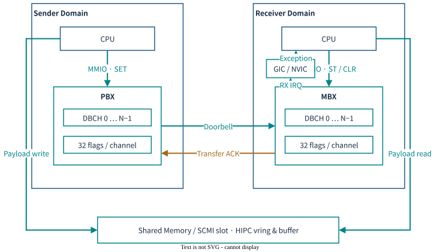

MHUv3의 한 방향은 **송신 CPU의 PBX(Postbox)**와 **수신 CPU의 MBX(Mailbox)**로 구성한다. 응답 IRQ나 역방향 알림에는 별도 pair를 사용한다. 같은 CPU에 있는 PBX와 MBX가 서로의 peer라는 뜻은 아니다. [HW 근거](SOURCES.md#hardware)

| 용어 | 의미 | 혼동하지 않을 대상 |
|---|---|---|
| DBCH | 32-bit flag를 갖는 HW channel window | CPU 수, SCMI protocol ID |
| Doorbell flag | 상대가 확인할 pending 상태 | 메시지 개수, packet queue |
| Combined IRQ | 여러 channel의 상태를 합친 interrupt | channel마다 독립된 IRQ |
| Transfer ACK | 수신 CLR로 HW 전송 상태를 회수 | SCMI 명령 성공, PSA 서비스 완료 |
| Shared payload | SW protocol이 관리하는 SRAM/DRAM | MHU register frame |

현재 full 구성은 **30개 `mhu320ae` frame / 15개 방향별 pair**를 생성한다. 이 중 14방향은 bridge이고, RSE MHU0의 2개 frame은 non-bridging local 구성이다. 이 개수는 실제 통신이 확인된 서비스 수가 아니다.

### 1.1 Register와 IRQ

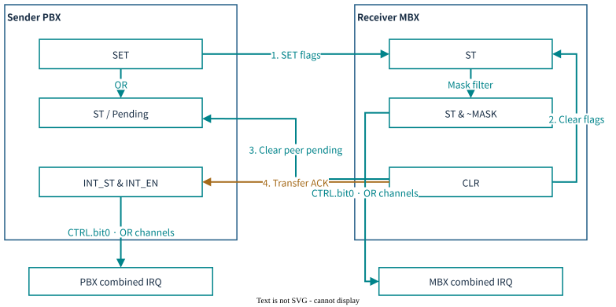

`DBCH[n] = frame + 0x1000 + n × 0x20`이다. 송신 `SET`은 flag를 OR하고, 수신 `CLR`은 선택한 flag를 양쪽에서 지운 뒤 송신 ACK 상태를 만든다. 동일 bit를 여러 번 SET해도 pending 상태 하나로 합쳐진다.

- MBX 수신 IRQ: channel별 `CTRL.bit0 && (ST & ~MASK)`를 OR.
- PBX 완료 IRQ: channel별 `CTRL.bit0 && (INT_ST & INT_EN)`를 OR.
- SW는 `DBCH_INT_ST → channel → flag` 순서로 원인을 찾는다.
- GIC EOI만으로 MHU source가 지워지지 않는다. Driver가 MBX CLR을 수행해야 한다.

QVP reset에서 MASK는 0이다. Linux는 초기화 중 모든 flag를 mask한 뒤 사용할 bit를 unmask한다. [register 상세](MAILBOX-MAP.md#registers)

### 1.2 같은 DBE, 다른 데이터 경로

| 사용 경로 | MHU에 기록하는 것 | 데이터 위치 / 완료 판단 |
|---|---|---|
| SCMI | 선택한 channel의 flag | 공유 slot의 header·payload; response와 `FREE` 확인 |
| HIPC/RPMsg | vring kick·attach·detach flag | 공유 vring·packet buffer; ownership과 endpoint handshake |
| AP–RSE SFCP | 길이·직렬화한 32-bit words·마지막 notify | 작은 payload도 DBCH로 전달; pointer 방식은 허용 공유 영역 접근 |

따라서 “MHU는 언제나 데이터 없이 알림만 전달한다”는 설명은 현재 RSE 경로에 맞지 않는다. SFCP의 word stream은 **DBE 위에 정의한 SW framing**이며 MHU FIFO extension은 아니다. [SW 근거](SOURCES.md#rse)

## 2. ARM Zena CSS FVP와 Apollo QVP 비교

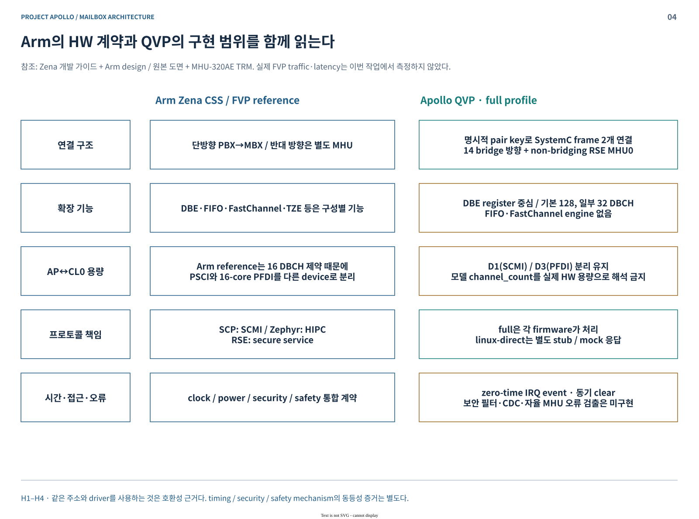

| 비교 항목 | Arm reference / FVP 설계 근거 | 현재 Apollo QVP |
|---|---|---|
| 통신 구조 | PBX→MBX의 단방향 연결 | 명시적 `pair`로 두 SystemC frame 연결 |
| Protocol 처리 | SCP SCMI, Zephyr HIPC, RSE 보안 서비스 | full에서는 해당 guest firmware가 처리 |
| Channel 용량 | AP–CL0 16 DBCH 제약으로 PSCI/PFDI device 분리 | 기본 128 DBCH; HIPC·CL1 PFDI는 32 |
| 기능 확장 | DBE·FIFO·FastChannel·TZE 등 구성 가능한 기능 | DBE 중심; FIFO·FastChannel engine 없음 |
| 접근 보호 | S/NS·ATU·보호 제어의 통합 계약 | MHU 모델 자체의 security/privilege filter 없음 |
| 시간·전력·오류 | clock/power bridge, safety 통합 | 기능 모델; CDC·물리 지연·자율 MHU fault 검출 미구현 |

동일한 주소와 driver를 사용하는 것은 SW 호환성 근거다. 실제 FVP의 feature register·traffic·latency는 조사하지 않았으므로 완전한 동등성으로 표현하지 않는다. Arm의 validation 시나리오도 이번 실행 결과와 구분한다. [참조 문서·원본 도면](SOURCES.md#reference)

## 3. Apollo QVP QBox의 Mailbox 구현

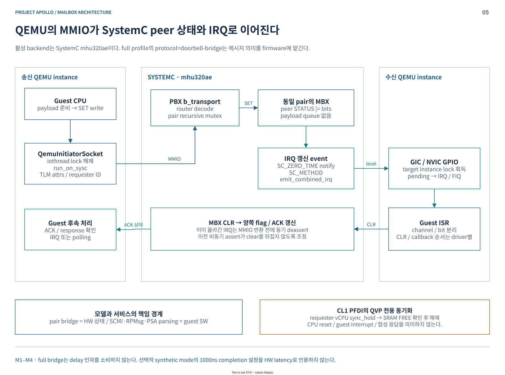

### 3.1 모델의 책임

| 계층 | 현재 구현의 책임 |
|---|---|
| QEMU / LibQemu | CPU 명령·MMIO·GIC/NVIC exception 실행 |
| QBox initiator | 정상 MMIO 경로에서 QEMU lock 해제 → `run_on_sysc()` → TLM 전달 |
| `mhu320ae` | register·mask·pending·ACK·reset 상태; pair mutex 아래 peer 상태 갱신 |
| SystemC event | `SC_ZERO_TIME`으로 IRQ assert 갱신; 올라간 IRQ의 clear는 MMIO 반환 전에 동기 처리 |
| QBox GPIO target | 대상 LibQemu instance lock 아래 GIC/NVIC 입력 설정 |
| Guest firmware / OS | 메시지 구조·소유권·retry·서비스 응답 처리 |

현재 backend는 **SystemC `mhu320ae`**다. QEMU MHU 장치나 MHUv2 model을 선택한 구성이 아니다. `protocol="doorbell-bridge"`는 DB 상태를 전달하며 full 모드에서 C++가 SCMI·PSA 서비스를 대신 실행하지 않는다. [모델·bridge 소스](SOURCES.md#models)

### 3.2 QVP에만 있는 처리와 한계

- AP–RSE의 `doorbell_commit_on_notify`는 마지막 DBCH write까지 부분 payload의 IRQ 재계산을 미룬다. 메시지 queue나 원자적 packet 전송은 아니다.
- CL1 PFDI는 실제 요청 vCPU를 `sync_hold`하고 SRAM `FREE`를 10µs 간격으로 확인한다. 서로 다른 QEMU instance의 진행 속도를 조정하는 정책이다.
- Register 부작용은 32-bit access에 구현되어 있다. 다른 지원 크기의 access는 backing bytes 접근이므로 동등한 동작으로 가정하지 않는다.
- `b_transport`는 delay를 소비하지 않는다. 선택적 synthetic mode의 1000ns completion 설정은 full bridge의 HW latency가 아니다.
- S/NS 이름과 ATU mapping만으로 실제 보안 격리를 입증할 수 없다. [구현 범위](MAILBOX-MAP.md#limits)

**`linux-direct`는 별도 비교 대상이다.** SCMI mock은 BASE discovery만 제공하고 clock/power/DVFS를 지원하지 않는다. HIPC는 `apollo_si_stub`, RSE mock은 `PSA_ERROR_NOT_SUPPORTED`를 반환한다. AP-only 결과를 SCP·Zephyr·TF-M의 실제 통신 증거로 확대하지 않는다.

## 4. 각 CPU와 Mailbox 구조

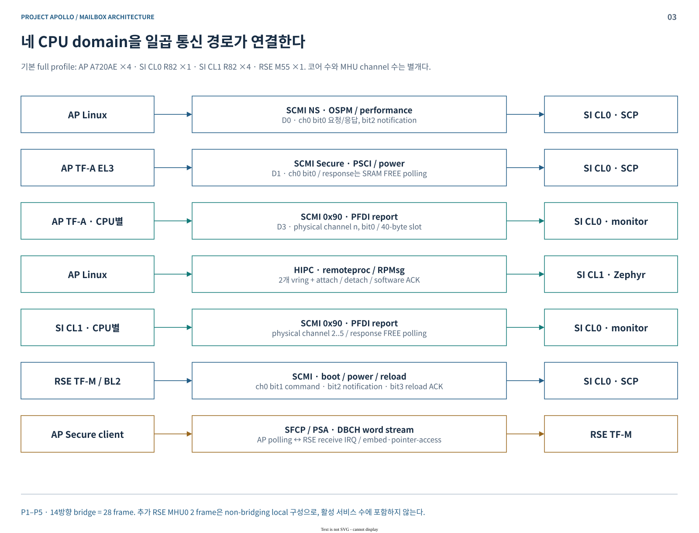

| Domain / 기본 CPU 수 | 주요 역할 | 대표 수신 interrupt |
|---|---|---|
| AP A720AE ×4 | Linux SCMI·HIPC, TF-A PSCI/PFDI, Secure Services | NS 응답 INTID145, HIPC INTID153; AP–RSE는 polling |
| SI CL0 R82 ×1 | SCP 제어 서비스·PFDI monitor | NS97, Secure99, AP PFDI103, RSE105, CL1 PFDI107 |
| SI CL1 R82 ×4 | Zephyr HIPC endpoint·CPU별 PFDI agent | HIPC INTID73; PFDI response는 shared-memory polling |
| RSE M55 ×1 | AP secure-service 처리, SCP boot/power 제어 | AP-S NVIC45, SCP runtime NVIC139; BL2는 polling |

MHU는 주로 subsystem·보안 domain·서비스 경로 단위로 배치된다. PFDI가 CPU별 slot과 channel을 사용한다고 해서 CPU마다 별도 MHU instance가 있는 것은 아니다.

### 4.1 주소와 IRQ의 번호 공간

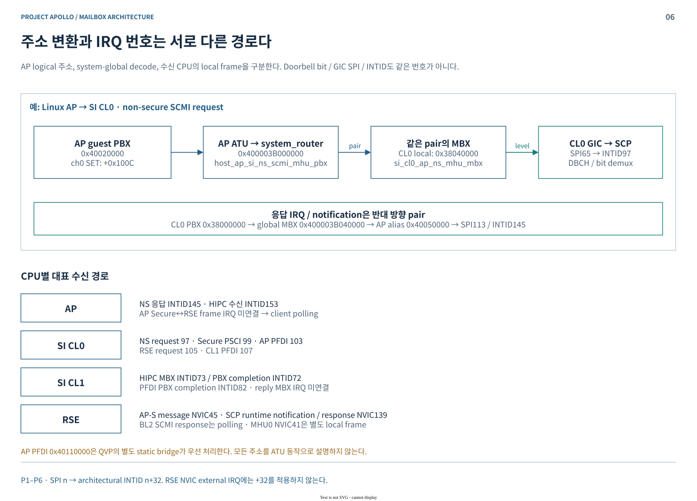

Linux가 사용하는 AP PBX `0x40020000`은 ATU 뒤에서 global `0x400003B000000`에 도달한다. Peer MBX는 CL0 local `0x38040000`에 보이며 CL0 **SPI65 / INTID97**을 발생시킨다.

AP PFDI `0x40110000`은 QVP의 별도 static bridge가 우선 처리한다. AP guest alias, extended system address, SI/RSE local address를 한 주소 표에 섞지 않는다. NVIC external IRQ에는 GIC의 `+32`를 적용하지 않는다. [15개 pair 전체표](MAILBOX-MAP.md#pairs)

### 4.2 Payload 메모리

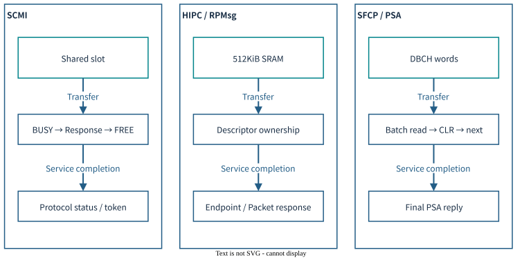

SCMI의 `FREE`는 shared slot의 소유권을 나타낸다. HIPC의 512KiB는 resource table·vring0·vring1·packet buffer에 각각 128KiB를 배정한다. AP와 CL1이 같은 bytes를 서로 다른 주소로 본다.

주소 변환은 cache coherence를 제공하지 않는다. SCP/Zephyr의 memory attribute, payload publish barrier, AP의 필요한 cache 유지보수는 각 SW의 책임이다. [CPU별 alias·메모리 표](MAILBOX-MAP.md#memory)

## 5. Subsystem별 Mailbox Software Architecture

### 5.1 AP — Linux / TF-A / Secure Services

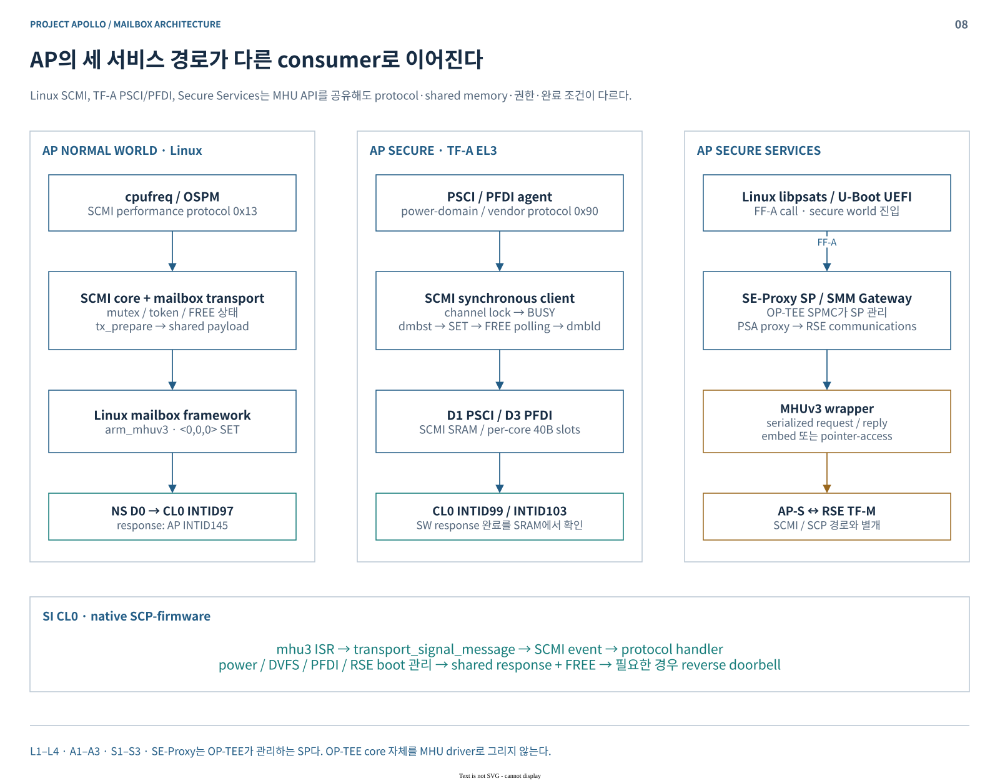

| Consumer | 소스 기반 경로 | 완료 방식 |
|---|---|---|
| Linux SCMI | cpufreq → SCMI mailbox transport → mailbox core → `arm_mhuv3` | shared response·token·FREE; 별도 RX doorbell |
| Linux HIPC | `rpmsg_net` → RPMsg/Virtio → `arm_si_rproc` → mailbox | vring 진행 상태와 software handshake |
| TF-A PSCI/PFDI | channel lock → shared payload → `dmbst` → SET → `dmbsy` | FREE polling 후 `dmbld`, response 확인 |
| Secure Services | Linux/U-Boot → FF-A → OP-TEE가 관리하는 SP → SE-Proxy MHU client | RSE의 PSA reply |
| TF-A RSE communications | `psa_call` → serialize → `rse_mbx_*` → MHU wrapper | DBCH batch clear polling + 최종 reply decode |

Linux의 실제 DT 진입점은 `hsoc/apollo-qvp-saturn-v.dts`이며 mailbox·SCMI 정의는 `hsoc/apollo.dtsi`에 있다. `arm/apollo-qvp.dts`는 호환용 include다. Defconfig는 MHUv3·mailbox·SCMI·remoteproc를 선택하고 RPMsg/Virtio는 module로 구성한다. 외부 `arm_si_rproc`·`rpmsg_net` 소스는 `sw-ref-stack` 소유다. [Linux·AP 근거](SOURCES.md#linux)

OP-TEE는 SP manager이며 MHU consumer는 SE-Proxy 내부 driver다. OP-TEE core에서 직접 MHU 호출을 찾지 못했다는 이유로 secure runtime 경로를 빠뜨리지 않는다. [Secure Services 선택 근거](SOURCES.md#ap)

### 5.2 SI CL0 — SCP-firmware

`mhu3_isr → transport → SCMI event → protocol handler`로 처리한다. **SCP ISR은 해당 flag를 먼저 CLR한 후 transport를 호출**한다. Transport는 shared message를 내부 buffer에 복사하고, SCMI는 framework event로 서비스 처리를 넘긴다.

응답 시 payload·length를 기록하고 barrier 뒤 `FREE=1`로 바꾼다. 요청에 interrupt-enable flag가 있을 때 reverse doorbell을 보낸다. 따라서 **HW ACK는 명령 완료보다 먼저 발생**할 수 있다. Transport readiness 이전의 메시지는 수락되지 않을 수 있다. [SCP 근거](SOURCES.md#scp)

### 5.3 SI CL1 — Zephyr

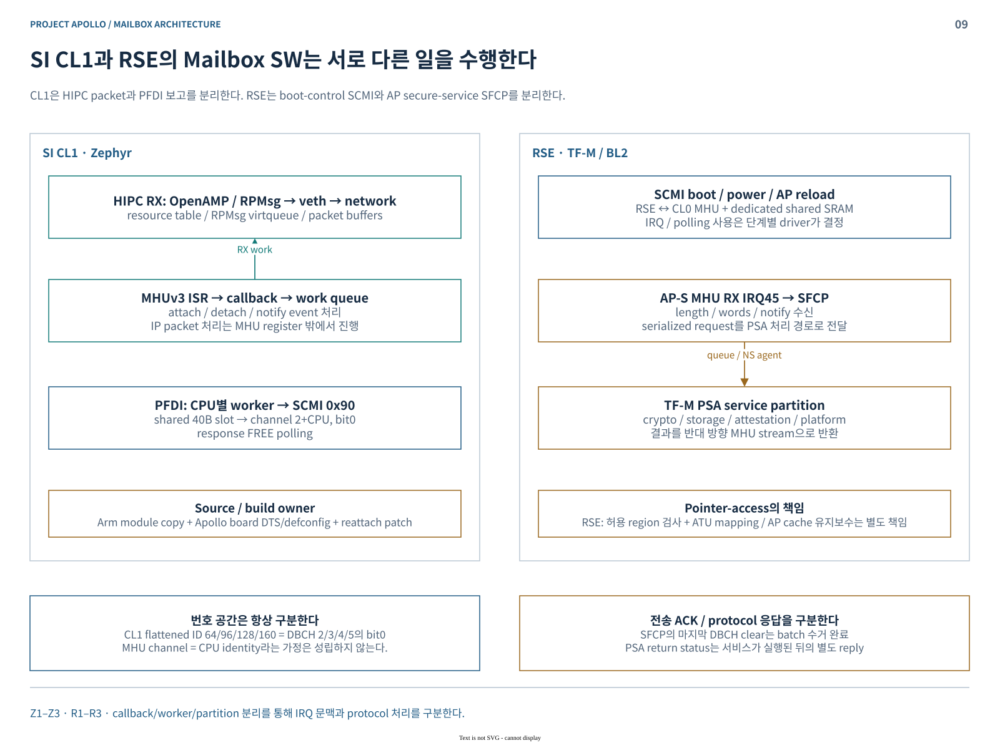

- **HIPC:** MHU ISR callback → atomic event 저장·`k_work_submit()` → veth worker → OpenAMP/RPMsg → network stack.
- **PFDI:** CPU별 40B slot → physical channel `2+CPU`, bit0 → CL0 monitor. Response는 FREE polling으로 확인한다.
- HIPC의 attach ACK는 resource 준비 신호다. Endpoint 생성과 RPMsg ready는 후속 negotiation·kick·handshake에서 완료한다.

MHU·veth·PFDI driver 원본은 Arm reference module이다. QVP recipe는 이를 generated copy로 만들고 reattach patch를 적용한다. QVP board DTS/defconfig가 기본 구성을 제공하며 inherited FVP overlay 인자는 제거한다. `hsoc-stack`의 Zephyr 본체만 조사하면 이 경로를 놓친다. [source/build 선택](SOURCES.md#zephyr)

### 5.4 RSE — TF-M / BL2

| 경로 | 처리 문맥과 역할 |
|---|---|
| BL2 ↔ SCP SCMI | RX IRQ mask + polling; SCP protocol/version 준비 확인 후 AP load 진행 |
| TF-M runtime ↔ SCP | NVIC139 → SCMI partition signal → `psa_wait` → notification 처리 |
| AP-S → SFCP | NVIC45 → SFCP word 수거·queue → `NS_MAILBOX_AGENT` → PSA decode·permission 검사 → service dispatch |
| AP reload 완료 | RSE→SCP ch0 bit3 전용 doorbell; shared SCMI packet 없는 ACK |

SFCP embed 방식은 payload도 DBCH로 전달한다. Pointer-access는 pointer/length를 전달하고 RSE가 허용 영역을 확인한 뒤 ATU로 접근한다. 현재 AP_S node의 허용 범위는 AP SRAM `0..0xFFFFF`와 DRAM carveout `0xFFFE0000..0xFFFFFFFF`다. 서비스 결과는 반대 방향 stream으로 반환한다. [RSE 근거](SOURCES.md#rse)

## 6. Mailbox Sequence — HW에서 SW까지

### 6.1 Linux SCMI → SCP

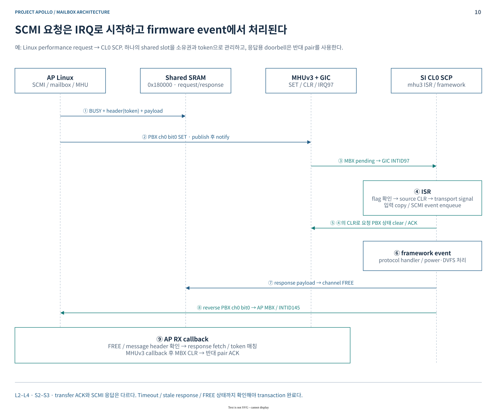

`payload publish → SET → MBX IRQ → SCP CLR → transport copy → SCMI event → 서비스 실행 → response/FREE → 선택적 응답 IRQ` 순서다. Linux는 늦은 응답이 다음 transaction에 섞이지 않도록 FREE와 header/token을 확인한다. IRQ 발생만으로 protocol 성공을 판정하지 않는다.

### 6.2 Linux HIPC ↔ Zephyr

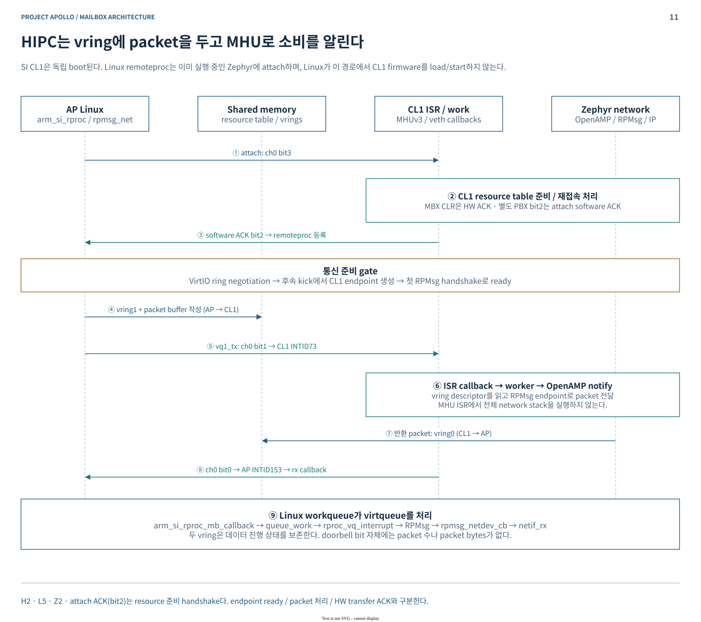

CL1은 독립적으로 boot된다. `arm_si_rproc`는 `RPROC_DETACHED` 상태에서 attach 요청을 보내며, 이 경로에서 CL1 firmware를 load/start하지 않는다. Packet은 vring/buffer로 이동하고 MHU는 해당 queue의 진행을 알린다. Linux RX callback은 workqueue를 통해 `rproc_vq_interrupt → RPMsg → netif_rx`로 이어진다.

### 6.3 AP secure client ↔ RSE SFCP

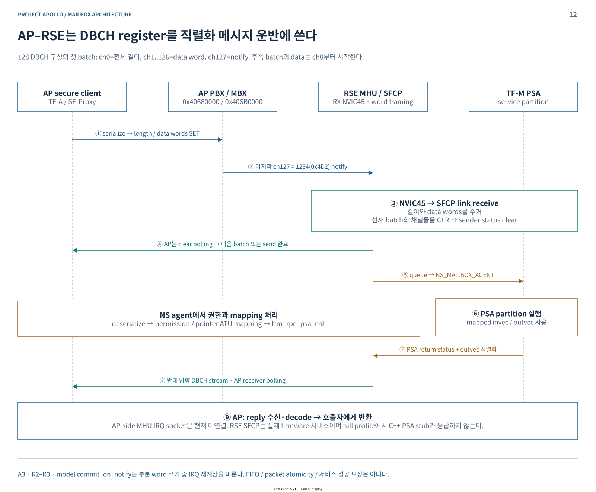

128 DBCH의 첫 batch는 **ch0 길이 → ch1..126 words → ch127 notify(1234)**다. 수신 측이 batch를 읽고 channel을 clear하면 송신 측이 다음 batch를 진행한다. 최종 PSA reply는 서비스 실행 이후의 별도 메시지다. RSE IRQ 안에서 word 수거·queue까지 수행하고, 저우선순위 NS mailbox agent가 PSA 처리를 이어간다.

### 6.4 Reset 이후에도 남는 책임

AP cold reset은 AP-facing MHU frame 10개를 reset한다. 상대 firmware와 shared memory는 별도 수명을 갖는다. HIPC SRAM은 reset callback을 받아도 `init_mem=false`로 bytes를 보존하며, 재접속 시 resource table과 vring 상태를 다시 협상해야 한다. Peer가 reset 상태일 때의 SET은 자동 응답이나 자동 replay를 보장하지 않는다. [reset 상세](MAILBOX-MAP.md#reset)

**Phase1 설명 범위:** 구현·배선·소스 선택을 확인한 architecture 문서다. 실제 왕복 통신, 부하·동시성, timeout 복구, AP 재접속, FVP 동등성은 실행 증거로 별도 판단한다. [문서 검증 결과](SOURCES.md#validation)
