# Apollo Mailbox SW Implementation Report

## 1. Overview

### 1.1 Purpose and Scope

Apollo의 MHUv3 Mailbox HW, QVP 모델·배선, Domain별 driver와 메시지 처리 경로를 설명한다.

- **시스템 용도:** Automotive AD의 AP–Safety Island 데이터 교환, 전원·성능 제어, RSE 보안 서비스 호출.
- **Hardware:** Arm Zena CSS의 MHU-320AE PBX/MBX, shared memory, GIC/NVIC 연결.
- **Software:** AP Linux·TF-A·Secure Services, SI CL0 SCP, SI CL1 Zephyr, RSE TF-M/BL2.

### 1.2 Mailbox Summary

**MHU는 Domain 사이의 전송 상태를 알리고, 상위 protocol은 데이터 형식·소유권·서비스 완료를 결정한다.** 수신 flag clear로 발생하는 HW ACK와 명령의 성공 응답은 다르다.

방향별 PBX→MBX 연결을 Mailbox 이름(QVP Pair key)으로 나열한다. `Domain / SW`는 송신 측, `상대 Domain / 상대 SW`는 수신 측이다.

| Mailbox 이름 | Domain | SW | 상대 Domain | 상대 SW | 주요 사용 방식 |
|---|---|---|---|---|---|
| `ap_to_si_cl0_ns` | AP | Linux SCMI | SI CL0 | SCP-firmware | Non-secure SCMI 요청; shared slot + doorbell |
| `si_cl0_to_ap_ns` | SI CL0 | SCP-firmware | AP | Linux SCMI | SCMI 응답·notification |
| `ap_to_si_cl0_scmi` | AP | TF-A PSCI | SI CL0 | SCP-firmware | Secure SCMI 전원 제어 요청; 응답은 shared slot polling |
| `si_cl0_to_ap_scmi` | SI CL0 | SCP-firmware | AP | TF-A PSCI | Secure SCMI 역방향 frame; AP는 응답 polling 사용 |
| `ap_to_si_cl0_pfdi` | AP | TF-A PFDI Caller | SI CL0 | SCP PFDI Monitor | CPU별 SCMI slot을 통한 PFDI 요청 |
| `si_cl0_to_ap_pfdi` | SI CL0 | SCP PFDI Monitor | AP | TF-A PFDI Caller | PFDI 역방향 frame; AP는 응답 polling 사용 |
| `apollo_ap_to_si_cl1` | AP | Linux remoteproc / RPMsg | SI CL1 | Zephyr HIPC / OpenAMP | HIPC vring notification·attach/detach |
| `apollo_si_cl1_to_ap` | SI CL1 | Zephyr HIPC / OpenAMP | AP | Linux remoteproc / RPMsg | HIPC vring notification·software ACK |
| `apollo_si_cl1_pfdi` | SI CL1 | Zephyr PFDI Caller | SI CL0 | SCP PFDI Monitor | CPU별 SCMI slot을 통한 PFDI 요청 |
| `apollo_si_cl0_pfdi_reply` | SI CL0 | SCP PFDI Monitor | SI CL1 | Zephyr PFDI Caller | CL1 PFDI 역방향 frame; shared slot 응답 |
| `ap_s_to_rse` | AP | Trusted Services SE Proxy | RSE | TF-M SFCP / NS Agent Mailbox | PSA 요청; DBCH stream·허용 shared buffer |
| `rse_to_ap_s` | RSE | TF-M SFCP / NS Agent Mailbox | AP | Trusted Services SE Proxy | PSA 응답; AP 수신 polling |
| `rse_to_si_cl0` | RSE | BL2 / TF-M | SI CL0 | SCP-firmware | Boot·power SCMI 요청, AP reload ACK |
| `si_cl0_to_rse` | SI CL0 | SCP-firmware | RSE | BL2 / TF-M SCMI | SCMI 응답·System Power notification |
| `rse_ap_monitor_local` | RSE | TF-M AP Monitor Link 정의 | AP（기본 QVP 미연결） | 미연결 | MHU0 local frame만 존재; 활성 AP 통신 경로 아님 |

총 **15개 Pair key**이며, RSE MHU0 local 구성을 포함한다. PBX/MBX 모델 이름·주소·IRQ는 [방향별 연결 상세표](MAILBOX-MAP.md#pairs)에 정리했다.

### 1.3 Glossary

| 용어 | 의미 |
|---|---|
| MHU / PBX / MBX | Message Handling Unit / 송신 Postbox / 수신 Mailbox |
| DBE / DBCH | Doorbell Extension / 32개 flag를 갖는 channel window |
| Combined IRQ | 여러 channel의 interrupt 상태를 모은 출력 |
| Transfer ACK | Receiver가 flag를 clear했다는 HW 전송 완료 상태 |
| SCMI | System Control and Management Interface; power·performance 등 제어 protocol |
| HIPC / RPMsg | 이기종 CPU 통신 / VirtIO 기반 메시지 protocol |
| Vring | Shared memory에 두는 VirtIO descriptor queue |
| SFCP / PSA | Secure Firmware Communication Protocol / 보안 서비스 API 규약 |
| ATU | Address Translation Unit; CPU별 주소 view 변환 |
| FREE / BUSY | SCMI shared slot의 소유권 상태 |
| GIC INTID / NVIC IRQ | AP·SI의 interrupt ID / RSE Cortex-M의 external IRQ 번호 |

## 2. Hardware Architecture

### 2.1 System Architecture — Automotive AD System

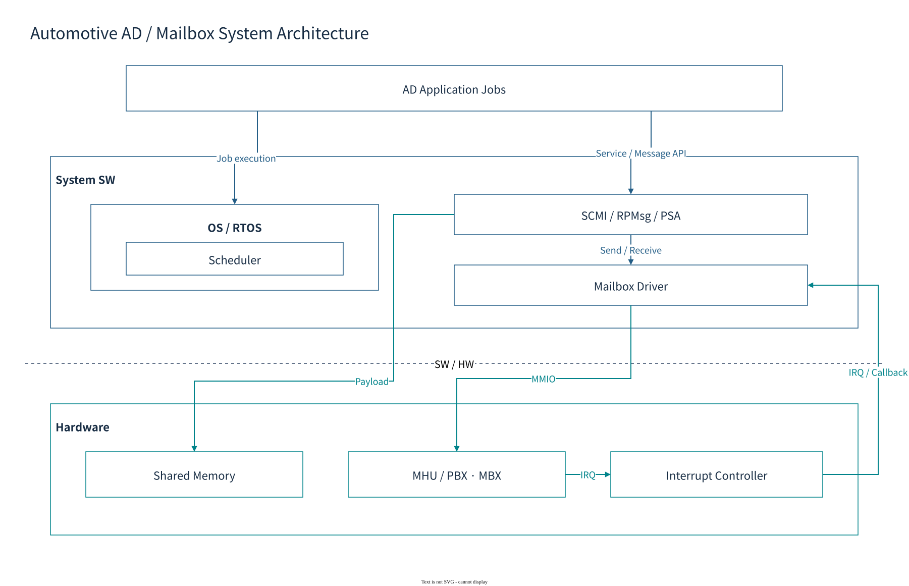

- **Primary Compute Core:** 각 Core의 PFDI Caller가 SCMI Channel을 통해 상태를 전달한다.
- **SI CL0:** PFDI Monitor가 MHUv3 Channel과 Shared Memory를 통해 각 Core를 모니터링한다.
- **외부 vMCU:** SI CL0가 전달하는 Fault Notification을 수신한다.

[Arm PFDI Monitoring 원본](https://arm-auto-solutions.docs.arm.com/en/v2.1/_images/platform_fault_detection_interface_monitoring.svg)에 외부 vMCU 연결을 추가했다.

### 2.2 Mailbox Hardware Architecture

#### 2.2.1 Mailbox Hardware Topology

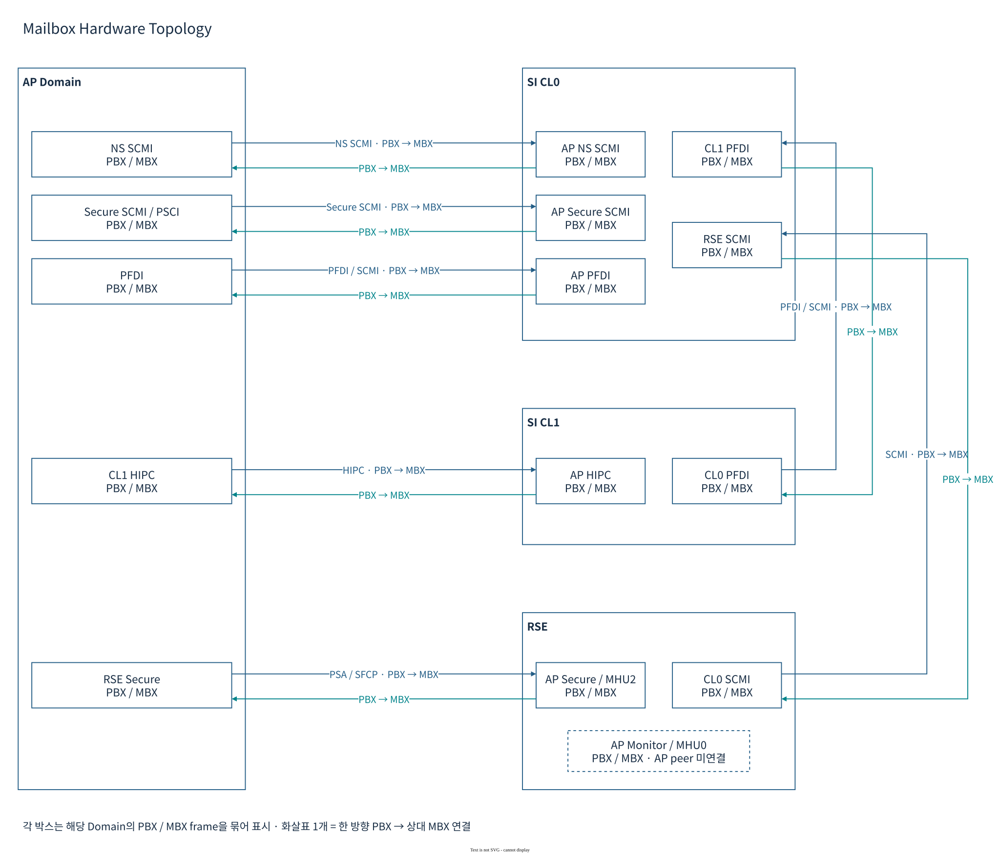

도면 상세 설명

- **NS SCMI**: NS SCMI / PBX / MBX
- **Secure SCMI / PSCI**: Secure SCMI / PSCI / PBX / MBX
- **PFDI**: PFDI / PBX / MBX
- **CL1 HIPC**: CL1 HIPC / PBX / MBX
- **RSE Secure**: RSE Secure / PBX / MBX
- **AP NS SCMI**: AP NS SCMI / PBX / MBX
- **AP Secure SCMI**: AP Secure SCMI / PBX / MBX
- **AP PFDI**: AP PFDI / PBX / MBX
- **CL1 PFDI**: CL1 PFDI / PBX / MBX
- **RSE SCMI**: RSE SCMI / PBX / MBX
- **AP HIPC**: AP HIPC / PBX / MBX
- **CL0 PFDI**: CL0 PFDI / PBX / MBX
- **AP Secure / MHU2**: AP Secure / MHU2 / PBX / MBX
- **CL0 SCMI**: CL0 SCMI / PBX / MBX
- **AP Monitor / MHU0 · 미연결**: AP Monitor / MHU0 / PBX / MBX · AP peer 미연결
- **각 박스는 해당 Domain의 PBX**: 각 박스는 해당 Domain의 PBX / MBX frame을 묶어 표시 · 화살표 1개 = 한 방향 PBX → 상대 MBX 연결

- 각 Domain 내부에 상대 Domain·서비스별 Mailbox를 배치했다. 각 박스는 해당 연결의 PBX와 MBX frame을 묶어 표시한다.
- 화살표는 **PBX → 상대 MBX** 방향이다. 7개 양방향 경로를 14개 화살표로 표시한다.
- RSE MHU0는 local frame만 존재하며, 기본 QVP의 AP peer 연결이 없어 점선으로 표시한다.
- Hardware 연결은 응답 IRQ의 SW 사용 여부와 별개다. 주소·IRQ·Pair key는 [전체 연결표](MAILBOX-MAP.md#pairs)를 참조한다.

#### 2.2.2 MHU-320AE Hardware 구조

- 한 방향의 MHU 연결은 **송신 PBX → 수신 MBX**다. 반대 방향에는 별도의 PBX/MBX pair가 필요하다.
- DBCH 하나는 32-bit pending flag를 제공한다. 같은 bit를 반복 SET해도 메시지 개수는 누적되지 않는다.
- SCMI·HIPC는 payload를 shared memory에 둔다. AP–RSE는 DBE register에 serialized words를 쓰는 SW framing도 사용한다.
- MHU-320AE의 extension 구성과 실제 사용하는 DBE 경로를 구분한다. 현재 QVP는 FIFO·FastChannel engine을 구현하지 않는다.

#### 2.2.3 Register / Interrupt 구조

`DBCH[n] = frame base + 0x1000 + 0x20 × n`. 아래 offset은 DBCH 시작 기준이다.

| Frame | Register / Offset | 기능 |
|---|---|---|
| PBX | `ST +0x00`, `SET +0x0C` | 송신 pending 조회 / flag set |
| PBX | `INT_ST +0x10`, `INT_CLR +0x14`, `INT_EN +0x18` | Transfer ACK 상태 / clear / enable |
| MBX | `ST +0x00`, `ST_MSK +0x04`, `CLR +0x08` | 수신 상태 / mask 적용 상태 / flag clear |
| MBX | `MSK_ST +0x10`, `MSK_SET +0x14`, `MSK_CLR +0x18` | 수신 flag mask 상태 / 설정 / 해제 |
| 양쪽 | `CTRL +0x1C` | 해당 channel의 combined IRQ 참여 |

- MBX IRQ: channel별 `CTRL.bit0 && (ST & ~MASK)`를 OR.
- PBX ACK IRQ: channel별 `CTRL.bit0 && (INT_ST & INT_EN)`를 OR.
- Driver는 frame의 `DBCH_INT_ST`에서 channel을 찾고 해당 channel의 flag를 처리한다.
- `MBX CLR`은 MHU source를 해제한다. GIC EOI/NVIC exception return은 MHU flag를 대신 지우지 않는다.

[전체 register map](MAILBOX-MAP.md#registers)

### 2.3 AP Domain Mailbox

#### 2.3.1 Hardware 구조

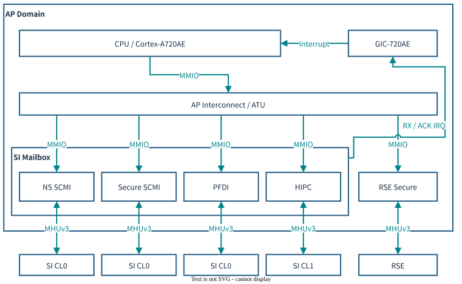

도면 상세 설명

- **NS SCMI**: NS SCMI / PBX / MBX
- **Secure SCMI**: Secure SCMI / PBX / MBX
- **PFDI**: PFDI / PBX / MBX
- **HIPC**: HIPC / PBX / MBX
- **RSE Secure**: RSE Secure / PBX / MBX

Arm Zena CSS AP는 **4 clusters × 4 Cortex-A720AE**, 기본 Apollo QVP는 AP 4 CPU 구성이다. MHU는 CPU마다 배치되지 않고 상대 Domain·보안 경로·서비스별로 공유한다.

- **AP↔CL0:** Non-secure SCMI, Secure PSCI, CPU별 PFDI transport를 분리한다.
- **AP↔CL1:** HIPC용 양방향 doorbell과 512KiB shared SRAM을 사용한다.
- **AP↔RSE:** Secure MHU 경로로 PSA 요청·응답을 전달한다.
- **IRQ:** AP의 수신·전송 ACK 출력은 GIC SPI로 연결한다. AP–RSE 응답은 현재 QVP에서 polling한다.

#### 2.3.2 MMIO / Interrupt Map

| AP 경로 | AP guest PBX / MBX | QVP AP GIC INTID | 사용 |
|---|---|---|---|
| NS SCMI | `0x40020000` / `0x40050000` | TX ACK 144 / RX 145 | Linux SCMI |
| Secure SCMI | PBX `0x40080000`; reverse frame은 global map 참조 | TX ACK 146 / RX 147 | TF-A PSCI; response polling |
| PFDI | PBX `0x40110000`; reverse frame은 global map 참조 | TX ACK 150 / RX 151 | CPU별 SCMI slot; response polling |
| HIPC | `0x400B0000` / `0x400E0000` | TX ACK 152 / RX 153 | Linux remoteproc/RPMsg |
| RSE Secure | `0x40680000` / `0x406B0000` | AP IRQ 미연결 | Secure client polling |

AP guest alias와 system-global decode 주소는 다르다. 예를 들어 NS SCMI PBX는 ATU를 거쳐 `0x400003B000000`에 도달한다. PFDI의 `0x40110000`은 QVP static bridge가 우선 처리한다. **IRQ 배선의 존재가 SW의 IRQ 사용을 뜻하지는 않는다.**

#### 2.3.3 AP Domain QVP 구현

- `system_mgmt/ap_si_mailbox.lua`: CL0 NS/Secure/PFDI 및 CL1 HIPC의 AP-facing frame.
- `system_mgmt/ap_rse_mailbox.lua`: RSE Secure PBX/MBX, 마지막 notify write 기준 IRQ 갱신.
- AP-facing frame은 총 10개이며 AP cold reset에 연결한다.
- 기본 DBCH 수는 128, HIPC는 32다. Arm reference의 AP–CL0 16 DBCH 제약과 동일한 capacity로 해석하지 않는다.

### 2.4 Safety Island Domain Mailbox

#### 2.4.1 Hardware 구조

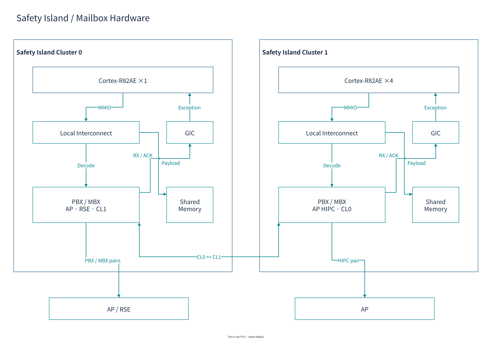

도면 상세 설명

- **AP NS SCMI**: AP NS SCMI / PBX / MBX
- **AP Secure SCMI**: AP Secure SCMI / PBX / MBX
- **AP PFDI**: AP PFDI / PBX / MBX
- **RSE SCMI**: RSE SCMI / PBX / MBX
- **CL1 PFDI**: CL1 PFDI / PBX / MBX
- **AP HIPC**: AP HIPC / PBX / MBX
- **CL0 PFDI**: CL0 PFDI / PBX / MBX

- **CL0:** SCP가 AP·RSE·CL1 요청을 수신하고 시스템 제어 서비스를 제공한다.
- **CL1:** Zephyr가 AP와 HIPC로 통신하고 CL0에는 별도 SCMI/PFDI 경로를 사용한다.
- 각 cluster의 MHU interrupt는 해당 cluster의 GIC 경로로 전달한다. Shared memory와 MHU register는 독립된 주소 영역이다.

#### 2.4.2 MMIO / Interrupt Map

주소는 SI local view, IRQ는 **GIC INTID**다.

| Cluster / 상대 | PBX / MBX | TX ACK / RX INTID |
|---|---|---|
| CL0 / AP NS | `0x38000000` / `0x38040000` | 96 / 97 |
| CL0 / AP Secure | `0x38080000` / `0x380C0000` | 98 / 99 |
| CL0 / AP PFDI | `0x38380000` / `0x383C0000` | 102 / 103 |
| CL0 / RSE | `0x38100000` / `0x38140000` | 미연결 / 105 |
| CL0 / CL1 | `0x38200000` / `0x38240000` | 미연결 / 107 |
| CL1 / AP HIPC | `0x39000000` / `0x39040000` | 72 / 73 |
| CL1 / CL0 PFDI | `0x39200000` / `0x39240000` | 82 / 미연결 |

#### 2.4.3 Shared Memory / Channel 구성

| 용도 | SI 주소 | Channel / flag |
|---|---|---|
| CL0 NS SCMI | `0xE01B0000` | ch0 bit0 request/reply, bit2 notification |
| CL0 Secure PSCI | `0xE0030DC0` | ch0 bit0 |
| CL0 AP PFDI | `0xE0030EC0 + 40×CPU` | ch0..15 bit0 |
| CL1 HIPC | `0xE0130000`, 512KiB | ch0 bit0/1 vring; bit2/3 lifecycle |
| CL1↔CL0 PFDI | `0x48000000`, 4KiB backing | ch2..5 bit0; CPU별 40B slot |
| CL0↔RSE SCMI | `0x40000000` | ch0 bit1 command, bit2 notification, bit3 reload ACK |

#### 2.4.4 Safety Island QVP 구현

`si_cl0/mailbox.lua`와 `si_cl1/mailbox.lua`가 pair·IRQ·channel 수를 설정한다. CL1 HIPC와 CL1↔CL0 경로는 32 DBCH이며 SCP ISR은 첫 32 channels의 bitmap을 처리한다.

CL1→CL0 요청의 requester hold는 QEMU instance 간 진행을 맞추는 QVP 실행 정책이다. MHU HW의 전송 latency나 SW protocol의 완료 조건을 바꾸는 정의가 아니다.

### 2.5 RSE Domain Mailbox

#### 2.5.1 Hardware 구조

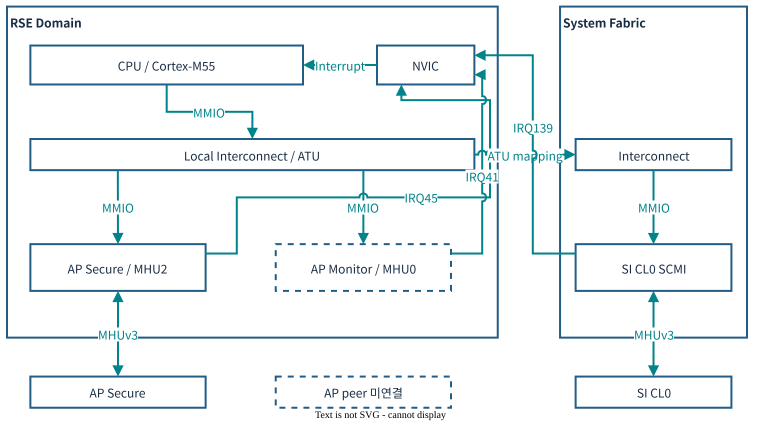

도면 상세 설명

- **AP Secure / MHU2**: AP Secure / MHU2 / PBX / MBX
- **AP Monitor / MHU0**: AP Monitor / MHU0 / PBX / MBX
- **SI CL0 SCMI**: SI CL0 SCMI / PBX / MBX

RSE Cortex-M55는 **AP Secure service 경로**와 **CL0 boot/power SCMI 경로**를 분리한다. MHU2는 RSE local frame, RSE–CL0 frame은 system fabric과 ATU를 통해 접근한다.

- AP-S 요청 → MHU2 receiver → NVIC45 → SFCP 처리.
- CL0 notification → RSE–SI MBX → NVIC139 → SCMI partition.
- RSE MHU0는 QVP local frame으로 존재하지만 기본 구성에서 AP peer로 bridge하지 않는다.

#### 2.5.2 MMIO / Interrupt Map

| 경로 | PBX / MBX view | RSE 수신 IRQ |
|---|---|---|
| AP Secure MHU2 | RSE local `0x501A0000` / `0x501B0000` | NVIC45 |
| RSE↔CL0 | System-global `0x400003C000000` / `0x400003C020000` | NVIC139 |
| MHU0 local | RSE local `0x50160000` / `0x50170000` | NVIC41; 기본 AP bridge 없음 |

NVIC 번호는 external IRQ이며 GIC SPI의 `+32` 변환을 적용하지 않는다. RSE–CL0 shared memory의 global base는 `0x4000040000000`이다.

#### 2.5.3 RSE Domain QVP 구현

- `rse/system.lua`: MHU0 local 및 MHU2 AP-S frame, NVIC 연결.
- `system_mgmt/rse_si_mailbox.lua`: RSE–CL0 bridge와 shared memory 접근.
- MHU2는 DBCH word stream을 전달하고 PSA 의미·권한 검사는 TF-M이 처리한다.
- RSE local SYS/RSS reset fanout에는 현재 MHU frame이 포함되지 않는다. CPU reset과 mailbox 상태 reset은 별개다.

### 2.6 Subsystem별 HW 구성 요약

| Domain | 상대 / MHU 역할 | Payload 자원 | 수신 interrupt |
|---|---|---|---|
| AP | CL0 SCMI·CL1 HIPC·RSE Secure | SCMI slots, HIPC SRAM, SFCP words/buffer | GIC SPI; RSE reply polling |
| SI CL0 | AP·RSE·CL1 제어 요청 | SCMI shared slots | GIC INTID97/99/103/105/107 |
| SI CL1 | AP HIPC·CL0 SCMI | HIPC 512KiB, CPU별 SCMI slot | HIPC INTID73 |
| RSE | AP SFCP·CL0 SCMI | DBCH words, 허용 AP buffer, SCMI pages | NVIC45/139 |

[방향별 pair·주소·채널 전체표](MAILBOX-MAP.md#pairs)

## 3. QVP Mailbox Implementation

### 3.1 Implementation Overview

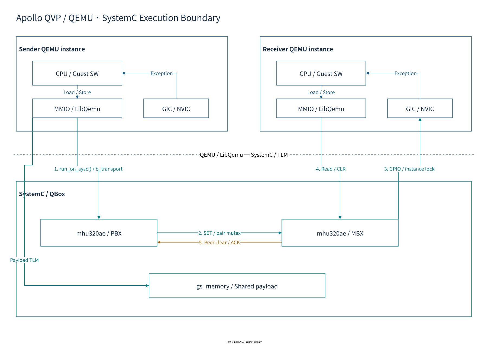

기본 full 구성은 **SystemC `mhu320ae` 30 frames / 15 directional pairs**다. 14방향은 bridge이며 MHU0 local pair는 non-bridging 구성이다.

| 계층 | 구현 책임 |
|---|---|
| QEMU / LibQemu | CPU MMIO 실행, GIC/NVIC exception 처리 |
| QBox initiator | QEMU lock 전환, `run_on_sysc()`를 통한 TLM 접근 |
| SystemC `mhu320ae` | Register·pending·mask·ACK, pair 상태 전달 |
| SystemC event / GPIO socket | IRQ 갱신 및 대상 QEMU instance 입력 |
| Guest firmware / OS | Shared memory 소유권·message 형식·서비스 실행·response |

### 3.2 Doorbell / Interrupt Execution Flow

1. 송신 SW가 payload를 publish하고 PBX `SET`을 쓴다.
2. 모델이 pair mutex 아래 sender pending과 peer MBX 상태를 갱신한다.
3. Unmasked flag가 있으면 combined IRQ를 assert한다.
4. 수신 CPU의 ISR이 상태를 읽고 선택 flag를 `CLR`한다.
5. MBX source를 낮추고 PBX transfer ACK를 만든다.
6. 서비스 완료는 response payload·FREE 또는 역방향 메시지로 별도 전달한다.

Assert 갱신은 `SC_ZERO_TIME` event를 사용한다. 이미 올라간 IRQ의 deassert는 clear MMIO 반환 전에 동기 처리한다. `b_transport`는 delay를 소비하지 않으며 register side effect는 32-bit access에 구현되어 있다.

### 3.3 Shared Memory / Ownership

도면 상세 설명

- **Shared slot**: Shared slot / Header / Token / Payload
- **512KiB SRAM**: 512KiB SRAM / Resource table / Vring / Buffer
- **DBCH words**: DBCH words / or permitted shared buffer

| Protocol | 데이터 경로 | 완료 조건 |
|---|---|---|
| SCMI | Header·token·payload를 shared slot에 기록 | 응답 header/token/status와 `FREE` 확인 |
| HIPC/RPMsg | Resource table·vring·buffer | Descriptor ownership·endpoint handshake·응답 packet |
| SFCP/PSA | DBCH batch 또는 pointer/length와 허용 buffer | Batch clear 후 최종 PSA reply decode |

HIPC 512KiB는 resource table·vring0·vring1·buffer 각 128KiB다. AP `0x00100000`과 CL1 `0xE0130000`은 같은 backing을 본다. Address translation이 cache coherence나 memory barrier를 대신하지 않는다.

### 3.4 Arm Zena CSS / Apollo QVP 구현 비교

| 항목 | Arm Zena CSS reference | Apollo QVP full |
|---|---|---|
| 전송 구조 | 단방향 PBX→MBX, 역방향 별도 pair | 동일 구조를 SystemC peer 연결로 구현 |
| 확장 기능 | MHU-320AE의 configurable extensions | DBE 중심; FIFO·FastChannel engine 없음 |
| Channel 수 | AP–CL0 16 DBCH 제약으로 PSCI/PFDI 분리 | 기본 128; HIPC·CL1 PFDI 32 |
| Security / safety | 접근 보호와 safety 통합 | MHU 내부 security filter·자율 fault 검출 미구현 |
| Clock / timing | HW clock·power·bridge 계약 | 기능 모델; 물리 CDC·전송 지연 모델 없음 |
| Protocol | SCP·Zephyr·TF-M이 처리 | 실제 guest가 처리; host가 서비스 대행하지 않음 |

- **AP–RSE:** `doorbell_commit_on_notify`는 마지막 notify까지 IRQ 재계산을 미룬다. Queue나 atomic packet engine은 아니다.
- **CL1→CL0:** 요청 vCPU의 `sync_hold`와 10µs 간격 shared `FREE` 확인을 사용한다.
- **Reset:** AP cold reset은 AP-facing 10 frames를 초기화한다. HIPC SRAM은 `init_mem=false`로 보존하므로 재접속 handshake가 필요하다.
- **Linux-direct:** BASE-only SCMI mock, HIPC stub, RSE unsupported 응답을 사용하는 별도 구성이다.

## 4. Mailbox Software Architecture

### 4.1 Mailbox Software Architecture Overview

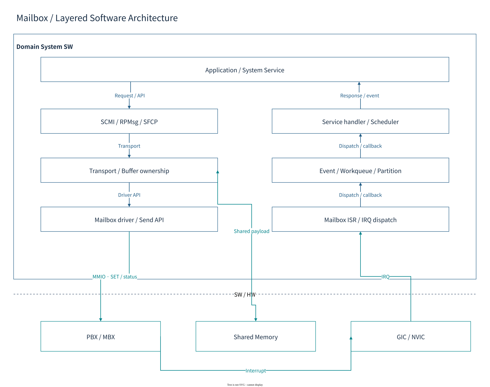

| 계층 | 역할 |
|---|---|
| Application / service | 제어 요청·packet 송수신·PSA 호출 |
| Protocol / transport | Header·token·buffer ownership·timeout·reply 관리 |
| Mailbox driver | Channel 요청, SET·status·CLR, RX callback·TX completion |
| IRQ / execution context | ISR에서 최소 수신 처리 후 event·workqueue·partition으로 전달 |
| Hardware | PBX/MBX 상태, shared memory, interrupt controller |

Mailbox에는 scheduler 기능이 없다. SCP framework event, Zephyr workqueue, TF-M partition scheduling은 driver 위에서 서비스 실행 시점을 결정한다.

### 4.2 AP Domain — Linux Kernel·TF-A·Secure Services

#### 4.2.1 Linux Kernel Mailbox Architecture

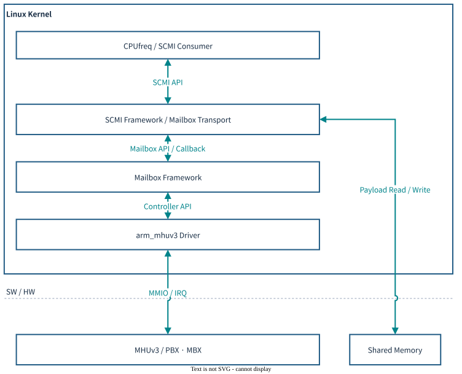

도면 상세 설명

- **Shared Memory**: Shared Memory / SCMI Payload

- `arm_mhuv3`: DBCH별 flag를 mailbox channel로 노출하는 controller driver.
- Mailbox core: client/controller 연결, TX queue·completion, RX callback 전달.
- SCMI mailbox transport: shared slot 준비, channel lock, 응답 header/token 확인.
- HIPC client는 SCMI와 별개로 remoteproc/RPMsg와 자체 shared memory를 사용한다.

##### 4.2.1.1 Mailbox Initialization

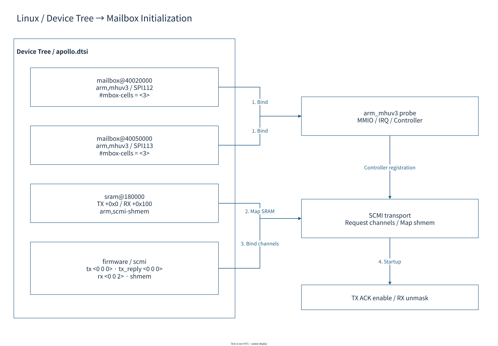

도면 상세 설명

- **mailbox@40020000**: mailbox@40020000 / arm,mhuv3 / SPI112 / #mbox-cells = <3>
- **mailbox@40050000**: mailbox@40050000 / arm,mhuv3 / SPI113 / #mbox-cells = <3>
- **sram@180000**: sram@180000 / TX +0x0 / RX +0x100 / arm,scmi-shmem
- **firmware / scmi**: firmware / scmi / tx &lt;0 0 0> · tx_reply &lt;0 0 0> / rx &lt;0 0 2> · shmem
- **arm_mhuv3 probe**: arm_mhuv3 probe / MMIO / IRQ / Controller
- **SCMI transport**: SCMI transport / Request channels / Map shmem

1. `hsoc/apollo-qvp-saturn-v.dts` → `apollo.dtsi`의 MHU·SCMI·shared SRAM 노드를 사용한다.
2. `arm_mhuv3`가 MMIO frame·DBE capacity를 읽고 controller와 IRQ를 등록한다.
3. SCMI transport가 `tx`, `tx_reply`, `rx` channel 및 shared memory를 요청한다.
4. TX ACK를 enable하고 사용 중인 RX flag만 unmask한다.

| DT 설정 | 의미 |
|---|---|
| `mailbox@40020000` / `mailbox@40050000` | PBX / MBX; `compatible = "arm,mhuv3"` |
| `interrupts = <GIC_SPI 112/113 ...>` | AP INTID144/145 |
| `#mbox-cells = <3>` | `<extension window flag>`; DBE extension=0 |
| SCMI `mboxes` | TX `<0 0 0>`, reply `<0 0 0>`, notification `<0 0 2>` |
| `sram@180000` | Request slot +0, notification slot +0x100; 각 256B |

##### 4.2.1.2 Mailbox / SCMI API

| API / callback | 동작 |
|---|---|
| `mbox_request_channel*()` | DT로 controller channel 획득 |
| `mbox_send_message()` | Client 요청 enqueue; controller가 flag SET |
| `mbox_chan_received_data()` | IRQ에서 client RX callback 호출 |
| `mbox_chan_txdone()` | HW 전송 완료 통지; SCMI 서비스 응답과 별개 |
| SCMI transfer | Message header/token과 shared status로 최종 응답 검사 |

한 flag에 동시 진행 중인 전송은 하나다. Driver의 `-EBUSY`는 상위 protocol이 buffer·순서를 관리해야 한다는 의미다.

##### 4.2.1.3 SCMI Request / Response Sequence

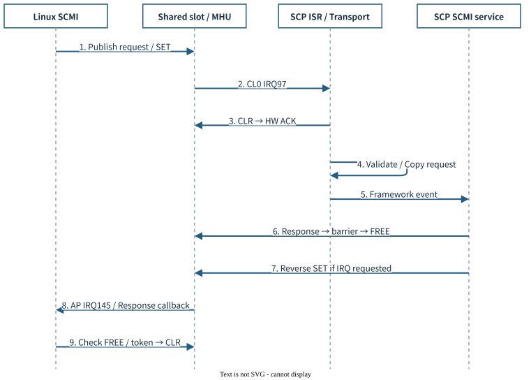

1. Linux가 shared request를 준비하고 AP PBX ch0 bit0을 SET한다.
2. CL0 IRQ에서 SCP가 flag를 CLR한 뒤 request를 내부 buffer로 복사한다.
3. SCMI framework event가 서비스를 실행한다.
4. SCP가 response를 기록하고 barrier 뒤 `FREE=1`로 전환한다.
5. 요청이 interrupt 응답을 요구하면 역방향 doorbell로 AP를 알린다.
6. Linux RX callback이 FREE·header/token을 검사한 후 driver가 MBX flag를 CLR한다.

Late IRQ가 다음 transaction의 응답으로 처리되지 않도록 token과 channel 상태를 함께 검사한다.

##### 4.2.1.4 HIPC / RPMsg Architecture

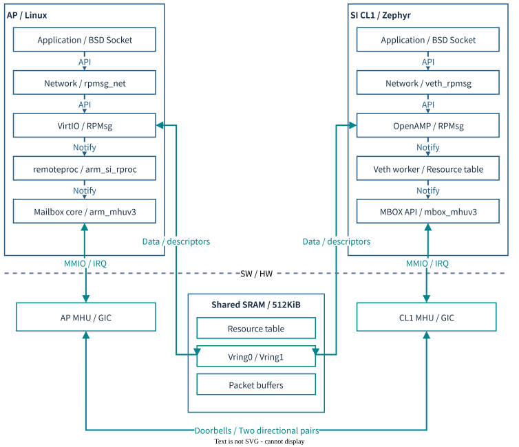

Arm HIPC reference의 Linux remoteproc/RPMsg와 Zephyr OpenAMP/veth 계층을 유지한다. Data는 vring/buffer, notification은 MHU 경로다.

| Linux 구성 | 역할 |
|---|---|
| `arm_si_rproc` | 독립 boot된 CL1에 attach; resource table·vring·MHU 채널 연결 |
| VirtIO / RPMsg | Buffer ownership·endpoint·name service |
| `rpmsg_net` | RPMsg payload와 network skb 변환 |
| RX workqueue | MHU callback에서 예약 → `rproc_vq_interrupt()` → RPMsg → `netif_rx()` |

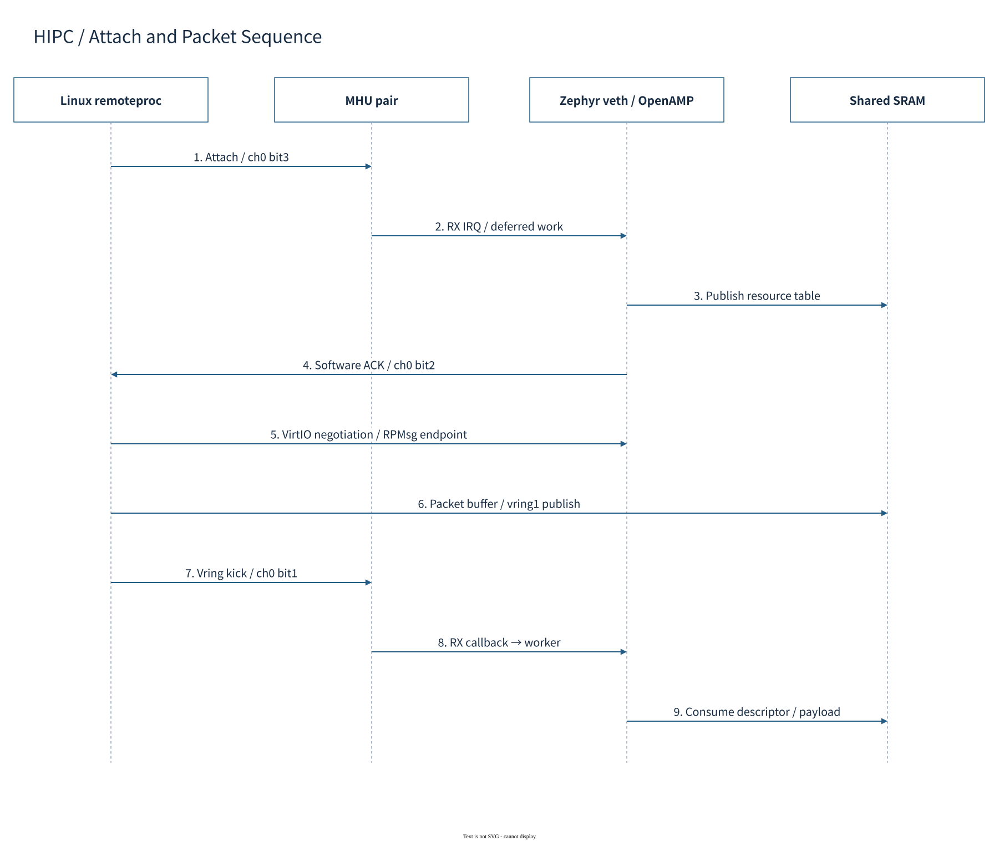

1. Linux는 CL1을 `RPROC_DETACHED`로 등록하고 attach flag를 보낸다.
2. Zephyr가 resource table을 준비하고 software ACK를 보낸다.
3. VirtIO negotiation·RPMsg name service로 endpoint를 연결한다.
4. 송신 측이 buffer/vring을 갱신하고 해당 queue의 MHU flag를 SET한다.
5. 수신 측 worker가 descriptor를 소비하고 network stack으로 packet을 전달한다.

Attach ACK는 endpoint ready나 packet 처리 완료가 아니다. 이 Linux driver 경로는 CL1 firmware를 load/start하지 않는다.

#### 4.2.2 TF-A Mailbox Architecture

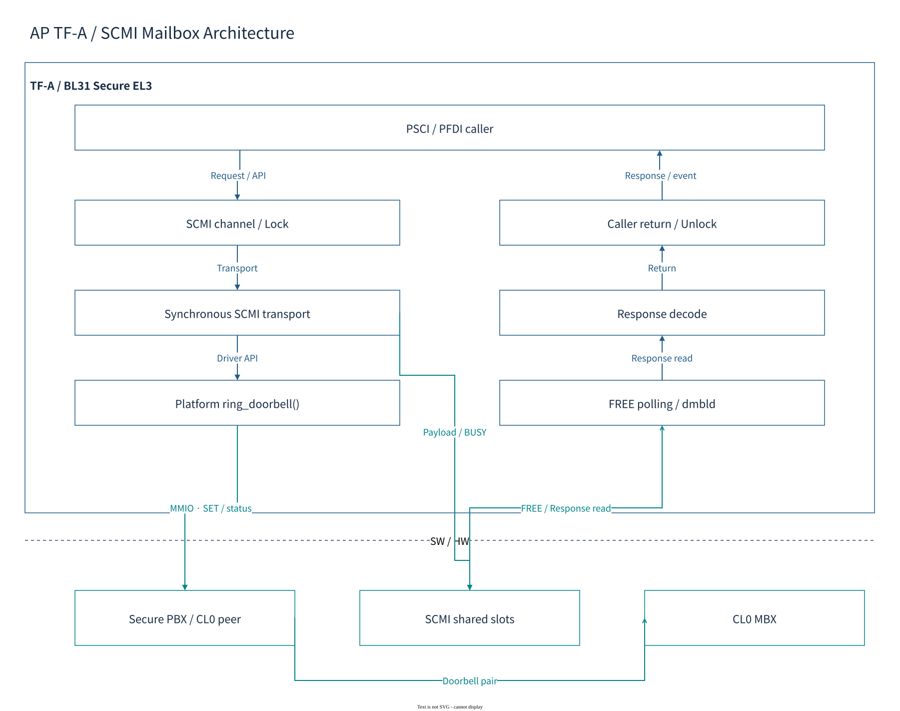

TF-A는 mailbox framework 대신 platform SCMI channel과 synchronous transport를 사용한다. PSCI는 Secure D1, PFDI는 별도 D3와 CPU별 slot을 사용한다.

##### 4.2.2.1 Configuration / Initialization

- `apollo_qvp_bl31_setup.c`: MHU doorbell 주소·shared slot·lock·ring callback 설정.
- PSCI slot: AP `0xDC0`; PFDI slot: `0xEC0 + 40×CPU`.
- PSCI는 ch0 bit0, PFDI는 CPU index별 channel bit0으로 알린다.

##### 4.2.2.2 SCMI API / Sequence

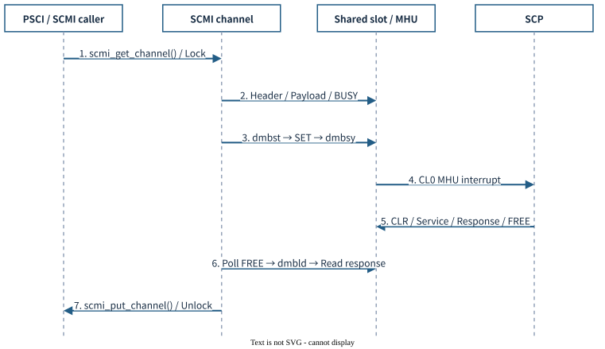

1. `scmi_get_channel()`로 lock을 얻고 기존 channel FREE를 확인한다.
2. 요청 header/payload를 기록하고 `scmi_send_sync_command()`가 BUSY로 전환한다.
3. `dmbst` → MHU SET → `dmbsy` 순서로 request를 publish한다.
4. SCP가 처리하는 동안 shared status의 FREE를 polling한다.
5. `dmbld` 뒤 응답을 읽고 `scmi_put_channel()`로 lock을 해제한다.

이 경로는 AP의 MHU RX IRQ를 기다리지 않는다. 현재 synchronous FREE 대기 loop 자체에는 timeout 탈출이 없다.

TF-A의 RSE communications는 별도 경로다. `psa_call` 계열 요청을 serialize하고 MHU wrapper가 batch를 송수신한다. BL2 measured-boot consumer는 build option에 따라 선택된다.

#### 4.2.3 U-Boot / OP-TEE Secure Services Architecture

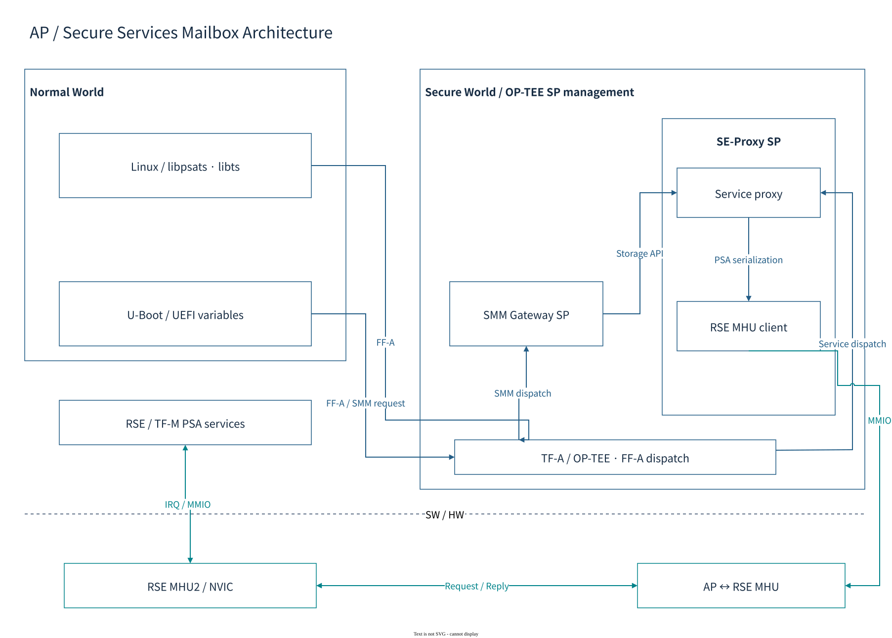

| 구성 | 역할 |
|---|---|
| U-Boot | UEFI variable service → FF-A → SMM Gateway |
| Linux | `libpsats/libts` → FF-A → Secure service |
| TF-A / OP-TEE | Secure-world 진입과 SP 관리·dispatch |
| SMM Gateway / SE-Proxy SP | UEFI storage proxy 및 PSA 요청 변환 |
| SE-Proxy MHU client | RSE와 실제 MHU 요청·응답 송수신 |

OP-TEE core와 U-Boot을 직접 MHU driver로 표현하지 않는다. 이 runtime 경로의 MHU consumer는 **SE-Proxy SP**이며 TF-A의 boot-time RSE client와도 구분한다. RSE 측 batch·PSA dispatch 순서는 4.5.3에 정리한다.

### 4.3 Safety Island CL0 — SCP Mailbox Architecture

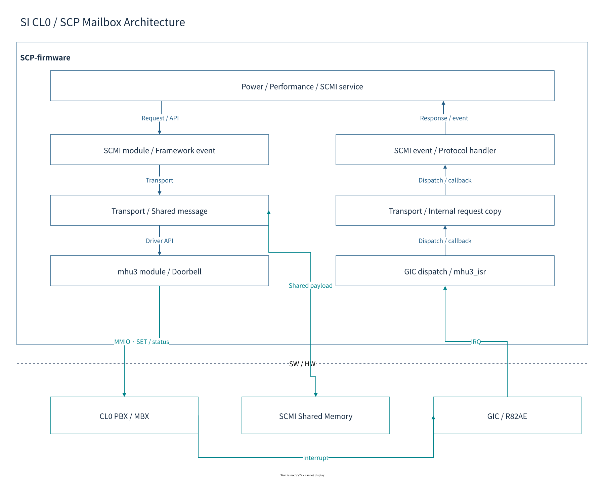

`mhu3` module은 IRQ·flag, `transport`는 shared slot, `scmi`는 메시지 dispatch를 담당한다. 실제 서비스는 framework event 문맥에서 실행한다.

#### 4.3.1 Mailbox Initialization

| 설정 / 단계 | 동작 |
|---|---|
| `config_mhu3.c` | PBX/MBX base, IRQ, physical channel/flag, logical sub-element 설정 |
| `config_transport.c` | Shared slot·size·agent 방향·SCMI binding 설정 |
| Module init / bind / start | Driver context 생성, transport API 연결, ISR 등록·enable |
| Channel setup | 수신 flag mask와 combined IRQ 참여 설정 |

MMIO는 Device, payload는 Normal Non-cacheable memory attribute를 사용한다. RSE reload ACK ch0 bit3은 transport 없는 전용 doorbell이다.

#### 4.3.2 SCMI Service Sequence

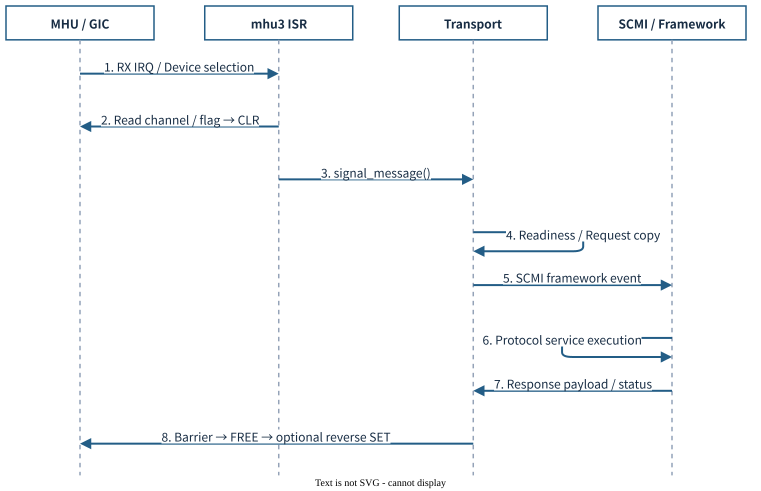

1. `mhu3_isr()`가 IRQ에 해당하는 device와 pending channel/flag를 찾는다.
2. 해당 flag를 W1C로 clear하고 `signal_message()`를 호출한다.
3. Transport가 readiness·소유권을 검사하고 request를 내부 buffer로 복사한다.
4. SCMI event가 protocol handler를 호출한다.
5. Response·length 기록 → barrier → FREE → 필요한 경우 reverse doorbell 순서로 응답한다.

CLR 시점의 HW ACK는 3–5보다 먼저 발생한다. Logical channel이 같은 DBCH를 공유하므로 CLR은 해당 flag만 직접 write하며 read-modify-write하지 않는다.

### 4.4 Safety Island CL1 — Zephyr Mailbox Architecture

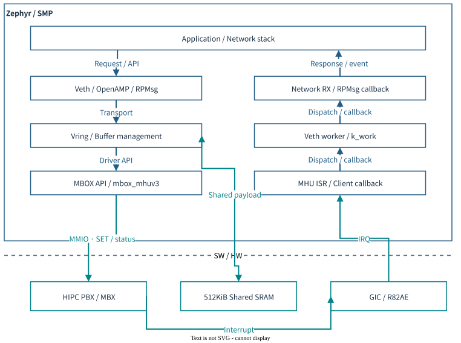

#### 4.4.1 Mailbox Initialization

- QVP board DTS가 HIPC TX/RX frame, IRQ, shared-memory attribute와 channel을 지정한다.
- `mbox_register_callback()`으로 client callback을 연결하고 `mbox_set_enabled()`로 필요한 channel을 활성화한다.
- HIPC는 AP와의 attach·resource-table·endpoint 연결을 거쳐 packet 송수신을 시작한다.
- Driver 원본은 Arm reference module이며 Apollo recipe가 generated copy에 reattach patch를 적용한다. Board 설정은 `zephyr_hsoc_src`가 소유한다.

#### 4.4.2 Mailbox API / Channel

| API / 경로 | 동작 |
|---|---|
| `mbox_send()` | PBX SET; DBE driver는 payload 전송 없이 doorbell 사용 |
| RX callback | Flag event를 저장하고 worker 예약 |
| Flattened channel ID | `32 × DBCH + flag`; Linux의 3-cell specifier와 다름 |
| HIPC ID 0 / 1 | vring0 / vring1 kick |
| HIPC RX ID 2 / 3 | detach / attach; TX ID2는 software ACK |
| CL0 SCMI ID 64/96/128/160 | ch2..5 bit0, CPU별 40B shared slot |

#### 4.4.3 HIPC Receive Sequence

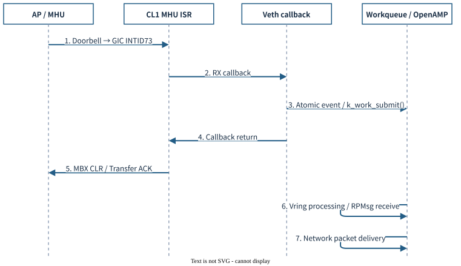

1. AP의 doorbell이 CL1 GIC INTID73을 발생시킨다.
2. MHU ISR이 client callback을 호출한다.
3. Veth callback이 atomic event를 기록하고 `k_work_submit()`을 호출한다.
4. Callback 반환 후 MHU driver가 해당 flag를 CLR한다.
5. Worker가 OpenAMP/RPMsg를 진행하고 network stack에 packet을 전달한다.

SMP에서는 worker가 ISR 종료 전에 다른 CPU에서 실행될 수 있다. TX ACK, attach ACK, RPMsg reply는 서로 다른 완료다. CL0 SCMI response는 shared FREE polling으로 확인한다.

### 4.5 RSE Domain — TF-M Mailbox Architecture

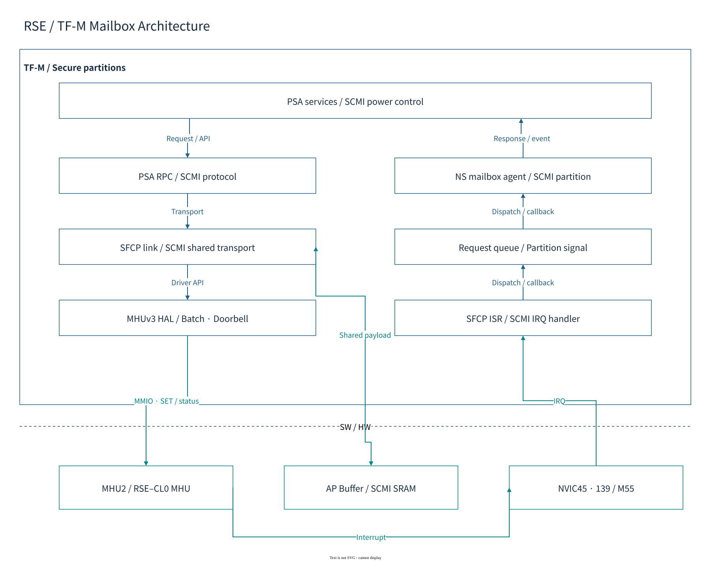

#### 4.5.1 Configuration / Initialization

| 단계 | 설정 / 동작 |
|---|---|
| BL2 SCMI | Shared command page·MHU 설정, 수신 IRQ mask, SCP readiness polling |
| TF-M SCMI | NVIC139와 SCMI partition signal 연결; `psa_wait()`에서 notification 대기 |
| SFCP | MHU2 AP_S link·node·buffer·IRQ45 설정 |
| NS mailbox agent | Inter-core communication 초기화, mailbox IRQ enable, signal 대기 |
| Pointer access | AP SRAM `0..0xFFFFF`, DRAM `0xFFFE0000..0xFFFFFFFF` 범위 검사 후 ATU 접근 |

#### 4.5.2 SCMI Boot / Runtime Sequence

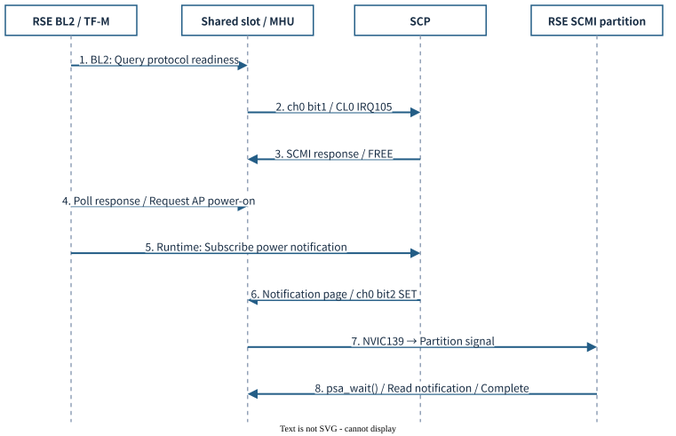

1. BL2가 SCP protocol/version 준비를 polling으로 확인한다.
2. RSE가 SCMI power 요청을 보내 AP primary core 기동을 진행한다.
3. Runtime에서 RSE가 system power notification을 구독한다.
4. SCP의 notification doorbell이 NVIC139와 partition signal로 전달된다.
5. TF-M SCMI partition이 shared notification을 읽고 상태 변경을 처리한다.

RSE→SCP ch0 bit3 reload ACK는 shared SCMI packet을 동반하지 않는 전용 doorbell이다.

#### 4.5.3 SFCP / PSA Request Sequence

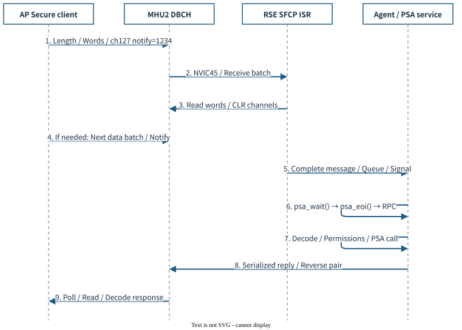

1. AP client가 요청을 serialize한다. 첫 batch는 **ch0 길이, ch1..126 data, ch127 notify=1234**다.
2. RSE NVIC45 → SFCP handler가 batch를 읽고 channel을 clear한다.
3. 추가 batch는 ch0부터 data를 쓰고 마지막 channel로 notify한다.
4. 완성된 메시지를 queue에 넣고 NS mailbox agent로 전달한다.
5. Agent가 `psa_wait()`에서 깨어나 `psa_eoi()` 후 RPC handler를 호출한다.
6. Message·pointer·permission을 검사하고 PSA service를 실행한다.
7. 결과는 반대 MHU pair의 별도 serialized reply로 반환한다.

Embed 방식은 payload를 DBCH로 전달한다. Pointer 방식은 pointer/length를 전달하고 허용 buffer에 접근한다. Batch clear는 버퍼 전송의 진행 신호이며 PSA service 성공은 최종 reply로 판단한다.

## 5. SW Test and Verification

실제 Guest SW가 실행하며 출력하는 UART 로그·shell 명령 결과·Guest 시험 프로그램 결과로 판정한다. Host runner는 실행과 로그 수집에 사용하며, 소스 분석·GDB 관찰·QVP 모델 trace만으로 PASS를 부여하지 않는다.

**결과 기록:** image 식별값, 실행 명령, Domain별 Guest 로그 경로와 관찰값을 함께 남긴다. `PASS`는 기대 결과 충족, `FAIL`은 불충족, `NOT RUN`은 실행 결과 미수집, `BLOCKED`는 실행·로그 수집 불가, `N/A`는 시험 기능 미포함이다. 아래 표는 시험 항목이며 이번 개정에서 새 Runtime 결과를 수집하지 않았으므로 `NOT RUN`으로 기록한다.

### 5.1 AP Domain — Linux

| Test ID | Guest 실행 / 수집 출력 | 판정 기준 | 실제 결과 | 판정 | Guest 로그 |
|---|---|---|---|---|---|
| MBX-101 | BSP `cpufreq` profile의 Guest policy·frequency 요청 및 응답 출력 수집 | SCMI policy 등록, 지원 frequency 요청 성공 및 Guest readback 확인 | — | NOT RUN | — |
| MBX-102 | MHU를 사용하는 요청 전후 Guest `/proc/interrupts` 수집 | 선택 MHU IRQ count 증가 | — | NOT RUN | — |
| MBX-103 | AP Guest에서 기존 `scripts/autosd_demo/hipc_ping.py` 실행; 결과 JSON 수집 | 지정 HIPC interface에서 ICMP request에 대한 SI reply와 payload 검사 PASS | — | NOT RUN | — |

Frequency readback은 실제 CPU 처리 속도나 MHU 전송 횟수의 증거가 아니다. MBX-102는 Guest에서 해당 IRQ가 식별되는 구성에 적용한다. `hipc` profile은 현재 FVP product 전용이며 QVP 실행 항목으로 사용하지 않는다. MBX-103은 AP가 시작한 ICMP 왕복만 판정한다.

### 5.2 AP Domain — Secure Services

| Test ID | Guest 실행 / 수집 출력 | 판정 기준 | 실제 결과 | 판정 | Guest 로그 |
|---|---|---|---|---|---|
| MBX-202 | Product `trusted-services` profile에서 Guest PSA 시험 출력 수집 | 실행한 crypto·PS·ITS·IAT suite의 실제 PASS/FAIL/SKIP 집계 확인 | — | NOT RUN | — |

해당 image에서 제공되는 suite만 판정한다. SKIP은 PASS로 합산하지 않는다. 서비스 응답은 end-to-end 결과이며 TF-A 초기화·MHU flag clear를 개별 입증하지 않는다.

### 5.3 Safety Island CL0 — SCP

Linux SCMI 요청·응답은 MBX-101에서 확인한다. 현재 Guest 출력으로 MHU ISR·transport event·channel flag 처리를 각각 판정하는 별도 시험은 배정하지 않는다. AP 부팅 완료만으로 SCP mailbox 시험을 PASS 처리하지 않는다.

### 5.4 Safety Island CL1 — Zephyr

| Test ID | Guest 실행 / 수집 출력 | 판정 기준 | 실제 결과 | 판정 | Guest 로그 |
|---|---|---|---|---|---|
| MBX-402 | MBX-103과 동일한 실행의 AP Guest 결과 및 제공되는 CL1 console 수집 | SI 응답을 포함한 ICMP 왕복·payload 검사 성공 | — | NOT RUN | — |

MBX-103과 같은 end-to-end 시험이며 별도 실행 건수로 중복 집계하지 않는다. CL1 ISR·worker 순서나 SI가 먼저 시작하는 통신은 이 결과에 포함하지 않는다.

### 5.5 RSE Domain — TF-M

| Test ID | Guest 실행 / 수집 출력 | 판정 기준 | 실제 결과 | 판정 | Guest 로그 |
|---|---|---|---|---|---|
| MBX-502 | AP↔RSE 경로를 사용하는 image에서 MBX-202 Guest 시험 결과와 RSE console 수집 | RSE-backed PSA 서비스의 요청·응답 시험 성공 | — | NOT RUN | — |

MBX-202와 같은 실행 결과를 연결한다. RSE-backed service가 아닌 항목은 제외한다. RSE 로그에 개별 dispatch가 없으면 SFCP handler·partition 내부 단계까지 PASS로 확장하지 않는다. Boot readiness·runtime notification은 별도 Guest 시험 출력이 없어 제외한다.

[검증 runner·profile](SOURCES.md#validation) · [소스 참조](SOURCES.md) · [draw.io 원본](apollo-mailbox-architecture.drawio)
