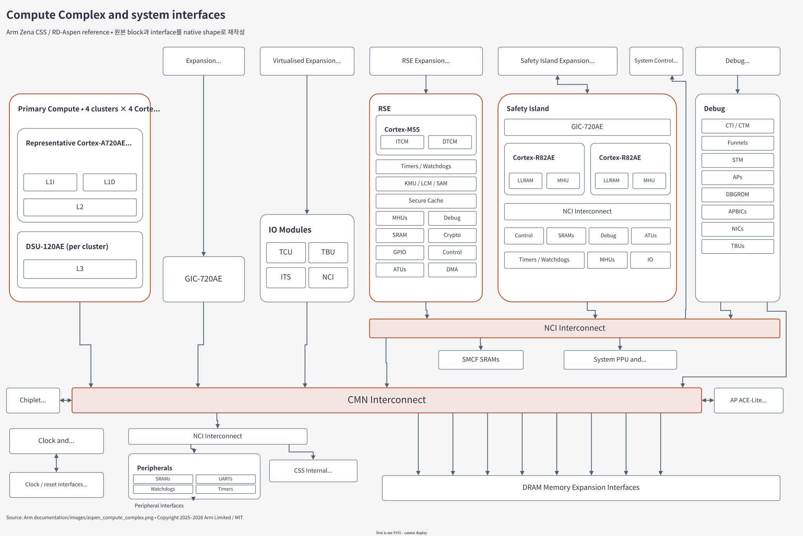

# 01.1 Hardware 구성과 Domain ownership

[전체 목차](../README.md) · [상위 장](../01-project-overview.md) · [다음: 01.2 Software stack과 실행 profile](02-software-and-profiles.md)

**이 문서의 질문:** AP에서 Linux가 실행되는 동안 누가 boot 신뢰와 power/reset, 독립 진단을 담당하는가? Compute Complex에서 SMB로 이동하며 block과 실행 주체를 대응시킨다.

## 1. Reference hardware를 읽는 순서

[draw.io 편집 원본](../figures/reference/aspen_compute_complex.drawio)

[Arm 원본 PNG](../../../../arm-zena-css/documentation/images/aspen_compute_complex.png)

*그림 1-1. Arm 원본 PNG를 바탕으로 native draw.io object로 재작성한 System Block Diagram. 출처: [components.rst — Components / Primary Compute](../../../../arm-zena-css/documentation/design/components.rst). 아래 해설은 그림의 block을 Apollo의 구현 책임에 대응시킨 것이다.*

### 1.1 Processor Block에서 memory와 interrupt까지

왼쪽의 **Primary Compute**는 rich OS와 application을 실행한다. Reference는 네 processor cluster와 cluster당 네 Cortex-A720AE를 설명한다. 각 cluster의 DSU-120AE는 공유 L3와 coherency, power management에 관련된 기능을 묶고, cluster 밖의 CMN interconnect가 memory 및 다른 system block으로의 연결을 제공한다.

CPU가 memory를 읽는 경로와 interrupt를 받는 경로는 서로 다르다. Load/store는 address decode와 interconnect를 지나고, 주변 장치의 IRQ는 GIC의 Distributor/Redistributor 및 CPU interface를 거쳐 exception으로 전달된다. PCIe device의 MSI는 interrupt wire를 하나씩 연결하는 대신 message write와 ITS/LPI mapping을 사용한다.

그림의 I/O block에 있는 **TCU/TBU**는 I/O address translation에 관련된 구성이다. DMA가 접근하는 주소의 translation·permission과 CPU의 MMU translation은 서로 다른 주체가 관리한다. 따라서 “Linux에서 이 주소를 읽을 수 있다”만으로 같은 장치의 DMA access까지 설명할 수 없다.

| Hardware block | 설계에서 맡는 일 | Apollo에서 먼저 읽을 구현 |
|---|---|---|
| Cortex-A720AE / DSU | application CPU, cluster·cache·power 구조 | `soc/hw-block/ap_compute/cpu.lua`, TF-A PSCI topology |
| CMN / NCI / NI | compute 및 peripheral 연결, access/fault 경계 | domain interconnect, TLM router, ATU, NI model |
| GIC / ITS | SPI/PPI/LPI delivery와 interrupt programming view | `ap_compute/system.lua`, GIC multiview wrapper |
| TCU / TBU | I/O translation과 DMA access control | SystemC SMMU/TBU 또는 선택한 QEMU backend |
| System Management Block | RSE·SI·shared controls의 결합 | `rse/`, `si_cl0/`, `si_cl1/`, `system_mgmt/` |
| Clock / Power / Reset | CPU·cluster와 subsystem 상태 전환 | SCP power-domain/PPU, Lua reset fanout |
| Peripheral / RoS | UART, timer, storage/network interface | `io_peri.lua`, `ros/`, board device 구성 |

Reference의 CMN/DSU cache와 physical topology는 **hardware가 무엇으로 구성되는지** 설명한다. QVP의 TLM router와 host-memory backing은 **software-visible transaction이 어디에 도착하는지** 구현한다. 둘의 대응 범위는 [05장](../05-fvp-qbox-comparison.md)의 IP별 비교에서 확인한다.

### 1.2 현재 실행 population

| 항목 | Arm reference | 현재 Apollo 일반 Yocto/runner 경로 |
|---|---|---|
| AP | 4 cluster × 4 PE topology | 기본 4 PE; machine metadata는 AP4/AP16 DTB 선택 |
| SI CL0 | Cortex-R82AE dual lockstep pair | 1 logical PE에서 SCP-firmware 실행 |
| SI CL1 | CFG2에서 Cortex-R82AE 4-core SMP | 4 PE에서 Zephyr SMP 실행 |
| RSE | Cortex-M55 기반 secure subsystem | 1 logical PE에서 TF-M 실행 |
| Configuration | CFG1: CL0, CFG2: CL0+CL1 | `RD_ASPEN_VARIANT="cfg2"` |

`PE`는 Processing Element다. Lockstep pair의 redundant core는 별도 OS instance로 세지 않는다. 또한 현재 firmware domain 수는 AP·RSE·CL0·CL1의 네 개이지만, RSE peripheral helper 때문에 QemuInstance 수는 다섯 개다. CPU 수·firmware domain 수·QemuInstance 수는 각각 다른 단위다.

근거: [reference topology](../../../../arm-zena-css/documentation/design/components.rst), [local.conf](../../../../build/conf/local.conf), [현재 SoC construction](../../../../hsoc-stack/tools/qbox-platform/platforms/apollo/soc/apollo.lua), [AP DTB 선택](../../../../hsoc-stack/yocto/meta-hsoc-bsp/conf/machine/apollo-qvp.conf).

## 2. System Management Block — Linux 밖에서 누가 system을 제어하는가

[draw.io 편집 원본](../figures/reference/aspen_system_management_block.drawio)

[Arm 원본 PNG](../../../../arm-zena-css/documentation/images/aspen_system_management_block.png)

*그림 1-2. Arm 원본 PNG를 바탕으로 native draw.io object로 재작성한 System Management Block. 출처: [components.rst — System Management Block](../../../../arm-zena-css/documentation/design/components.rst). RSE와 SI를 별도 processor로 보고, 그 아래의 shared peripheral·interconnect를 함께 읽는다.*

### 2.1 RSE: 신뢰를 시작하고 secure service를 제공한다

RSE는 처음 실행되는 Root of Trust다. M55의 ROM/OTP/flash와 TF-M boot chain으로 다음 image를 검증하고 적재한다. ATU를 설정하여 AP/SI의 memory에 접근하고, SCP와 SCMI로 기동 조건을 조정한다. Boot 이후에도 TF-M runtime은 secure storage·crypto·attestation 등의 service를 제공한다.

그림의 **LCM/KMU/SAM**은 각각 lifecycle, key management, security alarm과 관계된 block이다. ITCM/DTCM/SRAM은 firmware 실행과 data에 사용되고, MHU는 외부 client와의 notification 경로를 만든다. RSE 안에 보안 연산과 상태를 두는 목적은 AP의 일반 application과 resource·access boundary를 분리하는 데 있다.

### 2.2 SI CL0: resource state의 owner

CL0는 SCP-firmware의 module/event framework를 실행한다. Linux와 TF-A가 power/performance를 요청하면 SCP가 resource state를 확인하고 PPU·clock·DVFS 관련 동작을 수행한다. AP secondary CPU를 깨우는 동작, CL1 기동, watchdog recovery도 이 control path에 연결된다.

따라서 SCP는 별도 Cortex-M management CPU를 추가한다는 뜻이 아니다. **이 platform에서는 CL0에서 실행하는 firmware의 이름이 SCP-firmware**다. 현재 composition에 별도 MCP 또는 SI CL2 실행 domain도 없다.

### 2.3 SI CL1: 독립 RTOS와 AP의 협력

CL1은 Zephyr SMP를 실행하는 RTOS domain이다. AP와 shared memory 및 MHU를 사용해 HIPC/RPMsg 통신을 만들며, PFDI 진단과 report를 CL0의 monitor에 연결한다. Linux의 remoteproc은 이미 기동된 CL1에 attach한다. 일반적인 remoteproc의 “Linux가 remote image를 load한다”는 동작을 이 board에 그대로 적용하면 boot ownership을 잘못 설명하게 된다.

### 2.4 SMD: processor가 아니라 shared control domain

SMD는 AP·RSE·SI를 잇는 shared peripheral, SRAM, interconnect의 구역이다. MHU endpoint, shared payload, system counter, reset control 및 ATU programming interface가 이 구조와 연결된다. QVP에서는 `system_router`와 `smd_router`를 분리하며 selector `0x2`를 `system_to_smd_nci`로 SMD에 전달한다.

| 책임 | AP | RSE | SI CL0 | SI CL1 |
|---|---|---|---|---|
| Application / driver | Linux 및 제품 application | PSA secure partition | platform control module | RTOS application |
| Image 인증·적재 | AP boot stage의 후속 load | Root of Trust, AP/SI 초기 load | power/reset coordination | 초기 image의 실행 대상 |
| Runtime resource 요청 | PSCI / SCMI client | SCMI client 및 notification peer | SCMI server / PPU owner | 필요한 platform service client |
| Health / fault 처리 | PFDI client, RAS OS 처리 | secure boot 및 secure runtime | PFDI monitor, FMU/SSU, recovery | PFDI diagnostics / report |

상세 source와 각 계층의 초기화·runtime entry는 [06장](../06-component-software-architecture.md)에 이어진다.

## 3. Hardware boundary를 source boundary로 옮기는 방법

Hardware block diagram에서 큰 box는 physical 구성 단위다. Firmware가 link되는 binary 단위나 host의 C++ object 단위와 일대일로 대응하지는 않는다. 이를 Apollo에 옮길 때에는 **실행 주체**, **접근 가능한 resource**, **resource의 상태를 바꿀 권한**을 순서대로 나눈다.

예를 들어 AP의 CPUFreq governor는 새 performance level을 선택하지만 clock/voltage programming의 owner는 SCP다. Linux의 register 접근 가능 여부만으로 소유권을 판단하면 Linux와 SCP가 같은 clock을 동시에 제어하는 설계를 만들게 된다. 같은 이유로 CL1 firmware를 사용하는 Linux driver가 CL1의 최초 boot owner가 되는 것도 아니다.

| 경계 | 설계상 질문 | Apollo source에서 찾을 증거 |
|---|---|---|
| 실행 boundary | 어느 CPU에서 어떤 instruction set/privilege로 실행하는가? | AP/RSE/CL0/CL1 CPU descriptor와 firmware toolchain |
| Address boundary | 이 master의 transaction은 어떤 target에 도착하는가? | local router, ATU/bridge, target address window |
| Control boundary | reset·clock·image load를 누가 수행하는가? | SCP resource API, RSE image loader, reset fanout |
| Protection boundary | 어떤 access를 허용하고 거절하는가? | security attribute, protection/translation 설정, firmware validation |
| Evidence boundary | 구현·실행·물리 fidelity 중 어디까지 확인했는가? | model source, named guest scenario, 별도 hardware qualification |

[SoC entry `soc/apollo.lua`](../../../../hsoc-stack/tools/qbox-platform/platforms/apollo/soc/apollo.lua)의 `soc.load()`는 hardware block별 구성 객체를 준비한다. `soc.define()`은 fabric을 먼저 선언하고 RSE, AP/RoS, system management, SI host view와 CPU 구성을 조합한다. **선언 순서가 guest의 boot 순서인 것은 아니다.** CPU reset/loader/firmware handshake가 실제 실행 순서를 결정한다. 이 구분이 [QBox 상세 장](../04-qbox-runtime-and-lua.md)을 읽는 출발점이다.

## 4. Domain이 준비되었다는 말의 구체적인 의미

| 관측된 상태 | 다음에 확인할 사항 | 아직 결론 내릴 수 없는 것 |
|---|---|---|
| Host에 CPU object 생성 | reset vector·image·reset release | firmware 실행 |
| RSE가 boot log 출력 | SI/AP image validation·SCP readiness | AP가 실행 가능함 |
| CL0가 시작 | SCMI channel, power-domain startup | 모든 service가 요청을 처리함 |
| CL1가 scheduler 진입 | OpenAMP/endpoint 준비와 AP attach | HIPC packet 왕복 |
| AP Linux login | 선택한 service와 peer response | integrated qualification 완료 |

Domain별 readiness를 따로 기록하면 “Linux가 늦게 뜬다”는 현상을 어느 dependency에서 발생했는지 좁힐 수 있다. Boot dependency는 [Component SW](../06-component-software-architecture.md), source 수정의 영향 범위는 [Source Architecture](../02-project-source-architecture.md)에서 이어 읽는다.

---

[전체 목차](../README.md) · [상위 장](../01-project-overview.md) · [다음: 01.2 Software stack과 실행 profile](02-software-and-profiles.md)
