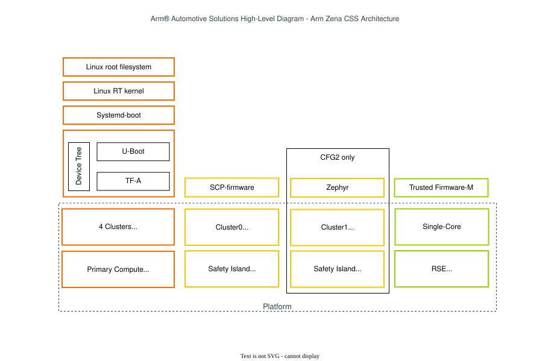
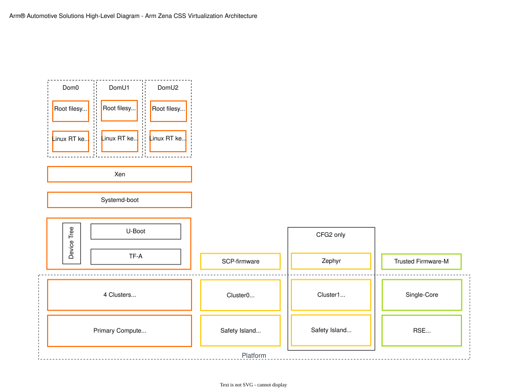

# 01.2 Software stack과 실행 profile

[전체 목차](../README.md) · [상위 장](../01-project-overview.md) · [이전: 01.1 Hardware 구성과 Domain ownership](01-hardware-and-domains.md) · [다음: 01.3 Address view와 System lifecycle](03-address-and-lifecycle.md)

**이 문서의 질문:** 같은 AP에서 실행하는 TF-A·OP-TEE·U-Boot·Linux의 역할은 어떻게 다른가? Privilege와 lifetime을 먼저 나누고 baremetal·virtualization·standalone의 적용 범위를 읽는다.

## 1. Software stack — 같은 box 안에서도 실행 privilege가 다르다

[draw.io 편집 원본](../figures/reference/aspen_high_level_arch.drawio)

[Arm 원본 SVG](../../../../arm-zena-css/documentation/images/aspen_high_level_arch.svg)

*그림 1-3. Arm 원본 Baremetal Architecture. 출처: [overview.rst — Architectures / Baremetal architecture](../../../../arm-zena-css/documentation/overview.rst). Reference의 EWAOL product layer는 Apollo에서 Nexios image/distro 구성으로 구체화된다.*

그림의 AP software를 boot 순서와 runtime 역할로 나누어 읽는다. TF-A BL2는 초기 load, BL31은 EL3 runtime, OP-TEE는 Secure world의 SPMC, U-Boot는 BL33/UEFI bootloader, Linux는 Normal world OS다. 이들은 모두 AP에서 실행하지만 exception level과 lifetime이 다르다.

RSE의 TF-M은 AP의 OP-TEE와 별도 processor에서 실행한다. OP-TEE가 관리하는 **SE-Proxy Secure Partition**은 AP client의 요청을 RSE service로 전달한다. **SMM Gateway SP**는 UEFI variable service를 연결하고, backend는 RSE Protected Storage에 도달한다. 따라서 UEFI variable 저장 문제도 U-Boot 한 component만으로 끝나는 구조가 아니다.

| 실행 위치 | Interface | 끝에서 수행하는 일 |
|---|---|---|
| Linux application → kernel → TF-A | `libpsats/libts`, FF-A | Secure Partition RPC와 dispatch |
| AP Secure Partition → RSE | SE-Proxy, MHUv3, PSA IPC | Crypto / ITS / PS / Attestation |
| U-Boot UEFI → SMM Gateway SP | FF-A, SMM variable protocol | UEFI variable persistence |
| Linux → TF-A → SCP | PSCI, SCMI | CPU/cluster power-state 제어 |
| Linux → SCP | SCMI Performance | cluster performance request 처리 |
| Linux ↔ Zephyr | remoteproc, VirtIO/RPMsg, MHU | shared-memory network/IPC |

**세 protocol을 구분한다.** PSCI는 CPU/system power 동작의 firmware interface이고, SCMI는 platform resource service protocol이며, FF-A는 firmware framework와 Secure Partition 간 통신 interface다. MHU는 이들 중 일부의 domain 간 전달을 위한 notification hardware다. 서로 다른 계층의 이름을 동의어로 사용하지 않는다.

근거: [Secure Services architecture와 SE-Proxy/SMM Gateway](../../../../arm-zena-css/documentation/design/secure_services.rst), [Power and performance control](../../../../arm-zena-css/documentation/design/power_and_performance_control.rst), [HIPC architecture](../../../../arm-zena-css/documentation/design/hipc.rst).

## 2. 실행 privilege와 software lifetime을 함께 읽기

Boot 그림은 image가 차례로 실행되는 순서를 보여주지만 runtime stack에는 그중 일부만 계속 남는다. BL2와 U-Boot의 load/boot 역할이 끝난 뒤에도 BL31과 Secure world service는 요청을 처리한다. 따라서 Linux가 실행 중일 때 secure service 문제가 발생하면 현재 exception이 도착하는 runtime component를 먼저 찾는다.

| Software | 주요 실행 위치 | 주 lifetime | 유지하는 계약 |
|---|---|---|---|
| TF-A BL2 | AP secure boot stage | 초기 load/handoff | image와 configuration 적재 |
| TF-A BL31 / SPMD | AP EL3 | OS runtime에도 상주 | PSCI, world switch, FF-A dispatch |
| OP-TEE / SPMC, SP | AP Secure world | secure runtime | SP lifecycle와 service dispatch |
| U-Boot BL33 | AP Normal world boot stage | OS 진입 전 | UEFI boot, slot/image 선택 |
| Linux | AP NS-EL1; virtualization은 별도 profile | product runtime | application, drivers, platform clients |
| TF-M | RSE M-profile Secure runtime | boot 이후에도 상주 | PSA partition과 isolation |
| SCP / Zephyr | CL0 / CL1 | 각 domain runtime | resource service / RTOS application |

EL 숫자를 모든 CPU에 공통으로 적용하면 안 된다. RSE의 M-profile privilege/isolation 모델은 AP의 EL3·EL1과 다르다. CL0/CL1의 Cortex-R 경로도 AP EL3 Secure Monitor와 별개다. 실제 build에서 선택된 SPMC/SPM 구성은 [06장](../06-component-software-architecture.md)의 domain 문서에서 확인한다.

## 3. Baremetal과 Virtualization — reference 선택지와 현재 profile

[draw.io 편집 원본](../figures/reference/aspen-virtualization-arch.drawio)

[Arm 원본 SVG](../../../../arm-zena-css/documentation/images/aspen-virtualization-arch.svg)

*그림 1-5. Arm 원본 Virtualization Architecture. 출처: [overview.rst — Virtualization architecture](../../../../arm-zena-css/documentation/overview.rst). Reference의 Xen/Dom0/DomU1/DomU2 배치이며 현재 Apollo full-system의 기본 runtime 구성을 뜻하지 않는다.*

Reference는 AP에 PREEMPT_RT Linux를 직접 올리는 Baremetal 경로와 Xen type-1 hypervisor 위의 Linux domain 경로를 구분한다. 여기서 Dom0/DomU는 **AP 안의 virtualization domain**이다. AP/RSE/SI CL0/SI CL1이라는 **독립 processor/firmware domain**과 같은 분류가 아니다.

| Profile | 어떤 SW를 실행하는가 | 주로 설명할 목적 |
|---|---|---|
| Apollo QBox full-system | RSE/CL0/CL1 + AP firmware/OS | boot, power/reset, secure service, IPC 통합 |
| Apollo QBox direct Linux | AP Linux와 선택된 device/substitute | AP driver 반복 개발 |
| Standalone QEMU Linux | 별도 machine에 직접 kernel 적재 | standalone emulator 경로 |
| AP gem5 | 독립 AP model 및 workload | 성능 모델 실험 |
| Standalone CL1 | 별도 CL1 image와 profile | CPU/UART/timer 또는 지정 benchmark |
| Reference Xen solution | Xen + Dom0/DomU Linux | reference virtualization architecture |

사용할 profile을 고른 뒤 CPU 수·DTB·firmware·disk·provider를 맞춘다. 같은 Linux binary가 보인다고 RSE/SCP/SI의 실행 조건까지 같은 것은 아니다.

## 4. Profile 선택이 interface에 미치는 영향

Full-system에서는 상대 firmware가 실제 service provider다. AP-only 실행에서 substitute가 같은 register read에 응답해도 RSE 인증, SCP policy, CL1 endpoint state가 모두 재현되는 것은 아니다. API 호출이 성공한 지점과 실제 peer가 실행한 지점을 구분해야 비교가 가능하다.

예를 들어 HIPC를 설명하려면 CL1 image·shared backing·MHU·remoteproc attach·RPMsg endpoint까지 필요하다. AP UART driver만 개발하는 경우에는 그 전체 구성이 필요하지 않을 수 있다. 이 두 실행의 성공 조건을 같은 boot marker로 평가하면 integration 누락을 놓친다.

| 작업 목적 | 필요한 최소 실행 계약 | 반드시 맞출 입력 |
|---|---|---|
| AP device driver | 해당 device의 MMIO·IRQ·DMA와 Linux consumer | kernel, DTB, model topology |
| Multi-domain boot | RSE authentication + CL0 power + AP/CL1 handoff | ROM/OTP/Flash, SI images, full profile |
| Secure service | AP SP와 RSE partition 양쪽 endpoint | SP package, TF-M config, mailbox mapping |
| HIPC recovery | CL1 유지/재기동 정책과 AP 재attach | reset scope, shared-memory lifetime, matching endpoint protocol |
| FVP/QVP 비교 | 같은 software-visible service와 scenario | machine별 artifact mapping, CPU population, feature selection |

실행 profile의 최종 선택은 launcher와 Lua에서 결정한다. Reference의 Xen diagram을 현재 baremetal profile의 기본 배치로 읽지 말고, [Build](../03-project-build-architecture.md)에서 image 선택을 확인한 뒤 [QBox runtime](../04-qbox-runtime-and-lua.md)에서 실제 구성까지 추적한다.

---

[전체 목차](../README.md) · [상위 장](../01-project-overview.md) · [이전: 01.1 Hardware 구성과 Domain ownership](01-hardware-and-domains.md) · [다음: 01.3 Address view와 System lifecycle](03-address-and-lifecycle.md)
