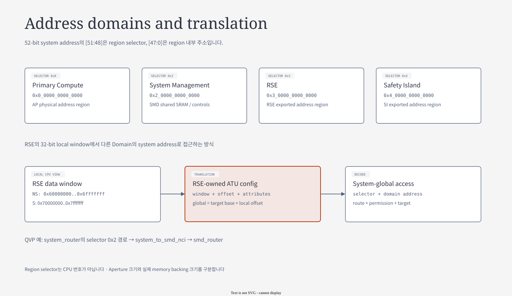
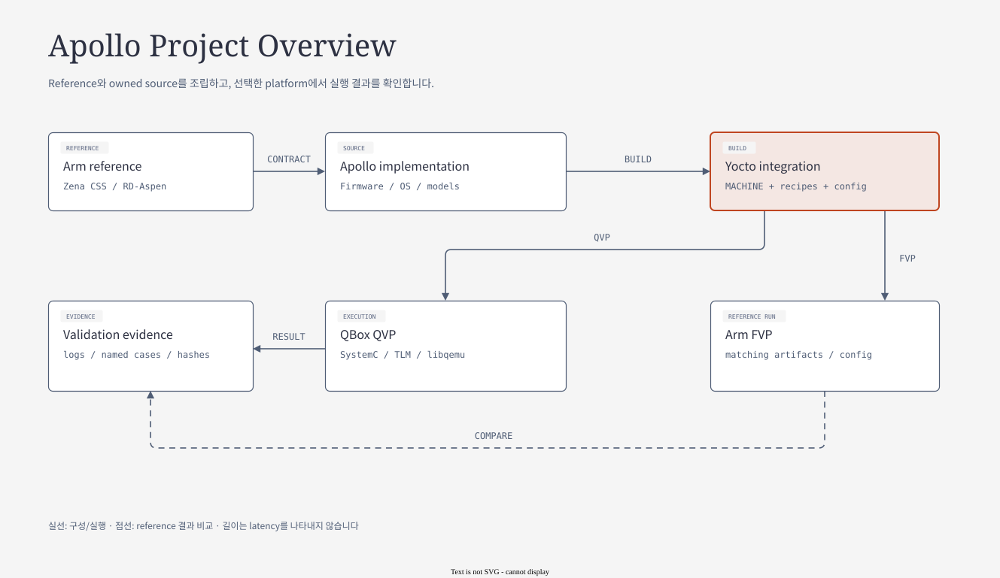

# 01.3 Address view와 System lifecycle

[전체 목차](../README.md) · [상위 장](../01-project-overview.md) · [이전: 01.2 Software stack과 실행 profile](02-software-and-profiles.md)

**이 문서의 질문:** 서로 다른 CPU 주소가 어떻게 같은 data를 가리키며, boot 이후 runtime 요청과 fault recovery는 어떻게 이어지는가? 하나의 transaction에 source·artifact·consumer를 연결한다.

## 1. Address architecture — 주소가 다르더라도 같은 storage일 수 있다



[draw.io 편집 원본](../diagrams/01-address-domains.drawio)

[기존 HTML 보기](../diagrams/01-address-domains.html)

*그림 1-4. Arm reference의 address-region 설명을 기반으로 정리한 translation 개념도. 출처: [components.rst — Address spaces / RSE Address Window Regions](../../../../arm-zena-css/documentation/design/components.rst). 실제 QVP egress는 [04장](../04-qbox-runtime-and-lua.md)에서 별도로 보여 준다.*

System-wide address는 최대 52-bit이며 상위 4-bit가 region을 구분한다. AP·RSE·SI의 CPU가 직접 보는 local address space와 같은 공간이 아니다. RSE의 32-bit data window로도 ATU가 만들어 주는 global address를 통해 다른 region에 접근할 수 있다.

| System selector | Region base | 대표 대상 |
|---|---:|---|
| `0x0` | `0x0_0000_0000_0000` | AP physical address region |
| `0x2` | `0x2_0000_0000_0000` | SMD SRAM, counter, system controls |
| `0x3` | `0x3_0000_0000_0000` | RSE exported interfaces |
| `0x4` | `0x4_0000_0000_0000` | SI exported SRAM, control, MHU |

위 표는 `components.rst`가 열거한 네 region이다. Hardware programmer's model의 AP-through-TCU selector 등 전체 aperture 설명은 [Global memory map](../../../fabric/global-memory-map.md)에서 별도로 다룬다. Selector는 Secure/Non-secure bit가 아니다. Security attribute, ATU permission과 target access policy도 함께 맞아야 한다.

### 1.1 Shared memory를 읽는 구체적인 예

AP의 HIPC resource-table area는 `0x00100000`이고 CL1 view에서는 `0xE0130000`이다. 두 주소는 별개의 message 복사본이 아니라 QVP의 `si_cl1_hipc_bridge`를 통해 같은 AP backing으로 연결된다. AP가 공유 영역을 갱신하고 MHU doorbell을 울리면 CL1은 자기 view에서 해당 내용을 읽는다.

1. Writer가 공유 buffer와 descriptor를 준비한다.
2. Protocol의 ownership·status를 갱신한다.
3. 필요한 memory ordering을 보장한 뒤 doorbell을 설정한다.
4. Receiver는 IRQ를 받아 자신의 address view에서 data를 읽는다.
5. Consumption/response를 완료하고 protocol이 정한 소유권을 반환한다.

이 순서 때문에 **MMIO register 주소**, **shared payload 주소**, **global translation 결과**를 따로 기록해야 한다. Doorbell bit가 set되었다고 payload까지 준비되었다고 가정해서는 안 된다.

근거: [CL1 HIPC bridge](../../../../hsoc-stack/tools/qbox-platform/platforms/apollo/soc/hw-block/si_cl1/interconnect.lua), [reference HIPC memory map](../../../../arm-zena-css/documentation/design/hipc.rst), [System/SMD split](../../../../hsoc-stack/tools/qbox-platform/platforms/apollo/soc/hw-block/fabric/fabric.lua). 각 register와 shared SRAM의 상세 map은 [07장](../07-system-software-core.md)에 정리했다.

## 2. Worked example — CL1 address를 AP backing까지 추적하기

[CL1 interconnect](../../../../hsoc-stack/tools/qbox-platform/platforms/apollo/soc/hw-block/si_cl1/interconnect.lua)는 `0xE0130000`에서 시작하는 `0x80000` byte window를 `si_cl1_hipc_bridge`에 연결한다. `mapped_base_addr=0x00100000`이고 출력은 `ap_router.target_socket`이다. 이 고정 window의 변환은 다음과 같다.

```text
CL1 input address       = 0xE0150040
window-relative offset  = 0xE0150040 - 0xE0130000 = 0x20040
AP target address       = 0x00100000 + 0x20040    = 0x00120040
```

따라서 CL1의 `0xE0150040`은 AP view의 vring0 영역 `0x00120040`으로 연결된다. 이 계산은 **주소 변환의 설명**이며 그 위치의 descriptor가 이미 유효하다는 뜻은 아니다. Ring format, ownership, memory ordering은 별도 protocol이 결정한다.

| 확인 순서 | 질문 | 이 예의 답 |
|---|---|---|
| 1. Initiator view | 누가 transaction을 만들었는가? | CL1 CPU/local router |
| 2. Decode window | 주소가 선언된 범위 안에 있는가? | `0xE0130000..0xE01AFFFF` |
| 3. Translation | offset이 어디에 더해지는가? | AP alias base `0x00100000` |
| 4. Target | 어느 router/backing이 받는가? | `ap_router`의 AP shared backing |
| 5. Protocol | 지금 읽어도 되는 data인가? | VirtIO/RPMsg ownership을 따로 확인 |

이 bridge는 CL1에게 system-global 전체 접근을 제공하지 않는다. CL1에 다른 global address를 임의로 넣어도 이 HIPC window가 그 접근을 보장하지 않는다. AP/RSE/CL0의 ATU egress와 CL1 고정 bridge를 구분하는 이유다.

## 3. System lifecycle을 세 단계로 연결하기

### 3.1 Boot: image가 준비되는 것과 CPU가 실행되는 것은 다른 사건이다

RSE가 먼저 boot하고 SI image와 AP BL2를 준비한다. SI0가 SCMI service를 제공할 수 있어야 AP power-on 요청이 완료된다. AP는 `RESET_TO_BL2` 경로로 TF-A BL2를 시작하고 BL31/BL32/BL33과 configuration을 준비한다. U-Boot/UEFI가 OS image를 선택한 뒤 Linux가 driver와 service를 시작한다.

CL1도 image load와 cluster/core release 조건이 있다. AP Linux가 HIPC에 attach하는 시점은 이 boot preparation 이후다. RSE flash와 AP flash의 역할, FIP와 signed image의 관계는 [03장](../03-project-build-architecture.md), 전체 multi-domain boot diagram은 [06장](../06-component-software-architecture.md)을 따른다.

**Secure Boot와 Measured Boot도 다르다.** Secure Boot는 image를 인증하여 실행 허용 여부를 결정한다. Measured Boot는 실행한 code/data의 measurement를 남겨 attestation에 사용한다. Reference는 AP BL33까지의 측정 범위와 configuration/Linux의 제외 범위를 별도로 설명한다. “부팅했음”, “인증했음”, “측정했음”은 같은 결과가 아니다.

근거: [boot_process.rst — Chain of Trust / Measured Boot / RSE-oriented boot flow](../../../../arm-zena-css/documentation/design/boot_process.rst).

### 3.2 Runtime: data plane과 control plane이 협력한다

| 사용 사례 | Data / request가 지나는 길 | 최종 resource owner |
|---|---|---|
| `cpufreq` 변경 | Linux policy → SCMI request SRAM → MHU → SCP performance module | SCP DVFS/clock resource |
| PSCI deep idle / wake (opt-in) | Linux CPUIdle → PSCI → TF-A → SCMI → SCP; timer/IRQ wake | SCP power-domain + TF-A resume |
| AP↔CL1 packet | netdev → RPMsg → shared vring/buffer → MHU kick → OpenAMP → Zephyr net stack | 양쪽 buffer/queue owner |
| PSA Crypto request | application → libpsats/libts → FF-A → SE-Proxy → RSE | TF-M service partition |
| PFDI online check | userspace → ioctl → SMC → TF-A test interface → report → CL0 | test backend + SCP monitor |

현재 Apollo DTS의 기본 idle은 WFI이며 위 PSCI deep idle은 opt-in 경로다. 모든 idle 진입이 SCP 요청을 발생시키는 것은 아니다. [현재 idle-state 설정](../../../../hsoc-stack/components/primary_compute/linux/arch/arm64/boot/dts/hsoc/apollo-qvp.dtsi)과 [05장의 CPUIdle 비교](../05-fvp-qbox-comparison.md)를 함께 읽는다.

CPUFreq와 CPUIdle은 같은 “저전력 기능”으로 묶이지만 action이 다르다. CPUFreq는 동작 중 performance level을 바꾸며, CPUIdle은 실행할 task가 없을 때 state를 고른다. Reference의 1.8/2.0/2.5 GHz와 전압 point는 demonstration 값이다. QVP에서 이를 guest-visible service 계약으로 구현하는 것과 실제 전력·성능 calibration은 별도다.

HIPC 역시 하나의 mailbox message로 packet을 보내는 구조가 아니다. 512 KiB shared-memory 구성의 resource table·두 vring·buffer와 RPMsg endpoint negotiation이 먼저 필요하다. 데이터는 공유 memory에 있고 MHU는 queue에 새 일이 있음을 알린다.

### 3.3 Fault와 recovery: 감지, 기록, 정책, 복구를 나눈다

PFDI, RAS, FMU, SSU, Watchdog은 하나의 장치를 다르게 부르는 이름이 아니다.

| 기능 | 중심 역할 | 다음 단계와의 연결 |
|---|---|---|
| PFDI | 지정한 firmware test 실행 interface와 결과 report | CL0 monitor의 timeout/result 판단 |
| RAS | CPU/device error record를 수집하고 software에 전달 | TF-A/SCP 처리, OS CPER/GHES 경로 |
| FMU | 여러 source의 fault를 계층적으로 집계 | critical/noncritical indication, SSU 및 IRQ |
| SSU | system safety state를 관리·표시 | TEST/SAFE/ERRN/ERRC, external manager interface |
| Watchdog | refresh가 멈춘 상태를 timeout으로 탐지 | WS0/WS1, SCP/RSE와 AP recovery |
| SMCF | monitor sampling과 data 수집 | MGI/MLI, DMA sample, SI0 interrupt |
| SBISTC / TFP | self-test 제어 / transient-fault reporting mechanism | FMU/RAS와 software fault 처리 |

AP watchdog recovery의 경우 SI0는 AP core/cluster를 제어하고 RSE에 인증된 AP image reload를 요청한다. AP가 꺼져도 RSE와 SI가 남아 복구를 조정한다는 점이 multi-domain architecture의 중요한 이유다. [07장](../07-system-software-core.md)은 원본 PFDI/FMU/SSU/RAS diagram과 실제 consumer를 연결해 이 흐름을 설명한다.

Reference PFDI의 기본 test backend와 FVP의 LBIST/MBIST 등에는 예제·dummy 경로가 있다. 무엇이 실제 test이고 무엇이 interface integration인지는 [PFDI](../../../../arm-zena-css/documentation/design/platform_fault_detection_interface.rst), [Safety boot](../../../../arm-zena-css/documentation/design/safety_boot.rst)의 조건과 현재 build 선택으로 구분한다.

## 4. Lifecycle 사이에서 보존되는 state

Boot·runtime·recovery를 하나의 sequence로 연결하려면 각 state의 수명을 알아야 한다. CPU reset은 host process 종료와 다르며, AP-only reset에서 RSE·SCP·CL1의 상태가 유지될 수 있다. 그러면 이전 AP의 buffer나 timeout event가 남아 새 AP와 충돌할 수 있다.

| State | 정상 runtime owner | AP recovery에서 검토할 것 |
|---|---|---|
| AP boot context | TF-A + SCP platform code | reset vector와 secondary state 재준비 |
| Authenticated AP image | RSE loader | reload 성공 후 CPU release |
| HIPC ring/endpoint | Linux + CL1 OpenAMP | 기존 descriptor 정리, attach/endpoint 재협상 |
| PFDI deadline | SCP per-core monitor | 새 boot generation과 이전 queued event 구분 |
| Watchdog WS1 | WDT model + SCP IRQ handling | level 해제 후 IRQ rearm |

이 표는 모든 state가 자동 초기화된다는 보장이 아니라 source를 읽는 순서다. [Watchdog recovery](../07-system/04-watchdog-and-recovery.md)에서는 timeout·generation·rearm까지, [Mailbox](../07-system/02-mailbox-and-ipc.md)에서는 buffer 소유권과 peer readiness까지 구체화한다.
## 5. 이 source들이 build와 runtime으로 만나는 지점



[draw.io 편집 원본](../diagrams/01-project-overview.drawio)

[기존 HTML 보기](../diagrams/01-project-overview.html)

*그림 1-6. Project integration 흐름. 앞의 hardware/software block을 실제 source, build 산출물, 실행 경로에 연결한다.*

| 산출물 | 담는 것 | 소비자 |
|---|---|---|
| RSE ROM/OTP/Flash, AP Flash | boot stage, security/provisioning state, signed image/FIP | RSE/AP boot firmware 및 loader |
| SI binary/ELF | CL0 control firmware, CL1 RTOS image, symbol/entry | loader, boot release, debugger |
| Kernel/DTB/UKI/WIC | AP OS, boot metadata, rootfs/storage layout | U-Boot/UEFI, Linux |
| Native provider | `platforms-vp`, libqemu, model libraries, installed Lua | host runtime |
| `.qboxconf` | provider와 image path, executable/config/environment 조합 | Shell launcher |

`./yocto_build.sh`의 product target은 `nexios-image`, `--bsp` target은 `nexios-bsp-initramfs`다. 기존 local configuration을 유지하려면 `--keep-conf` 계약을 먼저 확인한다. 실제 build task와 artifact dependency는 [03장](../03-project-build-architecture.md)에 자세히 설명한다.

`./run_qbox_yocto.sh`는 `.qboxconf`를 읽어 native provider와 image를 선택한 뒤 canonical Python runner를 호출한다. Lua는 그 다음 hardware descriptor와 socket binding을 만든다. Shell 실행 준비, Lua object 생성, guest firmware boot는 각각 다른 단계다.

## 6. 세미나에서 한 사례를 끝까지 설명하기

“Linux에서 CPU frequency를 바꾼다”를 예로 들면 application/policy는 AP에서 시작하고, SCMI transport는 shared SRAM과 MHU를 사용하며, resource operation은 SI0 SCP에서 끝난다. 이 경로를 구현하려면 Linux driver/DTS, SCP module/config, QVP MMIO/IRQ binding과 각각의 image를 함께 알아야 한다.

이것이 다음 장부터 확인할 순서다. **어느 source에 있는가 → 무엇으로 build되는가 → 어떤 object와 연결되는가 → 어느 firmware/driver가 처리하는가.**

기준은 2026-10-25 source/config다. 이번 보강은 architecture 문서 작업이며 build와 QBox/FVP runtime을 새로 실행한 결과는 포함하지 않는다. Source snapshot과 문서 검증은 [SOURCES.md](../SOURCES.md)에 기록한다.

---

[전체 목차](../README.md) · [상위 장](../01-project-overview.md) · [이전: 01.2 Software stack과 실행 profile](02-software-and-profiles.md)
