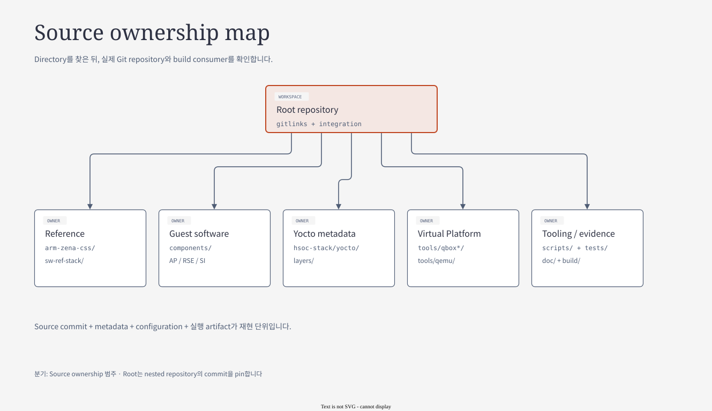

# 02. Project Source Architecture

[← 01. Project Overview](01-project-overview.md) · [세미나 목차](README.md) · [03. Build Architecture →](03-project-build-architecture.md)

> 발표 목표: 기능 변경을 시작할 때 어느 repository, source, metadata, test를 함께 확인해야 하는지 설명한다.
> 기준: 2026-10-25 checkout. Root `feature/qbox-rebase`, `c3f91677a416`. Source 정적 추적이며 새 build/runtime 검증 결과는 아니다.

이 장은 폴더 목록을 외우는 대신 **hardware domain이 왜 여러 software repository로 나뉘고, 그 repository들이 어떤 interface로 다시 결합되는지**를 설명한다.
아래 순서로 읽으면 새 기능을 어느 source에서 시작하고 어느 소비자까지 따라가야 하는지 판단할 수 있다.

| 먼저 답할 질문 | 이 장에서 찾을 연결 |
|---|---|
| 이 코드는 어느 CPU에서 실행되는가? | AP / RSE / SI CL0 / SI CL1 → component source |
| 어느 구현이 build에 들어가는가? | Reference recipe → Apollo include → local source / fetched dependency |
| 다른 repository와 무엇을 주고받는가? | ABI, protocol, shared memory, image/manifest |
| Source 수정이 runtime까지 어떻게 전달되는가? | Component → metadata → deploy/provider → consumer |

## 전체 source map

[draw.io 편집 원본](diagrams/02-source-map.drawio)

[기존 HTML 보기](diagrams/02-source-map.html)

그림은 **reference → implementation → integration → evidence**의 역할을 보여준다.
각 영역을 하나의 repository로 해석하면 안 된다. 특히 `hsoc-stack/` 아래에는 독립 Git repository가 여러 개 있다.

## 읽기 순서

| 순서 | Subchapter | 중심 질문 | 끝나면 설명할 수 있는 것 |
|---|---|---|---|
| 1 | [Ownership과 domain dependency](02-source/01-ownership-and-dependencies.md) | 어느 CPU와 repository가 책임지는가? | Guest/host 구분, framework/product binding, 외부 kernel module |
| 2 | [Source·configuration·artifact contract](02-source/02-build-source-contracts.md) | 그 source가 어떤 조건으로 build에 들어가는가? | externalsrc, CL1 composition, task checksum, secure payload dependency |
| 3 | [Change trace와 실패 진단](02-source/03-change-tracing-and-diagnosis.md) | 변경이 실제 consumer까지 전달됐는가? | HIPC attach/reattach, address view, source→artifact→traffic 추적 |

첫 문서는 source의 경계를, 두 번째는 build input의 경계를, 세 번째는 기능 검증의 경계를 설명한다. 발표에서 전체 흐름을 먼저 소개한 뒤 HIPC 사례를 따라가면 directory와 recipe 이름이 각자의 목적과 연결된다.

## 네 가지 관계를 나누어 읽는다

| 관계 | 대표 연결 | 혼동하면 생기는 문제 |
|---|---|---|
| Git ownership | Root gitlink → nested repository SHA | Directory 변경과 commit owner를 잘못 선택 |
| Build dependency | TF-M header → TS SP → OP-TEE → TF-A FIP | Runtime 호출 방향을 compile 순서로 오해 |
| Runtime interface | Linux/TF-A/Zephyr → SCMI/MHU → SCP | Generic module만 보고 actual channel을 누락 |
| Artifact provenance | Checkout → recipe → deploy/provider → launcher | 수정한 source와 실제 실행 binary가 달라짐 |

`arm-zena-css/`는 externally managed reference다. Apollo implementation은 component와 QBox source, 통합 선택은 HSOC metadata에서 찾는다. 현재 source registry의 출발점은 [BSP layer.conf](../../../hsoc-stack/yocto/meta-hsoc-bsp/conf/layer.conf)의 `HSOC_APOLLO_*_SRC`다.

## 발표에 사용할 실제 질문

- **“Linux driver인데 Linux repository에 없다면?”** HIPC의 `arm-si-rproc-mod`는 `sw-ref-stack` source를 외부 module recipe로 build한다.
- **“Defconfig를 수정했는데 왜 이전 설정인가?”** Source path와 함께 `do_kernel_configme`의 checksum 및 generated `.config`를 확인한다.
- **“Lua를 수정했는데 왜 실행이 그대로인가?”** Yocto launcher가 provider에 설치된 Lua를 읽으므로 install/sysroot와 `.qboxconf`를 추적한다.
- **“AP reset 후 HIPC만 실패한다면?”** CL1 retained state와 resource publication-before-ACK를 cold boot와 별도로 조사한다.

이 장의 공통 조사 순서는 **source owner → configuration 선택 → artifact consumer → 검증 표면**이다. 세부 증거와 실패 진단은 해당 subchapter에 연결해 두었다.

[02-1부터 읽기 →](02-source/01-ownership-and-dependencies.md) · [03. Project Build Architecture →](03-project-build-architecture.md) · [기존 Engineering Map](../build/ENGINEERING-MAP.md)
