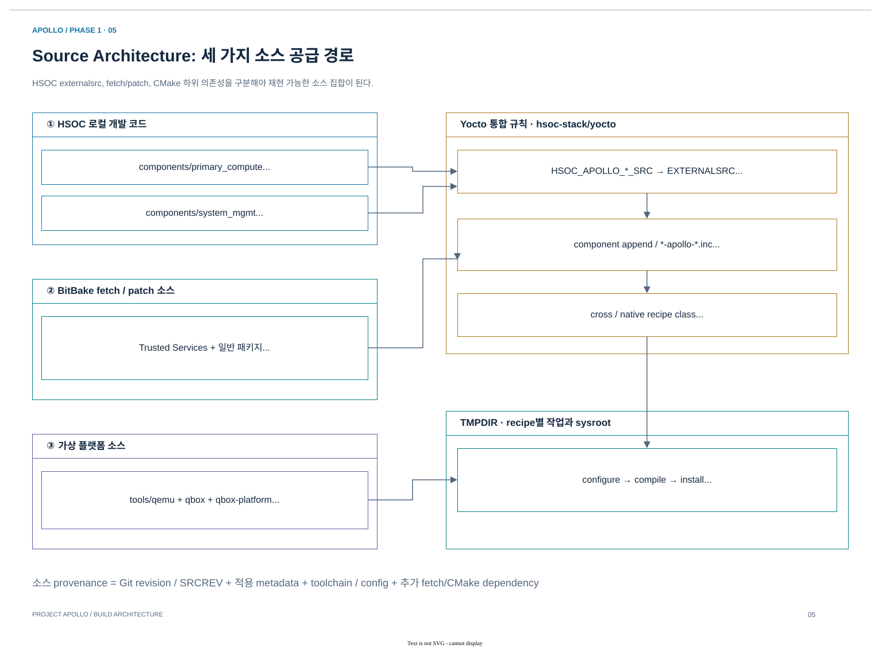

# 02.2 Source 선택·configuration·artifact contract

[상위 장](../02-project-source-architecture.md) · [← 이전](01-ownership-and-dependencies.md) · [다음 →](03-change-tracing-and-diagnosis.md)

> 목적: local, fetched, generated source가 recipe에 들어가는 경로와 변경 전파 조건을 설명한다.
> 기준: 2026-10-25 checkout의 source·metadata 정적 추적. 새 BitBake 실행이나 runtime 검증 결과를 의미하지 않는다.

## 1. Metadata가 “이 source를 이렇게 빌드한다”를 결정한다



[draw.io 편집 원본](../diagrams/phase1/build-05-source-provenance.drawio)

*기존 Phase 1의 source provenance Diagram. 세부 CL1 module copy와 현재 CPU/DTB 선택은 이 자료의 표를 기준으로 읽는다.*

이 그림의 세 입력은 **같은 source 공급 방식이 아니라는 점**이 핵심이다.
Local component는 checkout revision과 working diff가 입력이고, fetched component는 recipe의 `SRCREV`와 patch 순서가 입력이다.
QBox의 CMake/CPM 하위 dependency도 native build에 필요하므로 최상위 repository SHA 하나로 전체 provenance를 설명할 수 없다.

| Metadata 계층 | 담당하는 결정 | 예시 |
|---|---|---|
| BSP `conf/layer.conf` | Local source의 기준 경로 | `HSOC_APOLLO_LINUX_SRC`, `HSOC_APOLLO_QBOX_SRC` |
| `*-apollo-common.inc` | Reference recipe와 local source 연결 | `inherit externalsrc`, build directory, dependency 보존 |
| Machine-specific include | Apollo QVP/FVP configuration | defconfig, DTB, firmware variant, board overlay |
| Product distro/image/class | Image 구성·보안/저장 정책 | RT kernel provider, UKI A/B, verity, `.qboxconf` |

[BSP layer.conf](../../../../hsoc-stack/yocto/meta-hsoc-bsp/conf/layer.conf)의 `HSOC_APOLLO_*_SRC`가 local source registry다.
예를 들어 Linux는 `HSOC_APOLLO_LINUX_SRC`에서 선택되고, [Linux common include](../../../../hsoc-stack/yocto/meta-hsoc-bsp/recipes-kernel/linux/linux-yocto-apollo-common.inc)의 `do_kernel_configme`가 local defconfig와 fragment를 적용한다.
**Source commit만 같아도 MACHINE·metadata·config가 다르면 다른 binary가 만들어진다.**

| 흔한 오해 | 실제 source 계약 |
|---|---|
| 모든 component는 `SRC_URI` patch로 변경된다 | Local `externalsrc` component는 기본 fetch/unpack/patch task를 대체한다 |
| externalsrc이면 외부 dependency가 없다 | TF-M/TF-A/Zephyr의 보조 dependency fetch는 남아 있다 |
| 모든 Secure Service가 HSOC local repository다 | Trusted Services는 reference recipe의 fetch/patch 통합 경로도 사용한다 |
| Lua source를 저장하면 다음 실행에 바로 반영된다 | 기본 launcher는 provider에 **설치된 Lua 사본**을 선택한다 |
| `build/tmp*/work/`를 고치면 지속 가능한 수정이다 | Generated build tree는 재생성 대상이다; source/metadata 원인을 수정한다 |

근거: [externalsrc.bbclass](../../../../layers/poky/meta/classes/externalsrc.bbclass)의 `SRCTREECOVEREDTASKS`와 `SSTATE_SKIP_CREATION`, [TF-M common include](../../../../hsoc-stack/yocto/meta-hsoc-bsp/recipes-bsp/trusted-firmware-m/trusted-firmware-m-apollo-common.inc), [QBox provider recipe](../../../../hsoc-stack/yocto/meta-hsoc-bsp/recipes-devtools/qbox/qbox-apollo-qvp-native.bb).

### 사례 A. `linux-yocto-rt`라는 이름으로 local Linux를 빌드하는 과정

Recipe 이름이 upstream source 사용을 보장하지는 않는다. Nexios distro는 RT provider를 선택하고, HSOC append는 그 recipe에 local source와 Apollo config를 연결한다.
아래 순서에서 **provider 선택, source 선택, configuration 선택, OS hardware description 선택**은 각각 다른 결정이다.

| 순서 | 실제 결정 | 읽을 파일·symbol |
|---|---|---|
| 1 | RT kernel recipe 선택 | [auto-ad-nexios.conf](../../../../hsoc-stack/yocto/meta-hsoc-auto-solutions/conf/distro/auto-ad-nexios.conf), `PREFERRED_PROVIDER_virtual/kernel` |
| 2 | QVP include 선택 | [linux-yocto%.bbappend](../../../../hsoc-stack/yocto/meta-hsoc-bsp/recipes-kernel/linux/linux-yocto%.bbappend), `LINUX_HSOC_APOLLO_REQUIRE:apollo-qvp` |
| 3 | Local tree와 build directory 선택 | [common include](../../../../hsoc-stack/yocto/meta-hsoc-bsp/recipes-kernel/linux/linux-yocto-apollo-common.inc), `EXTERNALSRC:pn-linux-yocto-rt`, `EXTERNALSRC_BUILD` |
| 4 | Defconfig 및 필요 fragment 적용 | 같은 파일의 `do_kernel_configme`; [QVP include](../../../../hsoc-stack/yocto/meta-hsoc-bsp/recipes-kernel/linux/linux-yocto-apollo-qvp.inc)의 `APOLLO_QVP_KERNEL_DEFCONFIG` |
| 5 | CPU population에 맞는 DTB 선택 | [apollo-qvp.conf](../../../../hsoc-stack/yocto/meta-hsoc-bsp/conf/machine/apollo-qvp.conf), `APOLLO_QVP_DTB` |
| 6 | Boot payload에 포함 | [image 공통 include](../../../../hsoc-stack/yocto/meta-hsoc-auto-solutions/recipes-core/images/include/nexios-apollo-qboxboot.inc), `KERNEL_DEVICETREE`와 `QBOX_IMAGES` |

Kernel common include는 reference `kmeta`/fragment 일부를 제거하고 local `apollo_qvp_defconfig`를 직접 적용한다.
따라서 예전에 추가한 `.scc` 파일이 남아 있다고 해서 현재 build의 입력이라고 판단할 수 없다.
먼저 활성 include와 `do_kernel_configme`를 보고, 그 다음 generated `.config`와 실제 deploy DTB를 확인한다.

### 사례 B. `HW_CONFIG`와 Linux DTB는 서로 다른 source contract다

Arm [Components / Device tree·Trusted Firmware-A·U-Boot](../../../../arm-zena-css/documentation/design/components.rst)는 TF-A가 compile한 `HW_CONFIG`를 FIP에 넣고 U-Boot/Linux에 전달하는 reference 경로를 설명한다.
Apollo는 초기 firmware의 `HW_CONFIG`와 **UKI에 넣는 Linux OS DTB**를 구분한다. 두 파일을 각각의 consumer가 요구하는 hardware description으로 읽어야 한다.

| 구분 | 생성 source | 주요 consumer | 현재 추적점 |
|---|---|---|---|
| Firmware DTB | TF-A `fdts/` | BL2/U-Boot 등 초기 firmware | [Apollo TF-A platform.mk](../../../../hsoc-stack/components/primary_compute/trusted-firmware-a/plat/arm/board/automotive_rd/platform/apollo_qvp/platform.mk)의 `HW_CONFIG` |
| OS DTB | Linux `arch/arm64/boot/dts/hsoc/` | UKI로 boot하는 Linux | `APOLLO_QVP_DTB` → `KERNEL_DEVICETREE` → `do_uki` |
| CL1 devicetree | HSOC Zephyr board DTS + overlay | Zephyr compile-time device instance | Board `.dts`, generated `zephyr.dts` |
| QVP platform map | Apollo Lua + model parameter | Host simulator | `soc/`, `vp/`의 address·IRQ 연결 |

예를 들어 AP CPU count를 4에서 16으로 바꾸면 Linux DTB만 바꾸는 것으로 끝나지 않는다.
TF-A의 `PLATFORM_CORE_COUNT`, QBox의 `QBOX_APOLLO_NUM_CPUS`, OS의 CPU node/boot cmdline이 같은 population을 표현해야 한다.
이것이 hardware interface 변경을 source repository 하나의 내부 변경으로 볼 수 없는 이유다.

## 2. CL1 source composition

| 입력 | 역할 | 연결점 |
|---|---|---|
| Local Zephyr | RTOS kernel, architecture, common drivers | `HSOC_APOLLO_ZEPHYR_SRC` |
| Local HSOC module | Apollo board 및 platform 확장 | `HSOC_APOLLO_ZEPHYR_HSOC_SRC` |
| Arm SI module | integrated sample app, HIPC 등 reference service | `ZEPHYR_SAFETY_ISLAND_MODULE` |
| Fetched dependencies | CMSIS, libmetal, OpenAMP | `type=git-dependency`로 보조 fetch 유지 |
| Generated module copy | QVP용 HIPC patch 적용 위치 | `${WORKDIR}/apollo-safety-island` |

현재 [Zephyr common include](../../../../hsoc-stack/yocto/meta-hsoc-bsp/recipes-kernel/zephyr-kernel/zephyr-demos-cl1-apollo-common.inc)의 `do_prepare_apollo_hipc`는 Arm module을 `WORKDIR`로 복사한 뒤 patch를 적용한다. Reference checkout 자체를 수정하지 않는다.
따라서 CL1 문제를 볼 때 `zephyr/`만 검색하면 application·board·transport 구현을 놓칠 수 있다.

이 조합이 필요한 이유는 kernel, board support, application의 변경 주기를 분리하기 위해서다.
Zephyr kernel은 scheduling·driver framework를 제공하고, HSOC board는 CPU·memory·interrupt wiring을 선택하며, Arm SI module은 HIPC/PFDI 등의 integrated application을 제공한다.
Local 수정이 어디에 속하는지 판단한 뒤 해당 source와 그 source를 선택하는 metadata를 같이 고친다.

```text
zephyr-demos-cl1.bb + Apollo .bbappend
  → ZEPHYR_BOARD = apollo_qvp_safety_island_c1
  → EXTERNALSRC = local zephyrproject
  → ZEPHYR_SRC_DIR = WORKDIR/apollo-safety-island/apps/sample
  → ZEPHYR_MODULES = CMSIS + libmetal + OpenAMP + SI + HSOC + PFDI helper
  → generated .config + zephyr.dts → zephyr.elf / zephyr.bin
```

추적의 시작은 [reference zephyr-demos-cl1.bb](../../../../arm-zena-css/yocto/meta-zena-css-safety-island/recipes-kernel/zephyr-kernel/zephyr-demos-cl1.bb), [Apollo QVP include](../../../../hsoc-stack/yocto/meta-hsoc-bsp/recipes-kernel/zephyr-kernel/zephyr-demos-cl1-apollo-qvp.inc), [HSOC module.yml](../../../../hsoc-stack/components/system_mgmt/zephyrproject/zephyr_hsoc_src/zephyr/module.yml)이다.
독립 `zephyr-si-cl1-boot` image는 이 integrated application과 Kconfig가 다르므로 같은 CL1 CPU를 사용한다는 이유만으로 기능을 동일하게 취급하지 않는다.

## 3. Secure Service의 runtime와 build dependency


[draw.io 편집 원본](../figures/reference/primary_compute_secure_services.drawio)

*그림 2-3. Arm [원본 SVG](../../../../arm-zena-css/documentation/images/primary_compute_secure_services.svg) — [Secure Services / Primary Compute Secure Services / Architecture](../../../../arm-zena-css/documentation/design/secure_services.rst). Normal world client, AP Secure Partition, RSE service의 호출 관계를 보여준다. Apollo에서도 이 interface 계층을 따라 source를 찾되, Trusted Services는 local component repository 대신 recipe의 fetch/patch source가 포함된다.*

사용자가 Linux에서 PSA API를 호출할 때 `libpsats`/`libts`는 FF-A를 통해 Secure Partition에 요청한다.
TF-A는 EL3의 SPMD 역할을 하고, OP-TEE는 S-EL1 SPMC로 SP를 관리한다. SE Proxy는 요청을 MHUv3 IPC로 변환해 RSE TF-M의 실제 service에 전달한다.
U-Boot의 UEFI variable 저장도 SMM Gateway와 SE Proxy를 거쳐 RSE Protected Storage에 도달한다.

이 runtime 경로는 여러 binary 사이의 protocol 호출이다. 빌드에서는 같은 구성요소가 다른 방향으로 연결된다.
TS의 SP ELF가 OP-TEE에 embed되고, OP-TEE binary는 TF-A FIP의 BL32로 들어간다. U-Boot도 BL33로 FIP에 들어간다.
TF-M은 별도 RSE image지만 TS build에 FWU interface header를 제공하므로 **runtime이 다른 CPU여도 build dependency는 생긴다.**

| 보고 싶은 관계 | 따라갈 source/metadata | 연결 이유 |
|---|---|---|
| Linux → secure call | Linux FF-A, TS `libpsats`/`libts` | Client ABI와 service discovery |
| SP → RSE | TS SE Proxy, TF-M mailbox/service | IPC serialization과 service ID |
| TS → OP-TEE build | [optee-os-ts.inc](../../../../layers/meta-arm/meta-arm/recipes-security/optee/optee-os-ts.inc)의 `SP_PATHS` | SP ELF를 SPMC image에 포함 |
| TF-M → TS build | [ts-fvp-rd-aspen.inc](../../../../arm-zena-css/yocto/meta-zena-css-bsp/recipes-security/trusted-services/ts-fvp-rd-aspen.inc)의 `FWU_DEVICE_IMPL_INFO_DEF_FILE` | 같은 FWU data structure 정의 사용 |
| OP-TEE/U-Boot → TF-A build | [TF-A reference include](../../../../arm-zena-css/yocto/meta-zena-css-bsp/recipes-bsp/trusted-firmware-a/trusted-firmware-a-fvp-rd-aspen.inc)의 BL32/FIP 설정 | 다음 boot stage를 FIP payload로 포함 |

Secure Service 문제를 “TF-M 문제”라고만 분류하면 transport, FF-A dispatch, SP packaging 중 어디서 끊겼는지 놓치기 쉽다.
실패한 단계가 compile/link, boot, RPC 중 어느 것인지 정한 후 해당 관계를 따라가는 것이 빠르다.


## 4. Source 계약은 선택·변환·무효화로 읽는다

Source contract에는 경로뿐 아니라 **어떤 변화가 어느 task를 다시 실행하게 하는가**가 포함된다. `EXTERNALSRC`가 올바르더라도 configuration을 적용하는 task가 새 defconfig를 입력으로 보지 못하면 이전 `.config`로 compile할 수 있다. 반대로 metadata 변경은 source commit을 바꾸지 않고도 image 구성을 바꾼다.

| 계약 | Producer → consumer | 실제 입력 추적점 | 결과 확인 지점 |
|---|---|---|---|
| Source 선택 | `layer.conf` → component recipe | `HSOC_APOLLO_*_SRC`, `EXTERNALSRC` | Recipe의 `S`, `B` |
| Configuration | Defconfig/fragment → Kconfig task | `do_kernel_configme[file-checksums]` | `${B}/.config` |
| 보조 module | Arm SI + patch → CL1 configure | `do_prepare_apollo_hipc`, module list | `${WORKDIR}/apollo-safety-island` |
| Host core | QBox core tree → overlay recipe | `QBOX_CORE_TREE_HASH_FILES` | Native `do_configure/do_compile` signature |
| Artifact | Component deploy/sysroot → assembler | Task dependency와 input filename | FIP/Flash/UKI/WIC에 포함된 bytes |

[externalsrc.bbclass](../../../../layers/poky/meta/classes/externalsrc.bbclass)는 `SRCTREECOVEREDTASKS`를 처리하고 `do_compile`에 `srctree_hash_files()`, `do_configure`에 `srctree_configure_hash_files()`를 연결한다. 모든 local source가 같은 구성 입력을 가진 것은 아니므로 component include가 필요한 checksum을 더한다.

### Kernel defconfig가 실제 task에 연결되는 경로

[Linux common include](../../../../hsoc-stack/yocto/meta-hsoc-bsp/recipes-kernel/linux/linux-yocto-apollo-common.inc)의 `do_kernel_configme()`는 `oe_runmake -C ${S} O=${B} ${APOLLO_KERNEL_DEFCONFIG}`를 실행한다. Fragment를 선택하면 `merge_config.sh` 다음 `olddefconfig`를 수행한다. 그 task의 `file-checksums`에는 defconfig와 선택한 fragment 경로가 직접 들어간다.

```text
arch/arm64/configs/apollo_qvp_defconfig
  + 선택된 APOLLO_KERNEL_CONFIG_FRAGMENT
  → do_kernel_configme의 file-checksums
  → do_kernel_configme: .config 생성 / fragment merge
  → kernel configure·compile
  → Image / DTB / modules → image assembly
```

`do_menuconfig` 앞의 `apollo_kernel_menuconfig_prepare()`는 `.config`가 없을 때만 초기 설정을 준비한다. `do_savedefconfig()`는 `${B}/defconfig`를 `APOLLO_KERNEL_DEFCONFIG_PATH`로 복사하므로 source tree를 실제 수정하는 task다. Configuration 조사만 할 때 이 task를 무심코 실행하지 않는다. 여기서는 함수를 읽었으며 실행하지 않았다.

### CL1 generated copy는 재현 가능한 변환 단계다

`do_prepare_apollo_hipc()`는 QVP override를 확인하고 destination이 정확히 `${WORKDIR}/apollo-safety-island`인지 검사한다. 기존 generated copy를 제거한 후 `.git`을 제외해 reference module을 복사하고, `patch --batch --forward -p1`을 적용한다. `addtask ... after do_unpack before do_configure`가 이 변환을 configure의 선행 조건으로 만든다.

동일 include의 anonymous Python은 CMSIS/libmetal/OpenAMP만 보조 Git dependency로 남기고 `ZEPHYR_MODULES`를 실제 사용할 module 목록으로 정규화한다. 마지막 `file-checksums`는 local Zephyr, reference SI module, HSOC module tree를 configure·compile·prepare task 입력에 추가한다. Source가 여러 곳에 있어도 **한 recipe가 선택한 조합**으로 진단할 수 있는 이유다.

### Native provider가 별도 core tree를 추적하는 이유

[QBox provider recipe](../../../../hsoc-stack/yocto/meta-hsoc-bsp/recipes-devtools/qbox/qbox-apollo-qvp-native.bb)의 `EXTERNALSRC`는 overlay tree다. 그러나 CMake는 `QBOX_CORE_SOURCE_DIR`의 별도 core tree도 compile한다. 그래서 `QBOX_CORE_TREE_HASH_FILES`를 `do_configure`와 `do_compile`에 더한다. Overlay SHA만 기록하면 source input의 일부를 빠뜨린다.

## 5. Interface가 같다는 주장은 무엇으로 확인하는가

| Interface | 함께 대조할 입력 | 변경 영향 |
|---|---|---|
| CPU population | `PC_CPUS_COUNT`, TF-A core count, QBox env, Linux DTB/cmdline | Firmware·host·OS 조합 |
| Secure service ABI | TS header/manifest, OP-TEE SP inclusion, TF-M service | Compile dependency와 runtime RPC 모두 |
| Shared-memory transport | Address view, region size, resource table, mailbox channel | 양쪽 firmware/driver와 QVP fabric |
| Kernel module ABI | Kernel configuration, generated headers, symbols, module package | Kernel 재빌드와 module 배포 조합 |
| Host module ABI | QBox/SystemC/libqemu build·shared libraries | Native provider 전체 install layout |

ABI는 `aarch64`라는 문자열 하나로 결정되지 않는다. 같은 instruction set에서도 boot EL, calling convention, binary format, kernel configuration, host shared-library interface가 다르면 서로 교환할 수 없다. Toolchain과 task별 산출물은 [03.2](../03-build/02-task-graph-and-native-provider.md)에서 이어서 확인한다.

## 6. 실패를 source contract로 좁히기

| 증상 | 먼저 확인할 계약 | 읽을 구현 |
|---|---|---|
| Source를 고쳤는데 compile이 안 바뀜 | 선택한 source와 signature 입력 | `EXTERNALSRC`, `srctree_hash_files`, component `file-checksums` |
| `.config`에 원하는 option이 없음 | Active defconfig/fragment와 적용 task | `do_kernel_configme`, generated `.config` |
| CL1에 수정한 service가 없음 | Application root와 module copy | `ZEPHYR_SRC_DIR`, `ZEPHYR_MODULES`, `do_prepare_apollo_hipc` |
| SP build는 됐으나 secure service가 없음 | SP ELF의 OP-TEE inclusion과 FIP 재조립 | `SP_PATHS`, BL32, firmware assembly |
| CPU 수가 firmware와 Linux에서 다름 | Topology의 세 consumer | Machine DTB 식, TF-A config, `.qboxconf.env` |

Source 읽기는 **registry → selector append → common include → task body → generated input → consumer** 순서로 진행한다. 아직 build하지 않았다면 generated artifact가 현재 source와 같다고 단정하지 않고 source 계약과 artifact 검증을 별도로 기록한다.

## 다음 읽기

[02.3. Change trace와 진단](03-change-tracing-and-diagnosis.md)에서 HIPC 요청 하나를 실제 source·artifact·검증 표면으로 따라간다.

[상위 장](../02-project-source-architecture.md) · [← 이전](01-ownership-and-dependencies.md) · [다음 →](03-change-tracing-and-diagnosis.md)
