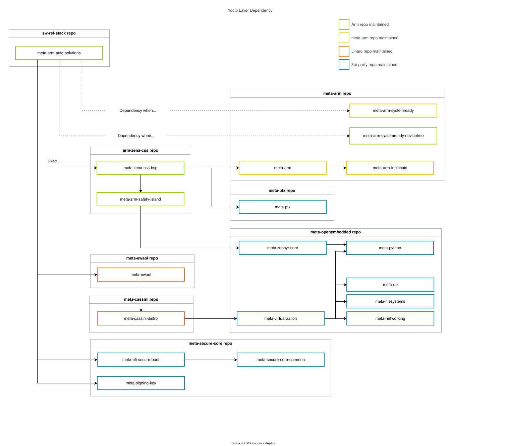
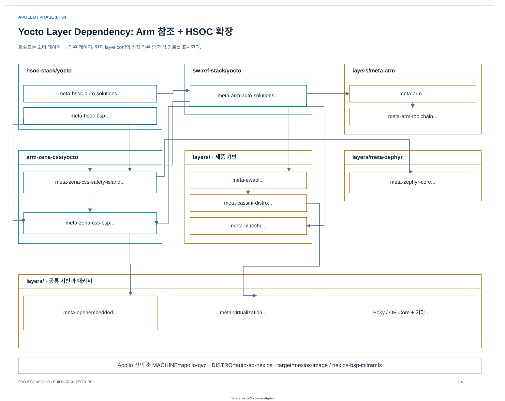

# 03.1 Build entrypoint와 configuration 선택

[상위 장](../03-project-build-architecture.md) · [← 이전](../03-project-build-architecture.md) · [다음 →](02-task-graph-and-native-provider.md)

> 목적: Arm reference 설정과 Apollo wrapper를 구분하고 현재 build graph의 입력을 확정하는 방법을 익힌다.
> 기준: 2026-10-25 checkout의 source·metadata 정적 추적. 새 BitBake 실행이나 runtime 검증 결과를 의미하지 않는다.

## 1. Reference와 Apollo의 build 진입점

Arm reference는 여러 use case를 선택하기 위해 `Kconfig → kas YAML → BitBake → runfvp` 경로를 제공한다.
현재 프로젝트는 pin한 reference layer를 재사용하면서 root wrapper와 HSOC template로 Apollo/Nexios 구성을 선택한다.
두 경로의 공통점은 BitBake dependency graph이고, 차이는 **그 graph에 어떤 machine·image·local source·host runner를 넣는가**다.

| 항목 | Arm reference | 현재 Apollo workspace |
|---|---|---|
| Repository 구성 | `kas checkout .../repos.yml` | Root Git submodule pin + local component checkout |
| 설정 UI/entrypoint | `kas menu arm-zena-css/Kconfig`, `kas build` | `yocto_build.sh`, HSOC `TEMPLATECONF` |
| Machine | `fvp-rd-aspen` | `apollo-qvp` 또는 `apollo-fvp` |
| BSP use case | `nodistro` + `core-image-minimal` | `auto-ad-nexios` + `nexios-bsp-initramfs` |
| Product use case | Baremetal/Virtualization reference image | 기본 `nexios-image`, 현재 `baremetal` feature |
| Source customization | Reference recipe의 upstream revision + downstream patches | HSOC `externalsrc` + local Apollo implementation |
| 실행 계약 | FVP configuration와 `runfvp` | QVP는 `.qboxconf` + QBox provider + root runner |

근거: Arm [Reproduce / Download·Kas build·Build Board Support Package](../../../../arm-zena-css/documentation/user_guide/reproduce.rst), [Integration / Yocto build configuration](../../../../arm-zena-css/documentation/design/integration.rst).
Reference menu는 AP CPU 1–16, 기본 CFG1을 설명하지만, 현재 Apollo QVP template는 CFG2/AP4이고 OS DTB 선택식은 AP4/AP16을 명시적으로 지원한다.
따라서 reference의 메뉴 선택 범위를 현재 QVP의 지원 조합으로 그대로 옮기지 않는다.

Reference `Overview`의 “baremetal”은 AP에 Xen 없이 Linux가 직접 올라가는 architecture라는 뜻이다.
이 프로젝트에서도 RSE의 TF-M, CL0의 SCP, CL1의 Zephyr는 함께 존재한다. Baremetal image를 firmware가 없는 Linux-only image로 이해하면 안 된다.

## 2. 현재 설정과 선택 가능한 설정을 구분한다

아래는 실제 파일에서 확인한 값이다. 명령행·환경·override까지 확장한 BitBake datastore의 dump는 아니다.

| 항목 | 현재 파일 값 / 선택 규칙 | 근거 |
|---|---|---|
| `MACHINE` | `apollo-qvp` 기본값 | `build/conf/local.conf` |
| `RD_ASPEN_VARIANT` | `cfg2` | 같은 파일 |
| AP CPU count | `PC_CPUS_COUNT_DEFAULT ??= "4"` 기본값 | 같은 파일 |
| `DISTRO` | `auto-ad-nexios` 기본값 | 같은 파일 |
| `TMPDIR` | `${TOPDIR}/tmp_baremetal` | 같은 파일 |
| PFDI | `PFDI_SUPPORT=1`, `PFDI_MONITOR_SUPPORT=1` | 같은 파일 |
| `TEMPLATECONF` 기록 | `meta-hsoc-auto-solutions/conf/templates/apollo-qvp` | `build/conf/templateconf.cfg` |
| `BBMULTICONFIG` | 빈 기본값 | `build/conf/local.conf` |
| AP4 OS DTB | `apollo-qvp-saturn-v-4cpus.dtb` | `apollo-qvp.conf`의 `APOLLO_QVP_DTB` |
| AP16 OS DTB | `apollo-qvp-saturn-v.dtb` | 같은 선택식; 지원 CPU count는 4/16 |

CPU count는 QBox 실행 환경, firmware topology, Linux DTB가 공유하는 계약이다.
AP4와 AP16 DTB를 임의 교환하면 단순 성능 설정 변경을 넘어 hardware description이 달라진다.

## 3. Yocto 설정을 읽는 순서

### Reference dependency에서 Apollo 확장점 찾기



[draw.io 편집 원본](../figures/reference/yocto_layers_dependency_diagram.drawio)

*그림 3-1. Arm [원본 SVG](../../../../arm-zena-css/documentation/images/yocto_layers_dependency_diagram.svg) — [Integration / Yocto layers dependency](../../../../arm-zena-css/documentation/design/integration.rst). BSP, automotive product, toolchain, common package layer가 서로 다른 repository에서 조합되는 이유를 보여준다. 원본의 일부 layer 표기는 현재 directory/collection 이름과 다르고 HSOC layer는 포함하지 않으므로, 아래 현재 layer 그림과 함께 읽는다.*

Layer를 나누는 목적은 같은 firmware/OS recipe를 여러 제품·machine에서 재사용하기 위해서다.
Toolchain layer는 compiler 공급을, BSP layer는 hardware와 firmware 구성을, product layer는 package·service·storage policy를 담당한다.
예를 들어 Linux RT kernel을 선택하는 제품 정책과 Apollo UART 주소를 정의하는 BSP 정보를 같은 recipe에 섞으면 다른 machine으로 확장할 때 변경 범위가 커진다.

Apollo의 `meta-hsoc-bsp`는 `meta-zena-css-bsp`/SI layer 위에서 local source와 QVP configuration을 연결한다.
`meta-hsoc-auto-solutions`는 automotive stack 위에서 Nexios image와 UKI/storage/QBox 실행 metadata를 제공한다.
이 구조 덕분에 reference repository를 직접 편집하지 않고 Apollo port와 제품 정책을 표현할 수 있다.

| 읽는 순서 | 파일/개념 | 이 계층이 정하는 것 |
|---|---|---|
| 1 | `bblayers.conf` | 파싱할 layer 집합 |
| 2 | `local.conf` / template | machine, distro, variant, local build policy |
| 3 | Machine `.conf` | BSP, firmware provider, DTB, WKS, machine override |
| 4 | Distro `.conf` | kernel provider와 제품 공통 기능 |
| 5 | Image `.bb` / `.bbappend` | package, rootfs, initramfs, UKI/WIC |
| 6 | Component recipe/include | source, toolchain, config, build/deploy task |
| 7 | `.bbclass` | 여러 recipe가 공유하는 task·policy |



[draw.io 편집 원본](../diagrams/phase1/build-04-yocto-layers.drawio)

*그림 3-2. Apollo의 현재 `layer.conf` dependency를 반영한 Phase 1 그림. 화살표는 소비 layer→의존 layer이며 전체 BitBake task DAG는 아니다. HSOC 두 layer가 원본 구조의 어디에 추가되는지 비교한다.*

| Layer 구역 | Apollo에서의 역할 |
|---|---|
| Poky / OE-Core | BitBake environment, core recipe/class, packaging/image infrastructure |
| `meta-arm` + toolchain | Arm firmware·compiler integration |
| `meta-zena-css-bsp` / `meta-zena-css-safety-island` | RD-Aspen reference BSP와 SI 구성 |
| Cassini / EWAOL / `meta-arm-auto-solutions` | Automotive product stack와 공통 image/demo 정책 |
| `meta-hsoc-bsp` | Local source registry와 Apollo machine/component adaptation |
| `meta-hsoc-auto-solutions` | Nexios distro/image/template, UKI·storage·QBox launch metadata |

[apollo-qvp.conf](../../../../hsoc-stack/yocto/meta-hsoc-bsp/conf/machine/apollo-qvp.conf)는 `fvp-rd-aspen.conf`를 `require`하고 `fvp-rd-aspen` override를 유지한다.
[auto-ad-nexios.conf](../../../../hsoc-stack/yocto/meta-hsoc-auto-solutions/conf/distro/auto-ad-nexios.conf)는 Cassini를 기반으로 `virtual/kernel = linux-yocto-rt`를 선택한다.
`meta-hsoc-auto-solutions`의 priority는 12지만, priority 하나로 최종 설정을 판단하지 않는다. Provider·override·include·class를 함께 읽어야 한다.

### Multi-domain과 Multiconfig는 서로 다른 개념이다

RSE·SI·AP firmware는 기본 build의 서로 다른 recipe/toolchain으로도 만들어진다.
현재 `BBMULTICONFIG`는 비어 있다. 별도로 제공되는 `apollo-qvp-dm-verity`와 `apollo-qvp-no-dm-verity` multiconfig는 `APOLLO_DM_VERITY`와 `TMPDIR`를 나누는 선택 구성이다.
파일이 존재한다는 사실만으로 현재 build에 두 구성이 모두 활성화되었다고 설명하면 안 된다.

근거: [multiconfig directory](../../../../hsoc-stack/yocto/meta-hsoc-auto-solutions/conf/multiconfig/), [QVP template](../../../../hsoc-stack/yocto/meta-hsoc-auto-solutions/conf/templates/apollo-qvp/).

## 4. `yocto_build.sh`의 실제 동작

| 단계 | 구현 | 사용자에게 보이는 의미 |
|---|---|---|
| 명령 해석 | `normalize_machine`, image selector, target/`-c` 처리 | 기본 `apollo-qvp`, 기본 target `nexios-image` |
| Build 위치 결정 | `BUILD_DIR`, `TEMPLATECONF` | 기본 root `build/`, machine별 HSOC template |
| 설정 준비 | `KEEP_CONF` 검사 | 기본 호출은 `build/conf`를 삭제 후 template로 재생성 |
| 환경 진입 | Poky `oe-init-build-env` | BitBake 실행 환경 및 build directory 설정 |
| 자원 설정 | `apollo-bitbake-resources.conf`, `-R` | `BB_NUMBER_THREADS`와 `PARALLEL_MAKE` 전달 |
| 실행 | `MACHINE=… bitbake …` | target 또는 명시한 task 실행 |

```bash
./yocto_build.sh --keep-conf                 # 현재 conf를 유지하는 제품 build
./yocto_build.sh --keep-conf --bsp           # 현재 conf를 유지하는 BSP build
./yocto_build.sh -c compile u-boot           # 명시적 target/task: conf 자동 보존
./yocto_build.sh qbox-apollo-qvp-native      # Native provider target: conf 자동 보존
```

위 명령은 설명용이며 이번 문서 작업에서 실행하지 않았다.
기본 `./yocto_build.sh`는 conf 재생성을 포함한다. `--dry-run`도 **BitBake 실행만 생략**하며 그 전에 conf 준비와 resource file 쓰기가 발생한다.
Shared build directory의 작업은 직렬화한다. Wrapper 자체에는 build 전 구간을 보호하는 serialization lock이 없다.

| 별도 selector | 선택 target | 이 장에서의 위치 |
|---|---|---|
| `--machine apollo-fvp` | FVP machine/template | QVP와 대응 artifact로 비교할 때 사용 |
| `--gem5` | `nexios-gem5-initramfs` | 별도 AP gem5 workflow |
| `--gem5-zephyr` | `gem5-native`, standalone CL1 image/probes | Integrated QBox image와 다른 실행 목적 |

근거: [yocto_build.sh](../../../../yocto_build.sh)의 `REQUESTED_TARGETS`·`BITBAKE_TASK`에 따른 `KEEP_CONF` 설정, `oe-init-build-env`, `RESOURCE_CONF` 작성, 마지막 BitBake 호출.


## 5. 설정은 네 번의 선택으로 좁혀진다

Wrapper가 `MACHINE`을 정한 뒤에도 모든 값이 확정되는 것은 아니다. `bblayers.conf`가 파싱 가능한 metadata를 정하고, machine/distro override가 component와 image policy를 선택하며, recipe/class가 task input을 완성한다. **파일에 보이는 값**과 **BitBake가 확장한 최종 값**을 구분해 읽는다.

| 단계 | 현재 source의 결정 | 전달되는 값 |
|---|---|---|
| Wrapper | `normalize_machine`, `REQUESTED_TARGETS`, `KEEP_CONF` | `MACHINE`, `TEMPLATECONF`, target/task |
| Build config | `local.conf`, `bblayers.conf`, `templateconf.cfg` | variant, distro, layer 집합, local policy |
| Machine/distro | `apollo-qvp.conf`, `auto-ad-nexios.conf` | DTB, firmware deploy dependency, kernel/WKS/provider policy |
| Image/class | Product/BSP recipe, qboxboot/UKI class | Package, initramfs, image types, host execution metadata |

`MACHINEOVERRIDES =. "fvp-rd-aspen:"`는 QVP가 reference recipe를 재사용하도록 만든 호환 경로다. 이 때문에 파일명에 FVP가 있어도 active QVP graph에 포함될 수 있다. 반대로 `:apollo-fvp` override가 존재한다는 사실만으로 QVP에 적용된다고 판단할 수 없다. Override 이름을 정확히 대조해야 한다.

### AP4를 AP16으로 바꾸는 경우의 계약

| 값 / consumer | Source 기준 | 일치해야 하는 내용 |
|---|---|---|
| `PC_CPUS_COUNT` | Reference machine의 count 선택 + current local default | 선택 CPU population |
| `APOLLO_QVP_DTB` | [QVP machine](../../../../hsoc-stack/yocto/meta-hsoc-bsp/conf/machine/apollo-qvp.conf)의 dictionary 식 | 4 또는 16에 대응하는 Linux DTB |
| OS cmdline | [nexios-image.bb](../../../../hsoc-stack/yocto/meta-hsoc-auto-solutions/recipes-core/images/nexios-image.bb)의 `BAREMETAL_IMAGE_NUM_CPUS` | `maxcpus`와 kernel topology |
| Native execution | [nexios-apollo-qboxboot.inc](../../../../hsoc-stack/yocto/meta-hsoc-auto-solutions/recipes-core/images/include/nexios-apollo-qboxboot.inc)의 env passthrough | QBox `QBOX_APOLLO_NUM_CPUS` |
| AP firmware | TF-A platform topology | Firmware가 관리하는 core 수 |

현재 DTB 선택식은 dictionary key 4/16을 명시한다. Reference menu가 제공하는 다른 count를 그대로 넣으면 같은 계약을 만족한다고 볼 수 없다. Image를 만들어 놓고 launcher env만 바꾸는 방식도 firmware/DTB/UKI가 함께 바뀌지 않는다.

## 6. Wrapper와 configuration 실패를 구분한다

| 증상 | 최초 확인 지점 | 해석 |
|---|---|---|
| `missing TEMPLATECONF directory` | Wrapper가 선택한 template path | BitBake parse 전 선택 문제 |
| 이전 custom conf가 사라짐 | `KEEP_CONF`와 explicit target/task 여부 | 기본 wrapper는 conf를 재생성 |
| Layer/recipe를 찾지 못함 | 실제 `bblayers.conf`, layer dependency, compatibility | Source checkout 존재와 parse 가능성은 다름 |
| DTB 선택 확장 오류 | `PC_CPUS_COUNT`, `APOLLO_QVP_DTB` | Machine topology 입력의 지원 조합 확인 |
| 예상과 다른 WIC layout | `DISTRO`, `APOLLO_DM_VERITY`, image override | Product/BSP와 plain/verity 선택을 확인 |
| Host가 과도하게 바쁨 | Resource `.conf`와 `-R` 값 | Task 수와 recipe 내부 `make -j`는 별도 제한 |

`--dry-run`은 configuration 조사에 완전히 read-only인 명령이 아니다. Source의 `if DRY_RUN` 위치는 `oe-init-build-env`와 resource file 작성 뒤다. 이 자료의 정적 확인에서는 wrapper를 실행하지 않고 파일의 분기와 현재 config를 읽었다.

## 7. Source 읽기 순서와 필요한 산출물

1. [yocto_build.sh](../../../../yocto_build.sh): `normalize_machine` → explicit target 시 `KEEP_CONF` → conf 준비 → target 선택 → resource `-R` → BitBake 호출.
2. [local.conf](../../../../build/conf/local.conf), [bblayers.conf](../../../../build/conf/bblayers.conf), [templateconf.cfg](../../../../build/conf/templateconf.cfg): 현재 build input을 기록한다.
3. [apollo-qvp.conf](../../../../hsoc-stack/yocto/meta-hsoc-bsp/conf/machine/apollo-qvp.conf)와 [auto-ad-nexios.conf](../../../../hsoc-stack/yocto/meta-hsoc-auto-solutions/conf/distro/auto-ad-nexios.conf): firmware, DTB, kernel, storage, test target의 override를 읽는다.
4. Image의 `require`/`inherit`를 따라 task graph로 내려간다. 최종 datastore나 task graph는 기존 build evidence 또는 별도의 승인된 build 조사에서 확인한다.

이 단계의 결과는 build 명령 하나가 아니라 **선택한 machine/distro/image와 config snapshot**이다. 다음 subchapter는 이 입력을 BitBake가 어떤 dependency로 처리하는지 설명한다.

## 다음 읽기

[03.2. Task graph와 native provider](02-task-graph-and-native-provider.md)에서 source, toolchain, sysroot, task signature를 연결한다.

[상위 장](../03-project-build-architecture.md) · [← 이전](../03-project-build-architecture.md) · [다음 →](02-task-graph-and-native-provider.md)
