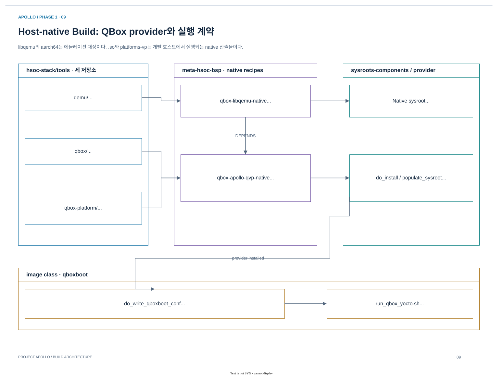

# 03.2 Toolchain·task DAG·native provider

[상위 장](../03-project-build-architecture.md) · [← 이전](01-configuration-and-entrypoints.md) · [다음 →](03-firmware-signing-and-flash.md)

> 목적: source를 compile하는 task와 dependency를 전달하는 sysroot를 구분하고 host provider의 완성 조건을 이해한다.
> 기준: 2026-10-25 checkout의 source·metadata 정적 추적. 새 BitBake 실행이나 runtime 검증 결과를 의미하지 않는다.

## 1. Source와 toolchain을 recipe에 연결한다

| Build 대상 | Source 연결 | Toolchain 계열 | 결과를 받는 곳 |
|---|---|---|---|
| Linux/U-Boot/TF-A/OP-TEE | Local `HSOC_APOLLO_*_SRC`, component common include | AArch64 cross | Image 또는 firmware assembly |
| TF-M | Local source + 보조 crypto/boot dependency | `gcc-arm-none-eabi-native` | RSE boot/runtime image |
| SCP | Local source, automotive product config | `gcc-aarch64-none-elf-native` | SI CL0 firmware |
| Zephyr CL1 | Local kernel/board + Arm sample/module + OpenAMP 등 | `zephyr-sdk-native` | CL1 binary/ELF |
| QBox/libqemu | Local host source + native dependency sysroot | Native compiler | Host provider |

`externalsrc` component는 source checkout을 빌드하며 중간 결과는 주로 `${WORKDIR}/build`로 분리한다.
기본 `do_fetch/do_unpack/do_patch`를 대체하므로, reference patch가 local checkout에 자동 적용된다고 가정하지 않는다.
TF-M 등은 `git-dependency`로 표시한 보조 source를 계속 fetch한다. CL1의 QVP HIPC patch는 generated module copy에 별도 적용된다.

근거: [source registry](../../../../hsoc-stack/yocto/meta-hsoc-bsp/conf/layer.conf), [TF-M common](../../../../hsoc-stack/yocto/meta-hsoc-bsp/recipes-bsp/trusted-firmware-m/trusted-firmware-m-apollo-common.inc), [Zephyr common](../../../../hsoc-stack/yocto/meta-hsoc-bsp/recipes-kernel/zephyr-kernel/zephyr-demos-cl1-apollo-common.inc).

### “Arm용 build” 안에서도 ABI가 나뉜다

Compiler가 host에서 실행되는 위치와 compiler가 생성하는 binary의 실행 위치를 구분해야 한다.
`gcc-arm-none-eabi-native`의 `native`는 compiler executable이 host용이라는 뜻이며, 결과물인 TF-M은 Cortex-M55에서 실행한다.
반대로 `qbox-libqemu-native`가 만드는 `.so`는 host process 안에 로드된다. Library 이름에 `aarch64`가 있는 것은 emulated target architecture를 나타내며 host ABI를 AArch64로 고정한다는 뜻이 아니다.

| 결과물 | 실행 환경 / ABI의 핵심 | 서로 교체할 수 없는 이유 |
|---|---|---|
| Linux kernel, AP firmware | A-profile AArch64; kernel/EL3/secure payload별 boot ABI | Entry EL, memory map, linker layout, boot parameter가 다름 |
| TF-M | M-profile Cortex-M55, Armv8.1-M | Instruction/exception model과 secure partition 환경이 다름 |
| SCP | R-profile AArch64, standalone firmware | Linux userspace ABI/libc에 의존하지 않는 runtime |
| Zephyr CL1 | R-profile AArch64 + Zephyr board configuration | RTOS startup, interrupt/timer device, linker region이 필요 |
| QBox/libqemu/model module | Host architecture의 native ABI | Host dynamic loader와 SystemC/QBox interface를 사용 |

Toolchain 선택 근거는 [TF-M recipe](../../../../layers/meta-arm/meta-arm/recipes-bsp/trusted-firmware-m/trusted-firmware-m.inc)의 `gcc-arm-none-eabi-native`, [SCP reference include](../../../../arm-zena-css/yocto/meta-zena-css-bsp/recipes-bsp/scp-firmware/scp-firmware-fvp-rd-aspen.inc)의 `gcc-aarch64-none-elf-native`, [Zephyr SDK include](../../../../layers/meta-zephyr/meta-zephyr-core/recipes-kernel/zephyr-kernel/zephyr-toolchain-zephyr.inc)의 `zephyr-sdk-native`다.
각 binary의 architecture가 같더라도 firmware/OS의 startup ABI가 다르면 같은 loader로 교체할 수 없다.

### Recipe task는 source를 실행 가능한 artifact로 바꾸는 경계다

| 경계 | 일반 recipe의 역할 | Apollo에서 함께 볼 사항 |
|---|---|---|
| `do_fetch / do_unpack / do_patch` | Revision 확보와 patch 적용 | Local `externalsrc`는 대체, 보조 `git-dependency`는 유지 |
| `do_prepare_recipe_sysroot` | Dependency의 header/library/tool 준비 | TF-A는 OP-TEE BL32, firmware는 여러 domain binary를 받음 |
| `do_configure` | Build system과 configuration 생성 | Kconfig, DTS, CMake cache, toolchain file |
| `do_compile` | Object/ELF/binary 생성 | 해당 component의 compile 결과이며 최종 image는 아직 아닐 수 있음 |
| `do_install` | `${D}`에 설치 layout 생성 | Native provider의 executable/module/Lua layout 포함 |
| `do_populate_sysroot` | 다른 recipe의 build input 제공 | ABI에 맞는 target/native sysroot로 전달 |
| `do_deploy` / image task | 실행·배포할 artifact 생성 | Flash/DTB/UKI/WIC 또는 개별 firmware |

`recipe-sysroot`는 이 recipe가 소비하는 dependency이고, `do_populate_sysroot`는 이 recipe의 결과를 다른 recipe에 제공하는 동작이다.
둘을 구분하면 “왜 OP-TEE를 먼저 build하는가”를 이해할 수 있다. TF-A의 FIP task가 BL32 payload를 입력으로 필요로 하기 때문이다.
U-Boot BL33은 별도 경로다. [TF-A base recipe](../../../../layers/meta-arm/meta-arm/recipes-bsp/trusted-firmware-a/trusted-firmware-a.inc)는 `u-boot:do_deploy`에 의존하고 `${DEPLOY_DIR_IMAGE}/u-boot.bin`을 `BL33`으로 전달한다.
`DEPENDS`에 recipe가 연결되어 있다고 해서 그 library가 최종 Linux rootfs에도 설치된다는 뜻은 아니다. Runtime package 포함은 image/package dependency에서 결정된다.

### CL1 source patch가 적용되는 실제 위치

CL1은 `externalsrc`를 사용하면서 Arm sample/module의 일부를 QVP에 맞춰 수정해야 한다.
현재 구현은 `do_prepare_apollo_hipc`에서 `${ZEPHYR_SAFETY_ISLAND_MODULE}`을 `${WORKDIR}/apollo-safety-island`로 복사하고, 그 복사본에 reattach patch를 적용한다.
그 다음 `ZEPHYR_SRC_DIR`와 `ZEPHYR_MODULES`가 generated copy를 사용하도록 연결한다.

이 순서는 reference checkout을 보존하면서도 build input을 명시하는 방법이다.
`WORKDIR`의 복사본을 수동 수정하면 다음 task에서 사라질 수 있으므로 지속적인 변경은 patch/source와 해당 task checksum에 반영한다.
Linux는 다른 사례다. `do_kernel_configme`가 local defconfig에 fragment를 merge하므로, kernel에서는 generated `.config`와 source defconfig의 관계를 확인해야 한다.

## 2. Native provider와 `.qboxconf`가 build를 runtime에 연결한다



[draw.io 편집 원본](../diagrams/phase1/build-09-native-provider.drawio)

*그림 3-6. Apollo native provider. Libqemu, QBox core, Apollo overlay가 host 실행 환경으로 조립되는 경로다. Guest WIC에 QBox executable을 넣는 구조가 아니다.*

Native provider를 별도 recipe로 만드는 이유는 image recipe가 host compiler와 library를 임의로 호출하지 않고, BitBake가 관리하는 dependency sysroot를 사용하게 하기 위해서다.
`qbox-libqemu-native`는 local QEMU를 build해 library/header/CMake package를 제공한다.
`qbox-apollo-qvp-native`는 이를 소비하면서 local QBox core와 Apollo overlay를 함께 build하고 필요한 executable·module·Lua만 설치한다.

| 단계 | 구현 | 전달 내용 |
|---|---|---|
| libqemu build | `qbox-libqemu-native` | Host libqemu와 CMake package |
| QBox/overlay build | `qbox-apollo-qvp-native` | `apollo_fvp_full_system` aggregate target |
| Provider check | `do_compile → do_check → do_install` | 기본 platform CTest; core suite는 opt-in |
| Provider install/sysroot | `do_install`, `do_populate_sysroot` | 실행 파일, module, 설치된 Apollo Lua |
| Launch contract 생성 | `do_write_qboxboot_conf` | Provider 경로 + image 이름 + executable/config/env |


## 3. Task DAG는 입력 dependency와 산출물 전달을 함께 표현한다

`DEPENDS`는 recipe의 build 환경을 만들기 위한 관계이고, `do_task[depends]`는 특정 task의 선행 task를 지정한다. `addtask ... after ... before ...`는 같은 recipe 안 순서를 추가한다. 이 세 가지를 섞어 읽으면 “어떤 binary가 왜 먼저 필요한가”가 흐려진다.

| Source의 선언 | 실제 예 | 의미 |
|---|---|---|
| `DEPENDS` | QBox provider → `qbox-libqemu-native` | Native library/header/CMake package를 recipe sysroot로 공급 |
| `do_compile[depends]` | TF-A → U-Boot `do_deploy` | FIP의 BL33 입력을 compile 시점에 확보 |
| `addtask` | Provider check after compile before install | 설치 전에 선택된 CTest 실행 |
| `do_write_qboxboot_conf[depends]` | Provider `do_populate_sysroot` | 실행 JSON에 적을 provider가 준비되어야 함 |
| `do_build[depends]` | Image → vMCU/ukiboot deploy | 최종 image workflow에 필요한 별도 artifact 확보 |

```text
libqemu do_populate_sysroot
  → QBox prepare_recipe_sysroot → configure → compile → check → install
  → QBox do_populate_sysroot ─┐
                            ├→ image do_write_qboxboot_conf → image_complete
image do_image ─────────────┘
```

위 도식은 일부 task의 dependency만 추린 것이다. Firmware/OS의 독립 선행 task는 병렬로 실행될 수 있고, sstate와 signature에 따라 일부 task를 재실행하지 않을 수 있다.

### QBox의 source와 install 계약을 실제 함수로 읽기

[Native provider recipe](../../../../hsoc-stack/yocto/meta-hsoc-bsp/recipes-devtools/qbox/qbox-apollo-qvp-native.bb)는 overlay `CMakeLists.txt`의 `QBOX_APOLLO_REQUIRED_TARGETS`를 `qbox_apollo_required_targets()`로 읽는다. Required target 목록을 recipe에 다시 수동 복사하지 않고 build 정의를 설치 계약으로 사용한다.

| 함수 / 변수 | 검증하거나 생성하는 것 | 실패 의미 |
|---|---|---|
| `do_configure:prepend` | Overlay/core/QEMU source 구조, CPM 파일과 SHA256 | Source/tool input 불완전 |
| `QBOX_APOLLO_BUILD_TARGET` | 기본 `apollo_fvp_full_system` aggregate | 이름의 FVP는 현재 QVP provider에서도 사용하는 target명 |
| `qbox_apollo_install_named_artifact` | `platforms-vp`, `libqbox.so` | Required build artifact 누락 |
| `qbox_apollo_install_module` | Required model `.so` | 구성에 필요한 model이 install되지 않음 |
| `qbox_apollo_install_runtime_libraries` | SystemC/CCI/fmt/reporting/rpc runtime library | Executable만으로 실행 환경이 완성되지 않음 |
| `qbox_apollo_install_data_tree` | Apollo Lua와 firmware data 사본 | Checkout과 installed configuration이 분리됨 |
| `qbox-apollo-qvp-provider.env` | Provider/version/target/layout 기록 | 설치 결과의 provenance 단서 |

`do_check()`의 기본 대상은 label `^qbox-platform-`이며, core suite는 `QBOX_CORE_TEST_DIRS`를 설정해야 추가된다. `--no-tests=error`가 빈 test selection을 실패로 취급하고, 제외 목록은 별도 `.excluded.list`에 기록한다. 따라서 provider task 완료를 모든 QBox test 또는 guest integration PASS로 확대하지 않는다.

### libqemu는 이름과 실행 ABI를 따로 본다

[qbox-libqemu-native.bb](../../../../hsoc-stack/yocto/meta-hsoc-bsp/recipes-devtools/qbox/qbox-libqemu-native.bb)는 `LIBQEMU_TARGETS="aarch64"`로 emulated target을 고른다. Recipe는 `native` class를 상속하며 결과 `libqemu-system-aarch64.so`는 host에서 실행된다. `do_install:append`는 이 library, `libqemuConfig.cmake`, header directory를 필수 출력으로 검사한다.

`do_configure:prepend`는 local QEMU의 CMake wrapper 파일을 `${WORKDIR}/qbox-libqemu-native-cmake`에 복사한다. 별도 `keycodemapdb`는 pin한 `SRCREV`의 `git-dependency`로 공급하고, QEMU configure에는 `--disable-download`를 준다. 반면 QBox provider CMake/CPM 단계는 `do_configure[network]="1"`이므로 local source라고 해서 전체 build가 network-free라고 설명하지 않는다.

## 4. Signature와 build tree에서 실패를 찾는다

| 단계 | 볼 파일 / 값 | 답해야 할 질문 |
|---|---|---|
| Selection | `S`, `B`, toolchain, `EXTERNALSRC` | 의도한 source·ABI를 사용했는가? |
| Configuration | CMakeCache, kernel `.config`, Zephyr `zephyr.dts` | 옵션·board·dependency가 맞는가? |
| Signature | `file-checksums`, task sigdata | 수정한 input이 적용 task에 연결되는가? |
| Task failure | `${T}/log.do_<task>`, `run.do_<task>` | 첫 실패 command와 실제 확장 값은 무엇인가? |
| Install | `${D}`, provider `.env`, required target | Compile 결과가 실행 layout으로 전달됐는가? |
| Sysroot | `recipe-sysroot-native`, `sysroots-components` | Consumer가 올바른 header/library/data를 받았는가? |

`SSTATE_SKIP_CREATION` 등 externalsrc의 정책과 다른 recipe의 sstate 재사용을 구분한다. “BitBake가 아무것도 안 했다”는 출력만으로 source 변경을 무시했다고 판단하지 않고, 해당 task의 dependency와 signature를 확인한다. 이 자료에서는 sigdata를 새로 생성하거나 cache를 삭제하지 않았다.

Source 읽기 순서는 [qbox-native-common.inc](../../../../hsoc-stack/yocto/meta-hsoc-bsp/recipes-devtools/qbox/qbox-native-common.inc) → libqemu recipe → provider `do_configure/do_check/do_install` → [qboxboot.bbclass](../../../../hsoc-stack/yocto/meta-hsoc-auto-solutions/classes/qboxboot.bbclass)다. Guest artifact 쪽은 다음 firmware/OS 두 subchapter로 갈라진다.

## 다음 읽기

[03.3. Firmware signing과 Flash](03-firmware-signing-and-flash.md)는 domain binary를 boot 매체로 조립한다. Host provider가 runtime에 전달되는 과정은 [03.5](05-runtime-artifacts-and-diagnosis.md)에 이어진다.

[상위 장](../03-project-build-architecture.md) · [← 이전](01-configuration-and-entrypoints.md) · [다음 →](03-firmware-signing-and-flash.md)
