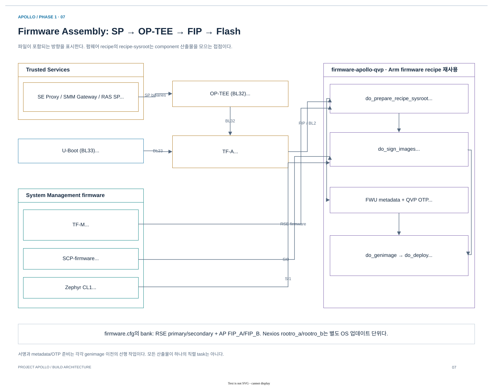
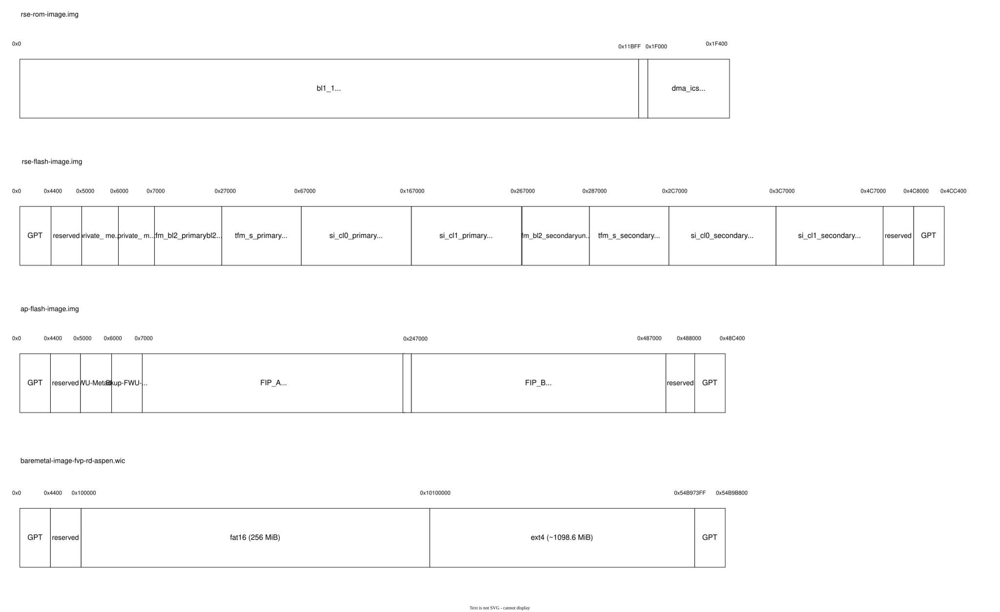

# 03.3 Firmware signing·FWU metadata·Flash assembly

[상위 장](../03-project-build-architecture.md) · [← 이전](02-task-graph-and-native-provider.md) · [다음 →](04-os-image-and-storage.md)

> 목적: domain별 binary가 인증 가능한 boot payload와 저장 매체로 바뀌는 과정을 추적한다.
> 기준: 2026-10-25 checkout의 source·metadata 정적 추적. 새 BitBake 실행이나 runtime 검증 결과를 의미하지 않는다.

## 1. Firmware assembly: binary를 저장 매체로 조립한다

[draw.io 편집 원본](../diagrams/phase1/build-07-firmware-assembly.drawio)

*그림 3-3. Apollo firmware assembly. 화살표는 payload가 포함되는 방향이다. TF-M·SCP·CL1은 별도 CPU의 binary이며, firmware recipe의 sysroot에서 Flash 조립 입력으로 만난다.*

AP의 BL2는 RSE가 인증·적재하는 첫 AP stage다. 그 뒤 BL2는 FIP에서 BL31, OP-TEE BL32, U-Boot BL33와 configuration DTB를 가져온다.
이 boot 순서 때문에 build graph도 OP-TEE/U-Boot→TF-A FIP→firmware assembly라는 dependency를 갖는다.
TF-M/SCP/CL1 binary를 AP ELF에 link하는 것이 아니라, 각 boot consumer가 찾아갈 수 있도록 저장 매체 layout에 배치하는 것이다.

| 연결 | Task 또는 조립 위치 | 산출물 의미 |
|---|---|---|
| Trusted Services → OP-TEE | SP ELF/manifest 통합 | BL32가 제공할 secure service |
| OP-TEE + U-Boot → TF-A | FIP 생성 | BL32/BL33 및 firmware config 묶음 |
| TF-A BL2 + SCP + CL1 | `do_sign_images` | Boot 대상 firmware 서명 |
| Firmware + FWU metadata | `do_genimage` | RSE/AP Flash layout |
| TF-M build config → OTP | `do_generate_rse_otp_image` | QVP RSE OTP image, 기본 64 KiB |

[firmware-apollo-common.inc](../../../../hsoc-stack/yocto/meta-hsoc-bsp/recipes-bsp/images/firmware-apollo-common.inc)는 reference `firmware-fvp-rd-aspen.bb`를 재사용한다.
[QVP firmware recipe](../../../../hsoc-stack/yocto/meta-hsoc-bsp/recipes-bsp/images/firmware-apollo-qvp.bb)는 TF-M의 `CMakeCache.txt`와 `otp_config.pickle`을 입력으로 OTP를 생성한다.
따라서 TF-M 설정을 바꾸면 runtime binary 외에 provisioning/OTP와 영속 RSE state의 호환성도 확인해야 한다.

| Deploy artifact | 소비 목적 |
|---|---|
| `rse-rom-image.img`, `rse-otp-image.img` | RSE 초기 boot와 보안 상태 |
| `rse-flash-image.img` | RSE/SI image와 firmware update layout |
| `ap-flash-image.img` | AP firmware FIP와 update metadata |
| `si0_ramfw.bin`, `zephyr-demos-cl1.bin` | Firmware assembly 및 QVP loader 입력 |
| 개별 ELF / provisioning 입력 | 일부 runtime loader와 entry·symbol 검증 |

Flash image만 복사하면 모든 QVP 실행 입력을 옮긴 것이 되는 것은 아니다. Launcher가 사용하는 개별 ELF·native provider도 함께 확인한다.

### 서명, metadata, 저장 매체 조립은 세 가지 작업이다

1. `do_sign_images`는 `sign_host_image()`로 AP BL2, SI0, SI1 payload를 처리한다. AP BL2는 `fiptool update --tb-fw`로 `fip_with_bl2.bin`에 반영한다.
2. `do_init_psa_fwu_metadata`는 firmware update bank의 초기 metadata를 생성한다. QVP는 별도 `do_generate_rse_otp_image`로 TF-M config에서 OTP를 만든다.
3. `do_genimage`는 `firmware.cfg`의 offset·partition GUID·payload에 따라 저장 매체 image를 조립한다. 서명/metadata/OTP task는 모두 이 조립의 선행 조건이다.

근거는 [reference firmware recipe](../../../../arm-zena-css/yocto/meta-zena-css-bsp/recipes-bsp/images/firmware-fvp-rd-aspen.bb)의 `do_sign_images`, `do_init_psa_fwu_metadata`, `addtask`와 [tfm_sign_image.bbclass](../../../../layers/meta-arm/meta-arm/classes/tfm_sign_image.bbclass)의 `sign_host_image`다.
Arm [Boot process / Image signing·System provisioning and image authentication](../../../../arm-zena-css/documentation/design/boot_process.rst)는 빌드된 인증 정보가 RSE boot에서 어떻게 소비되는지 설명한다.

[draw.io 편집 원본](../figures/reference/image-layouts.drawio)

*그림 3-4. Arm [원본 SVG](../../../../arm-zena-css/documentation/images/image-layouts.svg) — [Boot process / Images layout](../../../../arm-zena-css/documentation/design/boot_process.rst). 위에서 ROM, RSE Flash, AP Flash, OS WIC를 구분해 읽는다. 원본 BL1_1의 71 KiB 표시는 현재 `firmware.cfg`의 75k partition reservation과 다르며, 맨 아래 FAT+single-root WIC는 Nexios A/B WIC와 다르다. 현재 수치는 아래 source 기반 표를 따른다.*

### 현재 `firmware.cfg`의 저장 위치를 읽는 법

Offset은 **파일/매체 내부 offset**이다. CPU가 접근하는 physical address와 같지 않다.
예를 들어 AP Flash 안 `FIP_A`가 offset `0x7000`에 있다고 해서 AP BL2의 execution address가 `0x7000`인 것은 아니다.
매체 base, partition, FIP entry, load address는 서로 다른 단계의 정보다.

| 매체 | 항목 | 현재 offset / reservation | 초기 image 내용 |
|---|---|---|---|
| RSE ROM, raw | BL1_1 | 시작부, `size=75k` | `bl1_1.bin` |
| RSE ROM, raw | DMA ICS | `0x1F000`, `0x400` | `rom_dma_ics.bin` |
| RSE OTP, raw | QVP provisioning | 기본 `0x10000` bytes | TF-M build config에서 별도 생성 |
| RSE Flash, GPT | Private metadata | `0x5000`, `0x6000` | 두 replica용 영역 |
| RSE Flash, GPT | TF-M BL2/runtime primary | `0x7000`, `0x27000` | `bl2_signed.bin`, `tfm_s_signed.bin` |
| RSE Flash, GPT | SI0/SI1 primary | `0x67000`, `0x167000` | Signed SI firmware |
| RSE Flash, GPT | Secondary images | `0x267000`부터 각 영역 | 예약, 초기 payload 미지정 |
| AP Flash, GPT | FWU metadata / backup | `0x5000`, `0x6000` | `init_fwu_metadata.bin` |
| AP Flash, GPT | `FIP_A` | `0x7000` | `fip_with_bl2.bin` |
| AP Flash, GPT | `FIP_B` | `0x247000`, `0x240000` | 예약, 초기 payload 미지정 |

근거: [firmware.cfg](../../../../arm-zena-css/yocto/meta-zena-css-bsp/recipes-bsp/images/files/fvp-rd-aspen/firmware.cfg)와 [QVP OTP 생성 recipe](../../../../hsoc-stack/yocto/meta-hsoc-bsp/recipes-bsp/images/firmware-apollo-qvp.bb).
Reference `firmware.cfg`의 OTP placeholder는 size 0이지만 QVP recipe가 생성한 64 KiB 파일로 결과를 보완한다.
또한 firmware secondary bank와 Nexios rootfs B slot은 다른 업데이트 단위다. OS A/B가 양쪽 채워졌다고 firmware FIP_B도 채워지는 것은 아니다.

## 2. Firmware task의 입력을 boot consumer와 대응시킨다

Firmware assembly는 단순한 file concatenation이 아니다. RSE가 읽는 wrapper의 load address·size·version, AP BL2가 읽는 FIP entry, FWU가 읽는 bank metadata, platform이 읽는 OTP가 각각 다른 consumer의 계약이다.

| 입력 | Producer / 전달 경로 | Assembly에서 사용 | Runtime consumer |
|---|---|---|---|
| TF-A BL2 | TF-A output → `${RECIPE_SYSROOT}/firmware` | `sign_host_image`, FIP `--tb-fw` 갱신 | RSE authentication/load |
| TF-A FIP | BL31/BL32/BL33/config 포함 | `fip_with_bl2.bin`으로 조립 | AP BL2 |
| SCP SI0 / CL1 | 각 firmware recipe의 sysroot output | 별도 wrapper/signing | RSE와 SI boot path |
| TF-M image/config | TF-M binary + scripts + build config | RSE Flash와 OTP | RSE boot/runtime |
| 초기 FWU metadata | `do_init_psa_fwu_metadata` | AP Flash metadata/backup | Full-bank update policy |

`do_sign_images`, `do_init_psa_fwu_metadata`, QVP `do_generate_rse_otp_image`는 모두 `do_genimage` 이전에 배치되지만 서로를 직렬로 호출하는 하나의 함수는 아니다. 각 task가 필요한 input과 assembly 선행 관계를 가진다.

### OTP task가 binary 외에 build directory를 보는 이유

[firmware-apollo-qvp.bb](../../../../hsoc-stack/yocto/meta-hsoc-bsp/recipes-bsp/images/firmware-apollo-qvp.bb)의 `do_generate_rse_otp_image()`는 `trusted-firmware-m:do_compile`, `trusted-firmware-m-scripts-native:do_populate_sysroot`, `python3-native:do_populate_sysroot`에 의존한다. TF-M work root에서 `CMakeCache.txt`와 `platform/target/common/config/otp_config.pickle`이 함께 있는 build를 찾고 [provision_rse_otp_image.py](../../../../scripts/setup/provision_rse_otp_image.py)에 전달한다.

이는 OTP가 임의의 빈 file이 아니라 TF-M compile configuration에 맞춘 provisioning output이기 때문이다. Task는 generated file의 크기가 `APOLLO_QVP_RSE_OTP_IMAGE_SIZE`와 같은지도 검사한다. 최종 `do_genimage:append`가 이 파일을 `${B}/rse-otp-image.img`로 복사한다.

| OTP 관련 오류 | Source에서 검사하는 조건 | 먼저 확인할 입력 |
|---|---|---|
| Provisioning script 없음 | `HSOC_AUTO_SOLUTIONS_BASE` 아래 script file | Workspace root 계산 |
| Native Python 없음 | recipe sysroot의 executable | Native dependency 준비 |
| TF-M build output 없음 | Cache + pickle 동시 존재 | Machine/work root와 TF-M compile output |
| OTP size 불일치 | `stat` 결과와 expected bytes | Size 설정 및 script 결과 |
| Build 후 RSE authentication 실패 | 이 task의 크기 검사만으로 판정 불가 | Image signing/provisioning/state와 RSE log |

마지막 행은 build 형식 검사와 runtime 인증이 다른 이유를 보여준다. OTP와 Flash의 형식이 맞아도 선택된 persistent state나 image version이 다르면 별도 runtime 분석이 필요하다.

### Capsule generation과 초기 bank 구성을 구분한다

[Reference firmware recipe](../../../../arm-zena-css/yocto/meta-zena-css-bsp/recipes-bsp/images/firmware-fvp-rd-aspen.bb)의 `do_sign_images()`는 기본 이미지를 처리한 뒤 `BUILD_UEFI_CAPSULE`이 1일 때만 capsule용 이미지를 추가 생성한다. `bump_version()`은 version의 minor field를 증가시켜 capsule payload를 다시 서명한다.

현재 [local.conf](../../../../build/conf/local.conf)는 `BUILD_UEFI_CAPSULE="1"`을 선택한다. 이것은 capsule artifact 생성의 입력이며 실제 update 성공을 뜻하지 않는다. `firmware.cfg`의 초기 secondary bank가 비어 있는 사실과도 모순되지 않는다. Initial Flash layout, capsule payload, update 후 bank 상태는 서로 다른 시점의 산출물이다.

`do_init_psa_fwu_metadata()`는 TF-M BL2/runtime, SCP, AP FIP의 UUID 목록을 만들고 CFG2에서는 CL1 UUID를 더한다. Reference의 full-firmware-bank update policy 때문에 OS root A/B와 별개로 모든 firmware image의 조합을 다룬다.

## 3. 실패를 compile·assembly·boot 단계로 구분한다

| 최초 실패 | 확인할 file / task | 다음 조사 |
|---|---|---|
| BL32/BL33 입력 누락 | TF-A task log, OP-TEE sysroot/U-Boot deploy | 선행 payload dependency |
| `sign_host_image` 실패 | Wrapper size/load address/version, TF-M signing scripts | ABI·image envelope와 signing input |
| `genimage` partition 초과 | `firmware.cfg`, 실제 signed payload 크기 | Reservation과 image growth |
| OTP generation 실패 | Cache/pickle/script/native Python | 위 OTP 입력 계약 |
| RSE boot 실패 | 선택 ROM/OTP/Flash hash와 RSE log | Build graph 밖 runtime authentication/handoff |
| AP BL2 뒤 실패 | FIP 내용과 AP stage log | BL31/BL32/BL33/config consumer |

File offset, load address, ELF entry를 같은 수치로 취급하지 않는다. Flash offset은 loader가 payload를 찾는 위치이고, load address는 대상 memory이며, entry는 CPU가 실행을 시작하는 지점이다. [03.5](05-runtime-artifacts-and-diagnosis.md)의 SI1 preflight는 이 중 entry와 ELF/bin 내용의 관계를 따로 검사한다.

## 4. Source 읽기 순서

1. [firmware-apollo-common.inc](../../../../hsoc-stack/yocto/meta-hsoc-bsp/recipes-bsp/images/firmware-apollo-common.inc): reference recipe 재사용 경계.
2. [firmware-fvp-rd-aspen.bb](../../../../arm-zena-css/yocto/meta-zena-css-bsp/recipes-bsp/images/firmware-fvp-rd-aspen.bb): input dependency, `do_sign_images`, `do_init_psa_fwu_metadata`, task order.
3. [tfm_sign_image.bbclass](../../../../layers/meta-arm/meta-arm/classes/tfm_sign_image.bbclass): `sign_host_image`의 wrapper/signing 도구.
4. [firmware.cfg](../../../../arm-zena-css/yocto/meta-zena-css-bsp/recipes-bsp/images/files/fvp-rd-aspen/firmware.cfg): payload → partition/offset.
5. QVP OTP recipe와 provisioning script를 읽은 뒤 [Arm Boot process](../../../../arm-zena-css/documentation/design/boot_process.rst)의 consumer와 대조한다.

## 다음 읽기

[03.4. OS image와 storage](04-os-image-and-storage.md)에서 firmware Flash와 별도로 kernel/rootfs/UKI/WIC가 조립되는 과정을 비교한다.

[상위 장](../03-project-build-architecture.md) · [← 이전](02-task-graph-and-native-provider.md) · [다음 →](04-os-image-and-storage.md)
