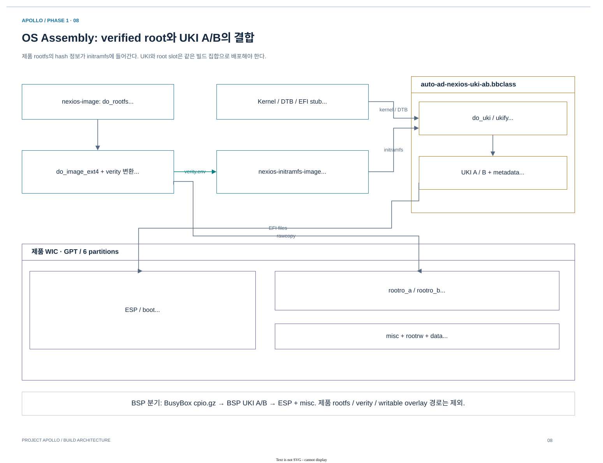

# 03.4 Rootfs·dm-verity·initramfs·UKI·WIC

[상위 장](../03-project-build-architecture.md) · [← 이전](03-firmware-signing-and-flash.md) · [다음 →](05-runtime-artifacts-and-diagnosis.md)

> 목적: product와 BSP image의 차이를 task dependency와 storage layout으로 설명하고 boot payload의 일관성을 확인한다.
> 기준: 2026-10-25 checkout의 source·metadata 정적 추적. 새 BitBake 실행이나 runtime 검증 결과를 의미하지 않는다.

## 1. OS assembly: 제품 image와 BSP image

[draw.io 편집 원본](../diagrams/phase1/build-08-os-assembly.drawio)

*그림 3-5. Apollo product image assembly. Rootfs hash 정보가 initramfs로 들어가고, 그 initramfs가 UKI에 들어간 뒤 WIC의 ESP에 배치된다. 그림의 `apollo-qvp-saturn-v.dtb` 표기는 AP16 이름이며, 현재 AP4 기본값에서는 `apollo-qvp-saturn-v-4cpus.dtb`를 선택한다. Firmware FIP와 OS UKI는 다른 container다.*

| 구분 | `nexios-image` | `nexios-bsp-initramfs` |
|---|---|---|
| 목적 | 제품 사용자 공간 | BSP·driver 검증 환경 |
| 기반 | `ewaol-image` | `core-image` |
| Root | 기본 dm-verity root A/B + writable storage | UKI 안 BusyBox initramfs |
| 주요 연결 | rootfs → verity metadata → initramfs → UKI → WIC | `do_image_cpio → do_uki → do_image_wic` |
| Boot 구성 | Direct slot UKI boot; systemd-boot discovery alias 병행 제공 | Direct slot UKI |
| Runtime 검증 | 제품 service·storage·domain 통합 필요 | BSP에 실제 포함된 driver/service 범위 |

UKI는 kernel, initramfs, cmdline, OS DTB를 함께 전달한다.
현재 U-Boot의 [BOOTCOMMAND](../../../../hsoc-stack/components/primary_compute/u-boot/configs/apollo_qvp_defconfig)는 `aanxbootselect → 선택 slot UKI의 직접 bootefi → fallback slot UKI → bootflow scan` 순서다.
제품 verity root는 WIC에 rawcopy하며, initramfs에 해당 verity metadata가 들어가야 한다.
OS DTB는 초기 firmware의 `HW_CONFIG` DTB와 역할이 다르다. 현재 AP4/AP16 선택은 [03.1 configuration](../03-build/01-configuration-and-entrypoints.md)의 `APOLLO_QVP_DTB` 규칙을 따른다.

근거: [제품 recipe](../../../../hsoc-stack/yocto/meta-hsoc-auto-solutions/recipes-core/images/nexios-image.bb), [제품 append](../../../../hsoc-stack/yocto/meta-hsoc-auto-solutions/recipes-core/images/nexios-image.bbappend), [BSP recipe](../../../../hsoc-stack/yocto/meta-hsoc-auto-solutions/recipes-core/images/nexios-bsp-initramfs.bb), [UKI A/B class](../../../../hsoc-stack/yocto/meta-hsoc-auto-solutions/classes/auto-ad-nexios-uki-ab.bbclass).

### 제품 image의 data dependency를 한 단계씩 읽기

**① Rootfs를 고정한다.** `nexios-image`의 package·postprocess 결과로 ext4를 만들고 verity hash payload를 생성한다.
`nexios-image.bbappend`의 `auto_ad_nexios_deploy_dm_verity_env`가 그 image를 검증할 metadata를 deploy한다.
Rootfs 내용이 달라지면 hash도 달라지므로 기존 initramfs의 hash 정보와 조합하면 boot 시 검증에 실패할 수 있다.

**② Minimal initramfs가 verified root를 연다.** [nexios-initramfs-image.bb](../../../../hsoc-stack/yocto/meta-hsoc-auto-solutions/recipes-core/images/nexios-initramfs-image.bb)는 제품 rootfs의 image task를 dependency로 추가한다.
`deploy_verity_hash`는 metadata를 `/usr/share/misc/dm-verity.env`에 넣는다. 이 initramfs에는 root를 여는 도구가 들어가며 제품의 demo/container package를 다시 넣지 않는다.

**③ UKI A/B를 만든다.** `auto-ad-nexios-uki-ab.bbclass`의 `do_uki`는 systemd EFI stub, kernel, initramfs, OS DTB, cmdline과 OS metadata를 `ukify`에 전달한다.
두 slot은 같은 kernel/rootfs에서 시작해도 cmdline의 `root=PARTLABEL=rootro_a`와 `rootro_b`가 다르다.
Kernel binary가 바뀌면 같은 파일명이어도 UKI가 다시 만들어져야 하므로 class는 kernel 파일 checksum을 task input에 포함한다.

**④ WIC에 배치한다.** [QVP WKS](../../../../hsoc-stack/yocto/meta-hsoc-bsp/wic/apollo-qvp-auto-ad-nexios-ab.wks.in)는 verified ext4를 root A/B에 `rawcopy`한다.
일반 rootfs plugin으로 filesystem을 다시 만들면 기존 byte layout과 hash payload가 달라지므로 verity와 맞지 않는다.
ESP에는 UKI와 boot manager가, `misc`에는 slot boot-state가, writable partition에는 변경 가능한 데이터가 들어간다.

| Nexios partition | 현재 고정 크기 | 담는 것 / 분리 이유 |
|---|---|---|
| `boot` / ESP | 256 MiB | UEFI boot infrastructure와 UKI A/B |
| `misc` | 4 MiB | Slot boot-state |
| `rootro_a`, `rootro_b` | 각 8192 MiB | 같은 초기 `.ext4.verity` raw image; slot별 root 선택 |
| `rootrw` | 512 MiB | Writable overlay 저장 영역 |
| `data` | 4096 MiB | 제품의 persistent data |

크기는 partition reservation이다. 실제 파일 payload 크기·sparse host disk 사용량과 같다고 해석하지 않는다.
BSP는 별도 rootro partition 없이 UKI의 initramfs에서 실행하므로 product WIC의 writable storage 구조를 기대하면 안 된다.

### Signing이 적용되는 보호 구간을 나누어 읽기

| 구간 | Build 측 작업 | Runtime consumer |
|---|---|---|
| RSE/SI/AP BL2 firmware | TF-M signing/encryption 설정과 firmware assembly | RSE boot chain |
| AP FIP의 후속 stage/config | TF-A TBB certificate와 FIP 구성 | AP BL2 |
| UEFI executable / UKI | UKI signing을 선택한 경우 key/certificate 적용 | U-Boot UEFI verification |
| Product rootfs | dm-verity hash payload와 metadata | Linux device mapper/initramfs |

현재 Nexios UKI class는 first-boot 기본값으로 unsigned UKI를 선택한다. `UEFI_SECURE_BOOT=1`을 명시하면 `UKI_SB_KEY`와 `UKI_SB_CERT`를 요구한다.
따라서 firmware signing이 있다는 사실로 OS UKI도 서명되었다고 설명하면 안 된다.
Arm reference의 [Boot process / UEFI Secure Boot](../../../../arm-zena-css/documentation/design/boot_process.rst)와 현재 UKI class의 정책을 구분해 읽는다.

## 2. Product와 BSP의 dependency가 다른 이유

제품 rootfs는 지속되는 read-only filesystem이고 initramfs는 그 root를 검증해 mount하는 초기 실행 환경이다. BSP는 전체 실행 환경이 initramfs에 있으므로 product root의 verity metadata를 기다릴 필요가 없다. 이 차이가 task ordering에 직접 나타난다.

| 구성 | 입력 | 먼저 만들어야 하는 것 | 후속 consumer |
|---|---|---|---|
| Product ext4/verity | Package rootfs | Verified rootfs와 `.verity.env` | Product initramfs |
| Product initramfs | Minimal packages + root hash | `DM_VERITY_IMAGE:do_image_<type>` | UKI의 initrd section |
| BSP initramfs | `PACKAGE_INSTALL` | 같은 recipe의 `do_image_cpio` | 같은 recipe의 `do_uki` |
| Slot UKI | Kernel/DTB/initrd/cmdline/stub | 모든 payload file | WIC ESP와 U-Boot |
| WIC | ESP 파일 + root image + writable partitions | UKI, root filesystem, boot state | Block device로 연결된 AP |

[nexios-initramfs-image.bb](../../../../hsoc-stack/yocto/meta-hsoc-auto-solutions/recipes-core/images/nexios-initramfs-image.bb)의 anonymous Python은 `DM_VERITY_IMAGE`와 `DM_VERITY_IMAGE_TYPE`를 읽어 `do_image`에 root image task dependency를 추가한다. `auto_ad_nexios_verity_env_file_checksum()`은 verity metadata를 checksum input으로 넣고, `deploy_verity_hash()`가 `/usr/share/misc/dm-verity.env`에 설치한다.

[BSP recipe](../../../../hsoc-stack/yocto/meta-hsoc-auto-solutions/recipes-core/images/nexios-bsp-initramfs.bb)는 `APOLLO_DM_VERITY=0`, 빈 `INITRAMFS_IMAGE`로 recursive product initramfs 관계를 없앤다. `AUTO_AD_NEXIOS_UKI_INITRD`는 자기 `cpio.gz`를 가리키고, `addtask uki after do_image_cpio before do_image_wic do_image_complete`가 순서를 명시한다.

### Kernel module도 OS image의 ABI 일부다

BSP의 `PACKAGE_INSTALL`에는 `arm-si-rproc-mod`, `rpmsg-net-mod`, `kernel-module-virtio-rpmsg-bus`, PFDI 관련 module/application이 포함된다. Driver source가 compile됐다는 사실과 image에 package가 포함된 사실은 별도다. Kernel을 바꾸면 해당 kernel의 generated headers/config/symbols로 외부 module을 만들고 같은 rootfs/initramfs에 배포해야 한다.

`NO_RECOMMENDATIONS=1`인 BSP에서는 추천 package를 자동 포함한다고 가정할 수 없다. 실제 `PACKAGE_INSTALL`과 generated manifest를 확인해야 한다. Product의 package policy는 `ewaol-image`와 image feature/class 쪽도 함께 읽는다.

## 3. `do_uki()`의 파일 계약을 따라 읽기

[auto-ad-nexios-uki-ab.bbclass](../../../../hsoc-stack/yocto/meta-hsoc-auto-solutions/classes/auto-ad-nexios-uki-ab.bbclass)의 `do_uki()`는 common `ukify` command를 만든 후 A/B slot별 cmdline과 output을 적용한다.

| 함수 내부 순서 | 검사 / 추가 option | 산출물에 미치는 영향 |
|---|---|---|
| EFI architecture/stub | `require_file(stub)`와 `--stub` | 해당 EFI ABI의 boot wrapper |
| Initrd | 값이 있으면 file 검사, `--initrd` | Product verity init 또는 BSP 전체 runtime |
| Kernel | `UKI_KERNEL_FILENAME`, `--linux` | Boot할 Image |
| OS DTB | `KERNEL_DEVICETREE` 순회, `--devicetree` | Firmware DTB와 다른 OS hardware description |
| Metadata/tool | OS release, systemd tools, optional config | UKI build metadata |
| Signing | 선택 시 key/cert file 검사, `--sign-kernel` | UEFI executable authentication |
| Slot loop | A/B cmdline/output, `slot=A/B` metadata file | 같은 kernel이라도 다른 root partition 선택 |

같은 UKI filename을 유지해도 kernel bytes가 변할 수 있으므로 `do_uki[file-checksums]`에 deploy kernel을 추가한다. 또한 class는 `INITRAMFS_IMAGE`가 비어 있을 때 잘못된 빈 initramfs `do_image_complete` dependency를 제거한다. BSP와 product를 같은 class로 처리하기 위한 분기다.

### Verity와 writable storage의 역할을 나눈다

dm-verity는 검증한 root image의 bytes를 기준으로 integrity를 검사한다. `/etc`와 persistent data를 변경하려고 read-only root를 임의 remount하면 이 계약을 깨뜨릴 수 있다. Product append의 `auto_ad_nexios_check_overlay_storage()`는 `LABEL=rootrw`, `OVERLAYFS_ETC_CREATE_MOUNT_DIRS=0`, mount point와 systemd unit, volatile `/run` 등을 확인한다.

| 경로/partition | 기본 역할 | Build에서 확인할 것 |
|---|---|---|
| `rootro_a/b` | Verified root bytes | `.ext4.verity`와 initramfs hash의 동일 조합 |
| `rootrw` / `/rootrw` | Writable overlay 저장 | Label과 mount unit, overlay preinit |
| `data` / `/data` | 제품 persistent data | PARTLABEL과 mount ordering |
| `/run` | Volatile runtime state | tmpfs와 `/var/run` symlink |
| ESP / `misc` | Executable와 slot state | UKI/metadata, boot-state 초기값 |

이 검사는 rootfs 구성의 일관성을 조기에 확인하는 build gate다. 부팅 후 mount와 update/rollback이 실제 동작하는지는 guest evidence가 필요하다.

## 4. OS build와 boot 실패의 연결

| 증상 | 첫 확인 입력 | 실패 경계 |
|---|---|---|
| UKI kernel/DTB file 없음 | `UKI_KERNEL_FILENAME`, `KERNEL_DEVICETREE`, deploy | Payload dependency/filename |
| Secure Boot key 오류 | `UEFI_SECURE_BOOT`, `UKI_SB_KEY/CERT` | Signing policy/input |
| Initramfs에서 root 검증 실패 | Root image hash와 `dm-verity.env` | Product root/initramfs 조합 |
| Driver module load 실패 | Boot한 kernel, module version/signature, package | Kernel/userspace image ABI |
| Root는 mount됐지만 `/etc` 변경 실패 | `rootrw` label/unit와 overlay preinit | Writable storage 정책 |
| DT를 수정했지만 device가 그대로임 | WIC ESP 안 UKI의 DTB | Deploy DTB와 실제 boot payload 차이 |

Source 읽기 순서는 product/BSP recipe → product append → initramfs recipe → UKI class → WKS → U-Boot `BOOTCOMMAND`다. 이 순서로 source와 boot consumer를 연결하면 단순히 WIC가 생성됐다는 사실보다 정확한 완료 조건을 설명할 수 있다.

## 다음 읽기

[03.5. Runtime artifacts와 진단](05-runtime-artifacts-and-diagnosis.md)에서 완성한 OS/firmware와 native provider를 실제 실행 조합으로 묶는다.

[상위 장](../03-project-build-architecture.md) · [← 이전](03-firmware-signing-and-flash.md) · [다음 →](05-runtime-artifacts-and-diagnosis.md)
