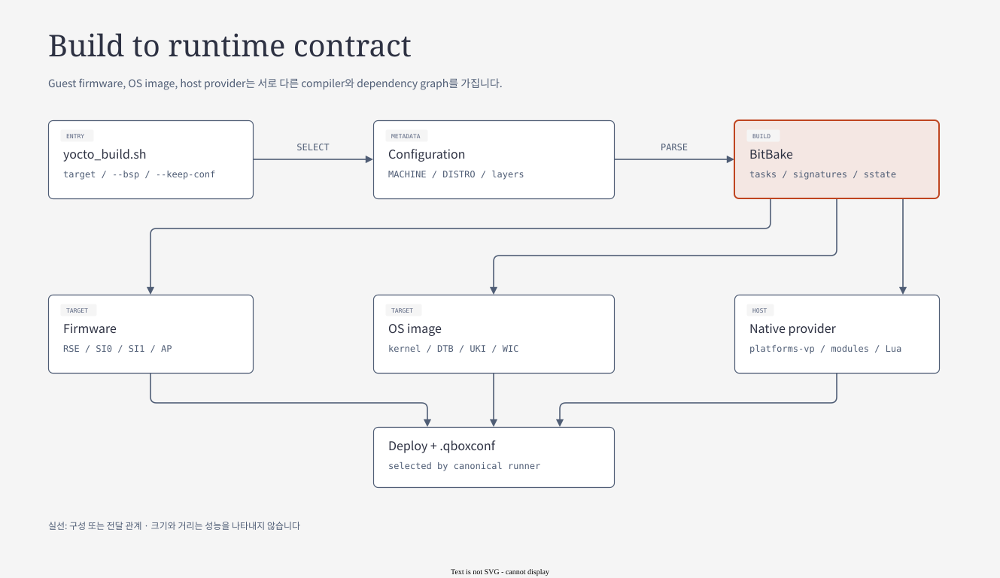

# 03. Project Build Architecture

[← 02. Source Architecture](02-project-source-architecture.md) · [세미나 목차](README.md) · [04. QBox 실행 구조 →](04-qbox-runtime-and-lua.md)

> 발표 목표: 선택한 configuration이 firmware·OS image·host simulator로 갈라졌다가 실행 계약에서 다시 만나는 과정을 설명한다.
> 기준: 2026-10-25 checkout과 local `build/conf/`. 이번 자료 작성에서는 BitBake build와 `bitbake -e`를 실행하지 않았다.

Build를 이해할 때는 명령 목록보다 **각 task가 누구의 입력을 만들고 어느 consumer가 받는가**를 먼저 본다. 세 실행 축은 compiler/ABI도, 저장 형식도, 실패를 관측하는 단계도 다르다.

## 전체 dependency map

[draw.io 편집 원본](diagrams/03-build-pipeline.drawio)

[기존 HTML 보기](diagrams/03-build-pipeline.html)

그림의 화살표는 **주요 dependency와 artifact 전달 관계**다. 모든 task가 이 순서로 직렬 실행된다는 뜻은 아니다.
BitBake는 dependency graph와 task signature, sstate에 따라 실행할 작업을 선택한다.

| Build 축 | 실행 위치 | 대표 산출물 | 최종 소비자 |
|---|---|---|---|
| Firmware | RSE, SI CL0/CL1, AP boot stages | ROM/OTP/Flash, TF-A FIP, SI binary/ELF | Domain boot code와 QVP loader |
| OS image | AP | Kernel/modules, initramfs, UKI, WIC | U-Boot/UEFI, Linux |
| Native platform | 개발 host | `platforms-vp`, libqemu, model `.so`, Lua | QBox runtime process |

**발표 포인트:** “이미지 build”에는 guest software와 host simulator dependency가 함께 들어간다. 같은 compiler와 ABI로 하나의 binary를 만드는 과정은 아니다.

## 읽기 순서

| 순서 | Subchapter | 중심 질문 | 주요 source trace |
|---|---|---|---|
| 1 | [Entrypoint와 configuration](03-build/01-configuration-and-entrypoints.md) | 어떤 machine·distro·image를 build하는가? | Wrapper → conf → override → image |
| 2 | [Toolchain·task DAG·native provider](03-build/02-task-graph-and-native-provider.md) | 어떤 ABI와 dependency로 compile/install하는가? | externalsrc → task signature → sysroot → provider |
| 3 | [Firmware signing·FWU·Flash](03-build/03-firmware-signing-and-flash.md) | 각 domain binary를 누가 인증하고 load하는가? | BL32/BL33 → FIP → signing/metadata/OTP → genimage |
| 4 | [OS image와 storage](03-build/04-os-image-and-storage.md) | Kernel/rootfs/verity/UKI는 어떻게 일치하는가? | Package → ext4/verity → initramfs → UKI → WIC |
| 5 | [Runtime artifact handoff와 진단](03-build/05-runtime-artifacts-and-diagnosis.md) | 새 build 결과가 실제로 실행됐는가? | `.qboxconf` → path validation → ELF/bin preflight → runner |

03-1과 03-2는 공통 기반이다. 이후 firmware 담당자는 03.3, Linux/product 담당자는 03-4를 깊게 읽고, 03-5에서 두 산출물과 host provider를 다시 연결한다.

## 현재 구성의 기준점

| 항목 | 현재 파일에서 확인한 값 | 의미 |
|---|---|---|
| Machine / variant | `apollo-qvp`, `cfg2` | QBox 대상 Apollo 구성 |
| AP CPU default | `PC_CPUS_COUNT_DEFAULT="4"` | AP4 DTB·firmware·QBox population을 함께 선택 |
| Distro / default image | `auto-ad-nexios` / `nexios-image` | 제품 rootfs와 A/B UKI/storage |
| BSP selector | `--bsp` → `nexios-bsp-initramfs` | Driver 검증용 initramfs boot |
| Build output | `build/tmp_baremetal` | Deploy와 host sysroot가 분리됨 |
| Multiconfig | 현재 `BBMULTICONFIG` 빈 기본값 | 여러 domain을 build한다고 multiconfig인 것은 아님 |

근거는 [현재 local.conf](../../../build/conf/local.conf), [template 기록](../../../build/conf/templateconf.cfg), [wrapper](../../../yocto_build.sh)다. 이 표는 파일 기반 snapshot이며 최종 expanded datastore를 새로 dump한 결과가 아니다.

## Build 조사를 시작하는 질문

| 질문 | 확인할 경계 | 해당 subchapter |
|---|---|---|
| 설정이 바뀌었거나 target이 다름 | Wrapper/config/override | 03.1 |
| Source 변경이 compile에 반영되지 않음 | Signature와 configure input | 03.2 |
| RSE/AP firmware authentication 또는 payload 문제 | Signing/OTP/FIP/Flash | 03.3 |
| Linux/driver/rootfs가 예상과 다름 | Package/DTB/UKI/verity/WIC | 03.4 |
| Binary는 새것인데 실행 결과가 그대로임 | Selected artifacts/installed provider | 03.5 |

Build 완료는 artifact 생성의 증거다. Domain boot, driver traffic·IRQ, service와 reset/error path는 실제 runtime evidence로 확인한다. 각 subchapter는 이 두 단계의 연결을 설명하되 동일한 결과로 취급하지 않는다.

[03-1부터 읽기 →](03-build/01-configuration-and-entrypoints.md) · [04. QBox 실행 구조 →](04-qbox-runtime-and-lua.md) · [기존 Build Architecture](../build/README.md)
