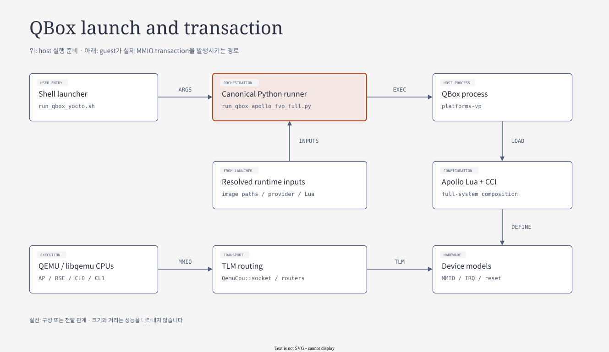

# 04.1 Launcher, artifact 선택과 runtime process

> **학습 목표:** 실행 입력이 provider와 runtime process로 전달되고 결과로 남는 경계를 추적한다.
> Source 기준: 2026-10-25 checkout. 이 장의 작성·분할 검증에서는 build와 runtime을 실행하지 않았다.

[상위 장](../04-qbox-runtime-and-lua.md) · [전체 목차](../README.md) · [이전: 04 개요](../04-qbox-runtime-and-lua.md) · [다음: QemuInstance와 object 생성](02-qemu-instance-construction.md)

## 실행 전체 그림



[draw.io 편집 원본](../diagrams/04-qbox-runtime.drawio)

[기존 HTML 보기](../diagrams/04-qbox-runtime.html)

**QBox는 QEMU CPU와 SystemC 모델을 한 실행 환경에 연결하는 framework이고, Apollo QVP는 그 위에 조립한 platform이다.**
정상 full-system 경로에서는 Linux만 적재하는 대신 RSE·SI firmware와 AP boot chain을 함께 실행한다.

| 단계 | 읽는 입력 | 만들어지는 결과 | Source entry |
|---|---|---|---|
| ① Shell launcher | `--bsp`, machine, `.qboxconf`, 실행 옵션 | 검증한 artifact/provider 경로, runner 인자 | `run_qbox_yocto.sh` |
| ② Python runner | Lua, firmware, DTB, disk, timeout | 환경변수·CCI override, process·console 관리, 결과 | `scripts/run/run_qbox_apollo_fvp_full.py` |
| ③ QBox host 실행기 | `platforms-vp`, model library, Lua | CCI preset, module 생성과 socket binding | `qbox/platforms/src/main.cc` |
| ④ SystemC + libqemu | 구성된 CPU·memory·device | TCG 실행, MMIO transaction, IRQ/reset event | QBox core + QEMU + Apollo overlay |
| ⑤ Guest SW | RSE/SI/AP image | TF-M, SCP, Zephyr, TF-A, U-Boot, Linux | 각 domain firmware |

①~③은 **host의 준비·구성 순서**, ⑤의 RSE-first 흐름은 **guest boot 순서**다.
Lua에서 먼저 정의한 module이 firmware도 먼저 실행한다는 뜻은 아니다.

근거: [launcher](../../../../run_qbox_yocto.sh) `read_qboxconf_shell_assignments`, `RUNNER_CMD`,
[canonical runner](../../../../scripts/run/run_qbox_apollo_fvp_full.py),
[QBox `sc_main`](../../../../hsoc-stack/tools/qbox/platforms/src/main.cc).

## 실행할 때 만나는 파일

| 입력 | 의미 | 읽을 때 주의할 점 |
|---|---|---|
| `*.qboxconf` | Yocto가 배포한 provider·image 경로 계약 | Lua 파일과 다른 JSON metadata다 |
| `platforms-vp` | host QBox executable | guest firmware가 아니며 native provider에서 공급한다 |
| `apollo-qvp-saturn-v.lua` | canonical full-system composition | 현재 entry이며 `apollo-qvp.lua`는 이 파일로 forwarding한다 |
| `rse-rom-image.img`, `rse-flash-image.img`, `rse-otp-image.img` | RSE boot·runtime·provisioning 상태 | 서로 맞는 build 조합을 사용한다 |
| `ap-flash-image.img`, `bl2.elf` | AP firmware package·boot 실행 입력 | Linux kernel만 바꿔서는 대체할 수 없다 |
| `si0_ramfw.bin` | SI CL0 SCP firmware | 전원·reset·SCMI 준비를 담당한다 |
| `zephyr-demos-cl1.bin` / `.elf` | SI CL1 runtime / symbols | standalone boot smoke image와 구분한다 |
| `apollo-qvp-saturn-v-4cpus.dtb` / `apollo-qvp-saturn-v.dtb`, `*.wic` | AP4 / AP16 OS topology·device description, disk | CPU 수와 platform topology를 맞춘다 |

Launcher는 `.qboxconf`의 provider를 `qbox-apollo-qvp-native`로 확인하고,
provider의 `bin/lib/share`와 native sysroot가 허용된 Yocto 경로 안에 있는지 검사한다.
Image는 `.qboxconf` 기준의 safe relative path와 파일 존재를 검사한다.
실행 시 사용한 입력을 남기는 이유는 “같은 source”와 “같은 실행 image”가 별개이기 때문이다.

일반 실행은 **shell → full runner → 같은 runner의 `--runtime-child` → `platforms-vp`** 순서다.
Runtime child가 `qbox_apollo_runtime.py`를 Python module로 호출하므로,
이 module을 별도의 독립 emulator process로 세지 않는다.
UART와 stdout은 child의 polling loop가 수집하고 tmux는 이를 보여 준다.

`apollo-qvp` launcher의 기본 Lua 경로는 checkout이 아니라
`.qboxconf`의 `provider.data_dir` 아래 설치된 config다.
Source의 `vp/`를 수정해도 provider를 다시 배포하지 않으면 실행에는 이전 Lua가 사용될 수 있다.
실제 구성을 찾을 때는 `QBOXCONF_CONFIG`, `QBOXCONF_PROVIDER_BINDIR`,
runner command와 artifact hash를 함께 확인한다.

또한 full-system에서 Linux kernel·OS DTB를 사용하는 주체는 WIC의 EFI/UKI boot 경로다.
Launcher가 DTB 정보를 받는 것과 Linux를 direct-load하는 것은 다르다.
기본 launcher는 performance preset, native CC3XX 및 제한된 flash DMI를 선택하므로,
아래의 standalone SoC 기본값과 실제 실행 backend를 구분한다.

## 입력은 한 번에 결정되지 않는다

같은 이름의 옵션도 **image 선택**, **Lua option**, **CCI preset** 중 어디에서 소비되는지 먼저 나눈다.
예를 들어 `.qboxconf`가 정하는 것은 설치 provider와 artifact 위치이며,
`--platform-param`은 이미 선택한 Lua가 생성할 module의 CCI 값을 지정한다.
DTB나 WIC 파일은 CCI parameter를 바꿨다고 함께 재생성되지 않는다.

| 결정 지점 | 실제 함수·입력 | 다음 단계로 넘기는 계약 |
|---|---|---|
| Shell에서 provider/image 선택 | `read_qboxconf_shell_assignments()` | `QBOXCONF_CONFIG`, provider `bin/lib/share`, artifact path |
| Full runner에서 artifact 확인 | `resolved_artifacts()`, `missing_required()` | 존재가 확인된 firmware·DTB·disk와 blocker |
| Full runner에서 실행 policy 보완 | `full_system_platform_params()` | default CCI와 사용자 `--platform-param` 목록 |
| Runtime child에서 process 준비 | `qbox_env()`, `run_platform()` | library path, `QBOX_RDASPEN_*`, `-l`, `-p` |
| Lua가 environment 해석 | `vp/options.create()` | domain/backend/loader 선택이 들어간 `ctx` |
| C++ model이 CCI를 소비 | `cci_param` 생성·조회 | 실제 module의 parameter와 연결 |

`full_system_platform_params()`는 AP/RSE/SI split 실행 default를 추가하기 전에
사용자가 지정한 key가 있는지 검사한다. Explicit key에는 같은 default를 추가하지 않고,
기본 목록 뒤에 사용자 목록을 둔다. `effective_platform_param()`의 보고용 조회도
사용자 목록을 역순으로 검색한다. 따라서 실행기 command와 결과의 effective value를 함께 읽는다.
`build_only`에서는 이 실행 default 추가가 생략된다.

이 규칙을 모든 설정에 적용할 수는 없다.
예를 들어 AP CPU 수는 runner가 topology를 선택하고 Lua가 CPU/GIC를 생성하는 입력이지만,
OS DTB와 firmware topology도 따로 맞아야 한다.
“CCI 하나를 바꾸었으므로 deployment 전체가 AP16이 되었다”는 해석은 성립하지 않는다.

근거: [full runner](../../../../scripts/run/run_qbox_apollo_fvp_full.py) `full_system_platform_params`, `effective_platform_param`,
[runtime 환경](../../../../scripts/run/qbox_apollo_runtime.py) `qbox_env`,
[VP option 해석](../../../../hsoc-stack/tools/qbox-platform/platforms/apollo/vp/options.lua).

## Boot/login과 qualification의 실행 경로

| 목적 | Entry | 판정 범위 |
|---|---|---|
| 개발자가 terminal에서 부팅·login | `./run_qbox_yocto.sh` | 기본 product image boot/login |
| 작은 BSP image의 부팅·login | `./run_qbox_yocto.sh --bsp` | BSP image boot/login |
| headless boot/login | 위 launcher의 `--headless` | 여전히 post-login probe를 끈다 |
| 통합 post-login 확인 | canonical Python runner의 `--post-login-probe` | runner가 정의한 post-login 항목 |
| 지정 기능의 검증·비교 | `run_test.sh`의 named profile | profile policy에 따른 standalone 또는 FVP-reference 범위 |

`run_qbox_yocto.sh`는 interactive/headless 양쪽 모두 `--no-post-login-probe`를 전달한다.
Python runner 자체의 기본값은 `post_login_probe=True`지만 launcher가 이를 덮어쓴다.
따라서 **launcher PASS를 mailbox, safety, driver qualification의 PASS로 읽으면 안 된다.**

기본 launcher는 current UID의 관리 대상 QBox session을 정리한다.
동시 실행을 의도하면 `--multi-session`을 사용한다.
아래는 실행 예시이며, 이 자료의 검증 과정에서는 실행하지 않았다.

```bash
./run_qbox_yocto.sh --bsp --multi-session
./run_qbox_yocto.sh --bsp --headless --multi-session
python3 scripts/run/run_qbox_apollo_fvp_full.py --help
```

근거: [launcher의 runner 조립](../../../../run_qbox_yocto.sh),
[post-login parser와 결과 평가](../../../../scripts/run/run_qbox_apollo_fvp_full.py),
[검증 profile 설명](../../../../hsoc-stack/tools/qbox-platform/platforms/apollo/README.md#validation-profiles).

## Canonical runner를 상태 전이로 읽기

`main()`의 목적은 emulator를 시작하는 것뿐 아니라 **시작할 수 없었던 이유와 실행 후 결과를 같은 형식으로 남기는 것**이다.
Outer runner와 runtime child를 구분하면 “Python이 종료됐다”는 증상도 어느 경계의 실패인지 나눌 수 있다.

```text
parse_args
  ├─ dry_run → 실행 계획 기록
  └─ resolved_artifacts + debug manifest + missing_required
       ├─ missing / manifest blocker → child 없이 write_result
       └─ prepare_si_cl1_boot
            ├─ blocker / check_only → child 없이 write_result
            └─ 필요 시 auto_provision_rse_otp
                 → run_child(--runtime-child)
                      → qbox_apollo_runtime.main
                      → run_platform(platforms-vp -l <Lua> -p <CCI> ...)
                 → child 결과·UART/log 수집 → write_result
```

`--runtime-child`는 같은 Python script가 `runtime_engine.main()`으로 분기하는 process 경계다.
그 안의 `run_platform()`이 `platforms-vp`를 `subprocess.Popen()`으로 시작한다.
따라서 parent Python, child Python, emulator의 exit status는 서로 다른 값이다.
선택한 wrapper나 tmux가 process를 추가할 수 있으므로 위 흐름을 고정 host process 개수로 읽지 않는다.

| 경계 | 수행하는 작업 | 다음 단계에 필요한 상태 |
|---|---|---|
| Preflight | artifact와 debug manifest, CL1 boot selection 확인 | blocker가 없어야 child 실행 |
| Provisioning | 필요한 경우 RSE OTP 준비 | ROM·flash·OTP 조합이 boot 가능해야 함 |
| Process spawn | executable, library path, Lua, CCI, UART path 적용 | host executable이 configuration을 읽음 |
| Observation | nonblocking stdout와 domain UART 수집, timeout·probe 진행 | guest별 boot marker / profile assertion |
| Aggregation | child 결과, marker group, SI error, profile evidence 평가 | 결과 범위와 blocker를 보존 |

`qbox_env()`는 provider/native library 탐색 경로와 firmware 환경변수를 구성한다.
Runtime의 stdout에는 module 생성·model 오류가 나오고,
RSE/SI/AP UART에는 각 firmware의 진행 상태가 나온다.
Host log가 계속 출력된다는 사실만으로 AP가 instruction을 진행한다고 판단할 수 없다.

### Result의 path 기록과 hash 증거를 구분한다

Full runner의 `artifact_record()`는 `path`, `exists`, `size`를 반환한다.
이 목록만으로 image byte identity를 확인했다고 말할 수 없다.
Named validation 경로의 `capture_profile_provenance()`는 별도로 testdata,
generated runtime config, WIC의 SHA-256과 shared source contract를 기록한다.
Provider binary·firmware·persistent state까지 비교하려면 각 전용 manifest/state evidence도 확인한다.

Persistent RSE flash를 쓰면 배포 input과 종료 후 writable state가 달라질 수 있다.
`prepare_persistent_rse_flash()`, `rse_storage_compatibility()`,
`finalize_rse_flash_state_status()`를 통해 초기화·재사용·종료 상태의 계약을 읽는다.
실행 전후 파일을 무조건 “같은 firmware image” 한 칸으로 합치지 않는다.

근거: [full runner main/result](../../../../scripts/run/run_qbox_apollo_fvp_full.py),
[runtime process·persistent state](../../../../scripts/run/qbox_apollo_runtime.py),
[validation provenance](../../../../scripts/validation/apollo_validation/provenance.py).

## 실패를 입력·host·boot·service 경계로 좁히기

| 관찰된 증상 | 먼저 확인할 경계 | 조사할 값·함수 |
|---|---|---|
| 실행 전에 missing/blocker | provider·artifact 선택 | `.qboxconf`, `missing_required()`, `prepare_si_cl1_boot()` |
| shared library / module type 오류 | host provider와 installed model | `LD_LIBRARY_PATH`, `moduletype`, native provider identity |
| RSE는 출력하지만 AP console이 없음 | domain boot handoff | RSE image/OTP, SCP readiness, AP reset/PPU, AP flash |
| Linux login 뒤 서비스 실패 | post-login / named profile | service 시작 marker, 개별 assertion, SI UART |
| source 수정이 반영되지 않음 | checkout과 installed provider 불일치 | `QBOXCONF_CONFIG`, 실제 Lua 경로, 배포 artifact |

Full runner의 `first_failing_marker()`는 정해진 marker group 우선순위에서
첫 미충족 marker를 선택한다. 이것은 log timestamp로 계산한 최초 사건과 같지 않다.
우선순위 결과로 조사할 domain을 정한 뒤 원본 UART의 시간·내용으로 원인을 확인한다.

발표 예시: “AP shell이 안 보인다”면 UART backend부터 바꾸기보다,
실제로 선택한 image, RSE/SCP 준비 marker, AP release, U-Boot/Linux 진행을 순서대로 확인한다.
Boot input과 post-login 기능 요구를 구분하면 불필요한 emulator 재실행을 줄일 수 있다.

---

[상위 장](../04-qbox-runtime-and-lua.md) · [전체 목차](../README.md) · [이전: 04 개요](../04-qbox-runtime-and-lua.md) · [다음: QemuInstance와 object 생성](02-qemu-instance-construction.md)
