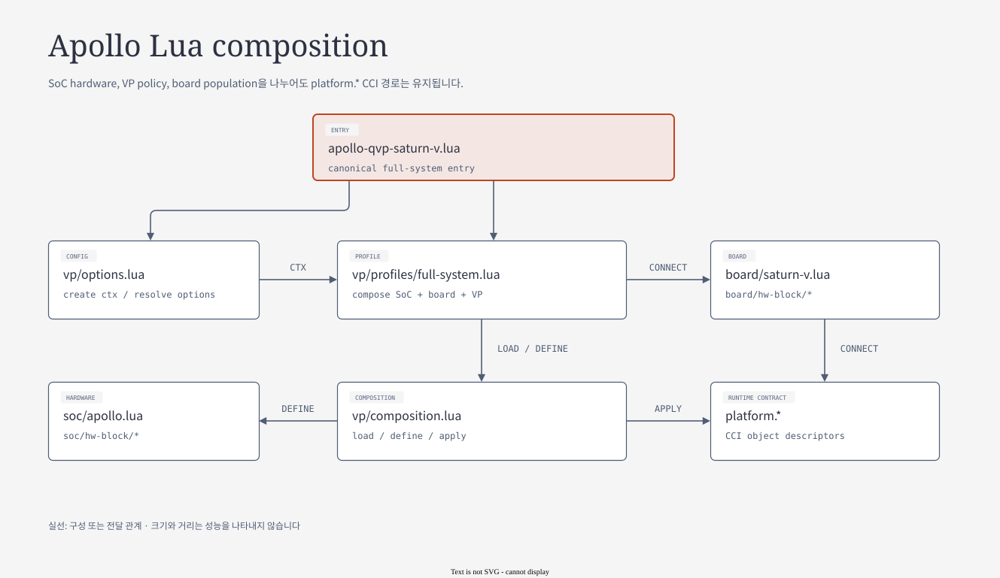
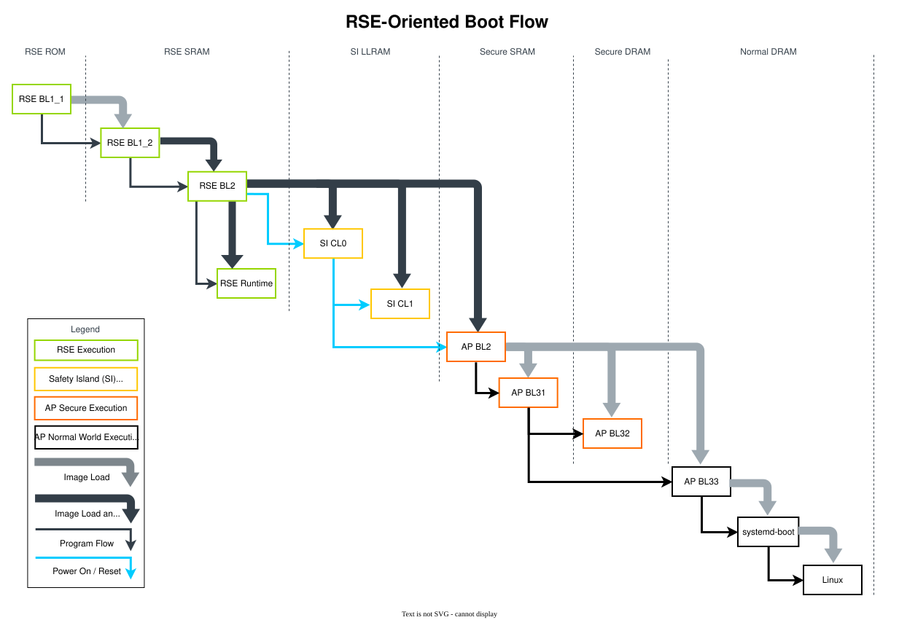

# 04.3 SoC·VP·Board Lua composition과 boot/reset

> **학습 목표:** ctx에서 최종 platform descriptor가 만들어지고 loader/reset이 연결되는 순서를 읽는다.
> Source 기준: 2026-10-25 checkout. 이 장의 작성·분할 검증에서는 build와 runtime을 실행하지 않았다.

[상위 장](../04-qbox-runtime-and-lua.md) · [전체 목차](../README.md) · [이전: QemuInstance와 object 생성](02-qemu-instance-construction.md) · [다음: Address와 time transport](04-address-time-transport.md)

## Lua source의 책임 경계



[draw.io 편집 원본](../diagrams/04-lua-composition.drawio)

[기존 HTML 보기](../diagrams/04-lua-composition.html)

```text
platforms/apollo/
├── apollo-qvp-saturn-v.lua       canonical full-system entry
├── apollo-qvp.lua                compatibility forwarding
├── apollo-qvp-linux.lua          AP-only direct Linux entry
├── soc/
│   ├── config.lua               host 입력 없는 SoC 기본값
│   ├── apollo.lua               hardware domain 조립
│   └── hw-block/                ap_compute, rse, si_cl0, si_cl1,
│                                system_mgmt, ros, fabric
├── vp/
│   ├── options.lua              환경·artifact·실행 옵션 수집
│   ├── profiles/full-system.lua 최종 composition 순서
│   ├── composition.lua          model 선택 + SoC + 실행 보강
│   └── <domain>/, backends/, test-wiring/, debug/
└── board/
    ├── saturn-v.lua             외부 board 부품 연결
    └── hw-block/                EEPROM, PCA9539, TPS6594
```

| 경계 | 책임 | 예시 |
|---|---|---|
| `soc/` | CPU, address, IRQ, reset, interconnect, device register model | GIC, MHU, ATU, PPU, watchdog |
| `vp/` | 실행 정책, loader, host backend, acceleration, diagnostics | TCG, sync policy, UART console, QMP |
| `board/` | SoC 밖 chip과 연결 | I2C EEPROM, GPIO expander, PMIC |

`soc/apollo.lua`는 `default_config()`와 `create(config)`로 host 파일 없는 descriptor를 만들 수 있다.
이 기본값의 AP는 16 PE이고 firmware loader와 board는 없다.
반면 VP entry는 환경을 읽으며, AP enable 기본값은 false다.
**실제 full runner가 AP enable·CPU 수·artifact 입력을 공급한다.**

File hierarchy를 나눠도 `platform.ap_cpu_0`, `platform.ap_gic` 같은 CCI 경로는 유지된다.
RSE CPU 경로는 `platform.rse_cpu_pass.cpu_0.cpu`다.
디렉터리 이름을 그대로 CCI container 경로로 변환해서는 안 된다.

근거: [SoC API](../../../../hsoc-stack/tools/qbox-platform/platforms/apollo/soc/apollo.lua),
[SoC defaults](../../../../hsoc-stack/tools/qbox-platform/platforms/apollo/soc/config.lua),
[VP options](../../../../hsoc-stack/tools/qbox-platform/platforms/apollo/vp/options/execution.lua),
[full-system profile](../../../../hsoc-stack/tools/qbox-platform/platforms/apollo/vp/profiles/full-system.lua).

## `ctx`에서 `platform`까지 조립하는 순서

`ctx`는 option, domain config, request identity, hardware factory를 담는 **구성 context**다.
`platform`은 CCI로 내보낼 **module descriptor table**이다.
`ctx.hardware.ap_compute`는 Lua의 조립 helper이며,
`platform.ap_cpu_0`은 실제 module 생성에 사용될 descriptor이므로 두 table의 역할이 다르다.

| 단계 | 현재 source가 하는 일 | 최종 해석 |
|---|---|---|
| Model 선택 | `composition.load()`가 AP/RSE/SI 설정 후 `soc.load()` 호출 | backend 선택은 hardware 생성 전에 적용 |
| Hardware 정의 | `soc.define()`가 fabric, RSE, AP/RoS, system management 생성 | address와 device object 생성 |
| AP view 연결 | `ap_compute.connect()` → `enable_ap_router()` | CPU·device target을 AP logical view로 재연결 |
| SI 정의 | host window를 만든 뒤 CL0/CL1 hardware 정의 | 서로 다른 domain address view 유지 |
| VP 적용 | reset, loader, domain execution policy, SI reset 순서 보강 | 실행 가능한 descriptor 완성 |
| Board/backend 적용 | AP board/loopback → audio → SI board → diagnostics/debug | host와 외부 device 연결 완성 |

예를 들어 AP CPU의 최초 `mem.bind`는 `system_router.target_socket`이지만,
`enable_ap_router()`가 최종적으로 `ap_router.target_socket`에 연결한다.
이 함수를 지나기 전의 descriptor만 보면 MMIO 경로를 잘못 설명하게 된다.
이러한 define/connect 구분은 남아 있지만, 과거 파일명인 `global-memory-map.lua`나
`address_view.lua`를 현재 공통 entry로 소개하지 않는다.

근거: [composition](../../../../hsoc-stack/tools/qbox-platform/platforms/apollo/vp/composition.lua),
[AP CPU 초기 정의](../../../../hsoc-stack/tools/qbox-platform/platforms/apollo/soc/hw-block/ap_compute/cpu.lua),
[AP interconnect 최종 연결](../../../../hsoc-stack/tools/qbox-platform/platforms/apollo/soc/hw-block/ap_compute/interconnect.lua).

### Canonical profile의 실제 호출 순서

```text
apollo-qvp-saturn-v.lua
  1. vp/options.create() → soc/config.create() + environment/artifact/policy
  2. full-system(ctx)
       composition.load(ctx)
         AP/RSE/CL0/CL1.configure → soc.load → ctx.hardware.*
       result = qvp.create()       # Container, quantum, keep_alive
       composition.define(ctx, result)
         soc.define → VP reset + RSE/AP/RoS/CL0/CL1.apply
         si_reset.finalize_reset_order(result)
       board.connect_ap → loopbacks.connect_ap → audio.connect
       board.connect_si → loopbacks.connect_pmic → diagnostics → debug
  3. platform = result             # QBox에 내보내는 최종 global table
```

`soc.define()` 안에서도 순서가 있다. Fabric과 RSE, AP/RoS, system management를 정의한 뒤
AP의 최종 address view를 연결한다. 이후 SI host window와 CL0/CL1 hardware를 정의한다.
이렇게 해야 mailbox, shared memory, PPU가 참조하는 이름이 최종 graph에서 서로 맞는다.

### 실제 descriptor를 읽는 법

아래는 AP CPU 정의에서 핵심만 발췌한 것이다. 최종 `mem.bind`는 뒤의 connect 단계가 바꾼다.

```lua
platform["ap_cpu_" .. i] = {
    moduletype = "cpu_arm_cortexA720AE";
    args = {ctx.instances.ap};
    mem = {bind = "&system_router.target_socket"};
    start_in_reset = true;
    cntfrq_hz = 125000000;
}
-- interconnect.enable_ap_router()에서 최종 연결
cpu.mem = {bind = "&ap_router.target_socket"}
```

`moduletype`는 factory가 찾을 C++ module type, `args`는 constructor 의존성,
`bind`는 socket 상대편, 나머지는 CCI parameter다.
문자열 `&platform.ap_qemu_inst`는 단순 장식 이름이 아니라 생성·binding 시 해석하는 object 참조다.

VP는 이미 정의된 hardware에 실행 특성을 덧붙인다.
예를 들어 `vp/si_cl0/si_cl0.lua`는 core PPU의 `power_on_load`를 loader의 `reset`에 연결한다.
`vp/backends/audio.lua`는 SystemC DMA/I2S descriptor를 native QEMU wrapper로 교체하되
기존 MMIO target·IRQ 연결을 가져온다. 따라서 최종 backend도 composition 끝에서 확인한다.

근거: [full-system](../../../../hsoc-stack/tools/qbox-platform/platforms/apollo/vp/profiles/full-system.lua),
[CL0 실행 보강](../../../../hsoc-stack/tools/qbox-platform/platforms/apollo/vp/si_cl0/si_cl0.lua),
[native audio adaptation](../../../../hsoc-stack/tools/qbox-platform/platforms/apollo/vp/backends/audio.lua).

## `ctx`의 값이 언제 확정되고 무엇을 바꾸는가

`vp/options.create()`는 domain을 load하기 전에 environment, artifact, execution,
model backend, vMCU 옵션을 한 번 수집한다.
이때 만든 `ctx`가 `configure()`와 hardware factory에 전달된다.
이미 생성한 `platform`의 field를 나중에 덮어쓰는 단계도 있으므로,
source 검색에서 처음 발견한 대입 한 줄만으로 effective configuration을 결정하지 않는다.

| 이름 | 포함하는 것 | consumer | 잘못 해석하기 쉬운 부분 |
|---|---|---|---|
| `ctx.options` | host environment, file/backend/execution 선택 | `configure`, loader, backend adapter | 실행마다 달라질 수 있음 |
| `ctx.config` | domain hardware configuration | `soc.load()`, hardware factory | host 실행 policy와 전부 같지 않음 |
| `ctx.hardware.*` | `define`, `connect`를 제공하는 Lua helper | `soc.define()` | SystemC instance 그 자체가 아님 |
| `ctx.instances.*` | constructor가 참조할 instance 경로 | CPU/device descriptor의 `args` | 문자열 참조의 target이 실제로 있어야 함 |
| `platform.*` | module/parameter/socket descriptor | CCI와 ModuleFactory | composition 마지막 결과가 실행 입력 |
| `ctx.request_context` | origin/domain/security/capability 입력 | CPU·loader·protected fabric | 주소와 별도로 전달되는 requester 정보 |

Loader origin은 VP options에서 AP `0x1F00`, CL0 `0x4F00`, CL1 `0x5F00`으로 분리한다.
Capability 이름도 `boot_loader=1`, `authenticated_image=2`로 정의한다.
이 숫자는 host loader가 어떤 requester로 fabric에 들어가는지 식별하는 모델 입력이다.
Capability 이름이 존재한다는 사실만으로 image 인증 결과를 증명하는 것은 아니다.

`ctx.config.monitor`도 여기에서 만들어진다.
Monitor port는 1~65535의 정수인지 검사하고,
runtime injection을 요청하면 monitor enable이 필요하다는 assertion을 적용한다.
이처럼 Lua는 단순한 배선 목록뿐 아니라 서로 맞아야 하는 실행 옵션도 검증한다.

근거: [options.create](../../../../hsoc-stack/tools/qbox-platform/platforms/apollo/vp/options.lua),
[SoC load/define](../../../../hsoc-stack/tools/qbox-platform/platforms/apollo/soc/apollo.lua),
[VP composition](../../../../hsoc-stack/tools/qbox-platform/platforms/apollo/vp/composition.lua).

### Define/connect 순서로 보는 AP MMIO 연결

AP CPU definition은 초기 memory target을 `system_router`로 둔다.
AP interconnect의 connect 단계가 AP logical view를 만들고 CPU와 관련 target을 재연결한다.
그러므로 설계 설명에서 확인해야 할 것은 다음 세 가지다.

1. `define()`에서 module과 초기 interface가 존재하는가.
2. `connect()`에서 address alias·translation·target binding이 바뀌는가.
3. VP/backend adapter가 최종 module type 또는 binding을 다시 바꾸는가.

예를 들어 audio adapter는 native DMA/I2S wrapper를 선택하면서 기존 IRQ와 MMIO 계약을 이어받는다.
반면 AP shared SRAM alias는 interconnect가 정한다.
Driver-visible 주소 문제가 발생했을 때 audio file만 보거나 CPU file만 보면
최종 경로를 놓칠 수 있는 이유다.

## Firmware boot와 host loader/reset을 함께 읽기



[draw.io 편집 원본](../figures/reference/rse_oriented_boot_flow.drawio)

원본: Arm [Boot process — Boot flow](../../../../arm-zena-css/documentation/design/boot_process.rst),
[`rse_oriented_boot_flow.svg`](../../../../arm-zena-css/documentation/images/rse_oriented_boot_flow.svg).
굵은 적재 화살표와 execution handoff를 구분해서 읽는다.
**Apollo delta:** 이 firmware 흐름과 함께 QVP host의 preload/reload와 PPU→reset adapter가 동작한다.

### 같은 image가 두 종류의 load 경로에 등장하는 이유

RSE firmware는 image authentication, measurement와 domain boot orchestration을 수행한다.
QVP의 loader는 model memory 초기화와 cold reset 후 실행 상태 복원을 지원한다.
Host가 image를 SRAM에 먼저 넣었다는 사실만으로 RSE firmware의 인증을 통과했다고 판정하지 않는다.

| 단계 | Firmware의 소유 동작 | QVP descriptor/model의 소유 동작 |
|---|---|---|
| Elaboration | 아직 CPU 실행 전 | 공통 `loader.end_of_elaboration()`가 초기 memory 적재 |
| RSE boot | BL1_1 → BL1_2 → BL2 → runtime | ROM/OTP/flash model, 선택 native crypto/가속 경로 |
| CL1 image 준비 | RSE BL2 pre-load hook의 cluster PPU ON | `host_si_cl1_clus_ppu.power_on_load → si_cl1_loader.reset` |
| CL0 시작 | RSE BL2 post-load의 PPU ON/CPUHALT 해제 | `power_on_load` reload 후 `power_on_reset` CPU release |
| CL1 실행 | SCP가 CL1 core별 PPU ON | `si_cl1_coreN_ppu.power_on_reset → si_cl1_cpu_N.reset` |
| AP 실행 | RSE/SCP handshake 후 AP ON | AP cold reset/boot memory 복원과 CPU release |

CL0 loader는 `si_cl0_router`를 통해 `0x120000000`에,
CL1 loader는 `si_cl1_router`를 통해 `0x140000000`에 binary를 적재한다.
Loader 자체도 initiator이며 request domain/security/capability metadata를 가진다.
Firmware의 CPU MMIO 경로와 host loader 접근을 같은 requester로 처리하지 않는다.

### Reset 순서가 functional behavior인 이유

현재 `finalize_reset_order()`는 SI PPU hold를 먼저 설정하고,
SystemC UART의 retained IRQ level과 GIC multiview 상태를 정리한 뒤 SI QemuInstance reset을 요청한다.
QEMU instance reset 완료가 vCPU를 resume하더라도 외부 hold가 남아 있어야
firmware의 PPU ON 이전에 CPU가 실행되지 않는다.

따라서 reset fanout은 단순 “모든 reset pin에 true” 목록이 아니다.
동일한 대상을 두 번 reset하거나 GIC보다 UART level을 늦게 clear하면
재부팅 직후 stale interrupt나 잘못된 release 순서가 나타날 수 있다.
CL1의 cluster PPU load와 core PPU release를 분리한 것도 같은 이유다.

근거: [공통 loader](../../../../hsoc-stack/tools/qbox/systemc-components/common/include/loader.h),
[CL0 loader](../../../../hsoc-stack/tools/qbox-platform/platforms/apollo/vp/si_cl0/boot.lua),
[CL1 loader](../../../../hsoc-stack/tools/qbox-platform/platforms/apollo/vp/si_cl1/boot.lua),
[CL1 PPU load 연결](../../../../hsoc-stack/tools/qbox-platform/platforms/apollo/vp/si_cl1/si_cl1.lua),
[SI CPU PPU/reset](../../../../hsoc-stack/tools/qbox-platform/platforms/apollo/soc/hw-block/si_cl0/power.lua),
[SI reset 순서](../../../../hsoc-stack/tools/qbox-platform/platforms/apollo/vp/si_cl1/reset.lua).

## 변경 위치와 실패 지점을 연결해서 읽기

아래는 새 변경을 수행하라는 절차가 아니라, source를 읽을 때 책임 경계를 찾는 표다.
한 configuration 값이 어느 layer에서 소비되는지 정하면 부작용 범위가 보인다.

| 바뀌는 요구 | 우선 읽을 owner | 함께 확인할 interface |
|---|---|---|
| AP CPU 수·GIC population | `soc/hw-block/ap_compute`, VP execution option | firmware topology, DTB, runner expected CPU |
| device register/IRQ | `soc/hw-block/<domain>`와 C++ model | target window, SPI/PPI, reset signal |
| firmware file·preload | `vp/<domain>/boot.lua` | loader initiator, address, requester, PPU load trigger |
| UART file/console | `vp/<domain>` backend | guest UART device와 host file/FIFO 양끝 |
| I2C board device | `board/saturn-v.lua`, `board/hw-block` | controller bus, address, IRQ/GPIO pin |
| reset 후 stale IRQ | `vp/si_cl1/reset.lua`와 해당 device | hold → UART clear → GIC reset → QEMU reset 순서 |

첫 module 생성에 실패하면 factory registration과 `args` 참조를 조사한다.
Model은 만들어졌지만 guest가 abort하면 address view·target offset·permission을 조사한다.
Cold boot는 되지만 warm/reset 경로에서 실패하면 loader 재적재와 PPU hold/release의 차이를 조사한다.
이 세 가지는 같은 “Lua 오류”가 아니며 필요한 log와 source 위치도 다르다.

**발표자가 설명할 수 있어야 하는 사례:** CL1 cluster PPU가 ON되어 image를 load하는 시점과
각 CL1 core PPU가 CPU reset을 해제하는 시점은 서로 다르다.
전자는 memory 준비이고 후자는 execution release이므로,
load callback을 확인한 것만으로 네 PE가 실행 중이라고 결론 내리지 않는다.

---

[상위 장](../04-qbox-runtime-and-lua.md) · [전체 목차](../README.md) · [이전: QemuInstance와 object 생성](02-qemu-instance-construction.md) · [다음: Address와 time transport](04-address-time-transport.md)
