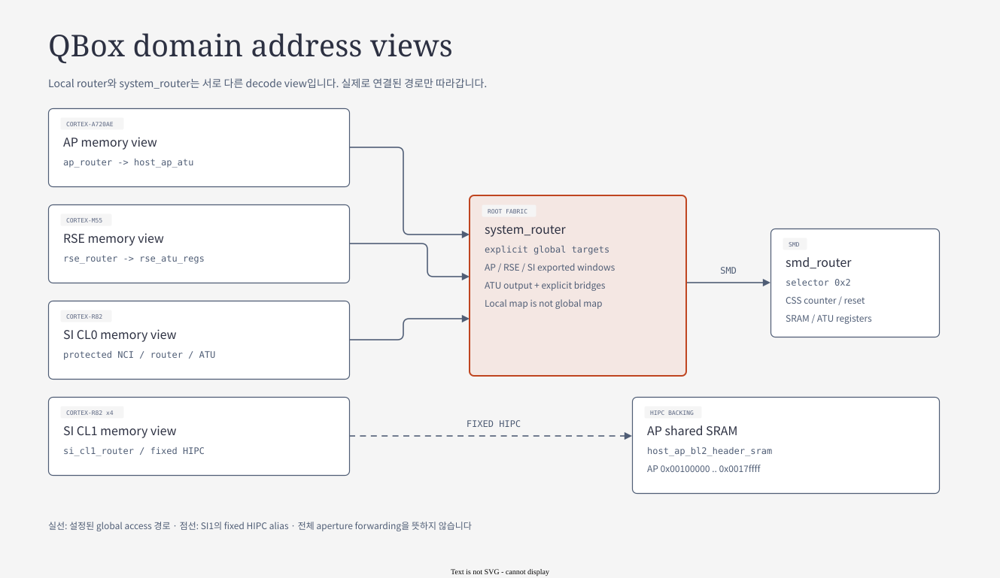
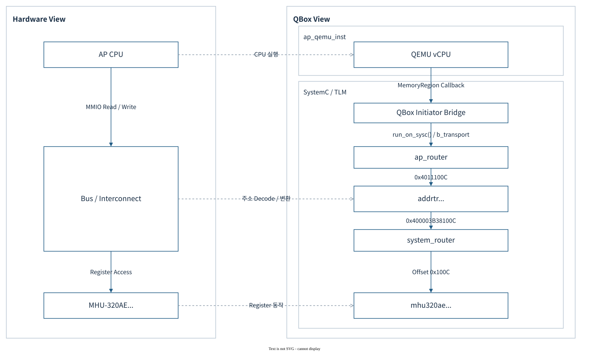
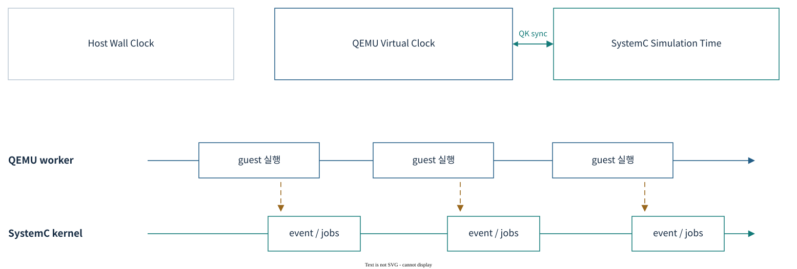

# 04.4 Address view, MMIO·DMA·IRQ·DMI와 시간

> **학습 목표:** AP MHU write의 주소 변환부터 IRQ·DMI·시간 정책까지 한 transaction의 경계를 추적한다.
> Source 기준: 2026-10-25 checkout. 이 장의 작성·분할 검증에서는 build와 runtime을 실행하지 않았다.

[상위 장](../04-qbox-runtime-and-lua.md) · [전체 목차](../README.md) · [이전: Lua composition과 reset](03-lua-composition.md) · [다음: FVP/QBox 비교 개요](../05-fvp-qbox-comparison.md)

## Domain별 memory view와 fabric



[draw.io 편집 원본](../diagrams/04-domain-fabric.drawio)

[기존 HTML 보기](../diagrams/04-domain-fabric.html)

그림은 **CPU가 바라보는 주소 공간을 연결한 topology**다.
Arm 문서의 CMN/NCI physical block을 TLM router 하나씩으로 치환한 그림은 아니다.
같은 backing memory에 도달해도 AP·RSE·SI의 논리 주소는 다를 수 있다.

| 출발 view | CPU에서 시작하는 실제 경로 | 다른 view로 나가는 경로 |
|---|---|---|
| AP | `ap_cpu_N.mem → ap_router` | `host_ap_atu`, 선택 `addrtr` bridge → `system_router` |
| RSE | M55 local router → pass → `rse_router` | `rse_atu_regs.translation_socket` → `system_router` |
| SI CL0 | CPU → NI `protected_target_socket` → `si_cl0_router` | `host_si_atu` / SMD expansion ATU → `system_router` |
| SI CL1 | `si_cl1_cpu_N.mem → si_cl1_router` | HIPC `si_cl1_hipc_bridge` → `ap_router` |
| System fabric | `system_router` | `system_to_smd_nci` → `smd_router` |

**RSE 예:** `0x60000000–0x6fffffff`는 Non-secure host-access window,
`0x70000000–0x7fffffff`는 Secure alias다.
RSE firmware가 ATU region을 설정하면 이 window의 offset이 더 큰 system address로 변환된다.
32-bit RSE 주소에 system의 모든 물리 주소를 직접 넣는 구조가 아니다.

**SI CL0 예:** CPU 접근은 NI 보호 target을 먼저 통과한다.
`host_ni710ae_nci`는 request의 domain/security와 APU permission을 검사하고,
허용된 transaction을 `si_cl0_router`로 전달한다.
권한 거부는 memory read/write 완료와 다르며 fault 경로로 연결된다.

**HIPC 예:** CL1의 `0xe0130000`, 길이 `0x80000` window는
AP SRAM의 `0x00100000`으로 변환된다.
CL1은 AP의 shared backing memory를 보는 것이며 system fabric 왕복이 필수인 경로는 아니다.
AP 쪽에도 같은 high window를 low SRAM으로 연결하는 alias가 있다.

**SMD 예:** `system_to_smd_nci`는 `0x2000000000000`부터
`0x1000000000000` 크기의 system-management 구간을 `smd_router`로 보낸다.
여기서는 `mapped_base_addr`와 source base가 같으므로 수치 주소를 바꾸지 않고 decode 경계를 분리한다.
`addrtr`가 있다고 항상 주소에 고정 차이를 더하는 것은 아니다.

근거: [Arm Components — RSE Address Window Regions](../../../../arm-zena-css/documentation/design/components.rst),
[AP view](../../../../hsoc-stack/tools/qbox-platform/platforms/apollo/soc/hw-block/ap_compute/interconnect.lua),
[RSE ATU](../../../../hsoc-stack/tools/qbox-platform/platforms/apollo/soc/hw-block/rse/interconnect.lua),
[SI0 보호·ATU](../../../../hsoc-stack/tools/qbox-platform/platforms/apollo/soc/hw-block/si_cl0/interconnect.lua),
[SI1 HIPC bridge](../../../../hsoc-stack/tools/qbox-platform/platforms/apollo/soc/hw-block/si_cl1/interconnect.lua),
[System/SMD fabric](../../../../hsoc-stack/tools/qbox-platform/platforms/apollo/soc/hw-block/fabric/fabric.lua).

## Worked case: AP의 32-bit MHU write 한 건



[draw.io 편집 원본](../diagrams/phase1/qbox-04a-mmio-hardware-qbox.drawio)

출처: [기존 QBox 교재 — AP Mailbox MMIO](../../qbox/README.md#apollo-예-ap-vcpu--두-router--systemc-mhu).
왼쪽은 hardware의 기능 경로, 오른쪽은 현재 QBox object 경로다.
둘 사이 점선은 대응 관계이며 별도 data link가 아니다.

AP가 PFDI monitor PBX Channel 0의 `DBCW_SET`에 쓰는 예를 따라간다.
Payload는 32-bit write지만 bus address는 각 view를 지나며 달라진다.

| 순서 | 처리 object | 이 단계의 주소 | 동작 |
|---|---|---|---|
| 1 | `ap_cpu_N.mem` / QBox initiator | `0x4011100c` | QEMU callback을 TLM write payload로 변환 |
| 2 | `ap_router` | `0x4011100c` | base `0x40110000`, size `0x30000` bridge 선택 |
| 3 | `ap_to_system_pfdi_monitor_mhu_bridge` | `0x400003b38100c` | `addrtr`가 system address로 변환 |
| 4 | `system_router` | `0x100c` | PBX base `0x400003b380000`을 뺀 target offset |
| 5 | `host_ap_si_pfdi_monitor_mhu_pbx` | Channel 0 `DBCW_SET` | doorbell state 갱신, pair의 수신 IRQ 조건 갱신 |

```text
offset         = 0x4011100c - 0x40110000 = 0x100c
system address = 0x400003b380000 + offset = 0x400003b38100c
target offset  = system address - PBX base = 0x100c
```

Bridge window는 `relative_addresses=false`여서 첫 router가 base를 빼지 않는다.
그래야 `addrtr`가 자기 source base를 빼고 `mapped_base_addr`를 더할 수 있다.
최종 PBX target에는 router의 상대 주소 처리가 적용되어 register offset이 전달된다.
반환 시 `addrtr::b_transport()`는 payload address를 복원하고 response status와 read data를 돌려준다.

QBox initiator의 `do_regular_access()`는 BQL unlock → `run_on_sysc(b_transport)` → BQL lock 순서다.
그 뒤 두 router와 translator 호출마다 새로운 host thread를 만드는 것은 아니다.
SystemC 문맥에서 nested `b_transport()` 호출이 이어진다.

근거: [AP bridge 상수·binding](../../../../hsoc-stack/tools/qbox-platform/platforms/apollo/soc/hw-block/ap_compute/interconnect.lua),
[PFDI PBX definition](../../../../hsoc-stack/tools/qbox-platform/platforms/apollo/soc/hw-block/system_mgmt/ap_si_mailbox.lua),
[Router](../../../../hsoc-stack/tools/qbox/systemc-components/router/include/router.h),
[MHU register 동작](../../../../hsoc-stack/tools/qbox-platform/systemc-components/mhu320ae/include/mhu320ae.h).

### MMIO·DMA·IRQ·DMI의 방향

| 경로 | 흐름 | 의미 |
|---|---|---|
| MMIO write/read | guest CPU → QEMU memory callback → QBox initiator → TLM router → target | register 모델의 부작용과 응답을 실행 |
| 주소 변환 | AP/SI/RSE logical address → ATU/`addrtr` → system address | 같은 장치가 domain별 다른 주소에 보일 수 있음 |
| IRQ | device signal → GIC/NVIC → CPU exception | MMIO transaction과 별도 연결 |
| DMI | 허용 memory range → direct host memory 접근 | 반복 transaction 비용을 줄임; 실제 coherent cache 모델을 뜻하지 않음 |
| Reset | reset source → fanout/adapter → CPU/device | 대상과 순서를 따로 확인해야 함 |

DMA device는 **control register의 target**이면서 **memory transfer의 initiator**다.
CPU가 DMA register를 설정하는 화살표와 DMA가 RAM을 읽고 쓰는 화살표의 출발점이 다르다.
예를 들어 기본 SystemC SMMU 경로의 AP PCIe bus master는
`ap_gpex_0.bus_master → ap_smmu_lti00.upstream_socket → downstream_socket → ap_router`로 간다.
TCU의 page-table 접근은 별도 `ap_smmu_0.dma` initiator다.

IRQ도 memory 응답의 역방향 전송이 아니다.
Mailbox가 signal level을 바꾸면 target GIC/NVIC가 pending 상태를 갱신하고 CPU exception을 요청한다.
QEMU target signal wrapper는 대상 instance의 I/O lock을 잡고 GPIO를 갱신한다.
CPU가 IAR을 읽고 EOI하는 MMIO/CPU-interface 처리는 그 다음 단계다.

### DMI가 생략하는 경로와 유지해야 하는 경로

RAM target이 `get_direct_mem_ptr()` grant를 주면 QBox가 host backing pointer를
QEMU memory alias로 등록하여 다음 RAM access의 SystemC 왕복을 줄인다.
이 grant에는 주소 범위와 read/write permission이 포함된다.
ATU·APU policy나 target state가 바뀌면 invalidation이 기존 alias를 무효화해야 한다.

| 접근 | 빠른 경로를 사용할 수 있는 조건 | 유지되는 동작 |
|---|---|---|
| RAM | target와 경유 translator가 DMI를 허용 | grant 범위·permission·invalidation |
| Flash | read-array 상태 및 허용 구간 | write command/state 변경 시 일반 경로 |
| 같은-instance QEMU device | 안전한 MemoryRegion hint가 제공됨 | 해당 QEMU device의 native 동작 |
| MHU doorbell / GIC multiview | register 부작용·policy 처리가 필요 | target의 접근 처리를 거쳐야 함 |

DMI는 coherent fabric의 snoop·cache-line protocol을 시뮬레이션하는 기능이 아니다.
또한 “DMI를 지원하는 model”과 “이번 run에서 DMI가 켜져 실제 hit가 난 model”을 구분한다.

`mem`은 CPU의 **initiator socket을 나타내는 CCI 이름**이다.
Router의 `target_socket`은 요청을 받고 `initiator_socket`은 decode한 target으로 보낸다.
`addrtr`는 source window와 `mapped_base_addr`를 연결하므로 address와 offset을 혼동하지 않는다.
GIC multiview처럼 접근마다 정책 검사가 필요한 경로는 DMI와 MemoryRegion hint 우회를 차단한다.

근거: [QBox initiator bridge](../../../../hsoc-stack/tools/qbox/qemu-components/common/include/ports/initiator.h),
[`addrtr`](../../../../hsoc-stack/tools/qbox/systemc-components/addrtr/include/addrtr.h),
[GIC wrapper](../../../../hsoc-stack/tools/qbox-platform/systemc-components/gicx00_multiview/include/gicx00_multiview.h).

## TCG와 SystemC가 시간을 진행시키는 방식



[draw.io 편집 원본](../diagrams/phase1/qbox-08-time-model.drawio)

출처: [기존 QBox 교재 — 실행과 시간](../../qbox/README.md#62-시간-진행과-동기화).
세 시간축은 “같은 시계의 다른 표시”가 아니다. CPU 실행, timed event, host 관측에 각각 사용한다.

| 설정 | 현재 기본 | 뜻 |
|---|---|---|
| `accel` | `tcg` | guest ISA 실행 엔진 |
| `tcg_mode` | AP/SI `MULTI`, RSE `SINGLE` | QEMU vCPU 실행 threading 정책 |
| `sync_policy` | `multithread-freerunning` | QEMU와 SystemC 진행을 조정하는 정책 |
| `time_sync_strategy` | `quantum_keeper` | local time과 동기화 시점을 관리하는 방식 |
| `quantum_ns` | full VP descriptor `10000000` | global quantum 설정 입력; clock frequency나 최대 skew 보장값이 아님 |
| CPU generic timer | AP/SI 125 MHz | CPU별 QEMU timer와 PPI, CSS counter mirror |

Host wall clock, SystemC simulation time, QEMU virtual clock을 구분한다.
`multithread-freerunning`을 사용한다는 사실만으로 domain 사이의 최대 시간차나 silicon timing을 보장할 수 없다.
Counter·timer·watchdog의 SW-visible 의미는 [System Core Architecture](../07-system-software-core.md)에서 연결한다.

CPU wrapper는 QEMU virtual clock가 SystemC time보다 앞서면 그 차이를 quantum keeper에 반영한다.
Deadline timer는 CPU를 kick하여 실행 loop에서 빠져나오게 하고 다음 deadline을 설정한다.
Loop 종료 callback의 `sync_with_kernel()`이 time을 반영하고 해당 policy의 `sync()`를 호출한다.

| 상황 | 현재 `multithread-freerunning` 동작 | 관찰할 결과 |
|---|---|---|
| 외부 QEMU thread의 `sync()` | SystemC tick을 notify하고 budget 대기는 하지 않음 | CPU가 global barrier를 기다리지 않음 |
| SystemC thread에서 `sync()` | local time 차이만큼 `wait()` | timed event와 simulation time 진행 |
| 일반 MMIO | SystemC target의 완료를 기다림 | freerunning이어도 register 순서는 완료에 의존 |
| CPU가 reset hold 상태 | quantum keeper를 정지 | 실행하지 않는 CPU가 시간 진행을 붙잡지 않도록 함 |
| reset release 후 WFI | 관리된 CPU는 deadline/timer wakeup 가능 상태 유지 | interrupt가 도착하면 실행 재개 |

`need_sync()`가 false인 정책에서 quantum을 10 ms에서 1 ms로 바꾸어도
budget을 강제하는 `multithread-quantum` 정책으로 바뀌지는 않는다.
Clock frequency, timer compare, annotated TLM delay, global quantum은 서로 다른 입력이다.

근거: [full VP quantum](../../../../hsoc-stack/tools/qbox-platform/platforms/apollo/vp/qvp.lua),
[AP 실행 정책](../../../../hsoc-stack/tools/qbox-platform/platforms/apollo/vp/ap_compute/qemu.lua),
[QBox 실행기](../../../../hsoc-stack/tools/qbox/platforms/src/main.cc),
[시간 모델 상세](../../qbox/README.md#35-qemuinstance-실행-모드와-quantum).

실행 세부 근거: [CPU deadline/sync/hold](../../../../hsoc-stack/tools/qbox/qemu-components/common/include/cpu.h),
[freerunning policy](../../../../hsoc-stack/tools/qbox/systemc-components/common/include/qkmulti-freerunning.h),
[IRQ target socket](../../../../hsoc-stack/tools/qbox/qemu-components/common/include/ports/qemu-target-signal-socket.h).

## Address·request identity·response는 함께 이동한다

주소 decode를 이해한 다음에는 payload에서 유지되는 계약을 본다.
하나의 `tlm_generic_payload`에는 command, address, data length, data pointer,
response status 등이 들어간다. Apollo의 request context는 initiator의 domain/security 등도 전달한다.
Translation은 숫자 주소만 바꾸고 끝나는 작업이 아니며,
target의 접근 허용 여부와 반환 상태까지 원래 initiator에 돌아와야 한다.

| 단계 | 변할 수 있는 값 | 유지·복원해야 할 값 |
|---|---|---|
| QEMU callback → TLM | QEMU access를 TLM command/data로 표현 | 요청 크기·쓰기 값·CPU requester |
| Router decode | relative target address | 선택 window와 transaction 의미 |
| ATU / `addrtr` | logical address → 다른 address view | request attribute, return address 복원 |
| Target 처리 | read data, response status, device state | register width·side effect·permission |
| Return | 원래 view로 address 복원 | caller가 확인할 성공/오류·read data |

같은 device base가 보인다는 것과 같은 permission으로 접근한다는 것은 다르다.
SI CL0 protected path의 NI APU는 requester/security를 사용한다.
Host loader가 CPU와 다른 origin/capability를 가지는 것도 이 구분 때문이다.
오류를 분석할 때 address만 출력하고 requester를 생략하면
허용된 preload와 거부된 CPU access의 차이를 놓칠 수 있다.

### 동일 PFDI write가 실패하는 세 위치

| 관찰 | 가능한 실패 경계 | 우선 비교할 값 |
|---|---|---|
| AP 주소에서 target을 못 찾음 | AP logical decode | `0x40110000` base, `0x30000` size, final binding |
| 다른 register가 변경됨 | translation / relative offset | `relative_addresses`, `mapped_base_addr`, `0x100c` |
| register write는 보이나 CL1 반응 없음 | signal·GIC·firmware service | MHU pair, IRQ mask/pending, view owner, ISR/ACK |

세 번째 경우에도 MMIO path 전체가 틀렸다고 단정하지 않는다.
Write response가 정상이어도 receiver mask, GIC enable, CPU reset hold,
service의 shared-memory 해석 중 어느 단계든 다음 진행을 막을 수 있다.
Mailbox payload/queue와 attach lifecycle은 [FVP 비교의 protocol 사례](../05-comparison/02-topology-device-mechanisms.md)에서 이어서 설명한다.

## 시간 문제와 주소 문제를 분리해서 진단하기

| 관찰 | 주소·동작 측면 | 시간·실행 측면 |
|---|---|---|
| register read가 고정값 | target/offset, read-array mode, alias 확인 | CPU가 같은 loop만 도는지 확인 |
| timer IRQ가 오지 않음 | compare/control, PPI/SPI routing, mask 확인 | counter clock와 deadline kick, CPU hold/WFI 확인 |
| reset 뒤 IRQ가 즉시 발생 | retained source level와 GIC pending 확인 | reset clear 순서와 CPU release 확인 |
| RAM은 빠르나 MMIO는 느림 | DMI hit와 side-effect path 차이 | BQL↔SystemC 왕복 및 host contention 확인 |
| timeout 발생 | 마지막 성공 transaction/marker 확인 | host timeout과 simulation time을 구분 |

`sc_main()`은 simulation time과 wall duration을 따로 출력한다.
Runner timeout은 host의 실행 제한이고, CPU timer는 guest가 보는 counter/clock 계약이다.
따라서 “host에서 10초 지났다”를 “모든 guest domain이 정확히 10초 진행했다”로 바꾸지 않는다.
먼저 transaction 또는 IRQ가 막힌 위치를 확인한 뒤 sync policy를 검토해야 원인을 분리할 수 있다.

근거: [request context 적용](../../../../hsoc-stack/tools/qbox/qemu-components/common/include/cpu.h),
[transport bridge](../../../../hsoc-stack/tools/qbox/qemu-components/common/include/ports/initiator.h),
[주소 변환](../../../../hsoc-stack/tools/qbox/systemc-components/addrtr/include/addrtr.h),
[host timeout](../../../../scripts/run/qbox_apollo_runtime.py) `run_platform`,
[simulation/wall 출력](../../../../hsoc-stack/tools/qbox/platforms/src/main.cc).

## 발표자가 한 transaction으로 확인할 질문

| 질문 | 이 장의 답 | source에서 확인할 곳 |
|---|---|---|
| 어느 CPU가 시작하는가? | AP A720AE vCPU | `ap_compute/cpu.lua` |
| 어느 주소 view인가? | `ap_router`의 logical address | `ap_compute/interconnect.lua` |
| 어디서 주소가 바뀌는가? | PFDI `addrtr` bridge | `mapped_base_addr`, `relative_addresses` |
| 어느 thread가 target을 호출하는가? | 일반 MMIO는 SystemC context | `do_regular_access()`, `run_on_sysc()` |
| 완료와 IRQ는 같은 event인가? | MMIO 반환과 수신 IRQ는 별도 경로 | MHU target + pair + GIC binding |
| 다음 접근은 우회할 수 있는가? | RAM grant는 DMI 가능, doorbell은 side effect 유지 | target DMI/hint policy |

1. “Launcher가 image와 provider를 고르고, Lua가 platform을 조립하고, QEMU와 SystemC가 실행한다.”
2. “폴더 구조는 source ownership이며, 최종 CCI·socket 연결은 composition이 끝난 뒤 확인한다.”
3. “Linux login, full-system 서비스 동작, FVP 기능 비교, silicon timing은 각각 다른 검증 범위다.”

추가 읽기: [QBox 상세 교재](../../qbox/README.md),
[현재 platform README](../../../../hsoc-stack/tools/qbox-platform/platforms/apollo/README.md).

---

[상위 장](../04-qbox-runtime-and-lua.md) · [전체 목차](../README.md) · [이전: Lua composition과 reset](03-lua-composition.md) · [다음: FVP/QBox 비교 개요](../05-fvp-qbox-comparison.md)
