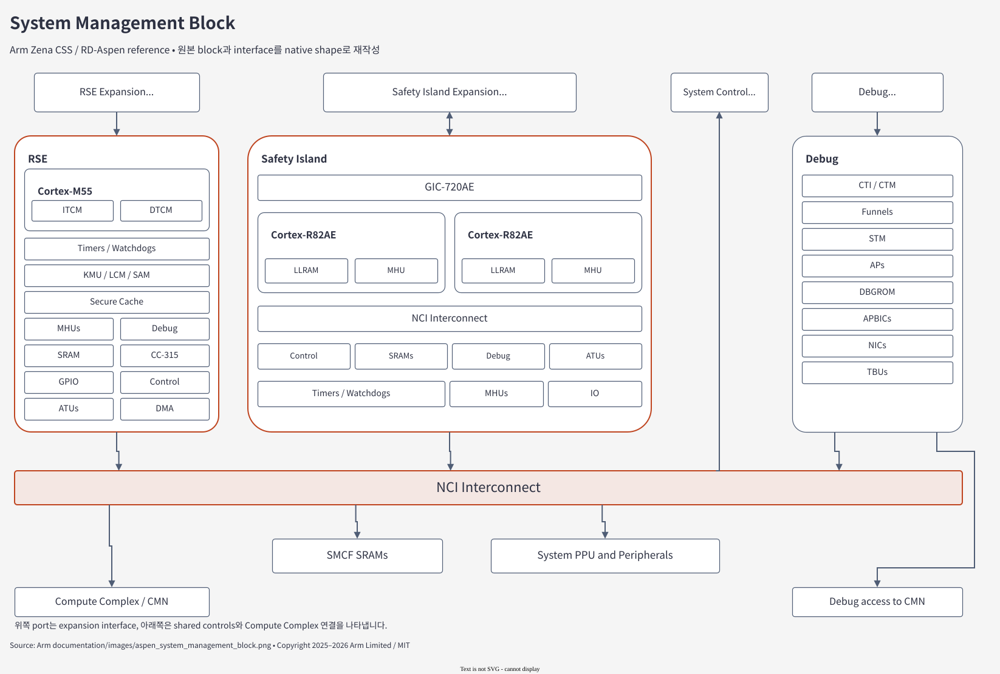
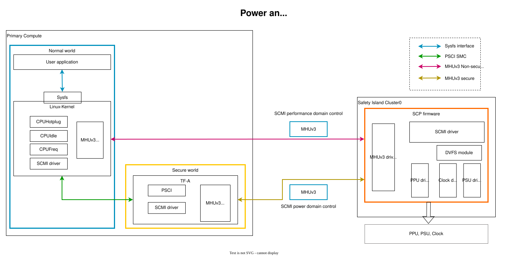
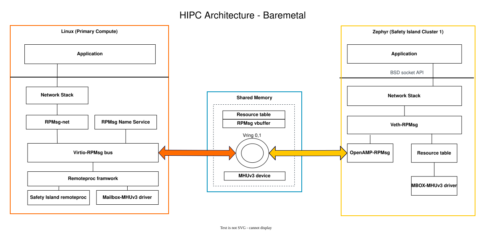

# 05.2 Domain topology와 device mechanism 비교

> **학습 목표:** CMN/NI·ATU/SMMU·GIC·power·HIPC를 실제 control/data/notification 경로로 비교한다.
> Source 기준: 2026-10-25 checkout. 이 장의 작성·분할 검증에서는 build와 runtime을 실행하지 않았다.

[상위 장](../05-fvp-qbox-comparison.md) · [전체 목차](../README.md) · [이전: 비교 baseline](01-comparison-baseline.md) · [다음: Evidence와 실패 진단](03-evidence-and-diagnosis.md)

## System Management Block과 execution domain

[draw.io 편집 원본](../figures/reference/aspen_system_management_block.drawio)

Native draw.io 재작성 기준: Arm [Components — System Management Block](../../../../arm-zena-css/documentation/design/components.rst),
[`aspen_system_management_block.png`](../../../../arm-zena-css/documentation/images/aspen_system_management_block.png).
**Apollo delta:** RSE, SI CL0, SI CL1은 별도 QEMU 실행 상태를 갖지만,
공유 SMD resource와 mailbox는 SystemC 연결을 통해 상호작용한다.
원본 그림의 Debug block 전체가 QVP에 그대로 구현되었다는 의미는 아니다.

여기서 **SMB는 RSE·Safety Island·SMD를 묶는 block**, **SMD는 shared peripheral/SRAM/interconnect domain**이다.
SCP는 SI CL0에서 실행하는 firmware이며 SMD라는 이름의 별도 CPU에서 실행하지 않는다.
이 구분이 되어야 “RSE가 SMD 주소의 PPU를 쓴다”는 boot 설명을 정확히 읽을 수 있다.

| Domain / 기능 | FVP/reference의 구성 | 현재 Apollo QVP | 설명 경계 |
|---|---|---|---|
| AP / Primary Compute | Cortex-A720AE, 최대 16 PE topology | `cpu_arm_cortexA720AE`; full runner 기본 4 PE | TCG는 pipeline/cache timing 모델이 아님 |
| RSE | Cortex-M55 기반 Root of Trust, DCLS 구성 설명 | `ApolloRseCPU`의 M55 PE 1개 + peripheral helper instance | redundant physical core의 fault comparison을 재현하지 않음 |
| SI CL0 | Cortex-R82AE dual lock-step pair; SCP firmware | `cpu_arm_cortexR82` PE 1개; SCP 실행 | 1개 functional PE와 물리 DCLS pair를 구분 |
| SI CL1 | Cfg2의 Cortex-R82AE 4-core SMP | R82 PE 4개; Zephyr SMP | Cfg1에는 없는 domain |
| SI CL2 | 이 reference configuration의 실행 domain 아님 | 해당 full-system Lua에 없음 | AP cluster 2와 SI CL2를 혼동하지 않음 |
| SCP | SI CL0에서 실행하는 firmware 역할 | SI CL0의 `si0_ramfw.bin` | 별도 SCP Cortex-M CPU domain을 그리지 않음 |
| MCP | 이 구성의 독립 실행 domain으로 정의되지 않음 | 해당 full-system Lua에 없음 | 다른 Arm platform의 SCP/MCP topology를 가져오지 않음 |

CPU 모델명에서 `AE` 표기를 사용하는 것과 모든 Automotive Enhanced safety 회로를 구현하는 것은 별개다.
QVP의 firmware domain은 AP·RSE·SI CL0·SI CL1 네 개이고, RSE helper를 포함한 QemuInstance는 다섯 개다.

근거: [reference Safety Island/Primary Compute](../../../../arm-zena-css/documentation/design/components.rst),
[SoC domain 목록](../../../../hsoc-stack/tools/qbox-platform/platforms/apollo/soc/apollo.lua),
[AP CPU](../../../../hsoc-stack/tools/qbox-platform/platforms/apollo/soc/hw-block/ap_compute/cpu.lua),
[SI CL0 CPU](../../../../hsoc-stack/tools/qbox-platform/platforms/apollo/soc/hw-block/si_cl0/cpu.lua),
[SI CL1 CPU](../../../../hsoc-stack/tools/qbox-platform/platforms/apollo/soc/hw-block/si_cl1/cpu.lua),
[RSE CPU](../../../../hsoc-stack/tools/qbox-platform/platforms/apollo/soc/hw-block/rse/cpu.lua).

## Hardware block을 어떻게 대응시키는가

| Block | FVP/reference | QVP의 대응 구현 | 남는 차이 |
|---|---|---|---|
| Interconnect | CMN S3(AE), NI-710AE | TLM router, `addrtr`, ATU, 보호·fault model | physical mesh, CHI traffic, contention·bandwidth 동등성 미입증 |
| Interrupt | GIC-720AE, multiple views, ITS | libqemu GIC + `gicx00_multiview`, functional AE 경로 | 전체 GIC-720AE silicon 기능과 같다는 의미 아님 |
| IOMMU | MMU-720AE TCU/TBU | 기본 SystemC `smmuv3` + `smmuv3_tbu`; 선택형 QEMU backend | 모든 구현·timing 차원을 포괄하는 equivalence 없음 |
| Mailbox | MHU-320AE | `mhu320ae`, doorbell, shared-memory IPC, functional FCE | physical protection, FIFO/security banking 범위 제한 |
| Timer | CPU generic timer, MMIO generic timer, system counter | CPU별 QEMU timer/PPI + `qemu_arm_arch_timer_mmio` + `host_gtimer` | event·counter 의미와 real-time 성능은 별도 |
| Watchdog / reset | AP/SI/RSE watchdog와 reset tree | watchdog model, signal fanout, PPU/reset adapter | full power/clock physical sequencing 동등성 미입증 |
| RSE boot/security | ROM/flash/OTP, CryptoCell, ATU 등 | SystemC model 및 선택형 QEMU native backend | acceleration 설정·보안 속성·persistent state를 함께 기록 |
| Safety fault | FMU·NI·SSU 계층 | System/Root/leaf FMU, error injection, SCP 처리 | physical ECC/CRC/DCLS/PING 진단 coverage 아님 |
| RoS | virtio block/net/rng, PL031, PL011 등 | guest interface를 제공하는 QEMU/SystemC model | host networking 경로나 주변장치 전체 동등성은 별도 |
| Board / 확장 | FVP 제공 board parameter | Saturn-V EEPROM/PCA9539/TPS6594, 외부 vMCU 연결 | Saturn-V schematic fidelity는 `UNVERIFIED` |

이 표는 **구현 대응표**다. 한 행에 대응 모델이 있다고 그 행 전체가 검증 PASS가 되는 것은 아니다.
FVP 역시 모든 Zena CSS IP를 모델링하지 않는다. Developer Guide는 CoreSight SoC-600,
STM-500, SDC-600, ELA-600을 FVP 미모델링 예로 명시한다.

근거: [FVP model 범위](../../../arm_zena_css_dev_guide/08-fixed-virtual-platform.md),
[QVP model/AE/Timer/PCIe 설명](../../../../hsoc-stack/tools/qbox-platform/platforms/apollo/README.md),
[SoC hardware source](../../../../hsoc-stack/tools/qbox-platform/platforms/apollo/soc/hw-block/).

### CMN과 NI를 router 한 종류로 설명하면 놓치는 것

QVP에서 **traffic routing**과 **interconnect의 programmer's model**은 서로 다른 코드에 있다.
Router는 address window를 decode하고 target으로 transaction을 전달한다.
`host_cmn_cyprus`는 SCP가 발견하고 설정하는 node/register 구조를 제공한다.
`host_ni710ae_nci`는 NCI/APU register와 선택된 protected traffic 경로를 구현한다.

| 기능 | 실제 source의 동작 | 그 결과 SW가 할 수 있는 일 |
|---|---|---|
| CMN node discovery | `seed_registers()`, child/node register 값 구성 | SCP가 node topology를 발견하고 초기화 진행 |
| CMN register 접근 | MMIO read/write와 window 검사 | firmware의 제어 register sequence 수행 |
| NI APU policy | request security/domain, region permission 검사 | 허용/거부 접근과 보호 fault 처리 |
| Policy 변경 | protected DMI invalidation 예약 | 이전 direct-memory grant가 권한 변경을 우회하지 않도록 함 |
| Fabric forwarding | domain router + ATU/`addrtr` | AP/RSE/SI가 서로 다른 주소로 같은 resource에 접근 |

이는 physical CHI flit, snoop filter, mesh congestion을 모델링하는 것과 다르다.
CMN register가 읽히고 SCP 초기화가 끝나는 결과는 **firmware 초기화 계약**의 증거다.
Cache coherency나 bandwidth 결과를 주장하려면 별도의 traffic/timing 모델과 측정 근거가 필요하다.

근거: [CMN register model](../../../../hsoc-stack/tools/qbox-platform/systemc-components/host_cmn_cyprus/include/host_cmn_cyprus.h),
[NI protected access](../../../../hsoc-stack/tools/qbox-platform/systemc-components/host_ni710ae_nci/include/host_ni710ae_nci.h),
[SI0 실제 protected binding](../../../../hsoc-stack/tools/qbox-platform/platforms/apollo/soc/hw-block/si_cl0/interconnect.lua).

### ATU와 SMMU는 주소를 바꾸지만 사용자가 다르다

| 항목 | ATU | SMMU / TCU·TBU |
|---|---|---|
| 주 사용자 | RSE/SCP 등 firmware와 domain 간 주소 window | DMA를 발생시키는 I/O requester |
| 제어 정보 | firmware가 설정한 region base/limit/offset·attribute | StreamID, translation context, page table |
| QVP 예 | RSE `0x60000000` / `0x70000000` → system address | PCIe bus master → `ap_smmu_lti00` → AP memory |
| 실패 관점 | unmapped region, 접근·attribute 오류 | translation/permission fault, Event Queue IRQ |

현재 기본 AP SMMU backend는 SystemC `smmuv3` TCU와 하나의 `smmuv3_tbu`다.
TCU register는 AP view `0x1c0000000`에 배치되고, TBU upstream은 PCIe bus master를 받는다.
TCU가 page table을 읽는 `dma` socket과 translated payload가 나가는 TBU downstream은 별도 경로다.
Event Queue IRQ는 `ap_gic.spi_in_65`, 즉 architectural INTID 97로 연결된다.

`qemu-arm-smmuv3` backend를 고르면 `arm_smmuv3` wrapper가 선택된다.
두 backend가 존재한다는 사실은 같은 run에서 동시에 두 개를 사용하는 의미가 아니다.
실제 선택은 `options.smmu_backend`와 최종 descriptor에서 확인한다.

근거: [TCU/TBU 정의](../../../../hsoc-stack/tools/qbox-platform/platforms/apollo/soc/hw-block/ap_compute/system.lua),
[최종 PCIe/DMA binding](../../../../hsoc-stack/tools/qbox-platform/platforms/apollo/soc/hw-block/ap_compute/interconnect.lua),
[model 기본값](../../../../hsoc-stack/tools/qbox-platform/platforms/apollo/soc/config.lua).

## Worked case 1: GIC multiple views는 무엇을 분리하는가?

[draw.io 편집 원본](../figures/reference/si_gic_multiple_view.drawio)

원본: Arm [Components — GIC Multiple Views](../../../../arm-zena-css/documentation/design/components.rst),
[`si_gic_multiple_view.svg`](../../../../arm-zena-css/documentation/images/si_gic_multiple_view.svg).
**Apollo delta:** 하나의 SI programming model 앞단을 유지하면서,
CL0/CL1의 실제 delivery는 각각 독립 libqemu GIC backend로 연결한다.

View는 OS별로 허용된 GIC programming interface와 interrupt 소유를 나눈다.
“View가 세 개니 interrupt controller와 CPU cluster도 세 개”라는 뜻은 아니다.
특히 View0는 SCP의 초기 설정을 위한 management view다.

| View | Arm reference 역할 | 현재 QVP의 연결 |
|---|---|---|
| SI View0 | SCP가 View1/2 소유·구성을 설정 | `si_gic_multiview`가 두 backend의 register 접근을 분기·병합 |
| SI View1 | CL0 실행 환경 | `si_cl0_gic`, 1 PE |
| SI View2 | CL1 Zephyr | `si_cl1_gic`, 4 PE |
| AP View0 | SCP의 AP GIC management | `0x20000000` public distributor view |
| AP View1 | AP 실행 환경 | `0x20800000` public distributor view |

AP raw backend frame은 `0x60000000`/`0x61000000`의 private router에 배치되어 있다.
CPU가 public view를 접근하면 wrapper를 거쳐야 하며,
DMI/MemoryRegion hint가 raw backend alias를 만들어 policy 검사를 우회하지 못하게 막는다.
SI의 View2 redistributor search는 CL1 MPIDR `0x10000`, `0x10100`, `0x10200`, `0x10300`과 맞아야 한다.

**Containment 예:** INTID 105가 정상 전달되던 상태에서 오류를 주입해 격리하면
guest IAR은 해당 source 대신 spurious 1023을 볼 수 있다.
오류를 clear한 뒤 interrupt를 명시적으로 재설정·enable해야 다시 105가 전달된다.
단순히 error status bit가 지워지는 것과 실제 IRQ delivery 복구는 서로 다른 확인 항목이다.
이러한 real CPU/GIC fixture가 provider test에 있으며, 실제 SI firmware 시험과는 구분한다.

근거: [SI multiview assembly](../../../../hsoc-stack/tools/qbox-platform/platforms/apollo/soc/hw-block/si_cl0/system.lua),
[CL1 backend](../../../../hsoc-stack/tools/qbox-platform/platforms/apollo/soc/hw-block/si_cl1/system.lua),
[GIC wrapper](../../../../hsoc-stack/tools/qbox-platform/systemc-components/gicx00_multiview/include/gicx00_multiview.h),
[functional AE validation](../../../qbox-ae-followup-validation-ko.md).

### Automotive Enhanced 기능은 register·delivery·fault hierarchy를 같이 본다

| 대상 | 현재 functional path | 별도 또는 미지원인 범위 |
|---|---|---|
| GIC containment | SPI/SGI/PPI source·view 소유, 격리·복구, selected RAM error path | 전체 physical ECC/lockstep/CRC/PING circuit |
| MHU fast channel | 64 × 32-bit, 32 channel/group; latest payload, pending/read-clear | 이 geometry는 QVP 설정이며 silicon synthesis 값 아님 |
| MHU RAM fault | 선택 receiver의 detector → local RAS/FMU 경로 | local RAS guest IRQ 미배선, 일부 polling 확인 |
| FMU hierarchy | leaf → System/Root/NI 경로, SCP bounded drain와 ACK | 전체 NI endpoint 및 물리 FHI pin topology |
| Power coordination | model Q-channel interface 제공 | 실제 power-controller/Q-channel integration 미배선 |

예를 들어 `ERRINS`로 record를 만들었다는 결과와 payload RAM fault가 실제 접근에서 검출된 결과를 분리한다.
SCP가 leaf를 ACK한 뒤 parent가 다시 assert되면 하위 fault가 남아 있는지 확인해야 한다.
**Injection 요청 수락, detector 동작, IRQ 도착, firmware 처리 완료**를 각각 관찰하면 실패 위치를 좁힐 수 있다.

## Worked case 2: CPUFreq와 CPUIdle은 어디까지 같은가?

[draw.io 편집 원본](../figures/reference/power_and_performance_control.drawio)

[Arm 원본 SVG](../../../../arm-zena-css/documentation/images/power_and_performance_control.svg)

원본: Arm [Power and performance control — Architecture](../../../../arm-zena-css/documentation/design/power_and_performance_control.rst),
[`power_and_performance_control.png`](../../../../arm-zena-css/documentation/images/power_and_performance_control.png).
**Apollo delta:** Linux·TF-A·SCMI·SCP라는 제어 역할은 유지하지만,
QVP PPU/clock state와 host TCG 처리량은 같은 물리량이 아니다.

그림의 위쪽 SCMI Performance 경로와 아래쪽 PSCI Power Domain 경로를 나누어 읽는다.
CPUFreq의 frequency 요청은 항상 TF-A를 거쳐야 하는 CPUIdle/PSCI 호출과 같은 경로가 아니다.

| 단계 | CPUFreq | CPUIdle / power state |
|---|---|---|
| Linux 결정 | governor가 performance level 선택 | idle governor가 state 선택 |
| 전달 interface | SCMI Performance message | PSCI 호출 → TF-A → SCP power-domain 요청 |
| SCP 역할 | domain limit/level, clock·PSU 제어 | core/cluster PPU 전이·release orchestration |
| QVP의 모델 결과 | guest-visible current level/limit | PPU state, CPU hold/release, IRQ wakeup |

Reference는 cluster별 performance domain과 1.8/2.0/2.5 GHz operating point를 제시한다.
QVP도 네 AP CPU당 하나의 performance domain과 이 level을 제공한다.
그러나 `scaling_cur_freq`가 1.8에서 2.5 GHz로 바뀐 것이 host TCG instruction rate가
같은 비율로 증가했다는 뜻은 아니다. 이 모델은 cpufreq protocol과 상태를 확인하는 데 사용한다.

현재 QVP의 default DT는 architectural WFI를 사용하고 PSCI deep idle state를 광고하지 않는다.
Core/cluster sleep 구현은 존재하지만 default boot의 state 목록과 동일하지 않다.
기능 경로에서는 powerdown WFI가 core PPU로 전달되고 enabled pending GIC PPI/SPI가 wakeup을 유발한다.
SCP의 cluster OFF/ON과 warm release는 cold boot의 firmware reload와 구분된다.

| 실험 질문 | 필요한 관찰 | 결과의 의미 |
|---|---|---|
| 주파수 요청이 반영됐는가? | SCMI response + domain current level/limit | firmware/driver control contract |
| CPU가 sleep 후 돌아오는가? | PPU state + timer/IRQ + CPU progress | functional wakeup |
| 성능·전력·exit latency가 silicon과 같은가? | 별도 calibrated model/hardware 측정 | 위의 상태 변화만으로 결론 낼 수 없음 |

근거: [Arm power design](../../../../arm-zena-css/documentation/design/power_and_performance_control.rst),
[QVP idle·performance 계약](../../../../hsoc-stack/tools/qbox-platform/platforms/apollo/README.md),
[PPU model](../../../../hsoc-stack/tools/qbox-platform/systemc-components/host_ppu/include/host_ppu.h),
[QVP idle 상세](../../../qbox-psci-idle.md).

## Worked case 3: HIPC packet은 mailbox에 담기지 않는다

[draw.io 편집 원본](../figures/reference/hipc_baremetal_design.drawio)

원본: Arm [HIPC — HIPC Baremetal Architecture](../../../../arm-zena-css/documentation/design/hipc.rst),
[`hipc_baremetal_design.svg`](../../../../arm-zena-css/documentation/images/hipc_baremetal_design.svg).
**Apollo delta:** Linux/Zephyr의 RPMsg 역할을 유지하고,
두 domain의 다른 memory view를 QVP bridge로 하나의 shared backing memory에 연결한다.

그림에서 **MHUv3는 알림**, **shared SRAM은 payload와 queue metadata**를 담당한다.
Linux는 remoteproc → Virtio-RPMsg → RPMsg-net으로,
Zephyr는 OpenAMP → RPMsg endpoint → virtual network interface로 연결된다.
Name Service announcement 이후 OS가 endpoint와 network device를 생성한다.

| 512 KiB shared region | AP view | CL1 view | 크기 |
|---|---|---|---|
| Resource table | `0x00100000` | `0xe0130000` | 128 KiB |
| Vring 0 | `0x00120000` | `0xe0150000` | 128 KiB |
| Vring 1 | `0x00140000` | `0xe0170000` | 128 KiB |
| Virtio buffer | `0x00160000` | `0xe0190000` | 128 KiB |

CL1 주소는 `0xe0130000 + (AP address − 0x00100000)`으로 대응한다.
QVP의 `si_cl1_hipc_bridge`는 반대로 CL1의 접근을 AP SRAM 주소로 변환한다.
Zephyr overlay의 `busaddr_delta_l = 0xe0030000`도 두 view의 차이를 표현한다.
Vring의 pointer/address를 그대로 다른 domain에서 역참조하면 안 되는 이유다.

**한 packet의 흐름:** 송신 측이 Virtio buffer에 payload를 쓰고 vring을 갱신한다.
이후 MHU doorbell로 상대를 깨우면 수신 ISR이 queue를 확인하고 RPMsg endpoint에 전달한다.
Buffer를 반환하는 used-ring/notification도 있어 한쪽의 IRQ만 확인해서는 왕복이 완성되지 않는다.
Network 경로에서는 RPMsg payload와 skb 사이 복사가 추가되므로 queue/packet-drop 관찰도 필요하다.

CL1은 Linux가 firmware를 적재하여 부팅하는 remote CPU가 아니다.
Arm reference의 remoteproc는 이미 독립 boot한 CL1에 `RPROC_DETACHED` 상태에서 attach하는 방식이다.
따라서 AP domain reset 후에는 CL1 boot 횟수와 AP의 attach/detach lifecycle을 따로 관찰한다.
QVP full-system과 CL1 service를 대신하는 AP-only stub도 이 지점에서 차이가 난다.

현재 AP board DTS는 `si_remoteproc`, resource/vring/buffer와 mailbox node를 enable한다.
CL1 overlay는 `0xe0130000`의 non-cacheable shared memory와 `vq0/vq1`, `attach`, `detach`, `ack` channel을 선언한다.
이는 raw doorbell 전달 위에 service-level handshake가 더 필요하다는 source 근거다.

근거: [Arm HIPC design·memory map](../../../../arm-zena-css/documentation/design/hipc.rst),
[AP SRAM/remoteproc DT](../../../../hsoc-stack/components/primary_compute/linux/arch/arm64/boot/dts/hsoc/apollo.dtsi),
[현재 QVP board DTS](../../../../hsoc-stack/components/primary_compute/linux/arch/arm64/boot/dts/hsoc/apollo-qvp-saturn-v.dts),
[CL1 HIPC overlay](../../../../hsoc-stack/components/system_mgmt/zephyrproject/zephyr_hsoc_src/overlays/hipc/apollo_fvp_safety_island_c1.overlay),
[QVP shared-memory bridge](../../../../hsoc-stack/tools/qbox-platform/platforms/apollo/soc/hw-block/si_cl1/interconnect.lua).

## IP 대응표를 transaction 단위로 사용하는 방법

IP 이름은 조사 시작점이고, 비교 단위는 guest가 수행한 동작이다.
예를 들어 “MMU-720AE가 있다”는 사실만으로 특정 PCIe DMA가 올바르게 번역되었다고 말할 수 없다.
Request가 어느 TBU로 들어오고, TCU가 어떤 table을 읽고,
성공 payload 또는 fault notification이 어디로 나갔는지 연결해야 한다.

| 사례 | Control path | Data / notification path | 비교할 관찰 |
|---|---|---|---|
| PCIe DMA | AP driver → SMMU TCU register | GPEX bus master → TBU → AP memory | buffer 내용, translation fault, Event Queue IRQ |
| GIC multiple views | SCP 관리 view → ownership 설정 | device signal → 선택 GIC backend → CPU | 허용 view 접근, INTID delivery, 격리·복구 |
| SCMI CPUFreq | Linux request → shared memory/MHU → SCP | response / current level | 요청 level, response, limit/state |
| HIPC packet | remoteproc attach + endpoint 구성 | buffer/vring + MHU notification | packet 왕복, queue 반환, detach/reattach |
| AE fault 처리 | injection / detector 설정 | leaf record → hierarchy → SCP drain/ACK | 각 named marker와 처리 완료 |

TCU의 page-table walk와 PCIe payload는 둘 다 RAM에 도달하지만 다른 initiator다.
Page table은 읽혔는데 payload가 잘못된 buffer에 기록되면 table lookup과 최종 translation을 나누어 본다.
Event Queue IRQ가 전달되었다고 DMA 성공으로 처리해서도 안 된다. IRQ는 fault 통지일 수 있다.

### FVP와 QVP에서 같은 failure criterion을 세우기

HIPC에서는 “doorbell IRQ 1회”보다 “attach 완료 후 packet 왕복과 used buffer 반환”이 service 의미에 가깝다.
GIC에서는 “register write 성공”보다 “해당 view/CPU에서 올바른 INTID를 읽고 EOI 후 재발생”이 중요하다.
CPUFreq에서는 “host benchmark가 빨라짐” 대신 “SCMI request와 현재 level/limit 일치”가 이 model의 기능 범위다.

이러한 기준은 FVP와 QVP의 내부 구현이 달라도 동일하게 관찰할 수 있다.
반대로 physical coherence, ECC fault coverage, power/thermal 특성은
이 transaction 수준의 기능 관찰만으로 판정할 수 없다.

근거: [AP SMMU topology](../../../../hsoc-stack/tools/qbox-platform/platforms/apollo/soc/hw-block/ap_compute/system.lua),
[AP DMA 연결](../../../../hsoc-stack/tools/qbox-platform/platforms/apollo/soc/hw-block/ap_compute/interconnect.lua),
[GIC multiview](../../../../hsoc-stack/tools/qbox-platform/systemc-components/gicx00_multiview/include/gicx00_multiview.h),
[Arm HIPC design](../../../../arm-zena-css/documentation/design/hipc.rst).

## 구성 차이를 증상으로 역추적하는 표

| 증상 | 먼저 확인할 contract | 구성에서 확인할 위치 |
|---|---|---|
| CL0는 실행되나 CL1이 없음 | Cfg2 선택, CL1 image, cluster/core PPU | variant, `si_cl1` descriptor와 loader/reset |
| Linux secondary CPU가 offline | PE count, MPIDR, GIC redistributor, PSCI | model/firmware/DTB 세 계층 |
| MHU status는 변하나 RPMsg endpoint가 없음 | shared memory view, attach, Name Service | HIPC bridge, resource table, remoteproc/OpenAMP |
| DMA timeout / fault | stream/context, page table, TBU path, IRQ | SMMU backend와 TCU/TBU binding |
| IRQ 격리 후 복구되지 않음 | source clear, view permission, rearm/enable | GIC containment, detector, firmware ACK |
| frequency 값만 바뀌고 host throughput 동일 | protocol state와 execution throughput 구분 | SCMI response, model frequency state, TCG |

실패가 보이면 먼저 해당 row의 contract를 좁힌다.
예를 들어 HIPC endpoint가 없을 때 physical CMN coherence 차이부터 원인으로 가정하기보다,
현재 source가 요구하는 address delta·notification·attach state를 확인한다.
이 방법은 FVP와 QVP 양쪽에서 재현 가능한 관찰을 남기는 데 목적이 있다.

---

[상위 장](../05-fvp-qbox-comparison.md) · [전체 목차](../README.md) · [이전: 비교 baseline](01-comparison-baseline.md) · [다음: Evidence와 실패 진단](03-evidence-and-diagnosis.md)
