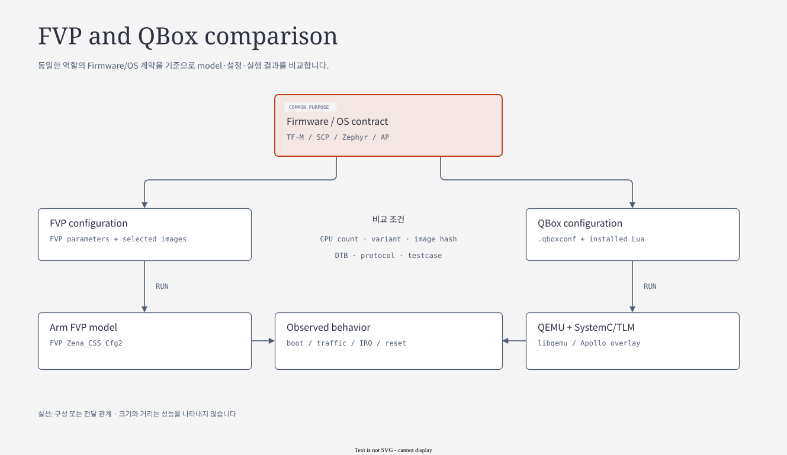

# 05.3 Evidence, FVP reference gate와 실패 진단

> **학습 목표:** standalone 기능 증거와 FVP 비교를 구분하고 실제 assertion·provenance·blocker로 결과를 읽는다.
> Source 기준: 2026-10-25 checkout. 이 장의 작성·분할 검증에서는 build와 runtime을 실행하지 않았다.

[상위 장](../05-fvp-qbox-comparison.md) · [전체 목차](../README.md) · [이전: Topology와 device mechanism](02-topology-device-mechanisms.md) · [다음: Component SW Architecture](../06-component-software-architecture.md)

## 판정할 기능과 비교 mode부터 선택한다

[draw.io 편집 원본](../diagrams/05-fvp-qbox.drawio) · [기존 HTML 보기](../diagrams/05-fvp-qbox.html)

앞 장의 topology·protocol 설명을 실제 evidence로 연결한다.
이 장의 표는 실행 결과를 읽는 방법이며 새 runtime PASS 보고가 아니다.
Source 구현, host/model 시험, full-system guest 실행, FVP 비교는 필요한 관찰이 서로 다르다.

## Full-system과 AP-only profile의 차이

| 항목 | QVP full-system | QVP direct Linux |
|---|---|---|
| Entry | `apollo-qvp-saturn-v.lua` | `apollo-qvp-linux.lua` |
| RSE / CL0 / CL1 firmware | 실행 | 실행하지 않음 |
| AP 시작 | RSE/SCP와 TF-A/U-Boot handoff | Linux 직접 적재 |
| Firmware 제공 기능 | 실제 firmware와 model의 상호작용 | 명시적 substitute/mock 포함 |
| 좋은 사용 사례 | boot chain, SCMI, reset, IPC 통합 확인 | AP device/driver 반복 개발 |
| 결과로 주장할 수 없는 것 | 검사하지 않은 feature의 자동 PASS | RSE 인증, SI firmware, FVP full-system 동등성 |

Direct Linux의 login 성공을 full-system boot와 같은 칸에 적으면 검증 범위가 사라진다.
결과표에는 반드시 profile, machine, AP CPU 수, artifact hash와 검사 항목을 남긴다.

근거: [direct Linux profile](../../../../hsoc-stack/tools/qbox-platform/platforms/apollo/vp/profiles/linux-direct.lua),
[platform README의 Direct Linux](../../../../hsoc-stack/tools/qbox-platform/platforms/apollo/README.md#direct-linux-profile).

## 현재 reference policy와 실행 결과의 의미

현재 policy의 `STANDALONE_QBOX_PROFILES`에는 아래 11개 profile이 있다.
이 allowlist에 속하면 FVP reference 없이 QVP 검증을 시작할 수 있다.
Allowlist에 있다는 것은 실행 권한/비교 policy이며, 해당 profile이 이번 checkout에서 PASS했다는 뜻은 아니다.

| 조건 | `comparison_mode()` | FVP reference 처리 |
|---|---|---|
| named profile 없음 | `none` | named 비교 없음 |
| standalone 허용 profile, reference 없음 | `standalone` | QVP 독립 결과 |
| reference를 명시 | `fvp-reference` | `validate_fvp_reference()` 실행 |
| allowlist 밖 named profile, reference 없음 | 실행 전 blocker | `blocked_fvp_reference_required` |

현재 allowlist: `bsp-core`, `cpuidle`, `cpufreq`, `pfdi`, `pfdi-si-cl1`,
`platform-devices`, `ras_cpu`, `safety-diagnostics-tests`, `si-cl1`, `smcf`, `trusted-services`.

Reference가 선택 사항인 profile도 reference를 제공한 순간에는 gate를 우회하지 않는다.
`qbox_entry._write_qbox_context()`는 현재 profile provenance를 만든 뒤
reference가 있으면 검증하고, 수락된 reference identity를 context에 기록한다.
Source policy가 변경될 수 있으므로 일반 README의 과거 문구보다 이 함수와 allowlist를 우선 확인한다.

근거: [reference policy](../../../../scripts/validation/apollo_validation/reference_policy.py),
[QBox entry의 context 생성](../../../../scripts/validation/apollo_validation/qbox_entry.py).

## FVP reference gate가 실제로 비교하는 것

Reference 파일은 임의 PASS report가 아니라 named run directory의 `summary.json`이어야 한다.
현재 구현은 FVP backend, `apollo-fvp` machine, exit code 0과 PASS 상태를 요구한다.
Run ID와 parent directory, 기록된 run directory도 일치해야 한다.

| 검사 층 | 비교·검증 값 | 대표 blocker |
|---|---|---|
| 실행 identity | backend, machine, run ID, path | `blocked_fvp_reference_backend`, `_path` |
| 기능 선택 | profile, image profile, selector, CPU count | `_profile_mismatch`, `_selector_mismatch`, `_cpu_mismatch` |
| Assertion coverage | expected ID 전체, 중복 없음, 전부 PASS, coverage kind | `_expected_mismatch`, `_assertions_incomplete` |
| Semantic input | profile snapshot, shared input, semantic digest | `_profile_snapshot_drift`, `_shared_input_drift`, `_semantic_drift` |
| Reference runtime input | testdata/config/WIC 파일의 현재 SHA-256 | `_testdata_drift`, `_runtime_config_drift`, `_image_artifact_drift` |
| Source provenance | 필요한 repository revision과 허용 관계 | `_source_revision_shared_drift` 등 |

Assertion 검사는 aggregate passed count만 보지 않는다.
Expected 목록과 observed ID 집합이 맞아야 하고 중복이 없어야 하며,
각 assertion status와 coverage kind도 확인한다.
그래서 중요한 case가 관측되지 않았는데 다른 case의 중복 출력으로 총합만 맞는 결과를 차단할 수 있다.

### Machine별 artifact와 shared semantic 계약

`capture_profile_provenance()`는 backend에 따라 `.fvpconf` 또는 `.qboxconf`를 선택하고,
testdata JSON, runtime config, WIC의 해시를 기록한다.
FVP reference를 읽을 때는 저장된 reference input 파일을 다시 읽어 hash drift를 검사한다.
이 검사는 **FVP WIC와 QVP WIC의 hash가 반드시 같아야 한다는 검사와 다르다.**

공통으로 비교하는 semantic 정보에는 profile, image profile, CPU count,
selectors, expected assertion, coverage kind, FVP config, shared input이 들어간다.
Shared input은 validation matrix, profile YAML, 선택 testcase source로 구성한다.
따라서 machine별 packaging 차이는 보존하면서 test 의도가 같은지 판단할 수 있다.

Source revision 검사도 모든 repository의 HEAD 문자열을 무조건 같게 요구하는 단순 비교가 아니다.
Shared repository는 동일 revision을 기본으로 하고,
BSP의 명시된 QVP-only path 변경 또는 mixed repository의 ancestor 관계처럼
source에 정의된 제한적 예외를 별도로 검증한다.
예외는 arbitrary drift를 허용하는 규칙이 아니므로 구체적인 allowlist와 ancestry 조건을 함께 읽는다.

근거: [reference 검증 구현](../../../../scripts/validation/apollo_validation/fvp_reference.py),
[provenance capture](../../../../scripts/validation/apollo_validation/provenance.py),
[revision policy](../../../../scripts/validation/apollo_validation/source_revisions.py).

## Case failure와 setup failure를 분리하는 진단 순서

| 확인 순서 | 필요한 관찰 | 판정할 질문 |
|---|---|---|
| 1. 입력·provider | manifest, resolved path, image/provider identity | 의도한 platform과 firmware를 시작했는가? |
| 2. 준비 단계 | reference gate, artifact/boot selection blocker | testcase를 시작할 조건이 충족됐는가? |
| 3. Domain boot | RSE/SCP/CL1/AP marker와 UART | 어느 domain handoff에서 멈췄는가? |
| 4. Service 준비 | driver bind, endpoint, shell/service readiness | 기능 요청을 받을 상태인가? |
| 5. 기능 stimulus | traffic, IRQ, injection, command ID | case의 입력이 실제로 전달됐는가? |
| 6. 결과·복구 | named assertion, ACK, rearm, 왕복 | 성공 조건과 후속 사용 가능 상태를 확인했는가? |

예를 들어 RSE-SCP 준비 단계에서 중단되면 HIPC packet case가 FAIL했다고 단정하지 않는다.
실제 packet을 보내지 못했으므로 setup/boot blocker와 미관측 case를 구분한다.
반대로 setup이 통과했어도 named assertion이 없으면 해당 기능 PASS를 채우지 않는다.

비교 결과에는 QVP 자체 functional PASS와 FVP reference의 지원 범위를 각각 남긴다.
PCIe/ITS처럼 FVP 구성에서 동일 시험을 제공하지 못하면 `UNSUPPORTED`와
`device_equivalence=NOT_COMPARABLE`을 유지하고 QVP 독립 evidence를 제시할 수 있다.
이때 standalone 성공을 FVP equivalence로 바꾸어 쓰지 않는다.

### 팀 보고서에 남길 최소 항목

| 범주 | 기록할 값 |
|---|---|
| Configuration | backend/machine/profile, AP/SI CPU 수, variant, installed Lua/parameter |
| Identity | 실행기/provider, input artifact, persistent-state 조건, source revision |
| Observation | domain UART, 실제 stimulus, expected/observed assertion ID |
| Result | PASS/FAIL/BLOCKED/SKIP/UNSUPPORTED, 최초 조사할 blocker |
| Comparison | standalone 또는 accepted FVP reference, 남는 fidelity gap |

이 자료 자체의 검증은 Markdown navigation, source link와 기술 설명의 source 대조다.
Build 성공이나 새 guest runtime 성공을 추가한 문서가 아니며,
아래 과거 기록은 당시 artifact와 시나리오 범위로 읽는다.

## 현재 구현과 과거 검증 기록을 읽는 방법

| 증거 종류 | 여기서 확인한 내용 | 해석 |
|---|---|---|
| `IMPLEMENTED` | 현재 Lua·C++·firmware source의 대응 경로 | source에 구현과 연결이 존재 |
| 기존 host/model PASS | 2026-10-24 FMU hierarchy 기록의 provider CTest 74, SCP host case 72 | 당시 artifact와 suite 범위의 결과 |
| 기존 guest PASS | 같은 기록의 `guest-2`: AP4, CL1 4 PE, FMU 20, hierarchy 2, RAM fault 3, FCE 8 왕복 | 당시 full-system 기능 시나리오 |
| `UNVERIFIED` | 이 문서 작성 시점의 새 full-system 재실행 | 이번에는 실행하지 않음 |
| `UNSUPPORTED` / fidelity gap | physical ECC/CRC/DCLS/PING, 전체 NI topology, silicon timing | 기능 PASS로 대체할 수 없음 |

기존 기록은 실제 [verification-summary.json](../../../../build/qbox-apollo-qvp/fmu-hierarchy-20261024/verification-summary.json)을 읽어 인용했다.
이 artifact는 local generated evidence이며 다른 clone에는 없을 수 있다.
여기에는 AP16이 static 범위이고 full runtime은 AP4라는 제한도 남아 있다.
지금 checkout의 모든 source와 당시 실행 hash가 동일하다고 재검증한 것은 아니다.

현재 named QBox profile의 reference 요구 여부는 `reference_policy.py`의 allowlist로 결정한다.
Standalone 허용 profile은 FVP 없이 실행할 수 있고, reference를 제공하면 동일한 검증 gate를 적용한다.
FVP에서 미지원인 기능은 QVP 자체 시험이 PASS여도 `device_equivalence=NOT_COMPARABLE`로 남길 수 있다.
예를 들어 현재 PCIe/ITS 문서는 QVP 기능 증거와 FVP의 `UNSUPPORTED` 경계를 따로 기록한다.

근거: [validation profiles](../../../../hsoc-stack/tools/qbox-platform/platforms/apollo/README.md#validation-profiles),
[PCIe/ITS profile](../../../../hsoc-stack/tools/qbox-platform/platforms/apollo/README.md#pcie-msi-xlpi-and-intx-test-profile),
[AE 추가 구현 기록](../../../qbox-ae-followup-validation-ko.md).

## 팀에서 사용할 비교 질문

| 질문 | 먼저 볼 증거 |
|---|---|
| “같은 SW를 실행했는가?” | source revision뿐 아니라 firmware·DTB·disk hash |
| “같은 hardware configuration인가?” | variant, CPU 수, GIC view, address/IRQ, board profile |
| “같은 기능을 확인했는가?” | named case marker와 guest의 실제 traffic/IRQ |
| “빠르게 부팅했으니 더 정확한가?” | boot 시간과 기능·timing fidelity를 별도 평가 |
| “FVP에서 안 되는 것은 QBox도 미지원인가?” | reference 한계와 QVP 독립 시험을 분리 |

발표 마무리: **“같은 firmware 계약을 비교하되, model 구성과 검증 범위는 결과 옆에 적는다.”**

추가 읽기: [QBox 상세 교재의 FVP 비교](../../qbox/README.md#2-arm-zena-css-fvp와-apollo-qvp),
[emulation project 상태](../../../qbox-fvp-emulation-project.md).

---

[상위 장](../05-fvp-qbox-comparison.md) · [전체 목차](../README.md) · [이전: Topology와 device mechanism](02-topology-device-mechanisms.md) · [다음: Component SW Architecture](../06-component-software-architecture.md)
