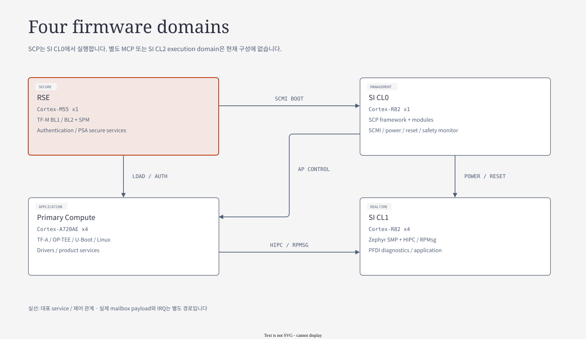

# 06. Project Component SW Architecture

[자료 목차](README.md) · [이전: FVP / QBox](05-fvp-qbox-comparison.md) · [다음: System SW Core](07-system-software-core.md)

> **핵심 메시지:** Apollo는 하나의 OS가 모든 일을 수행하는 구조가 아니다. AP는 application, RSE는 trust, SI CL0는 system management, SI CL1은 RTOS application을 담당하며 protocol로 협력한다.
>
> 기준: 2026-10-25 checkout의 full-system QVP source. 아래 CPU 수는 기본 구성이다. Source에 있는 기능과 이번 작업에서 실행 검증한 기능을 구분하며, 이 문서는 새로운 runtime PASS를 주장하지 않는다.

이 문서는 Component SW 전체를 보는 hub다. 상세 문서는 각 domain의 목적 → 구성 → 동작 순서 → interface → 실패 진단 → source 읽기 순서로 이어진다.

원본 Arm 그림은 **reference architecture**, `doc/phase1/` 그림은 **Apollo implementation 설명**이다. 각 그림 아래에 읽는 순서와 현재 구현에서 달라진 부분을 함께 적었다.

## 1. 전체 구조 — 실행 위치와 책임부터 구분하기

[draw.io 편집 원본](diagrams/06-domain-software.drawio)

[기존 HTML 보기](diagrams/06-domain-software.html)

그림은 실행 위치를 나타낸다. AP의 EL3/Secure world는 AP CPU에서 실행되며, 별도 CPU인 RSE와 구분한다.

| Domain | 기본 실행 CPU | 주요 SW | 대표 책임 | 이웃과의 interface |
|---|---|---|---|---|
| AP / Primary Compute | Cortex-A720AE ×4 | TF-A, OP-TEE, U-Boot, Linux | application 실행, AP secure service, OS boot | PSCI, FF-A, SCMI, HIPC/RPMsg |
| RSE | Cortex-M55 ×1 logical PE | TF-M BL1/BL2, SPM, PSA partitions | 이미지 인증·적재, boot measurement, 보안 서비스 | ATU, MHUv3, SCMI, PSA request |
| SI CL0 | Cortex-R82 ×1 logical PE | SCP-firmware | power/clock, AP·CL1 기동, fault·watchdog 복구 | PPU, SCMI, MHUv3, FMU/SSU |
| SI CL1 | Cortex-R82 ×4 | Zephyr, Arm HIPC/PFDI, HSOC board module | SMP RTOS, Ethernet over RPMsg, 진단·감시 | OpenAMP, MHUv3, shared memory |
| External vMCU, 선택 구성 | TC397 QEMU companion | Zephyr 기반 `zephyr_vmcu_src` | 외부 관리 RPC, safety 상태, CAN 경로 | UART/SPI 및 companion transport |

**현재 범위:** `soc/apollo.lua`에는 별도 SI CL2 실행 domain과 독립 MCP image가 없다. `SCP/MCP Software`라는 upstream project 명칭을 보고 MCP CPU를 그림에 추가하지 않는다. AP cluster의 `CL2` FMU 이름도 SI CL2를 뜻하지 않는다.

**DCLS:** reference의 redundant lockstep core는 독립적으로 firmware를 실행하는 CPU 하나로 더 세지 않는다. QVP의 logical PE 구성은 물리 lockstep 구현·진단 coverage의 증거가 아니다.

근거: [SoC composition](../../../hsoc-stack/tools/qbox-platform/platforms/apollo/soc/apollo.lua), [AP CPU](../../../hsoc-stack/tools/qbox-platform/platforms/apollo/soc/hw-block/ap_compute/cpu.lua), [CL0 CPU](../../../hsoc-stack/tools/qbox-platform/platforms/apollo/soc/hw-block/si_cl0/cpu.lua), [CL1 CPU](../../../hsoc-stack/tools/qbox-platform/platforms/apollo/soc/hw-block/si_cl1/cpu.lua), [RSE CPU](../../../hsoc-stack/tools/qbox-platform/platforms/apollo/soc/hw-block/rse/cpu.lua).

## 2. 상세 문서 읽기 순서

| 순서 | 상세 문서 | 핵심 질문 | 주요 시각 자료 |
|---|---|---|---|
| 06.1 | [Boot와 firmware lifecycle](06-software/01-boot-and-lifecycle.md) | 누가 적재하고 누가 release하는가 | SMB, boot dependency, flash layout |
| 06.2 | [AP boot·Linux·Secure Services](06-software/02-ap-and-secure-services.md) | EL3·SPMC·Linux·RSE 경계를 어떻게 통과하는가 | TF-A/Linux layers, secure service path |
| 06.3 | [RSE TF-M과 PSA runtime](06-software/03-rse-and-psa-runtime.md) | Manifest가 실행 가능한 service가 되는 조건은 무엇인가 | TF-M layers, manifest, PSA IPC |
| 06.4 | [Secure FWU와 image encryption](06-software/04-secure-firmware-update.md) | Write·install·trial·accept와 bank/key는 어떻게 연결되는가 | FWU path, encryption/key wrapping |
| 06.5 | [SI CL0 SCP system management](06-software/05-scp-system-management.md) | Config element와 binding이 request/event를 어떻게 연결하는가 | SCP layers, API binding, SCMI stack |
| 06.6 | [SI CL1 Zephyr와 HIPC](06-software/06-zephyr-and-hipc.md) | RTOS init부터 endpoint와 reattach까지 무엇을 준비하는가 | init levels, threads, HIPC |

**Domain 경계:** [06.1의 address view와 resident runtime](06-software/01-boot-and-lifecycle.md#domain-boundaries)으로 이동한다.

**Boot handoff:** [06.1의 boot flow와 pre-load/post-load handoff](06-software/01-boot-and-lifecycle.md#boot-detail)로 이동한다.

**AP Secure Services:** [06.2의 FF-A → SE Proxy → RSE PSA 경로](06-software/02-ap-and-secure-services.md#ap-secure-service)로 이동한다. 기존 장 anchor 링크도 이 landing에서 연결된다.

**RSE runtime:** [06.3의 manifest·SPM·PSA request](06-software/03-rse-and-psa-runtime.md#rse-runtime-detail)와 [06.4의 FWU/key state](06-software/04-secure-firmware-update.md)를 함께 읽는다.

**SCP binding:** [06.5의 init/bind/start와 SCMI configuration](06-software/05-scp-system-management.md#scp-binding)으로 이동한다.

**CL1 runtime:** [06.6의 init/thread와 실제 recipe의 HIPC reattach patch](06-software/06-zephyr-and-hipc.md#cl1-runtime-detail)로 이동한다.

## 3. 통신을 목적별로 다시 정리하기

| 목적 | Client → Server | Protocol | Payload / 알림 |
|---|---|---|---|
| AP CPU 상태 | Linux → TF-A → CL0 | PSCI + SCMI | secure shared slot + MHU |
| AP performance | Linux → CL0 | SCMI Performance | NS shared slot + MHU |
| Boot/recovery | RSE ↔ CL0 | SCMI + 전용 reload ACK | command/notification slot + doorbell |
| AP↔CL1 network | Linux ↔ Zephyr | VirtIO/RPMsg/virtual Ethernet | vring/buffer + doorbell |
| PFDI 감시 | AP/CL1 → CL0 | SCMI vendor/monitor interface | CPU별 slot + doorbell |
| 보안 서비스 | AP Secure Partition ↔ RSE | PSA 연계 transport | AP–RSE MHU와 허용 memory |

같은 MHU를 사용해도 protocol·buffer·완료 조건은 다르다. “Mailbox가 된다”는 한 문장으로 위 경로 모두의 정상 동작을 판정할 수 없다.

## 4. 장애를 어느 component에 배정할까

| 관찰한 현상 | 먼저 볼 계약 | 다음 자료 |
|---|---|---|
| RSE가 SCP readiness에서 중단 | RSE SCMI, CL0 boot/IRQ, shared SRAM | [System SW Core](07-system-software-core.md) |
| Linux boot 후 `ethsi1`이 없음 | 외부 module 설치·remoteproc attach·RPMsg ready | [Mailbox 상세](../mailbox/README.md) |
| CL1 timeout/uptime 이상 | selected image, timer frequency, virtual PPI | [Timer 상세](../timer/README.md) |
| AP watchdog IRQ 후 OS 미복귀 | SCP recovery, RSE reload ACK, AP boot | [Watchdog 상세](../watchdog/README.md) |
| secure service 실패 | FF-A dispatch, OP-TEE/SP 구성, RSE endpoint | [TF-M 상세](../tfm/README.md) |

발표 확인 질문: **CPU 실행 위치, image 적재 주체, resource 제어 주체, protocol 완료 조건을 각각 말할 수 있는가?** 네 가지를 나누면 복잡한 전체 구조를 따라가기 쉽다.

이번 자료는 source/config와 기존 도식을 대조해 작성했다. 새 build·guest boot·보안/안전 qualification은 수행하지 않았으며 runtime 상태는 별도 evidence로 확인해야 한다.
