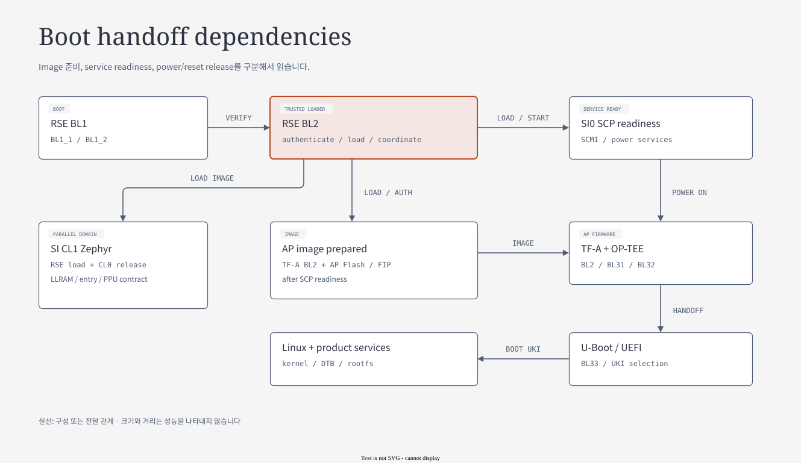

# 06.1 Boot와 firmware lifecycle

[상위: Component SW](../06-component-software-architecture.md) · [전체 목차](../README.md) · [이전](../06-component-software-architecture.md) · [다음](02-ap-and-secure-services.md)

RSE가 image를 준비하고 SCP가 CPU를 release한 뒤 각 firmware가 resident service로 전환되는 과정을 추적한다. Image load 성공, CPU entry 도달, protocol service 준비를 서로 다른 완료 조건으로 읽는 것이 목적이다.

> 기준: 2026-10-25 checkout의 source/config. 기존 diagram과 draw.io 편집 원본을 재사용하며, 이번 문서 작업에서 새 build/runtime 검증은 수행하지 않았다.

## 1. 구성 — 실행 domain과 address view

[draw.io 편집 원본](../figures/reference/aspen_system_management_block.drawio)

[Arm 원본 PNG](../../../../arm-zena-css/documentation/images/aspen_system_management_block.png)

*출처: Arm [components.rst — System Management Block](../../../../arm-zena-css/documentation/design/components.rst). Arm 원본 PNG의 block과 label을 기준으로 native draw.io object로 재작성했다.*

**그림 읽는 순서:** RSE와 Safety Island를 먼저 찾고, 두 실행 domain 사이의 SMD peripheral/SRAM/interconnect를 따라간다. System Management Block은 하나의 OS나 firmware 이름이 아니라 이 영역을 묶는 HW 경계다.

RSE의 M55는 외부 memory를 자기 32-bit local address에 직접 모두 배치할 수 없다. ATU window를 설정하여 system-global address의 일부를 local window에 보이게 한다. CL0 역시 SI view의 window를 통해 AP의 shared SRAM이나 PPU를 접근한다. 따라서 firmware의 pointer와 Lua의 decode address가 다르더라도 서로 잘못된 주소라는 뜻은 아니다.

| 실행 주체 | 직접 소유하는 runtime | 다른 domain을 다루는 방법 |
|---|---|---|
| AP Linux | task·VM·driver·network stack | PSCI/SCMI/FF-A/RPMsg 요청 |
| RSE TF-M | partition·secure storage·image loader | ATU로 접근하고 MHU로 기동/완료 조정 |
| CL0 SCP | module event queue·power state machine | PPU, GIC view config, SCMI server |
| CL1 Zephyr | SMP thread·RTOS device·OpenAMP | shared memory와 MHU를 통한 peer 통신 |

**Apollo 연결:** [soc/apollo.lua](../../../../hsoc-stack/tools/qbox-platform/platforms/apollo/soc/apollo.lua)의 `rse`, `si_cl0`, `si_cl1`, `system_mgmt` builder가 위 경계를 구현한다. SystemC router와 bridge는 memory transaction을 전달하며, SCP나 TF-M의 service logic을 대신 실행하는 것은 아니다.

### 1.1 Boot code와 resident runtime

| Component | Boot에서 하는 일 | Boot 뒤 남는 기능 | 주 실행 단위 |
|---|---|---|---|
| TF-A | BL2 image/config load | BL31의 SMC/exception handler | CPU exception context |
| OP-TEE | SPMC·SP 초기화 | FF-A dispatch·SP 실행 | secure thread/partition |
| U-Boot | UEFI 환경·slot/UKI 선택 | OS handoff 전 boot service | bootloader command/event |
| TF-M | BL1/BL2 인증·적재 | IPC SPM·PSA/FWU/SCMI partition | partition thread/signal |
| SCP | module init/bind/start | SCMI·power·fault processing | module event/callback |
| Zephyr | board/device/SMP init | application·network·PFDI | thread/workqueue/ISR |

발표에서는 firmware 이름을 나열한 다음 “어떤 CPU에서, 어떤 진입점으로 다시 실행되는가?”를 질문한다. AP의 SMC와 RSE의 MHU IRQ, CL1의 thread wakeup을 구분하면 runtime 구조가 명확해진다.

## 2. Boot handoff — 적재하는 주체와 실행시키는 주체

[draw.io 편집 원본](../diagrams/06-boot-handoff.drawio)

[기존 HTML 보기](../diagrams/06-boot-handoff.html)

| 구간 | 주체 | 수행 내용 | 다음 단계가 기다리는 조건 |
|---|---|---|---|
| RSE local boot | TF-M BL1_1 → BL1_2 → BL2 | RSE boot chain 진행, platform 접근 경로 준비 | image 인증·적재와 초기화 성공 |
| SI0 준비 | RSE boot HAL | SI0 image 적재와 기동 준비 | SCP firmware가 SCMI service 제공 |
| AP image 준비 | RSE BL2 | SCMI로 SCP readiness 확인, AP BL2 추출·적재, AP ATU 설정 | SCP 응답 및 적재 성공 |
| AP release | RSE + SCP | RSE의 SCMI power-domain 요청을 SCP가 처리 | AP primary core가 BL2 entry에서 실행 |
| AP boot | TF-A BL2 | BL31, BL32, BL33 관련 image·configuration 준비 | EL3 runtime와 secure/nonsecure entry 준비 |
| AP OS 진입 | BL31 / OP-TEE / U-Boot | OP-TEE 초기화와 U-Boot 진입, UEFI boot | Linux image·DTB·rootfs 선택 성공 |
| CL1 기동 | RSE + CL0 | RSE가 CL1 image 적재, CL0가 cluster 기동 조정 | Zephyr 초기화 및 HIPC/PFDI 준비 |

이 표는 주체 간 dependency를 설명한다. 모든 domain을 한 줄로 세운 엄밀한 시간 trace가 아니며, CL1의 준비와 AP boot에는 서로 다른 완료 조건이 있다.

`SCP is not ready. Abort`가 출력되면 AP Linux 이전의 **RSE↔SCP 초기 통신**부터 조사한다. UART login 여부나 Linux driver로 원인을 바로 좁히지 않는다.

근거: [RSE boot HAL](../../../../hsoc-stack/components/system_mgmt/trusted-firmware-m/platform/ext/target/arm/rse/automotive_rd/apollo-qvp/bl2/boot_hal_bl2.c)의 `boot_platform_pre_load_ap_bl2()`, `boot_platform_post_load_ap_bl2()`, `boot_platform_finish()`; [TF-A platform](../../../../hsoc-stack/components/primary_compute/trusted-firmware-a/plat/arm/board/automotive_rd/platform/apollo_qvp/platform.mk)의 `NEED_BL1=0`, `RESET_TO_BL2=1`.

### 2.1 Reference boot flow에서 세 종류 화살표 읽기

[draw.io 편집 원본](../figures/reference/rse_oriented_boot_flow.drawio)

[Arm 원본 SVG](../../../../arm-zena-css/documentation/images/rse_oriented_boot_flow.svg)

*출처: Arm [boot_process.rst — RSE-oriented boot flow / Boot Flow](../../../../arm-zena-css/documentation/design/boot_process.rst). 그림의 image load, program flow, power/reset 화살표는 서로 다른 관계다.*

1. **RSE program flow:** ROM의 BL1_1이 BL1_2를 준비하고, BL1_2가 flash의 RSE BL2를 복호화·검증한 뒤 실행한다. 다음 stage의 bytes를 복사하는 행위와 그 entry로 branch하는 행위는 다르다.
2. **Host image load:** RSE BL2는 CFG2에서 CL1 image를 LLRAM에 준비한 뒤 CL0 image를 준비한다. CL0가 실행되면 CL1 core 기동을 관리한다. AP BL2는 RSE flash가 아니라 AP secure flash의 FIP에서 가져온다.
3. **Release dependency:** AP BL2 적재 전에는 SCP SCMI service readiness가 필요하다. Image와 ATU가 준비된 후 RSE가 SCMI power-domain 요청을 보내 AP primary core를 release한다.
4. **AP program flow:** AP BL2가 FIP의 BL31/BL32/BL33와 configuration을 적재한다. BL31의 secure runtime 설정과 OP-TEE 초기화가 끝나면 Normal world의 U-Boot로 들어간다.

**Apollo 차이:** reference 그림의 `systemd-boot → Linux`는 일반 reference OS boot다. 현재 product U-Boot의 기본 command는 `aanxbootselect`로 선택한 UKI를 `bootefi`로 실행하므로, `systemd-boot`를 항상 지나는 것으로 설명하지 않는다.

**Code walk:** [RSE boot HAL](../../../../hsoc-stack/components/system_mgmt/trusted-firmware-m/platform/ext/target/arm/rse/automotive_rd/apollo-qvp/bl2/boot_hal_bl2.c)의 `boot_platform_pre_load_si_cl1()` → `boot_platform_post_load_si_cl0()` → `boot_platform_pre_load_ap_bl2()` → `boot_platform_finish()`를 본다. CL1의 cluster memory 접근 준비는 RSE, CL1 core power-on은 [SCP safety_island_platform](../../../../hsoc-stack/components/system_mgmt/scp-firmware/product/automotive-rd/apollo-qvp/module/safety_island_platform/src/mod_safety_island_platform.c)이 담당한다.

## 3. 동작을 source로 추적하기 — AP BL2 준비의 세 단계

[boot_hal_bl2.c](../../../../hsoc-stack/components/system_mgmt/trusted-firmware-m/platform/ext/target/arm/rse/automotive_rd/apollo-qvp/bl2/boot_hal_bl2.c)의 vector table은 image ID에 따라 pre-load와 post-load hook을 고른다. 같은 loader가 여러 image를 처리해도 image별 ATU window와 release 조건은 다르다.

| Hook / 함수 | 입력과 수행 | 다음 단계로 넘기는 계약 |
|---|---|---|
| `boot_platform_pre_load()` | `image_id`로 pre-load vector 선택 | 해당 image를 읽고 쓸 address view 준비 |
| `boot_platform_pre_load_ap_bl2()` | SCMI context init → Power Domain protocol version query | SCP service가 응답한 뒤 AP flash/header/code ATU window 준비 |
| `fill_secure_flash_map_with_data()` | AP secure flash의 FIP에서 BL2 위치 추출 | loader가 MCUboot image 영역을 읽을 flash map |
| `boot_platform_post_load_ap_bl2()` | header clear → `__DSB()` → 임시 RSE ATU 해제 → AP ATU 설정 | measurement 이후 header 수명 종료, AP 실행 view 준비 |
| `boot_platform_finish()` | Power Domain attributes 확인 → composite ON 요청 | SCP가 AP primary core 기동을 처리할 수 있는 시점 |

이 순서를 거꾸로 따라가면 장애 범위를 줄일 수 있다. AP entry가 안 보이면 먼저 power request를 확인하고, request가 없으면 post-load completion을, post-load가 없으면 image load와 pre-load readiness를 확인한다. `SCP ready`는 AP BL2가 이미 실행 중이라는 뜻이 아니다.

### 3.1 적재 주소와 entry address를 구분하는 예

RSE는 AP BL2 header와 code에 각각 ATU window를 연다. Header는 인증·measurement에 필요하지만 AP CPU의 실행 payload와 수명이 다르다. Post-load는 header를 clear하고 write completion을 보장한 후 RSE 임시 window를 닫는다. 따라서 boot 완료 뒤 RSE의 임시 pointer로 내용을 읽으려는 검사와 AP 자신의 실행 주소로 읽는 검사는 같은 접근이 아니다.

AP의 [platform.mk](../../../../hsoc-stack/components/primary_compute/trusted-firmware-a/plat/arm/board/automotive_rd/platform/apollo_qvp/platform.mk)는 `NEED_BL1=0`, `RESET_TO_BL2=1`이다. 이 때문에 RSE가 준비하는 AP entry는 일반적인 BL1 진입을 전제로 해석하면 안 된다. AP BL2는 후속 FIP payload와 dynamic configuration을 준비한다.

## 4. Interface — flash image·RAM image·integrity

[draw.io 편집 원본](../figures/reference/image-layouts.drawio)

[Arm 원본 SVG](../../../../arm-zena-css/documentation/images/image-layouts.svg)

*출처: Arm [boot_process.rst — Images layout](../../../../arm-zena-css/documentation/design/boot_process.rst). Firmware bank 배치와 OS disk를 구분하는 reference 그림이다.*

**그림 읽는 순서:** RSE ROM/OTP처럼 raw blob인 매체, RSE/AP flash처럼 firmware bank가 있는 매체, Linux rootfs가 들어가는 OS disk를 분리한다. 같은 `.img` 확장자라고 모두 bootable disk인 것은 아니다.

| 저장 매체 | 핵심 내용 | 적재·소비 주체 | 실행 위치 |
|---|---|---|---|
| RSE ROM/OTP | BL1_1, provisioning/BL1_2 관련 입력 | RSE BL1 | RSE ROM/SRAM |
| RSE flash | RSE BL2/runtime, SI0 RAMFW, CL1 image | RSE boot chain | RSE SRAM / SI LLRAM |
| AP secure flash | AP FIP, firmware metadata | RSE가 AP BL2 추출; AP BL2가 후속 FIP 처리 | AP shared SRAM / DRAM |
| VirtIO block | UEFI/UKI와 product filesystem | U-Boot, Linux | AP DRAM / filesystem |

**중요한 흐름:** build가 만든 signed image는 header·TLV·서명/암호화 정보를 포함할 수 있다. RSE loader가 이를 검증·처리하고 실행 RAM을 준비한다. Host에서 raw ELF를 직접 올린 경로와 같은 boot 검증을 수행했다고 단정할 수 없다.

**Apollo 차이:** 그림의 `.wic`는 reference의 FAT16+ext4 예시다. 현재 `nexios-image`의 UKI, slot, read-only filesystem 구성은 [Build Architecture](../03-project-build-architecture.md)의 product image 계약을 따른다. Firmware A/B bank와 OS A/B slot은 관리 metadata와 갱신 주체가 다르다.

### 4.1 Secure Boot, Measured Boot, Safety Boot

| 메커니즘 | 질문 | 핵심 연산 | 실패 시 의미 |
|---|---|---|---|
| Secure Boot | 실행해도 되는 image인가? | hash·signature·version 검증, 필요한 복호화 | 허용되지 않은 image 실행 차단 |
| Measured Boot | 이번에 무엇을 실행했는가? | digest·metadata를 RSE slot에 기록 | attestation에 쓸 측정 정보 문제 |
| Safety Boot integrity | RAM에 적재하는 동안 손상되지 않았는가? | build 시 붙인 CRC와 RAM image CRC 비교 | CL0/CL1 early boot 중단 |

CRC는 signature를 대체하지 않는다. 반대로 signature를 검증한 직후에도 전송·RAM 오류가 있을 수 있어 SI image의 CRC check가 별도 의미를 갖는다. CRC 대상에 `.data`가 포함되므로 초기화 코드가 해당 영역을 변경하기 전에 검사해야 한다.

근거: Arm [safety_boot.rst — Image Integrity](../../../../arm-zena-css/documentation/design/safety_boot.rst), [SCP image integrity 선택](../../../../hsoc-stack/components/system_mgmt/scp-firmware/product/automotive-rd/apollo-qvp/si0_ramfw/Firmware.cmake)의 `SCP_ENABLE_IMAGE_INTEGRITY_VERIFICATION`, [CL1 defconfig](../../../../hsoc-stack/components/system_mgmt/zephyrproject/zephyr_hsoc_src/boards/hsoc/apollo_qvp_safety_island_c1/apollo_qvp_safety_island_c1_defconfig)의 `CONFIG_ENABLE_IMAGE_INTEGRITY_CHECK`.

## 5. 실패 진단 — 가장 먼저 끊긴 계약 찾기

| 관측 | 우선 확인 | 아직 조사 대상이 아닌 단계 |
|---|---|---|
| `SCP is not ready. Abort` | CL0 firmware entry·SCMI transport·shared SRAM·startup timeout | Linux device probe |
| `Unable to extract AP BL2 from FIP` | flash map, FIP payload 구성, 선택 bank | Linux rootfs mount |
| AP BL2 pre-load 완료 후 정지 | image 인증·적재, post-load ATU 처리 | userspace application |
| AP power request 성공, entry 없음 | SCP power-domain/PPU, entry context, reset release | HIPC socket address |
| CL1 image CRC failure | 배포 image·CRC 대상·pre-C-runtime 검사 시점 | RPMsg Name Service |

로그를 하나의 시간순 목록으로만 읽지 말고 RSE·CL0·AP·CL1별 마지막 완료 지점을 적는다. 한 domain의 “ready”가 다른 domain의 service ready를 대신하지 않는다. Warm AP recovery에서는 RSE와 SI가 살아 있으므로 cold boot의 전체 초기화가 반복된다고 가정하지 않는다.

## 6. Source 읽기 순서

1. [RSE image hook와 finish](../../../../hsoc-stack/components/system_mgmt/trusted-firmware-m/platform/ext/target/arm/rse/automotive_rd/apollo-qvp/bl2/boot_hal_bl2.c): `boot_platform_pre_load_vector`, `boot_platform_post_load_vector`, AP readiness와 ATU cleanup.
2. [TF-A platform 선택](../../../../hsoc-stack/components/primary_compute/trusted-firmware-a/plat/arm/board/automotive_rd/platform/apollo_qvp/platform.mk): AP entry와 FIP configuration payload.
3. [SCP Safety Island platform](../../../../hsoc-stack/components/system_mgmt/scp-firmware/product/automotive-rd/apollo-qvp/module/safety_island_platform/src/mod_safety_island_platform.c): CL1 memory preparation과 core release의 책임 분리.
4. [Safety Boot reference](../../../../arm-zena-css/documentation/design/safety_boot.rst): CRC가 signature 뒤에 별도로 필요한 이유.
5. [AP runtime 진입](02-ap-and-secure-services.md), [RSE runtime](03-rse-and-psa-runtime.md), [SCP recovery](05-scp-system-management.md)로 이어간다.

---

[상위](../06-component-software-architecture.md) · [이전](../06-component-software-architecture.md) · [다음](02-ap-and-secure-services.md)
