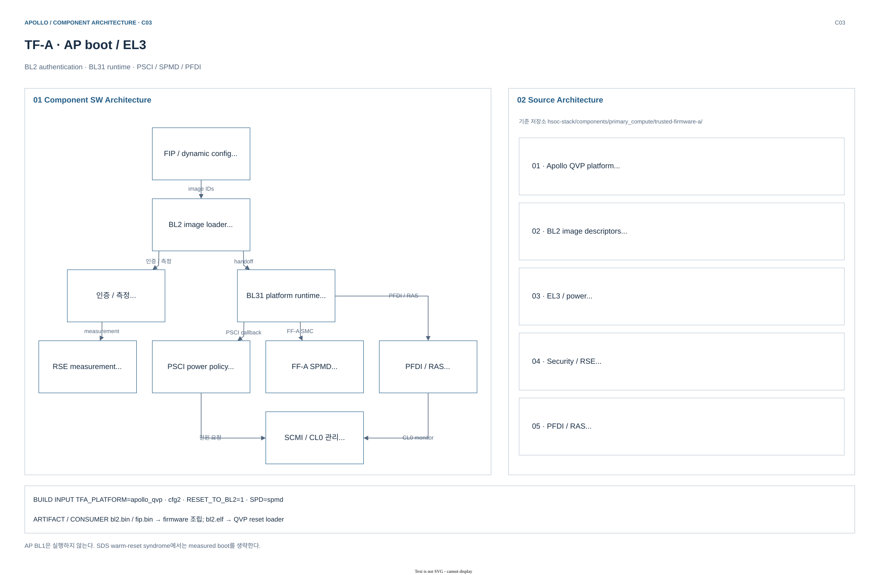
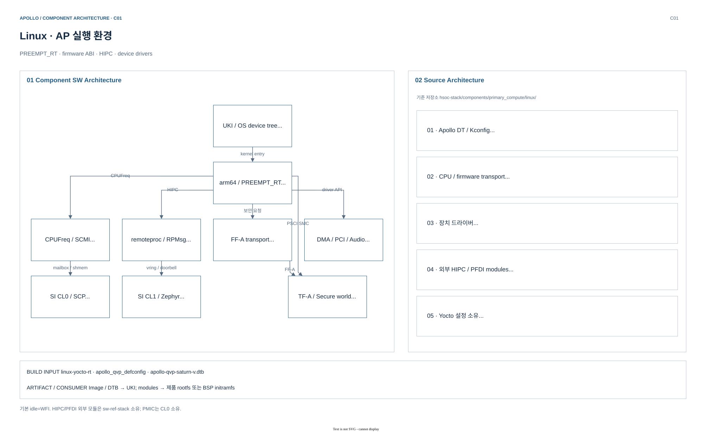
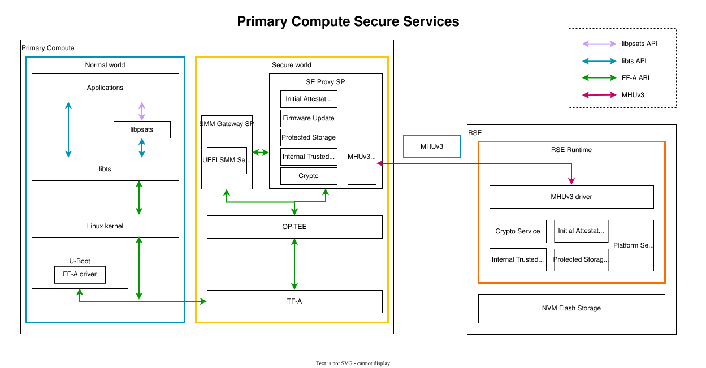

# 06.2 AP boot·Linux·Secure Services

[상위: Component SW](../06-component-software-architecture.md) · [전체 목차](../README.md) · [이전](01-boot-and-lifecycle.md) · [다음](03-rse-and-psa-runtime.md)

AP에서 TF-A·OP-TEE·U-Boot·Linux가 어떤 실행 경계를 맡는지 설명한다. Boot artifact가 runtime interface로 연결되는 조건과 Linux의 요청이 EL3·Secure Partition·RSE까지 전달되는 과정을 추적한다.

> 기준: 2026-10-25 checkout의 source/config. 기존 diagram과 draw.io 편집 원본을 재사용하며, 이번 문서 작업에서 새 build/runtime 검증은 수행하지 않았다.

## 1. 구성 — Exception level과 resident component

[draw.io 편집 원본](../diagrams/phase1/build-component-tf-a.drawio)

### 1.1 실행 권한과 수명

| 실행 영역 | Component | 계속 남는 책임 | 대표 진입점·소스 |
|---|---|---|---|
| EL3 | TF-A BL31 | PSCI, FF-A dispatch, PFDI/RAS 관련 service | `services/std_svc/`, Apollo platform hooks |
| S-EL1 | OP-TEE SPMC | Secure Partition 실행·통신, secure service mediation | `CFG_CORE_SEL1_SPMC=y`, FF-A support |
| Nonsecure boot | U-Boot BL33 | boot slot 선택, UEFI loader, EFI variable/capsule interface | `apollo_qvp_defconfig`, `aanxbootselect` |
| NS-EL1 kernel | Linux | process, driver, IPC, network, filesystem | `arch/arm64`, `drivers`, `kernel` |
| NS-EL0 | userspace | 제품 service·진단·application | image/package 구성에 따라 선택 |

TF-A BL2와 U-Boot는 boot stage다. Linux가 실행된 뒤 일반 device operation을 담당하는 kernel driver와 역할이 다르다. EL2의 virtualization 기능은 별도 구성 항목이며 기본 그림에 hypervisor를 가정하지 않는다.

OP-TEE의 source상 지원 CPU 수 16은 현재 QVP AP4 실행 구성과 다르다. Component의 최대 설정값과 launcher가 생성한 CPU 수를 구분한다.

근거: [TF-A recipe의 SPMD 선택](../../../../arm-zena-css/yocto/meta-zena-css-bsp/recipes-bsp/trusted-firmware-a/trusted-firmware-a-fvp-rd-aspen.inc), [OP-TEE platform config](../../../../hsoc-stack/components/primary_compute/optee_os/core/arch/arm/plat-automotive_rd/conf.mk), [U-Boot defconfig](../../../../hsoc-stack/components/primary_compute/u-boot/configs/apollo_qvp_defconfig).

## 2. 동작 순서 — image에서 OS와 secure endpoint까지

| 순서 | 실행 주체 | Source에서 읽을 조건 | 완료 결과 |
|---|---|---|---|
| 1 | TF-A BL2 | image descriptor와 `FW_CONFIG/HW_CONFIG/TOS_FW_CONFIG` | BL31·BL32·BL33 entry 정보 |
| 2 | BL31 SPMD | SPMC manifest의 load/entry address·FF-A version | OP-TEE SPMC context 초기화 |
| 3 | OP-TEE SPMC | secure partition image/manifest와 endpoint 설정 | SP discovery·message dispatch 가능 |
| 4 | U-Boot | `CONFIG_BOOTCOMMAND`와 slot selection 결과 | 선택 UKI를 `bootefi`로 실행 |
| 5 | Linux FF-A driver | version/ID, RXTX map, partition discovery | FF-A device와 service client 연결 |

[spmd_main.c](../../../../hsoc-stack/components/primary_compute/trusted-firmware-a/services/std_svc/spmd/spmd_main.c)의 `spmd_setup()`은 SPMC manifest를 받고, `spmd_spmc_init()`과 `spmd_setup_context()`는 secure entry context를 준비한다. 이후 `spmd_smc_handler()`가 FF-A call을 분류하고 world/context 전환을 담당한다. EL3 dispatcher가 Protected Storage의 파일 내용을 직접 관리하는 구조는 아니다.

[Linux FF-A driver](../../../../hsoc-stack/components/primary_compute/linux/drivers/firmware/arm_ffa/driver.c)의 `ffa_init()`은 transport와 version을 확인하고 `ffa_rxtx_map()` 이후 `ffa_setup_partitions()`를 호출한다. 따라서 Linux가 부팅했다는 사실과 원하는 SP가 discovery되었다는 사실은 분리된다. Message 전달에는 endpoint ID/UUID가 맞아야 하며, 공유 buffer를 사용하는 service에서는 FF-A memory-sharing 계약도 함께 확인한다.

[U-Boot defconfig](../../../../hsoc-stack/components/primary_compute/u-boot/configs/apollo_qvp_defconfig)의 순서는 `virtio scan → aanxbootselect → UKI load → bootefi`이며 실패하면 fallback UKI와 `bootflow scan` 경로가 남는다. Linux panic 전에 어떤 UKI/DTB를 실제 선택했는지를 확인해야 잘못된 firmware와 kernel 조합을 원인 후보에서 제외할 수 있다.

## 3. Runtime — Linux에서 외부 domain으로 나가는 경로

[draw.io 편집 원본](../diagrams/phase1/build-component-linux.drawio)

| 요청 | Linux 측 경로 | 실제 처리 주체 | 세미나에서 강조할 구분 |
|---|---|---|---|
| CPU on/off | PSCI → SMC → TF-A | TF-A가 CL0 power service와 협력 | Linux가 PPU를 직접 제어하는 구조로 단순화하지 않음 |
| CPU performance | CPUFreq → SCMI → mailbox | SCP performance/DVFS module | policy request와 model의 물리 frequency fidelity는 별도 |
| Secure service | FF-A → TF-A SPMD → OP-TEE/SP | AP secure partition 및 필요한 RSE service | AP secure world와 RSE를 동일 processor로 그리지 않음 |
| CL1 network | remoteproc attach → VirtIO/RPMsg → netdev | 이미 실행 중인 Zephyr HIPC | Linux가 CL1 firmware를 최초 적재하는 경로가 아님 |

`arm_si_rproc`는 `RPROC_DETACHED`로 시작하고 `.attach`를 제공한다. `kick()`은 MHU doorbell을 울리며 packet payload는 shared-memory vring/buffer에 있다.

근거: [Linux SCMI transport](../../../../hsoc-stack/components/primary_compute/linux/drivers/firmware/arm_scmi/transports/mailbox.c), [CPUFreq](../../../../hsoc-stack/components/primary_compute/linux/drivers/cpufreq/scmi-cpufreq.c), [외부 arm_si_rproc module](../../../../sw-ref-stack/components/primary_compute/linux_drivers/arm_si_rproc_mod/src/arm_si_rproc.c), [rpmsg_net module](../../../../sw-ref-stack/components/primary_compute/linux_drivers/rpmsg_net_mod/src/rpmsg_net.c).

### 3.1 PSA 호출 하나가 AP와 RSE를 통과하는 방법

[draw.io 편집 원본](../figures/reference/primary_compute_secure_services.drawio)

[Arm 원본 SVG](../../../../arm-zena-css/documentation/images/primary_compute_secure_services.svg)

*출처: Arm [secure_services.rst — Primary Compute Secure Services / Architecture](../../../../arm-zena-css/documentation/design/secure_services.rst).*

**그림 읽는 순서:** 왼쪽 Normal world application에서 `libpsats → libts`를 따라 Secure world로 들어간 뒤, `SE Proxy SP → MHUv3 → RSE Runtime`을 추적한다. 가운데 OP-TEE와 맨 오른쪽 RSE는 실행 CPU와 memory 보호 경계가 다르다.

예를 들어 application의 Protected Storage 요청은 다음 책임을 지나간다.

1. **`libpsats`:** PSA API 모양을 application에 제공한다. `libts`의 discovery/RPC를 이용해 service endpoint를 찾고 operation/parameter를 구성한다.
2. **Linux FF-A / TF-A SPMD:** Normal world의 요청을 FF-A ABI로 전달한다. TF-A는 EL3에서 world/context 전환을 관리하며 storage payload 자체의 service 구현자가 아니다.
3. **OP-TEE SPMC:** FF-A endpoint/partition 실행을 관리한다. SE Proxy SP는 AP 측 request를 RSE가 이해하는 IPC 호출로 바꾼다.
4. **AP–RSE MHU transport:** 요청과 buffer 정보를 RSE에 전달한다. `SCMI power request`와 transport 목적이 다르다.
5. **TF-M SPM / PS partition:** client identity·buffer access를 검사하고 PSA message를 service에 전달한다. PS service가 storage backend를 처리한 뒤 결과가 반대 경로로 반환된다.

**U-Boot UEFI variable 예:** U-Boot → FF-A → SMM Gateway SP → SE Proxy의 Protected Storage proxy → RSE PS service다. SMM Gateway라는 이름은 AP에서 x86 SMM CPU mode를 실행한다는 뜻이 아니라 UEFI variable service interface를 제공하는 partition이라는 뜻이다.

**Apollo 연결:** [OP-TEE `CFG_CORE_SEL1_SPMC`](../../../../hsoc-stack/components/primary_compute/optee_os/core/arch/arm/plat-automotive_rd/conf.mk), [TF-A SPMC manifest](../../../../hsoc-stack/components/primary_compute/trusted-firmware-a/plat/arm/board/automotive_rd/platform/apollo_qvp/fdts/apollo_qvp_optee_spmc_manifest.dts), [Linux FF-A driver](../../../../hsoc-stack/components/primary_compute/linux/drivers/firmware/arm_ffa/driver.c), [U-Boot EFI 설정](../../../../hsoc-stack/components/primary_compute/u-boot/configs/apollo_qvp_defconfig)이 접점이다. Trusted Services package/SP 선택은 실제 image recipe와 함께 확인한다.

## 4. Interface — boot 선택과 device ownership

| 항목 | 현재 source의 선택 | 변경 시 함께 읽을 곳 |
|---|---|---|
| OS DT | AP4: `apollo-qvp-saturn-v-4cpus.dts`; AP16: `apollo-qvp-saturn-v.dts` | machine의 `APOLLO_QVP_DTB` 선택, DTS include, matching Lua |
| U-Boot boot | `virtio scan` → `aanxbootselect` → UKI load → `bootefi` → fallback | image의 partition/UKI layout와 U-Boot 환경 |
| TPS6594/PMIC | SI CL0 firmware ownership | SCP PMIC module 및 QVP board peripheral 구성 |
| HIPC/PFDI 외부 module | `sw-ref-stack` source + Yocto module recipe | kernel ABI, Module.symvers, package 포함 여부 |

근거: [AP4 board DTS](../../../../hsoc-stack/components/primary_compute/linux/arch/arm64/boot/dts/hsoc/apollo-qvp-saturn-v-4cpus.dts), [AP16 board DTS](../../../../hsoc-stack/components/primary_compute/linux/arch/arm64/boot/dts/hsoc/apollo-qvp-saturn-v.dts), [machine DTB 선택](../../../../hsoc-stack/yocto/meta-hsoc-bsp/conf/machine/apollo-qvp.conf), [U-Boot boot command](../../../../hsoc-stack/components/primary_compute/u-boot/configs/apollo_qvp_defconfig). Board 파일명 자체는 Saturn-V schematic parity의 증거가 아니다.

### 4.1 Device tree 세 종류를 섞지 않기

| 입력 | Consumer | 결정하는 것 | 실행 중 사용 형태 |
|---|---|---|---|
| TF-A `FW_CONFIG/HW_CONFIG/TOS_FW_CONFIG` | TF-A, U-Boot, OP-TEE 초기화 | image address, platform description, SP 설정 | FIP dynamic configuration |
| Linux OS DTB | Linux OF/device model | device·IRQ·reserved-memory·CPU topology | flat DTB를 kernel이 해석 |
| Zephyr DTS + Kconfig | Zephyr build | device instance, MMIO/IRQ constant, driver 선택 | generated header와 링크된 device object |

이 구분은 boot 장애에 직접 영향을 준다. Linux DTB만 고쳐도 CL1의 MHU 주소는 바뀌지 않는다. CL1 firmware를 다시 빌드해야 board DTS 변경이 반영된다. TF-A의 platform DT와 UKI 안 OS DTB도 같은 파일이라는 전제를 두지 않는다.

## 5. 실패 진단 — EL 경계와 service 경계를 따로 확인

| 현상 | 첫 확인 지점 | 다음 확인 |
|---|---|---|
| AP entry 뒤 BL31/BL32 관련 실패 | FIP image descriptor·SPMC manifest | OP-TEE load/entry address와 selected feature |
| Linux는 정상인데 FF-A device가 없음 | `ffa_init()` version/ID/RXTX 오류 | SPMD/SPMC 초기화, partition enumeration |
| SP는 보이지만 PSA call 실패 | endpoint와 service operation, 반환 status | SE Proxy→RSE transport와 client authorization |
| EFI variable/capsule 실패 | SMM Gateway/FWU Proxy package와 U-Boot 설정 | RSE storage/FWU service |
| `ethsi1` 없음 | `arm_si_rproc`·`rpmsg_net` module과 attach | CL1 resource table·RPMsg NS |

같은 SMC instruction을 사용하더라도 PSCI, FF-A, PFDI는 function ID와 handler·완료 조건이 다르다. “SMC가 통과했다”는 결과를 secure storage나 CPU power transition의 성공으로 치환하지 않는다.

### 5.1 Code-reading exercise: Protected Storage request

Application이 반환받은 PSA status를 먼저 보존한다. 이후 Linux FF-A transport 오류인지, endpoint discovery 문제인지, SP service response인지 나눈다. RSE까지 전달되었다면 SPM의 SID/version/client 검사와 PS service의 저장소 오류를 구분한다. Buffer 공유 descriptor와 service payload는 모두 binary ABI이므로 양쪽 build의 규격과 크기를 같이 확인한다.

## 6. Source 읽기 순서

1. [Apollo TF-A platform.mk](../../../../hsoc-stack/components/primary_compute/trusted-firmware-a/plat/arm/board/automotive_rd/platform/apollo_qvp/platform.mk): entry 선택과 FIP configuration.
2. [SPMC manifest](../../../../hsoc-stack/components/primary_compute/trusted-firmware-a/plat/arm/board/automotive_rd/platform/apollo_qvp/fdts/apollo_qvp_optee_spmc_manifest.dts)와 [OP-TEE conf.mk](../../../../hsoc-stack/components/primary_compute/optee_os/core/arch/arm/plat-automotive_rd/conf.mk): S-EL1 SPMC 구성.
3. [TF-A SPMD](../../../../hsoc-stack/components/primary_compute/trusted-firmware-a/services/std_svc/spmd/spmd_main.c): setup과 runtime dispatch의 경계.
4. [Linux FF-A](../../../../hsoc-stack/components/primary_compute/linux/drivers/firmware/arm_ffa/driver.c): RXTX map·partition discovery·direct message.
5. [Secure Services reference](../../../../arm-zena-css/documentation/design/secure_services.rst): libpsats/libts, SE Proxy, SMM Gateway의 책임.
6. [RSE PSA runtime](03-rse-and-psa-runtime.md)과 [FWU state machine](04-secure-firmware-update.md)으로 service 내부를 내려간다.

---

[상위](../06-component-software-architecture.md) · [이전](01-boot-and-lifecycle.md) · [다음](03-rse-and-psa-runtime.md)
