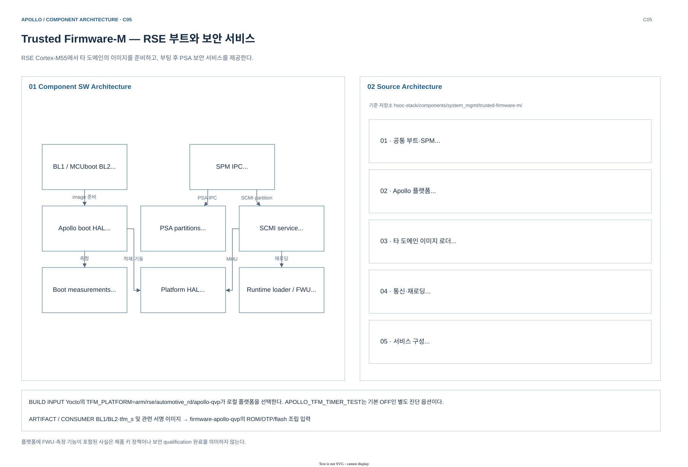
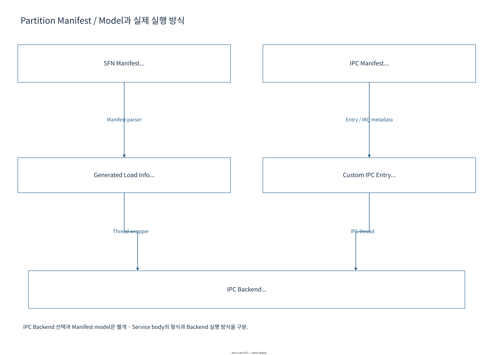
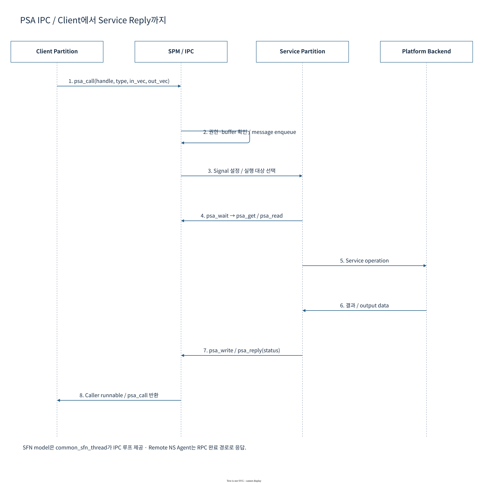

# 06.3 RSE TF-M과 PSA runtime

[상위: Component SW](../06-component-software-architecture.md) · [전체 목차](../README.md) · [이전](02-ap-and-secure-services.md) · [다음](04-secure-firmware-update.md)

RSE firmware를 bootloader 하나로 보지 않고 partition configuration, SPM initialization, PSA request dispatch, runtime image reload로 나누어 읽는다. Manifest에 적힌 service가 실제 호출 가능한 endpoint가 되기 위한 조건을 확인한다.

> 기준: 2026-10-25 checkout의 source/config. 기존 diagram과 draw.io 편집 원본을 재사용하며, 이번 문서 작업에서 새 build/runtime 검증은 수행하지 않았다.

## 1. 구성 — TF-M 계층과 build 선택

[draw.io 편집 원본](../diagrams/phase1/build-component-tf-m.drawio)

| 계층 | Component | 입력·출력 | 소유하는 책임 |
|---|---|---|---|
| Boot chain | BL1, MCUboot BL2 | ROM/OTP/flash → 검증된 image | stage 전환, 인증·복호화 |
| Platform boot HAL | `boot_hal_bl2.c` | RSE ATU → AP/SI memory | 타 domain image 적재와 SCMI handoff |
| IPC SPM | `spm_ipc.c` | PSA request → partition | partition scheduling·isolation·signal 처리 |
| PSA service | Crypto, ITS, PS, Attestation | client request → service response | 보안 연산·저장소·attestation |
| Platform service | SCMI, Measured Boot, FWU | mailbox/event → platform action | SCP 협력, 측정 기록, bank update |
| HAL/driver | MHUv3, ATU, flash, OTP 등 | service → MMIO | address/security boundary의 실제 접점 |

### 1.1 현재 config를 읽는 방법

| `apollo-qvp/config.cmake` 항목 | 의미 | 과대 해석하지 않을 점 |
|---|---|---|
| `CONFIG_TFM_SPM_BACKEND=IPC` | IPC backend 선택 | 모든 service가 같은 priority로 동작한다는 뜻 아님 |
| `TFM_LOAD_NS_IMAGE=OFF` | RSE 자체 NS image를 적재하지 않음 | AP NS Linux를 사용하지 않는다는 뜻 아님 |
| `MCUBOOT_IMAGE_NUMBER=5` | 복수 firmware image 처리 | CPU/domain 개수와 일대일 대응하지 않음 |
| `NR_OF_FW_BANKS=2` | FWU bank 구성 | 제품 rollback/키 정책 qualification 완료 아님 |
| `APOLLO_TIMER_TEST=OFF` | timer stage self-test 기본 비활성 | diagnostic code 존재와 실행을 구분 |

근거: [TF-M platform config](../../../../hsoc-stack/components/system_mgmt/trusted-firmware-m/platform/ext/target/arm/rse/automotive_rd/apollo-qvp/config.cmake), [IPC SPM](../../../../hsoc-stack/components/system_mgmt/trusted-firmware-m/secure_fw/spm/core/spm_ipc.c).

## 2. Initialization — manifest를 실행 가능한 service로 만들기

### 2.1 Manifest list와 partition manifest의 차이

| 입력 | 실제 값의 예 | 결정되는 항목 |
|---|---|---|
| Platform `tfm_manifest_list.yaml` | Crypto PID259, FWU PID263, NS mailbox PID262 | 포함할 partition·조건부 build·generated output 경로 |
| Partition manifest | SID·version·entry·priority·dependency·IRQ | service 접근 규칙과 runtime entry |
| `TFM_EXTRAS_REPO_EXTRA_MANIFEST_LIST` | SCMI, Measured Boot list | platform list 이외의 extras partition |
| CMake feature | `TFM_PARTITION_*`, `CONFIG_TFM_SPM_BACKEND` | 실제 compile/link할 partition과 SPM backend |

[Apollo config.cmake](../../../../hsoc-stack/components/system_mgmt/trusted-firmware-m/platform/ext/target/arm/rse/automotive_rd/apollo-qvp/config.cmake)는 platform manifest와 TF-M extras의 SCMI/Measured Boot list를 함께 선택한다. 따라서 platform YAML 한 파일에서 이름을 찾지 못했다고 service가 없다고 결론 내리지 않는다. 반대로 manifest에 기재되어 있어도 `conditional`이 꺼져 있으면 최종 image에 들어가지 않을 수 있다.

### 2.2 SPM 초기화의 의존 순서

[SPM main.c](../../../../hsoc-stack/components/system_mgmt/trusted-firmware-m/secure_fw/spm/core/main.c)는 static isolation boundary를 먼저 설정한 뒤 platform init, OTP/provisioning 확인, architecture 설정, boot-data validation을 수행한다. Peripheral 접근에 필요한 security 설정 이전에 driver를 호출하면 boot 순서를 위반한다.

[tfm_spm_init()](../../../../hsoc-stack/components/system_mgmt/trusted-firmware-m/secure_fw/spm/core/spm_ipc.c)는 connection space와 service list를 준비하고 1~4단계를 partition마다 반복한 뒤 5단계로 넘어간다.

1. `load_a_partition_assuredly()`로 generated load information을 읽는다.
2. `load_services_assuredly()`와 `load_irqs_assuredly()`로 service/IRQ lookup 정보를 만든다.
3. `tfm_hal_bind_boundary()`로 platform isolation boundary를 연결한다.
4. `backend_init_comp_assuredly()`로 component 실행 상태를 준비한다.
5. 마지막에 `backend_system_run()`으로 runtime execution을 시작한다.

### 2.3 Global IPC backend와 개별 service model

`CONFIG_TFM_SPM_BACKEND=IPC`가 모든 partition source에 자체 `psa_wait()` loop가 있다는 뜻은 아니다. [NS mailbox manifest](../../../../hsoc-stack/components/system_mgmt/trusted-firmware-m/platform/ext/target/arm/rse/automotive_rd/apollo-qvp/manifest/ns_agent_mailbox.yaml)는 `model=IPC`, LOW priority, `ns_agent_mailbox_entry`와 두 SLIH mailbox IRQ를 선언한다. 반면 [FWU manifest](../../../../hsoc-stack/components/system_mgmt/trusted-firmware-m/secure_fw/partitions/firmware_update/tfm_firmware_update.yaml)는 `model=SFN`, `entry_init=tfm_fwu_entry`, stateless service SID `0xA0`를 선언한다. Generated glue와 SPM backend가 이 계약을 연결하므로 service별 entry 형태를 확인해야 한다.

## 3. PSA request — manifest에서 reply까지

[draw.io 편집 원본](../diagrams/phase1/tfm-09-manifest.drawio)

*Apollo 상세 도식: [TF-M 문서 — Partition Manifest / Generated Code](../../tfm/README.md). Manifest는 설명용 목록이 아니라 build 입력이다.*

**그림 읽는 순서:** manifest의 partition/service 정의 → generated metadata → SPM partition runtime → 실제 entry function을 따라간다. Service ID(SID), version, client 권한, stack과 priority를 선언하면 build가 SPM이 사용할 구조를 생성한다.

Runtime 초기화는 [SPM `main.c`](../../../../hsoc-stack/components/system_mgmt/trusted-firmware-m/secure_fw/spm/core/main.c)의 platform·boot-data 초기화와 `BACKEND_SPM_INIT()`로 이어진다. Service loop가 실행되기 전에 memory boundary와 partition runtime context가 준비되어야 한다.

[draw.io 편집 원본](../diagrams/phase1/tfm-10-ipc.drawio)

*Apollo 상세 도식: [TF-M 문서 — PSA Client API / Message Flow](../../tfm/README.md).*

1. Client가 connect/call을 요청하면 SPM이 service와 version, caller identity 및 message buffer를 검사한다.
2. SPM이 message를 해당 partition에 연결하고 signal을 pending으로 만든다. `psa_wait()`로 자던 partition이 runnable 상태가 된다.
3. Partition은 `psa_get()`으로 message를 얻고 `psa_read()`/`psa_write()` 등 service 규약으로 payload를 처리한다. 임의 client pointer를 그대로 신뢰하는 구조로 설명하지 않는다.
4. `psa_reply()`가 status를 반환하면 대기 client가 진행한다. Transport IRQ가 도착한 시점과 service call이 완료된 시점 사이에 이 단계가 존재한다.

**Apollo 연결:** [IPC backend](../../../../hsoc-stack/components/system_mgmt/trusted-firmware-m/secure_fw/spm/core/spm_ipc.c), [platform manifest](../../../../hsoc-stack/components/system_mgmt/trusted-firmware-m/platform/ext/target/arm/rse/automotive_rd/apollo-qvp/manifest/tfm_manifest_list.yaml), [platform config](../../../../hsoc-stack/components/system_mgmt/trusted-firmware-m/platform/ext/target/arm/rse/automotive_rd/apollo-qvp/config.cmake). RSE의 IPC SPM을 Zephyr의 periodic scheduler tick과 동일하게 설명하지 않는다.

## 4. Interface — AP recovery와 RSE runtime loader

SCP가 AP watchdog 만료를 처리할 때 RSE 전체를 reboot할 필요는 없다. RSE runtime loader가 AP BL2를 다시 검증·적재하고 완료 ACK를 반환하는 경로가 있다.

| 요청 | RSE 처리 | 완료의 의미 |
|---|---|---|
| SCP의 AP image reload | SCMI handler → runtime image loader | image load·검증 완료 |
| SCP의 후속 power-on | AP CPU0 release를 조정 | AP 실행 재개 |
| Linux service 복귀 | AP가 별도로 boot·service 초기화 | 사용자 관점 recovery 완료 |

근거: [RSE SCMI HAL](../../../../hsoc-stack/components/system_mgmt/trusted-firmware-m/platform/ext/target/arm/rse/automotive_rd/apollo-qvp/scmi/scmi_hal.c), [runtime image loader](../../../../hsoc-stack/components/system_mgmt/trusted-firmware-m/platform/ext/target/arm/rse/automotive_rd/apollo-qvp/bootloader/rse_image_loader/src/rse_image_load_util.c).

### 4.1 Measured Boot record와 attestation

Boot stage는 image digest와 software type/version/signer 같은 metadata를 RSE measurement slot에 남긴다. RSE runtime은 초기 stage가 남긴 측정치를 인수하고, 이후 AP TF-A가 보내는 online measurement를 추가한다. Attestation service는 이 측정치와 요청자의 challenge 등 service 입력을 이용해 token을 만든다.

**Reference와 Apollo 차이:** Arm [boot_process.rst — Measured Boot](../../../../arm-zena-css/documentation/design/boot_process.rst)는 configuration data를 측정하지 않는다고 설명한다. 현재 [Apollo TF-A metadata table](../../../../hsoc-stack/components/primary_compute/trusted-firmware-a/plat/arm/board/automotive_rd/platform/apollo_qvp/apollo_qvp_measured_boot.c)에는 `FW_CONFIG` slot8, `HW_CONFIG` slot9, BL31/32/33 slot10/11/12가 선언되어 있고 warm-reset syndrome에 따른 skip도 있다. 따라서 slot 선언, 실제 callback 호출, RSE record 성공을 각각 구분해 확인한다.

### 4.2 동일한 MHU라도 boot와 runtime의 대기 방식은 다르다

[Apollo CMakeLists.txt](../../../../hsoc-stack/components/system_mgmt/trusted-firmware-m/platform/ext/target/arm/rse/automotive_rd/apollo-qvp/CMakeLists.txt)는 BL2에 `SCMI_COMMS_FOR_BL2_POLLING_MODE`, runtime에 `SCMI_COMMS_FOR_RUNTIME_IRQ_NOTIFICATIONS`를 선택한다. BL2는 초기 SCP readiness를 polling/timeout으로 기다릴 수 있고, runtime은 service/notification을 받아 다른 실행을 이어간다.

[scmi_hal.c](../../../../hsoc-stack/components/system_mgmt/trusted-firmware-m/platform/ext/target/arm/rse/automotive_rd/apollo-qvp/scmi/scmi_hal.c)의 shared-memory read는 doorbell flag에 맞는 message slot을 읽고, warm-reset ready notification은 AP BL2 reload 완료를 SCP에 알린다. 이 ACK는 image 준비 완료이며 Linux login이나 application health의 완료 신호가 아니다.

## 5. 실패 진단

| 관측 | 먼저 확인할 source 계약 | 분리할 오류 |
|---|---|---|
| TF-M banner 이전 정지 | static boundary·platform init·OTP 접근 | secure service API 오류보다 초기화 오류 |
| Service가 연결되지 않음 | manifest conditional·SID·version·generated metadata | partition 미포함과 잘못된 client request |
| PSA authorization 실패 | `tfm_spm_check_authorization()`·client ID range | transport 도착과 service 접근 허용 |
| Partition init에서 panic | `tfm_hal_bind_boundary()`와 load information | MMIO region/config mismatch |
| Warm reload ACK 없음 | runtime notification flag·image loader status | SCMI request 수신과 load completion |
| Attestation 내용 불일치 | boot-data handoff·measurement slot·warm-reset skip | token 생성과 원하는 measurement 포함 |

NS mailbox manifest의 client ID range와 service의 `non_secure_clients`는 함께 읽는다. Linux process가 전달한 pointer를 RSE secure pointer로 바로 사용하는 구조가 아니며, message vector와 caller identity를 SPM이 해석한 후 service가 처리한다.

## 6. Source 읽기 순서

1. [Apollo config](../../../../hsoc-stack/components/system_mgmt/trusted-firmware-m/platform/ext/target/arm/rse/automotive_rd/apollo-qvp/config.cmake) → [platform manifest list](../../../../hsoc-stack/components/system_mgmt/trusted-firmware-m/platform/ext/target/arm/rse/automotive_rd/apollo-qvp/manifest/tfm_manifest_list.yaml): selection·PID·extras.
2. [NS mailbox manifest](../../../../hsoc-stack/components/system_mgmt/trusted-firmware-m/platform/ext/target/arm/rse/automotive_rd/apollo-qvp/manifest/ns_agent_mailbox.yaml): entry, priority, IRQ, client range.
3. [SPM main](../../../../hsoc-stack/components/system_mgmt/trusted-firmware-m/secure_fw/spm/core/main.c) → [spm_ipc.c](../../../../hsoc-stack/components/system_mgmt/trusted-firmware-m/secure_fw/spm/core/spm_ipc.c): boundary와 runtime context 생성.
4. `tfm_spm_get_service_by_sid()`, `tfm_spm_check_authorization()`, `tfm_spm_check_client_version()`으로 service lookup·권한·version 검사를 읽는다. Stateless handle 경로는 table에서 service를 찾고 authorization 이후 version을 검사한다.
5. [runtime loader](../../../../hsoc-stack/components/system_mgmt/trusted-firmware-m/platform/ext/target/arm/rse/automotive_rd/apollo-qvp/bootloader/rse_image_loader/src/rse_image_load_util.c)와 [SCMI HAL](../../../../hsoc-stack/components/system_mgmt/trusted-firmware-m/platform/ext/target/arm/rse/automotive_rd/apollo-qvp/scmi/scmi_hal.c): AP recovery의 load/ACK 경계.
6. [FWU와 encryption](04-secure-firmware-update.md): service state와 bank/key의 수명.

---

[상위](../06-component-software-architecture.md) · [이전](02-ap-and-secure-services.md) · [다음](04-secure-firmware-update.md)
