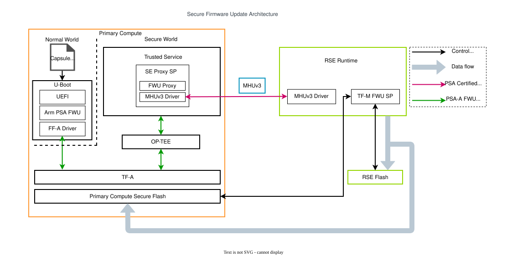
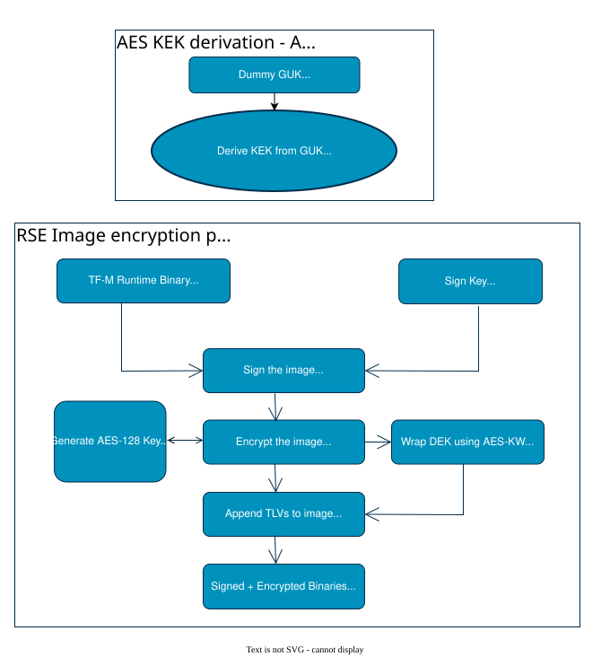

# 06.4 Secure FWU와 image encryption

[상위: Component SW](../06-component-software-architecture.md) · [전체 목차](../README.md) · [이전](03-rse-and-psa-runtime.md) · [다음](05-scp-system-management.md)

Firmware update를 capsule 복사 작업이 아닌 component state·bank metadata·key 계약으로 설명한다. 새 image를 저장한 시점, 다음 boot에 선택한 시점, accept한 시점을 구분하고 encryption과 authentication의 역할을 연결한다.

> 기준: 2026-10-25 checkout의 source/config. 기존 diagram과 draw.io 편집 원본을 재사용하며, 이번 문서 작업에서 새 build/runtime 검증은 수행하지 않았다.

## 1. 구성 — capsule frontend와 RSE update backend

[draw.io 편집 원본](../figures/reference/secure_firmware_update.drawio)

[Arm 원본 SVG](../../../../arm-zena-css/documentation/images/secure_firmware_update.svg)

*출처: Arm [secure_firmware_update.rst — Architecture](../../../../arm-zena-css/documentation/design/secure_firmware_update.rst).*

**그림 읽는 순서:** U-Boot의 capsule 입력에서 시작해 FF-A/FWU Proxy/MHU를 따라 RSE FWU partition과 두 flash bank로 내려간다. Capsule을 읽는 AP와 firmware flash를 갱신하는 RSE의 책임이 갈린다.

| 단계 | 책임 | 상태 변화 |
|---|---|---|
| Capsule 발견·인증 | U-Boot UEFI capsule code | update할 image payload 선택 |
| Operation 전달 | TS FWU Proxy → PSA FWU | stream/chunk를 RSE service로 전달 |
| Inactive bank 기록 | RSE FWU partition·flash backend | 현재 bank를 보존하며 새 image 저장 |
| Version·metadata 처리 | RSE | 다음 boot에서 시도할 bank 결정 |
| Trial boot·accept | boot chain + U-Boot | 성공 시 새 image accept; 실패 정책은 metadata/state로 결정 |

Firmware bank는 여러 domain image를 하나의 update 계약으로 묶는다. Linux rootfs 파일 하나를 복사하는 것과 다르며, write 완료와 new-bank boot 성공도 별도 단계다.

**Apollo 연결:** [TF-M FWU 구성](../../../../hsoc-stack/components/system_mgmt/trusted-firmware-m/platform/ext/target/arm/rse/automotive_rd/apollo-qvp/config.cmake)의 `NR_OF_FW_BANKS=2`, `FWU_SUPPORT_TRIAL_STATE=ON`, [U-Boot capsule 설정](../../../../hsoc-stack/components/primary_compute/u-boot/configs/apollo_qvp_defconfig). 위 원본 그림의 control/data 관계를 재사용하며, 제품별 capsule 배치·key policy·실제 bank 전환 결과는 별도 deployment 계약이다.

## 2. 동작 순서 — FWU component state machine

[tfm_fwu_req_mngr.c](../../../../hsoc-stack/components/system_mgmt/trusted-firmware-m/secure_fw/partitions/firmware_update/tfm_fwu_req_mngr.c)는 component별 `fwu_ctx[]`를 관리한다. API 호출 순서와 state가 맞지 않으면 `PSA_ERROR_BAD_STATE`를 반환하므로 마지막 호출의 성공만으로 전체 update를 판정할 수 없다.

| Operation / 함수 | 주요 전제 | State / 결과 |
|---|---|---|
| `tfm_fwu_start()` | component ID·manifest 크기 유효, READY | staging area 준비 후 WRITING |
| `tfm_fwu_write()` | WRITING, 허용 write size/offset | image chunk 기록; 아직 install 아님 |
| `tfm_fwu_finish()` | WRITING | CANDIDATE |
| `tfm_fwu_install()` | CANDIDATE 존재, 다른 update의 STAGED/TRIAL 등 충돌 없음 | backend 결과에 따라 STAGED/TRIAL/UPDATED/FAILED |
| `tfm_fwu_accept()` | trial 상태와 backend 조건 충족 | image accept 후 UPDATED |
| `tfm_fwu_cancel()/clean()` | 각 함수가 허용하는 state | 실패·완료 context 정리, 재시도 준비 |

`install()`은 dependency가 더 필요하면 candidate를 유지하고, backend가 reboot/restart를 요구하면 STAGED로 둔다. 즉 “install 요청 성공” 다음에도 boot 전환과 acceptance가 남을 수 있다. `query()`의 component state와 error를 함께 보존해야 전원 중단·재시작 뒤 어느 단계였는지 판단할 수 있다.

[FWU service manifest](../../../../hsoc-stack/components/system_mgmt/trusted-firmware-m/secure_fw/partitions/firmware_update/tfm_firmware_update.yaml)는 SID `0xA0`, version 1/STRICT, stateless handle 5, `mm_iovec=enable`, Crypto/Platform dependency를 선언한다. Request manager는 component ID와 vector 크기를 검사하고 staging/backend API에 넘긴다. Runtime request 형식과 flash offset을 혼동하지 않는다.

## 3. Image encryption — payload key와 wrapping key

[draw.io 편집 원본](../figures/reference/image-encryption-procedure.drawio)

[Arm 원본 SVG](../../../../arm-zena-css/documentation/images/image-encryption-procedure.svg)

*출처: Arm [rse_image_encryption.rst — Encryption approach / Key hierarchy / Boot-time decryption](../../../../arm-zena-css/documentation/design/rse_image_encryption.rst).*

**그림 읽는 순서:** image마다 생성한 DEK(Data Encryption Key)가 AES-128-CTR로 payload를 암호화하고, KEK(Key Encryption Key)가 AES-KW로 DEK를 감싸는 두 경로를 구분한다. Wrapped DEK는 MCUboot `ENCKW` TLV(type `0x31`)에 저장하며 signature·hash TLV는 image 인증을 담당한다. Encryption만으로 실행 권한이 검증되는 것은 아니다.

Boot loader는 encrypted flag와 ENCKW를 확인하고 허용된 KMU key handle로 DEK를 unwrap한 뒤 payload를 복호화·검증한다. 현재 [Apollo encryption configuration](../../../../hsoc-stack/components/system_mgmt/trusted-firmware-m/platform/ext/target/arm/rse/automotive_rd/apollo-qvp/config.cmake)은 `MCUBOOT_ENC_IMAGES`, `MCUBOOT_ENCRYPT_KW`, `MCUBOOT_ENCRYPT_AES`를 켜며, [get_enc_key_id_for_image()](../../../../hsoc-stack/components/system_mgmt/trusted-firmware-m/platform/ext/target/arm/rse/automotive_rd/apollo-qvp/bl2/rse_bl2_rotkw.c)는 runtime/AP BL2/SI0/CL1 image를 `RSE_KMU_SLOT_SECURE_ENCRYPTION_KEY`의 opaque handle에 연결한다.

**Reference와 현재 source:** 원본은 `GUK→KEK→DEK`로 요약한다. 현재 [rse_setup_runtime_secure_image_encryption_key()](../../../../hsoc-stack/components/system_mgmt/trusted-firmware-m/platform/ext/target/arm/rse/common/bl1/rse_kmu_keys.c)는 `KMU_HW_SLOT_KCE_CM`에서 secure encryption slot key를 derive하므로 GUK slot을 직접 읽는 코드로 설명하지 않는다. 실제 provisioned key 입력과 build signing 입력이 일치해야 한다.

이 boot-time image 복호화와 Linux가 요청하는 runtime PSA Crypto service는 목적·진입점이 다르다. [RSE crypto composition](../../../../hsoc-stack/tools/qbox-platform/platforms/apollo/soc/hw-block/rse/security.lua)은 `cc3xx` 또는 `qemu_cc3xx` backend를 선택한다. Model backend 선택만으로 physical key isolation·entropy 품질·side-channel 특성을 검증한 것은 아니다.

## 4. Interface — bank metadata가 다음 boot를 고르는 방법

[fwu_hal_bl2_update_state_and_flashmap()](../../../../hsoc-stack/components/system_mgmt/trusted-firmware-m/platform/ext/target/arm/rse/automotive_rd/apollo-qvp/fwu/fwu_hal_bl2.c)는 private metadata를 읽고 STAGED→TRIAL, UPDATED→READY 전환을 반영한다. 이어 `boot_index`에 맞춰 RSE runtime·SI0·CL1 image의 flash map을 바꾼다.

현재 port는 MCUboot가 임의로 최신 slot을 고르는 동작을 피하기 위해 해당 image의 primary/secondary flash-map entry를 **선택 bank의 같은 offset**으로 맞춘다. 이는 저장장치에 image를 두 번 복사했다는 뜻이 아니라 loader가 읽을 slot view를 platform metadata에 맞춘 것이다. AP FIP 처리와 RSE BL2 선택까지 모두 이 함수 하나가 처리한다고 일반화하지 않는다.

[fwu_private_metadata.c](../../../../hsoc-stack/components/system_mgmt/trusted-firmware-m/platform/ext/target/arm/rse/automotive_rd/apollo-qvp/fwu/fwu_private_metadata.c)는 metadata flash read/write 길이를 검사한다. Capsule signature, MCUboot image 인증, private metadata, OS slot metadata는 다른 입력이므로 한 단계의 성공으로 다른 단계의 내용을 대체하지 않는다.

| 경계 | 계약 | 잘못된 조합의 예 |
|---|---|---|
| Build signing ↔ provisioned key | wrapped DEK를 해제할 key 계층 일치 | 다른 development key로 만든 capsule/image |
| Capsule ↔ FWU component | component identity와 image dependency | image는 유효하지만 대상 component가 다름 |
| Metadata ↔ flash map | 선택 bank와 저장 image 위치 일치 | 새 bank 선택만 했고 일부 image write 미완료 |
| Firmware bank ↔ OS slot | 서로 독립적인 update metadata | Linux UKI slot 변경을 RSE bank accept로 해석 |

## 5. 실패 진단

| 반환/관측 | 추적할 부분 | 확인할 데이터 |
|---|---|---|
| START의 BAD_STATE | 이전 component context·backend state | READY인지, cleanup이 필요한지 |
| WRITE 실패 | input vector, maximum write size, staging backend | component·offset·chunk 길이 |
| DEPENDENCY_NEEDED | install candidate 집합 | 요구 firmware version/dependency |
| decrypt/unwrap 실패 | ENCKW TLV·key slot·provisioning | image flags와 선택 key handle |
| 첫 boot는 되지만 accept 안 됨 | trial policy·accept 호출·metadata write | active/previous bank와 component state |
| 재부팅 후 이전 firmware | selected bank·trial 처리 | write 성공과 bank commit을 구분 |

## 6. Source 읽기 순서

1. [U-Boot capsule frontend](../../../../hsoc-stack/components/primary_compute/u-boot/lib/efi_loader/efi_capsule.c): capsule 입력·검사·전달.
2. [FWU service manifest](../../../../hsoc-stack/components/system_mgmt/trusted-firmware-m/secure_fw/partitions/firmware_update/tfm_firmware_update.yaml) → [request manager](../../../../hsoc-stack/components/system_mgmt/trusted-firmware-m/secure_fw/partitions/firmware_update/tfm_fwu_req_mngr.c): API와 component state.
3. [platform bank selection](../../../../hsoc-stack/components/system_mgmt/trusted-firmware-m/platform/ext/target/arm/rse/automotive_rd/apollo-qvp/fwu/fwu_hal_bl2.c) → [private metadata](../../../../hsoc-stack/components/system_mgmt/trusted-firmware-m/platform/ext/target/arm/rse/automotive_rd/apollo-qvp/fwu/fwu_private_metadata.c): reboot 뒤 flash-map view.
4. [image key selection](../../../../hsoc-stack/components/system_mgmt/trusted-firmware-m/platform/ext/target/arm/rse/automotive_rd/apollo-qvp/bl2/rse_bl2_rotkw.c) → [KMU key setup](../../../../hsoc-stack/components/system_mgmt/trusted-firmware-m/platform/ext/target/arm/rse/common/bl1/rse_kmu_keys.c): opaque key와 derivation.
5. [image encryption reference](../../../../arm-zena-css/documentation/design/rse_image_encryption.rst)와 [Secure FWU reference](../../../../arm-zena-css/documentation/design/secure_firmware_update.rst): 전체 bank/key 흐름 대조.

---

[상위](../06-component-software-architecture.md) · [이전](03-rse-and-psa-runtime.md) · [다음](05-scp-system-management.md)
