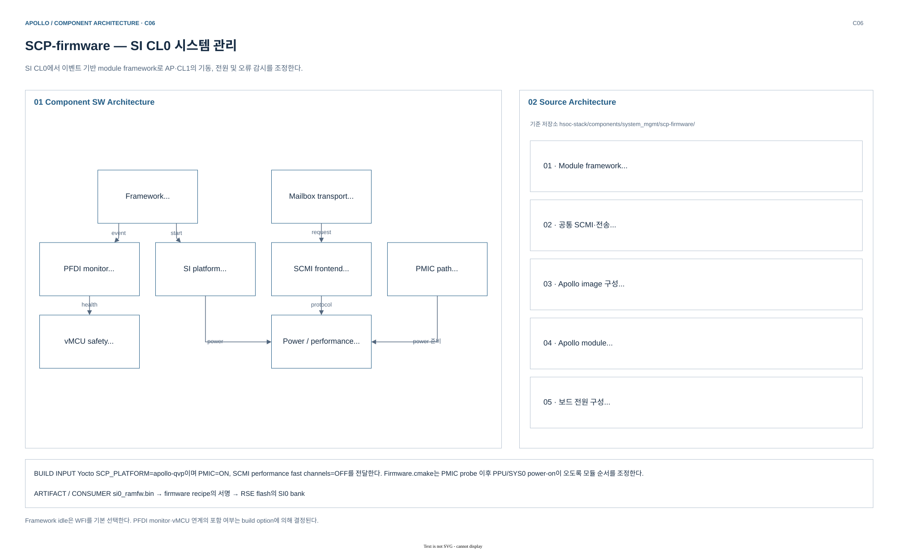
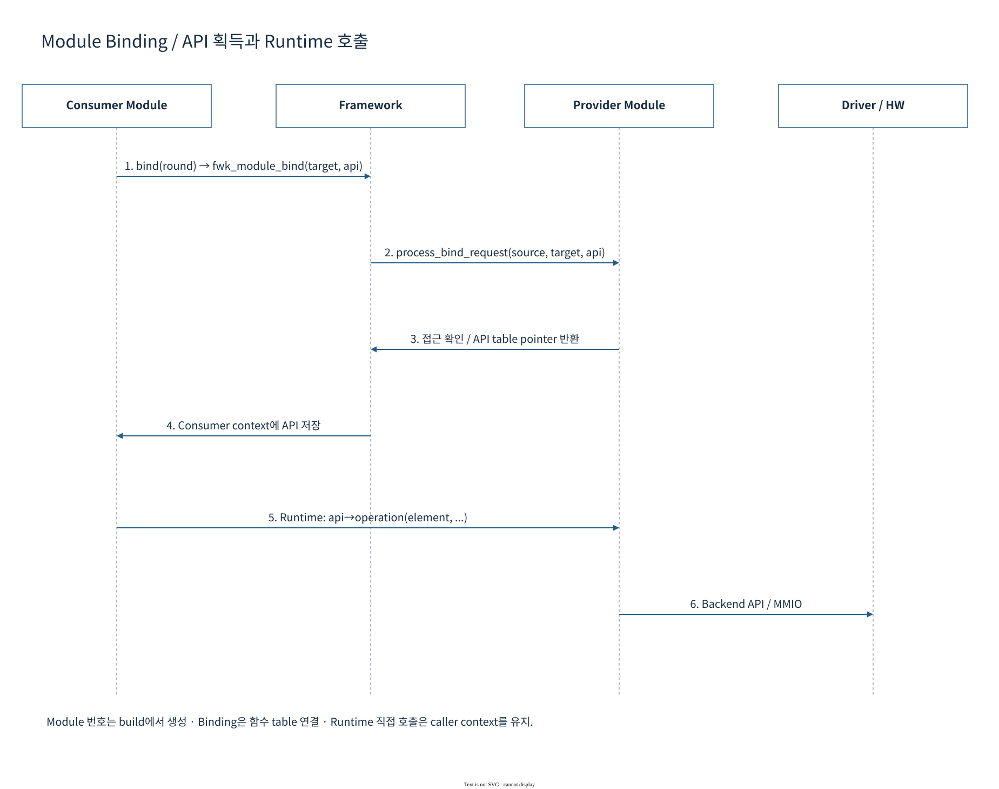
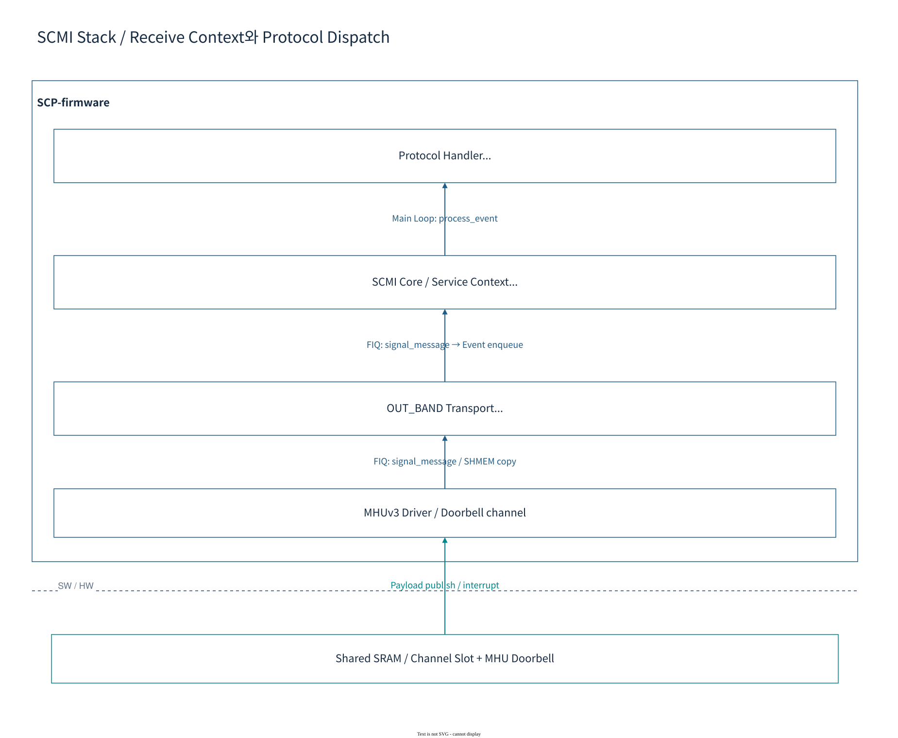

# 06.5 SI CL0 SCP system management

[상위: Component SW](../06-component-software-architecture.md) · [전체 목차](../README.md) · [이전](04-secure-firmware-update.md) · [다음](06-zephyr-and-hipc.md)

SCP의 config element와 API binding이 platform service를 만드는 과정을 설명한다. SCMI request와 asynchronous power/recovery event가 어떻게 서로 다른 module을 통과하며 완료되는지 추적한다.

> 기준: 2026-10-25 checkout의 source/config. 기존 diagram과 draw.io 편집 원본을 재사용하며, 이번 문서 작업에서 새 build/runtime 검증은 수행하지 않았다.

## 1. 구성 — module framework와 control service

[draw.io 편집 원본](../diagrams/phase1/build-component-scp-firmware.drawio)

| 계층 | 주요 module | 일하는 방식 |
|---|---|---|
| Framework | `fwk_module`, event/notification | init → bind → start → event dispatch |
| Request frontend | `scmi`, `scmi-power-domain`, `scmi-perf` | protocol/message를 service callback으로 분배 |
| Transport | `mhu3`, `transport` | IRQ·doorbell·shared memory 처리 |
| Resource control | `power-domain`, `ppu-v1`, `clock`, `dvfs` | resource state와 hardware operation 연결 |
| Platform orchestration | `si0-platform`, `cluster-control` | AP/CL1 boot와 AP recovery sequence |
| Safety/diagnostics | `fmu`, `ssu`, `pfdi-monitor` 등 | fault 집계·상태 감시; build option에 따라 포함 |
| Board control | `i2c`, `tps6594`, `pmic` | PMIC probe/초기화 후 전원 sequence |

SCP는 Linux나 Zephyr를 실행하지 않는 AArch64 firmware다. Module 목록·순서·`config_*.c`의 element binding이 application 구성에 해당한다. ISR에서 받은 모든 일을 즉시 끝내는 것이 아니라 framework event로 이어지는 경로도 있다.

## 2. Lifecycle — `init → bind → start`

[draw.io 편집 원본](../diagrams/phase1/scp-08-binding.drawio)

*Apollo 상세 도식: [SCP 문서](../../scp/README.md)의 module binding 설명. 화살표는 API pointer를 얻는 방향이다.*

**그림 읽는 순서:** consumer module의 configuration에 있는 target element/API ID를 확인하고 `fwk_module_bind()`가 호출하는 provider의 `process_bind_request()`를 따라간다. Consumer는 provider 내부 structure에 직접 의존하는 대신 승인된 API table을 받는다.

| Lifecycle | 하는 일 | 너무 일찍 하면 안 되는 일 |
|---|---|---|
| `init/element_init` | module/element context, config, memory 준비 | 아직 bind하지 않은 peer API 호출 |
| `bind(round)` | target module·element의 API 획득, 역방향 callback 연결 | round 의존성을 무시한 service 시작 |
| `start` | IRQ enable, notification subscribe, 초기 state machine 시작 | provider 초기화 이전 hardware request |
| `process_event` | queue에서 꺼낸 request/response 처리 | 긴 polling으로 전체 event loop 점유 |

근거: [fwk_module.c](../../../../hsoc-stack/components/system_mgmt/scp-firmware/framework/src/fwk_module.c)의 `fwk_module_init_modules()`, bind-round loop, `start_modules()`, `fwk_module_bind()`.

### 2.1 Bind round와 시작 시점

[fwk_module_start()](../../../../hsoc-stack/components/system_mgmt/scp-firmware/framework/src/fwk_module.c)는 모든 module init을 마친 뒤 bind round 0과 1을 실행하고 `start_modules()`를 호출한다. `FWK_MODULE_BIND_ROUND_MAX=1`이므로 “module A가 init되었으니 B API도 이미 사용 가능하다”는 가정은 성립하지 않는다.

`fwk_module_bind(target_id, api_id, &api)`는 target의 `process_bind_request()`에 requester 정보를 전달한다. Provider는 API ID와 requester를 검증하고 함수 pointer table을 돌려준다. Module ID는 service 종류, element ID는 instance, sub-element ID는 channel/core 같은 더 작은 자원에 해당할 수 있다. 같은 module의 element 하나가 다른 MMIO·IRQ를 소유하므로 이름만으로 binding을 판단하지 않는다.

## 3. 동작 순서 — SCMI request가 module event가 되기까지

[draw.io 편집 원본](../diagrams/phase1/scp-15-scmi-stack.drawio)

*Apollo 상세 도식: [SCP 문서 — SCMI stack](../../scp/README.md).*

MHU driver는 doorbell의 출처를 channel로 변환한다. Transport는 shared-memory ownership·header·payload length를 처리한다. SCMI core는 protocol ID와 message ID를 해석해 `scmi-power-domain` 또는 `scmi-perf` handler로 넘긴다. 마지막으로 power/clock/DVFS module이 platform driver를 호출한다.

예를 들어 AP power-on 요청에서 **SCMI message 성공**은 요청 처리 결과이고, **PPU power-state notification**은 hardware state transition 결과다. 비동기 transition이 있는 경로는 event/response를 통해 후속 상태를 진행해야 하므로 driver 함수 호출 하나로 전체 boot가 끝난다고 읽지 않는다.

**Apollo 연결:** [mod_scmi.c](../../../../hsoc-stack/components/system_mgmt/scp-firmware/module/scmi/src/mod_scmi.c)의 payload validation·protocol dispatch, [mod_transport.c](../../../../hsoc-stack/components/system_mgmt/scp-firmware/module/transport/src/mod_transport.c)의 channel lock/response, [Firmware.cmake](../../../../hsoc-stack/components/system_mgmt/scp-firmware/product/automotive-rd/apollo-qvp/si0_ramfw/Firmware.cmake)의 module 순서가 함께 계약을 이룬다.

### 3.1 Worked example — RSE SCMI channel의 configuration 연결

| Configuration | 식별자 / 핵심 field | 다음 owner |
|---|---|---|
| `config_scmi.c` | `SCMI_SERVICE_TO_RSE`, `transport_id`, `scmi_agent_id` | RSE agent의 SCMI service |
| `config_transport.c` | `SI0_RSE_SCMI_TRANSPORT`, COMPLETER, shared mailbox address/size | shared-memory header·ownership |
| Transport driver binding | MHU3 element + sub-element 0, TRANSPORT_DRIVER API | doorbell read/clear/notify |
| `mod_scmi.c` | protocol/message validation와 dispatch | power-domain/performance/vendor handler |

[SCMI service config](../../../../hsoc-stack/components/system_mgmt/scp-firmware/product/automotive-rd/apollo-qvp/si0_ramfw/config_scmi.c)와 [transport config](../../../../hsoc-stack/components/system_mgmt/scp-firmware/product/automotive-rd/apollo-qvp/si0_ramfw/config_transport.c)를 나란히 읽으면 service→transport→MHU가 연결된다. RSE service가 존재해도 transport 초기화 notification 이전에는 mailbox가 준비되지 않았을 수 있다. Payload bytes는 SRAM에 있고 MHU에는 notification이 있으므로 data size 오류와 IRQ wiring 오류를 따로 다룬다.

[mod_scmi.c](../../../../hsoc-stack/components/system_mgmt/scp-firmware/module/scmi/src/mod_scmi.c)는 protocol/message와 payload를 검증한 후 message handler에 전달한다. Response는 transport에 위임한다. CPU power request handler가 성공을 반환했어도 PPU 완료 notification이나 후속 boot entry는 별도의 관측점이다. 자세한 ownership은 [Mailbox와 IPC](../07-system/02-mailbox-and-ipc.md#mailbox-worked-example)를 따른다.

### 3.2 대표 event — AP watchdog recovery

1. AP NS WS1이 CL0 INTID321로 도착한다.
2. SCP가 IRQ 재진입을 막고 recovery event를 전달한다.
3. AP core/cluster OFF 후 RSE에 BL2 reload를 요청한다.
4. reload 성공과 context 준비 후 AP CPU0를 ON하고 IRQ를 rearm한다.

기한 초과나 reload 실패는 별도 실패 처리다. IRQ rearm은 Linux service 정상 복귀와 같은 완료 조건이 아니다.

근거: [SCP framework](../../../../hsoc-stack/components/system_mgmt/scp-firmware/framework/src/fwk_module.c), [SI0 platform](../../../../hsoc-stack/components/system_mgmt/scp-firmware/product/automotive-rd/apollo-qvp/module/si0_platform/src/mod_si0_platform.c), [RSE async reload](../../../../hsoc-stack/components/system_mgmt/scp-firmware/product/automotive-rd/apollo-qvp/module/si0_platform/src/platform_rse.c).

[SI0 platform recovery](../../../../hsoc-stack/components/system_mgmt/scp-firmware/product/automotive-rd/apollo-qvp/module/si0_platform/src/mod_si0_platform.c)의 recovery 경로는 `PENDING → RELOAD → BOOT → COMPLETE`로 진행하며 오류는 `FAILED`로 이어진다. `control_update()`는 AP core OFF를 확인한 뒤 RELOAD로 전환한다. 별도의 shutdown 요청에서 `control.stopping_ap`가 설정된 경우에는 `OFF`로 종료하므로 OFF를 모든 recovery가 거치는 상태로 읽지 않는다. `ap_watchdog_isr()`는 RSE handshake를 수행하지 않고 IRQ mask와 event 전달 후 asynchronous state machine에 일을 넘긴다.

`recovery_completion_allowed()`와 generation 검사는 이전 recovery의 늦은 completion이 새로운 요청을 완료시키지 못하게 한다. `ap_watchdog_rearm()`도 IRQ enable 직후 재진입할 수 있으므로 state publish 순서가 중요하다. COMPLETE는 이 firmware orchestration의 완료이며 AP application health는 별도 확인 대상이다.

## 4. Interface — MHU FCE와 SCMI perf fast channel

| 항목 | 현재 source 선택 | 의미 |
|---|---|---|
| `SCP_ENABLE_MHU3_FAST_CHANNELS` | `TRUE` | MHU hardware FCE payload/IRQ 기능 |
| `SCP_ENABLE_SCMI_PERF_FAST_CHANNELS` | 기본 `OFF` | SCMI performance의 shared-memory polling fast channel |
| Linux SCMI 요청 | doorbell mailbox | 위 두 기능을 모두 자동 사용한다고 가정하지 않음 |

이 구분은 현재 [Firmware.cmake](../../../../hsoc-stack/components/system_mgmt/scp-firmware/product/automotive-rd/apollo-qvp/si0_ramfw/Firmware.cmake)에 명시되어 있다. 과거 문서의 “FastChannel 미구현”을 현재 MHU 전체에 적용하지 않는다.

## 5. 실패 진단

| 현상 | 먼저 읽을 계약 | 구분할 지점 |
|---|---|---|
| boot 중 bind 실패 | target/API ID, provider API count, round | module 부재와 권한/ID 오류 |
| MHU IRQ는 오지만 SCMI timeout | transport element·mailbox view·header | IRQ receipt와 message acceptance |
| SCMI NOT_SUPPORTED/INVALID_PARAMETERS | protocol ID·message ID·payload length | hardware 연결과 protocol 구현 |
| power request 후 진행 없음 | power-domain notification·PPU transition | request 응답과 hardware state |
| watchdog recovery 재진입 | generation·pending level·rearm state | 이전 fault와 새 WS1 |
| callback이 늦어짐 | ISR/event queue의 긴 작업·polling | deadline과 module execution context |

Firmware.cmake에 module이 있어도 `config_*.c`의 instance와 실제 Lua address/IRQ가 일치해야 한다. 새로운 test module이나 debugger command가 production consumer 대신 resource를 읽는 경우도 있으므로 caller를 함께 확인한다.

## 6. Source 읽기 순서

1. [Firmware.cmake](../../../../hsoc-stack/components/system_mgmt/scp-firmware/product/automotive-rd/apollo-qvp/si0_ramfw/Firmware.cmake): module 목록·순서·feature 선택.
2. [fwk_module.c](../../../../hsoc-stack/components/system_mgmt/scp-firmware/framework/src/fwk_module.c): init → bind round → start → provider API validation.
3. [config_scmi.c](../../../../hsoc-stack/components/system_mgmt/scp-firmware/product/automotive-rd/apollo-qvp/si0_ramfw/config_scmi.c) → [config_transport.c](../../../../hsoc-stack/components/system_mgmt/scp-firmware/product/automotive-rd/apollo-qvp/si0_ramfw/config_transport.c): service·channel·agent 연결.
4. [mod_transport.c](../../../../hsoc-stack/components/system_mgmt/scp-firmware/module/transport/src/mod_transport.c) → [mod_scmi.c](../../../../hsoc-stack/components/system_mgmt/scp-firmware/module/scmi/src/mod_scmi.c): shared memory와 protocol 처리.
5. [mod_si0_platform.c](../../../../hsoc-stack/components/system_mgmt/scp-firmware/product/automotive-rd/apollo-qvp/module/si0_platform/src/mod_si0_platform.c)와 [platform_rse.c](../../../../hsoc-stack/components/system_mgmt/scp-firmware/product/automotive-rd/apollo-qvp/module/si0_platform/src/platform_rse.c): generation·timeout·RSE reload completion.

---

[상위](../06-component-software-architecture.md) · [이전](04-secure-firmware-update.md) · [다음](06-zephyr-and-hipc.md)
