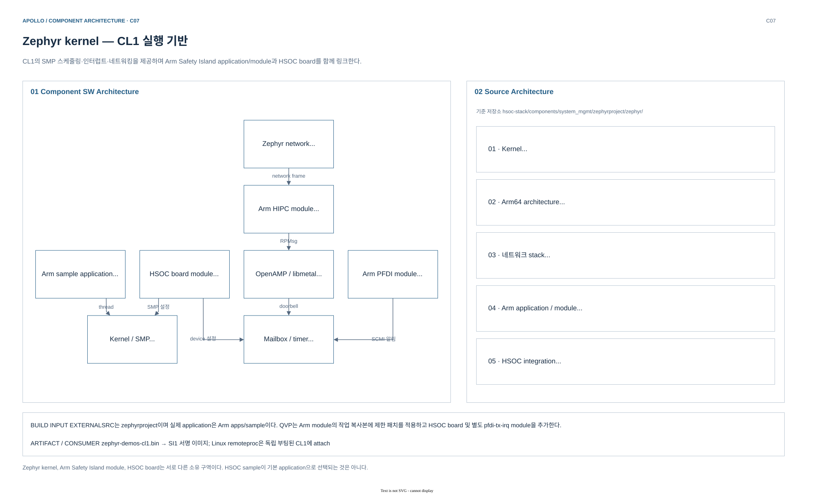
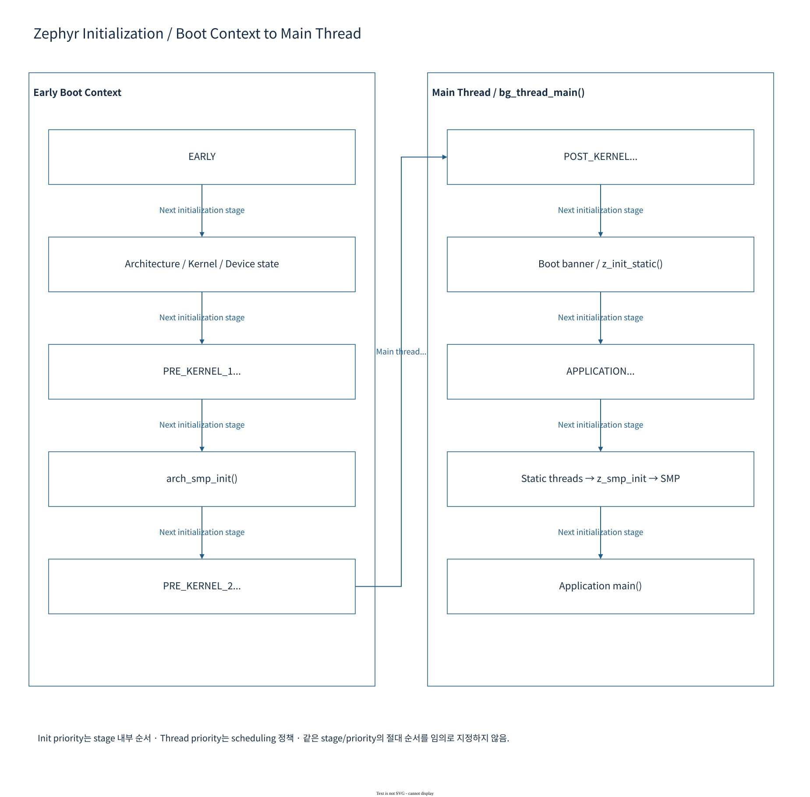
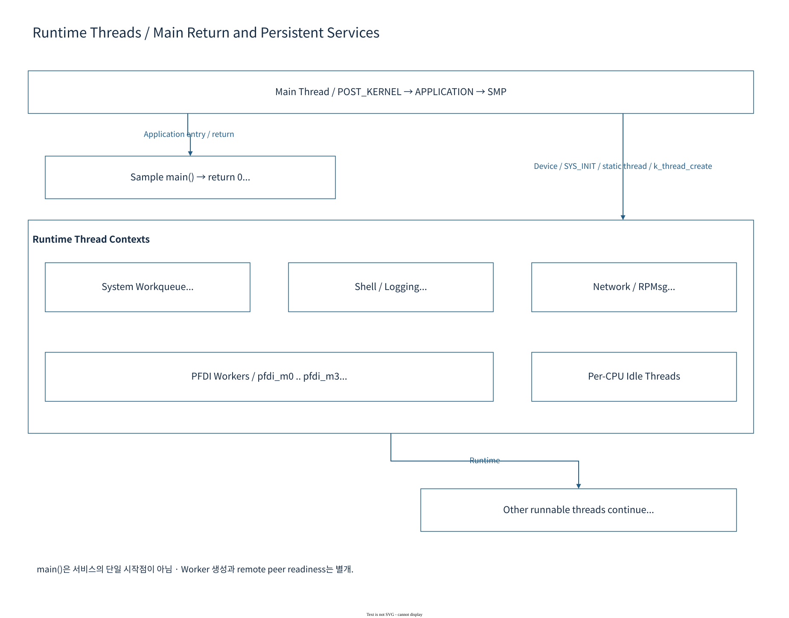

# 06.6 SI CL1 Zephyr와 HIPC

[상위: Component SW](../06-component-software-architecture.md) · [전체 목차](../README.md) · [이전](05-scp-system-management.md) · [다음](../07-system-software-core.md)

CL1 image의 build 입력부터 Zephyr init level, HIPC endpoint, AP reset 이후 reattach까지 추적한다. Reference source와 Yocto가 준비하는 실제 작업 복사본의 차이를 포함해 RTOS 동작을 설명한다.

> 기준: 2026-10-25 checkout의 source/config. 기존 diagram과 draw.io 편집 원본을 재사용하며, 이번 문서 작업에서 새 build/runtime 검증은 수행하지 않았다.

## 1. 구성 — kernel·Arm module·HSOC board

[draw.io 편집 원본](../diagrams/phase1/build-component-zephyr.drawio)

| 구성 요소 | Source owner | 주요 기능 | 바꾸는 경우 |
|---|---|---|---|
| Zephyr kernel/arch/driver | `zephyrproject/zephyr` | thread, SMP, IRQ, timer, network API | 공통 kernel/driver 동작 수정 |
| Arm application/module | `arm-zena-css/components/safety_island/zephyr/src` | sample application, HIPC, PFDI | read-only reference; owned integration 경로로 patch |
| HSOC board module | `zephyrproject/zephyr_hsoc_src` | DTS, Kconfig, board init hook | Apollo QVP/FVP board contract 수정 |
| Yocto integration | `meta-hsoc-bsp` | application 작업 복사본, module 선택·patch·build | 실제 image 구성을 변경 |

**기본 application:** recipe는 Arm `apps/sample`을 작업 영역에 준비한다. `zephyr_hsoc_src/samples/`에 있는 별도 sample이 자동으로 실행되는 것은 아니다.

### 1.1 기본 CL1 board 기능

| 기능 | 설정·동작 | AP/CL0와의 연결 |
|---|---|---|
| SMP | `CONFIG_SMP=y`, `CONFIG_MP_MAX_NUM_CPUS=4` | CL0가 cluster 기동 조정 |
| Time | 125 MHz, `ARM_ARCH_TIMER`, tickless | CPU-local virtual timer/PPI |
| HIPC | OpenAMP + RPMsg + `VETH_RPMSG` | AP remoteproc/netdev와 shared vring |
| Mailbox | MHUv3, 32 doorbell channel | HIPC 및 PFDI doorbell |
| PFDI | management/agent hook | CL0 monitor에 상태·결과 보고 |
| Console | PL011 shell, kernel/net commands | CL1 UART의 개별 실행 증거 |

근거: [CL1 defconfig](../../../../hsoc-stack/components/system_mgmt/zephyrproject/zephyr_hsoc_src/boards/hsoc/apollo_qvp_safety_island_c1/apollo_qvp_safety_island_c1_defconfig), [CL1 DTS](../../../../hsoc-stack/components/system_mgmt/zephyrproject/zephyr_hsoc_src/boards/hsoc/apollo_qvp_safety_island_c1/apollo_qvp_safety_island_c1.dts), [CL1 recipe integration](../../../../hsoc-stack/yocto/meta-hsoc-bsp/recipes-kernel/zephyr-kernel/zephyr-demos-cl1-apollo-common.inc).

## 2. Initialization과 실행 thread

[draw.io 편집 원본](../diagrams/phase1/zephyr-08-init-levels.drawio)

*Apollo 상세 도식: [Zephyr 문서 — Initialization](../../zephyr/README.md).*

**그림 읽는 순서:** architecture/early board 초기화에서 device init level을 거쳐 application으로 내려간다. DTS는 address·IRQ·clock을, Kconfig는 compile할 driver와 기능을 고르고, driver의 init macro가 실제 device object와 초기화 함수를 등록한다.

`si_net_init.c`는 `SYS_INIT(..., APPLICATION, ...)`으로 연결된다. Network interface가 준비된 뒤 VLAN/IP를 설정해야 하므로 early hardware init과 같은 시점에 실행하면 안 된다. CPU-local 초기화 hook은 secondary CPU에도 적용할 설정을 담당하며, 한 번 실행되는 application init과 수명이 다르다.

[draw.io 편집 원본](../diagrams/phase1/zephyr-10-runtime-threads.drawio)

*Apollo 상세 도식: [Zephyr 문서 — Runtime threads](../../zephyr/README.md).*

Shell thread는 사용자 명령을, network worker는 packet 처리를, PFDI CPU worker는 지정 CPU의 test를 담당한다. ISR은 MHU/Timer event를 빠르게 받아 후속 실행을 깨운다. 긴 network/service 작업을 모두 ISR에서 수행하는 구조로 설명하지 않는다.

**Apollo 연결:** [board network init](../../../../hsoc-stack/components/system_mgmt/zephyrproject/zephyr_hsoc_src/boards/hsoc/apollo_qvp_safety_island_c1/si_net_init.c), [Arm PFDI manager](../../../../arm-zena-css/components/safety_island/zephyr/src/subsys/pfdi/pfdi_mgmt.c), [Zephyr scheduler](../../../../hsoc-stack/components/system_mgmt/zephyrproject/zephyr/kernel/sched.c). Arm source는 reference이고 실제 build에는 recipe의 작업 복사본·patch가 적용될 수 있다.

### 2.1 Build 입력이 driver instance가 되는 순서

1. [CL1 common recipe](../../../../hsoc-stack/yocto/meta-hsoc-bsp/recipes-kernel/zephyr-kernel/zephyr-demos-cl1-apollo-common.inc)가 Arm sample application과 HSOC board/module, CMSIS/libmetal/OpenAMP를 선택한다.
2. Board DTS의 chosen/reserved-memory/mailbox와 Kconfig가 generated device definition 및 driver compile 선택으로 바뀐다.
3. Driver 초기화가 device readiness와 callback/work item을 준비한다.
4. `SYS_INIT(si_net_init, APPLICATION, CONFIG_SI_NET_INIT_PRIORITY)`가 선택 interface의 VLAN/IP를 구성한다.
5. SMP worker와 network workqueue가 runtime request를 처리한다. CPU-local PFDI/timer 설정은 각 CPU의 실행 수명과 연결된다.

[si_net_init.c](../../../../hsoc-stack/components/system_mgmt/zephyrproject/zephyr_hsoc_src/boards/hsoc/apollo_qvp_safety_island_c1/si_net_init.c)는 `CONFIG_SI_NET_INIT_IFACE_INDEX`의 interface를 찾지 못하면 ENODEV, VLAN enable이나 IPv4 설정이 실패하면 해당 오류를 반환한다. 따라서 UART shell이 동작하는 경우에도 network interface 생성과 application network init은 따로 실패할 수 있다.

## 3. Runtime — Linux와 Zephyr가 socket으로 통신하는 경로

[draw.io 편집 원본](../figures/reference/hipc_baremetal_design.drawio)

[Arm 원본 SVG](../../../../arm-zena-css/documentation/images/hipc_baremetal_design.svg)

*출처: Arm [hipc.rst — HIPC Baremetal Architecture](../../../../arm-zena-css/documentation/design/hipc.rst).*

**그림 읽는 순서:** 두 OS의 BSD socket API를 맨 위에 놓고, Linux `RPMsg-net`와 Zephyr `Veth-RPMsg`가 Ethernet frame을 RPMsg payload로 감싸는 과정을 아래로 따라간다. 가장 아래 MHU는 packet을 보관하지 않으며, shared vring/buffer에 새 descriptor가 있다는 사실을 알린다.

연결 시 Zephyr가 RPMsg Name Service message로 endpoint를 알리면 Linux RPMsg bus가 endpoint와 대응 netdev를 구성한다. 이후 Linux의 `skb`와 Zephyr network buffer가 공유 transport buffer로 변환된다. 이 복사·buffer pool·worker scheduling이 throughput과 drop에 영향을 준다.

**Apollo 연결:** AP shared memory 512 KiB는 resource table, 두 vring, packet buffer의 네 영역이다. 현재 AP/CL1 주소 alias는 [07장의 memory 표](../07-system/02-mailbox-and-ipc.md#mailbox-worked-example)를 따른다. Linux `arm_si_rproc`는 CL1에 attach하며 CL1 boot는 RSE/CL0가 맡는다.

원본의 network topology에 있는 Open vSwitch/`brsi1`은 reference userspace 구성이다. RPMsg transport가 준비되었다고 현재 image에 해당 bridge가 자동 생성되었다고 가정하지 않는다. `ethsi1`, VLAN200, 실제 IP/route/service를 단계별로 확인한다.

### 3.1 Attach와 packet event를 분리하기

[Linux arm_si_rproc](../../../../sw-ref-stack/components/primary_compute/linux_drivers/arm_si_rproc_mod/src/arm_si_rproc.c)는 `RPROC_DETACHED` 상태에서 attach mailbox를 보내 ACK를 기다린다. Resource table과 reserved-memory를 준비한 뒤 VirtIO/RPMsg가 endpoint를 구성한다. `arm_si_rproc_kick()`은 vqid에 맞는 mailbox를 선택하며 packet bytes를 MHU에 복사하지 않는다.

실제 handshake는 `arm_si_add_rproc_core()`에서 `devm_rproc_add()` 전에 수행한다. `rproc_ops.attach`의 `arm_si_rproc_attach()` 자체는 0을 반환하며, memory-region 준비는 `.prepare`, 게시된 table 획득은 `.get_loaded_rsc_table`의 책임이다. Callback 이름만 보고 attach ACK가 `.attach` 안에서 송신된다고 해석하지 않는다.

[Reference veth_rpmsg.c](../../../../arm-zena-css/components/safety_island/zephyr/src/drivers/ethernet/veth_rpmsg.c)는 RPMSG_ATTACH/DETACH 상태와 `veth_rpmsg_setup_vdev()`, `rpmsg_create_ept()`, `notify_handler()`를 제공한다. 다만 Apollo image의 reset 동작을 설명할 때 이 reference 한 파일만 읽으면 부족하다.

### 3.2 AP-only reset에서 적용되는 Apollo integration patch

현재 recipe의 `do_prepare_apollo_hipc`는 Arm source를 WORKDIR의 `apollo-safety-island`로 복사한 뒤 [reattach patch](../../../../hsoc-stack/yocto/meta-hsoc-bsp/recipes-kernel/zephyr-kernel/files/0001-veth-restore-resource-table-on-reattach.patch)를 적용한다. Externalsrc가 `do_patch`를 생략하므로 별도 prepare task로 연결한 것이다. Read-only reference checkout을 직접 고치지 않는다.

| Patch 단계 | 이유 | 보존해야 하는 순서 |
|---|---|---|
| mailbox event를 atomic pending 상태로 기록 | ISR과 lifecycle/VQ work 직렬화 | worker에서 상태 전환 처리 |
| 기존 vdev teardown, DETACH 상태로 이동 | 살아 있는 SI와 재부팅 AP의 세대 분리 | 이전 TX와 teardown 경합 방지 |
| `restore_rsc_table()` | AP boot가 shared table/ring을 clear할 수 있음 | SI-owned template 복사·shared region 초기화 |
| `barrier_dmem_fence_full()` 후 attach ACK | peer가 ACK 뒤 유효한 table을 읽어야 함 | data publication → notification |
| 후속 VirtIO/RPMsg setup | 새 ring/endpoint와 traffic 재개 | attach ACK와 endpoint ready 구분 |

따라서 AP reset 후 Linux module을 다시 load할 때는 SI reboot 여부보다 shared resource 재게시와 ACK 순서가 중요하다. `ethsi1` 존재, endpoint attach, VLAN/IP, socket response는 각기 다른 완료 단계다.

## 4. Interface — standalone와 integrated image의 계약

| 구분 | 목적 | 전제 |
|---|---|---|
| Standalone boot image | CPU·entry·UART 등의 작은 boot 확인 | 별도 image의 Kconfig와 launcher 확인 |
| Integrated `zephyr-demos-cl1` | HIPC/PFDI·SMP·network 실행 | timer, reset, shared memory, MHU, CL0/AP peer 준비 |

Standalone launcher에 integrated ELF를 넣는 것만으로 통합 서비스 조건이 생기지 않는다. Shell 존재 여부도 선택 image의 Kconfig에 따른다. [CL1 상세 자료](../../zephyr/README.md)와 현재 [standalone launcher](../../../../run_qbox_zephyr.sh)를 함께 읽는다.

## 5. 실패 진단

| 현상 | 첫 확인 | 다음 단계 |
|---|---|---|
| Shell이 없음 | 선택 image의 CONFIG_SHELL과 standalone/integrated 구분 | UART를 진단하기 전에 image 확인 |
| SMP CPU 일부만 실행 | CL0 release와 board CPU topology·timer/PPI | per-CPU init/PFDI 상태 |
| Mailbox device not ready | DTS binding·driver Kconfig·init 결과 | channel role와 IRQ 연결 |
| Attach ACK timeout | AP attach channel·SI worker·resource restore | mailbox ACK와 RPMsg NS를 구분 |
| Resource table invalid | recipe patch 적용·template·shared view | AP reset 후 재게시 순서 |
| Endpoint는 있으나 통신 안 됨 | buffer pool·VLAN/IP/route·netdev 상태 | transport와 network 계층을 분리 |

Source 진단에서는 `ZEPHYR_SRC_DIR`와 `ZEPHYR_MODULES`의 선택을 먼저 기록한다. Generated `.config`·`zephyr.dts`·ELF가 있어야 그 실행 image의 compile 결과를 단정할 수 있으며, 이 문서 작업은 기존 source의 선택 규칙을 설명한다.

## 6. Source 읽기 순서

1. [CL1 recipe integration](../../../../hsoc-stack/yocto/meta-hsoc-bsp/recipes-kernel/zephyr-kernel/zephyr-demos-cl1-apollo-common.inc): working copy·module list·prepare task.
2. [board DTS](../../../../hsoc-stack/components/system_mgmt/zephyrproject/zephyr_hsoc_src/boards/hsoc/apollo_qvp_safety_island_c1/apollo_qvp_safety_island_c1.dts)와 [defconfig](../../../../hsoc-stack/components/system_mgmt/zephyrproject/zephyr_hsoc_src/boards/hsoc/apollo_qvp_safety_island_c1/apollo_qvp_safety_island_c1_defconfig): address·IRQ·SMP·timer·shell.
3. [si_net_init.c](../../../../hsoc-stack/components/system_mgmt/zephyrproject/zephyr_hsoc_src/boards/hsoc/apollo_qvp_safety_island_c1/si_net_init.c): application init의 interface/VLAN/IP 선택.
4. [reference veth_rpmsg](../../../../arm-zena-css/components/safety_island/zephyr/src/drivers/ethernet/veth_rpmsg.c)와 [active recipe patch](../../../../hsoc-stack/yocto/meta-hsoc-bsp/recipes-kernel/zephyr-kernel/files/0001-veth-restore-resource-table-on-reattach.patch): init·callback·worker·reattach 수명.
5. [AP remoteproc](../../../../sw-ref-stack/components/primary_compute/linux_drivers/arm_si_rproc_mod/src/arm_si_rproc.c) → [RPMsg netdev](../../../../sw-ref-stack/components/primary_compute/linux_drivers/rpmsg_net_mod/src/rpmsg_net.c): 반대 peer의 handshake/packet 경로.
6. [Mailbox와 IPC의 buffer ownership](../07-system/02-mailbox-and-ipc.md#mailbox-worked-example)으로 address alias와 ordering을 연결한다.

---

[상위](../06-component-software-architecture.md) · [이전](05-scp-system-management.md) · [다음](../07-system-software-core.md)
