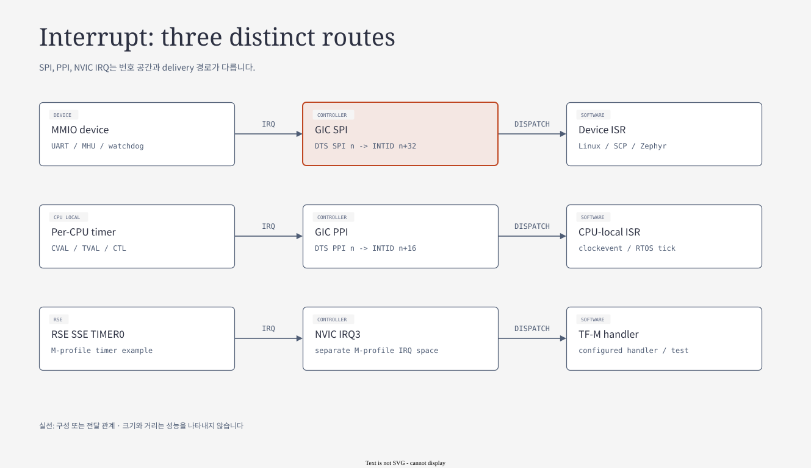
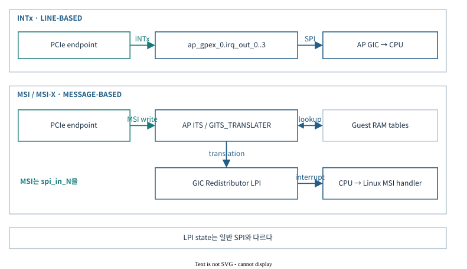

# 07.1 Interrupt와 GIC — source에서 ISR까지

[전체 목차](../README.md) · [상위 장](../07-system-software-core.md) · [다음: 07.2 Mailbox와 IPC](02-mailbox-and-ipc.md)

**이 문서의 질문:** device는 IRQ를 발생시켰는데 왜 handler가 실행되지 않는가? Address view·번호 체계·controller state·driver dispatch를 차례로 좁힌다.

## 1. Interrupt — 번호와 ownership

[draw.io 편집 원본](../diagrams/07-interrupt-route.drawio)

[기존 HTML 보기](../diagrams/07-interrupt-route.html)

### 1.1 번호 체계를 먼저 맞춘다

| 표기 | 의미 | 예 |
|---|---|---|
| GIC SPI socket `spi_in_N` | SPI 입력 offset | `spi_in_121` → INTID153 |
| DTS `GIC_SPI N` | SPI offset | `<GIC_SPI 121 ...>` → INTID153 |
| GIC PPI socket | architectural INTID | `ppi_in_cpu_0_27` → INTID27 |
| DTS `GIC_PPI N` | PPI offset | `<GIC_PPI 11 ...>` → INTID27 |
| NVIC external IRQn | Cortex-M external IRQ 번호 | IRQ3 → vector19 |
| Linux virq | kernel이 할당한 논리 IRQ | `/proc/interrupts` 번호와 INTID를 동일시하지 않음 |

SPI는 `INTID=N+32`, DTS PPI는 `INTID=N+16`이다. **NVIC IRQ에는 GIC의 +32 규칙을 적용하지 않는다.**

근거: [QBox GIC wrapper](../../../../hsoc-stack/tools/qbox/qemu-components/irq-ctrl/arm_gicv3/include/arm_gicv3.h), [NVIC wrapper](../../../../hsoc-stack/tools/qbox/qemu-components/irq-ctrl/armv7m_nvic/include/armv7m-nvic.h), [상세 Wiring Map](../../interrupt/WIRING-MAP.md).

### 1.2 Domain별 controller와 SW consumer

| Domain | QVP object / 실행 view | 대표 SW 처리 | 주소·특징 |
|---|---|---|---|
| AP | `ap_gic`, AP View1 | Linux IRQ, TF-A secure interrupt | GICD `0x20800000`, GICR `0x20880000` |
| SI CL0 | `si_cl0_gic`, View1 | SCP Group0/FIQ와 framework callback/event | GICD `0x30100000`, GICR `0x30140000` |
| SI CL1 | `si_cl1_gic`, View2 | Zephyr Group1/IRQ와 ISR table | GICD `0x30200000`, GICR `0x30260000` |
| RSE | M55 NVIC | TF-M vector → handler/SPM signal | NVIC local SCS; GICD 없음 |

SCP는 관리 View0를 통해 AP/SI GIC의 view mapping을 구성한다. AP와 CL0/CL1의 실행 view를 관리 view와 구분한다. QVP의 SI CL0/CL1은 별도 QEMU GIC backend를 사용하므로, reference의 단일 GIC multiview를 물리적으로 그대로 재현한 구조는 아니다.

근거: [AP system](../../../../hsoc-stack/tools/qbox-platform/platforms/apollo/soc/hw-block/ap_compute/system.lua), [CL0 system](../../../../hsoc-stack/tools/qbox-platform/platforms/apollo/soc/hw-block/si_cl0/system.lua), [CL1 system](../../../../hsoc-stack/tools/qbox-platform/platforms/apollo/soc/hw-block/si_cl1/system.lua), [CL1 DTS](../../../../hsoc-stack/components/system_mgmt/zephyrproject/zephyr_hsoc_src/boards/hsoc/apollo_qvp_safety_island_c1/apollo_qvp_safety_island_c1.dts).

### 1.3 대표 route로 읽는 IRQ lifecycle

| 이벤트 | Route | Driver/service가 해야 하는 일 |
|---|---|---|
| AP HIPC RX | CL1 MHU → AP SPI121 / INTID153 | mailbox callback → remoteproc/RPMsg 처리 → source clear |
| CL1 HIPC RX | AP MHU → CL1 SPI41 / INTID73 | Zephyr MHU ISR → OpenAMP 처리 |
| CL0 timer | MMIO comparator → SPI2 / INTID34 | SCP gtimer ISR → 만료 alarm callback |
| CPU virtual timer 예 | 해당 CPU comparator → PPI27 | 선택된 timer driver의 clockevent 처리·다음 deadline 설정 |
| RSE TIMER0 | SSE timer → NVIC IRQ3 | 선택된 TF-M handler/시험 경로 |
| AP NS watchdog WS1 | AP SPI51 / INTID83 + CL0 SPI289 / INTID321 | CL0 recovery orchestration |

Level interrupt는 controller에서 EOI만 했다고 source가 사라지지 않는다. Device status/doorbell clear와 GIC/NVIC acknowledge를 별도 동작으로 읽는다. AP Linux의 실제 physical/virtual timer 선택은 boot log와 driver 설정으로 확인하며, PPI27 예시를 모든 AP 구성의 선택 결과로 보지 않는다.

### 1.4 MSI/ITS와 fault interrupt

| 종류 | 일반 SPI와의 차이 | 현재 자료의 경계 |
|---|---|---|
| PCIe MSI → ITS → LPI | device가 message write, ITS가 event/collection 처리 | ITS/table/mapping과 guest consumer 증거 필요 |
| GIC/MHU/NI fault → FMU/SSU | 정상 기능 IRQ와 별도 오류 보고 경로 | fault record·criticality·ACK 순서 추적 필요 |
| PFDI monitor | SW 진단 결과·timeout 보고 | physical lockstep/ECC qualification과 구분 |

`pending` register만 확인한 결과와 실제 guest ISR 완료 결과를 분리한다. AE 상세 구현은 [현재 QVP README](../../../../hsoc-stack/tools/qbox-platform/platforms/apollo/README.md)와 해당 test/evidence를 사용한다.

### 1.5 GIC multiview — 관리 권한과 interrupt 실행 view

[draw.io 편집 원본](../figures/reference/si_gic_multiple_view.drawio)

[Arm 원본 SVG](../../../../arm-zena-css/documentation/images/si_gic_multiple_view.svg)

*출처: Arm [components.rst — GIC Multiple Views](../../../../arm-zena-css/documentation/design/components.rst).*

**그림 읽는 순서:** CL0의 `GIC Multi view Driver`가 View0로 들어가는 관리 화살표를 먼저 본다. 이어 CL0 일반 GIC driver는 View1, CL1 GIC driver는 View2를 사용한다. View는 단순히 이름이 다른 주소 alias가 아니라 PE·interrupt 자원을 어느 실행 환경에 할당할지 정하는 programming contract다.

Boot에서 SCP가 routing/view ownership을 준비한 뒤 각 OS가 자신에게 보이는 distributor/redistributor를 초기화한다. Linux나 Zephyr가 관리 View0 전체를 직접 재설정하는 흐름으로 이해하면 domain 간 ownership을 놓치게 된다.

**Apollo 차이:** QVP의 SI는 `si_cl0_gic`와 `si_cl1_gic` 두 backend로 실행 IRQ를 전달하고, `gicx00_multiview`가 관리 register/view 접근을 모델링한다. Reference의 단일 silicon GIC block과 QEMU 객체 개수는 일치하지 않는다. [multiview model](../../../../hsoc-stack/tools/qbox-platform/systemc-components/gicx00_multiview/include/gicx00_multiview.h), [CL0 system](../../../../hsoc-stack/tools/qbox-platform/platforms/apollo/soc/hw-block/si_cl0/system.lua), [CL1 system](../../../../hsoc-stack/tools/qbox-platform/platforms/apollo/soc/hw-block/si_cl1/system.lua)을 같이 읽는다.

### 1.6 UART RX 한 번으로 interrupt lifecycle 따라가기

| 단계 | HW/GIC 상태 | CPU/driver 동작 | 오류가 생기는 지점 |
|---|---|---|---|
| 1. Source event | UART FIFO 조건 만족, level assert | 아직 ISR 미실행 | device mask가 꺼져 있으면 선 자체가 안 올라옴 |
| 2. Pending | GIC가 source pending 기록 | enable/group/priority/routing 조건 대기 | CPU interface mask나 routing 대상 오류 |
| 3. Acknowledge | CPU가 IAR를 읽어 INTID 수신, active 진입 | exception entry → IRQ dispatch | DTS hwirq와 driver 등록 불일치 |
| 4. Service | source 조건 해소 필요 | FIFO drain, device status 처리 | device 원인을 남기면 재진입 |
| 5. EOI/deactivate | priority drop와 active 종료 | EOIR, split EOI mode이면 별도 deactivate | EOI와 device clear를 혼동 |
| 6. Resume | 새 pending이 없으면 정상 실행 | deferred work/thread 계속 | ISR에서 긴 작업을 하면 latency 증가 |

Edge는 발생 순간을 pending으로 남기고, level은 source가 계속 assert되어 있으면 다시 pending이 될 수 있다. “Interrupt를 clear했다”는 로그에는 device cause clear인지 GIC pending/active 정리인지가 드러나야 한다.

**Code walk:** [Linux GICv3](../../../../hsoc-stack/components/primary_compute/linux/drivers/irqchip/irq-gic-v3.c)의 `gic_handle_irq()`와 IRQ domain dispatch → device driver handler → `gic_eoi_irq()`를 따라간다. CL0의 FIQ와 RSE NVIC도 각자 exception 진입·controller ACK·device 처리 경계를 구분하되, 같은 register/API를 사용하지 않는다.

### 1.7 PCIe MSI는 왜 ITS를 지나는가

[draw.io 편집 원본](../diagrams/phase1/interrupt-12-its.drawio)

*Apollo 상세 도식: [Interrupt 문서 — PCIe MSI / ITS / LPI](../../interrupt/README.md).*

**그림 읽는 순서:** PCIe function이 MSI message write를 발생시키고, ITS가 `DeviceID + EventID`를 LPI와 target collection으로 변환하는 경로를 따라간다. UART처럼 고정 SPI wire 하나를 올리는 방식과 다르다.

Linux ITS driver는 device/event/collection mapping과 command queue, LPI configuration/pending table을 준비한다. Device가 올바른 message를 썼어도 ITS table과 redistributor의 LPI 설정이 준비되지 않으면 CPU interrupt가 발생하지 않는다. 따라서 MSI 문제는 endpoint의 write, ITS translation, LPI pending, Linux handler를 각각 확인한다.

**Apollo 연결:** [Linux ITS driver](../../../../hsoc-stack/components/primary_compute/linux/drivers/irqchip/irq-gic-v3-its.c)와 [AP ITS instance](../../../../hsoc-stack/tools/qbox-platform/platforms/apollo/soc/hw-block/ap_compute/system.lua). GIC revision 값이나 ITS 객체 존재만으로 모든 virtualization/physical interrupt feature를 입증하지는 않는다.

## 2. Linux IRQ dispatch를 실제 함수 단위로 읽기

[현재 `irq-gic-v3.c`](../../../../hsoc-stack/components/primary_compute/linux/drivers/irqchip/irq-gic-v3.c)의 `gic_handle_irq()`는 IRQ 진입 당시 interrupt mask 상태에 따라 entry path를 선택한다. 내부 `__gic_handle_irq()`는 special INTID를 제외하고 acknowledge 처리를 한 뒤 `generic_handle_domain_irq()`에 **hardware INTID**를 전달한다. IRQ domain이 이를 Linux의 logical IRQ와 handler에 연결한다.

이 경로에서 실패하면 driver ISR까지 도달하지 않는다. 현재 구현은 domain dispatch 실패를 `Unexpected interrupt`로 기록하고 unhandled interrupt를 deactivate한다. `/proc/interrupts`에 보이는 숫자로 Lua의 `spi_in_N`을 직접 찾는 대신, DTS specifier→hwirq→IRQ domain mapping을 먼저 맞춰야 한다.

EOI 경로도 mode에 따라 달라진다. `gic_eoi_irq()`는 EOIR를 쓰고, split EOI mode에서는 priority drop과 deactivate가 나뉜다. 같은 ISR 안에서 peripheral register를 clear하는 동작은 이 controller 처리와 별개다. Level source를 남기면 deactivate 직후 다시 pending이 될 수 있다.

| 증상 | 앞 단계에서 확인할 값 | 다음 조사 대상 |
|---|---|---|
| Device status만 set, GIC pending 없음 | device IRQ enable, Lua output binding, SPI offset | model의 signal 갱신과 GIC input |
| Pending이 있는데 CPU가 안 받음 | enable/group/priority/affinity, CPU mask | CPU interface와 target PE |
| Unexpected interrupt | delivered INTID와 DT hwirq | IRQ domain 및 driver probe |
| ISR이 계속 반복 | device cause clear 여부, level 상태 | clear 순서, FIFO drain, W1C 의미 |
| 한 CPU에서만 timer IRQ 없음 | 해당 CPU의 PPI enable와 comparator | CPU-local 초기화·hotplug 경로 |

이 순서로 좁히면 model IRQ 미발생과 guest handler 미등록을 분리할 수 있다. MSI는 앞 절의 ITS mapping이 추가되므로 고정 SPI 관측 절차를 그대로 적용하지 않는다.

---

[전체 목차](../README.md) · [상위 장](../07-system-software-core.md) · [다음: 07.2 Mailbox와 IPC](02-mailbox-and-ipc.md)
