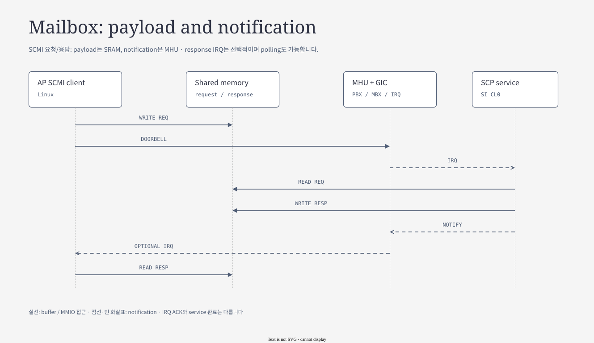
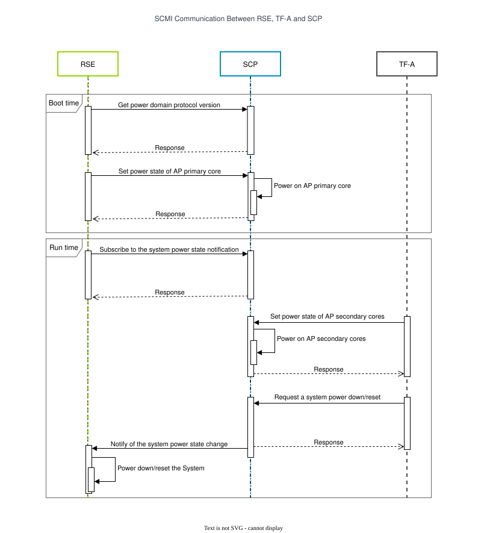
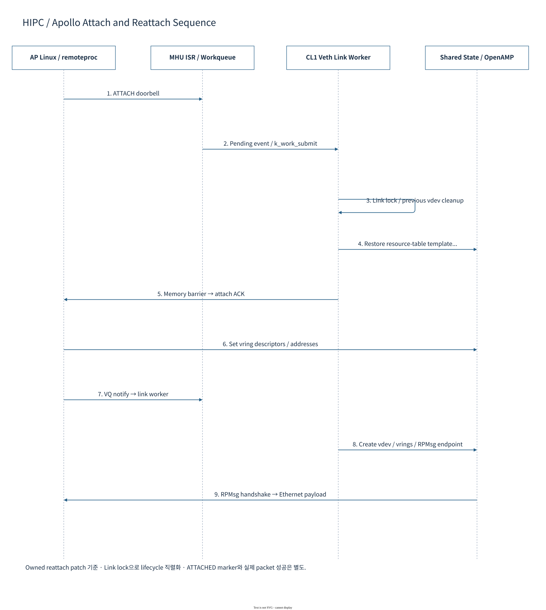

# 07.2 Mailbox와 IPC — notification, payload, completion

[전체 목차](../README.md) · [상위 장](../07-system-software-core.md) · [이전: 07.1 Interrupt와 GIC](01-interrupt-and-gic.md) · [다음: 07.3 Timer와 deadline](03-timer-and-deadlines.md)

**이 문서의 질문:** doorbell ACK를 받은 요청은 어디까지 끝난 것인가? SCMI의 shared slot과 RPMsg의 ring을 비교하고 buffer ownership·timeout·재접속을 설명한다.

## 1. Mailbox — notification과 payload를 분리하기

[draw.io 편집 원본](../diagrams/07-mailbox-flow.drawio)

[기존 HTML 보기](../diagrams/07-mailbox-flow.html)

### 1.1 기본 구성

| 구성 요소 | 역할 | 흔한 오해 |
|---|---|---|
| PBX | 송신 측 programming view | 수신 payload buffer 자체가 아님 |
| MBX | 수신 측 programming view | IRQ 한 번이 상위 요청 한 건의 성공을 뜻하지 않음 |
| Doorbell channel / flag | pending bit로 event 알림 | FIFO가 아니므로 동일 bit 반복 SET을 message queue로 보지 않음 |
| Shared memory | SCMI payload 또는 RPMsg vring/buffer | 주소가 같아 보이는 것과 동일 backing은 별개 |
| Transport / protocol | ownership, token, status, response, timeout | HW ACK와 service completion을 구분 |

SCMI의 일반 흐름은 **payload 작성 → doorbell SET → peer IRQ → service 실행 → response/status 갱신 → completion 관찰**이다. Memory ordering과 cacheability도 protocol contract의 일부다.

근거: [MHU model](../../../../hsoc-stack/tools/qbox-platform/systemc-components/mhu320ae/include/mhu320ae.h), [Linux MHU driver](../../../../hsoc-stack/components/primary_compute/linux/drivers/mailbox/arm_mhuv3.c), [SCP SCMI](../../../../hsoc-stack/components/system_mgmt/scp-firmware/module/scmi/src/mod_scmi.c).

### 1.2 실제 channel을 목적별로 보기

| 경로 | Protocol / 데이터 | 알림·완료 | 주 consumer |
|---|---|---|---|
| AP NS ↔ CL0 | SCMI / request+notification SRAM | ch0 bit0 request/reply, bit2 notification | Linux SCMI ↔ SCP |
| AP Secure → CL0 | SCMI power / secure SRAM slot | ch0 bit0, response/FREE polling | TF-A PSCI ↔ SCP |
| RSE ↔ CL0 | SCMI command/notification | bit1 command, bit2 notification | TF-M ↔ SCP |
| RSE → CL0 reload ACK | payload 없는 완료 알림 | bit3 전용 doorbell | AP recovery state machine |
| AP ↔ CL1 | HIPC / VirtIO-RPMsg vring | bit0/bit1 queue kick; attach/detach 별도 flag | Linux remoteproc ↔ Zephyr OpenAMP |
| AP/CL1 → CL0 | PFDI / CPU별 shared slot | CPU별 channel/flag | PFDI agent ↔ monitor |

Protocol ID, doorbell channel, flag bit, GIC INTID는 서로 다른 번호 공간이다. Linux MHU DT의 `<extension window bit>`와 Zephyr의 flattened channel ID도 같은 표기법이 아니다.

근거: [AP–SI Lua](../../../../hsoc-stack/tools/qbox-platform/platforms/apollo/soc/hw-block/system_mgmt/ap_si_mailbox.lua), [CL0 mailbox](../../../../hsoc-stack/tools/qbox-platform/platforms/apollo/soc/hw-block/si_cl0/mailbox.lua), [RSE–SI mailbox](../../../../hsoc-stack/tools/qbox-platform/platforms/apollo/soc/hw-block/system_mgmt/rse_si_mailbox.lua), [상세 channel 표](../../mailbox/MAILBOX-MAP.md#channels).

### 1.3 같은 shared memory의 서로 다른 CPU view

| 용도 | AP view | Peer view | 크기·배치 |
|---|---:|---:|---|
| NS SCMI | `0x00180000` | CL0 `0xE01B0000` | backing 4 KiB; request slot 256 B |
| Secure SCMI | `0x00000DC0` | CL0 `0xE0030DC0` | 256 B slot; 앞 영역은 SDS |
| HIPC resource table | `0x00100000` | CL1 `0xE0130000` | 128 KiB |
| HIPC vring0 / vring1 | `0x00120000` / `0x00140000` | `0xE0150000` / `0xE0170000` | 각각 128 KiB |
| HIPC packet buffer | `0x00160000` | CL1 `0xE0190000` | 128 KiB |
| CL1 PFDI | AP 직접 경로와 별개 | CL0/CL1 `0x48000000` | backing 4 KiB, CPU별 slot |

AP HIPC doorbell은 낮은 guest alias `0x400B0000`/`0x400E0000`에서 접근하고, system-global MHU decode는 `0x400003B100000`/`0x400003B140000`이다. **MMIO register 주소와 shared payload 주소를 혼합하지 않는다.**

QVP의 ATU/`addrtr`가 여러 view를 같은 backing으로 연결한다. 이 연결 자체가 CPU cache coherence·물리 interconnect latency를 입증하지는 않는다. [메모리·주소 상세](../../mailbox/MAILBOX-MAP.md#memory)

### 1.4 HIPC는 attach 이후에도 준비 단계가 남는다

| 단계 | 의미 | 다음 단계 |
|---|---|---|
| CL1 firmware 실행 | RSE/CL0가 준비한 RTOS가 실행 중 | resource table·transport 준비 |
| Linux remoteproc attach | `RPROC_DETACHED` remote에 연결 | attach ACK와 memory mapping |
| VirtIO/RPMsg 준비 | vring/endpoint negotiation | RPMsg endpoint/netdev 준비 |
| `ethsi1` 통신 | packet TX/RX와 peer response | workload별 throughput·오류 확인 |

Attach ACK만 확인한 결과를 network PASS로 부르지 않는다. [arm_si_rproc](../../../../sw-ref-stack/components/primary_compute/linux_drivers/arm_si_rproc_mod/src/arm_si_rproc.c)의 `arm_si_add_rproc_core()`·`arm_si_rproc_prepare()`·`arm_si_rproc_kick()`을 따른다. `.attach` callback 자체는 성공을 반환하는 작은 hook이며 최초 firmware loader가 아니다.

### 1.5 현재 MHU FCE / AE 지원 범위

| 항목 | 현재 구현·설정 | 적용 범위 |
|---|---|---|
| MHU FCE | 64 channel, 32 channel/group, 32-bit payload | Apollo Lua의 선택 geometry |
| SCP MHU3 fast channel | `SCP_ENABLE_MHU3_FAST_CHANNELS=TRUE` | 진단·FCE callback/IRQ 경로 |
| Linux/Zephyr 일반 mailbox | doorbell interface 유지 | SCMI/HIPC가 자동 FCE 전환되는 것은 아님 |
| SCMI perf fast channel | 기본 `OFF` | MHU FCE와 별개 기능 |
| AE fault support | RAM fault/FMU/RAS 등 기능 model | physical ECC/CRC/lockstep/timing parity 제외 |

기존 Mailbox 상세 자료의 “FastChannel engine 미구현” 상태 문구는 최신 source보다 오래되었다. 현재 기능은 [QVP README](../../../../hsoc-stack/tools/qbox-platform/platforms/apollo/README.md), [MHU header](../../../../hsoc-stack/tools/qbox-platform/systemc-components/mhu320ae/include/mhu320ae.h), [SCP 구성](../../../../hsoc-stack/components/system_mgmt/scp-firmware/product/automotive-rd/apollo-qvp/si0_ramfw/Firmware.cmake)을 우선한다.

### 1.6 Worked example — Linux SCMI request의 buffer ownership

[draw.io 편집 원본](../figures/reference/scmi_comm_rse_tfa_scp.drawio)

[Arm 원본 SVG](../../../../arm-zena-css/documentation/images/scmi_comm_rse_tfa_scp.svg)

*출처: Arm [components.rst — MHUv3 Communication](../../../../arm-zena-css/documentation/design/components.rst). 이 reference 그림에 더해 Apollo Linux는 NS SCMI 경로를 사용한다.*

**그림 읽는 순서:** RSE→SCP의 boot readiness/power 요청과 TF-A→SCP의 AP power 요청을 나눈다. 같은 SCMI server에 도착해도 agent/channel/security와 shared-memory slot이 다르다.

다음은 AP NS slot `0x00180000`을 사용하는 request의 단순화된 상태 흐름이다. CL0에서는 같은 backing이 `0xE01B0000`으로 보인다.

| 시점 | Shared channel | AP client | CL0 transport/service |
|---|---|---|---|
| A. Idle | `FREE=1` | channel lock과 free 상태 확인 | 새 요청 대기 |
| B. Publish request | `FREE=0`, header/length/payload 유효 | token/protocol/message, interrupt-request flag 작성 | 아직 이전 data를 읽으면 안 됨 |
| C. Notify | request가 peer에 보이는 상태 | MHU PBX SET | MBX IRQ → transport가 요청 획득 |
| D. Execute | server ownership | response 대기 또는 polling | validation → SCMI dispatch → module 처리 |
| E. Publish response | status/payload/length 갱신 후 `FREE=1` | token과 completion 조건 확인 | barrier 뒤 ownership 반환 |
| F. Complete | 재사용 가능 | response read, 결과 전달 | IENABLED이면 response notification |

**왜 barrier가 필요한가:** doorbell이 먼저 보이고 payload가 늦게 보이면 peer가 이전 request를 읽을 수 있다. 마찬가지로 `FREE=1`이 response보다 먼저 보이면 client가 이전 응답을 읽는다. CPU compiler barrier, CPU memory ordering, cache clean/invalidate, device MMIO ordering은 각각 다른 층이므로 임의 `volatile` 하나로 대체하지 않는다.

현재 [Linux `shmem.c`](../../../../hsoc-stack/components/primary_compute/linux/drivers/firmware/arm_scmi/shmem.c)의 `shmem_tx_prepare()`는 FREE 대기, ownership 변경, flag/header/payload 작성을 수행한다. [SCP `mod_transport.c`](../../../../hsoc-stack/components/system_mgmt/scp-firmware/module/transport/src/mod_transport.c)의 `transport_respond()`는 response length/payload를 노출한 뒤 `__sync_synchronize()`를 거쳐 FREE를 set한다. 그 후 `IENABLED`일 때만 `trigger_event()`를 호출한다.

이것이 **MHU hardware ACK ≠ SCMI response**인 이유다. MBX clear에 따른 PBX ACK는 doorbell 처리 상태이고, 상위 protocol의 status/token/ownership 확인이 service 완료를 결정한다.

### 1.7 RPMsg는 shared slot 하나가 아니라 ring과 buffer pool이다

[draw.io 편집 원본](../diagrams/phase1/zephyr-17-attach-sequence.drawio)

*Apollo 상세 도식: [Zephyr 문서 — HIPC attach sequence](../../zephyr/README.md). Reference 배경은 Arm [hipc.rst — RPMsg / Safety Island remoteproc driver](../../../../arm-zena-css/documentation/design/hipc.rst).*

**그림 읽는 순서:** remoteproc attach handshake → resource table → VirtIO negotiation → RPMsg Name Service → network endpoint 순서다. Doorbell이 동작하는 것만으로 마지막 endpoint가 준비되는 것은 아니다.

RPMsg sender는 빈 buffer를 얻어 header/payload를 채우고 descriptor를 publish한다. 수신 측은 ring에서 descriptor를 얻어 message를 소비하고 buffer ownership을 돌려준다. Queue index를 갱신하기 전에 buffer data가 보이도록 ordering을 지켜야 하며, sender가 아직 peer가 사용하는 buffer를 재사용하면 packet corruption이 된다.

두 vring의 진행 방향은 CL1→AP와 AP→CL1이며 MHU flag0/1이 각각 queue kick을 구분한다. **512 KiB backing**은 무제한 queue가 아니다. Buffer pool이 소진되면 send 실패/대기/drop이 생길 수 있고 Linux network stack으로 옮기는 `skb` copy 이후에도 별도 congestion/drop이 가능하다.

**Apollo 연결:** [arm_si_rproc](../../../../sw-ref-stack/components/primary_compute/linux_drivers/arm_si_rproc_mod/src/arm_si_rproc.c)의 `.prepare`/`.kick`, [Linux rpmsg_net](../../../../sw-ref-stack/components/primary_compute/linux_drivers/rpmsg_net_mod/src/rpmsg_net.c), [Zephyr veth_rpmsg](../../../../arm-zena-css/components/safety_island/zephyr/src/drivers/ethernet/veth_rpmsg.c). AP reset 후에는 shared backing 보존 여부와 ring/endpoint 재협상을 함께 보아야 한다.

### 1.8 PSA proxy, SCMI, RPMsg가 공유하지 않는 것

| Interface | 주 대상 | Message의 의미 | 완료 기준 |
|---|---|---|---|
| SCMI | power/performance/platform service | protocol ID + message ID + token | SCMI status/response |
| RPMsg | endpoint 간 message/network frame | endpoint address + buffer/ring ownership | receive callback·상위 network response |
| PSA proxy | RSE crypto/storage/attestation/FWU | service operation·client identity·in/out vector | TF-M service의 reply |

MHUv3는 공통 notification hardware지만 serialization, 권한 검사, buffer 수명은 위 protocol이 결정한다. AP Secure world에서 RSE로 pointer를 넘기는 경우에는 허용 address region과 길이 검증이 필요하다. 세 경로를 같은 “mailbox driver 성공” 결과로 합치지 않는다. [AP–RSE service 경로 그림](../06-software/02-ap-and-secure-services.md#ap-secure-service)

## 2. Timeout 이후에도 shared buffer의 owner는 남아 있다

Client timeout은 “기다리기를 끝냈다”는 client의 판단이다. Server가 처리 중인 memory를 즉시 새 request로 덮어도 된다는 허가는 아니다. [Linux `shmem_tx_prepare()`](../../../../hsoc-stack/components/primary_compute/linux/drivers/firmware/arm_scmi/shmem.c)가 새 전송 전에 FREE를 다시 기다리는 이유가 여기에 있다. 현재 구현은 예상 RX timeout의 두 배까지 기다린 뒤에도 busy이면 경고와 오류 로그를 남기고 preparation을 중단한다.

Polling 완료도 FREE 하나로 결정하지 않는다. 같은 파일의 `shmem_poll_done()`은 header token을 추출해 `xfer->hdr.seq`와 일치하는지 먼저 확인한다. 그 다음 FREE 또는 ERROR를 completion 조건으로 본다. 이전 요청의 지연 response를 현재 요청의 성공으로 해석하지 않기 위한 경계다.

| 시점 | 잘못된 해석 | 실제로 필요한 확인 |
|---|---|---|
| AP timeout 발생 | shared slot을 바로 재사용 | peer가 FREE로 ownership을 반환했는가 |
| MHU RX ACK 도착 | SCMI command 성공 | token·status·payload가 현재 transfer에 대응하는가 |
| FREE 발견 | response의 길이를 그대로 신뢰 | header/status 제외 길이와 caller buffer 상한 |
| AP reset 후 attach | 이전 RPMsg buffer도 재사용 가능 | peer state, vring index, endpoint negotiation |

`shmem_fetch_response()`는 length에서 header/status 8 byte를 제외하고 caller의 RX buffer 한도로 copy 길이를 제한한다. Hardware notification 처리와 protocol response parsing은 이렇게 서로 다른 책임을 갖는다.

## 3. Request 하나를 추적할 때 남길 정보

SCMI의 경우 domain/channel, token, protocol/message ID, shared-memory 양쪽 view, request/response 시점, status를 함께 기록한다. RPMsg에서는 endpoint address, vring index, buffer ownership, kick flag와 peer readiness가 중심이다. 주소나 IRQ count 하나만 남기면 어느 request가 유실되었는지 복원하기 어렵다.

| 경계 | SCMI 관측 | RPMsg 관측 |
|---|---|---|
| Producer publish | header·payload·BUSY | descriptor와 available index |
| Hardware notify | PBX flag와 MBX IRQ | queue별 kick flag |
| Peer consume | transport dispatch와 service status | receive callback와 buffer 반환 |
| Request complete | matching token, FREE/ERROR, response | endpoint response 또는 network 왕복 |

현재 문서의 주소·channel 표와 이 관측 항목을 함께 사용한다. 시험에서 register read/write만 확인했다면 protocol 완료를 주장하지 않고 그 관측 단계까지 기록한다.

---

[전체 목차](../README.md) · [상위 장](../07-system-software-core.md) · [이전: 07.1 Interrupt와 GIC](01-interrupt-and-gic.md) · [다음: 07.3 Timer와 deadline](03-timer-and-deadlines.md)
