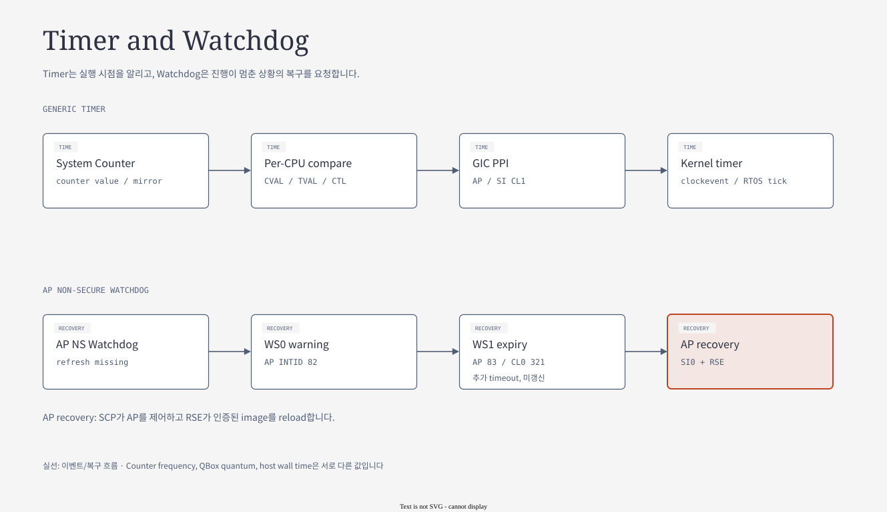
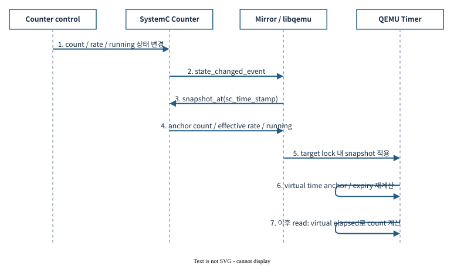
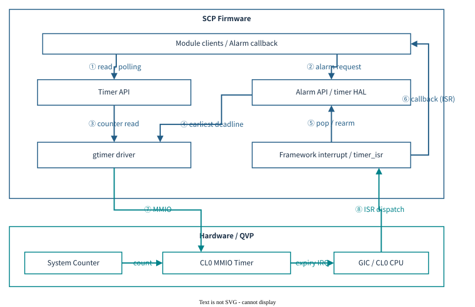

# 07.3 Timer와 deadline — count에서 callback까지

[전체 목차](../README.md) · [상위 장](../07-system-software-core.md) · [이전: 07.2 Mailbox와 IPC](02-mailbox-and-ipc.md) · [다음: 07.4 Watchdog과 AP recovery](04-watchdog-and-recovery.md)

**이 문서의 질문:** counter는 증가하는데 왜 timeout callback이 늦거나 실행되지 않는가? Counter rate, comparator, IRQ, software queue, execution context를 분리해 읽는다.

## 1. Timer — 공통 count와 독립 comparator



[draw.io 편집 원본](../diagrams/07-timer-watchdog.drawio)

[기존 HTML 보기](../diagrams/07-timer-watchdog.html)

### 1.1 Counter, Timer, clocksource, clockevent

| 용어 | 설명 | 예 |
|---|---|---|
| Counter | 현재 시각을 표현하는 증가 값 | CSS system counter, CPU counter read |
| Comparator | count와 deadline을 비교 | `CVAL` |
| Timer | comparator·enable·mask·IRQ 구성 | CPU Generic Timer, MMIO timer |
| clocksource | OS가 시간 경과를 읽는 입력 | Linux architected counter |
| clockevent | OS가 다음 deadline IRQ를 예약하는 장치 | per-CPU architected timer |
| Software timer | 여러 timeout을 관리하는 SW 자료구조 | Linux hrtimer, Zephyr timeout queue, SCP alarm |

한 Counter를 공유해도 CPU마다 comparator는 따로 존재한다. IRQ가 발생하는 시각과 ISR이 실제 실행되는 시각도 구분한다.

### 1.2 Domain별 active timer

| Domain | Active mechanism | 대표 SW 경로 | 주의 |
|---|---|---|---|
| AP CPU | per-CPU QEMU Generic Timer | Linux arch timer → clockevent/hrtimer | CPU PPI와 MMIO timer SPI는 별개 |
| AP MMIO | `qemu_arm_arch_timer_mmio` | Secure/NS frame | frame1 S INTID80, frame0 NS INTID81 |
| CL0 | SystemC `host_gtimer` MMIO comparator | SCP timer alarm → gtimer → FIQ callback | INTID34; generic CPU timer와 별개 |
| CL1 | CPU virtual timer | `CNTV_CVAL` → PPI27 → `sys_clock_announce()` | tickless, SMP CPU-local deadline |
| RSE | SSE TIMER0–3 + 별도 SysTick | BL2 polling 또는 조건부 test/handler | SysTick을 TF-M 기본 periodic scheduler로 단정하지 않음 |

Apollo의 현재 active timer를 SP804로 설명하지 않는다. Generic Timer, `host_gtimer`, SSE timer, SysTick을 각각 실제 driver/model과 연결한다.

근거: [AP timer Lua](../../../../hsoc-stack/tools/qbox-platform/platforms/apollo/soc/hw-block/ap_compute/system.lua), [CL0 timer Lua](../../../../hsoc-stack/tools/qbox-platform/platforms/apollo/soc/hw-block/si_cl0/system.lua), [RSE timer Lua](../../../../hsoc-stack/tools/qbox-platform/platforms/apollo/soc/hw-block/rse/system.lua), [CL1 timer config](../../../../hsoc-stack/components/system_mgmt/zephyrproject/zephyr_hsoc_src/boards/hsoc/apollo_qvp_safety_island_c1/apollo_qvp_safety_island_c1_defconfig).

### 1.3 비교할 주소와 clock

| 항목 | 주소 또는 clock | 해석 |
|---|---|---|
| AP CNTCTL | `0x1A810000` | MMIO timer frame 관리 |
| AP Secure / NS frame | `0x1A820000` / `0x1A830000` | 낮은 주소가 frame1, 높은 주소가 frame0 |
| CL0 CNTCTL / CNTBase | `0x2A6F0000` / `0x2A720000` | SCP MMIO timer |
| RSE TIMER0 S / NS | `0x58000000` / `0x48000000` | 같은 timer의 접근 view, NVIC IRQ3 |
| CSS / AP / CL1 기본 rate | 125 MHz | mirror와 각 model의 선택 조건 확인 |
| RSE SysTick | CPU clock 100 MHz | CSS counter와 다른 입력 |
| Watchdog | AP/CL0 125 MHz, RSE 32 MHz | 자체 SystemC count, CSS rate와 별개 |

`CNTFRQ` 값, 실제 counter 증가율, guest가 쓰는 시간 환산값을 함께 확인한다. CPU core frequency나 host wall-clock을 timer frequency로 대신하지 않는다. [상세 Timer Map](../../timer/TIMER-MAP.md)

### 1.4 Software deadline 처리 예

| Client | 예약 | 만료 | 실행되는 후속 작업 |
|---|---|---|---|
| Linux sleep/hrtimer | per-CPU clockevent deadline | timer PPI | callback/task wakeup |
| Zephyr `k_sleep()` | timeout queue, next tickless deadline | virtual timer PPI | `sys_clock_announce()` → timeout·scheduler |
| SCP alarm | 가장 이른 alarm을 MMIO CVAL에 설정 | CL0 FIQ | alarm callback; 주기 요청이면 재예약 |
| TF-M BL2 SCMI wait | TIMER0 count polling과 timeout 비교 | polling loop의 기한 초과 | 실패 반환/boot abort |

SCP callback과 TF-M polling에 OS scheduler 경로를 일괄 적용하지 않는다. QVP simulation time 검증은 physical WCET/interrupt latency 검증과 별도다.

<a id="timer-worked-example"></a>

### 1.5 Worked example — 5 ms 뒤 CPU-local event 예약



[draw.io 편집 원본](../diagrams/phase1/timer-03a-counter-propagation.drawio)

*Apollo 상세 도식: [Timer 문서 — Time Base / Counter Propagation](../../timer/README.md).*

**그림 읽는 순서:** 공유 CSS counter의 count/rate/running 상태가 mirror를 통해 CPU timer·AP MMIO·RSE timer에 전달되는 경로와, 각 model이 자기 deadline event를 예약하는 경로를 구분한다. Comparator를 중앙 counter 하나로 합치는 그림이 아니다.

125 MHz counter에서 현재 virtual count가 `10,000,000`이고 5 ms 뒤 event가 필요하다고 가정하면 다음과 같다.

```text
delta = 125,000,000 × 0.005 = 625,000 ticks
deadline CVAL = 10,000,000 + 625,000 = 10,625,000
compare 조건 = count >= CVAL
IRQ assert 조건 = compare 조건 && ENABLE && !IMASK
```

이는 값의 의미를 설명하는 계산 예다. 실제 driver는 overflow, 이미 지난 deadline, 최소 delta, 현재 CPU의 timer 종류 등을 고려해 programming한다. `CVAL`은 absolute deadline이고 `TVAL`은 현재 count에 대한 relative interval이다.

Virtual count는 physical count와 offset 관계를 가지므로 `CNTVCT` 기준 deadline에 `CNTPCT`를 섞으면 offset만큼 오차가 생긴다. Rate가 바뀌었다면 tick 수를 시간으로 환산하는 쪽과 model의 실제 counter 증가율도 함께 갱신되어야 한다.

### 1.6 한 hardware comparator로 여러 software timeout 처리



[draw.io 편집 원본](../diagrams/phase1/timer-08f-scp-software.drawio)

*Apollo 상세 도식: [Timer 문서 — SCP Timer Architecture](../../timer/README.md).*

**그림 읽는 순서:** 여러 module의 alarm 요청이 timer HAL의 정렬된 queue에 들어가고, 가장 이른 deadline만 gtimer comparator에 설정되는 경로를 본다. IRQ 후에는 만료한 alarm callback을 실행하고 다음 deadline을 다시 programming한다.

예를 들어 alarm A=10 ms, B=15 ms, C=30 ms라면 첫 hardware interrupt는 A를 위한 10 ms다. A callback 후 B를 위한 15 ms absolute deadline을 넣고, B를 취소했다면 C로 건너뛴다. Periodic callback의 재예약 정책은 누적 지연과 burst 실행에 영향을 준다.

Linux hrtimer와 Zephyr tickless timeout도 많은 software timeout을 작은 수의 hardware event source에 배치한다. 다만 callback context는 다르다. SCP의 ISR callback에서 긴 blocking 작업을 하면 다른 alarm·SCMI 처리까지 늦출 수 있으므로 event로 넘길 작업과 즉시 끝낼 일을 구분한다.

**Apollo 연결:** [SCP timer module](../../../../hsoc-stack/components/system_mgmt/scp-firmware/module/timer/src/mod_timer.c), [gtimer module](../../../../hsoc-stack/components/system_mgmt/scp-firmware/module/gtimer/src/mod_gtimer.c), [CL0 host_gtimer](../../../../hsoc-stack/tools/qbox-platform/systemc-components/host_gtimer/include/host_gtimer.h). CL0 모델의 TVAL 저장과 실제 CVAL scheduling 구현은 구분한다.

## 2. CL0 comparator가 SystemC event를 예약하는 과정

[현재 `host_gtimer.cc`](../../../../hsoc-stack/tools/qbox-platform/systemc-components/host_gtimer/src/host_gtimer.cc)의 `timer_thread()`는 comparator 재설정과 counter state 변경을 모두 wakeup 조건으로 사용한다. `update_timer_irq()`가 현재 만료·enable·mask 상태를 계산하고, 아직 미래 deadline이면 `timer_delay()`가 다음 wait 시간을 계산한다. CVAL을 더 이른 값으로 바꾸거나 counter rate/state가 달라지면 기존 wait를 끝내고 다시 계산해야 한다.

`timer_delay()`는 단순히 `CVAL - count`를 host wall-clock sleep으로 바꾸지 않는다. Counter snapshot의 fractional count와 input-tick remainder를 반영하고, 나눗셈을 올림하여 comparator 도달 전에 expiry를 예약하지 않도록 한다. 현재 source는 중간 계산에 128-bit 값을 사용하고 SystemC time 범위를 넘는 deadline도 확인한다.

| 상태 | Model의 처리 | SW가 관측할 수 있는 결과 |
|---|---|---|
| ENABLE=0 | 미래 expiry 예약 안 함 | count가 증가해도 timer IRQ 없음 |
| 미래 CVAL, running counter | 남은 tick을 simulation delay로 환산 | deadline event 후 IRQ 조건 재평가 |
| 이미 지난 CVAL | 현재 expiry 상태를 즉시 평가 | enable·unmasked이면 level assert |
| IMASK=1 | expiry 조건과 IRQ 출력 분리 | deadline 지났어도 CPU에 전달 안 됨 |
| Counter state 변경 | state-change event로 wait 해제 | 새 rate/count 기준 재예약 |

## 3. Deadline 오류를 time base부터 좁히기

먼저 두 count read 사이의 **simulation time**과 count delta를 비교한다. 그 다음 CVAL이 같은 physical/virtual count 기준인지, mask와 routing이 맞는지 확인한다. 마지막으로 ISR 진입과 callback 실행의 지연을 나눈다. Callback이 늦다는 이유만으로 counter 주파수부터 바꾸면 정상 time base를 훼손할 수 있다.

SCP alarm callback이 새 event를 queue에 넣는 구조에서는 comparator expiry, ISR, event queueing, event consumption의 네 시점이 다르다. PFDI timeout과 watchdog rearm도 같은 timer 기반을 쓰므로 한 callback의 blocking 작업이 여러 platform service의 응답을 늦출 수 있다. 이는 model clock calibration과 firmware scheduling을 따로 분석해야 하는 이유다.

---

[전체 목차](../README.md) · [상위 장](../07-system-software-core.md) · [이전: 07.2 Mailbox와 IPC](02-mailbox-and-ipc.md) · [다음: 07.4 Watchdog과 AP recovery](04-watchdog-and-recovery.md)
