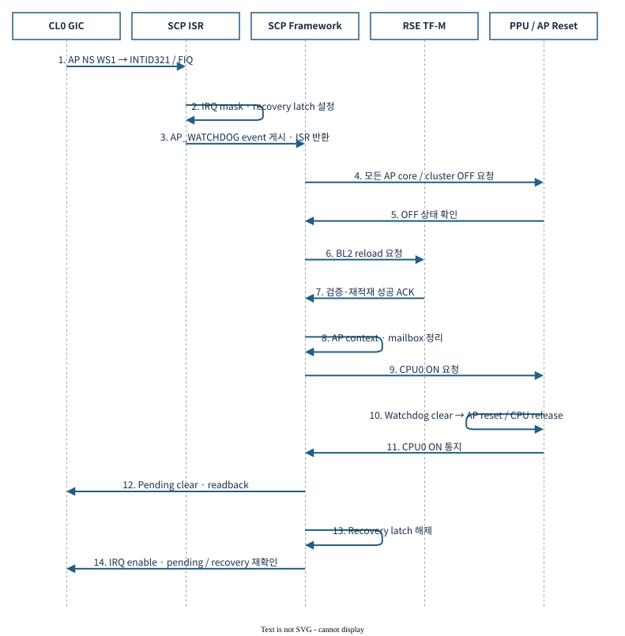
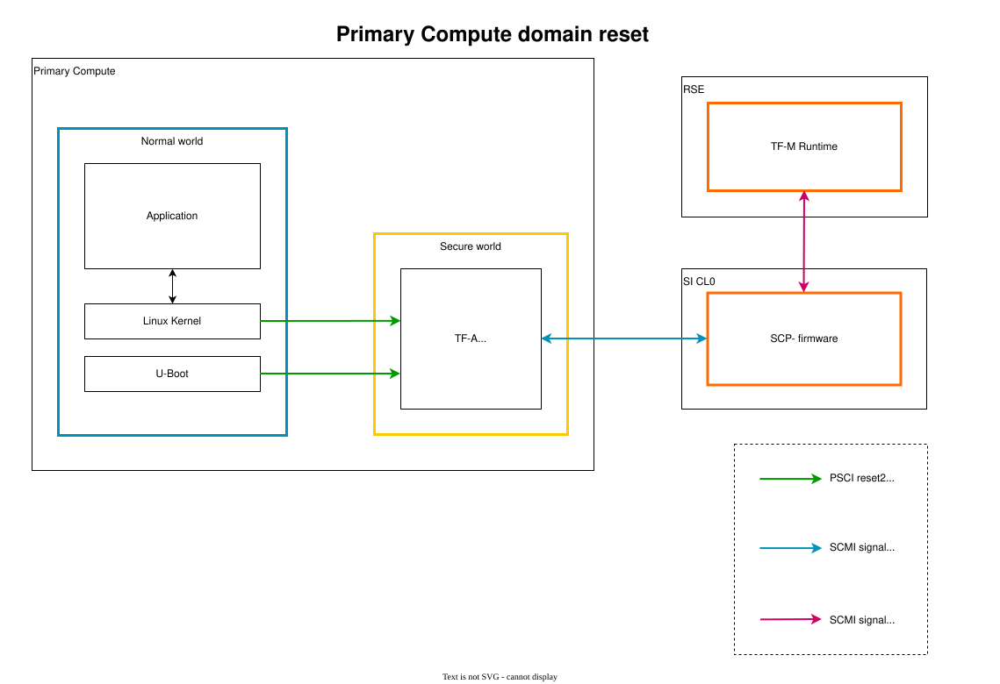

# 07.4 Watchdog과 AP recovery — WS1에서 service 복귀까지

[전체 목차](../README.md) · [상위 장](../07-system-software-core.md) · [이전: 07.3 Timer와 deadline](03-timer-and-deadlines.md) · [다음: 07.5 Power와 performance](05-power-and-performance.md)

**이 문서의 질문:** watchdog 만료 후 어떤 domain이 살아남아 AP를 복구하는가? HW timeout과 SCP/RSE recovery state machine의 완료·실패 조건을 함께 다룬다.

## 1. Watchdog — 만료 신호 이후의 recovery가 핵심

### 1.1 두 단계 모델

| 단계 | 동작 | SW 관점 |
|---|---|---|
| Arm / refresh | WCS/WOR 설정, WRR write | timeout을 설정하고 feeding |
| WS0 | 첫 구간 만료 | 경고·interrupt; policy에 따라 처리 |
| WS1 | 추가 구간 만료 | reset 또는 management firmware에 복구 요청 |
| Recovery | 별도 controller/firmware sequence | image reload, CPU release, service 복구 |

`zena_watchdog`의 두 deadline과 SCP의 recovery timeout은 서로 다른 시간이다. `/dev/watchdog` device가 보이는 것만으로 watchdog이 armed되었다고 판단하지 않는다.

### 1.2 현재 배선과 미완성 경계

| Watchdog | Control / Refresh | WS0 | WS1와 최종 연결 |
|---|---|---|---|
| AP NS | `0x1A420000` / `0x1A430000` | AP INTID82 | AP INTID83 + CL0 INTID321 → SCP recovery |
| AP Secure | `0x1A460000` / `0x1A470000` | AP INTID79 | reset controller → AP reset |
| SI CL0 | `0x2A700000` / `0x2A710000` | CL0 INTID37 | controller까지 연결; **`si_reset` 출력 미연결** |
| RSE NS | `0x48040000` / `0x48041000` | NVIC IRQ1 | NVIC IRQ0; reset input 연결과는 다름 |
| RSE Secure | `0x58040000` / `0x58041000` | 미연결 | 미연결 |
| SI CL1 전용 | 없음 | — | 전용 platform WDT instance/DT binding 없음 |

CL1에 Zephyr WDT API가 존재해도 현재 Apollo board의 전용 HW watchdog이 생기는 것은 아니다. RSE timestamp watchdog과 CMSDK SLOWCLK watchdog, SAM 내부 watchdog도 서로 다른 IP다.

근거: [AP system](../../../../hsoc-stack/tools/qbox-platform/platforms/apollo/soc/hw-block/ap_compute/system.lua), [CL0 system](../../../../hsoc-stack/tools/qbox-platform/platforms/apollo/soc/hw-block/si_cl0/system.lua), [RSE system](../../../../hsoc-stack/tools/qbox-platform/platforms/apollo/soc/hw-block/rse/system.lua), [reset controller binding](../../../../hsoc-stack/tools/qbox-platform/platforms/apollo/soc/hw-block/system_mgmt/system.lua), [reset fanout](../../../../hsoc-stack/tools/qbox-platform/platforms/apollo/soc/hw-block/fabric/reset.lua), [상세 Watchdog Map](../../watchdog/WATCHDOG-MAP.md).

### 1.3 AP NS watchdog recovery sequence

[draw.io 편집 원본](../diagrams/phase1/watchdog-11-recovery-sequence.drawio)

| 순서 | 주체 | 완료 조건 |
|---|---|---|
| 1 | Linux watchdog client/driver | feeding 중단이 실제 HW refresh 중단으로 이어짐 |
| 2 | Watchdog + IRQ routing | WS1이 CL0 INTID321로 전달 |
| 3 | SCP | IRQ mask·recovery event·AP OFF 성공 |
| 4 | RSE | AP BL2 load/decrypt/hash/signature 처리 성공 후 ACK |
| 5 | SCP | AP context 준비, CPU0 ON, IRQ rearm |
| 6 | AP firmware/Linux | 새로운 boot와 확인 대상 service 복귀 |

Linux `sbsa_gwdt` 기본 `action=0`에서 복구 주체는 SCP다. 프로세스 종료만으로 feeding이 멈춘다고 가정하면 watchdog core의 keepalive 동작 때문에 시험 해석이 틀릴 수 있다.

근거: [Linux driver](../../../../hsoc-stack/components/primary_compute/linux/drivers/watchdog/sbsa_gwdt.c), [watchdog core](../../../../hsoc-stack/components/primary_compute/linux/drivers/watchdog/watchdog_dev.c), [SCP recovery](../../../../hsoc-stack/components/system_mgmt/scp-firmware/product/automotive-rd/apollo-qvp/module/si0_platform/src/mod_si0_platform.c), [진단 도구](../../../../scripts/autosd_demo/watchdog_guest.py).

### 1.4 WS0, WS1와 AP domain reset의 실제 범위

[draw.io 편집 원본](../figures/reference/pc_domain_reset.drawio)

[Arm 원본 SVG](../../../../arm-zena-css/documentation/images/pc_domain_reset.svg)

*출처: Arm [boot_process.rst — Primary Compute reset 관련 절](../../../../arm-zena-css/documentation/design/boot_process.rst). Reference reset 협력 관계를 보여주는 그림이다.*

**그림 읽는 순서:** reset 요청을 받은 CL0가 AP를 정지시키고 RSE image reload와 협력한 뒤 AP를 다시 release하는 경로를 따라간다. AP domain reset에서 RSE·CL0·CL1까지 반드시 재부팅되는 것은 아니다.

Watchdog offset을 `O`, clock을 `f`라고 하면 한 구간은 `O/f`이다. Refresh 없이 첫 구간이 지나면 WS0, 추가 구간이 지나면 WS1이 된다. 예를 들어 `O=125,000,000`, `f=125 MHz`라면 WS0는 1 s, WS1은 총 2 s 뒤라는 계산이다. **AP WS0 ISR이 WS1을 발생시키는 것이 아니다.**

Apollo AP NS WS1은 SCP IRQ321 recovery로 들어간다. 반면 AP Secure WS1은 reset controller에 직접 연결된다. [reset fanout](../../../../hsoc-stack/tools/qbox-platform/platforms/apollo/soc/hw-block/fabric/reset.lua)은 AP watchdog 상태를 먼저 clear하고 AP reset release를 진행하도록 target 순서를 정한다. 이전 WS1이 계속 assert된 채 CPU를 release하면 새 reset과 이전 reset completion이 충돌할 수 있기 때문이다.

**Reference와 구현 차이:** 위 그림은 개념적인 AP reset 협력이다. Apollo의 실제 reset scope는 fanout target 목록, [SCP recovery state machine](../../../../hsoc-stack/components/system_mgmt/scp-firmware/product/automotive-rd/apollo-qvp/module/si0_platform/src/mod_si0_platform.c), [RSE runtime loader](../../../../hsoc-stack/components/system_mgmt/trusted-firmware-m/platform/ext/target/arm/rse/automotive_rd/apollo-qvp/bootloader/rse_image_loader/src/rse_image_load_util.c)로 결정한다. Shared memory/remote endpoint를 유지하는 경우 HIPC attach와 service state를 다시 맞춰야 한다.

## 2. Recovery는 bounded asynchronous state machine이다

[SCP `mod_si0_platform.c`](../../../../hsoc-stack/components/system_mgmt/scp-firmware/product/automotive-rd/apollo-qvp/module/si0_platform/src/mod_si0_platform.c)의 `ap_watchdog_isr()`는 WS1을 mask하고 event를 enqueue한다. RSE와의 긴 handshake를 ISR에서 수행하지 않는다. 이후 power-down, reload, CPU0 power-on, IRQ rearm은 서로 다른 완료 사건으로 진행된다.

`control_start()`는 전체 recovery deadline과 generation을 만들고 one-shot alarm으로 상태 확인을 예약한다. `recovery_completion_allowed()`는 예상 state·active flag·현재 counter를 확인한다. 이전 recovery의 callback이 늦게 도착하거나 deadline 이후 성공 응답이 와도 새 recovery의 정상 완료로 처리하면 안 되기 때문이다.

| 경계 | 현재 code가 검사하는 것 | 실패 시 의미 |
|---|---|---|
| ISR → event | IRQ mask와 enqueue 결과 | WS1 진입은 있었지만 orchestration 시작 실패 |
| AP OFF → reload | core/power state와 전체 deadline | AP 정지가 완료되지 않아 다음 단계 진행 불가 |
| RSE reload → CPU release | `complete_rse_recovery()` 결과와 RELOAD state | 인증/적재 실패 시 AP를 OFF에 유지 |
| CPU0 ON → IRQ rearm | pending level, rearm generation·deadline | 이전 WS1 잔존 또는 새 WS1 발생 |
| Firmware COMPLETE → 제품 정상 | 새 Linux boot와 service 재연결 | firmware 완료만으로 제품 service 복귀 불명 |

RSE reload 실패 처리에는 AP를 끈 채 WS1 mask를 유지하는 경로가 있다. 실패 로그가 없다는 이유로 임의 CPU_ON을 이어 수행하는 구조가 아니다. 이 실패 상태를 기록해야 오래된 image나 미완성 context로 실행을 재개한 결과와 구분할 수 있다.

## 3. IRQ rearm이 recovery의 마지막 단계인 이유

`watchdog_rearm_poll()`은 generation이 맞는 pending 작업만 처리하고, rearm timeout 이전인지 확인한다. `ap_watchdog_rearm()` 이후 IRQ unmask가 새 ISR을 유발했을 수 있으므로 `ap_watchdog_recovery`를 다시 확인한다. 성공할 때 `SI0_RECOVERY_COMPLETE`와 `SI0_AP_RUN`을 설정한다. 재확인이 필요하면 10,000 µs one-shot alarm을 사용한다. 이 interval은 watchdog HW offset이 아니다.

따라서 평가 기록에는 WS1 관측, AP OFF, RSE reload 결과, CPU0 ON, IRQ rearm, 새 boot ID와 service 복귀를 각각 남긴다. HIPC peer가 살아남았다면 attach/endpoint 재협상까지 확인한다. Linux process 종료나 host UART 재출력만으로 recovery 전체를 판정하지 않는다.
## 4. Reset·power·fault와 함께 봐야 하는 이유

| 연계 요소 | core 기능과의 관계 | 확인할 계약 |
|---|---|---|
| Reset fanout | watchdog/MHU/timer 상태의 수명 결정 | AP-only reset과 전체 Apollo reset의 target 목록 |
| PPU / power-domain | CPU 실행 시작·정지 조정 | SCP state machine와 reset release 순서 |
| GIC multiview | domain별 interrupt 접근·routing 구성 | SCP 초기화와 runtime backend 구성 |
| ATU / router | peer가 보는 payload·register 주소 결정 | local view → global address → backing |
| FMU / SSU | 정상 기능 이외 fault 수집·보고 | leaf identity, criticality, ACK 순서, recovery policy |

AP reset 시 remote firmware·shared memory·RPMsg endpoint가 모두 같은 상태로 초기화된다고 가정하지 않는다. 각 peer의 재접속 protocol과 reset scope를 함께 확인한다.

---

[전체 목차](../README.md) · [상위 장](../07-system-software-core.md) · [이전: 07.3 Timer와 deadline](03-timer-and-deadlines.md) · [다음: 07.5 Power와 performance](05-power-and-performance.md)
