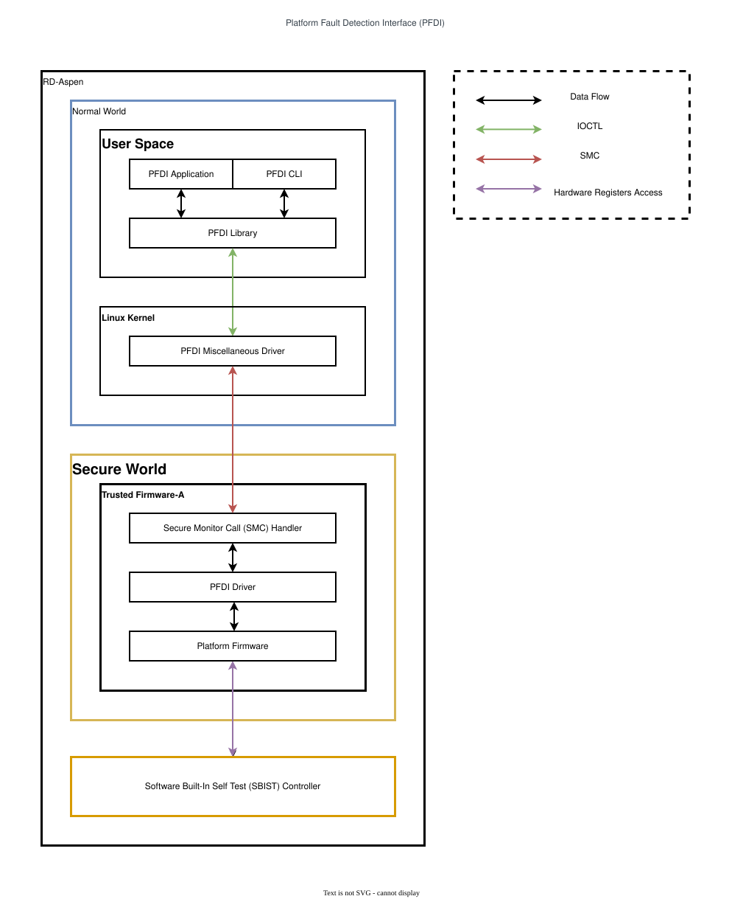
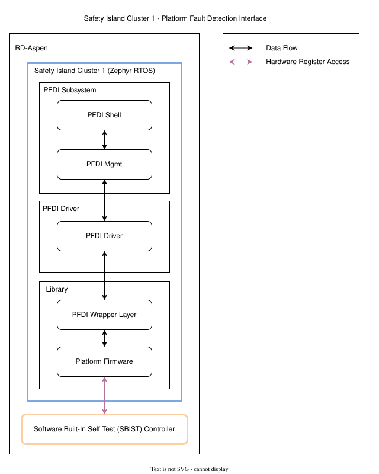
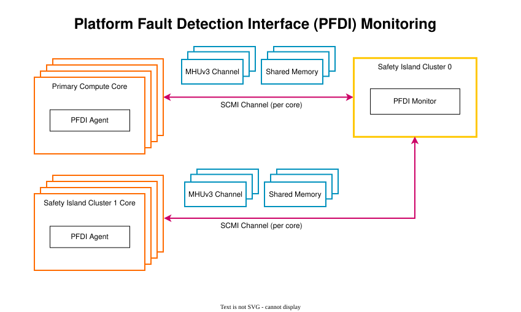

# 07.6 PFDI와 core별 monitoring

[전체 목차](../README.md) · [상위 장](../07-system-software-core.md) · [이전: 07.5 Power와 performance](05-power-and-performance.md) · [다음: 07.7 FMU·SSU·RAS](07-fmu-ssu-and-ras.md)

**이 문서의 질문:** test API 성공, Online report, deadline 준수는 각각 무엇을 증명하는가? AP·CL1 test 실행과 CL0 monitor state를 연결한다.

## 1. AP PFDI: Linux request가 EL3 test로 이어지는 경로

[draw.io 편집 원본](../figures/reference/platform_fault_detection_interface.drawio)

[Arm 원본 SVG](../../../../arm-zena-css/documentation/images/platform_fault_detection_interface.svg)

*출처: Arm [platform_fault_detection_interface.rst — Application Processor PFDI Implementation](../../../../arm-zena-css/documentation/design/platform_fault_detection_interface.rst).*

**그림 읽는 순서:** userspace에서 `libpfdi` API 호출 → kernel character device의 `ioctl` → SMC → TF-A PFDI handler → test backend를 따라간다. 호출 결과는 같은 경로로 돌아오며, monitoring report는 별도의 SCMI 경로를 사용한다.

OoR(Out-of-Reset) test와 Online test는 시점과 실패 처리 목적이 다르다. Reference AP primary OoR failure는 boot를 중단하고, secondary OoR failure는 이후 CPU_ON 허용 여부에 영향을 준다. Online test는 이미 실행 중인 core를 대상으로 주기적인 검사를 수행한다. Firmware library version, test count, 실행 result를 구분해야 “interface 호출 성공”과 “test 통과”를 혼동하지 않는다.

현재 통합의 kernel entry는 외부 module인 [pfdi_misc.c](../../../../sw-ref-stack/components/primary_compute/linux_drivers/pfdi_misc_mod/src/pfdi_misc.c)다. Reference 문서는 기본 backend가 실제 fault detection을 수행하지 않는 example implementation임을 명시한다. 따라서 PFDI API·agent 통신 검증을 licensed Arm STL의 test coverage나 hardware diagnostic coverage로 확대해서 설명하지 않는다.

## 2. CL1 PFDI: Secure Monitor 없이 Zephyr 안에서 실행

[draw.io 편집 원본](../figures/reference/si_platform_fault_detection_interface.drawio)

[Arm 원본 SVG](../../../../arm-zena-css/documentation/images/si_platform_fault_detection_interface.svg)

*출처: Arm [platform_fault_detection_interface.rst — Safety Island Cluster 1 PFDI Implementation](../../../../arm-zena-css/documentation/design/platform_fault_detection_interface.rst).*

**그림 읽는 순서:** shell/periodic trigger → subsystem manager → 해당 CPU의 worker → local PFDI driver/test 함수로 읽는다. Cortex-R82AE에는 EL3 Secure Monitor가 없으므로 AP 그림의 SMC 화살표를 CL1에 그대로 적용하지 않는다. CL1 PFDI는 Zephyr의 Secure EL1 firmware service이다.

CL1은 [pfdi_mgmt.c](../../../../arm-zena-css/components/safety_island/zephyr/src/subsys/pfdi/pfdi_mgmt.c)에서 CPU worker와 periodic execution을 관리하고, [pfdi_module.c](../../../../arm-zena-css/components/safety_island/zephyr/src/drivers/pfdi/pfdi_module.c)가 test interface를 연결한다. [weak CPU test backend](../../../../arm-zena-css/components/safety_island/zephyr/src/lib/pfdi/pfdi_weak_cpu_tests.c)는 대체 가능한 reference 구현이다. OoR failure 후 boot를 계속할지 여부는 AP의 규칙을 복사하지 않고 CL1의 post-run hook과 platform policy를 확인한다.

## 3. PFDI monitor: CPU별 deadline과 boot generation

[draw.io 편집 원본](../figures/reference/platform_fault_detection_interface_monitoring.drawio)

[Arm 원본 SVG](../../../../arm-zena-css/documentation/images/platform_fault_detection_interface_monitoring.svg)

*출처: Arm [platform_fault_detection_interface.rst — Platform Fault Detection Interface Monitoring](../../../../arm-zena-css/documentation/design/platform_fault_detection_interface.rst).*

**그림 읽는 순서:** AP/CL1의 각 CPU agent가 자기 SCMI channel로 CL0에 report하는 화살표를 본다. 한 CPU의 정상 report가 다른 CPU의 timeout을 숨기지 않도록 core별 state와 alarm이 필요하다. 이 timer는 Linux `/dev/watchdog`와 별개의 software monitoring timer이다.

| Monitor state | 기다리는 사건 | 다음 단계의 의미 |
|---|---|---|
| `WAIT_FOR_OOR` | reset 직후 OoR 결과 | early test 결과와 boot 진행 가능 여부 판단 |
| `WAIT_FOR_BOOT` | runtime agent의 첫 Online report | boot가 service 실행 단계까지 도달했는지 확인 |
| `WAIT_FOR_ONL` | 다음 주기의 Online report | FDTI에 맞춰 주기적으로 결과 수신 |

[현재 monitor](../../../../hsoc-stack/components/system_mgmt/scp-firmware/product/automotive-rd/apollo-qvp/module/pfdi_monitor/src/mod_pfdi_monitor.c)는 core별 `generation`, `powered_off`, `online_seen`을 유지한다. `pfdi_monitor_prepare_restart()`가 명시적으로 호출된 restart에서 generation을 바꾸고, queue에 남아 있던 이전 generation의 status/timeout event는 무시한다. 예를 들어 AP reset 직후 옛 timeout event가 도착해도 새 boot의 fault로 처리하면 안 된다.

Agent와 monitor의 SCMI vendor protocol ID는 `0x90`이다. [core별 binding](../../../../hsoc-stack/components/system_mgmt/scp-firmware/product/automotive-rd/apollo-qvp/si0_ramfw/config_scmi_pfdi_monitor.c)은 transport service를 monitor element에 대응시킨다. 따라서 “MHU interrupt 수신” 이후에도 SCMI decode, core identity, state transition, alarm refresh까지 확인해야 정상 report 수신이라고 할 수 있다.

## 4. Report와 power notification의 경쟁을 처리하기

[Monitor event handler](../../../../hsoc-stack/components/system_mgmt/scp-firmware/product/automotive-rd/apollo-qvp/module/pfdi_monitor/src/mod_pfdi_monitor.c)의 `pfdi_monitor_process_event()`는 target core index를 검사한 뒤 event generation과 현재 core generation을 비교한다. Generation이 다르면 이전 boot의 event로 보고 상태를 바꾸지 않는다. 이 검사는 queue에 들어간 시점과 처리 시점 사이에 reset이 일어날 수 있다는 전제를 반영한다.

현재 `prepare_restart()`는 해당 core가 `powered_off` 상태일 때만 generation을 증가시키고 fault·Online 기록과 state를 초기화한다. 호출 지점은 [SCP `finish_warm_reset()`](../../../../hsoc-stack/components/system_mgmt/scp-firmware/product/automotive-rd/apollo-qvp/module/si0_platform/src/mod_si0_platform.c)의 `ap_watchdog_recovery` 분기로, 구성된 AP core에 대해 restart를 준비한다. 일반 Power OFF/ON notification은 alarm·`powered_off`·`online_seen`을 바꾸며 generation·fault·`core_state`를 자동 초기화하지 않는다.

예를 들어 core A의 timeout이 queue에 들어간 직후 AP watchdog recovery가 이 restart API를 호출해 새 generation이 열렸다고 하자. 그 timeout을 새 boot에 적용하면 막 시작한 core를 즉시 실패 처리한다. 반대로 같은 generation에서 잘못된 순서의 OoR report를 받으면 protocol fault로 기록한다. “오래된 event 무시”와 “현재 boot의 protocol 오류”는 서로 다른 분기다.

| 사건 | 관리하는 state | 목적 |
|---|---|---|
| 명시적 `prepare_restart()` | generation, WAIT_FOR_OOR, fault·Online 기록 | 이전 boot event와 구분 |
| OoR 결과 | boot timeout, WAIT_FOR_BOOT | early test 이후 runtime 도달 감시 |
| Online report | Online timeout, WAIT_FOR_ONL, `online_seen` | CPU별 주기 보고 추적 |
| Power OFF/SLEEP | `powered_off=true`, alarm stop | 의도적으로 정지한 CPU의 false timeout 방지 |
| Power ON | `powered_off=false`, boot alarm start | 새 실행 상태의 report 대기 |

이 state machine은 현재 source의 동작 설명이다. Alarm callback에서 event를 enqueue하는 시간과 handler가 처리하는 시간 사이에는 queue delay가 있으므로 FDTI 평가에서는 report timestamp, alarm deadline, event 처리 시점을 함께 봐야 한다.

## 5. 진단 성공과 진단 coverage의 차이

PFDI API가 실행되고 정상 결과가 전달되면 interface integration을 확인할 수 있다. 그러나 weak/reference backend가 실제 STL로 교체되지 않았다면 CPU 내부 fault 검출 coverage를 뜻하지 않는다. Missing report를 timeout으로 잡는 monitoring과 test algorithm이 silicon fault를 검출하는 능력도 별개다.

평가 단위를 core별로 유지한다. 모든 CPU의 합산 report count는 한 CPU의 누락을 다른 CPU의 잦은 report가 가릴 수 있다. 결과에는 core identity, generation, OoR/Online 상태, deadline, backend 종류를 함께 남겨야 source state machine과 실행 evidence를 대응시킬 수 있다.

---

[전체 목차](../README.md) · [상위 장](../07-system-software-core.md) · [이전: 07.5 Power와 performance](05-power-and-performance.md) · [다음: 07.7 FMU·SSU·RAS](07-fmu-ssu-and-ras.md)
