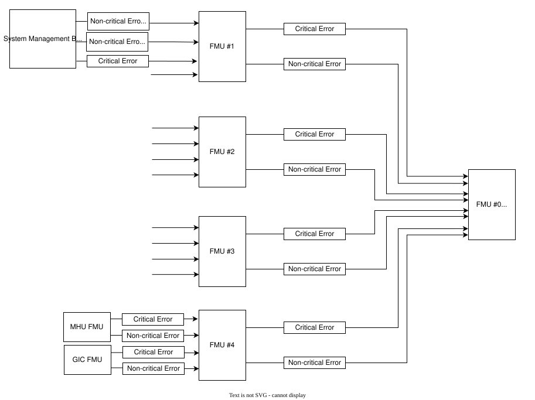
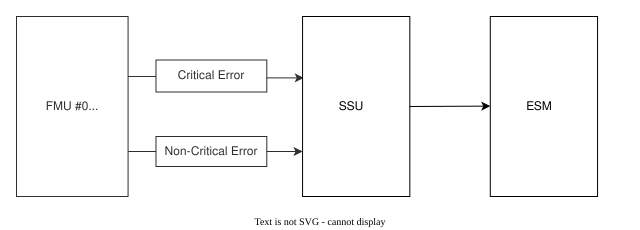
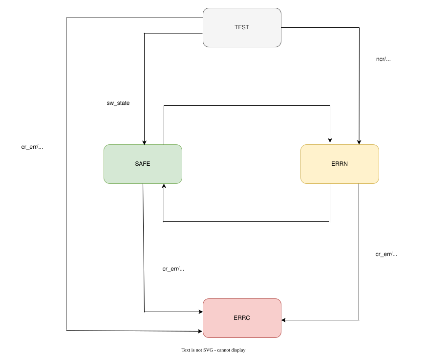
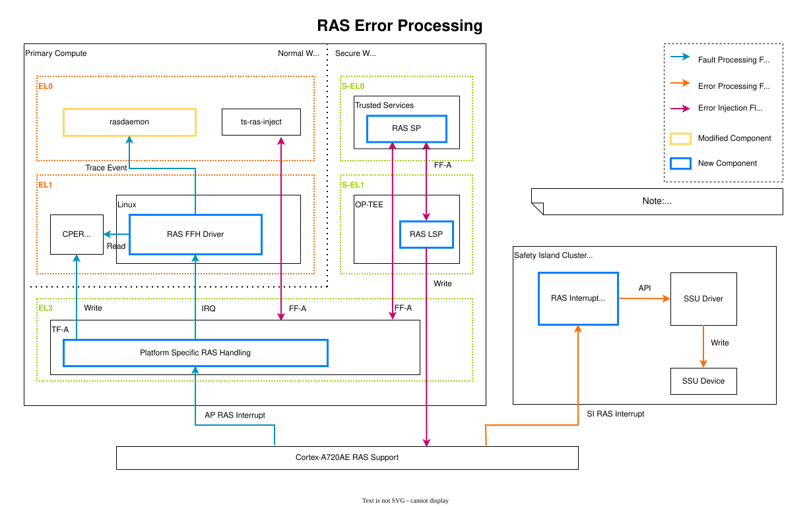
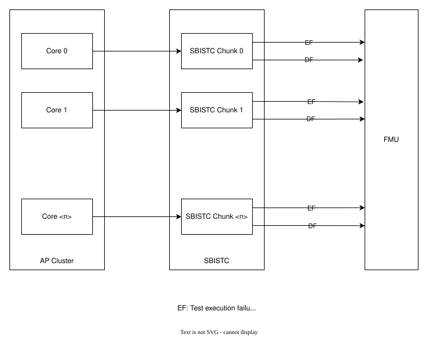
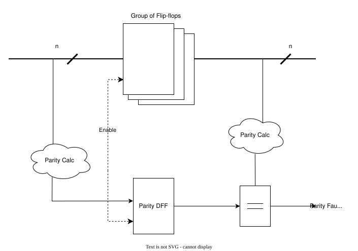

# 07.7 FMU·SSU·RAS — fault identity에서 OS 기록까지

[전체 목차](../README.md) · [상위 장](../07-system-software-core.md) · [이전: 07.6 PFDI와 core별 monitoring](06-pfdi-and-monitoring.md) · [다음: 07.8 SMCF](08-smcf-sampling.md)

**이 문서의 질문:** fault를 ACK하기 전에 무엇을 보존해야 하고 누가 recovery를 결정하는가? FMU tree, SSU state, CPER consumer와 SBISTC/TFP의 진입점을 따라간다.

## 1. FMU tree: summary bit에서 실제 leaf fault까지 내려가기

[draw.io 편집 원본](../figures/reference/fmu_tree.drawio)

[Arm 원본 SVG](../../../../arm-zena-css/documentation/images/fmu_tree.svg)

*출처: Arm [fmu.rst — RD-Aspen FMU Topology, Design and Framework](../../../../arm-zena-css/documentation/design/fmu.rst).*

**그림 읽는 순서:** fault는 leaf에서 root로 올라가지만, software는 root summary에서 child와 leaf 방향으로 내려가 원인을 찾는다. Root bit만 clear하면 어느 device의 어떤 record였는지 잃거나, 아직 assert된 leaf가 즉시 root를 다시 올릴 수 있다.

System FMU0는 root이고 FMU1/2는 외부 CSS fault, FMU3은 SI processor cluster, FMU4는 SI 내부 peripheral·infrastructure fault를 모은다. GIC·MHU·NI-710AE FMU는 각 IP의 record format을 가진 leaf이다. 이 관계는 [Apollo `config_fmu.c`](../../../../hsoc-stack/components/system_mgmt/scp-firmware/product/automotive-rd/apollo-qvp/si0_ramfw/config_fmu.c)의 parent와 source index로 software에 표현된다.

현재 [SCP FMU module](../../../../hsoc-stack/components/system_mgmt/scp-firmware/product/automotive-rd/apollo-qvp/module/fmu/src/mod_fmu.c)의 처리 과정은 다음과 같다.

1. Critical 또는 Non-critical ISR에서 해당 IRQ를 mask하고 drain event를 queue에 넣는다.
2. Root summary부터 leaf까지 경로를 저장하고 실제 fault record의 identity와 syndrome을 읽는다.
3. Leaf와 upstream ACK 진행 상태를 유지하여 재시도 시 같은 record를 중복 ACK하지 않는다.
4. Consumer에게 fault notification을 전달하고 다음 record를 처리한다. 한 event의 drain budget은 16이다.
5. Fault가 소진되거나 한 batch의 budget에 도달하면 state를 먼저 publish하고 IRQ를 다시 enable한다. 남은 level fault는 다음 ISR을 일으키므로 SCMI 같은 다른 ISR work에도 실행 기회를 준다.

NI의 하나의 RAS snapshot은 여러 output을 동시에 assert할 수 있다. 오래된 Non-critical event가 먼저 queue에 있었다고 shared snapshot을 먼저 ACK하면 뒤의 Critical event가 근거를 잃는다. 현재 `next_fault()`는 root에 Critical pending이 있으면 Non-critical drain을 기다리게 하여 이 순서 문제를 처리한다.

**Apollo 구현에서 확인할 차이:** System FMU, GIC/MHU device FMU, NI FMU를 모두 같은 register array로 읽으면 안 된다. [System FMU model](../../../../hsoc-stack/tools/qbox-platform/systemc-components/zena_fmu/include/zena_fmu.h), [device FMU model](../../../../hsoc-stack/tools/qbox-platform/systemc-components/zena_device_fmu/include/zena_device_fmu.h), [NI model](../../../../hsoc-stack/tools/qbox-platform/systemc-components/zena_ni710ae_fmu/include/zena_ni710ae_fmu.h)은 서로 다른 register profile과 ACK 규칙을 구현한다. 그림의 연결 관계와 해당 profile의 정확한 register 동작을 함께 봐야 한다.

## 2. Fault 처리에서 보존해야 할 세 가지 state

[현재 FMU module](../../../../hsoc-stack/components/system_mgmt/scp-firmware/product/automotive-rd/apollo-qvp/module/fmu/src/mod_fmu.c)은 **선택한 fault identity**, **tree를 내려온 경로**, **각 ACK의 진행 상태**를 따로 유지한다. `next_fault()`가 leaf를 찾은 뒤 중간 ACK가 실패하면 새 fault를 고르지 않고 기존 경로를 이어야 한다. 이미 clear한 leaf에 다시 ACK하면 그 사이 발생한 새 fault까지 지울 수 있기 때문이다.

Notification enqueue도 별도 단계다. `notification_pending`이 남아 있으면 `next_fault()`는 먼저 그 notification을 다시 enqueue한다. [Framework의 `fwk_notification_notify_atomic()`](../../../../hsoc-stack/components/system_mgmt/scp-firmware/framework/src/fwk_notification.c) 성공은 subscription 대상 event queue에 넣었다는 뜻이며 consumer handler의 처리 완료 ACK가 아니다. Leaf ACK, notification enqueue, consumer 실행을 각각 확인해야 한다.

| State | 유지하는 내용 | 재시도에서 지켜야 할 조건 |
|---|---|---|
| `pending_fault` | device/node/syndrome 관련 identity | 다른 fault로 덮지 않음 |
| path + per-entry ACK | leaf부터 ancestor까지 진행 상태 | 완료한 ACK를 반복하지 않음 |
| `notification_pending` | notification enqueue 미완료 | 다음 record보다 먼저 enqueue 재시도 |
| drain status | masked/queued/drained/error | 실패 후 IRQ가 계속 mask인지 확인 |

ACK나 notification enqueue 실패 후에는 IRQ를 mask한 상태로 error와 진행 정보를 유지한다. `recover()` API가 drain event를 다시 queue에 넣어 재개할 수 있으며 자동 timer retry를 뜻하지 않는다.

## 3. Critical 우선순위와 batch fairness를 함께 보장하기

Critical 우선순위는 단순 event queue 순서보다 강한 제약이다. Non-critical event가 먼저 enqueue되어도 같은 NI snapshot에 Critical pending이 있으면 `next_fault(false)`는 대기한다. Critical ACK가 필요한 record를 Non-critical 경로가 먼저 소비하지 않게 한다.

반면 fault가 무한히 유입될 때 FMU만 계속 실행하면 SCMI와 다른 ISR 작업이 굶을 수 있다. `process_event()`는 drain budget을 적용하고 batch 끝에서 IRQ를 rearm한다. 정상 queue에 즉시 자신을 다시 넣는 방식 대신 아직 남은 level fault가 새 ISR을 만들게 한다. 실패한 Critical drain을 기다리는 Non-critical은 mask를 유지해 불필요한 IRQ 반복을 피한다.

이 두 규칙은 서로 다른 문제를 해결한다. 첫째는 shared fault record의 정확성, 둘째는 system 전체의 진행 가능성이다. 따라서 검증도 fault identity·ACK 순서뿐 아니라 동시 SCMI 요청의 완료를 별도로 관측해야 한다.

## 4. SSU: fault 수집 결과를 외부 safety state로 표현

[draw.io 편집 원본](../figures/reference/fmu_ssu_integration.drawio)

[Arm 원본 SVG](../../../../arm-zena-css/documentation/images/fmu_ssu_integration.svg)

*출처: Arm [ssu.rst — FMU-SSU Integration](../../../../arm-zena-css/documentation/design/ssu.rst).*

**그림 읽는 순서:** Critical fault의 직접 SSU 입력과 Non-critical fault를 판단하는 SCP software 경로를 구분한다. Reference 기본 정책에서는 Critical이 즉시 상태에 반영되고 Non-critical은 software가 escalation 여부를 결정한다. SSU 상태 출력은 fault의 상세 syndrome을 대체하지 않으므로 FMU record를 함께 보존해야 한다.

[draw.io 편집 원본](../figures/reference/ssu_fsm_state.drawio)

[Arm 원본 PNG](../../../../arm-zena-css/documentation/images/ssu_fsm_state.png)

*출처: Arm [ssu.rst — Finite State Machine](../../../../arm-zena-css/documentation/design/ssu.rst). Reference FSM이며 아래 QVP 동작 차이를 함께 읽는다.*

Reference의 TEST는 reset 후 시험 중, SAFE는 정상 상태, ERRN은 Non-critical, ERRC는 Critical 상태다. 이 상태는 application task의 정상 실행 여부를 자동으로 보증하는 health score가 아니라, 지정된 fault input과 software control을 반영한 hardware-facing status이다.

**중요한 QVP 차이:** [현재 `zena_ssu`](../../../../hsoc-stack/tools/qbox-platform/systemc-components/zena_ssu/include/zena_ssu.h)는 ERRC에 대한 `SYS_CTRL` SAFE/ERRN 전환을 막지만, `write_status()`에서 valid bit를 W1C로 clear하면 ERRN/ERRC 상태를 SAFE로 돌린다. Reference 그림의 ERRC 복귀 조건과 동일하다고 볼 수 없다. Default Non-critical input enable도 Critical과 다르므로 model의 enable bits와 SCP 정책을 함께 확인한다.

## 5. RAS Firmware-First: CPU syndrome이 Linux 기록으로 바뀌는 과정

[draw.io 편집 원본](../figures/reference/ras_error_processing.drawio)

[Arm 원본 SVG](../../../../arm-zena-css/documentation/images/ras_error_processing.svg)

*출처: Arm [ras.rst — Error processing, Primary Compute error processing, Safety Island error processing](../../../../arm-zena-css/documentation/design/ras.rst).*

**그림 읽는 순서:** AP의 FHI → TF-A → CPER → Linux 경로와, SI CL0가 ERI를 받아 처리하는 경로를 분리한다. SI의 처리에는 AP userspace가 먼저 응답해야 한다는 의존성이 없다. Corrected, Deferred, Uncorrected의 구분은 로그 심각도보다 이후 recovery 가능성에 관한 정보다.

| 단계 | Apollo에서의 계약 | 담당 source |
|---|---|---|
| CPU error report | per-CPU FHI는 AP PPI17 경로 | [Apollo model 설명](../../../../hsoc-stack/tools/qbox-platform/platforms/apollo/README.md) |
| Firmware-First 처리 | EL3에서 error record를 읽고 CPER 작성 | [TF-A RAS handler](../../../../hsoc-stack/components/primary_compute/trusted-firmware-a/plat/arm/board/automotive_rd/platform/apollo_qvp/ras/apollo_qvp_ras.c) |
| Shared record | `0xFFA00000` buffer에 기록 후 cache flush | 같은 handler의 `cper_write_cpu_record()`, `flush_dcache_range()` |
| OS 알림 | absolute INTID89 = DTS의 SPI57 | [IRQ definition](../../../../hsoc-stack/components/primary_compute/trusted-firmware-a/plat/arm/board/automotive_rd/platform/apollo_qvp/ras/include/apollo_qvp_ras.h), [Linux DTS](../../../../hsoc-stack/components/primary_compute/linux/arch/arm64/boot/dts/hsoc/apollo-qvp.dtsi) |
| Linux 소비 | DT error-status source → common status 처리 → trace | [estatus-dt.c](../../../../hsoc-stack/components/primary_compute/linux/drivers/ras/estatus-dt.c) |
| SI 독립 판단 | ERI record 해석 후 SSU·diagnostic 처리 | [SCP RAS handlers](../../../../hsoc-stack/components/system_mgmt/scp-firmware/product/automotive-rd/apollo-qvp/module/ras_handlers/src/mod_ras_handlers.c) |

Reference 문서의 “SPI 89” 표기는 현재 DTS의 `<GIC_SPI 57>`과 번호 체계가 다르다. 이 자료는 **absolute INTID89**로 통일한다. Firmware가 CPER를 publish하기 전에 notification을 올리면 Linux가 이전 데이터를 볼 수 있으므로 record write·cache visibility·notification의 순서도 mailbox와 같은 producer/consumer 문제다.

**Apollo에서의 적용 범위:** CPU RAS pseudo fault와 firmware/OS reporting path는 model로 제공되지만, QEMU cache RAM에서 실제 ECC bit-cell fault를 발생시키는 물리 모델은 아니다. TF-A가 CPER를 만들었다는 것, Linux가 record를 처리했다는 것, userspace `rasdaemon`이 저장했다는 것은 각각 별도의 관측 지점이다.

## 6. OS report를 읽는 세 단계

TF-A가 CPER buffer를 작성했다면 firmware producer까지만 확인한 것이다. Linux가 notification을 받아 record를 처리했다면 OS consumer까지, `rasdaemon`이 저장했다면 userspace persistence까지 확인한 것이다. 각 단계의 성공/실패를 나누면 “RAS log가 없다”는 현상을 firmware·IRQ·kernel·userspace 중 어디서 끊겼는지 좁힐 수 있다.

SSU state는 이 세 단계 전체의 성공을 나타내는 집계 점수가 아니다. Safety state 입력과 firmware policy가 결정하는 별도 출력이다. 앞 절의 QVP W1C 차이를 포함하여 실제 선택한 model contract로 판정한다.
## 7. SBISTC와 TFP가 FMU·RAS에 들어오는 지점

[draw.io 편집 원본](../figures/reference/sbistc_info_flow.drawio)

[Arm 원본 SVG](../../../../arm-zena-css/documentation/images/sbistc_info_flow.svg)

*출처: Arm [sbistc.rst — Test Status and Fault Reporting, Design and Framework](../../../../arm-zena-css/documentation/design/sbistc.rst).*

**그림 읽는 순서:** STL이 core별 SBISTC chunk에 진행 상태를 기록하고, test failure 또는 DEADLOCK output이 FMU record로 이어지는 경로를 본다. `FCTLR`는 test 상태, `FPIR`는 현재 partition, `FFMIR`는 failure mode를 표현한다. Reference SBISTC watchdog은 test execution deadline을 감시하며 Linux watchdog과 별개의 목적을 가진다.

[현재 `apollo_sbist` model](../../../../hsoc-stack/tools/qbox-platform/systemc-components/apollo_sbist/include/apollo_sbist.h)은 `FCTLR_FAIL` write를 받아 CPU별 SBIST execution-failure 입력을 System FMU1에 주입한다. 기본 AP4의 record는 210–213이다. 이 경로는 fault routing·SCP consumer를 설명하는 근거이며, reference STL 전체 알고리즘과 SBISTC의 모든 watchdog timing을 구현했다는 뜻은 아니다.

[draw.io 편집 원본](../figures/reference/tfp_mechanism.drawio)

[Arm 원본 SVG](../../../../arm-zena-css/documentation/images/tfp_mechanism.svg)

*출처: Arm [tfp.rst — Transient Fault Detection Mechanism, Fault Reaction, Implementation in Software](../../../../arm-zena-css/documentation/design/tfp.rst).*

**그림 읽는 순서:** functional flop group의 parity와 저장된 parity-flop을 비교하고, mismatch를 RAS record로 모으는 경로를 본다. Reference TFP는 single transient fault를 검출하는 hardware mechanism이며 짝수 bit-flip은 놓칠 수 있다. Software는 이 gate-level 비교 대신 `ERXSTATUS_EL1`의 valid·SERR·IERR 정보를 해석한다.

TFP syndrome의 `SERR=0x1A`는 [TF-A RAS handler](../../../../hsoc-stack/components/primary_compute/trusted-firmware-a/plat/arm/board/automotive_rd/platform/apollo_qvp/ras/apollo_qvp_ras.c)와 [SCP RAS handler](../../../../hsoc-stack/components/system_mgmt/scp-firmware/product/automotive-rd/apollo-qvp/module/ras_handlers/src/mod_ras_handlers.c)의 diagnostic 분기로 연결된다. QVP에서 이 syndrome을 주입하고 handler를 실행하는 것은 software response 확인이며, physical parity coverage 또는 SPFM/SFF 측정과는 다른 evidence이다.

---

[전체 목차](../README.md) · [상위 장](../07-system-software-core.md) · [이전: 07.6 PFDI와 core별 monitoring](06-pfdi-and-monitoring.md) · [다음: 07.8 SMCF](08-smcf-sampling.md)
