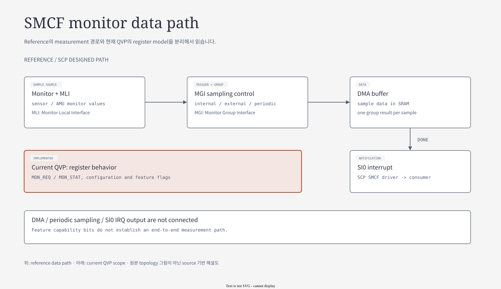

# 07.8 SMCF — sampling control과 data delivery

[전체 목차](../README.md) · [상위 장](../07-system-software-core.md) · [이전: 07.7 FMU·SSU·RAS](07-fmu-ssu-and-ras.md)

**이 문서의 질문:** sample enable이 성공했는데 consumer에 data가 없는 이유는 무엇인가? Reference data path와 현재 QVP register model의 경계를 단계별로 확인한다.

## 1. SMCF — monitor sample이 SCP consumer에 도착하는 경로

[draw.io 편집 원본](../diagrams/07-smcf-monitor.drawio)

[기존 HTML 보기](../diagrams/07-smcf-monitor.html)

*근거: Arm [smcf.rst — Configuration / Software flow](../../../../arm-zena-css/documentation/design/smcf.rst)와 아래 source. 원본 RST에는 그림이 없어 data path와 구현 경계를 새로 도식화했다.*

**그림 읽는 순서:** monitor → MLI → MGI → DMA shared buffer → SI0 IRQ → SCP consumer를 따라간다. 이는 reference의 완성된 sampling 경로이며, 그림 아래 QVP 범위와 구분한다. MLI(Monitor Local Interface)는 개별 data source에 붙고 MGI(Monitor Group Interface)는 여러 MLI의 sampling·수집을 제어한다.

| 단계 | Reference/SCP의 역할 | Data·control 계약 |
|---|---|---|
| Monitor / MLI | sensor 또는 activity counter 값을 공급 | source width·mode·valid 상태 |
| MGI | monitor enable과 sampling trigger를 적용 | manual, periodic, data-read, external-input trigger |
| DMA buffer | sample set을 MGI별 RAM 영역에 publish | DMA write address와 CL0 read address는 서로 다른 ATU view |
| IRQ / SCP consumer | sample completion → event → notification → data API | IRQ 수신과 sample data 소비·logging은 다른 단계 |

현재 [SCP `config_smcf.c`](../../../../hsoc-stack/components/system_mgmt/scp-firmware/product/automotive-rd/apollo-qvp/si0_ramfw/config_smcf.c)는 SMD MGI 1개와 AP cluster MGI 4개를 선언한다. 모두 periodic mode, `8,000,000 REFCLK cycles`, RAM DMA destination을 선택한다. AP MGI별 data 영역은 `0x100` stride이며 SMD sample 영역은 CL0 read-view base에서 `0x2000` 떨어져 있다.

SCP software의 처리 순서는 다음과 같다.

1. Startup에서 MGI feature/data format을 읽고 monitor·period·DMA 주소·IRQ를 설정한다.
2. `smcf_client`가 `PD_SYSTOP` ON notification을 받으면 모든 MGI의 sampling을 시작한다. OFF/SLEEP 전환에서는 중지한다.
3. Reference MGI가 RAM에 sample set을 쓰고 completion IRQ를 올리면 `sample_data_set_complete_handler()`가 framework event를 queue에 넣고 source를 clear한다. Debugger CLI가 실행 중이면 event queueing을 억제하는 조건도 있다.
4. Module event가 new-sample notification으로 변환되고 AMU/sensor consumer가 data API로 읽는다. 다음 sampling이 buffer를 덮을 수 있으므로 notification 자체가 sample의 무기한 유효성을 보장하지 않는다.

근거: [SMCF driver](../../../../hsoc-stack/components/system_mgmt/scp-firmware/module/smcf/src/mod_smcf.c), [sampling client](../../../../hsoc-stack/components/system_mgmt/scp-firmware/product/automotive-rd/apollo-qvp/module/smcf_client/src/mod_smcf_client.c), [SMCF data API 계약](../../../../hsoc-stack/components/system_mgmt/scp-firmware/module/smcf/doc/smcf.md).

**Trigger와 clock:** periodic interval은 `8,000,000 / REFCLK_Hz`이다. CPU generic timer의 125 MHz를 SMCF REFCLK로 자동 대입하지 않는다. External trigger를 사용할 수 있다는 architecture와 현재 periodic 설정도 다르며, [platform sampling wrapper](../../../../hsoc-stack/components/system_mgmt/scp-firmware/product/automotive-rd/apollo-qvp/module/platform_smcf/src/mod_platform_smcf.c)의 external-trigger 부분은 추가 구현을 위한 comment이다.

**현재 QVP 범위:** [host_smcf_mgi](../../../../hsoc-stack/tools/qbox-platform/systemc-components/host_smcf_mgi/include/host_smcf_mgi.h)는 `MON_REQ→MON_STAT`, mode status, sample-enable, IRQ-status W1C와 feature register를 제공한다. DMA/periodic capability bit는 기본 true지만 class에는 DMA initiator, IRQ output, periodic event scheduling이 없다. [Lua composition](../../../../hsoc-stack/tools/qbox-platform/platforms/apollo/soc/hw-block/si_cl0/safety.lua)의 5개 MGI도 register target socket만 연결한다. 따라서 현재 source로 전체 sample 전달 완료를 주장할 수 없다.

**Measurement fidelity:** reference FVP의 MLI도 dummy/random data source이다. Register 설정 성공, model sample 전달, 실제 temperature/voltage/AMU 측정 정확도는 서로 다른 단계다. `start sampling` command 성공을 sample IRQ·buffer 변경·consumer log의 관측으로 대신하지 않는다.

## 2. Configuration plane과 sample data plane을 분리해 읽기

SMCF는 먼저 어떤 monitor를 어떤 주기로 읽을지 설정하고, 그 다음 sample을 memory에 전달한다. 두 단계가 다른 interface를 사용하기 때문에 register 설정이 모두 성공해도 data path가 완성되지 않을 수 있다. 현재 QVP `host_smcf_mgi`는 전자의 여러 register를 제공하지만 후자의 DMA initiator·periodic scheduling·IRQ output은 제공하지 않는다.

| 경계 | Reference에서 필요한 동작 | 현재 QVP source로 확인 가능한 범위 |
|---|---|---|
| Driver probe | ID·feature·format read | register response |
| Monitor enable | request/status handshake | `MON_REQ`→`MON_STAT` |
| Sampling 시작 | periodic/external trigger 생성 | sample-enable bit 저장 |
| Data publish | DMA destination에 sample set write | end-to-end DMA 동작 없음 |
| Completion | completion status + SI0 IRQ | IRQ-status register 접근; output 배선 없음 |
| Consumer | event→notification→sample data API | SCP consumer code 존재; model 공급 증거 별도 필요 |

따라서 현재 상태에서 driver 초기화 실패를 고치는 작업과 sample engine을 구현하는 작업의 범위는 다르다. Feature register의 capability bit만으로 DMA가 실행된다고 결론내릴 수 없다.

## 3. Sample notification은 snapshot 복사가 아니다

[SCP `sample_data_set_complete_handler()`](../../../../hsoc-stack/components/system_mgmt/scp-firmware/module/smcf/src/mod_smcf.c)는 element를 대상으로 event를 enqueue한 뒤 interrupt source를 clear한다. 이 event 자체에 전체 sample buffer를 복사하지 않는다. Consumer가 늦게 읽으면 다음 sample이 같은 memory를 덮었는지 확인해야 하며, sample count·valid 상태·buffer lifetime을 API 계약과 함께 읽어야 한다.

Debugger CLI가 실행 중이면 event queueing을 억제하는 조건도 있다. CLI에서 sampling enable을 관측하면서 일반 consumer log가 없다고 판단할 때 이 실행 context를 확인해야 한다. 정상 firmware event loop와 interactive debugger context의 진행 조건이 다르기 때문이다.

## 4. Sample 하나를 확인하는 순서

검증 시에는 monitor 선택·period·DMA 주소를 기록하고, sampling 전 buffer 상태와 이후 sample validity/내용을 대조한다. 다음으로 IRQ, SCP event, notification, consumer read까지 같은 sample에 연결한다. 현재 QVP의 미구현 data path를 감안하면 이 절차는 향후 end-to-end 구현의 확인 기준이며 이번 문서에서 실행한 시험 결과가 아니다.

FVP에서 dummy/random MLI data가 전달되는 결과도 실제 voltage·temperature 측정 정확도를 증명하지 않는다. Data delivery와 sensor calibration은 서로 다른 검증 항목이다.

---

[전체 목차](../README.md) · [상위 장](../07-system-software-core.md) · [이전: 07.7 FMU·SSU·RAS](07-fmu-ssu-and-ras.md)
