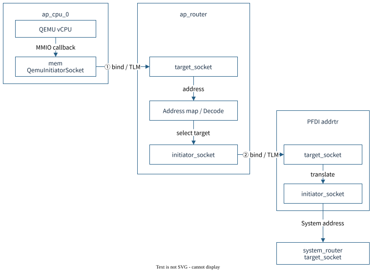
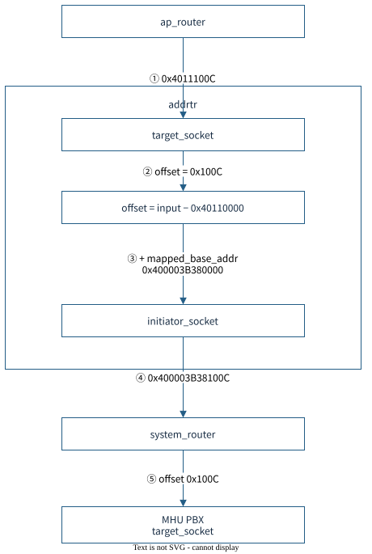
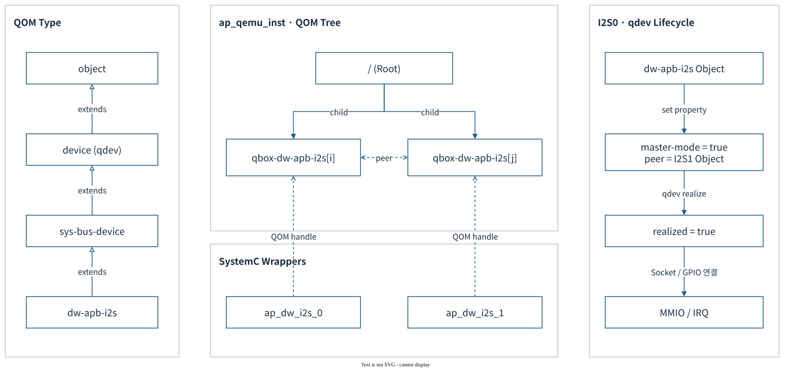
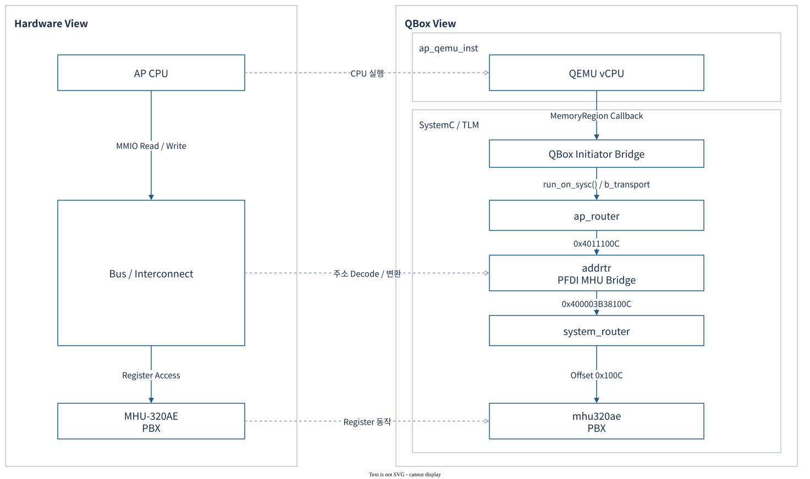

# Project Apollo QVP Architecture

**Phase 1 기술 세미나 · 2026-10-16 · Apollo QVP / RD-Aspen Cfg2**

Apollo QVP는 **QEMU의 Arm 명령어·장치 실행과 SystemC/TLM의 시스템 모델을 결합한 가상 플랫폼**이다. RSE·Safety Island·Primary Compute의 펌웨어를 함께 실행하고, 주소 변환·인터럽트·전원/reset·도메인 간 통신을 소스 수준에서 구성한다.

[draw.io 전체 편집본 — 15페이지](apollo-qvp-architecture.drawio) · [모델·소스 연결표](MODEL-MAP.md) · [조사 근거와 검증 범위](SOURCES.md) · [관련 Build Architecture](../build/README.md)

도면은 **white 테마의 native draw.io**이며 본문의 SVG에도 편집 정보를 포함했다. 아래 설명은 현재 checkout과 canonical full-system runner의 구성을 기준으로 한다. 소스에서 확인한 구조와 실제 실행 시험의 결과를 구분한다.

| 장 | 핵심 질문 | 도면 |
|---|---|---|
| 1. Simulation / Emulation | 무엇을 실행하고 무엇을 모델링하는가? | 01 |
| 2. FVP / QVP | 무엇을 공통 계약으로 비교하는가? | 02 |
| 3. QBox / libqemu | CPU 실행과 TLM transaction은 어떻게 연결되는가? | 03, 03a–03c, 04, 04a |
| 4. Platform Lua | SoC·VP·Board가 무엇을 소유하는가? | 05 |
| 5. Components | 어느 모델이 QEMU이고 어느 모델이 SystemC인가? | 06, 11 |
| 6. Execution | 어떤 process·thread·clock·boot flow로 실행되는가? | 07–10 |

## 1. Simulation과 Emulation

### 1.1 모델링 관점과 실행 방식


이 문서에서는 **simulation을 모델의 상태·상호작용·시간 진행을 계산하는 관점**, **emulation을 대상 시스템의 실행 계약을 재현해 SW를 실행하는 관점**으로 구분한다. 두 용어는 배타적인 제품 분류가 아니다.

| 관점 | 초점 | Apollo에서의 구현 |
|---|---|---|
| Emulation | ISA, CPU 상태, 예외, 장치의 SW-visible 동작 | QEMU CPU/QOM 모델, TCG의 guest code → host code 번역 |
| Simulation | 상태기계, event 순서, signal, transaction, 모델 시간 | SystemC kernel, `SC_THREAD`/`SC_METHOD`, TLM socket |
| Timing fidelity | 어느 수준의 지연·경합·물리 동작을 재현하는가? | 개별 모델과 동기화 정책별로 판단; cycle accuracy를 전제하지 않음 |

QEMU TCG는 guest 명령어를 **Translation Block(TB)** 단위로 번역·캐시하여 host에서 실행한다. 이는 guest ISA 실행 방식이며 실제 A720AE의 pipeline·cache·분기 예측 지연을 그대로 계산한다는 뜻은 아니다. [QEMU TCG 설계](https://www.qemu.org/docs/master/devel/tcg.html)

Arm FVP도 Fast Models 기반의 programmer’s-view 플랫폼이다. 따라서 **FVP를 cycle-accurate simulator, QVP를 단순한 고속 대체품으로 구분하면 부정확하다**. 비교는 기능과 시간 모델의 범위를 명시한 뒤 수행한다. [Arm Fast Models와 FVP](https://learn.arm.com/install-guides/fm_fvp/), [Arm Fast Models User Guide](https://documentation-service.arm.com/static/5f48df7d6e73485d721ea02e)

### 1.2 Arm Fast Models

**Arm CPU·System IP의 SW-visible 동작을 제공하는 모델 라이브러리와 플랫폼 구성 도구**다.

- **모델 범위:** 명령어, Register, Exception, Memory 접근 등 Programmer’s View.
- **구성:** 필요한 CPU·IP 모델을 조합해 사용자 SoC의 Virtual Platform을 만든다. SystemC/TLM 환경과도 연계할 수 있다.
- **용도:** 실제 보드가 나오기 전 Bootloader·Firmware·OS 개발, Debug와 기능 검증.
- **시간 해석:** 기능 중심 모델이다. 실제 CPU pipeline·cache latency를 그대로 재현하는 Cycle-accurate RTL 모델로 해석하지 않는다.

Fast Models는 **플랫폼을 만드는 구성 요소**, FVP는 그 구성 요소로 만든 **실행 가능한 플랫폼**이다. [Arm Fast Models](https://www.arm.com/products/development-tools/simulation/fast-models), [Arm Fast Models / FVP 안내](https://learn.arm.com/install-guides/fm_fvp/)

### 1.3 Arm Fixed Virtual Platform — FVP

**Fast Models를 사용해 CPU·Memory·Peripheral을 미리 조립한 시스템 모델**이다.

- **제공 형태:** 정해진 시스템 구성을 실행하는 모델과 설정 Parameter.
- **사용 방식:** Firmware·Kernel·Disk Image를 적재하고 UART·Debugger로 실행을 관찰한다.
- **Fixed의 의미:** 사용자가 IP를 자유롭게 조립하는 모델 라이브러리와 달리, 제공된 Topology를 기반으로 사용한다. 지원 Parameter까지 모두 고정이라는 뜻은 아니다.
- **Apollo 관계:** RD-Aspen FVP는 Arm Zena CSS의 참조 SW Stack과 Hardware Interface를 확인하는 비교 대상이다.

FVP는 기능 정확성을 목표로 하는 Programmer’s-view Platform이다. FVP 실행 시간 자체를 Silicon 성능 측정값으로 사용하지 않는다. [Arm FVP](https://www.arm.com/products/development-tools/simulation/fixed-virtual-platforms)

### 1.4 QEMU

**CPU와 주변장치를 모델링하고 대상 바이너리를 실행하는 오픈소스 Emulator / Virtualizer**다.

| 실행 방식 | 역할 |
|---|---|
| System Emulation | CPU·Memory·Device를 구성해 Firmware와 OS 전체를 실행 |
| User-mode Emulation | 대상 ISA의 사용자 프로그램을 Host OS 위에서 실행 |
| TCG | Guest 명령어를 Host 코드로 변환하여 실행; 다른 ISA 사이에서도 사용 |
| KVM 등 Accelerator | 지원되는 Host·Guest 조합에서 Hardware Virtualization 활용 |

Apollo QVP는 QEMU의 **System Emulation / TCG**를 활용한다. CPU 명령어·예외와 일부 Device는 QEMU가 처리하고, 외부 SystemC 모델과의 접근은 QBox가 연결한다. QEMU의 실행 결과가 RTL 내부 신호나 Silicon의 Cycle별 지연까지 재현하는 것은 아니다. [QEMU System Emulation](https://www.qemu.org/docs/master/system/introduction.html), [QEMU User-mode](https://www.qemu.org/docs/master/user/index.html), [TCG](https://www.qemu.org/docs/master/devel/tcg.html)

### 1.5 QBox

**QEMU를 SystemC/TLM-2.0 환경에 통합하는 Co-simulation Framework**다.

- **QEMU:** CPU 명령어 실행, CPU 상태·Exception, QEMU Device 모델.
- **QBox Bridge:** QEMU Memory 접근·IRQ·Reset을 SystemC Transaction·Signal에 연결.
- **SystemC/TLM:** Router·Memory·Peripheral 모델의 상태와 Event 실행.
- **Platform 구성:** Apollo는 Lua/CCI로 Instance·주소·Socket·IRQ·Reset 연결을 정의한다.

관계는 **QEMU = 실행 엔진**, **QBox = 통합 Framework**, **Apollo QVP = 이를 사용해 구성한 플랫폼**이다. QBox 자체가 완성된 Apollo Machine이거나 모든 모델의 Cycle Accuracy를 보장하는 것은 아니다. [QBox 공식 저장소](https://github.com/qualcomm/qbox), [Apollo checkout의 QBox 구성](../../../hsoc-stack/tools/qbox/README.md)

### 1.6 Synopsys Virtual Platform / Virtualizer

**Virtual Platform은 가상 Hardware 시스템이며, Virtualizer는 이를 제작·배포·Debug하는 Synopsys 도구군**이다.

| 구분 | 역할 |
|---|---|
| Virtual Platform / Virtual Prototype | CPU·Memory·Peripheral 모델을 연결한 실행 가능한 시스템 |
| Virtualizer / Virtualizer Studio | 모델 작성·통합, SystemC/TLM-2.0 기반 플랫폼 구성, 분석·Debug |
| VDK — Virtualizer Development Kit | 가상 플랫폼과 SW 개발·시험 도구를 묶은 배포 단위 |

Firmware·Driver·OS를 실제 Hardware 이전에 개발하고 반복 시험하는 데 사용한다. 실행·시간의 추상화 수준은 선택한 모델과 구성에 따라 달라진다. Virtualizer라는 제품명만으로 Cycle Accuracy를 판단하지 않는다. [Synopsys Virtualizer](https://www.synopsys.com/verification/virtual-prototyping/virtualizer.html)

**Apollo와의 관계:** QBox와 Virtualizer는 모두 시스템 모델을 통합해 SW를 실행하는 환경이지만, 제공 모델·통합 API·Debug 도구·라이선스가 다르다. 이 문서의 Apollo 구성은 QBox 기반이다.

### 1.7 Synopsys ZeBu

**SoC RTL을 전용 Hardware에서 실행하는 Hardware Emulation 시스템**이다.

- **입력:** 합성 가능한 RTL과 Clock·Reset·Memory·Interface 구성.
- **실행:** RTL을 Emulator용으로 Compile·Mapping하고, Testbench·Host 또는 외부 환경과 연결한다.
- **용도:** RTL 기능 검증, 긴 SW Workload를 이용한 HW/SW 통합, Boot·Driver·System 검증.
- **시간 해석:** 모델링한 RTL의 Clock·Cycle 관계를 다룬다. Emulator의 실행 속도와 실제 Chip 주파수는 다르며 Analog·물리 Timing Sign-off를 대신하지 않는다.

QEMU가 명령어·Device 동작을 SW 모델로 재현하는 것과 달리, ZeBu의 검증 대상은 **Emulator에 적재한 RTL 설계**다. [Synopsys ZeBu](https://www.synopsys.com/verification/emulation-prototyping/emulation/zebu-ep.html), [RTL과 Virtual Prototype의 Hybrid 구성 사례](https://www.synopsys.com/content/dam/synopsys/company/publications/advanced-verification-bulletin/advanced-verification-bulletin-issue2.pdf)

**Hybrid Emulation:** Virtualizer의 CPU·시스템 모델과 ZeBu의 RTL Subsystem을 연결할 수 있다. 빠른 SW 실행과 RTL 검증을 분담하는 방식이며, 모든 Block이 동일한 추상화 수준으로 실행되는 것은 아니다. [Virtualizer Hybrid Emulation](https://www.synopsys.com/verification/virtual-prototyping/virtualizer.html)

### 1.8 기술별 역할 비교

| 기술 | 분류 / 구성 단위 | 주 실행 기반 | 주요 목적 |
|---|---|---|---|
| Arm Fast Models | Arm IP 모델·구성 도구 | Host에서 실행하는 Programmer’s-view 모델 | 사용자 SoC 모델 구성, 초기 SW 개발 |
| Arm FVP | 사전 구성 Virtual Platform | Fast Models | 참조 Platform의 Firmware·OS 실행 |
| QEMU | Emulator / Virtualizer | TCG 또는 지원 Accelerator | ISA·Device 모델 기반 Guest 실행 |
| QBox | Co-simulation Framework | QEMU + SystemC/TLM | CPU와 사용자 시스템 모델 통합 |
| Virtualizer / VDK | 상용 제작 도구 / 배포 Platform | Processor·Peripheral 모델, SystemC/TLM 등 | 초기 SW 개발·Debug·회귀 시험 |
| ZeBu | Hardware Emulator | Compile·Mapping한 RTL | RTL 및 HW/SW 통합 검증 |

**Apollo QVP의 위치:** QEMU가 CPU를 실행하고 QBox가 SystemC 모델을 연결한다. FVP와는 Firmware가 관측하는 기능 계약을 비교하며, RTL 기반 검증과 Silicon Timing 검증은 각각 다른 단계로 구분한다.

## 2. Arm Zena CSS FVP와 Apollo QVP


Arm 참조의 [Components](../../../arm-zena-css/documentation/design/components.rst), [Boot process](../../../arm-zena-css/documentation/design/boot_process.rst)와 원본 시스템·SMB·부트 도면을 기준으로 비교했다. **FVP의 IP 구성, Apollo의 구현 모델, 검증된 동작은 서로 다른 정보**다. [참조 도면 목록](SOURCES.md#s1)

| 비교 축 | Arm RD-Aspen FVP | Apollo QVP |
|---|---|---|
| 실행 엔진 | Fast Models 기반 FVP executable | `platforms-vp` + libqemu/TCG + SystemC/TLM |
| AP | Cortex-A720AE 기반 Primary Compute | QEMU A720AE wrapper; full runner 기본 4 PE, 설정 범위 1–16 |
| RSE | Cortex-M55, secure boot와 Root of Trust | M55 CPU instance + 주변장치 helper instance; TF-M과 RSE 모델 결합 |
| SI CL0 | Cortex-R82AE dual lock-step 구성 | 기능 실행용 R82 PE 1개; dual lock-step fault detection의 물리 모델을 뜻하지 않음 |
| SI CL1 | **Cfg2에서만** R82AE 4-core SMP 확장 | R82 PE 4개 + Zephyr SMP |
| Interconnect | CMN S3(AE), NI-710AE 등 참조 IP 모델 | TLM router·address view·ATU·보호 모델; 물리 mesh 경합·대역폭 재현은 별도 범위 |
| Interrupt / IOMMU | GIC-720AE multiple views, MMU-720AE | QEMU GIC + multiview/reset 보강; 기본 SMMU는 SystemC `smmuv3` + `smmuv3_tbu` |
| 구성·확장 | FVP parameter와 모델 제공 범위 | Lua/CCI, 수정 가능한 C++ 모델, QEMU backend, 외부 vMCU 연결 |
| 관찰 | Iris/Arm debugger, model trace·console | GDB/QMP, QBox monitor, TLM/model trace, 도메인별 UART |
| 시간 해석 | 기능 모델의 시간 의미를 기준으로 판단 | QEMU virtual clock와 SystemC time을 정책으로 동기화; silicon timing 보장 없음 |

**공통 비교 단위는 firmware가 관측하는 계약**이다. RSE 중심 boot, PSCI/SCMI, FF-A 보안 서비스, MHU doorbell/shared-memory IPC, 주소·보안 속성·IRQ를 같은 설정과 이미지 조합으로 비교한다. Machine별 DTB·flash·부트 설정이 다르므로 이미지 하나를 무조건 교환하는 방식은 적절하지 않다.

`apollo-qvp-saturn-v.lua`는 RSE·CL0·CL1·AP를 조합하는 full-system 진입점이다. AP-only Direct Linux profile은 firmware 대행 기능을 포함하는 별도 경로다. **AP Linux login만으로 RSE 인증, CL0 전원 관리, CL1 통신까지 검증했다고 보고하지 않는다.**

## 3. QBox의 구조와 원리 — QEMU / libqemu

### 3.1 생성과 소유 구조


Host 진입 순서는 `sc_main → ArgParser → GreenSocsPlatform("platform") → sc_start()`다. SystemC kernel은 event와 `run_on_sysc` 작업을 처리한다.

| 계층 | 핵심 책임 | 소유 소스 |
|---|---|---|
| QBox 실행기 | `sc_main`, Lua/CLI 해석, CCI, model 생성, `sc_start()` | `qbox/platforms/`, `qbox/systemc-components/common/` |
| QEMU bridge | QOM 생성·property·realize, memory/IRQ/reset을 TLM/SystemC에 연결 | `qbox/qemu-components/common/` |
| libqemu | QEMU를 library로 초기화하고 C++ wrapper에 export/callback API 제공 | `qbox/.../libqemu-cxx/`, `qemu/libqemu/` |
| QEMU engine | TCG, CPU state, QOM, MemoryRegion, virtual timer, native devices | `qemu/accel/`, `qemu/target/`, `qemu/hw/` |
| Apollo overlay | CPU 확장, SoC/VP/Board Lua, MHU/PPU/ATU/reset 및 board 통합 | `qbox-platform/` |

생성 흐름은 **Lua table → CCI preset → ModuleFactory → SystemC module**이며 QEMU wrapper는 이어서 **QOM instantiate/realize**를 수행한다. `moduletype`는 등록된 constructor를, `args`는 생성자 참조를, `socket.bind`는 모듈 간 연결을 지정한다. CCI는 실행 설정을 전달하는 계층이며 guest MMIO 버스가 아니다.

QemuInstance는 기본적으로 **`-M none -m 0`**으로 초기화한다. 완성된 QEMU `apollo-qvp` machine을 실행하는 대신 QBox가 CPU·장치·메모리를 조립한다. `libqemu_init`가 export API와 QEMU I/O thread를 제공하고, wrapper가 QOM object를 만든다.

여러 QemuInstance는 한 `platforms-vp` process 안에서 독립된 QEMU 상태를 갖는다. 현재 Linux loader는 같은 library의 추가 instance에 임시 `.so` 사본과 `dlopen(RTLD_LOCAL)`을 사용한다. **instance 수와 OS process 수를 혼동하면 실행 구조를 잘못 읽게 된다.** [소스 S2](SOURCES.md#s2)

### 3.2 QBox Core Components

QBox의 공통 구성은 **플랫폼 생성 → QEMU 통합 → 모델 연결 → 실행·시간 동기화**로 나뉜다. 아래 라이브러리 이름은 기능 계층을 나타내며, 각각이 별도 Process라는 뜻은 아니다.

#### 3.2.1 플랫폼 생성과 실행 기반

| Component | 역할 | 주요 입력 / 연결 |
|---|---|---|
| `platforms-vp` | 플랫폼 실행기. CLI·Lua 설정을 읽고 모듈을 생성한 뒤 SystemC 실행 시작 | `-l` Lua, `-p` CCI preset, `sc_start()` |
| `ConfigurableBroker` / CCI | 모듈별 Parameter와 preset을 관리. CPU 옵션·주소·Socket 연결 설정 전달 | `platform.*` Parameter 경로 |
| `ModuleFactory` / Container | `moduletype`에 대응하는 Constructor를 찾고 의존성에 따라 모듈 생성·연결. 필요 시 모델 Library 로드 | `moduletype`, `args`, `socket.bind` |
| `libgsutils` | CCI 접근, 설정 해석, 공통 Port·Socket 등 모델 작성 기반 제공 | CCI helper, Signal / Biflow Socket |
| SystemC kernel / TLM-2.0 | Process·Event·Simulation Time을 관리하고 모델 간 Transaction 인터페이스 제공 | `SC_THREAD`, `SC_METHOD`, TLM Socket |

SystemC/TLM은 QBox가 사용하는 실행 기반이다. **CCI는 설정 전달**, **TLM은 실행 중 메모리 Transaction 전달**을 담당한다. [구성 API](../../../hsoc-stack/tools/qbox/docs/configuration.md), [공통 Utilities](../../../hsoc-stack/tools/qbox/docs/libgsutils.md)

#### 3.2.2 QEMU 통합과 동기화

| Component | 역할 | 연결 대상 |
|---|---|---|
| `libqemu-cxx` | libqemu를 로드하고 QEMU Object·Device·CPU·Memory·Timer API를 C++로 제공 | QEMU export / callback API |
| `libqbox` | QEMU 객체를 SystemC Module로 감싸고 TLM·IRQ·Reset 연결 제공 | QEMU ↔ SystemC |
| `QemuInstanceManager` | 생성한 QEMU Instance의 수명 관리 | 하나 이상의 `QemuInstance` |
| `QemuInstance` | 독립된 QEMU 상태와 CPU·Device 집합 관리. Accelerator·TCG·시간 정책 설정 | libqemu, CPU / Device Wrapper |
| CPU / Device Wrapper | QOM 객체 생성·속성 설정·realize 수행. CPU 메모리 접근과 Device MMIO·IRQ를 외부로 노출 | `QemuCpu`, `QemuDevice`, 개별 CPU·IP Wrapper |
| `QemuInitiatorSocket` | QEMU가 시작한 CPU·DMA 접근을 TLM Transaction으로 변환. DMI 매핑 처리 | QEMU MemoryRegion → SystemC Target |
| `QemuTargetSocket` | SystemC에서 들어온 접근을 QEMU Device의 주소 공간으로 전달 | SystemC Initiator → QEMU Device |
| QEMU Signal Socket | QEMU GPIO와 SystemC Signal 연결. IRQ·Reset 등 제어 신호 전달 | QEMU GPIO ↔ SystemC Signal |
| `libgssync` / Quantum Keeper | 외부 QEMU Thread와 SystemC 사이의 시간 진행·동기화 정책 제공 | QEMU virtual time, SystemC time |
| `run_on_sysc()` / 작업 Queue | QEMU 측 요청을 SystemC 실행 문맥으로 전달하고 완료를 기다리는 경로 제공 | QEMU Thread → SystemC Kernel Thread |

**Memory 접근은 Socket, IRQ·Reset은 Signal, 시간 진행은 동기화 정책**이 담당한다. Apollo의 기본 시간 정책은 6.2절에 정리한다. [QEMU 통합](../../../hsoc-stack/tools/qbox/docs/libqbox.md), [C++ Wrapper](../../../hsoc-stack/tools/qbox/docs/libqemu-cxx.md), [동기화](../../../hsoc-stack/tools/qbox/docs/libgssync.md)

#### 3.2.3 기본 SystemC Components

| Component | 역할 | 플랫폼에서의 사용 |
|---|---|---|
| `router` | 주소 범위에 따라 TLM 접근을 Target으로 전달 | CPU·DMA와 RAM·MMIO 연결 |
| `addrtr` | Window offset을 유지하며 주소를 변환 | AP View ↔ System View 연결 |
| `gs_memory` | 메모리 저장 공간과 TLM 접근 제공. 허용 시 DMI Pointer 제공 | RAM·ROM 영역, 파일 기반 Memory |
| `loader` | ELF·Binary 등의 내용을 지정된 메모리 경로로 적재 | Firmware·초기 데이터 적재; `gs_memory` 내부 Loader도 제공 |
| `exclusive_monitor` | Exclusive 접근 상태를 추적하고 성공 여부 처리 | 해당 모델을 사용하는 TLM 경로의 Exclusive Access 지원 |
| `memory_dumper` | 모델 메모리를 파일로 저장 | 메모리 상태 확인 |
| Character Backend | UART 등의 양방향 Byte Stream을 Host I/O와 연결 | `char_backend_stdio`, `char_backend_socket`, `char_backend_file` |
| Monitor | Simulation과 등록된 모델의 상태를 조회·관찰 | 실행 중 진단 |

이들은 재사용 가능한 기반 모델이다. Apollo 고유 MHU·PPU·ATU 및 SoC 배선은 `qbox-platform/`에서 확장하며, 실제 선택되는 Device 모델은 5장에서 구분한다. [기본 Components](../../../hsoc-stack/tools/qbox/docs/base-components.md), [Character Backend](../../../hsoc-stack/tools/qbox/docs/backends.md), [Monitor](../../../hsoc-stack/tools/qbox/docs/monitor.md)

##### 3.2.3.1 Router 구조와 Socket Binding

**`bind`는 연결을 만들고, Router는 주소로 목적지를 선택한다.** `target_socket`은 요청을 받는 입구, `initiator_socket`은 요청을 내보내는 출구다. 이름은 각 모듈을 기준으로 읽는다.



그림의 화살표는 **실행 중 요청 방향**이다. ①·②는 아래 Lua의 binding과 대응한다. `PFDI addrtr`는 `ap_to_system_pfdi_monitor_mhu_bridge`의 축약 표기다.

| 객체 / Socket | 역할 |
|---|---|
| `ap_cpu_0.mem` | CPU wrapper 안의 `QemuInitiatorSocket`. QEMU MMIO callback을 TLM 요청으로 전달 |
| `ap_router.target_socket` | 여러 CPU·DMA initiator의 요청을 받는 Router 입력 |
| Router address map | 연결된 Target의 `address`·`size`·`priority`로 목적지 선택 |
| `ap_router.initiator_socket` | 선택한 Target으로 요청을 전달하는 Router 출력 |
| 장치의 `target_socket` | Router가 전달한 요청을 받는 장치 입력 |

**Apollo Lua 예제 — 실제 배선에서 필요한 부분만 발췌**

```lua
platform.ap_router = {
    moduletype = "router";
}

-- ① CPU initiator → Router target
platform.ap_cpu_0.mem = {
    bind = "&ap_router.target_socket";
}

-- ② Router initiator → 주소 변환 Bridge target
platform.ap_to_system_pfdi_monitor_mhu_bridge = {
    moduletype = "addrtr";
    mapped_base_addr = AP_HOST_PFDI_MONITOR_MHU_PBX_BASE;
    target_socket = {
        address = AP_PFDI_MONITOR_MHU_PBX_BASE;
        size = AP_PFDI_MONITOR_MHU_SIZE;
        bind = "&ap_router.initiator_socket";
        relative_addresses = false;
        priority = 0;
    };
    initiator_socket = {bind = "&system_router.target_socket"};
}
```

②는 **Target 쪽 설정에 상대 Initiator를 적은 것**이다. 설정을 적는 위치가 요청 방향을 결정하지 않는다. 실제 전달 방향은 항상 `ap_router.initiator_socket → Bridge.target_socket`이다.

**연결 시점과 실행 시점**

1. **플랫폼 생성:** Lua의 `bind`가 CCI 설정으로 전달된다. Module Factory는 `&ap_router.target_socket` 같은 객체 참조를 해석해 실제 TLM 소켓을 연결한다.
2. **주소 맵 구성:** Router가 연결된 Target의 주소 설정을 읽는다. 이 예제의 AP Window는 `0x40110000`, 크기는 `0x30000`이다.
3. **MMIO 실행:** `ap_cpu_0.mem`이 이미 연결된 Router 입력에 `b_transport()`를 호출한다. 접근마다 Router 이름을 검색하지 않는다.
4. **목적지 선택:** 주소 `0x4011100C`에 해당하는 Bridge를 골라 `initiator_socket[index]`로 전달한다. 여기서는 `relative_addresses=false`이므로 원래 AP 주소를 유지한다.
5. **후속 전달:** `addrtr`가 System 주소로 변환해 `system_router`로 보낸다. 이후 MHU 도착 경로는 3.4절의 두 Router 예제를 따른다.

`relative_addresses`의 기본값은 `true`다. 이 경우 Router는 Target 호출 전에 base address를 빼고, 반환 후 원래 주소를 복원한다. 매칭되는 주소가 없으면 `TLM_ADDRESS_ERROR_RESPONSE`를 반환한다. 응답 상태와 read 데이터는 같은 `b_transport()` 호출의 반환 경로로 돌아온다.

**Initiator bridge의 위치:** CPU C++ 멤버는 `QemuCpu::socket`이며 생성 이름이 `mem`이다. 따라서 `platform.ap_cpu_0.mem` 자체가 QEMU↔TLM bridge이고, 주소 변환용 `addrtr`와는 별개다.

[AP Lua 배선](../../../hsoc-stack/tools/qbox-platform/platforms/apollo/soc/hw-block/ap_compute/interconnect.lua) · [CPU wrapper](../../../hsoc-stack/tools/qbox/qemu-components/common/include/cpu.h) · [Initiator bridge](../../../hsoc-stack/tools/qbox/qemu-components/common/include/ports/initiator.h) · [Router 구현](../../../hsoc-stack/tools/qbox/systemc-components/router/include/router.h)

##### 3.2.3.2 addrtr — Address Translation Bridge

**`addrtr`는 한 주소 Window를 다른 주소 Window로 옮기는 SystemC 모듈**이다. 입력 `target_socket` 하나와 출력 `initiator_socket` 하나를 가지며, Window 안의 offset을 유지해 같은 Transaction을 전달한다.



Router가 여러 Target 중 목적지를 선택한다면, `addrtr`는 **이미 선택된 경로에서 주소를 변환**한다. CPU의 가상주소를 변환하는 MMU나 페이지 테이블 모델은 아니다.

| 설정 | 의미 | AP PFDI Mailbox 예 |
|---|---|---|
| `target_socket.address` | 입력 Window의 시작 주소 | `0x40110000` |
| `target_socket.size` | 입력 Window 크기 | `0x30000` |
| `mapped_base_addr` | 출력 Window의 시작 주소 | `0x400003B380000` |
| `target_socket.relative_addresses` | 앞단 Router가 base를 뺄지 결정 | `false`: AP 주소 그대로 전달 |

**예제 — 앞 절의 Lua 설정을 실제 주소 값으로 풀어 쓴 형태**

```lua
platform.ap_to_system_pfdi_monitor_mhu_bridge = {
    moduletype = "addrtr";
    mapped_base_addr = 0x400003B380000;
    target_socket = {
        address = 0x40110000;
        size = 0x30000;
        relative_addresses = false;
        bind = "&ap_router.initiator_socket";
    };
    initiator_socket = {bind = "&system_router.target_socket"};
}
```

`relative_addresses=false`는 **앞단 Router가 읽는 설정**이다. `addrtr`는 입력 주소를 `target_socket.address`와 비교하므로, 앞단에서 이미 base를 뺀 offset만 전달하면 이 예제의 입력 Window에 맞지 않는다.

**32-bit Register Write가 지나가는 순서**

1. AP가 `0x4011100C`에 쓰면 `ap_router`가 위 Bridge Window를 선택한다.
2. `addrtr`가 접근 주소와 길이 4바이트가 입력 Window 안에 들어오는지 확인한다.
3. 아래 식으로 Transaction 주소만 바꾸고 출력 소켓의 `b_transport()`를 호출한다.
4. `system_router`는 System 주소로 MHU PBX를 선택하고, 장치에는 상대 주소 `0x100C`를 전달한다.
5. 호출이 반환되면 `addrtr`가 Transaction 주소를 원래 AP 주소로 복원한다. Read 데이터·응답 상태는 같은 Transaction으로 돌아온다.

```text
offset = 0x4011100C - 0x40110000 = 0x100C
output = 0x400003B380000 + 0x100C = 0x400003B38100C
```

`addrtr`는 데이터 내용을 바꾸거나 자체 대기 시간을 추가하지 않는다. 입력 범위를 벗어난 요청은 현재 구현에서 fatal report 대상이다. Debug 접근에도 같은 변환을 적용하며, DMI가 허용되는 Target에서는 DMI 주소 범위와 invalidation도 입력 View로 변환한다. MHU의 일반 Register 접근은 위 MMIO 전달 경로로 이해하면 된다.

[addrtr 구현](../../../hsoc-stack/tools/qbox/systemc-components/addrtr/include/addrtr.h) · [Apollo Bridge 배선](../../../hsoc-stack/tools/qbox-platform/platforms/apollo/soc/hw-block/ap_compute/interconnect.lua)

### 3.3 QOM — QEMU Object Model

**QOM은 QEMU의 CPU·Device 등 객체를 등록·생성·설정하는 C 기반 Object Framework**다. QBox는 QOM 객체를 SystemC Wrapper 안에 생성해 TLM·Signal과 연결한다.

#### 3.3.1 Type, Class, Object와 Property



Apollo full-system의 **`platform.ap_dw_i2s_0`·`platform.ap_dw_i2s_1`**을 예로 든다. `audio.connect()`는 두 장치를 `qemu_dw_apb_i2s` Wrapper로 구성하고 같은 `platform.ap_qemu_inst`에 연결한다.

- **왼쪽 — Type 상속:** `dw-apb-i2s → sys-bus-device → device → object`. qdev의 장치 기능을 상속한 QOM Type이다.
- **가운데 위 — 객체 소유:** 두 I2S QOM 객체는 해당 libqemu의 Root 아래 Child로 생성된다. `peer`는 상대 I2S를 참조하는 Link Property이며 Parent–Child 관계가 아니다.
- **가운데 아래 — Wrapper:** `ap_dw_i2s_0`·`ap_dw_i2s_1`은 SystemC 객체다. 각 Wrapper의 `m_dev`가 해당 QOM 객체를 참조한다.
- **오른쪽 — I2S0 초기화:** QOM 객체 생성 → `master-mode=true`·`peer` 설정 → Realize → MMIO Socket·IRQ 연결 순서다. I2S1의 `master-mode`는 false다.

| 구분 | I2S0 | I2S1 |
|---|---|---|
| SystemC 경로 | `platform.ap_dw_i2s_0` | `platform.ap_dw_i2s_1` |
| Wrapper Class / Lua moduletype | `qemu_dw_apb_i2s` | `qemu_dw_apb_i2s` |
| QEMU Instance | `platform.ap_qemu_inst` | `platform.ap_qemu_inst` |
| QOM Type | `dw-apb-i2s` | `dw-apb-i2s` |
| QOM 경로 형식 | `/qbox-dw-apb-i2s[i]` | `/qbox-dw-apb-i2s[j]` |
| `peer` Link | I2S1 QOM 객체 | I2S0 QOM 객체 |

`libqemu-cxx`는 `qbox-<Type 이름 앞 10자>[*]` 형식으로 Root에 Child를 추가하고 QOM이 사용 가능한 인덱스를 할당한다. **`i`·`j`는 생성 순서에 따라 정해지는 인덱스**다. SystemC 이름의 `_0`·`_1`이 QOM 인덱스에 그대로 대응한다고 가정하지 않는다. 그림은 실제 소스의 구성 관계를 표현하며 실행 중 Tree를 캡처한 것은 아니다.

[AP I2S 구성](../../../hsoc-stack/tools/qbox-platform/platforms/apollo/vp/backends/audio.lua), [I2S Wrapper](../../../hsoc-stack/tools/qbox-platform/qemu-components/qemu_dw_apb_i2s/include/qemu_dw_apb_i2s.h), [QEMU I2S Type](../../../hsoc-stack/tools/qemu/hw/audio/dw-apb-i2s.c), [QOM Child 생성](../../../hsoc-stack/tools/qbox/qemu-components/common/src/libqemu-cxx/libqemu-cxx.cc)

| 요소 | 역할 |
|---|---|
| `TypeInfo` | Type 이름, 부모 Type, Class·Instance 크기와 초기화 함수를 정의 |
| `ObjectClass` | Type별 공통 동작을 정의. Virtual Method에 해당하는 함수 포인터 등을 보관 |
| `Object` | 생성된 개별 Instance. 각 CPU·Device의 상태 보관 |
| Property | 객체의 설정·상태를 이름으로 노출. 정수·문자열·Boolean 및 다른 객체에 대한 Link 등 지원 |
| QOM Tree | 객체의 Parent–Child 소유 관계를 표현하는 Composition Tree |
| `DeviceState` / `DeviceClass` | QOM 위에 장치 Lifecycle을 추가한 qdev 기반. `realize`·`unrealize` 등 제공 |

QOM은 **단일 Type 상속과 여러 Stateless Interface 구현**을 지원한다. Type 상속 관계와 QOM Tree의 객체 소유 관계는 별개다. QOM Tree 자체가 MMIO Address Map이나 IRQ 배선을 정의하는 것은 아니다.

#### 3.3.2 QBox에서의 객체 생성 순서

일반 `QemuDevice` Wrapper의 생성 흐름은 다음과 같다.

| 순서 | 단계 | 수행 내용 |
|---|---|---|
| 1 | QEMU Type 등록 | QEMU 초기화 과정에서 `TypeInfo`를 등록해 생성 가능한 Type 준비 |
| 2 | SystemC Wrapper 생성 | ModuleFactory가 Lua의 `moduletype`에 해당하는 Wrapper 생성. 대상 `QemuInstance`와 QOM Type 지정 |
| 3 | QOM Instance 생성 | `before_end_of_elaboration()`에서 `instantiate()` → `object_new()` 호출 |
| 4 | Property 설정 | Wrapper가 CPU·Device 설정을 QOM Property에 반영 |
| 5 | Device Realize | `end_of_elaboration()`에서 `realized=true` 설정. Device별 초기화·설정 검증 수행 |
| 6 | 외부 연결·실행 | Wrapper별 순서에 따라 MMIO·GPIO를 TLM·Signal에 연결하고 Simulation 실행 |

**Object 생성과 Device Realize는 다른 단계**다. 생성은 객체와 기본 상태를 준비하고, Realize는 설정을 바탕으로 장치를 사용할 수 있도록 초기화한다. 일반적인 장치 설정 Property는 Realize 전에 지정한다. Realize 자체가 Guest CPU의 부팅 시작을 뜻하지는 않는다.

#### 3.3.3 ModuleFactory·CCI·QOM의 관계

| 계층 | 생성 / 설정 대상 | 담당 범위 |
|---|---|---|
| ModuleFactory | SystemC Module / QBox Wrapper | Lua descriptor에 따른 모듈 생성과 Socket 연결 |
| CCI | SystemC Module의 Parameter | 플랫폼 설정값 전달 |
| QOM / qdev | libqemu 내부 CPU·Device 객체 | QEMU Type·Property·Device Lifecycle |
| QBox Wrapper | SystemC Module과 QOM 객체 사이 | 필요한 CCI 값을 QOM Property에 반영하고 Memory·IRQ·Reset 연결 |

Lua의 **`moduletype`는 QBox Constructor 이름**, **QOM Type은 QEMU 내부 객체 Type 이름**이다. 두 이름과 객체 경로가 반드시 같지는 않으며, CCI Parameter가 모두 QOM Property로 자동 변환되는 것도 아니다. `router`·`gs_memory` 같은 순수 SystemC 모델은 QOM 객체 없이 동작한다.

[QEMU QOM 설계](../../../hsoc-stack/tools/qemu/docs/devel/qom.rst), [QBox QemuDevice Lifecycle](../../../hsoc-stack/tools/qbox/qemu-components/common/include/device.h)

### 3.4 MMIO와 DMI


일반 CPU MMIO의 경로는 다음과 같다.

1. QEMU MemoryRegion callback이 command·주소·실제 access size를 TLM payload에 넣는다. secure/user 및 requester 문맥도 extension으로 전달한다.
2. QEMU BQL을 풀고 `run_on_sysc()`에 작업을 넣는다. SystemC thread가 `router → b_transport → target model`을 실행한다.
3. target의 data·response status·delay가 돌아오면 BQL을 다시 잡고 guest 실행을 이어간다.

CPU callback의 최대 access size는 8 byte다. **모든 transaction이 1 byte 또는 항상 8 byte인 것은 아니다.** QEMU 모델을 target으로 만나는 경우에는 `QemuTargetSocket`이 대상 instance의 BQL을 잡고 QEMU AddressSpace read/write를 호출한다.

| 경로 | 적용 원리 | 경계 |
|---|---|---|
| `b_transport` | register side effect와 상태기계를 거치는 일반 접근 | thread 전환·주소 decode·동기화 비용 포함 |
| DMI | target의 host backing pointer를 QEMU memory alias에 매핑 | 주소 구간·권한·translation·target 상태가 grant를 허용해야 함 |
| 같은-instance QEMU alias | bridge가 발견한 QEMU MemoryRegion을 재사용 | 매 접근의 SystemC 왕복을 줄일 수 있음 |
| `transport_dbg` | debugger/loader용 접근 | 일부 target은 `b_transport`를 재사용하므로 MMIO 무부작용을 보장하지 않음 |
| `nb_transport_fw/bw` | 현재 QEMU bridge에서는 미구현 | `abort/assert` 경로; 사용 가능한 고속 실행 방식이 아님 |

`gs_memory`는 DMI를 직접 제공하고 router·ATU·SMMU 경로는 범위와 권한을 제한한다. Flash는 read-array 상태와 허용 구간 등 조건이 붙는다. 변환·상태가 바뀌면 **DMI invalidation → CPU alias 제거 → TLB flush**가 필요하다. read-only DMI의 write는 원래 접근 경로로 돌아간다.

현재 DMI 질의는 일반 `run_on_sysc` queue와 다른 직접 호출 경로다. Exclusive/reentrant 접근도 별도 분기가 있다. **DMI 지원, effective enable, 실제 hit rate를 구분**해야 하며 CPU invalidation 설명을 모든 DMA initiator로 확대하지 않는다. [소스 S3](SOURCES.md#s3)

#### Apollo 예: AP vCPU → 두 Router → SystemC MHU



왼쪽은 CPU–Bus–MHU의 하드웨어 기능 경로를 단순화한 그림이고, 오른쪽은 같은 접근을 처리하는 QBox 객체 구성이다. 점선은 기능 대응 관계이며 실제 연결선이 아니다. QEMU Instance와 SystemC 영역을 나누고, Bridge에서 TLM 실행 문맥으로 전환되는 위치를 표시했다.

AP가 SI CL0에 알림을 보내는 **PFDI Mailbox의 PBX Register 접근**은 `ap_router`와 `system_router`를 모두 거친다. AP CPU를 활성화한 구성에서의 배선이며, 도착 모델은 순수 SystemC `mhu320ae`다.

**경로:** `ap_cpu_N.mem → ap_router → ap_to_system_pfdi_monitor_mhu_bridge → system_router → host_ap_si_pfdi_monitor_mhu_pbx.target_socket`

예를 들어 PBX Channel 0의 `DBCW_SET`에 32-bit Write를 수행하면 주소는 다음과 같이 전달된다.

| 순서 | 구성 요소 | 전달 주소 | 처리 |
|---|---|---|---|
| 1 | AP vCPU / QBox Initiator | `0x4011100C` | Guest MMIO를 Write Payload로 변환하고 `run_on_sysc()`로 전달 |
| 2 | `ap_router` | `0x4011100C` | AP Window `0x40110000`, 크기 `0x30000`에 해당하는 Bridge 선택 |
| 3 | `ap_to_system_pfdi_monitor_mhu_bridge` (`addrtr`) | `0x400003B38100C` | AP View 주소를 System Fabric 주소로 변환 |
| 4 | `system_router` | `0x100C` | PBX Base `0x400003B380000`을 Decode하고 Base를 뺀 Register Offset 전달 |
| 5 | `host_ap_si_pfdi_monitor_mhu_pbx` (`mhu320ae`) | `DBCW_SET`, Channel 0 | Write Data를 Register 동작에 적용하고 연결된 Mailbox의 Doorbell 상태·IRQ 갱신 |

주소 변환식은 **`System 주소 = 0x400003B380000 + (AP 주소 − 0x40110000)`**이다. `ap_router`의 Bridge Window는 `relative_addresses=false`이므로 AP 주소를 그대로 `addrtr`에 넘긴다. 반면 PBX Target은 Router의 기본 상대 주소 모드를 사용해 `0x100C`를 받는다.

- **`ap_router`:** AP가 보는 주소 공간에서 목적지를 선택한다.
- **`addrtr`:** AP View와 System Fabric 사이의 주소 차이를 변환한다.
- **`system_router`:** 변환된 주소에서 실제 SystemC Component를 선택한다.
- **응답:** 각 호출이 반환되며 주소를 복원하고 Response Status를 QEMU에 돌려준다. Read라면 Data도 같은 경로로 반환한다.

Router마다 새로운 QEMU Thread나 SystemC 작업을 생성하는 구조는 아니다. 일반 MMIO에서는 Bridge가 SystemC 문맥으로 넘긴 뒤 **Router → Address Translator → Router → Target의 `b_transport()` 호출이 이어진다**. Mailbox IRQ 전달은 MMIO 응답과 별도 경로다. 이 예의 Doorbell Register는 Side Effect가 있으므로 RAM용 DMI Fast Path로 설명하지 않는다.

모든 AP MMIO가 이 경로를 쓰는 것은 아니다. 5.2절의 AP I2C0처럼 `ap_router`에 직접 연결된 장치도 있다. Router 계층은 주소 View와 모델 배선을 표현하며 물리 Interconnect의 Hop별 지연을 자동 재현하지 않는다.

[AP Router·주소 변환 배선](../../../hsoc-stack/tools/qbox-platform/platforms/apollo/soc/hw-block/ap_compute/interconnect.lua), [PFDI MHU Target 배선](../../../hsoc-stack/tools/qbox-platform/platforms/apollo/soc/hw-block/system_mgmt/ap_si_mailbox.lua), [Router 주소 처리](../../../hsoc-stack/tools/qbox/systemc-components/router/include/router.h), [Address Translator](../../../hsoc-stack/tools/qbox/systemc-components/addrtr/include/addrtr.h)

### 3.5 QemuInstance 실행 모드와 Quantum

QemuInstance의 실행 설정은 **Thread 구성**, **시간 계산 방식**, **동기화 정책**, **Quantum 크기**로 나뉜다. 각 설정은 서로 다른 역할을 갖는다.

#### 3.5.1 설정 항목과 적용 범위

| 설정 | 적용 범위 | 역할 | QBox Core 기본값 |
|---|---|---|---|
| `accel` | QemuInstance | CPU 실행 Accelerator 선택 | Apollo는 `tcg` 사용 |
| `tcg_mode` | QemuInstance | TCG의 CPU 실행 Thread 구성 | `MULTI` |
| `time_sync_strategy` | QemuInstance | CPU 실행 시간을 SystemC와 연결하는 방식 | `quantum_keeper` |
| `sync_policy` | Quantum Keeper | 실행 허용 시간과 동기화 대기 방식 | `multithread-quantum` |
| `quantum_ns` | `platforms-vp` 실행기 / Global Quantum | 동기화 기준 시간 간격, 단위 ns | `1000000` = 1 ms |
| `insn_per_second` | CPU, MCIPS 사용 시 | 명령 수를 모델 시간으로 환산하는 실행률 | CPU별 설정 |

`quantum_ns`는 QemuInstance마다 독립적으로 지정하는 CPU Timeslice가 아니라 **SystemC/TLM의 Global Quantum 설정**이다. OS Scheduler Tick, Generic Timer 주기, Host의 실제 경과 시간과도 별개다.

#### 3.5.2 TCG Mode — CPU 실행 구조

| Mode | CPU 실행 구조 | Quantum Keeper 구성 |
|---|---|---|
| `SINGLE` | Instance의 vCPU를 하나의 QEMU CPU Thread에서 순환 실행 | Instance 내 CPU들이 첫 Quantum Keeper 공유 |
| `MULTI` | vCPU별 Host Thread에서 병렬 실행 | CPU별 Quantum Keeper 생성 |
| `COROUTINE` | QBox의 Coroutine 실행 경로로 SystemC Thread와 협력 실행 | SystemC Thread형 Quantum Keeper 사용; `tlm2`와 조합 |

위 Quantum Keeper 구성은 `time_sync_strategy=quantum_keeper` 경로에 해당한다. QEMU I/O Thread는 CPU 실행 Thread와 별개다. `MULTI`는 Host 병렬 실행을 제공하지만 CPU 간 동일한 진행 시간이나 실행 순서 재현성을 보장하지 않는다.

현재 구현에서 **`tlm2`는 `COROUTINE`과 조합**하며, OS Thread형 정책과 `COROUTINE`의 조합은 거부한다. `MULTI`와 QEMU `icount`의 동시 사용도 거부한다. QBox의 `mcips`와 QEMU `icount`는 별도 기능이다.

#### 3.5.3 Time Sync Strategy — 시간 계산 방식

| Strategy | 동작 | 주요 설정 |
|---|---|---|
| `quantum_keeper` | QEMU Virtual Clock와 SystemC Time의 차이를 Local Time에 반영. CPU callback과 deadline timer에서 동기화 처리 | `sync_policy`, Global Quantum |
| `mcips` | TCG Plugin이 실행 명령 수를 계수하고 `insn_per_second`로 시간 환산. CPU 진행과 Idle 시 시간 진행을 Plugin이 관리 | CPU별 실행률, Plugin의 동기화 Window |

`quantum_keeper`의 Local Time은 개념적으로 **`max(QEMU Virtual Time − SystemC Time, 0)`**이다. Global Quantum은 CPU deadline timer의 재설정 간격에도 사용된다.

`mcips`는 CPU의 일반 Quantum Keeper를 실행하지 않는 별도 경로다. 따라서 `sync_policy`만 보고 MCIPS의 대기 동작을 판단하면 안 된다. 명령 수 기반 시간은 설정한 실행률에 따른 모델이며 실제 CPU의 Pipeline·Cache 지연을 계산하는 Cycle-accurate 모델은 아니다.

#### 3.5.4 Sync Policy — 실행 Budget과 대기

아래에서 `Tsc`는 SystemC Time, `Tcpu`는 Quantum Keeper가 추적하는 CPU 진행 시간, `Q`는 Global Quantum이다. Budget은 외부 CPU Thread가 추가로 진행할 수 있는 모델 시간이다.

| Policy | 소스에 구현된 기준 | 동작 요약 |
|---|---|---|
| `tlm2` | 표준 TLM Local Time / Quantum | SystemC Thread에서 시간만큼 `wait()`하는 협력 실행 |
| `multithread` | Budget = `max(Tsc + 2Q − Tcpu, 0)` | 외부 Thread가 Budget 소진 시 SystemC 진행을 기다림 |
| `multithread-quantum` | Budget = `max(Tsc + Q − Tcpu, 0)` | 한 Quantum 기준으로 실행 Budget 제한 |
| `multithread-adaptive` | 진행 차이에 따라 Budget을 `2Q`, `Q`, `Q/2`, `0`으로 선택 | CPU와 SystemC 시간 차이에 따라 Budget 조절 |
| `multithread-rolling` | Quantum 경계와 다음 SystemC Event를 함께 고려 | Pending Event 시점에 맞춰 Budget 축소 |
| `multithread-unconstrained` | Budget은 항상 `Q`, `need_sync()`는 false | Quantum 소진에 따른 외부 Thread 대기를 적용하지 않음 |
| `multithread-freerunning` | `need_sync()`는 false; 외부 `sync()`는 Tick Notify만 수행 | SystemC를 깨우고 외부 CPU Thread는 Budget을 기다리지 않음 |

Budget 제한 정책의 기본 흐름은 다음과 같다.

1. CPU 실행·메모리 접근 과정에서 진행 시간을 Quantum Keeper에 반영한다.
2. 동기화가 필요하면 CPU 실행 Loop에서 빠져나와 `sync()`를 수행한다.
3. 외부 CPU Thread는 Budget이 0인 동안 기다리고, SystemC가 Event·작업을 처리하며 진행한다.
4. Budget이 생기면 CPU 실행을 재개한다.

이는 **정책이 동기화 지점에서 적용하는 기준**이다. 표의 `Q`·`2Q`를 실제 IRQ Latency나 모든 CPU 간 시간차의 측정 상한으로 해석하지 않는다. `freerunning`에서도 MMIO 작업 완료 대기와 QEMU Lock은 유지된다.

#### 3.5.5 Apollo 기본 설정과 해석

| 대상 | TCG Mode | Sync Policy | Time Sync Strategy |
|---|---|---|---|
| AP | `MULTI` | `multithread-freerunning` | `quantum_keeper` |
| SI CL0 | `MULTI` | `multithread-freerunning` | `quantum_keeper` |
| SI CL1 | `MULTI` | `multithread-freerunning` | `quantum_keeper` |
| RSE | `SINGLE` | `multithread-freerunning` | `quantum_keeper` |

Apollo VP의 Global Quantum 기본값은 **`10000000 ns` = 10 ms**다. Domain별 `vp/*/qemu.lua`가 실행 정책을 지정하며 환경변수로 변경할 수 있다. QBox Core의 기본 정책·1 ms 값과 구분한다.

- **10 ms의 의미:** 동기화 관련 기준 간격. CPU가 Host에서 정확히 10 ms씩 실행된다는 뜻은 아니다.
- **Quantum 축소:** Budget 제한 정책에서는 앞서 실행할 수 있는 시간을 줄이지만 동기화 비용이 늘 수 있다. IRQ 정확도가 자동 보장되지는 않는다.
- **Freerunning:** Quantum을 줄여도 Budget 대기 정책으로 바뀌지 않는다.
- **설정 변경 비교:** 부팅 진행, Timer·IRQ 전달, Domain 간 통신, Host 실행 시간과 모델 시간의 진행률을 함께 확인한다.

[QemuInstance 설정·조합](../../../hsoc-stack/tools/qbox/qemu-components/common/include/qemu-instance.h), [CPU 시간 동기화](../../../hsoc-stack/tools/qbox/qemu-components/common/include/cpu.h), [Sync Policy 구현](../../../hsoc-stack/tools/qbox/systemc-components/common/src/libgssync/qk_factory.cc), [Apollo Quantum 설정](../../../hsoc-stack/tools/qbox-platform/platforms/apollo/vp/qvp.lua)

### 3.6 CCI와 TLM / TLM-2.0

**CCI는 모델의 설정·조회 인터페이스**, **TLM은 모델 간 통신을 Transaction으로 표현하는 방법**, **TLM-2.0은 그 통신 인터페이스와 규칙을 정의한 표준**이다.

#### 3.6.1 CCI — Configuration, Control and Inspection

CCI는 SystemC 모델과 도구가 이름·타입을 갖는 Parameter를 통해 설정 정보를 교환하도록 한다. QBox는 이를 Lua·CLI 설정과 모듈 생성에 사용한다. [Accellera CCI](https://www.accellera.org/activities/working-groups/systemc-cci)

| 구성 | 역할 | QBox 예 |
|---|---|---|
| Parameter | 모델이 노출하는 타입 지정 설정값 | `tcg_mode`, `sync_policy`, `read_only` |
| Broker | Parameter와 생성 전 Preset을 관리하고 접근 중개 | `gs::ConfigurableBroker` |
| Preset | Parameter 생성 전에 준비하는 초기 설정 | Lua 값, CLI `-p` 설정 |
| Parameter Handle | 이름으로 Parameter를 찾아 조회·변경 | 도구·모듈의 설정 접근 |
| Callback / Lock | 값 접근·변경 처리와 변경 제한 | QemuInstance의 실행 모드 설정 잠금 |

QBox의 설정 흐름은 **Lua / CLI → CCI Preset → ModuleFactory → Module의 Parameter**다. `moduletype`, `args`, `bind`를 해석해 객체를 생성·연결하는 것은 QBox의 기능이며 CCI 표준 자체의 플랫폼 생성 기능은 아니다.

CCI 값의 변경 가능 여부는 모델의 Lock·Callback·Lifecycle에 달려 있다. 실행 중 Parameter를 변경한다고 이미 생성된 CPU나 주소 배선이 자동 재구성되지는 않는다. [QBox Configuration](../../../hsoc-stack/tools/qbox/docs/configuration.md)

#### 3.6.2 TLM과 TLM-2.0

TLM(Transaction-Level Modeling)은 개별 Bus Pin의 매 Cycle 변화 대신 **주소·데이터·명령을 담은 요청과 응답**으로 통신을 표현한다. 예를 들어 CPU의 Register Read를 하나의 Transaction으로 Device 모델에 전달한다.

| 구분 | 의미 |
|---|---|
| TLM | Transaction 단위로 통신을 모델링하는 추상화 방법 |
| TLM-2.0 | Socket, Payload, Transport, DMI, Debug 등 모델 간 상호운용 규칙 |
| Loosely Timed — LT | 주요 동작 지점과 지연 중심의 모델링. 일반적으로 Blocking Transport 사용 |
| Approximately Timed — AT | 요청·응답의 Phase와 Timing을 더 세분화. 일반적으로 Non-blocking Transport 사용 |

TLM-2.0 사용만으로 AXI Handshake·Arbitration·Cache Coherency나 Cycle Accuracy가 구현되는 것은 아니다. 해당 동작은 각 모델이 별도로 표현해야 한다. [TLM-2.0 LRM](https://www.accellera.org/images/downloads/standards/systemc/TLM_2_0_LRM.pdf)

#### 3.6.3 TLM-2.0의 주요 구성

| 구성 / API | 역할 |
|---|---|
| Initiator / Target Socket | 요청을 시작하는 모델과 처리하는 모델 연결 |
| `tlm_generic_payload` | Command, Address, Data Pointer·Length, Byte Enable, Streaming Width, Response Status 전달 |
| Payload Extension | 공통 Payload에 없는 추가 문맥 전달. QBox에서는 보안 속성·Requester 정보 등에 사용 |
| `b_transport(payload, delay)` | 요청·응답을 하나의 호출로 처리하는 Blocking Transport. 지연을 전달하거나 SystemC `wait()` 사용 |
| `nb_transport_fw/bw` | 요청·응답을 Phase로 분리하는 Non-blocking Transport. 호출 안에서 `wait()`하지 않음 |
| `get_direct_mem_ptr()` | 허용 주소·권한·지연과 Host Memory Pointer를 받아 직접 접근하는 DMI 경로 |
| `invalidate_direct_mem_ptr()` | 기존 DMI 구간이 더 이상 유효하지 않음을 Initiator에 통보 |
| `transport_dbg()` | Simulation Time을 진행시키지 않는 Debug 접근 인터페이스 |

`delay`는 **모델 시간의 지연 정보**이며 Host Thread의 실제 Sleep 시간이 아니다. Quantum Keeper는 이 지연을 Local Time으로 누적해 동기화할 때 사용한다. 각 인터페이스의 표준 계약은 [TLM-2.0 LRM](https://www.accellera.org/images/downloads/standards/systemc/TLM_2_0_LRM.pdf)에 정의되어 있다.

#### 3.6.4 QBox에서 CCI와 TLM이 만나는 지점

| 단계 | 사용 인터페이스 | 예 |
|---|---|---|
| 플랫폼 구성 | Lua / CCI / ModuleFactory | Router에 MMIO 주소·크기를 지정하고 Socket Bind |
| Guest 실행 | QEMU Bridge / TLM | CPU Load·Store → Payload → Router → Device |
| 응답·시간 반영 | TLM Response / Delay | Read Data·성공 여부 반환, Local Time 반영 |
| IRQ·Reset | QBox Signal Socket | Device 신호를 CPU·Interrupt Controller와 연결 |

QBox의 일반 MMIO는 `b_transport`, 허용된 Memory 접근은 DMI를 사용한다. 현재 QEMU Bridge의 `nb_transport_fw/bw`는 미구현이므로 AT 경로로 사용할 수 없다. 또한 일부 Target의 `transport_dbg()`는 `b_transport()`를 재사용하므로 MMIO Side Effect 유무를 모델별로 확인해야 한다. 구체적인 접근 Flow는 **3.4절**, 시간 동기화는 **3.5절**에서 설명한다.

[QBox Initiator Bridge](../../../hsoc-stack/tools/qbox/qemu-components/common/include/ports/initiator.h), [QBox Target Bridge](../../../hsoc-stack/tools/qbox/qemu-components/common/include/ports/target.h)

## 4. Apollo QVP Platform Lua


기준 디렉터리는 [`qbox-platform/platforms/apollo/`](../../../hsoc-stack/tools/qbox-platform/platforms/apollo/)다.

```text
apollo-qvp-saturn-v.lua                 canonical full-system 진입
├─ vp/options.lua                      host 실행·모델 선택 context
└─ vp/profiles/full-system.lua          최종 조합 순서
   ├─ vp/composition.lua               SoC 생성 전 선택 / 생성 후 실행 보강
   │  └─ soc/apollo.lua                standalone SoC API
   │     └─ soc/hw-block/              fabric · RSE · AP · SI · ROS
   ├─ board/saturn-v.lua               board/hw-block/ 외부 chip 연결
   └─ vp/backends · test-wiring · debug audio · loopback · 진단
```

| 경계 | 소유하는 것 | 핵심 규칙 |
|---|---|---|
| `soc/` | CPU, 주소·크기·IRQ, interconnect, reset topology | host 파일·환경변수 없이 `soc.create(config)` 가능 |
| `vp/` | accelerator/sync, loader, console, debug, mock/extension, 실행 보강 | hardware 생성 전 선택과 생성 후 변경을 구분 |
| `board/` | EEPROM, PCA9539, TPS6594, I2C bus population | SoC controller에 외부 장치를 연결 |

**최종 구성 순서:** domain model 선택 → SoC load/define → VP 실행·reset/loader 적용 → AP board/loopback → audio backend → SI board → diagnostics/debug.

이 순서는 descriptor 조립 순서다. guest firmware의 부팅 순서가 아니다. 파일은 `soc/hw-block/...`로 나뉘어도 객체는 `platform.ap_cpu_0`, `platform.ap_gic`처럼 유지된다. RSE CPU의 공개 경로는 `platform.rse_cpu_pass.cpu_0.cpu`다.

| 설정 차이 | standalone SoC | canonical full runner / VP |
|---|---|---|
| AP CPU | 기본 16 PE | AP enable 설정, CPU 수 기본 4 PE; 환경·qboxconf·local.conf 영향 |
| RSE flash | `systemc-strata` | 기본 `qemu-cfi-local` → `pflash_cfi` |
| RSE crypto | SystemC `cc3xx` | 기본 performance preset이 QEMU native `qemu_cc3xx` 선택 |
| AP DMA/I2S | 초기 SystemC descriptor | 후속 `audio.connect()`가 QEMU wrapper로 교체 |

Entry Lua를 환경 없이 직접 읽으면 `enable_ap_cpus=false`가 기본이다. 정상 full runner가 AP를 켜므로 **소스 기본값·runner override·최종 객체**를 함께 확인해야 한다. [소스 S4](SOURCES.md#s4)

## 5. QEMU Components와 SystemC Components

### 5.1 모델 구현 경계


`qemu-components`의 wrapper도 SystemC module이다. 차이는 **장치 상태기계를 어디에서 실행하느냐**다.

| 유형 | 상태기계 소유 | 현재 대표 모델 |
|---|---|---|
| QEMU native + QBox wrapper | QEMU `hw/` 또는 `target/`; wrapper는 QOM/TLM/신호 연결 | A720AE/R82/M55, `arm_gicv3`, AP `qemu_dma350`·`qemu_dw_apb_i2s`, `pflash_cfi`, RSE `qemu_cc3xx` |
| Pure SystemC | C++ TLM callback, SystemC event/process | `mhu320ae`, `host_ppu`, `rse_atu`, RSE `dma350`; crypto 대안 `cc3xx` |
| 공통 infrastructure | 주소 decode·memory·bus·loader·backend | `router`, `gs_memory`, `smmuv3`/`smmuv3_tbu`, I2C controller/bus |

**AP DMA/I2S 사례:** `audio.connect()`는 기존 객체 이름·MMIO·IRQ를 유지하면서 AP의 두 DMA와 두 I2S를 QEMU native backend로 교체한다. I2S peer와 DMA는 같은 `ap_qemu_inst`에 연결한다. Request/ACK는 native GPIO에 담긴 정보를 유지하고, DMA memory master는 `global_peripheral_initiator → TLM`으로 외부 메모리에 접근한다.

현재 native DMA 모델은 1D copy/fill/wrap과 handshake를 구현하며 command links, security attribution, bus timing은 구현 범위에 포함하지 않는다. IP 이름의 동일성이 전체 사양 지원을 뜻하지 않는다.

**MHU 사례:** SystemC 모델이 SET/CLEAR/MASK·paired mailbox·IRQ를 처리한다. HIPC의 데이터는 shared-memory/vring에 있고 MHU는 알림을 전달한다. 모델에 있는 선택적 SCMI 대행 응답과 실제 firmware의 SCMI 서비스를 같은 것으로 취급하지 않는다.

Backend 이름도 구현 클래스와 다를 수 있다. `systemc-mmu720ae`는 현재 core **`smmuv3` + `smmuv3_tbu`**를 선택하는 정책 문자열이다. overlay에 `mmu720ae` 소스가 존재한다는 이유로 이를 active model로 표기하면 틀린다. [24개 대표 모델과 선택 근거](MODEL-MAP.md), [소스 S5](SOURCES.md#s5)

### 5.2 하나의 장치를 끝까지 추적하기


AP cold reset은 I2C reset의 ACK를 처리한 뒤 AP를 release한다. Reset 연결은 `soc/hw-block/fabric/reset.lua`, 외부 slave 연결은 `board/saturn-v.lua`가 담당한다.

AP I2C0의 최종 경로는 **`ap_cpu_N.mem → ap_router → ap_dw_i2c_0.target_socket`**이다. SoC가 controller·주소·IRQ를 정의하고, Board가 I2C slave를 연결한다.

- MMIO: `0x30100000`, 크기 `0x10000`; 모델 `dw_apb_i2c`, library `dw-apb-i2c`.
- Interrupt: `irq → ap_gic.spi_in_320`; guest가 보는 **INTID는 352**다.
- 제어: pinctrl의 `peripheral_enable_0 → pinmux_enable`; AP cold reset 목록에 controller reset 포함.
- 외부 장치: `board_i2c0`에 EEPROM·PCA9539 연결. Saturn-V 실제 회로와의 일치도는 `UNVERIFIED`다.

이 경로에서 주소 mapping, pinmux, reset, bus population, interrupt를 함께 읽어야 한다. [단계별 소스](MODEL-MAP.md#ap-i2c0-lua에서-실제-연결까지)

## 6. Execution 구조와 Flow

### 6.1 Process·thread·domain


**Firmware domain은 4개, QemuInstance는 5개**다. RSE가 CPU 실행용과 주변장치용 instance를 나눠 사용하기 때문이다. 아래 객체는 모두 하나의 `platforms-vp` process 내부에 있다.

| QemuInstance 경로 | CPU / 역할 | 기본 TCG mode |
|---|---|---|
| `platform.qemu_inst` | RSE 주변장치 helper; CPU 없음 | SINGLE 설정 |
| `platform.rse_cpu_pass.qemu_inst` | Cortex-M55 × 1 | SINGLE |
| `platform.ap_qemu_inst` | Cortex-A720AE × N; full runner 기본 4 | MULTI |
| `platform.si_cl0_qemu_inst` | Cortex-R82 × 1, SCP | MULTI |
| `platform.si_cl1_qemu_inst` | Cortex-R82 × 4, Zephyr | MULTI |

`MULTI`는 QEMU의 vCPU별 host thread를 사용한다. `SINGLE`은 instance의 CPU를 RR thread에서 실행한다. 별도로 각 libqemu의 I/O thread와 SystemC kernel host thread가 있다. SystemC의 `SC_THREAD` 개수가 host OS thread 개수인 것은 아니다.

일반 MMIO는 `run_on_sysc`를 통해 SystemC thread로 전달된다. IRQ는 경계에 따라 다르다. 같은-instance QEMU GPIO는 직접 연결할 수 있고, SystemC/다른 instance 경로는 queue와 대상 BQL을 사용한다. 선택 TC397 vMCU는 별도의 `qemu-system-tricore` process다. [소스 S6](SOURCES.md#s6)

### 6.2 시간 진행과 동기화

TCG Mode·Sync Policy·Quantum의 동작과 조합은 **3.5절**에 정리했다. 아래는 Apollo full-system 설정 요약이다.


- **Host Wall Clock:** Host OS scheduling과 CPU 부하의 영향을 받는 실제 경과 시간.
- **QEMU Virtual Clock:** 각 QemuInstance의 virtual timer 기준 시간.
- **SystemC Simulation Time:** `sc_time_stamp()`와 timed event의 기준 시간.

| 설정 축 | 현재 full-system 기본 | 의미 |
|---|---|---|
| Accelerator | `tcg` | guest code의 동적 번역 실행 |
| TCG mode | AP/SI `MULTI`, RSE `SINGLE` | QEMU CPU thread 구성 |
| Sync policy | `multithread-freerunning` | 외부 QEMU thread의 sync는 kernel tick을 깨움; quantum budget 대기 없음 |
| Time strategy | `quantum_keeper` | QEMU virtual clock와 `sc_time_stamp()` 차이를 local time에 반영 |
| Global quantum | `10000000 ns` = 10 ms | full profile의 실행 설정; core 실행기 자체 기본값 1 ms와 구분 |

**10 ms는 CPU 간 최대 시간차 보장이 아니다.** 기본 freerunning의 `need_sync()`는 false다. Budget을 기다리는 `multithread-quantum`은 별도 정책이며, 실제 진행률·IRQ latency·재현성은 설정과 traffic을 포함해 측정해야 한다. Host wall time, QEMU virtual time, SystemC simulation time도 같은 값으로 해석하지 않는다. [소스 S7](SOURCES.md#s7)

### 6.3 Launcher와 실행 입력


`./run_qbox_yocto.sh [--bsp]`는 `.qboxconf`로 provider와 image를 선택한다. 일반 경로는 **shell → full runner → 동일 runner의 `--runtime-child` → `platforms-vp`**다. Child가 `qbox_apollo_runtime.py`를 호출하므로 이 파일을 별도의 세 번째 Python executable로 그리지 않는다.

실행 파일과 Lua는 기본적으로 **설치된 `qbox-apollo-qvp-native` provider**에서 읽는다. `LD_LIBRARY_PATH`도 provider의 library/module 및 native sysroot를 포함한다. 소스 Lua 수정만으로 이미 설치된 실행 파일·Lua가 바뀌지는 않는다.

기본 launcher는 **performance preset·native CC3XX·range-limited flash DMI**를 선택한다. Preset은 RSE libc/LMS/이미지 검증 관련 hotpath 가속과 SRAM DMI도 활성화한다. 따라서 Lua의 단독 기본값으로 실제 backend나 guest가 실행한 경로를 단정하지 않는다.

| 입력 / 상태 | 실제 처리·소비자 |
|---|---|
| ROM·provisioning·OTP | host loader가 RSE ROM/VM/OTP를 초기화 |
| RSE flash | persistent state; source hash·storage fingerprint 확인 후 재사용/갱신, 조건에 따라 PS/ITS 보존 |
| OTP·AP flash | 기본 runtime `writable-images`에 실행용 사본 준비 |
| SI0·CL1·AP BL2 | loader preset과 reset 보조 초기화; CL1 ELF/bin·entry 검증 포함 |
| WIC | `ap_virtioblk_0`의 raw/writeback backend; 기본 `--copy-disks` off이므로 guest write가 입력 파일에 반영될 수 있음 |
| Kernel·OS DTB | full-system에서는 WIC의 EFI/UKI 부트 경로가 소비; launcher metadata를 direct-load로 해석하지 않음 |

RSE persistent state 기본 경로는 `build/qbox-apollo-fvp/state/yocto-${MACHINE}/`다. 현재 경로명에 `fvp`가 남아 있다. BSP+vMCU UART 구성은 별도 private WIC를 만드는 예외다.

Runtime child는 UART와 platform stdout을 **nonblocking polling loop**로 수집한다. tmux의 `tail -F`는 로그 표시용이다. Launcher는 headless에서도 `--no-post-login-probe`를 전달하므로, full post-login qualification에는 canonical Python runner의 probe 결과가 필요하다. [소스 S8](SOURCES.md#s8)

### 6.4 생성·초기화·부팅·Reset


Host lifecycle은 **`sc_main → CCI/descriptor 구성 → sc_start 진입 → elaboration callback → start_of_simulation → event/CPU 실행`**이다. Elaboration 중 QOM object가 instantiate/realize되고 loader가 이미지를 초기 preload한다. `sc_start()`를 모든 초기화가 끝난 뒤 guest를 켜는 함수 하나로만 해석하면 순서가 맞지 않는다.

| 단계 | Firmware가 수행하는 일 | QVP host/model이 함께 수행하는 일 |
|---|---|---|
| RSE 시작 | BL1_1 → BL1_2 → BL2; 이후 TF-M runtime | ROM/OTP/provisioning 적재, RSE flash backend |
| SI CL1 이미지 | RSE BL2의 **pre-load**에서 cluster PPU ON; 이후 image/header 처리 | CL1 초기 preload/reload, RVBAR 설정; 이 cluster PPU는 CPU reset을 직접 해제하지 않음 |
| SI CL0 | RSE BL2의 **post-load**에서 core PPU ON·CPUHALT 해제 | SI0 raw bin 초기 preload; cold ON에 `power_on_load → loader.reset → SRAM reload → reset 해제` |
| SI CL1 실행 | SCP `safety_island_platform.start`가 CL1 core별 전원 ON 요청 | `si_cl1_coreN_ppu.power_on_reset → CPU reset 해제`; Zephyr 4 PE 실행 |
| AP release | RSE가 SCP readiness와 AP BL2 준비 후 `boot_platform_finish → SCMI AP ON` | AP BL2 ELF `.data` 복원, stack/BSS/xlat 초기화; cold reset에도 재수행 |
| AP boot | BL2 → BL31/BL32/BL33 → U-Boot → UKI/Linux | AP flash와 VirtIO block/network backend |

공통 loader는 `end_of_elaboration()`에서 처음 적재하고 `reset=true`에서 다시 적재한다. 따라서 **PPU ON이 항상 최초 이미지 로드 시점은 아니다**. Warm resume은 cold ON의 reload와도 구분한다. System reset에서는 SI CPU hold, IRQ/GIC 정리, QemuInstance reset, firmware의 PPU release 순서가 중요하다.

Arm 참조 도면의 인증·적재 화살표와 QVP host의 preload/reload는 역할이 다르다. 현재 BL2는 image ID 역순으로 **CL1 → CL0 → AP**를 처리한다. CL1 cluster의 load hook과 SCP가 수행하는 core별 release를 분리해 읽어야 한다. 기본 실행의 RSE hotpath 가속도 인증 시험의 범위와 함께 기록한다. [소스 S9](SOURCES.md#s9)

Phase 1 발표에서는 **구현 구조 → 실제 실행 증거 → 남은 fidelity 범위**를 연결한다. 이 문서는 구조를 설명하며, 부팅 성공·서비스 시험·성능 수치를 새로 측정한 결과 보고서는 아니다. [근거와 문서 검증](SOURCES.md#validation)
