# Project Apollo QVP Architecture

**Phase 1 기술 세미나 · 2026-10-16 · Apollo QVP / RD-Aspen Cfg2**

Apollo QVP는 **QEMU의 Arm 명령어·장치 실행과 SystemC/TLM의 시스템 모델을 결합한 가상 플랫폼**이다. RSE·Safety Island·Primary Compute의 펌웨어를 함께 실행하고, 주소 변환·인터럽트·전원/reset·도메인 간 통신을 소스 수준에서 구성한다.

[draw.io 전체 편집본 — 11페이지](apollo-qvp-architecture.drawio) · [모델·소스 연결표](MODEL-MAP.md) · [조사 근거와 검증 범위](SOURCES.md) · [관련 Build Architecture](../build/README.md)

도면은 **white 테마의 native draw.io**이며 본문의 SVG에도 편집 정보를 포함했다. 아래 설명은 현재 checkout과 canonical full-system runner의 구성을 기준으로 한다. 소스에서 확인한 구조와 실제 실행 시험의 결과를 구분한다.

| 장 | 핵심 질문 | 도면 |
|---|---|---|
| 1. Simulation / Emulation | 무엇을 실행하고 무엇을 모델링하는가? | 01 |
| 2. FVP / QVP | 무엇을 공통 계약으로 비교하는가? | 02 |
| 3. QBox / libqemu | CPU 실행과 TLM transaction은 어떻게 연결되는가? | 03–04 |
| 4. Platform Lua | SoC·VP·Board가 무엇을 소유하는가? | 05 |
| 5. Components | 어느 모델이 QEMU이고 어느 모델이 SystemC인가? | 06, 11 |
| 6. Execution | 어떤 process·thread·clock·boot flow로 실행되는가? | 07–10 |

## 1. Simulation과 Emulation

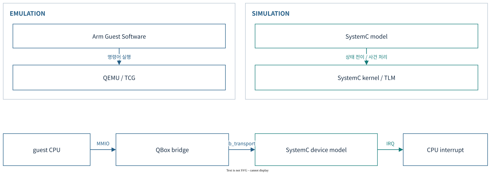

이 문서에서는 **simulation을 모델의 상태·상호작용·시간 진행을 계산하는 관점**, **emulation을 대상 시스템의 실행 계약을 재현해 SW를 실행하는 관점**으로 구분한다. 두 용어는 배타적인 제품 분류가 아니다.

| 관점 | 초점 | Apollo에서의 구현 |
|---|---|---|
| Emulation | ISA, CPU 상태, 예외, 장치의 SW-visible 동작 | QEMU CPU/QOM 모델, TCG의 guest code → host code 번역 |
| Simulation | 상태기계, event 순서, signal, transaction, 모델 시간 | SystemC kernel, `SC_THREAD`/`SC_METHOD`, TLM socket |
| Timing fidelity | 어느 수준의 지연·경합·물리 동작을 재현하는가? | 개별 모델과 동기화 정책별로 판단; cycle accuracy를 전제하지 않음 |

QEMU TCG는 guest 명령어를 **Translation Block(TB)** 단위로 번역·캐시하여 host에서 실행한다. 이는 guest ISA 실행 방식이며 실제 A720AE의 pipeline·cache·분기 예측 지연을 그대로 계산한다는 뜻은 아니다. [QEMU TCG 설계](https://www.qemu.org/docs/master/devel/tcg.html)

Arm FVP도 Fast Models 기반의 programmer’s-view 플랫폼이다. 따라서 **FVP를 cycle-accurate simulator, QVP를 단순한 고속 대체품으로 구분하면 부정확하다**. 비교는 기능과 시간 모델의 범위를 명시한 뒤 수행한다. [Arm Fast Models와 FVP](https://learn.arm.com/install-guides/fm_fvp/), [Arm Fast Models User Guide](https://documentation-service.arm.com/static/5f48df7d6e73485d721ea02e)

## 2. Arm Zena CSS FVP와 Apollo QVP

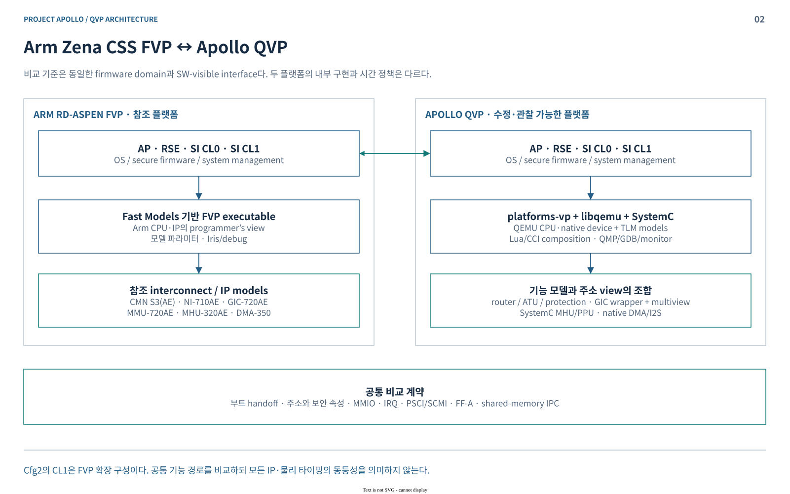

Arm 참조의 [Components](../../../arm-zena-css/documentation/design/components.rst), [Boot process](../../../arm-zena-css/documentation/design/boot_process.rst)와 원본 시스템·SMB·부트 도면을 기준으로 비교했다. **FVP의 IP 구성, Apollo의 구현 모델, 검증된 동작은 서로 다른 정보**다. [참조 도면 목록](SOURCES.md#s1)

| 비교 축 | Arm RD-Aspen FVP | Apollo QVP |
|---|---|---|
| 실행 엔진 | Fast Models 기반 FVP executable | `platforms-vp` + libqemu/TCG + SystemC/TLM |
| AP | Cortex-A720AE 기반 Primary Compute | QEMU A720AE wrapper; full runner 기본 4 PE, 설정 범위 1–16 |
| RSE | Cortex-M55, secure boot와 Root of Trust | M55 CPU instance + 주변장치 helper instance; TF-M과 RSE 모델 결합 |
| SI CL0 | Cortex-R82AE dual lock-step 구성 | 기능 실행용 R82 PE 1개; dual lock-step fault detection의 물리 모델을 뜻하지 않음 |
| SI CL1 | **Cfg2에서만** R82AE 4-core SMP 확장 | R82 PE 4개 + Zephyr SMP |
| Interconnect | CMN S3(AE), NI-710AE 등 참조 IP 모델 | TLM router·address view·ATU·보호 모델; 물리 mesh 경합·대역폭 재현은 별도 범위 |
| Interrupt / IOMMU | GIC-720AE multiple views, MMU-720AE | QEMU GIC + multiview/reset 보강; 기본 SMMU는 SystemC `smmuv3` + `smmuv3_tbu` |
| 구성·확장 | FVP parameter와 모델 제공 범위 | Lua/CCI, 수정 가능한 C++ 모델, QEMU backend, 외부 vMCU 연결 |
| 관찰 | Iris/Arm debugger, model trace·console | GDB/QMP, QBox monitor, TLM/model trace, 도메인별 UART |
| 시간 해석 | 기능 모델의 시간 의미를 기준으로 판단 | QEMU virtual clock와 SystemC time을 정책으로 동기화; silicon timing 보장 없음 |

**공통 비교 단위는 firmware가 관측하는 계약**이다. RSE 중심 boot, PSCI/SCMI, FF-A 보안 서비스, MHU doorbell/shared-memory IPC, 주소·보안 속성·IRQ를 같은 설정과 이미지 조합으로 비교한다. Machine별 DTB·flash·부트 설정이 다르므로 이미지 하나를 무조건 교환하는 방식은 적절하지 않다.

`apollo-qvp-saturn-v.lua`는 RSE·CL0·CL1·AP를 조합하는 full-system 진입점이다. AP-only Direct Linux profile은 firmware 대행 기능을 포함하는 별도 경로다. **AP Linux login만으로 RSE 인증, CL0 전원 관리, CL1 통신까지 검증했다고 보고하지 않는다.**

## 3. QBox의 구조와 원리 — QEMU / libqemu

### 3.1 생성과 소유 구조

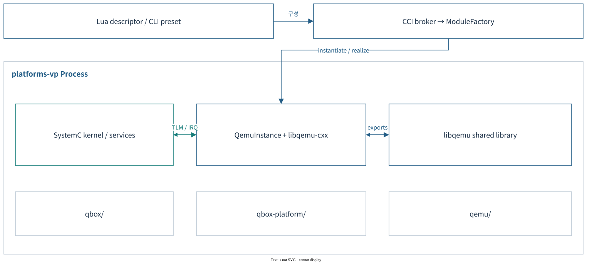

| 계층 | 핵심 책임 | 소유 소스 |
|---|---|---|
| QBox 실행기 | `sc_main`, Lua/CLI 해석, CCI, model 생성, `sc_start()` | `qbox/platforms/`, `qbox/systemc-components/common/` |
| QEMU bridge | QOM 생성·property·realize, memory/IRQ/reset을 TLM/SystemC에 연결 | `qbox/qemu-components/common/` |
| libqemu | QEMU를 library로 초기화하고 C++ wrapper에 export/callback API 제공 | `qbox/.../libqemu-cxx/`, `qemu/libqemu/` |
| QEMU engine | TCG, CPU state, QOM, MemoryRegion, virtual timer, native devices | `qemu/accel/`, `qemu/target/`, `qemu/hw/` |
| Apollo overlay | CPU 확장, SoC/VP/Board Lua, MHU/PPU/ATU/reset 및 board 통합 | `qbox-platform/` |

생성 흐름은 **Lua table → CCI preset → ModuleFactory → SystemC module**이며 QEMU wrapper는 이어서 **QOM instantiate/realize**를 수행한다. `moduletype`는 등록된 constructor를, `args`는 생성자 참조를, `socket.bind`는 모듈 간 연결을 지정한다. CCI는 실행 설정을 전달하는 계층이며 guest MMIO 버스가 아니다.

QemuInstance는 기본적으로 **`-M none -m 0`**으로 초기화한다. 완성된 QEMU `apollo-qvp` machine을 실행하는 대신 QBox가 CPU·장치·메모리를 조립한다. `libqemu_init`가 export API와 QEMU I/O thread를 제공하고, wrapper가 QOM object를 만든다.

여러 QemuInstance는 한 `platforms-vp` process 안에서 독립된 QEMU 상태를 갖는다. 현재 Linux loader는 같은 library의 추가 instance에 임시 `.so` 사본과 `dlopen(RTLD_LOCAL)`을 사용한다. **instance 수와 OS process 수를 혼동하면 실행 구조를 잘못 읽게 된다.** [소스 S2](SOURCES.md#s2)

### 3.2 MMIO와 DMI

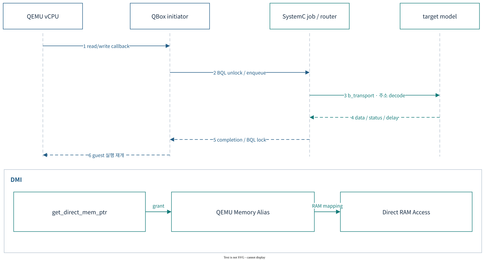

일반 CPU MMIO의 경로는 다음과 같다.

1. QEMU MemoryRegion callback이 command·주소·실제 access size를 TLM payload에 넣는다. secure/user 및 requester 문맥도 extension으로 전달한다.
2. QEMU BQL을 풀고 `run_on_sysc()`에 작업을 넣는다. SystemC thread가 `router → b_transport → target model`을 실행한다.
3. target의 data·response status·delay가 돌아오면 BQL을 다시 잡고 guest 실행을 이어간다.

CPU callback의 최대 access size는 8 byte다. **모든 transaction이 1 byte 또는 항상 8 byte인 것은 아니다.** QEMU 모델을 target으로 만나는 경우에는 `QemuTargetSocket`이 대상 instance의 BQL을 잡고 QEMU AddressSpace read/write를 호출한다.

| 경로 | 적용 원리 | 경계 |
|---|---|---|
| `b_transport` | register side effect와 상태기계를 거치는 일반 접근 | thread 전환·주소 decode·동기화 비용 포함 |
| DMI | target의 host backing pointer를 QEMU memory alias에 매핑 | 주소 구간·권한·translation·target 상태가 grant를 허용해야 함 |
| 같은-instance QEMU alias | bridge가 발견한 QEMU MemoryRegion을 재사용 | 매 접근의 SystemC 왕복을 줄일 수 있음 |
| `transport_dbg` | debugger/loader용 접근 | 일부 target은 `b_transport`를 재사용하므로 MMIO 무부작용을 보장하지 않음 |
| `nb_transport_fw/bw` | 현재 QEMU bridge에서는 미구현 | `abort/assert` 경로; 사용 가능한 고속 실행 방식이 아님 |

`gs_memory`는 DMI를 직접 제공하고 router·ATU·SMMU 경로는 범위와 권한을 제한한다. Flash는 read-array 상태와 허용 구간 등 조건이 붙는다. 변환·상태가 바뀌면 **DMI invalidation → CPU alias 제거 → TLB flush**가 필요하다. read-only DMI의 write는 원래 접근 경로로 돌아간다.

현재 DMI 질의는 일반 `run_on_sysc` queue와 다른 직접 호출 경로다. Exclusive/reentrant 접근도 별도 분기가 있다. **DMI 지원, effective enable, 실제 hit rate를 구분**해야 하며 CPU invalidation 설명을 모든 DMA initiator로 확대하지 않는다. [소스 S3](SOURCES.md#s3)

## 4. Apollo QVP Platform Lua

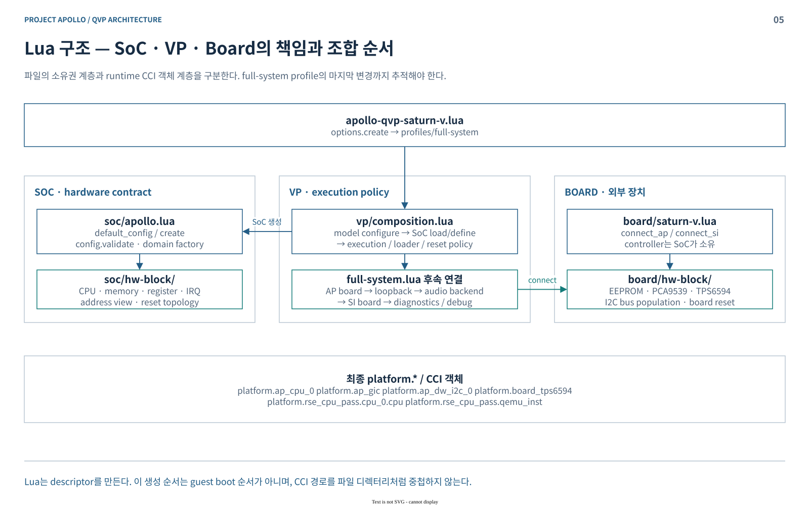

기준 디렉터리는 [`qbox-platform/platforms/apollo/`](../../../hsoc-stack/tools/qbox-platform/platforms/apollo/)다.

```text
apollo-qvp-saturn-v.lua                 canonical full-system 진입
├─ vp/options.lua                      host 실행·모델 선택 context
└─ vp/profiles/full-system.lua          최종 조합 순서
   ├─ vp/composition.lua               SoC 생성 전 선택 / 생성 후 실행 보강
   │  └─ soc/apollo.lua                standalone SoC API
   │     └─ soc/hw-block/              fabric · RSE · AP · SI · ROS
   ├─ board/saturn-v.lua               board/hw-block/ 외부 chip 연결
   └─ vp/backends · test-wiring · debug audio · loopback · 진단
```

| 경계 | 소유하는 것 | 핵심 규칙 |
|---|---|---|
| `soc/` | CPU, 주소·크기·IRQ, interconnect, reset topology | host 파일·환경변수 없이 `soc.create(config)` 가능 |
| `vp/` | accelerator/sync, loader, console, debug, mock/extension, 실행 보강 | hardware 생성 전 선택과 생성 후 변경을 구분 |
| `board/` | EEPROM, PCA9539, TPS6594, I2C bus population | SoC controller에 외부 장치를 연결 |

**최종 구성 순서:** domain model 선택 → SoC load/define → VP 실행·reset/loader 적용 → AP board/loopback → audio backend → SI board → diagnostics/debug.

이 순서는 descriptor 조립 순서다. guest firmware의 부팅 순서가 아니다. 파일은 `soc/hw-block/...`로 나뉘어도 객체는 `platform.ap_cpu_0`, `platform.ap_gic`처럼 유지된다. RSE CPU의 공개 경로는 `platform.rse_cpu_pass.cpu_0.cpu`다.

| 설정 차이 | standalone SoC | canonical full runner / VP |
|---|---|---|
| AP CPU | 기본 16 PE | AP enable 설정, CPU 수 기본 4 PE; 환경·qboxconf·local.conf 영향 |
| RSE flash | `systemc-strata` | 기본 `qemu-cfi-local` → `pflash_cfi` |
| RSE crypto | SystemC `cc3xx` | 기본 performance preset이 QEMU native `qemu_cc3xx` 선택 |
| AP DMA/I2S | 초기 SystemC descriptor | 후속 `audio.connect()`가 QEMU wrapper로 교체 |

Entry Lua를 환경 없이 직접 읽으면 `enable_ap_cpus=false`가 기본이다. 정상 full runner가 AP를 켜므로 **소스 기본값·runner override·최종 객체**를 함께 확인해야 한다. [소스 S4](SOURCES.md#s4)

## 5. QEMU Components와 SystemC Components

### 5.1 모델 구현 경계

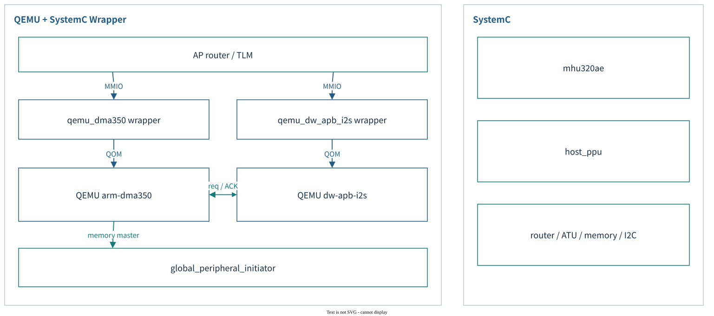

`qemu-components`의 wrapper도 SystemC module이다. 차이는 **장치 상태기계를 어디에서 실행하느냐**다.

| 유형 | 상태기계 소유 | 현재 대표 모델 |
|---|---|---|
| QEMU native + QBox wrapper | QEMU `hw/` 또는 `target/`; wrapper는 QOM/TLM/신호 연결 | A720AE/R82/M55, `arm_gicv3`, AP `qemu_dma350`·`qemu_dw_apb_i2s`, `pflash_cfi`, RSE `qemu_cc3xx` |
| Pure SystemC | C++ TLM callback, SystemC event/process | `mhu320ae`, `host_ppu`, `rse_atu`, RSE `dma350`; crypto 대안 `cc3xx` |
| 공통 infrastructure | 주소 decode·memory·bus·loader·backend | `router`, `gs_memory`, `smmuv3`/`smmuv3_tbu`, I2C controller/bus |

**AP DMA/I2S 사례:** `audio.connect()`는 기존 객체 이름·MMIO·IRQ를 유지하면서 AP의 두 DMA와 두 I2S를 QEMU native backend로 교체한다. I2S peer와 DMA는 같은 `ap_qemu_inst`에 연결한다. Request/ACK는 native GPIO에 담긴 정보를 유지하고, DMA memory master는 `global_peripheral_initiator → TLM`으로 외부 메모리에 접근한다.

현재 native DMA 모델은 1D copy/fill/wrap과 handshake를 구현하며 command links, security attribution, bus timing은 구현 범위에 포함하지 않는다. IP 이름의 동일성이 전체 사양 지원을 뜻하지 않는다.

**MHU 사례:** SystemC 모델이 SET/CLEAR/MASK·paired mailbox·IRQ를 처리한다. HIPC의 데이터는 shared-memory/vring에 있고 MHU는 알림을 전달한다. 모델에 있는 선택적 SCMI 대행 응답과 실제 firmware의 SCMI 서비스를 같은 것으로 취급하지 않는다.

Backend 이름도 구현 클래스와 다를 수 있다. `systemc-mmu720ae`는 현재 core **`smmuv3` + `smmuv3_tbu`**를 선택하는 정책 문자열이다. overlay에 `mmu720ae` 소스가 존재한다는 이유로 이를 active model로 표기하면 틀린다. [24개 대표 모델과 선택 근거](MODEL-MAP.md), [소스 S5](SOURCES.md#s5)

### 5.2 하나의 장치를 끝까지 추적하기

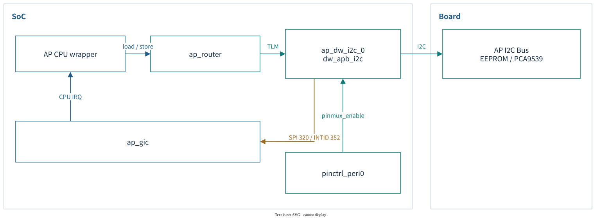

AP I2C0의 최종 경로는 **`ap_cpu_N.mem → ap_router → ap_dw_i2c_0.target_socket`**이다. SoC가 controller·주소·IRQ를 정의하고, Board가 I2C slave를 연결한다.

- MMIO: `0x30100000`, 크기 `0x10000`; 모델 `dw_apb_i2c`, library `dw-apb-i2c`.
- Interrupt: `irq → ap_gic.spi_in_320`; guest가 보는 **INTID는 352**다.
- 제어: pinctrl의 `peripheral_enable_0 → pinmux_enable`; AP cold reset 목록에 controller reset 포함.
- 외부 장치: `board_i2c0`에 EEPROM·PCA9539 연결. Saturn-V 실제 회로와의 일치도는 `UNVERIFIED`다.

이 경로에서 주소 mapping, pinmux, reset, bus population, interrupt를 함께 읽어야 한다. [단계별 소스](MODEL-MAP.md#ap-i2c0-lua에서-실제-연결까지)

## 6. Execution 구조와 Flow

### 6.1 Process·thread·domain

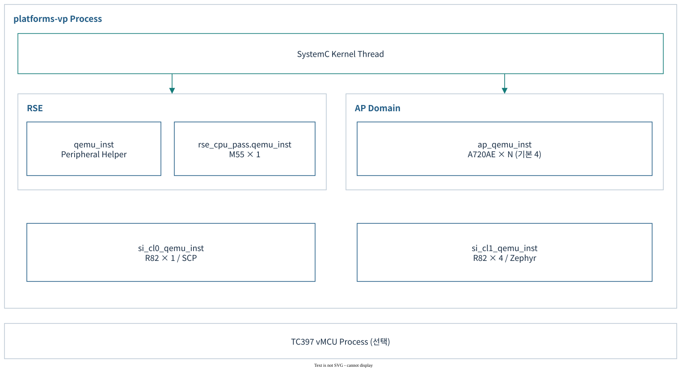

**Firmware domain은 4개, QemuInstance는 5개**다. RSE가 CPU 실행용과 주변장치용 instance를 나눠 사용하기 때문이다. 아래 객체는 모두 하나의 `platforms-vp` process 내부에 있다.

| QemuInstance 경로 | CPU / 역할 | 기본 TCG mode |
|---|---|---|
| `platform.qemu_inst` | RSE 주변장치 helper; CPU 없음 | SINGLE 설정 |
| `platform.rse_cpu_pass.qemu_inst` | Cortex-M55 × 1 | SINGLE |
| `platform.ap_qemu_inst` | Cortex-A720AE × N; full runner 기본 4 | MULTI |
| `platform.si_cl0_qemu_inst` | Cortex-R82 × 1, SCP | MULTI |
| `platform.si_cl1_qemu_inst` | Cortex-R82 × 4, Zephyr | MULTI |

`MULTI`는 QEMU의 vCPU별 host thread를 사용한다. `SINGLE`은 instance의 CPU를 RR thread에서 실행한다. 별도로 각 libqemu의 I/O thread와 SystemC kernel host thread가 있다. SystemC의 `SC_THREAD` 개수가 host OS thread 개수인 것은 아니다.

일반 MMIO는 `run_on_sysc`를 통해 SystemC thread로 전달된다. IRQ는 경계에 따라 다르다. 같은-instance QEMU GPIO는 직접 연결할 수 있고, SystemC/다른 instance 경로는 queue와 대상 BQL을 사용한다. 선택 TC397 vMCU는 별도의 `qemu-system-tricore` process다. [소스 S6](SOURCES.md#s6)

### 6.2 시간 진행과 동기화

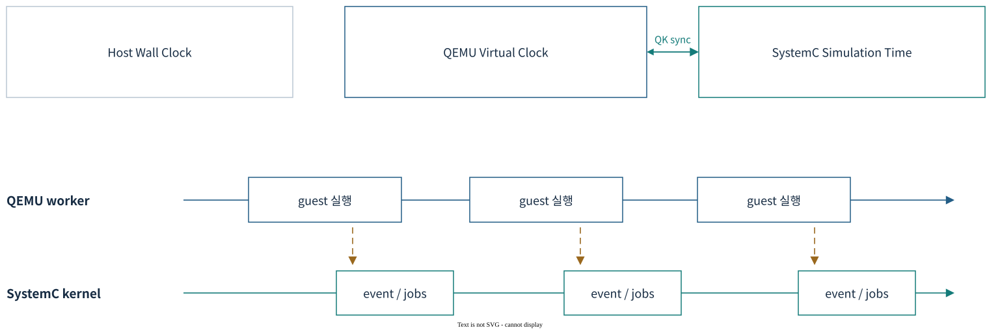

| 설정 축 | 현재 full-system 기본 | 의미 |
|---|---|---|
| Accelerator | `tcg` | guest code의 동적 번역 실행 |
| TCG mode | AP/SI `MULTI`, RSE `SINGLE` | QEMU CPU thread 구성 |
| Sync policy | `multithread-freerunning` | 외부 QEMU thread의 sync는 kernel tick을 깨움; quantum budget 대기 없음 |
| Time strategy | `quantum_keeper` | QEMU virtual clock와 `sc_time_stamp()` 차이를 local time에 반영 |
| Global quantum | `10000000 ns` = 10 ms | full profile의 실행 설정; core 실행기 자체 기본값 1 ms와 구분 |

**10 ms는 CPU 간 최대 시간차 보장이 아니다.** 기본 freerunning의 `need_sync()`는 false다. Budget을 기다리는 `multithread-quantum`은 별도 정책이며, 실제 진행률·IRQ latency·재현성은 설정과 traffic을 포함해 측정해야 한다. Host wall time, QEMU virtual time, SystemC simulation time도 같은 값으로 해석하지 않는다. [소스 S7](SOURCES.md#s7)

### 6.3 Launcher와 실행 입력

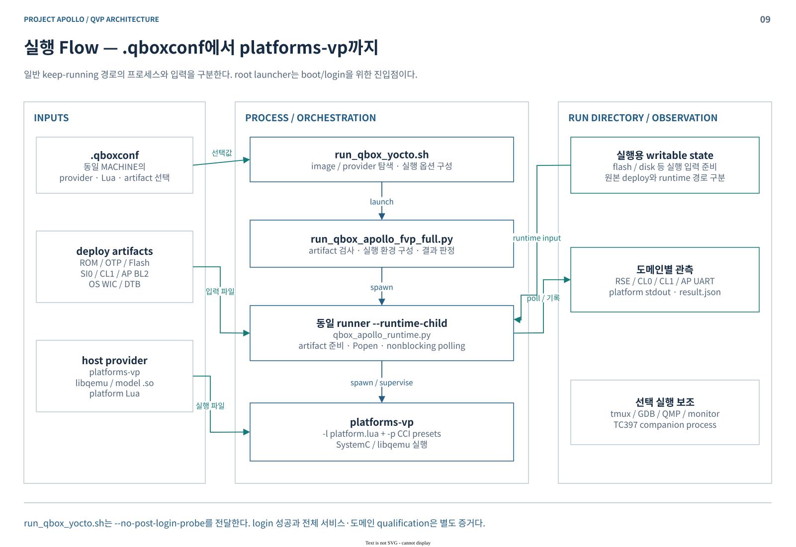

`./run_qbox_yocto.sh [--bsp]`는 `.qboxconf`로 provider와 image를 선택한다. 일반 경로는 **shell → full runner → 동일 runner의 `--runtime-child` → `platforms-vp`**다. Child가 `qbox_apollo_runtime.py`를 호출하므로 이 파일을 별도의 세 번째 Python executable로 그리지 않는다.

실행 파일과 Lua는 기본적으로 **설치된 `qbox-apollo-qvp-native` provider**에서 읽는다. `LD_LIBRARY_PATH`도 provider의 library/module 및 native sysroot를 포함한다. 소스 Lua 수정만으로 이미 설치된 실행 파일·Lua가 바뀌지는 않는다.

기본 launcher는 **performance preset·native CC3XX·range-limited flash DMI**를 선택한다. Preset은 RSE libc/LMS/이미지 검증 관련 hotpath 가속과 SRAM DMI도 활성화한다. 따라서 Lua의 단독 기본값으로 실제 backend나 guest가 실행한 경로를 단정하지 않는다.

| 입력 / 상태 | 실제 처리·소비자 |
|---|---|
| ROM·provisioning·OTP | host loader가 RSE ROM/VM/OTP를 초기화 |
| RSE flash | persistent state; source hash·storage fingerprint 확인 후 재사용/갱신, 조건에 따라 PS/ITS 보존 |
| OTP·AP flash | 기본 runtime `writable-images`에 실행용 사본 준비 |
| SI0·CL1·AP BL2 | loader preset과 reset 보조 초기화; CL1 ELF/bin·entry 검증 포함 |
| WIC | `ap_virtioblk_0`의 raw/writeback backend; 기본 `--copy-disks` off이므로 guest write가 입력 파일에 반영될 수 있음 |
| Kernel·OS DTB | full-system에서는 WIC의 EFI/UKI 부트 경로가 소비; launcher metadata를 direct-load로 해석하지 않음 |

RSE persistent state 기본 경로는 `build/qbox-apollo-fvp/state/yocto-${MACHINE}/`다. 현재 경로명에 `fvp`가 남아 있다. BSP+vMCU UART 구성은 별도 private WIC를 만드는 예외다.

Runtime child는 UART와 platform stdout을 **nonblocking polling loop**로 수집한다. tmux의 `tail -F`는 로그 표시용이다. Launcher는 headless에서도 `--no-post-login-probe`를 전달하므로, full post-login qualification에는 canonical Python runner의 probe 결과가 필요하다. [소스 S8](SOURCES.md#s8)

### 6.4 생성·초기화·부팅·Reset

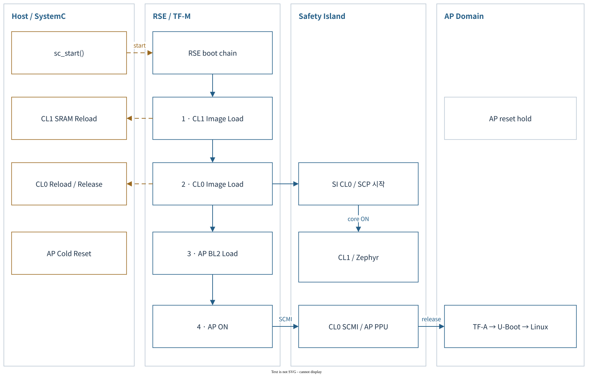

Host lifecycle은 **`sc_main → CCI/descriptor 구성 → sc_start 진입 → elaboration callback → start_of_simulation → event/CPU 실행`**이다. Elaboration 중 QOM object가 instantiate/realize되고 loader가 이미지를 초기 preload한다. `sc_start()`를 모든 초기화가 끝난 뒤 guest를 켜는 함수 하나로만 해석하면 순서가 맞지 않는다.

| 단계 | Firmware가 수행하는 일 | QVP host/model이 함께 수행하는 일 |
|---|---|---|
| RSE 시작 | BL1_1 → BL1_2 → BL2; 이후 TF-M runtime | ROM/OTP/provisioning 적재, RSE flash backend |
| SI CL1 이미지 | RSE BL2의 **pre-load**에서 cluster PPU ON; 이후 image/header 처리 | CL1 초기 preload/reload, RVBAR 설정; 이 cluster PPU는 CPU reset을 직접 해제하지 않음 |
| SI CL0 | RSE BL2의 **post-load**에서 core PPU ON·CPUHALT 해제 | SI0 raw bin 초기 preload; cold ON에 `power_on_load → loader.reset → SRAM reload → reset 해제` |
| SI CL1 실행 | SCP `safety_island_platform.start`가 CL1 core별 전원 ON 요청 | `si_cl1_coreN_ppu.power_on_reset → CPU reset 해제`; Zephyr 4 PE 실행 |
| AP release | RSE가 SCP readiness와 AP BL2 준비 후 `boot_platform_finish → SCMI AP ON` | AP BL2 ELF `.data` 복원, stack/BSS/xlat 초기화; cold reset에도 재수행 |
| AP boot | BL2 → BL31/BL32/BL33 → U-Boot → UKI/Linux | AP flash와 VirtIO block/network backend |

공통 loader는 `end_of_elaboration()`에서 처음 적재하고 `reset=true`에서 다시 적재한다. 따라서 **PPU ON이 항상 최초 이미지 로드 시점은 아니다**. Warm resume은 cold ON의 reload와도 구분한다. System reset에서는 SI CPU hold, IRQ/GIC 정리, QemuInstance reset, firmware의 PPU release 순서가 중요하다.

Arm 참조 도면의 인증·적재 화살표와 QVP host의 preload/reload는 역할이 다르다. 현재 BL2는 image ID 역순으로 **CL1 → CL0 → AP**를 처리한다. CL1 cluster의 load hook과 SCP가 수행하는 core별 release를 분리해 읽어야 한다. 기본 실행의 RSE hotpath 가속도 인증 시험의 범위와 함께 기록한다. [소스 S9](SOURCES.md#s9)

Phase 1 발표에서는 **구현 구조 → 실제 실행 증거 → 남은 fidelity 범위**를 연결한다. 이 문서는 구조를 설명하며, 부팅 성공·서비스 시험·성능 수치를 새로 측정한 결과 보고서는 아니다. [근거와 문서 검증](SOURCES.md#validation)
