# Apollo SCP-firmware Implementation Report

## 1. Overview

### 1.1 Purpose and Scope

Safety Island CL0의 SCP-firmware를 **소스·빌드 → Boot → Framework 초기화 → Event 실행 → Driver·통신 Stack** 순서로 설명한다.

- **대상:** Cortex-R82에서 실행하는 SCP-firmware와 Apollo Product 구성.
- **핵심:** Module Lifecycle, API Binding, Event·Notification, Interrupt, SCMI Transport.
- **연계:** RSE의 image handoff, TF-A·Linux·Zephyr의 firmware service 요청.
- **실행 환경:** Apollo QVP. 전원·Safety 기능은 Software Module과 API 연결을 중심으로 기술한다.

### 1.2 SCP-firmware Component Summary

| 항목 | Apollo 구성 |
|---|---|
| Source version | SCP-firmware `2.16.0` 기반 로컬 확장 |
| Product / Firmware | `automotive-rd/apollo-qvp/si0_ramfw` |
| Build target | `apollo-qvp-si0-bl2` |
| Processor | SI CL0 Cortex-R82 Core0, AArch64 / EL2 |
| 실행 모델 | 단일 Firmware, Event Loop 기반 Module Callback 실행 |
| Code / Data | ITCM 512 KiB / DTCM 512 KiB, Stack 16 KiB |
| Interrupt | GIC Group0 FIQ, Framework ISR 등록·dispatch |
| Timer | Generic Timer MMIO + Timer HAL / Alarm API |
| 통신 | MHUv3 + Shared Memory + Transport + SCMI |
| Build / Deploy | Yocto `scp-firmware` / `si0_ramfw.elf`, `si0_ramfw.bin` |

`si0-bl2`는 SCP build target 이름이다. RSE BL2, AP TF-A BL2와 각각 다른 실행 image다.

### 1.3 Glossary

| 용어 | 의미 |
|---|---|
| Product / Firmware | Platform 구성 단위 / 정적으로 link하는 실행 image |
| Module / Element | 기능 구현 단위 / Module이 관리하는 device 또는 service instance |
| Sub-element | Element 내부 channel·alarm 등 하위 자원 |
| API Binding | Provider의 함수 table을 Consumer에 연결 |
| Event / Notification | 특정 대상의 비동기 작업 / 구독자에게 전달하는 상태 알림 |
| ISR / Event Context | FIQ 처리 중 실행 / Main Loop가 Callback을 실행하는 문맥 |
| SCMI | Processor와 System Management Firmware 간 제어 protocol |
| A2P / P2A | Agent → Platform / Platform → Agent channel 방향 |
| SDS | Shared Data Structure, boot 정보를 공유하는 memory ABI |
| HAL | 상위 Service와 IP Driver 사이의 공통 interface |

## 2. SCP-firmware Software Stack Overview

### 2.1 Platform Service·Protocol·HAL·Driver·Framework 구성

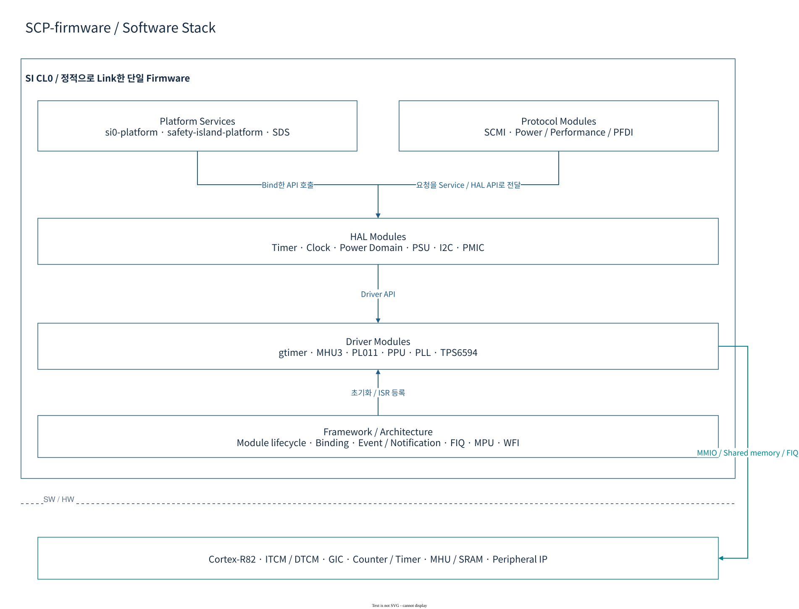

| 계층 | 대표 Module | 역할 |
|---|---|---|
| Platform Service | `si0-platform`, `safety-island-platform`, `sds` | Platform 초기화·상태·boot 정보 관리 |
| Protocol | `scmi`, `scmi-power-domain`, `scmi-perf` | 외부 요청 해석과 Service API 연결 |
| HAL | `timer`, `clock`, `power-domain`, `psu`, `i2c`, `pmic` | Device 종류별 공통 operation |
| Driver | `gtimer`, `mhu3`, `pl011`, `ppu-v1`, `tps6594` | Register·interrupt·device protocol 제어 |
| Framework | `fwk_module`, `fwk_core`, `fwk_notification` | Lifecycle·Binding·비동기 실행 |
| Architecture | AArch64 entry, GIC, exception, memory | CPU 실행 환경과 Framework 연결 |

Framework는 모든 Module의 실행 기반이다. 모든 API 호출이 Event Queue를 통과하는 것은 아니다.

### 2.2 Architecture Layer와 Hardware Interface

- `arch/arm/aarch64/`: Reset entry, exception vector, FIQ, GIC CPU interface.
- `arch/arm/common/`: Linker layout, heap 영역, libc 연결.
- `fwk_interrupt`: Module이 사용하는 ISR 등록·enable interface.
- Product의 `fmw_*.h`, `si0_*.h`: Memory·interrupt·logging device의 실제 구성.
- Driver는 MMIO에 접근하며, Architecture Layer는 CPU exception·interrupt context를 제공한다.

### 2.3 Safety Island CL0 실행 환경

- CL0 Core0가 하나의 Firmware Event Loop를 실행한다.
- Module별 RTOS Thread나 일반적인 Task Scheduler는 구성하지 않는다.
- 직접 API 호출은 caller context에서 실행하고, Event는 Main Loop에서 순차 처리한다.
- FIQ는 Main Loop 실행을 중단할 수 있다. 긴 Callback은 뒤따르는 Event 처리를 지연시킨다.
- MPU는 image·data·shared memory·device 접근 attribute를 구성한다.

### 2.4 RSE·TF-A·Linux·Zephyr와의 인터페이스

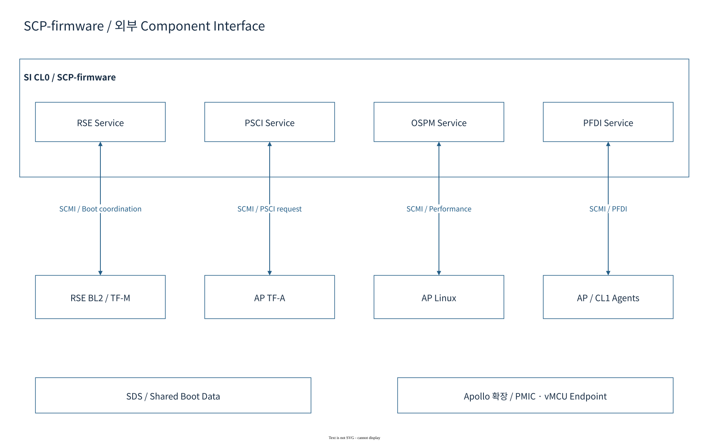

| Component | SCP와의 계약 |
|---|---|
| RSE BL2 / TF-M | SCP image handoff, SCMI service readiness, boot·system 요청 |
| AP TF-A | PSCI 동작에 필요한 SCMI Power Domain / System Power 요청 |
| AP Linux | OSPM SCMI Performance 요청, 별도 PFDI Agent 통신 |
| SI CL1 Zephyr | Per-core PFDI Agent의 상태·진단 메시지 |
| AP firmware | SDS에 게시된 boot 정보 소비 |
| vMCU | Apollo 확장 endpoint를 통한 상태·board 제어 메시지 |

### 2.5 Apollo Firmware의 활성 Module 구성

`Firmware.cmake`의 Module 목록과 기존 QVP build의 `fwk_module_idx.h`를 대조한 구성이다.

| 기능군 | 포함 Module |
|---|---|
| 실행 기반 | `armv8r-mpu`, `pl011`, `gicx00`, `gicx00-multiview`, `gtimer`, `timer` |
| Platform | `ni-710ae`, `cmn-cyprus`, `clear-memory`, `sid`, `system-info`, `pcid`, `apcontext`, `sds` |
| 통신 | `mhu3`, `transport`, `scmi` 및 Power Domain·System Power·Performance protocol |
| 제어 HAL | `ppu-v1`, `system-power`, `power-domain`, `system-pll`, `ros-clock`, `clock`, `dvfs`, `psu`, `mock-psu` |
| Board 확장 | `dw-apb-i2c`, `i2c`, `gpio`, `tps6594`, `pmic`, `vmcu-safety` |
| Platform·Safety Service | `si0-platform`, `safety-island-platform`, `cluster-control`, `fmu`, `ssu`, `sbistc`, `ras-handlers`, PFDI Monitor |
| Monitor·진단 | SMCF·sensor 관련 Module, `debugger-cli`, `integration-test`, 선택된 test Module |

QVP Product도 내부 `SCP_PLATFORM_VARIANT=fvp` 분기를 사용한다. 이 이름만으로 SMCF·CL1 관련 코드를 FVP 전용으로 분류하지 않는다. Performance Fast Channel은 QVP recipe에서 비활성화한다.

## 3. Source and Build Architecture

### 3.1 Source Repository 및 Directory Structure

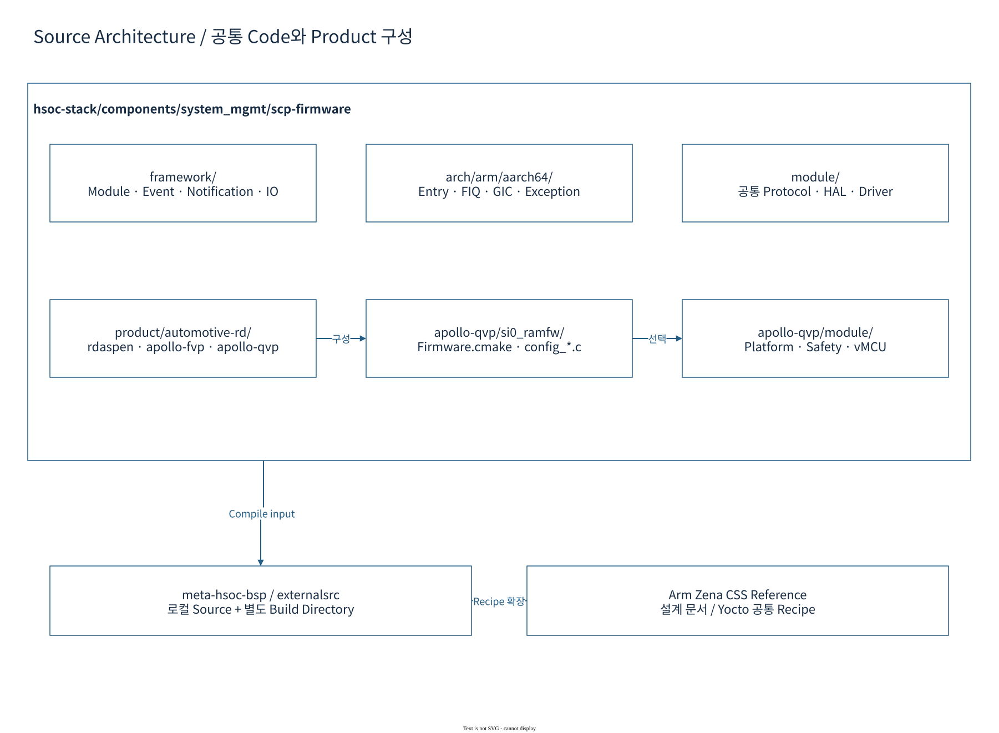

```text
hsoc-stack/components/system_mgmt/scp-firmware/
├── framework/                   Module·Event·Notification·IO
├── arch/arm/aarch64/             Entry·Exception·FIQ·GIC
├── arch/arm/common/              Linker·Heap·libc
├── module/                      공통 Protocol·HAL·Driver
├── product/automotive-rd/
│   ├── module/                  Automotive 공통 Module
│   ├── rdaspen/                 Arm Reference Product
│   ├── apollo-fvp/              Apollo FVP Product
│   └── apollo-qvp/
│       ├── si0_ramfw/           Firmware·Element·Resource 구성
│       └── module/              Apollo Platform Module
├── cmake/                       Build·Toolchain 지원
├── tools/                       CRC·Symbol 처리
└── unit_test/                   Module Test Framework
```

### 3.2 `framework/`·`arch/`·`module/`·`product/`의 역할

| 경로 | 소유하는 내용 | 변경 시 영향 |
|---|---|---|
| `framework/` | 공통 실행·연결 규칙 | 여러 Product의 Module 동작 |
| `arch/` | CPU entry·exception·memory 지원 | 해당 Architecture의 Firmware |
| `module/` | 재사용 가능한 기능·Driver | 해당 Module을 선택한 Product |
| `product/` | Module 선택·instance·주소·정책 | 해당 Product/Firmware |

현재 Event 실행 구현은 `framework/src/fwk_core.c`에 있다. 일반적인 SCP 설명의 Thread API 명칭을 현재 소스 파일명·실행 모델에 그대로 대입하지 않는다.

### 3.3 공통 Module과 Apollo Product Module

- 공통 Module의 공개 API는 `module/<name>/include/mod_<name>.h`에 둔다.
- 구현과 내부 context는 `src/` 및 내부 header에 둔다.
- Apollo 전용 구현은 `apollo-qvp/module/`에서 관리한다.
- Automotive 공통 GIC Multiview·SSU·SBISTC 등은 `automotive-rd/module/`에서 선택한다.
- `SCP_MODULE_PATHS`와 `SCP_MODULES`가 실제 link할 구현과 순서를 결정한다. Product 이름만으로 코드 상속을 가정하지 않는다.

### 3.4 `Firmware.cmake`·Module Selection·Build Options

| 설정 | 기존 QVP CMakeCache 값 |
|---|---|
| `SCP_FIRMWARE_SOURCE_DIR` | `automotive-rd/apollo-qvp/si0_ramfw` |
| `SCP_PC_CONFIGURED_CORES_COUNT` | `4` — 관리 대상 AP core 수 |
| `SCP_ENABLE_NOTIFICATIONS` | `ON` |
| `SCP_ENABLE_WFI_IDLE` | `ON` |
| `SCP_ENABLE_SCMI_PERF_FAST_CHANNELS` | `OFF` |
| `SCP_ENABLE_SCMI_PFDI_MONITOR` | `1` |
| `SCP_APOLLO_QVP_PMIC` / `SCP_APOLLO_QVP_VMCU_SAFETY` | `ON` / `1` |
| `SCP_ENABLE_DEBUGGER` | `1` |
| `SCP_ENABLE_IMAGE_INTEGRITY_VERIFY` | `ON` |
| Build / Log | `Debug` / `INFO` |

위 값은 2026-10-04 생성된 기존 build cache의 기록이다. 현재 `build/conf/local.conf`도 `MACHINE=apollo-qvp`, `PFDI_MONITOR_SUPPORT=1`을 지정한다. 본 문서 작성 중 재빌드는 수행하지 않았다.

### 3.5 `config_*.c`·Element Table·API 연결 구성

| 구성 항목 | 의미 | 예 |
|---|---|---|
| `struct fwk_module_config` | Module 공통 data와 Element 제공자 | `config_timer` |
| Element table | 이름·instance data·하위 자원 수 | Timer device, MHU link, SCMI service |
| Element data | Register base·IRQ·peer ID·backend API | `config_gtimer.c`, `config_mhu3.c` |
| API ID | Provider Module과 API index | Timer driver API, Transport API |
| Sub-element count | Element 내부 자원 개수 | Alarm slot, doorbell mapping |

`FWK_ID_*`는 Software 객체 식별자다. Element 번호, MHU DBCH 번호, GIC INTID는 서로 다른 번호 체계다.

### 3.6 CMake·Toolchain·Yocto Build 통합

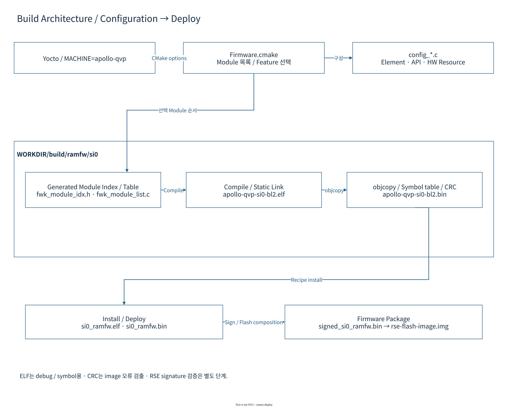

1. `meta-arm`의 `scp-firmware` recipe에 Arm Zena CSS 설정을 적용한다.
2. `meta-hsoc-bsp`가 Product를 `apollo-qvp`로 선택하고 로컬 `externalsrc`를 연결한다.
3. `${WORKDIR}/build/ramfw/si0`에서 CMake를 실행한다.
4. `aarch64-none-elf-` GNU Toolchain과 `cortex-r82` target으로 compile한다.
5. Module index·table 생성 → compile → ELF link → binary·CRC 처리 → install/deploy한다.

`externalsrc` 빌드는 체크아웃된 로컬 소스를 입력으로 사용한다. Arm reference recipe의 patch 목록이 매번 이 source tree에 다시 적용되는 구조로 설명하지 않는다.

### 3.7 Linker Layout·ITCM·DTCM·Stack 구성

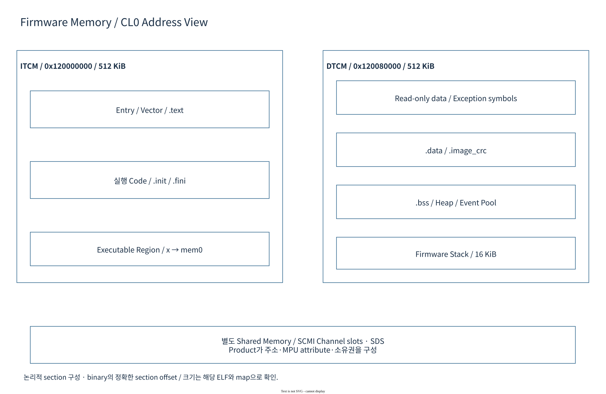

| 영역 | CL0 address / 크기 | 주요 용도 |
|---|---|---|
| ITCM | `0x120000000` / 512 KiB | Entry, vector, executable code |
| DTCM | `0x120080000` / 512 KiB | Read-only data·exception symbol, initialized data·CRC, BSS·heap·stack |
| Stack | 16 KiB | Firmware 실행 및 exception context |
| Shared memory | Product별 별도 window | SCMI slot, SDS, domain 공유 정보 |

`FMW_MEM_MODE=ARCH_MEM_MODE_DUAL_REGION_NO_RELOCATION`이다. Reset code는 BSS를 지우며, 일반적인 ROM→RAM `.data` 복사를 이 경로에 추가하지 않는다. RSE load address와 CL0 실행 주소는 각 도메인의 address view로 구분한다.

### 3.8 Build and Deploy Artifacts

| 산출물 | 소비자 / 목적 |
|---|---|
| `fwk_module_idx.h`, `fwk_module_list.c` | 선택된 Module 순서·ID·config pointer |
| `apollo-qvp-si0-bl2.elf` | Link 결과, symbol·debug·section 분석 |
| `apollo-qvp-si0-bl2.bin` | Flat binary, exception symbol·CRC 후처리 |
| `si0_ramfw.elf`, `si0_ramfw.bin` | Recipe가 정규화한 install/deploy 이름 |
| `signed_si0_ramfw.bin` | Firmware image recipe의 서명 결과 |
| `rse-flash-image.img` | RSE boot가 소비하는 firmware package |

CRC patcher는 binary의 마지막 4 byte를 제외한 범위를 CRC32로 계산하여 마지막 field에 기록한다. RSE의 서명 검증과는 별도 단계다. QVP의 CL0 raw loader도 `si0_ramfw.bin`을 별도 memory input으로 사용한다.

## 4. Boot and Initialization Architecture

### 4.1 RSE에서 SCP-firmware로의 Boot Handoff

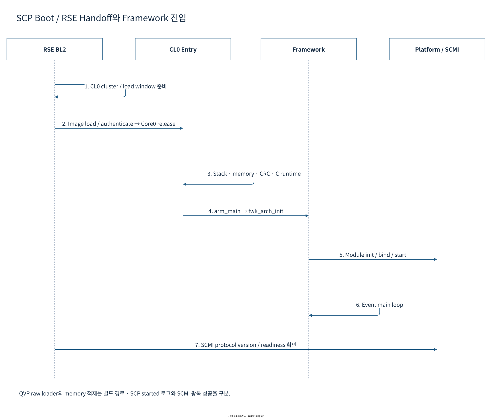

1. RSE BL2가 CL0 cluster와 image 접근 window를 준비한다.
2. CL0 image를 적재·인증하고 post-load 단계에서 Core0를 release한다.
3. SCP가 entry·Framework·Module을 초기화한다.
4. RSE가 SCMI Power Domain protocol version 응답으로 SCP service 준비를 확인한다.

QVP `si_cl0/boot.lua`의 raw loader는 CL0 SRAM에 binary를 공급한다. Loader의 `authenticated_image` capability 표시는 접근 정책이며, 이 표시 자체가 암호학적 인증 결과는 아니다.

### 4.2 AArch64 Entry·C Runtime·Image Integrity 확인

`arch_exception_reset` → `arm_main()` → `platform_init_hook()` → `fwk_arch_init()` 순서다.

- Entry: EL2 실행 환경, 초기 MPU·cache, BSS, stack, libc constructor를 준비한다.
- Apollo hook: `verify_image_crc()`와 `verify_scr_cfg_integrity()`를 실행한다.
- SCR 확인 시 MPU를 잠시 해제하고 확인 후 다시 활성화한다.
- Hook 실패 시 `fwk_trap()`으로 진행을 중단한다.

### 4.3 MPU·Cache·Exception·Interrupt 초기화

| 단계 | 처리 |
|---|---|
| Assembly entry | `VBAR_EL2`, `HCR_EL2`, `SCTLR_EL2`, 초기 PMSA region |
| `armv8r-mpu` Module | Product가 정의한 memory attribute 구성 |
| Architecture interrupt init | Architecture hook 호출; GICv3 경로는 추가 register 설정 없음 |
| GIC Product Module | Distributor·Redistributor·View 관련 구성 |
| Driver start | 개별 interrupt callback 등록·enable |

CL0의 일반 device interrupt 처리 경로는 **Group0 FIQ**다. Architecture interrupt 초기화 하나가 전체 GIC Product 설정을 대신하지 않는다.

### 4.4 Framework·IO·Logging 초기화

```text
fwk_module_init()          Module / Element context table 준비
 → fwk_io_init()           IO adapter 준비
 → fwk_log_init()          Logging 준비
 → fwk_arch_interrupt_init()
 → fwk_module_start()      Module lifecycle 실행
 → __fwk_run_main_loop()   Event 처리
```

`fwk_module_init()`는 context를 구성하는 단계다. 전체 Module의 `init()` callback은 이후 `fwk_module_start()`에서 호출한다.

### 4.5 Module Lifecycle: Init → Element Init → Bind → Start

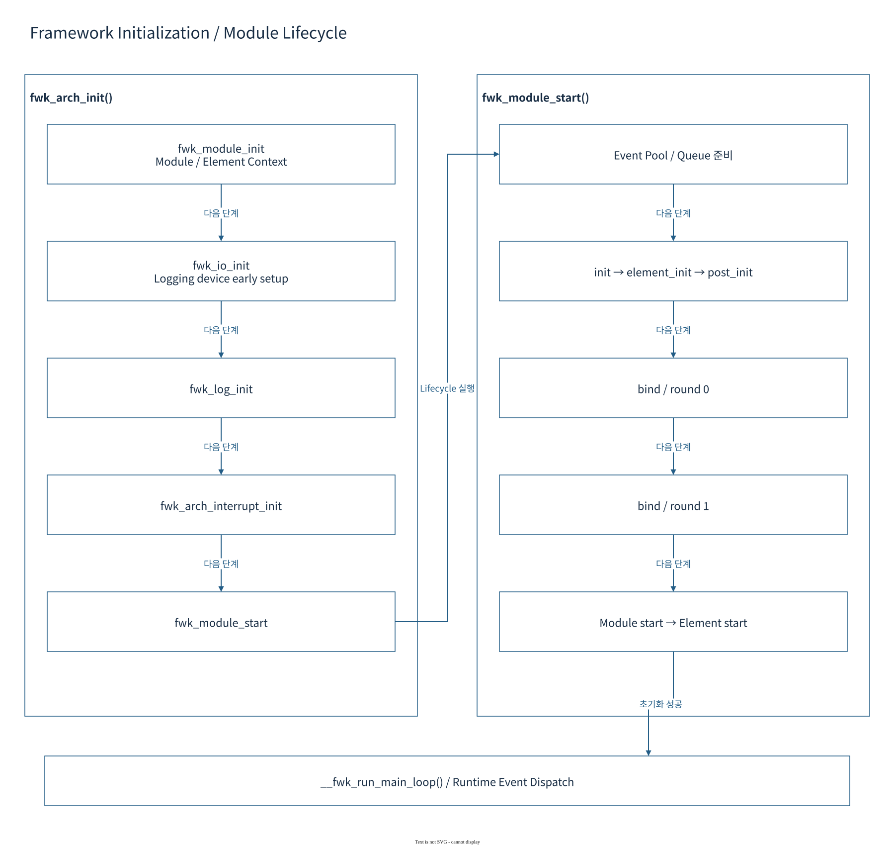

| 단계 | 호출 / 역할 |
|---|---|
| Event pool | `__fwk_init()`로 queue와 pooled event 준비 |
| Init | Module `init()`, 각 `element_init()`, 선택적 `post_init()` |
| Bind round 0 | 모든 Module·Element의 일차 API 연결 |
| Bind round 1 | 다른 Module의 초기 binding에 의존하는 연결 |
| Start | Module `start()` 후 해당 Element `start()` |
| Runtime | Event·Notification dispatch 시작 |

각 phase는 generated Module index 순서로 진행한다. `post_init`·`bind`·`start`는 생략 가능하다. `init`은 필수이며 Element가 있으면 `element_init`도 필요하다.

### 4.6 Module 초기화 순서와 의존 관계

- Hardware 접근 전 MPU·interconnect·clock 등 필요한 기반을 준비한다.
- Driver와 HAL은 `bind()`에서 API를 확보하고 `start()`에서 장치를 활성화할 수 있다.
- PMIC 활성 구성은 `timer` 뒤에 I2C·TPS6594·GPIO·PMIC를 삽입하고 `ppu-v1`을 그 뒤로 이동한다.
- 이 순서는 Timer·PMIC 준비 전 SYS0 동작이 시작되지 않도록 하는 Product 의존 관계다.
- API 연결 완료와 원격 domain의 boot 완료는 다른 상태다.

### 4.7 Platform Service 시작과 Main Loop 진입

| 관찰 지점 | 의미 |
|---|---|
| `SCP started` | `si0-platform`의 start 단계 도달 |
| `[FWK] Module initialization complete!` | 전체 Module lifecycle callback 완료 |
| RSE의 SCMI protocol version 응답 | 해당 channel의 요청·응답 동작 |
| 후속 Platform Event | Start에서 등록한 비동기 작업 수행 |

`start()`가 Event를 제출할 수 있으므로 initialization 로그 이후에도 platform 작업은 계속된다.

## 5. Framework Runtime Architecture

### 5.1 Module·Element·Sub-element·Identifier

| 객체 | 예 | Context |
|---|---|---|
| Module | Timer HAL | 공통 API·event·notification 정의 |
| Element | Timer device 0 | Driver ID·alarm list·device 상태 |
| Sub-element | Alarm slot | Caller별 alarm resource |
| API | Timer alarm API | `start`, `stop` 등의 함수 table |
| Event | Service 작업 | Source·target·event ID·parameter |

`fwk_id_t`는 객체 type과 index를 표현한다. Module index는 build마다 생성되므로 외부 protocol의 고정 번호로 사용하지 않는다.

### 5.2 API Binding과 Module 간 함수 호출

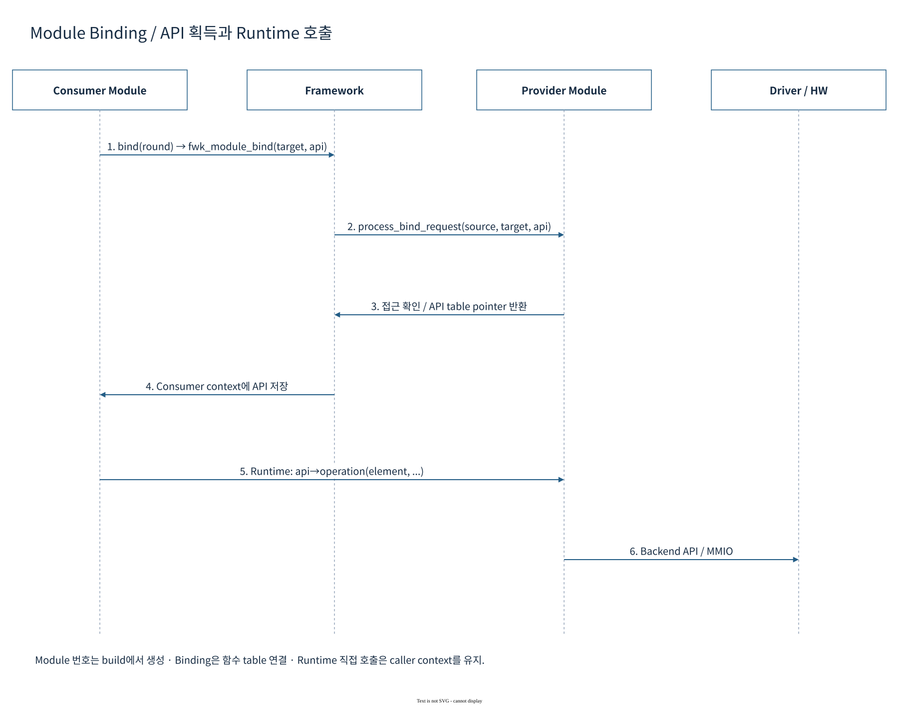

1. Consumer가 `fwk_module_bind(target_id, api_id, &api)`를 호출한다.
2. Framework가 Provider의 `process_bind_request()`를 호출한다.
3. Provider가 source·target·API를 확인하고 함수 table pointer를 반환한다.
4. Consumer는 pointer를 context에 보관하고 runtime에 직접 호출한다.

직접 호출은 synchronous call이다. ISR에서 호출하면 Provider 코드도 ISR context에서 실행한다.

### 5.3 Event 생성·Queue·Dispatch

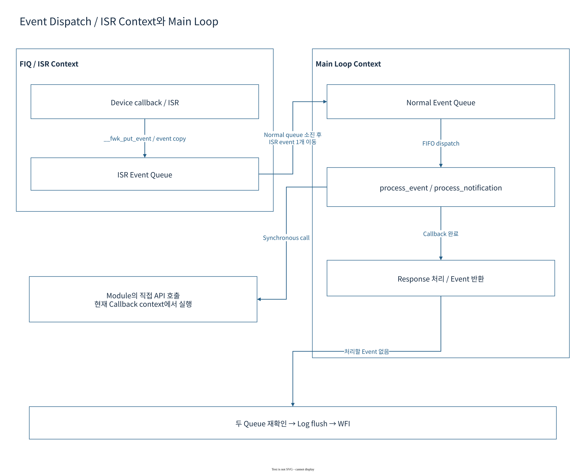

- `__fwk_put_event()` / `__fwk_put_event_light()`는 제출 내용을 pool object에 복사한다.
- ISR에서 제출한 Event는 `isr_event_queue`, 일반 제출은 `event_queue`로 들어간다.
- Main Loop는 normal queue를 모두 처리한 뒤 ISR queue에서 Event **1개**를 normal queue로 옮긴다.
- 대상 Module의 `process_event()` 또는 `process_notification()`을 호출한다.
- 완료한 Event는 free queue로 반환한다.

이 순서는 Task priority scheduling이 아니다. 긴 callback과 지속적인 normal event 생성은 뒤의 작업을 지연시킬 수 있다.

### 5.4 Request·Response·Delayed Response

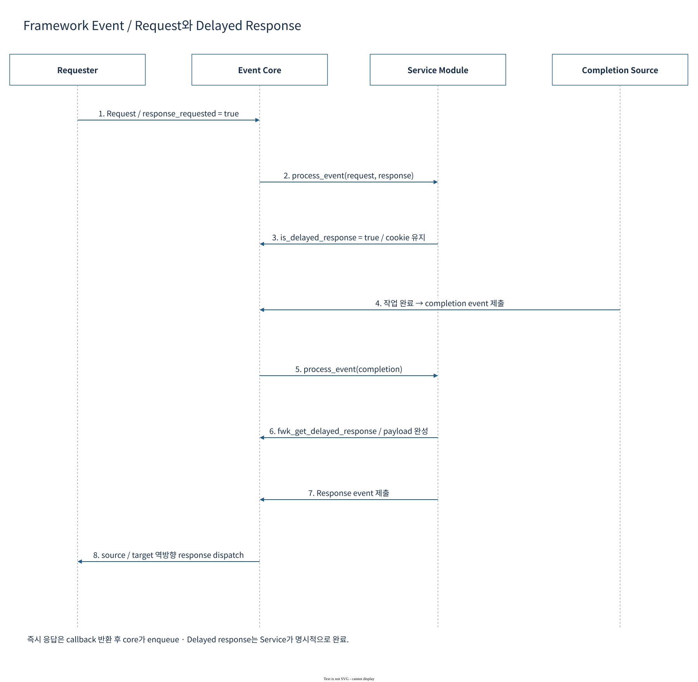

| 종류 | 계약 |
|---|---|
| Request | `response_requested=true`로 후속 응답 요청 |
| Immediate response | Handler가 response parameter를 채우고 반환; Framework가 response enqueue |
| Delayed response | Handler가 `is_delayed_response=true`를 설정하고 cookie를 유지 |
| Completion | `fwk_get_delayed_response()`로 저장된 응답을 얻어 완성 후 Event 제출 |

- Response는 source·target이 바뀐 비동기 Event다.
- `FWK_PENDING` 반환만으로 delayed response가 완성되지는 않는다.
- Delayed response 조회 API는 ISR 호출을 허용하지 않는다. IRQ 완료 신호는 Event로 넘겨 처리한다.
- 대기 중인 delayed response도 shared event pool을 점유한다.

### 5.5 Notification·Subscription

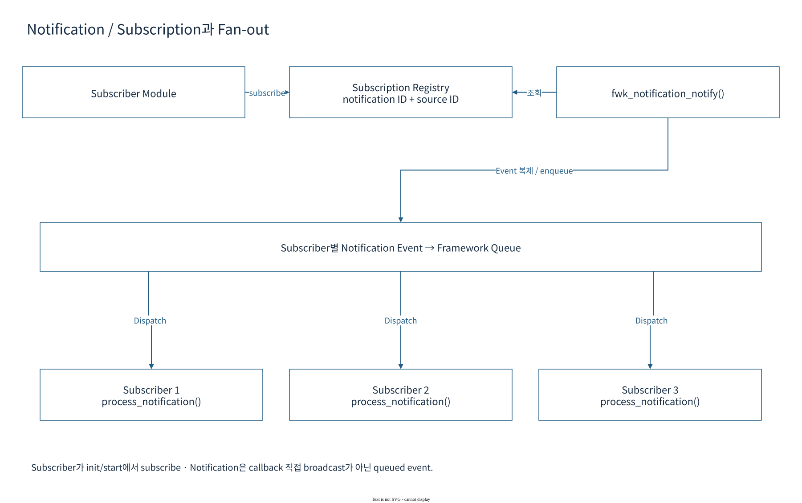

- `fwk_notification_subscribe(notification_id, source_id, target_id)`로 구독한다.
- Publisher의 `fwk_notification_notify()`가 구독자별 Event를 생성한다.
- Main Loop가 각 구독자의 `process_notification()`을 호출한다.
- 반환 count는 성공적으로 enqueue한 알림 수다.
- Subscribe/unsubscribe는 ISR에서 수행하지 않는다. Notify는 유효한 source ID를 지정하면 ISR에서도 사용할 수 있다.

### 5.6 Interrupt Context와 Event 처리 Context

```text
Device → GIC Group0 FIQ → fiq_handler → irq_global
       → ICC_IAR0 acknowledge → 등록한 ISR → ICC_EOIR0
                                           │
                                           └─ Event 제출 → Main Loop callback
```

| Context | 주요 작업 | 구현 시 고려 |
|---|---|---|
| ISR | Status 확인·clear, payload snapshot, Event 제출 | 작업 시간을 제한하고 불필요한 polling을 피함 |
| Event callback | Protocol 해석, 상태 전이, 후속 API 호출 | 긴 동기 작업은 전체 queue 처리 지연 |
| Direct API | Caller의 context 유지 | API 자체가 ISR-safe인지 확인 |

AArch64의 `fwk_interrupt_global_disable()`는 이 경로에서 `DAIF.F`를 mask한다. 함수 이름의 interrupt를 `DAIF.I`만으로 해석하지 않는다.

### 5.7 Timer Alarm·비동기 처리·WFI Idle

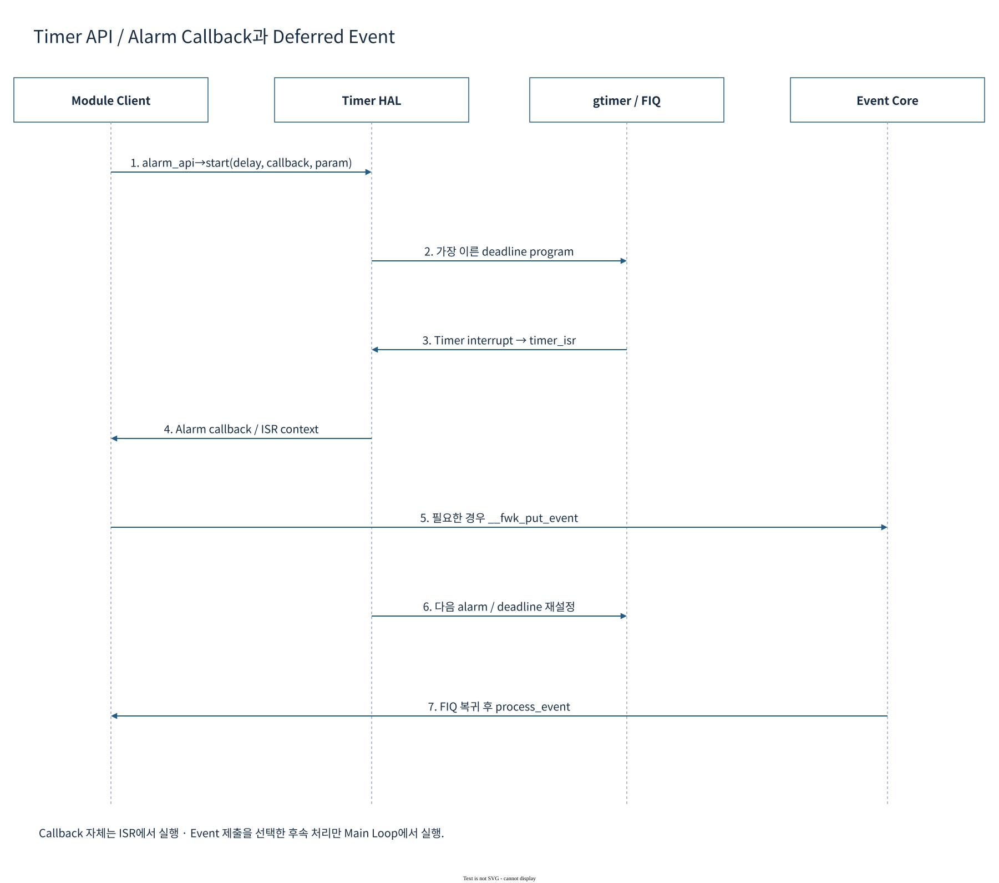

- `timer` HAL이 alarm queue와 다음 deadline을 관리한다.
- `gtimer`가 MMIO timer를 program한다.
- FIQ의 `timer_isr()`가 만료 alarm callback을 **ISR에서 직접 호출**한다.
- Callback이 Event를 제출한 경우에만 후속 처리가 Main Loop로 이동한다.

Idle은 두 queue를 비운 후 interrupt를 mask하고 queue를 다시 확인한다. Log flush까지 완료되면 `fwk_arch_suspend()`의 `DSB SY; WFI`로 대기하고, 깨어나 interrupt mask를 복구한다. 마지막 queue 재확인은 wakeup과 Event 등록 사이의 경쟁을 방지한다.

### 5.8 Memory·Event Resource 관리

| 자원 | 현재 구성 / 관리 |
|---|---|
| Event pool | Notification 활성 구성에서 128개 shared object |
| 공유 대상 | Normal·ISR Event, response, delayed response, notification fan-out |
| Subscription pool | 별도의 static record 128개 |
| Module context | `fwk_mm_alloc()` / `fwk_mm_calloc()` 등으로 확보 |
| Heap | libc allocation; `_notrap` 계열은 실패 시 NULL 반환 |
| Stack | CL0 Firmware Stack 16 KiB |

Event pool 재사용과 Module의 heap allocation은 별개다. Free event 고갈·enqueue 실패를 무시하면 작업이나 응답이 유실될 수 있다.

### 5.9 Error Handling·Logging·Exception 진단

- Framework API는 `FWK_E_PARAM`, `FWK_E_ACCESS`, `FWK_E_STATE` 등으로 오류를 전달한다.
- Module init/bind/start 실패는 boot 진행을 중단시킬 수 있다.
- `fwk_mm_alloc/calloc`의 일반 계열은 allocation 실패 시 trap한다.
- Logging은 IO adapter와 PL011을 사용하며 Main Loop idle 진입 전 buffer를 비운다.
- Apollo는 exception symbol table을 활성화한다. Exception dump는 vector·register·stack 분석을 지원한다.
- 정상 FIQ dispatch와 fatal exception 진단은 별도 경로다.

## 6. Module and Device Driver Architecture

### 6.1 Service·Protocol·HAL·Driver Module 구현 패턴

| Module 구성 | 내용 |
|---|---|
| `struct fwk_module` | Type, API/Event/Notification 수, lifecycle·dispatch callback |
| 공개 header | API table, config structure, event/notification index |
| Context | Module·Element별 runtime 상태와 bind한 API pointer |
| Product config | Instance data, resource, backend·peer ID |

Module type은 역할을 표현한다. Framework는 공통 lifecycle과 dispatch 계약으로 이들을 실행한다.

### 6.2 Product Configuration에서 Driver Instance 구성까지

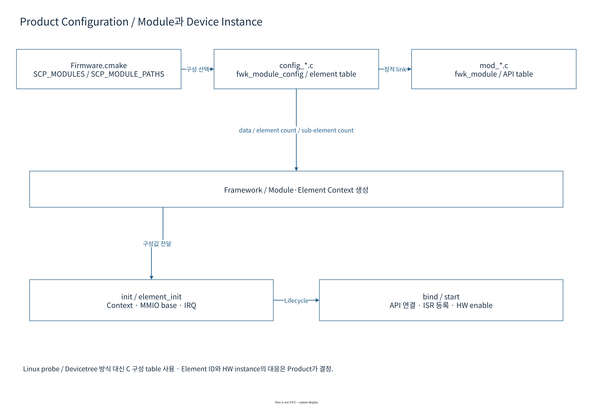

1. Firmware가 Module과 구현 경로를 선택한다.
2. `config_*.c`가 Element data와 count를 제공한다.
3. Framework가 Module·Element context를 준비한다.
4. Driver가 `element_init()`에서 주소·IRQ·private context를 구성한다.
5. `bind()`에서 backend·consumer API를 연결하고 `start()`에서 필요한 HW를 활성화한다.

Linux Device Tree probe 대신 **정적 C configuration table**이 instance 생성의 입력이다.

### 6.3 GIC·Interrupt Handler 연결

- Architecture GIC code가 CPU acknowledge·EOI와 등록 ISR 호출을 처리한다.
- `gicx00` / `gicx00-multiview`가 Product의 View·interrupt 접근을 구성한다.
- CL1 존재 여부에 따라 CL0가 사용하는 GIC View 주소를 선택한다.
- Driver는 `fwk_interrupt_set_isr()` 계열로 handler를 연결한다.

| CL0 수신 Interrupt | INTID |
|---|---:|
| Generic Timer MMIO | 34 |
| AP Non-secure MHU / OSPM | 97 |
| AP Secure Domain1 MHU / PSCI | 99 |
| AP Secure Domain3 MHU / PFDI | 103 |
| RSE MHU | 105 |
| CL1 MHU / PFDI | 107 |

표의 숫자는 GIC INTID다. Device Tree의 SPI 상대 index나 MHU sub-element 번호가 아니다.

### 6.4 Generic Timer·Timer HAL·Alarm API

| 계층 | 구현 / 구성 |
|---|---|
| Consumer | Platform·Monitor는 Alarm API, MHU는 Timer wait API 사용 |
| HAL | `module/timer`, Element별 alarm queue / Sub-element별 alarm |
| Driver | `module/gtimer`, counter read·compare·interrupt 제어 |
| Timer frame | `0x2A720000`, INTID 34 |
| Control frame | `0x2A6F0000` |
| Frequency 설정 | Reference clock 125 MHz, counter increment 설정 8 |

Counter read·busy wait와 interrupt alarm API를 구분한다. Alarm callback의 context는 5.7의 ISR 경로를 따른다.

### 6.5 PL011·IO Adapter·Console

- Console Element0: `0x2A400000`, UART clock 24 MHz, 115200 baud.
- IO adapter가 PL011 driver를 Framework IO·Logging에 연결한다.
- `debugger-cli`는 선택된 integration-test Module과 command interface를 연결한다.
- vMCU 활성 시 `0x2A820000`의 별도 UART Element를 사용한다. Console과 다른 endpoint다.

### 6.6 MHUv3·Transport Driver

- MHU Element는 송신·수신 frame과 IRQ를 가진 link를 표현한다.
- Sub-element는 Product가 지정한 DBCH·flag와 상위 signal API를 연결한다.
- ISR이 pending flag를 확인·clear하고 Transport signal callback을 호출한다.
- Transport가 shared slot의 소유권·길이·local buffer·completion을 관리한다.
- SCMI protocol decoding은 상위 SCMI Event Handler가 수행한다.

### 6.7 Power·Clock·PSU HAL과 Backend Driver 연결

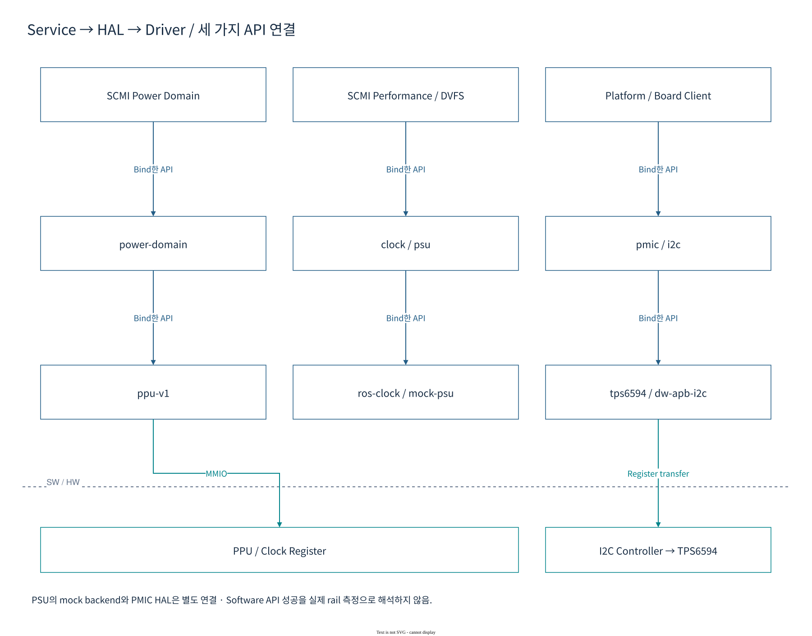

| Consumer | HAL / Service | Backend |
|---|---|---|
| SCMI Power Domain | `power-domain` | `ppu-v1` |
| SCMI System Power | `system-power` / Product platform | Platform driver API |
| SCMI Performance | `dvfs` → `clock`, `psu` | `ros-clock`, `system-pll`, `mock-psu` |

각 경로는 Product config의 driver ID/API ID로 연결한다. `mock-psu`의 논리 전압 상태와 TPS6594의 register 설정은 별도 API 경로다.

### 6.8 I2C·GPIO·PMIC HAL과 Driver 연결

```text
Client → PMIC HAL → TPS6594 Driver → I2C HAL → DW APB I2C
Client → GPIO HAL → TPS6594 GPIO Driver
```

- PMIC HAL은 device·rail index·단위를 공통화한다.
- TPS6594 driver는 register encoding과 device protocol을 담당한다.
- I2C HAL과 controller driver가 실제 register transaction을 수행한다.
- 전압·enable readback은 설정 register 값이며 실제 전압·power-good 측정값과 구분한다.

### 6.9 Platform·Safety Module의 Framework 연결 구조

| Module | Framework 연결 |
|---|---|
| `si0-platform` | Start·Event·Notification, SCMI·Timer·Power API |
| `safety-island-platform` | Cluster 구성과 Power Domain API |
| `fmu`, `ssu`, `sbistc`, `ras-handlers` | Driver ISR, fault callback, 상위 상태 전달 |
| `pfdi-monitor`, `scmi-pfdi-monitor` | Protocol handler, per-core context, timeout alarm |
| `platform-smcf`, `smcf-client` | Sensor API, Timer·sampling 관련 callback |
| `vmcu-safety` | Timer에서 후속 Event 제출, 상태 snapshot·UART·GPIO API |

각 Service는 같은 Framework 실행·연결 규칙을 사용하며, Product config가 Timer·Protocol·Driver 의존 관계를 결정한다.

## 7. SCMI and Communication Stack Architecture

### 7.1 SCMI Agent·Service·Protocol·Channel 구성

| 요청 경로 | Agent ID | Service / Channel |
|---|---:|---|
| RSE | 1 | Secure A2P, 별도 P2A notification |
| TF-A PSCI | 2 | AP secure domain1 |
| AP·CL1 PFDI | 3 | Per-core service / shared agent identity |
| Linux OSPM A2P | 4 | AP non-secure request channel |

- Agent는 요청 주체, Service는 Transport에 연결한 endpoint다.
- 하나의 Agent가 여러 Service/Channel을 사용할 수 있다.
- `config_scmi.c`의 OSPM P2A는 현재 `SI0_SCMI_AGENT_IDX_RSE`로 지정되어 있다. A2P의 Agent4와 같은 값으로 정규화하지 않는다.
- QVP는 Performance Fast Channel 대신 interrupt-driven mailbox 경로를 선택한다.

### 7.2 Shared Memory·MHUv3·Transport 계층

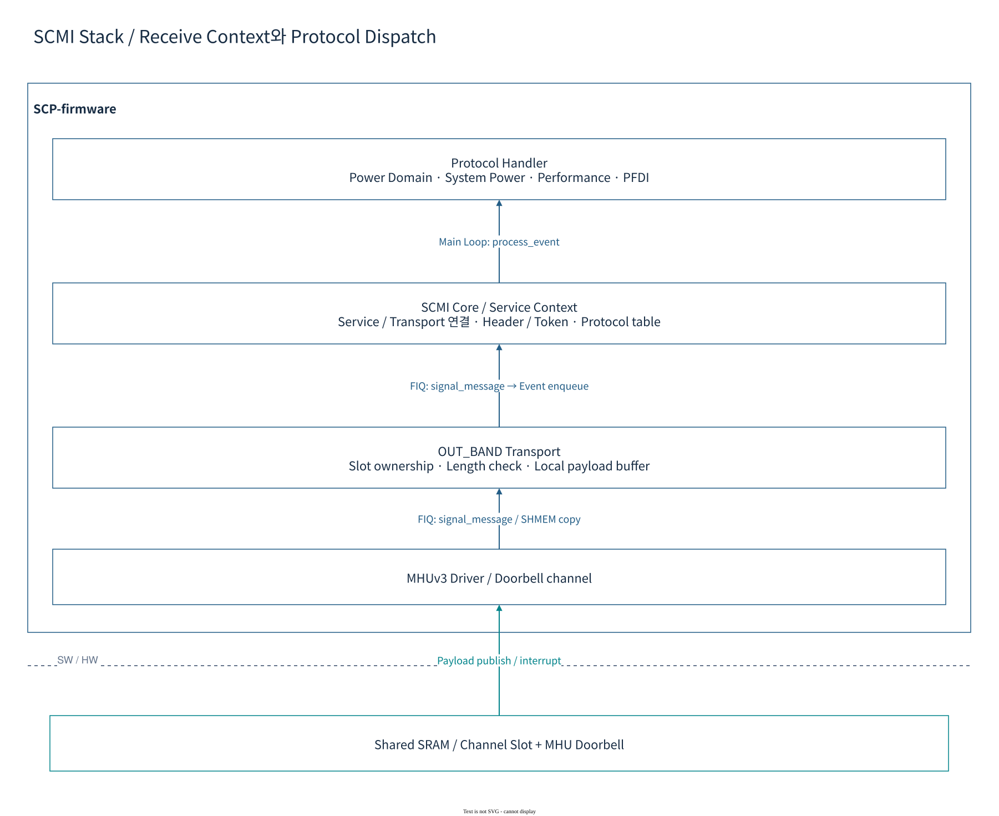

| 계층 | 보유 상태 / 책임 |
|---|---|
| MHU | Doorbell pending·mask·ack, DBCH/flag mapping |
| Shared slot | Channel status, flags, length, header, payload |
| OUT_BAND Transport | Channel lock, ownership, local request copy, response publish |
| SCMI Core | Service–Transport 연결, header/token, protocol lookup |
| Protocol | Command validation, Service API 호출, status/payload 응답 |

Doorbell은 payload 자체가 아니다. Shared memory에 게시한 데이터가 유효함을 상대에게 알린다.

### 7.3 Interrupt → Event → Protocol Handler 처리 흐름

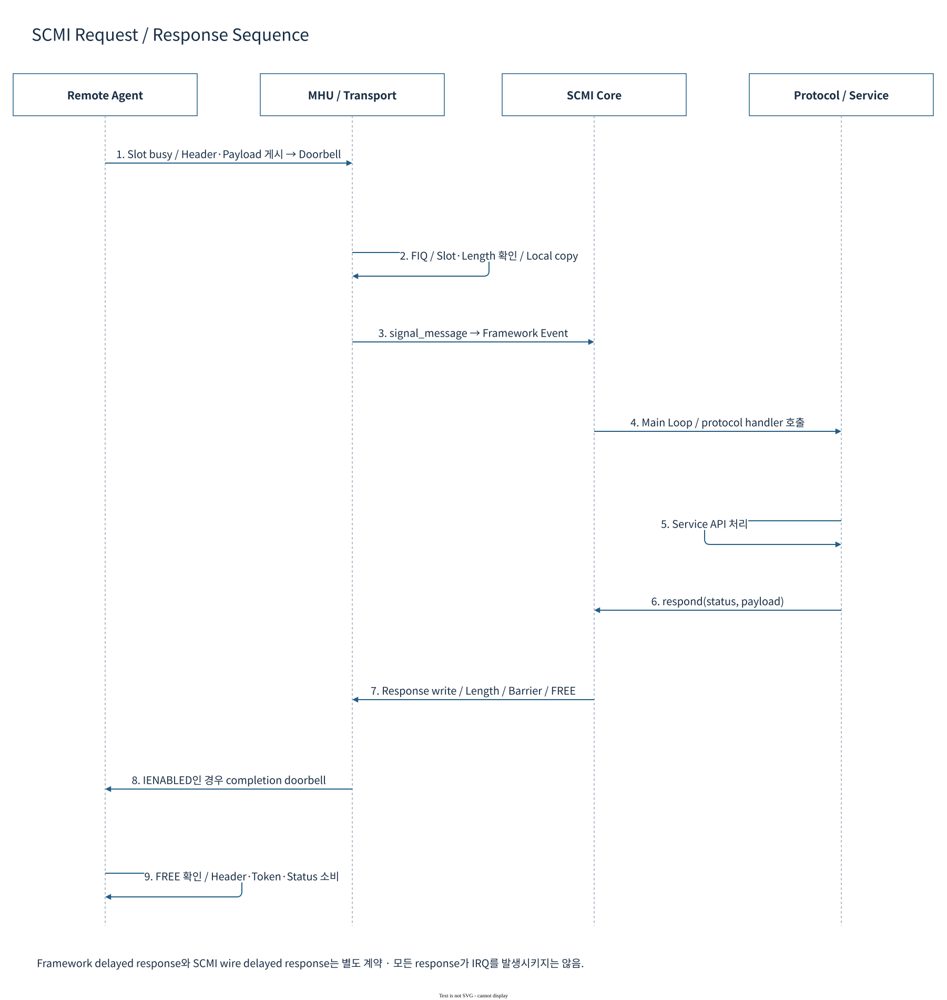

1. Agent가 shared slot에 header·payload를 쓰고 doorbell을 발생시킨다.
2. MHU ISR이 pending flag를 clear하고 Transport에 전달한다.
3. Transport가 lock·소유권·길이를 확인하고 local buffer로 복사한다.
4. SCMI `signal_message()`가 Framework Event를 제출한다.
5. Main Loop의 `scmi_process_event()`가 protocol·message·type·token을 해석한다.
6. Protocol Handler가 명령을 검증하고 Service API를 호출한다.

**Context 경계:** MHU·Transport 수신 처리는 FIQ에서, SCMI protocol dispatch는 Event Loop에서 수행한다.

### 7.4 Protocol Handler에서 Service API 호출

| Protocol Module | 연결 대상 |
|---|---|
| `scmi-power-domain` | Power Domain API |
| `scmi-system-power` | System Power / Platform API |
| `scmi-perf` | DVFS API |
| `scmi-pfdi-monitor` | PFDI Monitor API |

Protocol Handler는 protocol status와 Service operation을 연결한다. 직접 API 호출 뒤 후속 Event·Notification을 기다리는 구현도 있으므로 API 반환과 최종 operation 완료를 구분한다.

### 7.5 Response·Notification 반환 흐름

- Protocol이 SCMI `respond()`를 호출한다.
- Transport가 response payload·header·length를 쓰고 memory barrier 후 `FREE`를 게시한다.
- 요청 flag가 response interrupt를 활성화한 경우에만 completion doorbell을 보낸다.
- Agent가 slot 상태와 token·status를 확인하여 응답을 소비한다.
- P2A Notification은 별도 channel의 계약을 따른다.

Framework delayed response는 내부 Event 계약이고, SCMI delayed response는 외부 wire protocol 계약이다. 하나의 용어로 합쳐 설명하지 않는다.

### 7.6 RSE·TF-A·Linux·Zephyr 통신 경로

| 경로 | CL0 MHU 구성 | 상위 처리 |
|---|---|---|
| RSE A2P | RSE link, DBCH0 / flag1 | SCMI request |
| RSE P2A | RSE link, DBCH0 / flag2 | SCMI notification |
| RSE warm sync | RSE link, DBCH0 / flag3 | `Transport NONE` → Platform signal |
| TF-A PSCI | AP Domain1 secure, DBCH0 / flag0 | SCMI Power / System Power |
| Linux OSPM A2P | AP NS, DBCH0 / flag0 | SCMI Performance |
| OSPM P2A | AP NS, DBCH0 / flag2 | SCMI notification |
| AP PFDI | Domain3 secure, RX DBCH0…15 / flag0 | Per-core PFDI service |
| CL1 PFDI | CL1 link, DBCH2…5 / flag0 | 4개 core의 PFDI service |

RSE warm sync는 payload 없는 signal 경로다. 이를 SCMI request로 표시하지 않는다. CL1 channel은 현재 QVP의 `fvp` variant와 `CFG1=0` 조건에서 포함된다.

### 7.7 SDS 기반 공유 데이터 구조

- SDS는 SCMI transaction buffer와 별도의 shared-data ABI다.
- Secure AP shared SRAM에 3,520 byte region을 구성한다.
- CPU 정보, Firmware version, Reset syndrome, Feature availability, Isolated CPU MPID 등을 게시한다.
- SI0 Platform의 `SUBSYS_INITIALIZED` notification을 받아 초기화한다.
- AP firmware가 structure ID·version·valid 상태에 따라 소비한다.

### 7.8 Channel 상태·동시 요청·오류 처리

| 상황 | 처리 |
|---|---|
| Transport lock / slot 소유권 불일치 | `FWK_E_STATE` |
| 잘못된 payload length | Transport error 및 protocol 오류 응답 |
| 지원하지 않는 protocol | `SCMI_NOT_SUPPORTED` |
| 잘못된 message type | `SCMI_PROTOCOL_ERROR` |
| 접근이 제한된 protocol | `SCMI_DENIED` |
| 송신 doorbell busy | 새 doorbell 전에 기존 PBX flag clear 대기; 기본 30 ms 초과 시 `FWK_E_TIMEOUT` |

Service별 무제한 request queue를 제공하지 않는다. Channel은 완료까지 점유되며, payload snapshot·busy 상태·응답 완료 순서를 함께 관리한다.

## 8. Test and Verification

### 8.1 검증 대상 Firmware·Build Configuration

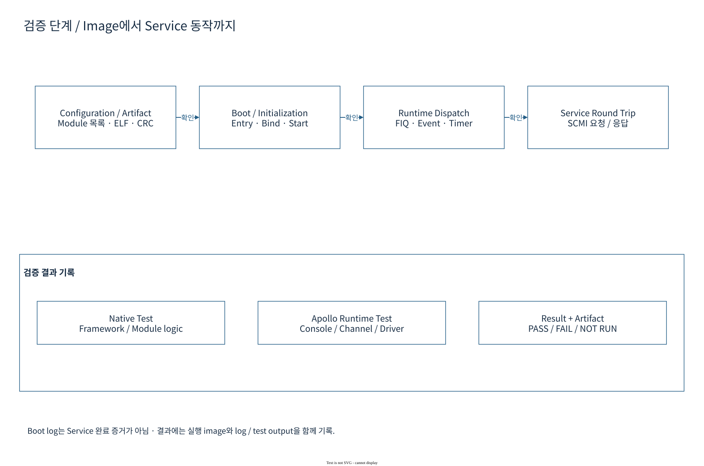

| 항목 | 기록 내용 |
|---|---|
| Source | SCP revision, Product, 변경 사항 |
| Build | CMakeCache, generated Module 목록, Toolchain |
| Image | `si0_ramfw.bin` / ELF와 matching flash package |
| 실행 환경 | Apollo Machine, BSP/Product image, runner 설정 |
| 결과 | Test ID, PASS/FAIL/NOT RUN, log·결과 파일 |

현재 보고서는 소스·기존 build 설정 대조 결과를 포함한다. 새 runtime 검증 결과는 아래에 `NOT RUN`으로 구분한다.

### 8.2 Framework·Module Unit Test

| 검증 대상 | 기존 Test 위치 |
|---|---|
| Event·Idle | `framework/test/test_fwk_core.c`, `test_fwk_idle.c` |
| Lifecycle·Binding | `framework/test/test_fwk_module.c` |
| Notification | `framework/test/test_fwk_notification.c` |
| MHU·Transport·SCMI | `module/{mhu3,transport,scmi}/test/` |
| Generic Timer | `module/gtimer/test/` |
| Board HAL | `module/pmic/test/`, `module/tps6594/test/` |

Native Framework/Module test 진입점은 SCP의 `Makefile.cmake`와 `unit_test/user_guide.md`에 정의되어 있다. Source test 통과 여부와 QVP 장치·IRQ 동작 결과는 별도로 기록한다.

### 8.3 Boot·Module Initialization 검증

- 기존 `test_00_si_cl0_boot.py`가 SSU·CMN 초기화, `SCP started`, Module initialization 완료 로그를 확인한다.
- RSE의 SCMI protocol version 성공으로 통신 준비 상태를 추가 확인한다.
- 실패 시 첫 init/bind/start 오류와 trap·exception dump를 함께 기록한다.

### 8.4 Event·Notification·Timer 처리 검증

| 항목 | 확인 방법 |
|---|---|
| Event dispatch | Native core test에서 enqueue·response·queue 전환 확인 |
| Notification | Subscribe·fan-out·response와 resource 사용 확인 |
| Timer | Driver test와 실제 alarm 동작을 각각 기록 |
| Idle | `scripts/test/measure_scp_idle.py`의 firmware·host 관찰 결과 |

Idle 측정의 host vCPU 사용률은 물리 CL0 CPU 사용률이나 소비전력이 아니다.

### 8.5 SCMI·Transport 통신 검증

- RSE↔SCP: protocol version 요청·응답.
- Linux↔SCP: 현재 활성 Performance mailbox 경로의 요청·응답.
- Zephyr↔SCP: BSP의 `pfdi-si-cl1` profile에서 Agent/Monitor 통신.
- Native Transport test: ownership·length·completion 오류 경로.

기존 `test_70_power_scmi.py`에는 FVP 종료·reset 동작을 가정한 검사가 있다. QVP 공통 검증의 완료 결과로 재사용하지 않는다.

### 8.6 Driver·Console·진단 기능 검증

| 항목 | 기존 검증 수단 |
|---|---|
| Console·기본 boot | CL0 OEQA boot case와 SCP UART log |
| Debugger CLI | `test_20_si_cl0_diagnostics.py`의 SSU/FMU command |
| PMIC | `scripts/test/verify_qbox_si_pmic.py` |
| PFDI channel | `qa-tests/profiles/pfdi-si-cl1.yaml` — BSP, FVP/QBox |
| Exception | Failure log의 register·symbol dump 확인 |

Boot/login launcher와 post-login test runner를 구분한다. `run_qbox_yocto.sh`의 boot 성공만으로 위 검증을 완료 처리하지 않는다.

### 8.7 검증 결과 및 실패 로그

| ID | 항목 | 결과 | 기록 |
|---|---|---|---|
| DOC-01 | 8개 챕터와 Source·Framework 흐름 대조 | PASS | 로컬 소스·config·기존 build cache 확인 |
| DOC-02 | Diagram·Markdown link·편집 데이터 검사 | PASS | Native draw.io 및 SVG export 검사 |
| SCP-01 | 현재 Source 재빌드 | NOT RUN | 신규 ELF/BIN 미생성 |
| SCP-02 | Framework·Module Unit Test | NOT RUN | 실행 결과 없음 |
| SCP-03 | Boot·Module initialization | NOT RUN | 신규 boot log 없음 |
| SCP-04 | Event·Timer·WFI 동작 | NOT RUN | 신규 runtime trace 없음 |
| SCP-05 | SCMI 왕복·오류 처리 | NOT RUN | 신규 통신 결과 없음 |
| SCP-06 | Console·PMIC·진단 command | NOT RUN | 신규 driver 결과 없음 |

실행 결과 파일은 `build/qbox-apollo-qvp/` 아래 해당 검증 directory에 보관하고, image revision·test 결과·최초 실패 로그를 함께 기록한다.

---

[draw.io 원본](apollo-scp-architecture.drawio) · [Source Index](SOURCES.md) · [Zephyr 보고서](../zephyr/README.md) · [Linux 보고서](../linux/README.md)
