# Apollo Trusted Firmware-M Implementation Report

## 1. Overview

### 1.1 Purpose and Scope

RSE에서 실행하는 Trusted Firmware-M(TF-M)을 **소스·빌드 → Boot → SPM Runtime → Secure Service → Driver·통신** 순서로 설명한다.

- **대상:** Cortex-M55의 Bootloader와 Secure Firmware, Apollo Platform 구현.
- **핵심:** Image 인증, Partition 실행, PSA API, Isolation, 외부 요청 처리.
- **연계:** AP Secure Proxy, SI CL0 SCP-firmware, SI CL1 Zephyr.
- **실행 환경:** Apollo QVP. Component의 Software 구조와 API 흐름을 중심으로 기술한다.

### 1.2 TF-M Component Summary

| 항목 | Apollo 구성 |
|---|---|
| Source / Platform | TF-M 2.2.2 기반 / `arm/rse/automotive_rd/apollo-qvp` |
| Processor | RSE Cortex-M55, Armv8.1-M Mainline |
| Boot stages | BL1_1 → BL1_2 → MCUboot BL2 → TF-M Runtime |
| Runtime image | `tfm_s`, Secure Processing Environment |
| SPM Backend / Isolation | IPC / Level 2 |
| Partition | PSA Service 7개 + Mailbox·SCMI Agent 2개 |
| 외부 PSA 진입 | NS Agent Mailbox / SFCP / MHUv3 |
| Local Non-secure image | 사용하지 않음: `TFM_LOAD_NS_IMAGE=OFF` |
| Crypto Backend | Mbed TLS / CryptoCell-312 |
| System Management 연계 | RSE ↔ SCP SCMI |

### 1.3 Glossary

| 용어 | 의미 |
|---|---|
| RSE | Runtime Security Engine, 보안 Boot·Service를 수행하는 Subsystem |
| SPE / NSPE | Secure / Non-secure Processing Environment |
| SPM | Secure Partition Manager, Service·Message·실행 경계 관리 |
| PSA RoT / Application RoT | PSA 기반 신뢰 영역 / Application 보안 Service 영역 |
| IPC / SFN Model | Message loop를 구현하는 Partition / Service 함수로 구현하는 Partition |
| SID / Handle / Client ID | Service 식별자 / 호출 대상 값 / 요청자 식별값 |
| SLIH | Second-Level Interrupt Handling, Partition에서 후속 IRQ 처리 |
| SFCP | RSE 통신 Protocol Stack, PSA message와 legacy 형식 처리 |
| ATU | 외부 주소를 RSE 접근 Window에 매핑하는 Address Translation Unit |
| OTP / NV Counter | 일회성 설정·Key 저장 영역 / Rollback 방지용 단조 Counter |

## 2. TF-M Software Stack Overview

### 2.1 Bootloader·SPM·Secure Partition·Platform HAL 구성

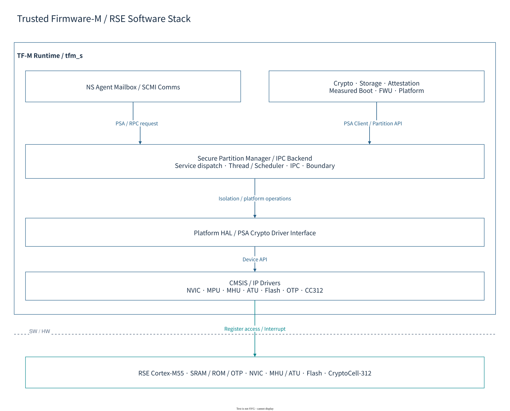

| 계층 | 책임 |
|---|---|
| BL1 / BL2 | 다음 Image의 적재·검증·실행, Host Image 준비 |
| SPM | Service 등록, Message 전달, Thread Scheduling, 접근 검사 |
| Secure Partition | Crypto·Storage·Attestation 등의 PSA Service 구현 |
| Communication Agent | 외부 요청을 SPM으로 전달하거나 SCMI Notification 처리 |
| Platform HAL / Driver | Memory 보호, Interrupt, Flash·OTP·MHU·Crypto IP 제어 |

Bootloader와 Runtime은 별도 실행 Image다. Bootloader가 종료된 뒤 Runtime의 SPM과 Partition이 동작한다.

### 2.2 RSE Cortex-M55 실행 환경

- Partition은 Secure Thread Mode에서 실행한다. SVC는 권한 경계의 API 진입, PendSV는 Context Switch, IRQ Handler는 Interrupt 전달을 담당한다.
- Partition마다 Stack과 실행 상태를 갖는다. CPU 실행은 하나의 Scheduler가 조정한다.
- RSE SRAM VM0·VM1은 각각 256 KiB이며 Boot Stage와 Runtime이 용도별로 재사용한다.
- 외부 AP·SI Memory는 ATU Window를 통해 접근한다.

### 2.3 Secure Processing Environment와 Isolation 구성

- **SPM / PSA RoT:** Privileged 실행.
- **Application RoT:** Unprivileged 실행. 현재 Protected Storage가 해당한다.
- **Level 2:** 정적 Memory 경계와 Privilege 전환으로 두 RoT 영역을 구분한다.
- Local NS Image와 NS Agent TZ는 비활성이다. 외부 AP 요청은 Mailbox Agent가 대리한다.

### 2.4 TF-M Core·RSE Common·Apollo Platform의 역할

| 소스 영역 | 역할 |
|---|---|
| TF-M Core | PSA API, SPM, IPC, Partition Runtime, 공통 Service |
| RSE Common | RSE Boot·Isolation·SFCP·Crypto·Lifecycle 공통 구현 |
| Apollo Platform | Host Image Layout, MHU Link, SCMI, Flash, 주소·권한 설정 |
| TF-M Extras | Measured Boot·SCMI 등 추가 Partition 구현 |

### 2.5 AP Secure Firmware·SCP·Zephyr와의 역할 분담

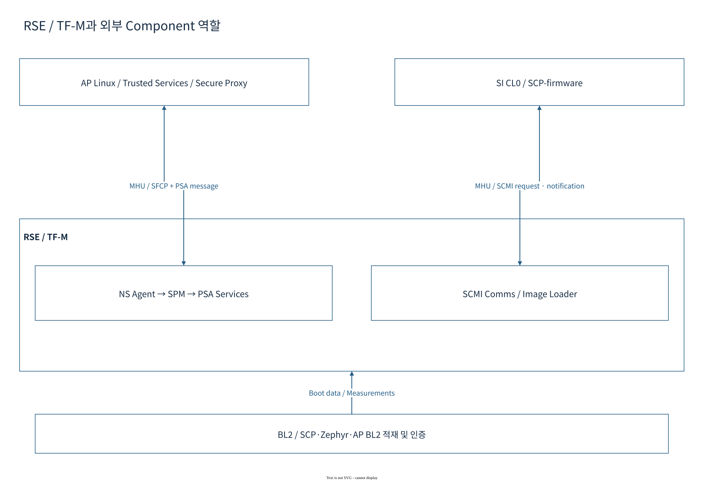

| Component | 역할 / RSE와의 연결 |
|---|---|
| RSE TF-M | Image 인증·측정, Secure Service 제공 |
| AP TF-A / Secure Proxy | AP Secure Boot·Monitor, 외부 PSA 요청 중계 |
| SI CL0 SCP-firmware | CPU 기동·전원 관리, SCMI Service·Notification |
| SI CL1 Zephyr | RTOS Application 실행. Image는 RSE가 준비하고 SCP가 CPU를 기동 |

### 2.6 현재 활성 Secure Partition 구성

| Partition | Manifest Model | RoT | 주요 기능 |
|---|---|---|---|
| Crypto | SFN | PSA | Key·Cipher·Hash·Signature |
| Internal Trusted Storage | SFN | PSA | UID 기반 신뢰 저장 |
| Protected Storage | SFN | Application | 암호화·Rollback 보호 저장 |
| Initial Attestation | SFN | PSA | Attestation Token |
| Measured Boot | SFN | PSA | Boot Measurement 관리 |
| Firmware Update | SFN | PSA | Update Image 처리 |
| Platform | SFN | PSA | Reset·IOCTL·NV Counter |
| NS Agent Mailbox | IPC | PSA | 원격 PSA 요청 중계 |
| SCMI Comms | IPC | PSA | SCP System Power Notification |

**IPC Backend에서도 SFN Model을 실행한다.** Backend가 SFN Service를 `common_sfn_thread()`로 감싸 Thread·Message 방식에 연결한다.

## 3. Source and Build Architecture

### 3.1 Source Repository 및 Directory Structure

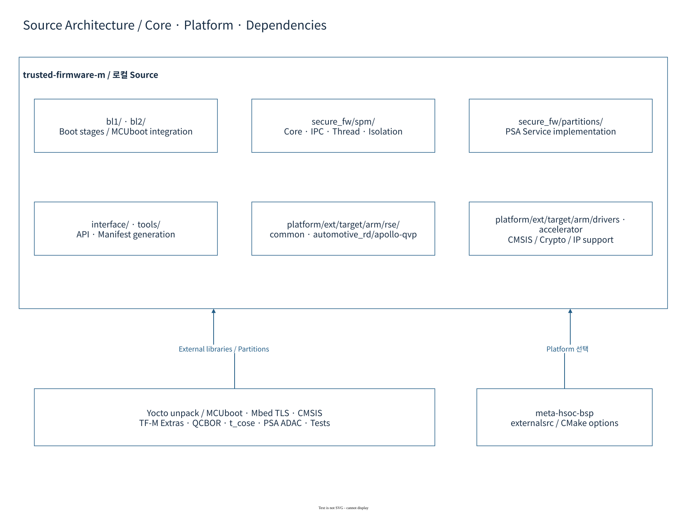

Source Root: `hsoc-stack/components/system_mgmt/trusted-firmware-m/`

```text
trusted-firmware-m/
├── bl1/                         # BL1_1 / BL1_2
├── bl2/                         # MCUboot 연계
├── secure_fw/
│   ├── spm/                     # Core / IPC / Scheduler
│   └── partitions/              # PSA Service / Mailbox
├── interface/                   # PSA API / Client library
├── platform/ext/
│   ├── common/                  # 공통 Isolation / Startup
│   └── target/arm/rse/
│       ├── common/              # RSE HAL / SFCP / Boot
│       └── automotive_rd/apollo-qvp/
├── tools/                       # Manifest / Image 도구
└── config/                      # 기본 Feature 설정
```

### 3.2 `bl1/`·`bl2/`·`secure_fw/`·`interface/`·`platform/` 구성

| Directory | 구현 단위 |
|---|---|
| `bl1/bl1_1`, `bl1/bl1_2` | Root of Trust에서 BL2까지의 Boot |
| `bl2/ext/mcuboot` | MCUboot Entry와 Image 검증 연계 |
| `secure_fw/spm` | Service Registry, IPC, Thread, Architecture Handler |
| `secure_fw/partitions` | Partition Entry·Service Handler·Backend |
| `interface` | PSA Client / Service API와 Manifest 공개 Header |
| `platform` | Startup, Linker, Hardware HAL, Target 구성 |

### 3.3 RSE Common과 Apollo Platform 소스

| RSE Common | Apollo Platform |
|---|---|
| `tfm_hal_platform.c`: 초기화 | `config.cmake`: Feature 선택 |
| `tfm_hal_isolation_rse.c`: 보호 설정 | `config_tfm_target.h`: Target 정의 |
| `sfcp/`: Packet·PSA 전달 | `sfcp/`: Link·외부 주소·Service 권한 |
| `tfm_interrupts.c`: IRQ Hook | `device/`, `cmsis_drivers/`: Device 연결 |
| 공통 Boot·OTP·Crypto 지원 | `bl2/`, `scmi/`: Image Handoff·SCMI |

### 3.4 TF-M Extras·MCUboot·Mbed TLS·CMSIS 의존 관계

| 의존 소스 | 사용처 |
|---|---|
| MCUboot | BL2 Image 검증·Update Boot 처리 |
| Mbed TLS | PSA Crypto와 Software Crypto |
| CMSIS | Cortex-M Register·Exception·Driver Interface |
| TF-M Extras | SCMI Comms, Measured Boot Partition |
| QCBOR / t_cose | Attestation Token Encoding·Signing |
| PSA ADAC | Debug Authentication 지원 |
| TF-M Tests | 선택형 시험 구성; 현재 `TEST_S/TEST_NS=OFF` |

외부 의존 소스는 Yocto unpack 영역에서 공급한다. TF-M 본체의 `externalsrc`와 소유 경로가 다르다.

### 3.5 CMake Configuration·Feature·Isolation 설정

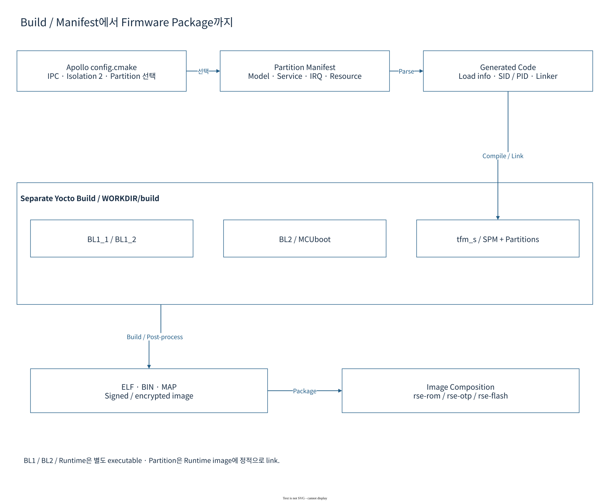

| 설정 | 구성값 |
|---|---|
| `CONFIG_TFM_SPM_BACKEND` | `IPC` |
| `TFM_ISOLATION_LEVEL` | `2` |
| `BL1`, `BL2` | `ON` |
| `TFM_LOAD_NS_IMAGE` / NS Agent TZ | `OFF` |
| NS Agent Mailbox | `ON` |
| Crypto / ITS / PS / IA / MB / FWU / Platform / SCMI | `ON` |
| `CRYPTO_HW_ACCELERATOR` | `ON`, CC312 |
| `CONFIG_TFM_CONNECTION_BASED_SERVICE_API` | `0`, Stateless Service 호출 |
| `CONFIG_TFM_MMIO_REGION_ENABLE` | `0` |
| `APOLLO_TIMER_TEST` / `RSE_GPIO_SELF_TEST` | `OFF` / `ON` |

표는 Apollo 소스 설정과 기존 생성 설정을 반영한다. Image별 설정·실행 결과는 9장에서 기록한다.

### 3.6 Partition Manifest와 Generated Code

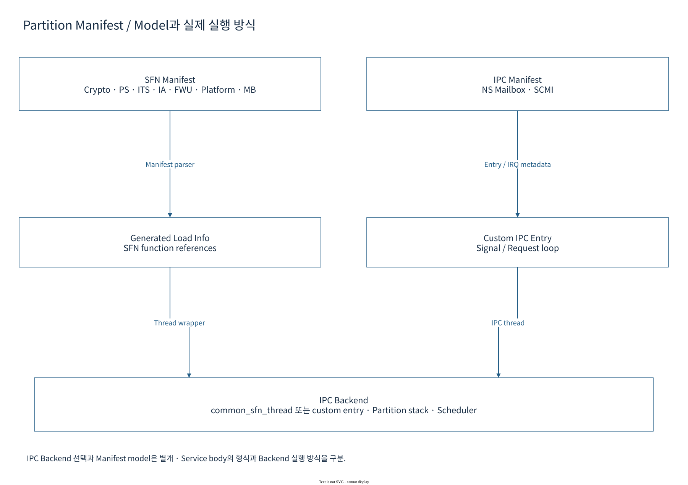

1. Manifest에서 Model·Entry·Priority·Service·IRQ·Dependency를 정의한다.
2. Generator가 Load Info, Service Table, SID/PID, Service 선언을 생성한다.
3. Linker Template에 Code·Data·Stack 영역을 반영한다.
4. SPM이 Generated Load Info로 Partition과 Service를 등록한다.

Generated 파일은 Build Directory의 `generated/`에 있으며 Source Manifest를 수정해 재생성한다.

### 3.7 Yocto Recipe·External Source·Toolchain 통합

- 소유 Recipe: `hsoc-stack/yocto/meta-hsoc-bsp/recipes-bsp/trusted-firmware-m/`.
- `EXTERNALSRC`: 로컬 TF-M checkout. Build Output은 Recipe Work Directory로 분리한다.
- Cortex-M55 Bare-metal Toolchain으로 Bootloader와 Secure Firmware를 빌드한다.
- Dependency Patch는 해당 unpack 소스에 적용한다.
- `cmake --build … -- install` 결과의 `bin/*`를 Firmware Deploy 영역으로 복사한다.
- 개발용 BL1 Signing 입력은 Build의 `externalsrc-keys`에 준비한다.

### 3.8 Memory Layout·Linker 구성

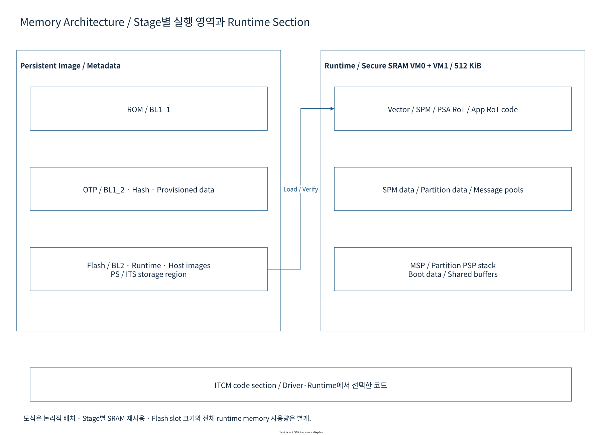

| 구분 | 구성 |
|---|---|
| SRAM | VM0 256 KiB + VM1 256 KiB |
| Boot Flash | RSE 64 MiB / AP 64 MiB |
| Image Slot 정의 | BL2 128 KiB, Secure Image 256 KiB, AP BL2 512 KiB |
| Storage 할당 | Protected Storage 1 MiB / ITS 256 KiB |
| Runtime Section | Vector, SPM Code, PSA/Application RoT Code·Data, Partition Stack |
| Linker | Generated `tfm_isolation_s.ld`, Platform Memory 정의 |

Image Slot 크기와 Runtime RAM 사용량은 다른 값이다. 최종 Section 주소·사용량은 해당 Image의 ELF/MAP으로 확인한다.

### 3.9 Build and Deploy Artifacts

| 산출물 | 용도 |
|---|---|
| `bl1_1.*` | 최초 Boot Stage / ROM Image 구성 |
| `bl1_2_padded.bin`, `bl1_2_padded_hash.bin` | 후속 Stage와 OTP 검증 정보 |
| `bl2_signed.bin` | 검증 대상 MCUboot Image |
| `tfm_s_signed.bin` | 검증 대상 Secure Runtime |
| `.elf`, `.axf`, `.map` | Symbol·Section·Debug 분석 |
| Provisioning / OTP 관련 파일 | 개발 Lifecycle·Key·Boot 입력 구성 |
| `rse-rom-image.img` | RSE ROM Package |
| `rse-otp-image.img` | RSE OTP Package |
| `rse-flash-image.img` | Runtime·Host Image를 포함한 Flash Package |

Firmware Recipe의 개별 Binary와 Firmware Image Recipe의 최종 Package를 구분한다.

## 4. Boot and Initialization Architecture

### 4.1 BL1_1 → BL1_2 → BL2 → TF-M Runtime

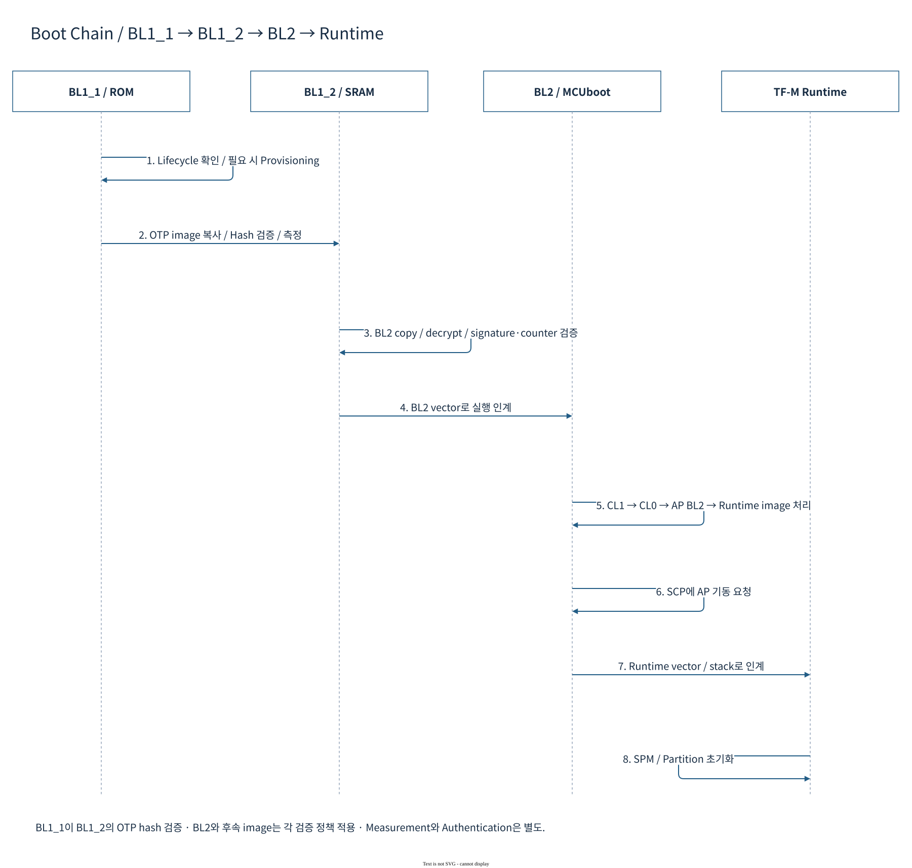

| 단계 | 주요 책임 | 다음 실행 대상 |
|---|---|---|
| BL1_1 | Lifecycle·Provisioning, BL1_2 Hash 검증 | BL1_2 |
| BL1_2 | BL2 복호화·Signature·Rollback 검사 | BL2 |
| BL2 | Runtime·Host Image 적재·인증·측정 | TF-M Runtime |
| Runtime | SPM·Service 초기화, 외부 요청 처리 | Partition Thread |

### 4.2 BL1_1의 Provisioning·OTP·Root of Trust 초기화

1. Platform과 Lifecycle 상태를 확인한다.
2. Provisioning이 필요한 상태이면 해당 흐름을 실행한다.
3. BL1_2를 OTP에서 SRAM으로 복사한다.
4. OTP의 기준 Hash로 검증하고 Measurement를 기록한다.
5. BL1_2 Vector를 이용해 다음 Stage로 진입한다.

### 4.3 BL1_2의 BL2 적재·검증·실행

- Boot 후보를 선택하고 BL2를 적재·복호화한다.
- Signature와 Security Counter로 Image·Rollback 조건을 확인한다.
- 실패하면 다른 후보 또는 Recovery 경로를 처리한다.
- 성공하면 BL2 Vector로 실행을 넘긴다.

BL1_2의 BL2 복호화 경로와 MCUboot의 후속 Image 암호화 설정은 별도 계층이다.

### 4.4 BL2의 Image 적재·복호화·인증·측정

Apollo 구성의 처리 순서는 **SI CL1 → SI CL0 → AP BL2 → RSE Runtime**이다.

- `boot_platform_pre_load()`에서 대상 Memory와 접근 Window를 준비한다.
- MCUboot가 Header·Payload·Signature·Security Counter를 확인한다.
- Post-load Hook이 Measurement·기동 연계를 수행한다.
- Local NS Image는 처리 대상에서 제외한다.

### 4.5 SCP·Zephyr·AP Image Handoff와 Boot 조정

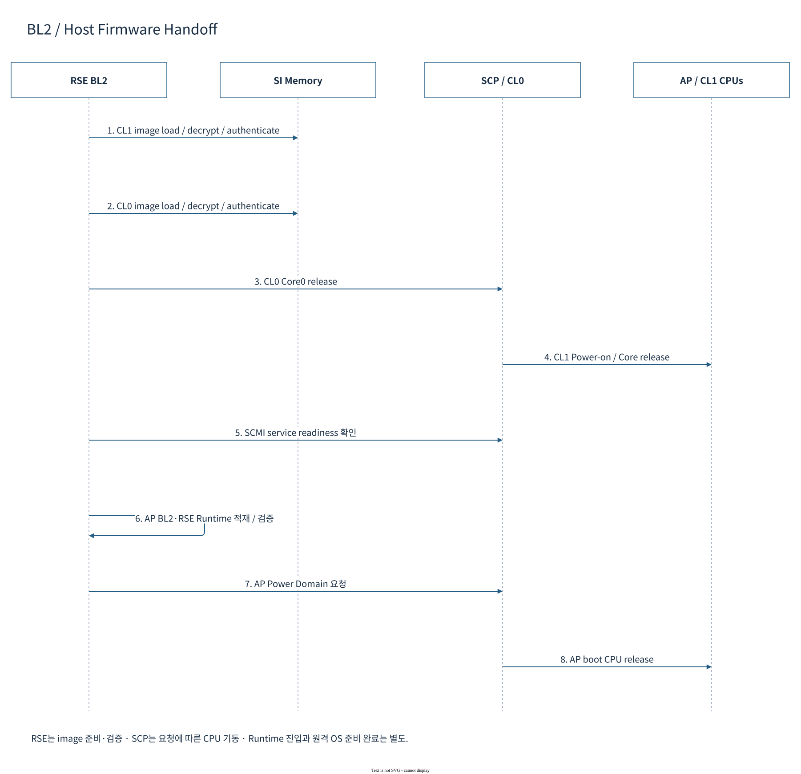

1. RSE가 CL1 Image를 준비한다.
2. RSE가 CL0 SCP Image를 준비하고 CL0 Core0를 Release한다.
3. SCP가 초기화 과정에서 CL1을 기동한다.
4. RSE BL2가 SCP SCMI 준비 상태를 확인하고 AP BL2를 준비한다.
5. RSE가 SCP에 AP Power Domain 요청을 전달한다.
6. SCP가 AP 기동을 수행하고, RSE는 Secure Runtime으로 진입한다.

SCP의 CL1 초기화와 RSE의 후속 Image 처리는 서로 다른 CPU에서 진행한다. RSE Runtime 진입은 Linux·Zephyr Application 준비 완료를 의미하지 않는다.

### 4.6 TF-M Runtime Entry·C Runtime 초기화

- Startup이 Vector·Stack·C Runtime Data를 준비한다.
- `main()`이 Architecture 보호 기능과 MSPLIM을 설정한다.
- `tfm_core_init()`에서 Core·Platform·Boot Data를 초기화한다.
- Secure Exception Priority 설정 후 `BACKEND_SPM_INIT()`으로 진입한다.

### 4.7 Platform·Isolation Boundary·Interrupt 초기화

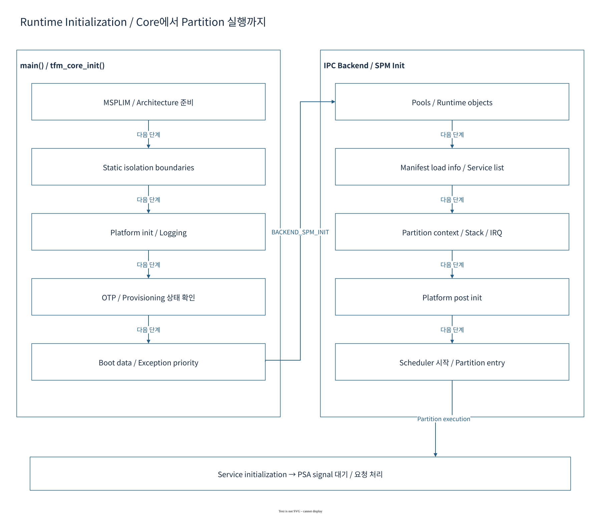

- Static Boundary → Platform Clock·Reset·Debug → ATU·IRQ·Console 순서로 준비한다.
- OTP·Provisioning 상태와 Boot Data를 확인한다.
- SAU·MPU·MPC·PPC 설정으로 Memory 접근 경계를 만든다.
- SPM은 Partition IRQ와 Signal 연결을 등록한다.

### 4.8 SPM·Secure Partition 초기화 및 Service 대기

1. Connection Pool과 Runtime Context를 초기화한다.
2. Manifest Load Info에서 Service·IRQ를 등록한다.
3. Partition Boundary·Stack·Thread를 생성한다.
4. Platform 후처리 후 Scheduler를 시작한다.
5. IPC Partition은 자체 Entry로, SFN Partition은 공통 Thread Wrapper로 진입한다.
6. Service 초기화 후 Signal을 기다린다.

## 5. Secure Partition Manager Runtime Architecture

### 5.1 SPM Core·IPC Backend·Partition Runtime 구성

| 구성 | 주요 소스 / 책임 |
|---|---|
| SPM Core | `spm_ipc.c`: Partition·Service 등록, 권한 검사 |
| IPC Backend | `backend_ipc.c`: Message·Thread·Reply 연결 |
| Scheduler | `thread.c`, `ipc_schedule()`: Runnable Thread 선택 |
| Architecture | `tfm_arch_v8m_main.c`: SVC·PendSV·Context 전환 |
| SFN Runtime | `sfn_common_thread.c`: SFN을 IPC loop에 연결 |

### 5.2 Partition·Service·SID·Handle·Client ID

- **Partition:** 실행 Context·Stack·권한의 단위.
- **Service:** Partition이 제공하는 호출 Interface.
- **SID:** Service 식별자. 현재 일반 Service는 Version 1 / STRICT다.
- **Handle:** `psa_call()`이 사용하는 호출 대상 값. 현재 Stateless Handle을 사용한다.
- **Client ID:** 요청자 식별값. 외부 요청은 Mailbox Agent가 허용 범위로 변환한다.

연결형 API는 비활성이므로 일반 요청마다 `psa_connect()` / `psa_close()`를 수행하지 않는다.

### 5.3 Partition Thread·Priority·Scheduler

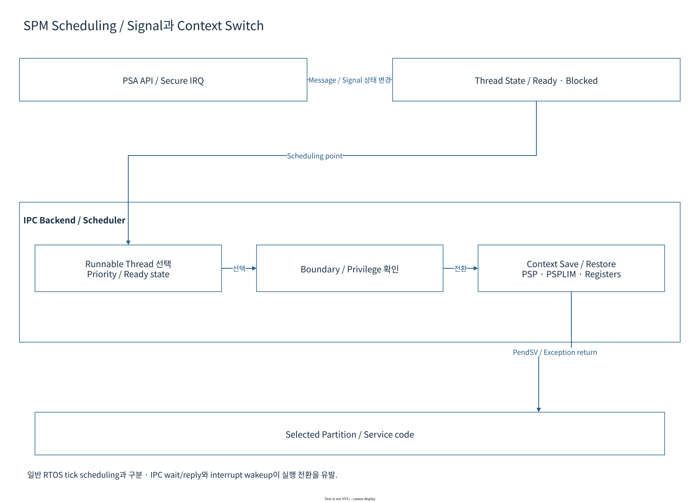

- Generated `load_order`를 Priority로 사용하며 작은 값이 우선한다.
- Scheduler는 정렬된 목록에서 첫 Runnable Thread를 선택한다.
- 요청 대기·Reply·IRQ Signal이 Thread의 실행 가능 상태를 바꾼다.
- 주기 Tick, Round-robin Quantum, RTOS의 Time Slice는 사용하지 않는다.

### 5.4 SVC·PendSV·Context Switch

| 경로 | 역할 |
|---|---|
| Privileged API Wrapper | 같은 보호 경계에서 SPM Stack의 함수 호출로 API 처리 |
| SVC | Unprivileged Partition에서 SPM API로 진입 |
| PendSV | Scheduler 실행, Partition Context 저장·복원 |
| Boundary 전환 | Level 2의 Privilege 상태 변경 |

PendSV는 PSP·PSPLIM·Callee-saved Register·EXC_RETURN 등을 관리한다. 모든 PSA 호출에서 SVC가 발생하는 것은 아니다.

### 5.5 PSA Client API와 Message 생성·전달

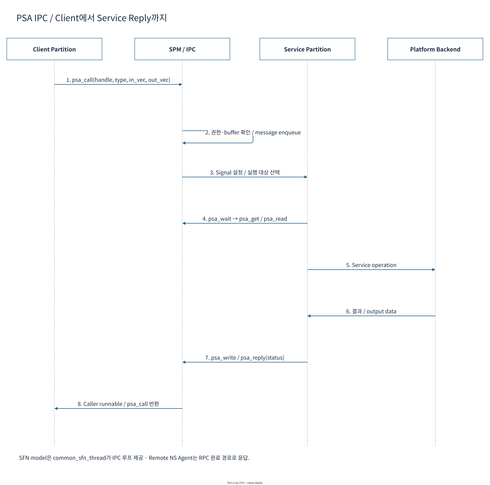

1. Client가 Handle·Operation·IOVec으로 `psa_call()`을 호출한다.
2. SPM이 Service 접근 권한과 Buffer 범위를 검사한다.
3. Request를 대상 Partition Queue에 넣고 Signal을 설정한다.
4. 일반 Secure Client는 Reply를 기다리며 Block된다.
5. Service 완료 시 Reply Signal로 Client를 Runnable 상태로 만든다.

원격 Mailbox 요청은 RPC 완료 Callback을 통해 외부 Response에 연결한다.

### 5.6 `psa_wait()`·`psa_get()`·`psa_reply()` 실행 흐름

```text
entry_init()
  → psa_wait(signal_mask, PSA_BLOCK)
  → psa_get(signal, &msg)
  → Service Handler / psa_read() / psa_write()
  → psa_reply(msg.handle, status)
  → 다음 Signal 대기
```

- SFN Model에서는 공통 Wrapper가 위 Loop를 제공한다.
- `psa_wait()`는 Blocking 또는 즉시 확인을 지원한다. millisecond Sleep API가 아니다.
- `psa_get()`은 한 Service Signal의 Message를 가져온다.

### 5.7 Signal·Interrupt·Partition Wakeup

- Hardware IRQ → NVIC Handler → SPM IRQ Hook → Partition Signal.
- SLIH Partition은 `psa_wait()`에서 깨어 후속 처리를 수행한다.
- `psa_eoi()`와 Device별 Status 처리를 통해 IRQ를 마무리한다.
- Service 본문은 Hardware ISR에서 실행하지 않는다.

### 5.8 Stack·Memory Pool·Buffer 접근 검사

- Partition별 Stack·Metadata는 Generated Layout에 배치한다.
- 정적 Pool에서 진행 중 Request의 Connection 객체를 할당한다.
- Stateless API도 처리 중 객체·Buffer 자원을 사용한다.
- SPM은 IOVec 배열, Input Read 권한, Output Read/Write 권한, 주소 Overflow를 확인한다.
- 외부 Host Pointer는 SFCP의 주소 범위·ATU 검사를 추가로 통과한다.

### 5.9 Isolation Level 2의 접근 경계와 권한 전환

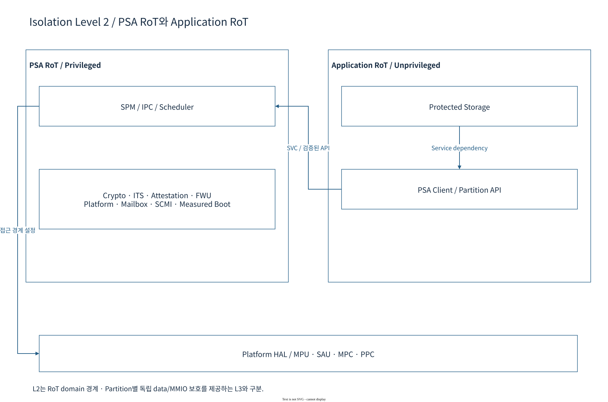

- SPM·PSA RoT는 Privileged, Protected Storage는 Unprivileged다.
- `tfm_hal_bind_boundary()`가 RoT Type에 따라 실행 권한을 정한다.
- Level 2는 정적 MPU 설정과 `CONTROL.nPRIV` 전환을 사용한다.
- RSE는 Partition 초기화 후 Secure MPU를 Lock한다.
- Partition마다 MPU Region을 동적으로 재구성하는 Level 3 동작은 적용하지 않는다.

### 5.10 Error Handling·Panic·Fault 진단

| 오류 종류 | 처리 |
|---|---|
| Service 기능 실패 | PSA Status를 Caller에 반환 |
| 접근 불가 Service / Buffer | Authorization·Memory 검사에서 차단 |
| 잘못된 Partition API 사용 | Programmer Error / Panic 경로 |
| Architecture Fault | Secure Fault Handler·Console 진단 |
| Pool 부족 / Transport 오류 | 요청 실패 또는 해당 오류 처리 경로 |

기존 구성은 Panic Halt 활성, Backtrace·Stack Watermark 비활성이다. Halt와 정상 PSA Error Response를 구분해 기록한다.

## 6. Secure Partition and Service Architecture

### 6.1 Partition Manifest·Entry Point·Service Loop 구현 패턴

- Manifest가 Service·Dependency·Entry·IRQ를 선언한다.
- **SFN:** Init 함수 + Operation Dispatch 함수. IPC Wrapper가 대기·Reply를 담당한다.
- **IPC:** Entry에서 Signal Loop와 Message·IRQ 처리를 직접 구성한다.
- Mailbox·SCMI Agent는 일반 PSA Service SID 없이 외부 통신을 처리한다.

### 6.2 PSA API·Service Handler·Platform Backend 연결

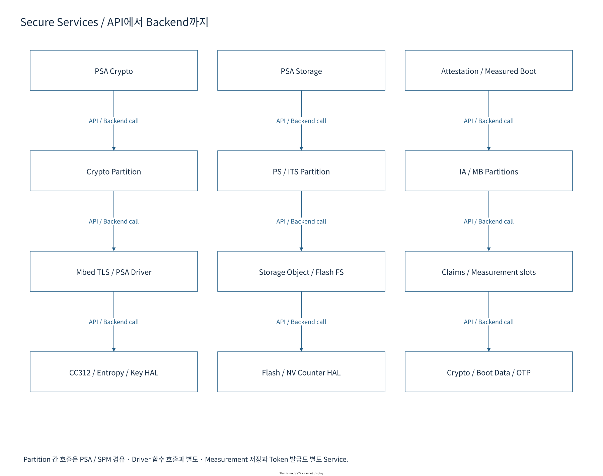

```text
PSA Client API → SPM → Service Handler → 기능 Backend → HAL / Driver
```

Partition 간 호출은 PSA/SPM을 거친다. 같은 Partition 내부 Backend·Driver 함수 호출과 구분한다.

| Service | SID | Stateless Handle |
|---|---|---:|
| Crypto | `0x80` | 1 |
| Protected Storage | `0x60` | 2 |
| Internal Trusted Storage | `0x70` | 3 |
| Initial Attestation | `0x20` | 4 |
| Firmware Update | `0xA0` | 5 |
| Platform | `0x40` | 6 |
| Measured Boot | `0xC0` | 16 |

### 6.3 Crypto Service와 CryptoCell Backend

- `tfm_crypto_sfn()`이 Packed IOVec의 Function ID를 해석한다.
- Dispatcher가 Key·Cipher·Hash·Signature 등 PSA Crypto 연산으로 연결한다.
- Mbed TLS의 PSA Driver Interface가 Software / CC312 Backend를 선택한다.
- Persistent Key 저장은 ITS 의존 관계를 사용한다.
- Hardware Accelerator 활성화가 모든 연산의 Hardware 실행을 뜻하지는 않는다.

### 6.4 Internal Trusted Storage·Protected Storage

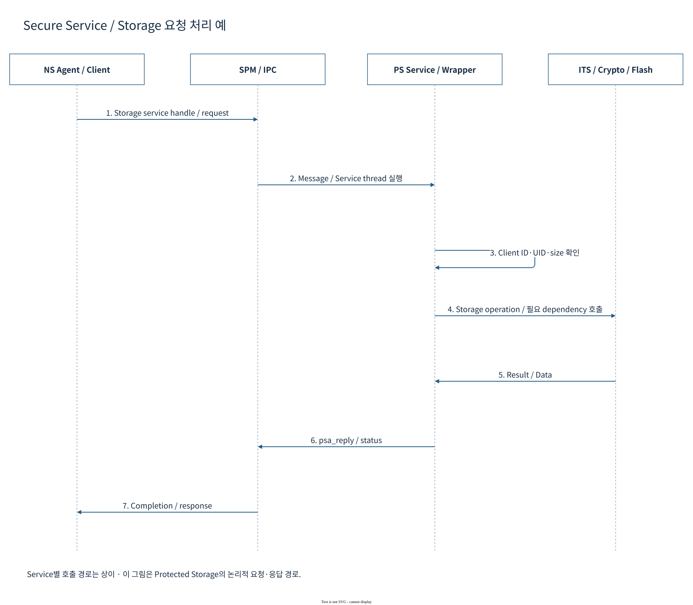

| 구분 | ITS | Protected Storage |
|---|---|---|
| API | `psa_its_*` | `psa_ps_*` |
| 식별 | Client ID + UID | Client ID + UID |
| RoT | PSA | Application |
| Backend | ITS Filesystem / Flash HAL | Crypto·ITS·Platform 의존 |
| 현재 보호 설정 | `ITS_ENCRYPTION=OFF` | Encryption·Rollback Protection ON |

Storage 요청은 UID·Size·Access 조건을 검사한 뒤 Backend로 전달한다. ITS 자체를 암호화 저장소로 설명하지 않는다.

### 6.5 Initial Attestation·Measured Boot

- Bootloader가 Image Measurement를 수집한다.
- Measured Boot Partition이 Measurement Slot을 관리한다.
- Initial Attestation이 Measurement·Device Claim을 취합하고 Crypto를 통해 Token을 만든다.
- **Image 인증:** 실행 허용 판단. **Measurement:** 실행 Image에 관한 기록. **Attestation:** 기록·Claim을 Token으로 제공.

### 6.6 Firmware Update Partition과 Flash Backend

- START → WRITE → FINISH → INSTALL 등 Update Operation을 Dispatch한다.
- QUERY·CANCEL·CLEAN·ACCEPT·REJECT·REQUEST_REBOOT를 처리한다.
- Image 위치와 Flash 접근은 Apollo FWU Backend가 담당한다.
- Update Service 성공과 다음 Boot에서 새 Image가 인증·실행되는 결과는 별도 검증 항목이다.

### 6.7 Platform Service

- `tfm_platform_service_sfn()`이 NV Counter Read/Increment, System Reset, IOCTL을 분기한다.
- `tfm_platform_hal_*`이 Platform Operation을 수행한다.
- 외부 Client에 허용되는 Operation은 SFCP Service Allowlist로 제한한다.
- 내부 Platform API 전체가 외부 AP에 공개되는 것은 아니다.

### 6.8 NS Agent Mailbox·SCMI Comms Partition

| 항목 | NS Agent Mailbox | SCMI Comms |
|---|---|---|
| Model / Priority | IPC / LOW | IPC / NORMAL |
| Stack 설정 / 기존 Generated 값 | `0x1000` | `0x500` |
| 입력 | AP Mailbox Signal·RPC Reply | SCP Doorbell Signal |
| 처리 | PSA 요청 검증·전달·응답 | System Power Notification·HAL 호출 |
| 통신 | SFCP / MHU | Shared Memory / MHU |

### 6.9 Partition 간 의존 관계와 호출 흐름

| Caller | 주요 Dependency |
|---|---|
| Protected Storage | Crypto, ITS, Platform |
| Crypto | ITS |
| Initial Attestation | Crypto, Measured Boot |
| Measured Boot | Crypto |
| Firmware Update | Crypto, Platform |

SPM은 Secure Caller의 Manifest Dependency를 검사한다. 외부 요청에는 NS-accessible 조건과 SFCP의 Service 권한 검사가 함께 적용된다.

## 7. Platform HAL and Device Driver Architecture

### 7.1 TF-M Platform API·HAL·CMSIS Driver 구성

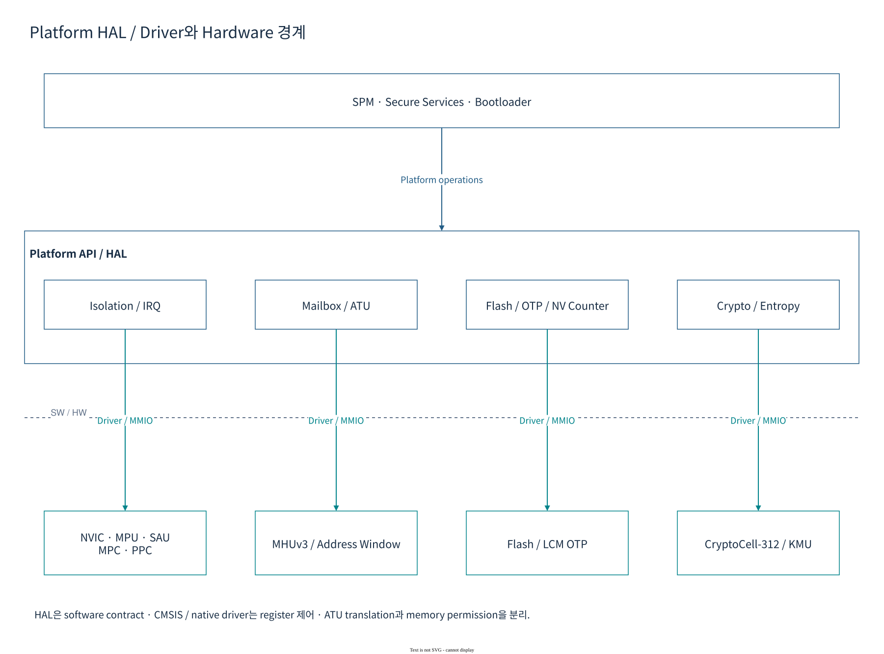

- TF-M API는 Platform Operation을 정의한다.
- HAL은 RSE/Apollo 정책과 Device 연결을 구현한다.
- CMSIS Wrapper·Native Driver는 Register·IRQ·Data 전송을 제어한다.
- Bootloader와 Runtime은 필요한 Driver를 각 Image에 Link한다.

### 7.2 Device Definition·Memory Map·Resource 연결

- `device/`의 Device Instance가 Base Address와 Driver Configuration을 연결한다.
- Host Memory Map은 AP·SI Image 적재 주소와 Shared Window를 정의한다.
- RSE Expansion Device 정의가 SCP MHU 등의 외부 연결을 추가한다.
- Generated Partition Resource와 Platform의 Device Instance는 별도 구성 요소다.

### 7.3 NVIC·Interrupt Handler·Secure Partition 연결

1. MHU 등 IP가 Interrupt를 발생시킨다.
2. NVIC가 Cortex-M55 Handler로 전달한다.
3. `tfm_interrupts.c`가 Device 수신 처리와 SPM Hook을 호출한다.
4. SPM이 Manifest에 연결된 Signal을 설정한다.
5. Partition별 EOI 정책을 적용한다. NS Agent는 EOI 후 요청을 Dispatch하고, SCMI는 처리 후 EOI를 수행한다.

### 7.4 MPU·SAU·MPC·PPC 기반 접근 제어

| 블록 | 역할 |
|---|---|
| MPU | Secure Software의 Privilege·Memory 접근 경계 |
| SAU | CPU Security Attribution |
| MPC | Memory의 Secure / Non-secure 접근 제어 |
| PPC | Peripheral 접근 권한 |
| ATU | 외부 주소 변환; 권한 검사를 대체하지 않음 |

Apollo는 Local NS Image를 적재하지 않으므로 해당 NS Code·Data·Veneer SAU Region 설정은 활성화하지 않는다. SAU·MPC·PPC 보호 초기화 자체는 수행한다.

### 7.5 Timer·Counter·Watchdog

- Boot Timer는 SCMI Readiness·Polling Timeout 등에 사용한다.
- BL2 SCMI Counter 주파수는 125 MHz다.
- SysTick·Timer0–3 진단은 `APOLLO_TIMER_TEST`로 선택한다.
- Watchdog Register·Driver는 Platform 계층의 Reset·진단 자원이다. Service Scheduler의 주기 Tick으로 사용하지 않는다.
- Watchdog Driver 존재만으로 Runtime Watchdog의 상시 Enable·Refresh를 단정하지 않는다.

### 7.6 UART·Console·Logging

- PL011 CMSIS Wrapper와 Native Driver로 Console을 구성한다.
- Boot Stage, Image 검증, Runtime Entry, SCMI 구독 상태를 로그로 확인한다.
- SPM Panic과 PSA 기능 오류를 구분해 수집한다.
- Console 문자열은 해당 실행 지점의 증거이며 전체 Service 성공 판정과 별개다.

### 7.7 MHUv3·Shared Memory·ATU

- MHU는 요청·응답 또는 Doorbell Notification을 전달한다.
- SCMI는 Shared Memory Slot에 Payload를 기록하고 MHU로 알린다.
- SFCP는 Message 수신·Serialization을 담당하고, Pointer Protocol은 Host Buffer를 ATU Window에 연결한다.
- Device Status·Shared Slot 소유권·Partition Signal을 각각 처리해야 한다.

### 7.8 Flash·OTP·NV Counter

- Flash Driver는 Image·Storage 영역을 읽고 쓴다.
- Apollo CMSIS 구성은 StrataFlash와 Memory 기반 Flash 접근을 용도별로 연결한다.
- OTP는 Lifecycle·Boot 검증·Key Material에 사용한다.
- NV Counter는 Boot Rollback 및 Service의 단조 상태 관리에 사용한다.
- Provisioning Data, Runtime Storage, Firmware Update Slot은 서로 다른 용도의 영역이다.

### 7.9 Crypto Accelerator·Entropy·Key 접근

- CC312 Driver가 지원 연산을 Accelerator로 전달한다.
- Entropy·Key 관련 HAL이 Platform 자원을 Crypto Stack에 제공한다.
- Software Backend와 Hardware Driver의 선택은 Algorithm·Build 설정에 따른다.
- 개발 구성의 Dummy Provisioning은 제품 Key Provisioning과 구분한다.

## 8. Communication Stack Architecture

### 8.1 AP Client → Secure Proxy → RSE 요청 경로

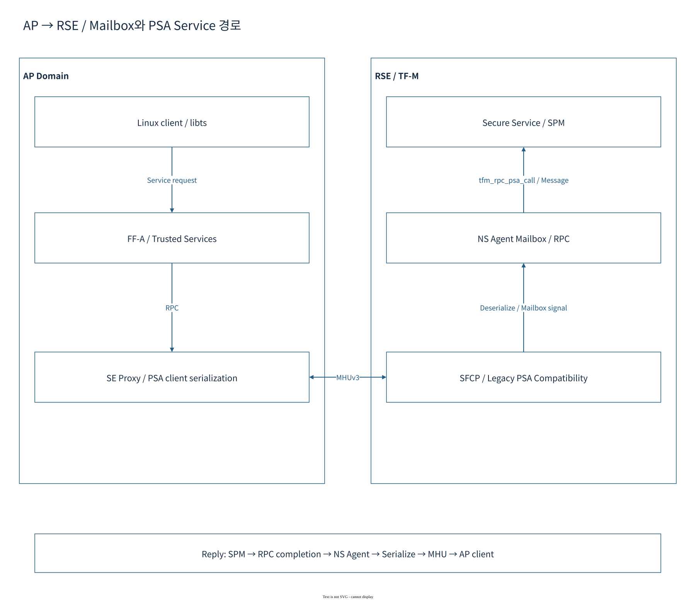

```text
Linux PSA Client / libts
  → FF-A / Trusted Services SE Proxy
  → RSE Comms API / MHU
  → RSE SFCP legacy compatibility
  → NS Agent Mailbox / RPC
  → SPM / Secure Partition
```

AP의 RSE Comms 호출과 RSE의 SFCP 수신 Stack은 이름·소스 경로가 다르다. SFCP가 기존 PSA Wire Format과의 호환 처리를 제공한다.

### 8.2 MHUv3 Transport·Message Buffer·Serialization

- Link 1: AP Monitor ↔ RSE. Link 2: AP Secure ↔ RSE.
- SFCP Node 0은 RSE, Node 2는 AP Secure다. Node 수는 RSE CPU 수가 아니다.
- 수신 ISR이 Packet Size 확인·Buffer 할당·수신·Legacy 변환·Queue 등록을 수행한다.
- Partition Context가 PSA Message를 Deserialize하고 요청을 Dispatch한다.
- `SFCP_ENABLE_ENCRYPTION=ON`만으로 Legacy AP 요청의 암호화 사용을 단정하지 않는다.

### 8.3 NS Agent Mailbox → RPC → SPM 연결

- `ns_agent_mailbox_entry()`가 통신을 초기화하고 Mailbox IRQ를 Enable한다.
- Mailbox Signal에서 `psa_eoi()` 후 Request Handler를 실행한다.
- `sfcp_handle_req()`가 Request를 꺼내 검증하고 `tfm_rpc_psa_call()`로 전달한다.
- Service 완료 시 RPC Reply Signal을 받아 Response를 구성한다.
- RSE Common의 NS Core Boot/Wait Hook은 no-op이다. Host CPU 기동은 BL2·SCP가 담당한다.

### 8.4 PSA Service Request / Response Sequence

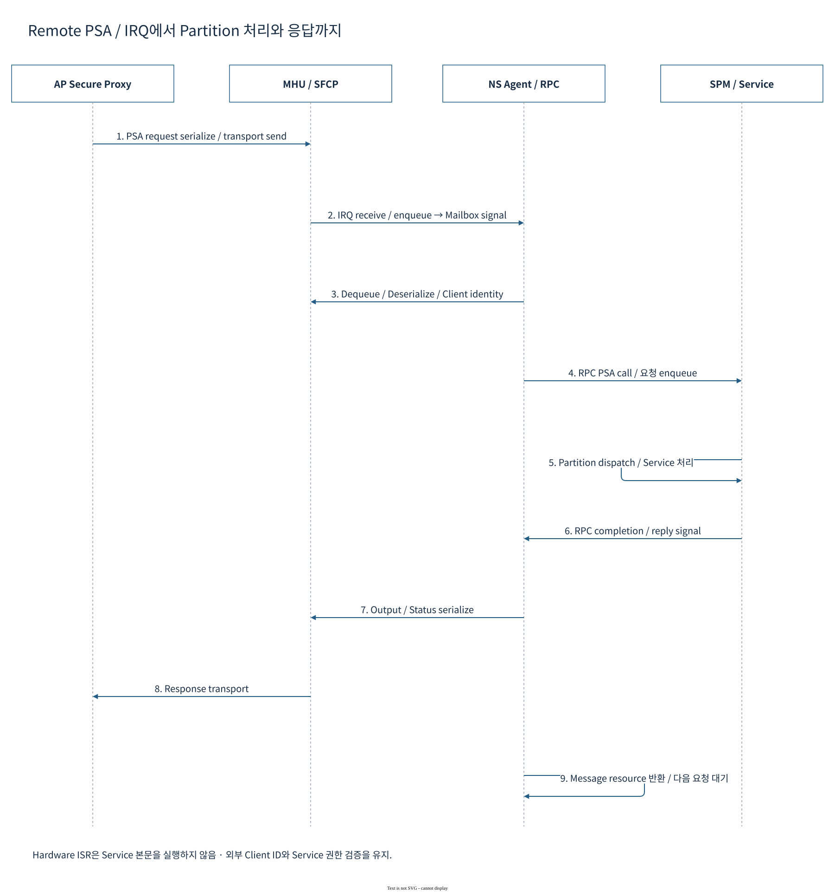

1. AP Proxy가 PSA 요청을 Serialize하여 전송한다.
2. RSE MHU IRQ가 SFCP 수신 Queue와 Mailbox Signal을 갱신한다.
3. Agent가 Deserialize·Service 권한·Client Identity를 확인한다.
4. RPC가 SPM에 요청을 등록한다.
5. 대상 Partition이 Service를 실행한다.
6. SPM Reply가 Agent의 RPC 완료 경로를 깨운다.
7. Output·Status를 Serialize하여 AP로 전송한다.
8. Message Buffer·Pool 자원을 반환한다.

### 8.5 Client Identity·Service 접근 권한·Buffer 검증

| 검사 | 적용 내용 |
|---|---|
| Message | Size·형식·IOVec 수; 전체 IOVec 최대 4개 |
| Client ID | Link·Client 범위를 RSE 식별값으로 변환 |
| Service | Crypto·ITS·PS·IAT·MB·FWU, 제한된 Platform Operation |
| Pointer | Host 범위·Overflow 검사 후 ATU Map |
| SPM | NS 접근 허용 또는 Secure Caller Dependency, Buffer 권한 |

AP Secure Node 2의 Pointer Window는 AP Shared SRAM `0x00000000–0x000FFFFF`, AP MHU DRAM `0xFFFE0000–0xFFFFFFFF`로 제한한다. 다른 Node에 동일한 Pointer 권한을 부여하지 않는다.

### 8.6 RSE ↔ SCP SCMI 통신 구조

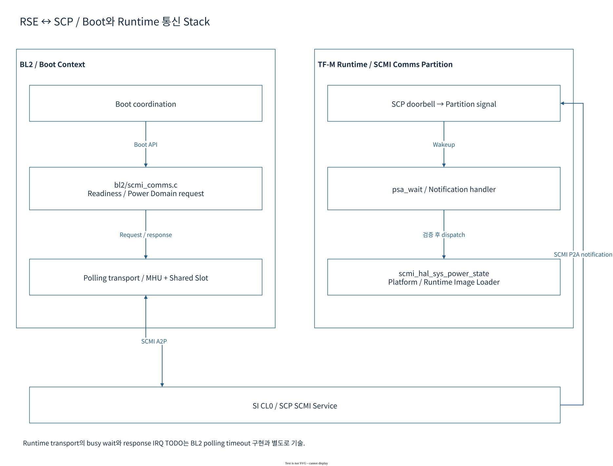

| 항목 | 구성 |
|---|---|
| MHU Channel 0 | Bit 1 Command, Bit 2 Notifier, Bit 3 Warm Reset ACK |
| Shared Slot | Command / Notifier 각각 `0x100` Byte |
| Boot | Readiness 확인, AP Power Domain 제어 |
| Runtime | System Power Notification 구독·처리 |
| HAL Operation | Shutdown, Cold Reset, Warm AP BL2 Reload·ACK |

Runtime Power-up Operation은 지원하지 않는다. Warm Reset은 Runtime Image Loader와 SCP ACK 경로를 포함한다.

### 8.7 Boot 단계와 Runtime 단계의 통신 초기화

| 구분 | BL2 | Runtime SCMI Partition |
|---|---|---|
| 준비 | ATU·Shared Slot·MHU 설정 | Slot FREE 초기화·IRQ Enable |
| 수신 | Receiver IRQ Mask, Timer Polling | Doorbell IRQ → Partition Signal |
| 시작 | SCP Readiness 확인 | System Power Notification Subscribe |
| 실행 문맥 | Boot 함수 | `psa_wait()` 기반 Thread |

### 8.8 Interrupt Notification·Timeout·오류 처리

- **BL2:** Timer 기반 Readiness Polling과 Startup Budget을 사용한다. 현재 소스의 Startup Budget은 10초다.
- **Runtime SCMI:** Doorbell Read/Clear → Shared Length 검사 → Message 처리 → Slot FREE 반환.
- Runtime `transport_send()`의 FREE 대기에는 Timeout TODO가 남아 있다.
- Runtime Response의 Completion IRQ도 TODO다. 모든 Response에 IRQ가 발생한다고 가정하지 않는다.
- Invalid Service·Pointer·Length는 해당 검증 계층에서 처리하고, 반복 위반에 대한 Halt/Reset 정책도 별도로 적용한다.

## 9. Test and Verification

### 9.1 검증 대상 Image·Configuration·실행 환경

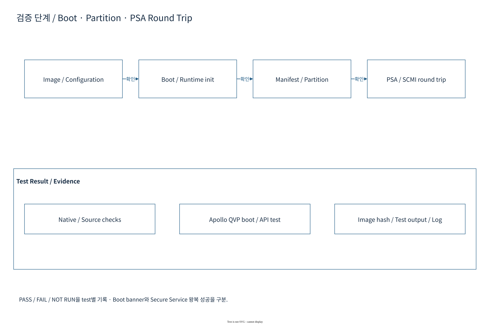

| 기록 항목 | 내용 |
|---|---|
| Source / Config | TF-M Revision, Platform, CMakeCache, Generated Config |
| Image | ROM·OTP·Flash Package Hash와 `tfm_s` Symbol |
| 환경 | QVP 실행 구성, Product/BSP Image, Console Log |
| 결과 | Test별 PASS / FAIL / NOT RUN, Exit Code, 실패 지점 |

기존 Build Cache는 **2026-09-12** 생성본이며 Version Header는 `2.2.2 / v2.2.2+g27d66d3ed06d`다. 현재 Source의 재빌드·실행 결과로 취급하지 않는다.

### 9.2 Boot Stage·Runtime Initialization 검증

- `test_00_rse_boot.py`: CL0 Release, SCMI Init, AP Power-on, Runtime Entry, SCMI 구독 로그.
- Measurement Marker: BL1_2·BL2·SI_CL1·SI_CL0·AP_BL2·RT_0 및 AP 후속 Image.
- BL2 SCMI Readiness Native Test: 정상 응답·Retry·Timeout·잘못된 Header/Length·Counter Wrap·Slot Ownership.
- Native Test의 CTest Timeout은 5초이며, Firmware Startup Budget과 다른 값이다.

### 9.3 Partition Manifest·활성 Service 구성 확인

- Source Manifest와 Generated Load Info의 Model·Entry·Dependency·IRQ를 비교한다.
- 활성 Partition 9개와 Stateless Service 7개의 연결을 확인한다.
- L2, Connection API OFF, MMIO Region 기능 OFF를 Generated Config에서 확인한다.
- 이 검사는 구성 검증이며 Service 실행 시험을 대신하지 않는다.

### 9.4 AP에서의 PSA Service 요청·응답 검증

`trusted-services` Profile은 **FVP / QBox Product Image**를 지원한다.

| 실행 도구 | 검증 대상 |
|---|---|
| `psa-crypto-api-test` | Crypto API |
| `psa-ps-api-test` | Protected Storage |
| `psa-its-api-test` | Internal Trusted Storage |
| `psa-iat-api-test` | Initial Attestation |

`test_80_trusted_services.py`는 Exit 0, 비어 있지 않은 출력, PSA Summary, Secure Console Error Marker를 함께 확인한다. BSP Initramfs를 이 Profile의 지원 대상으로 확대하지 않는다.

### 9.5 RSE ↔ SCP SCMI 통신 검증

- Native Readiness Test로 BL2 Polling 상태 전이와 오류 처리를 검사한다.
- Boot Log에서 SCMI 준비·AP Power 요청·Runtime 구독 지점을 확인한다.
- Runtime Shutdown·Warm/Cold Reset은 실제 Notification과 결과를 별도로 기록한다.
- Boot Marker 성공을 모든 Runtime SCMI Operation의 통과로 합산하지 않는다.

### 9.6 Driver·Console·진단 기능 검증

| 대상 | 현재 사용 가능한 확인 경로 |
|---|---|
| UART / Console | 각 Boot Stage·Runtime Log 수집 |
| Timer | `APOLLO_TIMER_TEST` 선택형 SysTick·Timer0–3 진단 |
| GPIO | `RSE_GPIO_SELF_TEST` 진단 |
| Flash / Crypto / Mailbox | 해당 PSA API의 통합 요청·응답 시험 |
| Isolation / Fault | 전용 접근 위반 시나리오와 Fault Log 필요 |

기존 Cache는 Timer Self-test OFF, GPIO Self-test ON이다. 별도 `platform-devices` Profile은 FVP 전용이며 QBox 검증 경로로 사용하지 않는다.

### 9.7 검증 결과 및 실패 로그

| 항목 | 이번 문서 작성 결과 | 실행 결과 |
|---|---|---|
| Source·Manifest·기존 Generated Config 대조 | 확인 | Runtime 판정 대상 아님 |
| BL2 SCMI Native Test | 구현·Case 확인 | NOT RUN |
| QVP Boot / Runtime Init | 실행 경로 확인 | NOT RUN |
| AP PSA API Test 4종 | Profile·판정 코드 확인 | NOT RUN |
| Runtime SCMI Notification / Reset | 처리 경로 확인 | NOT RUN |
| Timer / GPIO Self-test | 설정·소스 확인 | NOT RUN |
| Isolation Fault / FWU 재부팅 | 구현 경로 확인 | NOT RUN |

실행 시 실패 로그에는 **Image Hash, Test 이름, 마지막 성공 단계, 오류 Status, AP·RSE·SCP Console**을 함께 남긴다.

편집 원본: [White draw.io Diagram Book](apollo-tfm-architecture.drawio)
