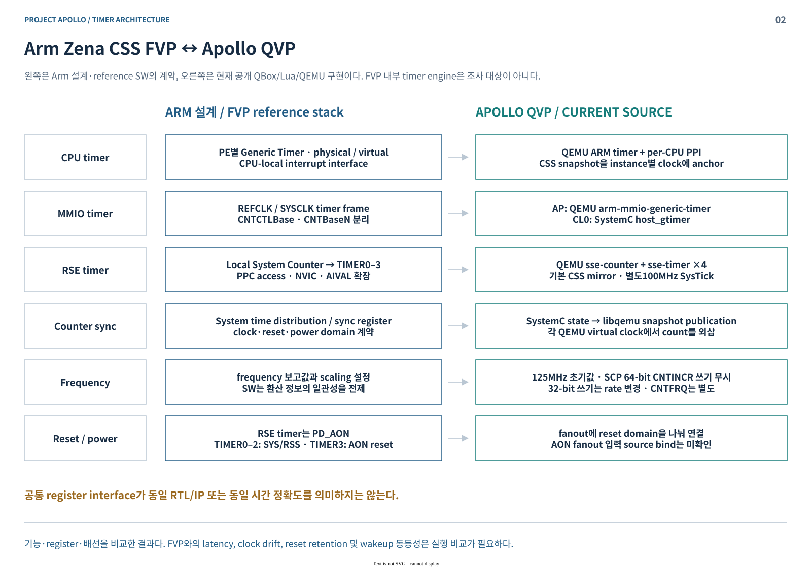
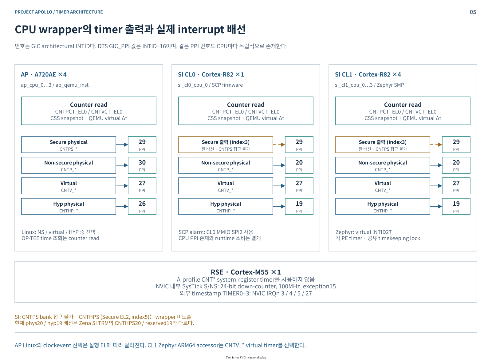
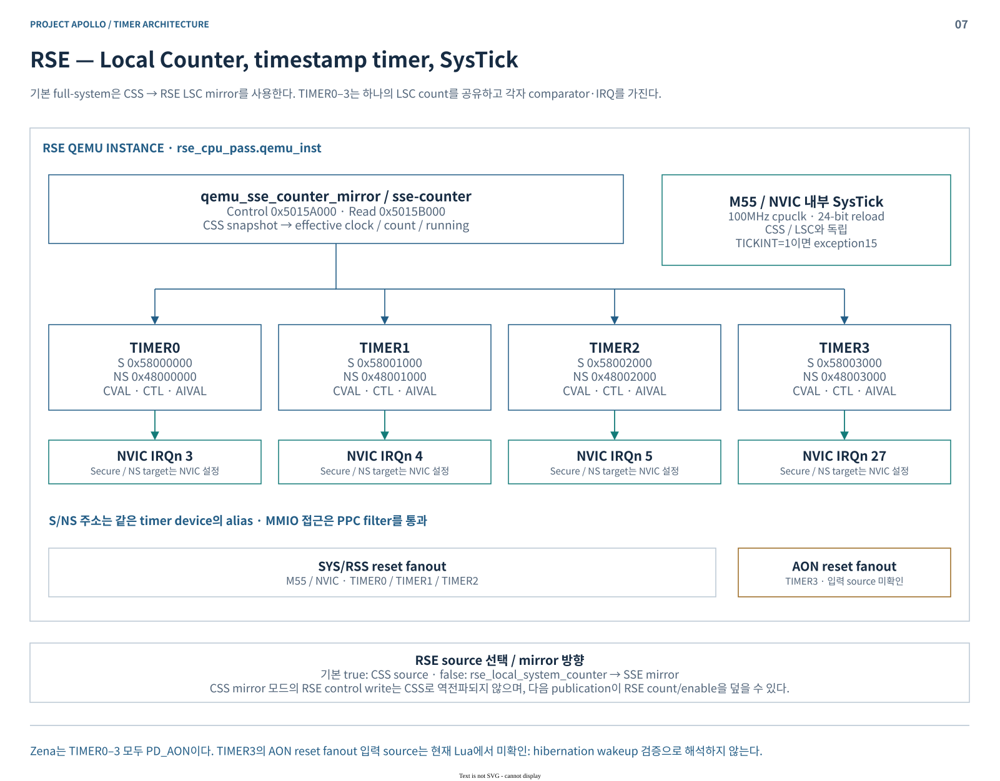
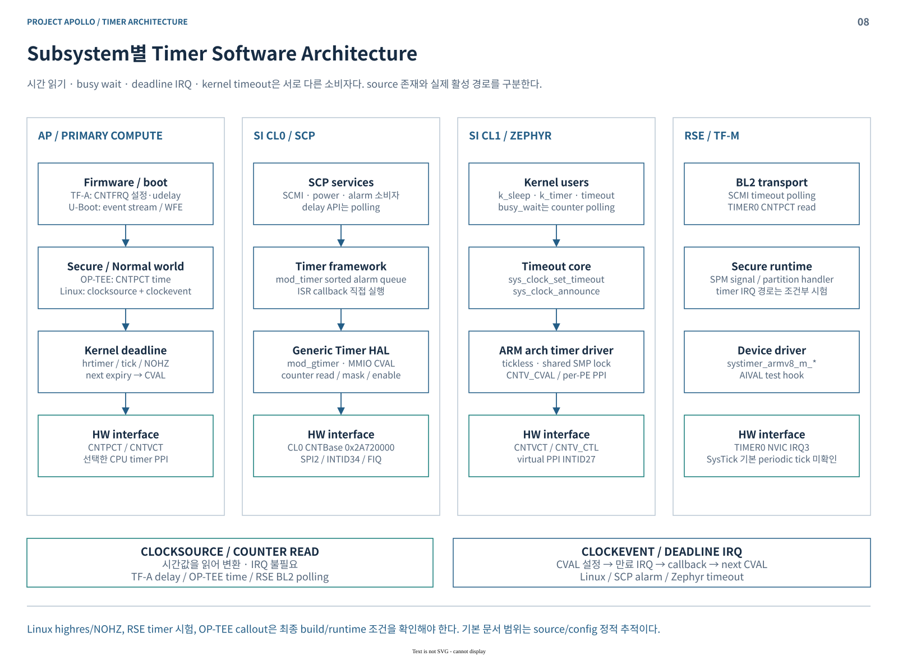
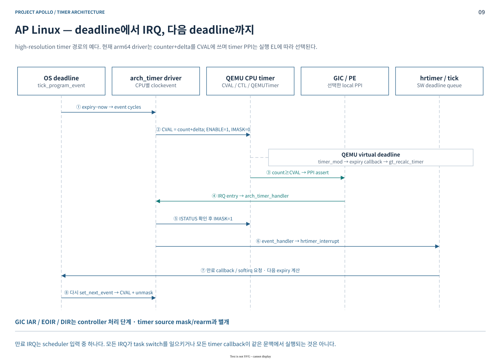
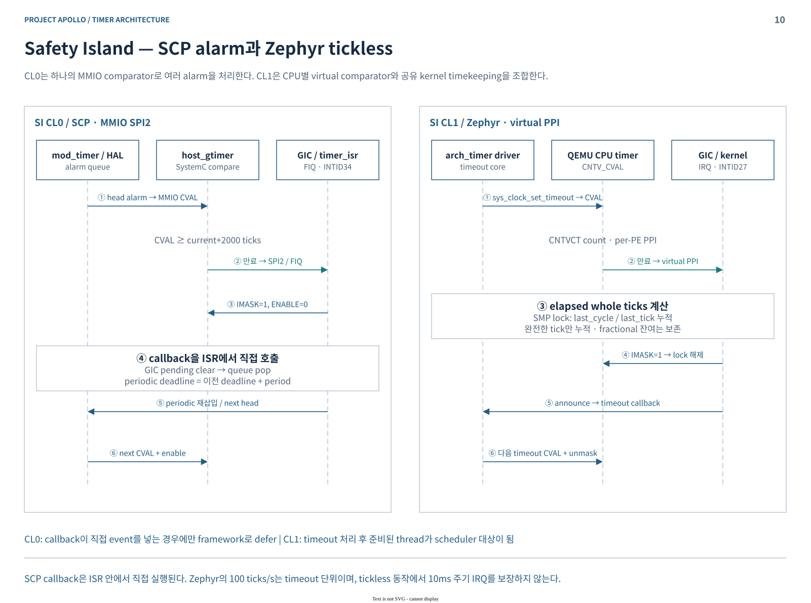
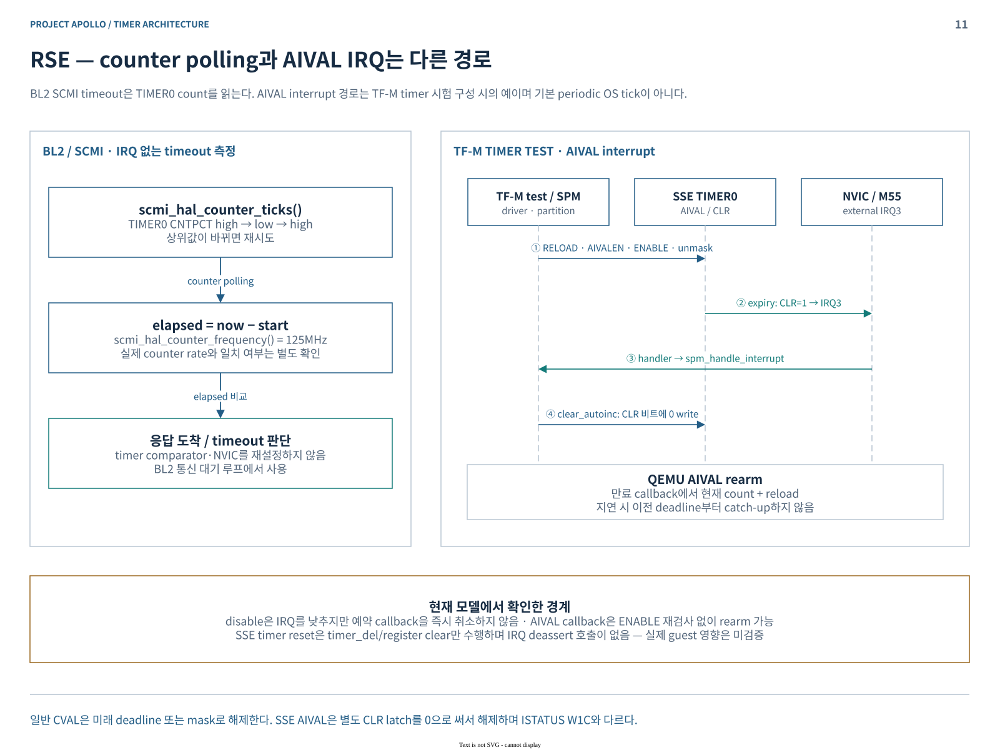

# Project Apollo Timer Architecture

Phase1 완료 보고 · 기술 세미나 · 2026-10-16

**공유 counter가 시간값을 제공하고, CPU·MMIO timer의 comparator가 deadline IRQ를 만든다.** Apollo QVP는 SystemC counter와 여러 QEMU instance를 mirror로 연결한다. OS의 시간 환산, IRQ 발생, host 실행 속도는 각각 구분해야 한다.

- 기준 구성: `apollo-qvp` / `cfg2` / AP 4 PE / SI CL0 1 PE / CL1 4 PE / RSE M55 1 PE.
- 조사 범위: Arm 설계·TRM, 최종 Lua descriptor, QBox·QEMU, firmware·OS 소스. **이번 문서 작성에서 빌드·부팅·시간 정확도 측정은 수행하지 않았다.**
- 자료: [편집 가능한 draw.io 원본](apollo-timer-architecture.drawio) · [주소·주파수·IRQ 상세표](TIMER-MAP.md) · [근거 소스와 검증 범위](SOURCES.md).

| 발표 순서 | 핵심 질문 |
|---|---|
| [1. HW 구조](#hardware) | Counter, comparator, IRQ gate는 어떻게 나뉘는가? |
| [2. FVP와 QVP](#comparison) | 같은 SW 계약을 어떤 모델로 구현하며 어디까지 같은가? |
| [3. QBox 구현](#implementation) | SystemC와 QEMU의 시간·주파수·register 상태는 어떻게 연결되는가? |
| [4. CPU와 timer](#cpu) | CPU-local PPI와 MMIO SPI/NVIC는 어디에서 갈라지는가? |
| [5. Subsystem SW](#software) | Linux·SCP·Zephyr·TF-M은 어떤 timer를 소비하는가? |
| [6. HW → SW sequence](#sequences) | 만료·ISR·callback·rearm은 어떤 순서로 진행되는가? |

## 1. Timer / Counter HW 구조

| 구성 | 역할 | SW 관점 |
|---|---|---|
| System Counter | 일정한 기준으로 timestamp 증가 | `CNTPCT` 또는 MMIO count read |
| CPU timer bank | PE별 physical·virtual deadline 비교 | `CNT*_CVAL`, `CNT*_TVAL`, `CNT*_CTL`; local PPI |
| MMIO timer frame | CPU 밖의 deadline comparator | `CNTBaseN`; 공유 SPI 또는 NVIC IRQ |
| RSE Local System Counter | TIMER0–3에 공통 timestamp 제공 | timer마다 별도 CVAL·mask·AIVAL 상태 |
| SysTick | M-profile CPU 내부 24-bit down-counter | LOAD/VAL/CTRL; timestamp TIMER0–3와 별개 |

**시간 조회와 timer 만료는 별도 기능이다.** Counter read에는 IRQ가 필요 없다. Virtual count는 physical count에 offset을 적용한다. `TVAL`은 상대 deadline view이며, IRQ를 해제하려면 comparator 조건이나 mask/enable을 바꿔야 한다. [Arm Generic Timer 설명](https://documentation-service.arm.com/static/6294c39db334256d9ea8ae53?token=), [로컬 register·RSE 근거](SOURCES.md#hardware).

위 그림은 architectural 계약이다. **현재 CL0 `host_gtimer`의 TVAL은 저장만 하며 상대 deadline 동작을 구현하지 않는다.** CPU/AP MMIO/RSE timer의 TVAL 동작과 구분한다.

## 2. Arm Zena CSS FVP와 Apollo QVP 비교

FVP 비교는 `arm-zena-css/documentation/design`의 SW 의존성과 Zena TRM의 timer·reset 계약을 기준으로 했다. FVP 내부 clock engine이나 실제 counter 증가율을 추정하지 않았다.

| 비교 지점 | 이번 조사에서 확인한 차이 |
|---|---|
| Time distribution | TRM의 chip 간 sync handshake와 QVP의 instance별 snapshot 전달은 다른 구조 |
| Sync frame | QVP `host_gtimer`는 register 저장을 제공; phase-lock·network-delay 보정 protocol은 구현하지 않음 |
| Register 기능 | AP MMIO의 CNTACR 저장은 접근 제한을 강제하지 않음; virtual comparator 미구현. CL0 TVAL도 기능 차이 존재 |
| RSE reset | Zena TIMER0–3는 모두 PD_AON. TIMER0–2는 SYS/RSS, TIMER3는 AON reset; QVP의 실제 연결 범위는 [상세표](TIMER-MAP.md) 참조 |
| Event stream | Arm reference의 U-Boot `udelay`가 사용하는 WFE event는 timer PPI IRQ와 별도 비교 대상 |
| Cfg2 범위 | FVP의 두 번째 R82AE cluster는 현재 물리 Zena 구성의 TRM register/IRQ 범위 밖 |

FVP machine 설정에서 timer 주파수 override는 확인되지 않았다. Firmware의 `125MHz` 상수를 FVP 내부 주파수의 실측값으로 사용하지 않는다. 기능 모델의 register 호환성도 latency·drift·low-power wakeup 동등성을 입증하지 않는다. [FVP·설계 근거](SOURCES.md#reference).

## 3. Apollo QVP QBox의 Timer / Counter 구현

### 3.1 시간값의 소유와 전달

| 모델 | 소유 상태 | 실행 방식 |
|---|---|---|
| `arm_system_counter` | count·소수부·input Hz·increment·enable·generation | SystemC elapsed time에서 산술 계산; 입력 clock마다 event를 만들지 않음 |
| `host_gtimer` | CSS control/read/sync register 또는 CL0 CVAL/CTL | CSS 객체 직접 참조; `sc_event`로 deadline wait 중단·재계산 |
| `qemu_arm_counter_mirror` | CSS → CPU/AP MMIO snapshot 전달 | source 변경 시 target QEMU lock 안에서 anchor·rate 갱신 |
| QEMU CPU generic timer | CPU별 comparator·CTL·QEMUTimer | QEMU virtual ns에서 count 외삽 → expiry callback → PPI |
| QEMU AP MMIO timer | frame0/1 각각 CVAL·CTL·IRQ | CPU timer와 별도 state; 같은 CSS source를 mirror |
| `qemu_sse_counter_mirror` / `qemu_sse_timer` | RSE LSC 및 TIMER0–3 | LSC clock/count 전달 → shared QOM counter → NVIC IRQ |

QEMU mirror의 계산은 `count = anchor_count + floor(Δvirtual_ns × effective_Hz / 10⁹)`다. 매 read마다 SystemC counter를 호출하지 않는다. 따라서 공통 기준을 공유해도 instance 간 관찰값이 항상 같은 것은 아니다.

기본 실행은 `quantum_keeper`·`multithread-freerunning`이며 비-icount TCG의 virtual time은 host monotonic elapsed time에 연결된다. **10ms quantum은 guest timer 주기나 domain 간 skew 상한이 아니다.** QBox CPU 실행 budget용 timer도 guest CNTP/CNTV timer와 별개다. [모델·시간축 근거](SOURCES.md#models).

### 3.2 입력 주파수, 실제 증가율, 보고값

| 값 | 초기값 / 현재 소스 경로 | 의미 |
|---|---|---|
| CSS input Hz | 125MHz | counter 입력 기준 |
| CSS increment | 초기 1; SCP 요청값은 8이지만 현재 64-bit 쓰기는 무시 | 실제 적용값은 write 폭·model handler까지 추적 |
| Effective rate | input × 적용된 increment | CPU/AP/RSE mirror에 전달되는 rate |
| Reported frequency | CSS CNTFID0, CPU CNTFRQ, AP MMIO CNTFRQ 등 | SW의 count→시간 환산 정보; rate와 별도 |

현재 `cfg2 → fvp variant → gtimer element start → gtimer_control_init()`는 CNTINCR를 `uintptr_t`로 쓴다. **AArch64의 8-byte store는 QBox transport에서 유지되며, `host_gtimer`의 해당 64-bit 구현정의 쓰기는 성공 응답 후 무시된다.** 따라서 이 SCP 초기화가 increment를 8로 바꾼다고 설명하면 틀린다.

별도의 **32-bit `CNTINCR=8` 쓰기**를 적용하면 모델 산식은 1GHz다. 이때 보고값이 125MHz로 남으면 count를 8배 긴 시간으로 환산한다. 이는 조건부 계산이며 실제 boot의 최종 register·시간 오차 측정값이 아니다.

RSE timer의 CNTFRQ도 guest가 저장하는 metadata다. RSE native SCEN/CNTSCR scaling은 mirror가 전달하는 clock rate와 별도이므로 함께 확인해야 한다. [주파수 모델](SOURCES.md#models), [SCP 설정·초기화](SOURCES.md#scp).

### 3.3 MMIO frame 구분

- **CNTControlBase**: CSS count·enable·increment 제어. SCP는 SMD physical 주소를 SI ATW window로 접근한다.
- **CNTCTLBase**: timer frame의 설정·접근 register 공간. QVP에서 register 저장과 실제 access gating은 구분해야 한다.
- **CNTBaseN**: count read와 CVAL/CTL. AP는 frame1 Secure/INTID80, frame0 NS/INTID81; CL0는 INTID34.

같은 offset `0xD0`도 CSS `host_gtimer`에서는 정수 CNTINCR, RSE SSE counter에서는 8.24 CNTSCR0다. 이름·offset만으로 같은 IP라고 판단하지 않는다. [주소·owner·IRQ 상세표](TIMER-MAP.md), [register 구현](SOURCES.md#models).

## 4. 각 CPU와 Timer 구조

| CPU domain | 현재 QVP CPU 구성 | Timer 연결과 소비 |
|---|---|---|
| AP | Cortex-A720AE ×4 | CPU별 timer PPI; Linux clockevent. AP MMIO frame은 별도 SPI |
| SI CL0 | `cpu_arm_cortexR82` ×1 | CPU timer 출력 배선과 별도로 SCP alarm은 MMIO SPI2 사용 |
| SI CL1 | `cpu_arm_cortexR82` ×4 | Zephyr는 CNTV virtual timer / INTID27; SMP PE별 comparator |
| RSE | Cortex-M55 ×1 | NVIC 내부 SysTick; 외부 SSE TIMER0–3는 IRQn 3/4/5/27 |

그림의 PPI 번호는 architectural INTID다. SI phys20/hyp19는 현재 QVP pin 이름·배선이며 TRM과의 일치를 단정하지 않는다. **R82의 PPI29는 출력 핀만 연결돼 있으며 CNTPS bank의 정상 guest 접근은 불가하다.** 별도 Secure EL2 CNTHPS comparator(index5)는 wrapper가 노출하지 않는다. [CPU·PPI 소스](SOURCES.md#platform).

RSE의 S/NS timer 주소는 **동일 device의 alias**다. 네 timer는 같은 LSC를 공유하지만 comparator와 IRQ는 독립적이다. 기본 full-system의 CSS mirror=true와 standalone SoC의 기본값을 혼동하지 않는다.

SysTick은 별도 100MHz CPU clock을 사용한다. CSS increment가 watchdog·RTC까지 일괄 변경되는 구조도 아니다. TIMER3 AON fanout의 입력 source는 현재 Lua에서 미확인이다. [RSE·reset 근거](SOURCES.md#platform).

## 5. Subsystem별 Timer Software Architecture

| Subsystem / SW | 시간 조회·대기 | Deadline / IRQ 처리 |
|---|---|---|
| AP / TF-A | CNTFRQ 설정, CNTPCT 기반 `udelay` | Secure timer 접근 허용과 IRQ 사용은 별도 |
| AP / U-Boot | CNTPCT/CNTFRQ; EL2 이상에서는 조건부 event stream + WFE, 이후 tail polling | Event stream은 CVAL/PPI ISR이 아님 |
| AP / OP-TEE | S-EL1 구성에서 CNTPCT secure time | CNTPS callout 코드 존재; automotive_rd의 활성 초기화 호출 미확인 |
| AP / Linux | `arch_sys_counter` clocksource·sched_clock | CPU별 `arch_sys_timer` clockevent → hrtimer/tick |
| SI CL0 / SCP | MMIO count polling, `delay(us)` | sorted alarm queue → MMIO CVAL → FIQ → ISR callback |
| SI CL1 / Zephyr | CNTVCT; cycle API·busy wait | CNTV_CVAL → PPI → `sys_clock_announce` → timeout 처리 |
| RSE / TF-M | BL2 SCMI timeout은 TIMER0 count polling | Timer 시험 구성 시 AIVAL / SPM signal; 기본 periodic SysTick 사용 근거 없음 |

**Linux**는 clocksource read와 clockevent PPI를 따로 선택한다. Kernel이 HYP에서 실행되면 HYP timer, HYP 사용 불가이면서 virtual IRQ가 있으면 virtual, 나머지 ARM64는 NS physical 경로다. DT에 IRQ가 있다는 이유로 실행 중 선택을 확정하지 않는다. Highres/NOHZ의 최종 활성 상태도 runtime 확인 항목이다.

**Zephyr** board 기본값은 125MHz, 100 ticks/s, tickless, SMP 4다. `CYC_PER_TICK=1,250,000`은 이 설정의 환산값이다. 각 PE의 timer를 초기화하고 공유 lock 아래 elapsed ticks를 누적하므로 CPU 수만큼 uptime이 중복 증가하는 구조가 아니다.

**RSE**의 `APOLLO_TIMER_TEST`는 기본 OFF다. TF-M의 `plat_test.c` AIVAL hook도 SCMI/SLIH/FLIH test build 조건부이며, 일반 scheduler tick의 증거로 사용하지 않는다. [AP SW](SOURCES.md#ap-software) · [SCP](SOURCES.md#scp) · [Zephyr](SOURCES.md#zephyr) · [TF-M](SOURCES.md#tfm).

## 6. Timer Sequence: HW → SW

### 6.1 AP Linux: CVAL → PPI → clockevent → rearm

1. Clockevent가 다음 expiry를 cycle delta로 변환; driver가 **현재 count+delta를 CVAL**에 쓰고 enable/unmask.
2. QEMU comparator 만료 → PPI → GIC/CPU exception → `arch_timer_handler`.
3. ISR은 ISTATUS를 확인하고 **IMASK=1**, `event_handler` 호출. Highres 경로는 만료 callback과 필요한 softirq 요청을 처리.
4. 다음 expiry로 CVAL 재설정·unmask. GIC EOI/DIR은 별도의 controller 완료 단계.

NOHZ는 불필요한 tick IRQ를 생략한다. Counter clocksource까지 정지한다는 뜻은 아니다. [Linux 경로](SOURCES.md#ap-software).

### 6.2 SI CL0 / CL1: alarm과 tickless timeout

| 구간 | CL0 / SCP | CL1 / Zephyr |
|---|---|---|
| Program | 가장 이른 alarm; `max(deadline, now+2000 ticks)` | Kernel timeout을 CNTV_CVAL로 변환 |
| HW → CPU | SystemC comparator → SPI2/INTID34 → Group0 FIQ | QEMU CPU timer → virtual PPI27 → IRQ |
| ISR | mask·disable, pending clear, alarm pop | elapsed whole ticks 계산; tickless이면 mask |
| SW 처리 | callback을 **ISR에서 직접 호출** | `sys_clock_announce` → timeout callback·thread wake |
| Rearm | periodic: 이전 deadline+period, 다음 queue head | 다음 timeout을 CVAL에 쓰고 unmask |

SCP의 최소 2000 ticks를 고정 μs로 환산하려면 effective rate를 먼저 알아야 한다. Zephyr 100 ticks/s는 idle 중 10ms마다 IRQ가 발생한다는 의미가 아니다. [SCP 경로](SOURCES.md#scp), [Zephyr 경로](SOURCES.md#zephyr).

### 6.3 RSE: polling과 AIVAL interrupt

- **BL2 polling**: TIMER0 count를 high-low-high로 읽어 rollover를 확인; 경과 시간으로 SCMI timeout 판단. Comparator·NVIC를 재설정하지 않는다.
- **AIVAL 시험**: RELOAD·AIVALEN·ENABLE 설정 → 만료 시 CLR latch/IRQ3 → TF-M handler/SPM → `clear_autoinc_interrupt()`가 CLR에 **0** 기록.
- **현재 QEMU 동작**: 만료 callback은 `현재 count+reload`로 다음 AIVAL 설정. Disable 후 예약 callback이 남을 수 있고, reset에는 명시적 IRQ deassert 호출이 없다. 실제 guest 영향은 이번에 검증하지 않았다.

[SSE 모델](SOURCES.md#models), [TF-M driver·조건부 시험](SOURCES.md#tfm).

### Phase1 보고에서 구분할 증거

이번 문서는 **구현·정적 배선·SW 호출 경로**를 확인한다. 실행 중 frequency 일치, guest가 자연스럽게 관찰하는 domain 간 drift, reset 직후 IRQ, 저전력 wakeup, FVP parity는 별도 실행 증거가 필요하다.

특히 `apollo_timer_snapshot`은 capture 전에 mirror를 재동기화한다. 그 결과의 counter 일치를 독립적인 guest 동시-read나 자연 drift 측정으로 인용하지 않는다. [검증 범위와 관찰 도구 주의점](SOURCES.md#validation).

관련 세미나: [Interrupt Architecture](../interrupt/README.md) · [QVP Architecture](../qbox/README.md).
