# Apollo Timer SW Implementation Report

<a id="overview"></a>

## 1. Overview

### 1.1 Purpose and Scope

Apollo의 Timer/Counter HW와 QVP 구현, Domain별 SW의 초기화·시간 조회·timeout·interrupt 처리 경로를 설명한다.

- **시스템 용도:** Automotive AD의 주기적 Job, deadline 관리, OS/RTOS의 시간 관리와 scheduling 지원.
- **대상:** AP의 Linux·TF-A·U-Boot·OP-TEE, Safety Island CL0의 SCP, CL1의 Zephyr, RSE의 TF-M.
- **구현 범위:** Counter·Timer register, QBox/SystemC·QEMU 모델 연결, driver·API·ISR·callback·Scheduler 관계.

### 1.2 Timer/Counter Summary

**Counter는 시간값을 제공하고, Timer는 설정한 deadline과 Counter를 비교해 interrupt를 발생시킨다.** 시간 조회·polling은 Timer interrupt 없이도 동작한다.

| Domain / SW | 주요 시간 자원 | SW 사용 방식 |
|---|---|---|
| AP / Linux | Generic Counter·CPU-local Timer | Timekeeping·hrtimer·sleep·Scheduler 연계 |
| AP / TF-A·U-Boot | Physical Counter | Firmware 시간 조회·polling delay·timeout; U-Boot은 조건부 WFE event 사용 |
| AP / OP-TEE | Physical Counter | Secure time 조회·RPC 대기; Timer callout 활성화는 별도 확인 |
| SI CL0 / SCP | MMIO Generic Timer | SW alarm queue·FIQ callback·periodic 재설정 |
| SI CL1 / Zephyr | Virtual Counter·CPU별 CNTV Timer | Tickless timeout·Timer callback·Thread wakeup |
| RSE / TF-M | Timestamp Timer·별도 SysTick | BL2 polling timeout·조건부 AIVAL/자체 시험 |

QVP는 SystemC Counter와 QEMU instance별 시간 자원을 연결한다. **SW 환산 frequency, 실제 count 증가율, host 실행 속도는 서로 구분**한다. Timer 만료나 Thread ready 전환은 Job의 즉시 실행·완료를 보장하지 않는다.

### 1.3 Glossary

| 용어 | 의미 |
|---|---|
| Counter | 시간 기준으로 증가하는 count 값 또는 이를 제공하는 HW |
| Timer / Comparator | Counter와 deadline을 비교해 만료 상태·interrupt를 생성하는 HW |
| Clocksource / Clockevent | Linux의 시간 조회 자원 / 다음 interrupt 예약 자원 |
| CNTFRQ | Counter frequency metadata; 값을 쓰는 것만으로 실제 clock이 변경되지는 않음 |
| CNTPCT / CNTVCT | Physical / Virtual count 조회 register; virtual count에는 offset 적용 |
| CVAL / TVAL / CTL | 절대 비교값 / 상대 timer 값 / enable·mask·status 제어 register |
| Tick / Cycle | OS 시간 관리 단위 / Counter 증가 단위; 서로 다른 주파수 사용 가능 |
| Tickless | 고정 주기 tick 대신 다음 timeout에 맞춰 Timer를 설정하는 방식 |
| IRQ / FIQ / ISR | Interrupt 요청 / Arm의 FIQ exception 경로 / interrupt 처리 함수 |
| PPI / SPI | GIC의 CPU별 interrupt / 공유 peripheral interrupt |
| GIC / NVIC | AP·Safety Island / Cortex-M 계열의 interrupt controller |
| Deadline / Timeout | 목표 만료 시각 / 대기·작업의 제한 시간 |
| AIVAL | RSE Timestamp Timer의 auto-increment 만료값·주기 제어 기능 |
| SPM / SLIH / FLIH | TF-M Secure Partition Manager / Second-Level / First-Level Interrupt Handling |
| QVP / FVP | Apollo QBox 기반 Virtual Platform / Arm Fixed Virtual Platform |

<a id="hardware"></a>

## 2. Hardware Architecture

<a id="system"></a>

### 2.1 System Architecture — Automotive AD System

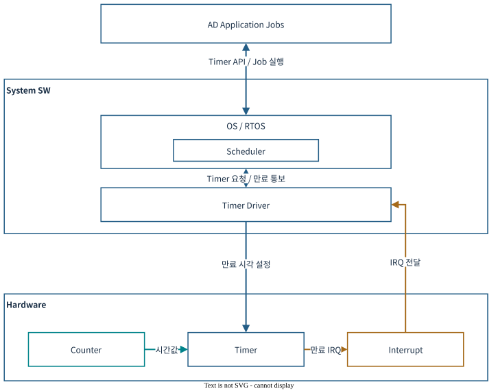

- **System:** OS scheduler tick과 주기적 Job 실행, 시간 제한이 있는 Job의 deadline 관리를 지원한다.
- **Hardware — Timer IP:** 설정한 주기 또는 시각에 interrupt를 발생시킨다.
- **Software — Timer driver:** Interrupt를 처리하고 OS/RTOS를 통해 Job 실행·timeout 관리에 필요한 Timer API를 제공한다.

### 2.2 AP Domain Timer/Counter

**HW 도면은 Zena AP의 4 clusters × 4 CPUs = 16 CPUs 구조**, QVP 설명은 기본 AP 4 CPU 구성을 기준으로 한다.

AP의 timer는 **CPU system-register timer**와 **MMIO timer**로 나뉜다. 두 경로는 System Counter를 시간 기준으로 사용하지만 comparator와 interrupt는 각각 독립적이다.

#### 2.2.1 ARM Generic Timer

**Hardware 구조**

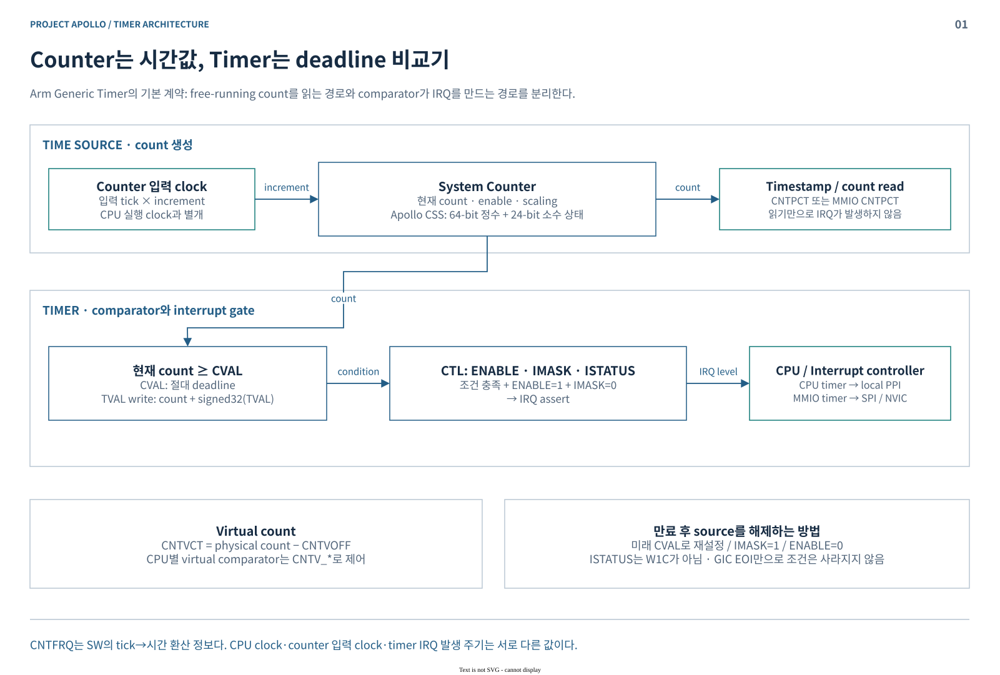

- **공통 시간 기준:** System Counter의 physical count를 각 AP CPU가 참조한다.
- **CPU별 timer bank:** Physical·Virtual·Hypervisor·Secure timer가 각각 CVAL comparator와 enable/mask를 갖는다.
- **Virtual count:** 기본 EL1 virtual 경로는 physical count에서 `CNTVOFF_EL2`를 뺀 시간값을 사용한다.
- **만료 경로:** `count ≥ CVAL` → enable/mask 판정 → 해당 CPU의 GIC PPI → CPU exception. 각 CPU에 같은 PPI 번호가 독립적으로 적용된다.

**Register map — AArch64 system registers**

메모리 주소가 아닌 `MRS/MSR`로 접근한다. `_EL0` 접미사가 EL0의 무조건적인 접근 허용을 뜻하지는 않으며, 상위 EL의 접근 제어·trap 설정을 따른다.

| Register | 유효 폭 | 역할 |
|---|---:|---|
| `CNTFRQ_EL0` | 32-bit | SW 시간 환산에 쓰는 counter frequency; clock 설정 register가 아님 |
| `CNTPCT_EL0` / `CNTVCT_EL0` | 64-bit | Physical / virtual count 읽기 |
| `CNTVOFF_EL2` | 64-bit | EL1 virtual count의 offset |
| `CNTP_CVAL_EL0` / `CNTP_TVAL_EL0` / `CNTP_CTL_EL0` | 64 / 32 / 32-bit | EL1 physical timer |
| `CNTV_CVAL_EL0` / `CNTV_TVAL_EL0` / `CNTV_CTL_EL0` | 64 / 32 / 32-bit | EL1 virtual timer |
| `CNTHP_CVAL_EL2` / `CNTHP_TVAL_EL2` / `CNTHP_CTL_EL2` | 64 / 32 / 32-bit | Non-secure EL2 physical timer |
| `CNTPS_CVAL_EL1` / `CNTPS_TVAL_EL1` / `CNTPS_CTL_EL1` | 64 / 32 / 32-bit | Secure physical / EL3 timer; 접근은 보안·EL 설정에 따름 |
| `CNTKCTL_EL1` / `CNTHCTL_EL2` | 제어 필드 | 하위 EL의 counter·timer 접근 및 trap 제어 |

- `CVAL`: 절대 만료 count. `TVAL`: 상대값이며 write 시 `CVAL = count + sign_extend(TVAL[31:0])`.
- `CTL`: bit0 `ENABLE`, bit1 `IMASK`, bit2 `ISTATUS`. ISTATUS는 W1C가 아니며, 다음 CVAL 설정 또는 mask/disable로 IRQ 조건을 해소한다.

**Interrupt Table — 현재 Apollo AP 연결**

| Timer | QBox 출력 | GIC INTID | DTS PPI offset |
|---|---|---:|---:|
| Secure physical (`CNTPS_*`) | `irq_timer_sec_out` | 29 | 13 |
| EL1 physical (`CNTP_*`) | `irq_timer_phys_out` | 30 | 14 |
| EL1 virtual (`CNTV_*`) | `irq_timer_virt_out` | 27 | 11 |
| EL2 physical (`CNTHP_*`) | `irq_timer_hyp_out` | 26 | 10 |
| EL2 virtual (`CNTHV_*`, VHE) | 현재 AP Lua 연결 없음 | 28: DTS 선언만 존재 | 12 |

`INTID = PPI offset + 16`이다. 위 네 연결은 CPU별 private interrupt이며 MMIO timer의 SPI와 별개다. Architectural timer 전체 목록과 현재 QVP에 배선한 출력 수를 혼동하지 않는다. [Register 근거](SOURCES.md#ap-hardware) · [AP 배선 근거](SOURCES.md#platform)

**Interrupt 발생·해제 조건**

| 계층 | Interrupt 발생 / 전달 조건 | 해제 / 완료 |
|---|---|---|
| Timer | 선택한 count ≥ CVAL, `ENABLE=1`, `IMASK=0` | IMASK=1, disable 또는 미래 CVAL 설정으로 source 낮춤; ISTATUS는 W1C 아님 |
| GIC | 해당 CPU의 PPI enable, group·priority 조건 충족 | IAR로 acknowledge; EOI/Deactivate로 active 상태 완료 |
| CPU | 해당 exception의 mask·routing 조건 허용 | IRQ 처리 후 exception return; 필요 시 scheduler 실행 |

**Interrupt 발생 Flow — 화살표 01–09**

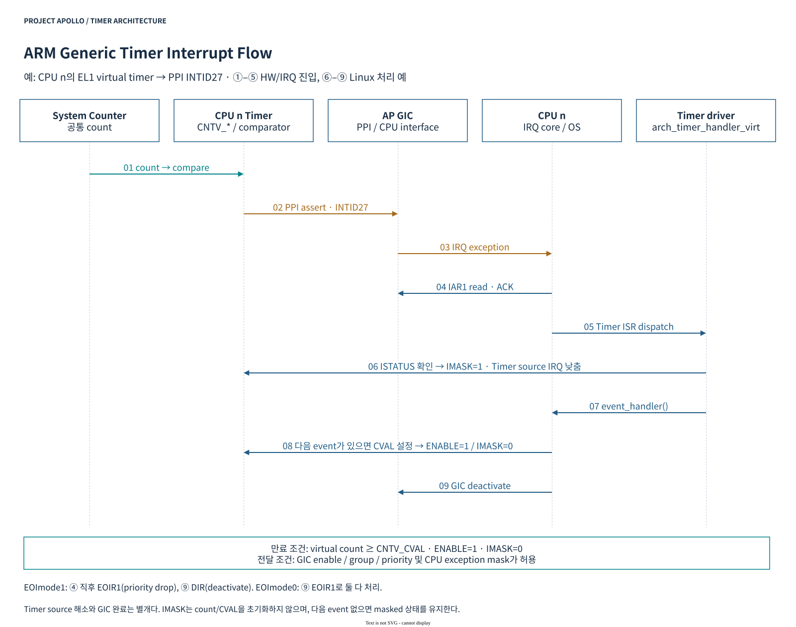

<details>
<summary>도면 상세 설명</summary>

- **System Counter**: System Counter / 공통 count
- **CPU n Timer**: CPU n Timer / CNTV_* / comparator
- **AP GIC**: AP GIC / PPI / CPU interface
- **CPU n**: CPU n / IRQ core / OS
- **Timer driver**: Timer driver / arch_timer_handler_virt
- **만료 조건: virtual count ≥ CNTV_CVAL · ENABLE=1 · IMASK=0**: 만료 조건: virtual count ≥ CNTV_CVAL · ENABLE=1 · IMASK=0 / 전달 조건: GIC enable / group / priority 및 CPU exception mask가 허용

</details>

CPU n의 **EL1 virtual timer(INTID27)**를 예로 든다. 실제 Linux timer 선택은 별도이며, Secure/EL2 timer의 handler는 해당 firmware/hypervisor가 담당한다.

| 번호 | 경로 | 처리 |
|---|---|---|
| 01 | Counter → Timer | Virtual count를 CVAL과 비교 |
| 02 | Timer → GIC | ENABLE·IMASK 조건을 만족하면 CPU n의 PPI27 assert |
| 03 | GIC → CPU | Pending·priority·mask 조건에 따라 IRQ exception 진입 |
| 04 | IRQ core → GIC | `ICC_IAR1_EL1` read로 INTID 확인·acknowledge |
| 05 | IRQ core → Timer driver | IRQ domain에서 per-CPU timer ISR로 dispatch |
| 06 | Timer driver → Timer | ISTATUS 확인 후 IMASK=1; source IRQ를 낮춤 |
| 07 | Timer driver → OS | `evt->event_handler()`로 clockevent 전달; tick/hrtimer 처리 |
| 08 | OS → Timer driver → Timer | 다음 event가 있으면 `CVAL=count+delta`, ENABLE=1·IMASK=0으로 rearm |
| 09 | IRQ core → GIC | Handler 반환 후 deactivate; IRQ exit/exception return 진행 |

**EOI 순서는 GIC mode에 따라 다르다.** EOImode1은 04 직후 EOIR1로 priority를 낮추고 09에서 DIR로 deactivate한다. EOImode0은 09의 EOIR1로 둘 다 처리한다. GIC EOI가 Timer의 만료 조건을 지우지는 않는다. [ISR·GIC 소스 근거](SOURCES.md#timer-interrupt-flow)

#### 2.2.2 ARM Generic Timer MMIO Frame

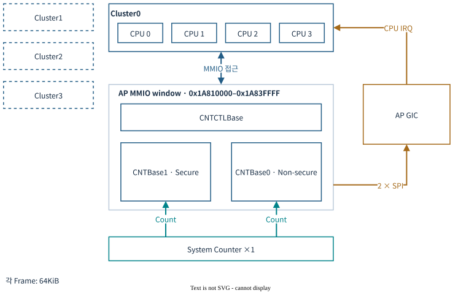

<details>
<summary>도면 상세 설명</summary>

- **Cluster1**: Cluster1 / CPU 4–7
- **Cluster2**: Cluster2 / CPU 8–11
- **Cluster3**: Cluster3 / CPU 12–15
- **CNTCTLBase**: CNTCTLBase / 0x1A810000 · Frame 제어
- **CNTBase1 · Secure**: CNTBase1 · Secure / 0x1A820000 / SPI48 → INTID80
- **CNTBase0 · Non-secure**: CNTBase0 · Non-secure / 0x1A830000 / SPI49 → INTID81
- **AP GIC**: AP GIC / SPI 라우팅
- **각 Frame: 64KiB**: 각 Frame: 64KiB · CPU와 Frame은 1:1 관계 아님 · Cluster1–3 연결 생략 · QVP: physical timer만 구현

</details>

CPU-local timer가 `MRS/MSR + PPI`를 사용하는 반면, MMIO timer는 **load/store + SPI**를 사용한다. Frame은 CPU 번호에 종속되지 않으며 CPU마다 frame 하나가 배정되는 구조는 아니다.

**MMIO 구조**

- **접근:** CPU의 load/store → AP MMIO bus → `CNTCTLBase` 또는 `CNTBaseN`.
- **`CNTCTLBase`:** Timer frame 존재·기능 정보와 접근 제어를 제공한다. System Counter 생성기를 제어하는 frame이 아니다.
- **`CNTBaseN`:** Counter read와 해당 frame의 CVAL/TVAL/CTL을 제공한다. CPU-local timer bank와 comparator를 공유하지 않는다.
- **IRQ:** Frame별 comparator → GIC SPI → 라우팅된 AP CPU. QVP의 두 frame은 physical timer만 구현한다.

| Frame | AP base / 크기 | Interrupt |
|---|---|---|
| `CNTCTLBase` | `0x1A810000` / 64KiB | 없음 |
| `CNTBase1` — Secure | `0x1A820000` / 64KiB | SPI48 → INTID80 |
| `CNTBase0` — Non-secure | `0x1A830000` / 64KiB | SPI49 → INTID81 |

**주요 MMIO register map** — Offset은 각 frame base 기준이다.

| Frame | Offset | Architectural register | 현재 QVP 동작 |
|---|---|---|---|
| CNTCTL | `0x000` | CNTFRQ | 설정된 frequency 읽기 |
| CNTCTL | `0x004` | CNTNSAR | 모델명 CNTSR; 0 읽기, 접근 보호 미구현 |
| CNTCTL | `0x008` | CNTTIDR | 모델명 CNTTID; frame 수 2 반환, architectural capability bitfield와 다름 |
| CNTCTL | `0x040 + 4×N` | CNTACR<N> | RW 저장; 실제 접근 제한은 강제하지 않음 |
| CNTBaseN | `0x000 / 0x004` | CNTPCT low / high | 64-bit physical count 읽기 |
| CNTBaseN | `0x010` | CNTFRQ | Counter frequency 읽기 |
| CNTBaseN | `0x014` | CNTEL0ACR | 모델명 CNTPL0ACR; RW 저장 |
| CNTBaseN | `0x020 / 0x024` | CNTP_CVAL low / high | 64-bit 절대 만료값 RW |
| CNTBaseN | `0x028` | CNTP_TVAL | 32-bit 상대 만료값 RW |
| CNTBaseN | `0x02C` | CNTP_CTL | ENABLE / IMASK RW, ISTATUS 조회 |

Architecture의 optional virtual timer·CNTVOFF·별도 CNTEL0Base frame은 현재 AP 모델에서 구현하지 않는다. 특히 표준 `0x00C`는 CNTVCT high 위치지만 QVP는 frame ID를 반환하므로, 표준 virtual register로 사용하면 안 된다. Linux DT는 Non-secure frame0만 노출한다. [MMIO 표준·모델 근거](SOURCES.md#ap-hardware)

#### 2.2.3 System Counter


<details>
<summary>도면 상세 설명</summary>

- **CNTControlBase**: CNTControlBase / 0x02_0000_D010_0000 / Counter 제어
- **CNTRead**: CNTRead / 0x02_0000_D011_0000 / Count 조회
- **REFCLK · 125 MHz**: REFCLK / Clock frequency: 125 MHz
- **System Counter**: System Counter / Increment logic + 64-bit count
- **AP CPU-local Timers**: AP CPU-local Timers / Cluster0–3 / CPU0–15
- **AP MMIO Timer Frames**: AP MMIO Timer Frames / CNTBase0 / CNTBase1

</details>

**Arm Zena CSS Hardware 구조** — AP의 시간값 소비 경로를 중심으로 표시했다.

- **시간값 생성:** REFCLK **125MHz** → increment logic → 64-bit System Counter. CPU별 timer와 MMIO timer가 공통 count를 사용한다.
- **제어 / 조회:** `CNTControlBase`는 Counter 설정, `CNTRead`는 count 조회를 제공한다. Timer frame의 `CNTCTLBase`와 다른 블록이다.
- **Interrupt:** 정상 deadline interrupt는 각 timer comparator가 생성한다.

| CSS frame | SMD physical base | 역할 |
|---|---|---|
| REFCLK Counter CNTControlBase | `0x02_0000_D010_0000` | Counter 접근·제어 |
| REFCLK Counter CNTRead | `0x02_0000_D011_0000` | Count 조회 |

각 frame은 64KiB이며 Secure 접근·NI-710AE APU gating을 적용한다. Zena 주소 맵의 부트 기본 접근 주체는 RSE다. 위 주소는 AP local timer MMIO 주소와 구분한다.

입력 clock과 Counter의 **실효 증가율**은 다를 수 있다. Armv8.6 이후의 architectural effective rate는 1GHz이며, 125MHz clock에서 tick당 8씩 증가하는 것은 이를 구현하는 예다. 이 예를 현재 FVP/QVP의 실측 주파수로 해석하지 않는다.

[Zena HW·Arm Counter 근거](SOURCES.md#zena-system-counter). QBox의 Counter mirror와 구현 제약은 **2.2.4 QVP 구현** 및 [3장](#implementation)에서 별도로 다룬다.

Multiview·FMU 구조는 [Interrupt Architecture — AP Domain](../interrupt/README.md#ap-automotive-enhanced)를 참조한다.

#### 2.2.4 AP Domain Timer / Counter QVP 구현

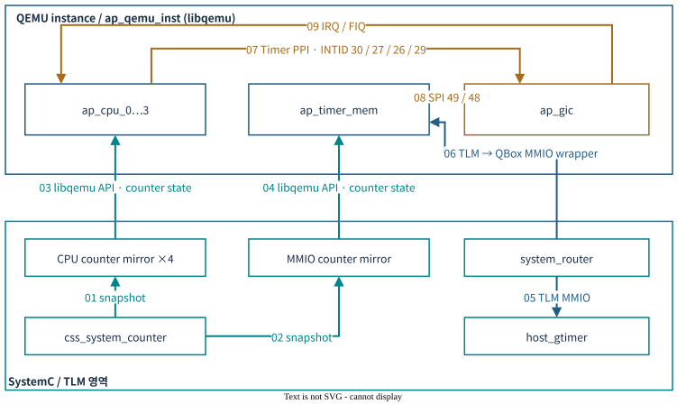

<details>
<summary>도면 상세 설명</summary>

- **css_system_counter**: css_system_counter / 공통 count · frequency · running
- **host_gtimer**: host_gtimer / Counter control / read / sync
- **CPU counter mirror ×4**: CPU counter mirror ×4 / ap_cpu_counter_mirror_0…3
- **MMIO counter mirror**: MMIO counter mirror / ap_timer_counter_mirror
- **system_router**: system_router / TLM address routing
- **ap_cpu_0…3**: ap_cpu_0…3 / A720AE · CPU-local timer / CNT* / comparator / expiry
- **ap_timer_mem**: ap_timer_mem / arm_arch_timer_mmio / Physical frame0 / frame1
- **ap_gic**: ap_gic / GIC backend

</details>

- **SystemC/TLM 영역:** 공통 Counter·mirror·MMIO router.
- **QEMU instance:** `ap_qemu_inst` 내부의 CPU-local timer·MMIO timer·GIC backend.
- **경계 연결:** Counter snapshot은 libqemu API, MMIO는 QBox wrapper의 TLM socket, IRQ는 QBox signal socket을 사용한다. 그림의 QEMU 영역은 backend 소속이며 wrapper 자체는 SystemC 객체다.

**SystemC가 공통 Counter를 소유하고, QEMU가 AP CPU별 timer와 MMIO timer의 만료·IRQ를 처리한다.** AP CPU 4개 구성에서는 CPU mirror 4개와 MMIO mirror 1개가 같은 `css_system_counter`를 참조한다.

##### 모델 구성과 소유권

| Lua 객체 | 구현 모델 | 담당 기능 |
|---|---|---|
| `css_system_counter` | SystemC `arm_system_counter` | 공통 count·enable·주파수·increment 상태; 초기 입력 125MHz, increment 1 |
| `host_css_counters_timers{,_read,_sync}` | SystemC `host_gtimer` | CSS Counter control/read/sync MMIO 창; AP deadline comparator와 별개 |
| `ap_cpu_0`–`ap_cpu_3` | QBox `cpu_arm_cortexA720AE` / QEMU ARM timer | PE별 CNT* system register·comparator·만료 event |
| `ap_cpu_counter_mirror_0`–`_3` | SystemC `qemu_arm_counter_mirror` | 공통 Counter snapshot을 각 CPU timer에 전달 |
| `ap_timer_mem` | QBox `qemu_arm_arch_timer_mmio` / QEMU `arm_arch_timer_mmio` | CNTCTLBase와 physical timer frame0/1; frame별 CVAL·CTL·IRQ |
| `ap_timer_counter_mirror` | SystemC `qemu_arm_mmio_counter_mirror` | 공통 Counter snapshot을 AP MMIO timer에 전달 |
| `ap_gic` | QEMU GIC backend | Timer PPI/SPI 수신 및 AP CPU IRQ/FIQ 전달 |

##### 실행 Flow

1. **시간 기준 생성:** `css_system_counter`가 SystemC 경과 시간으로 count를 계산한다. Clock tick마다 event를 생성하지 않는다.
2. **Snapshot 전달:** Mirror가 초기화 시와 Counter 상태 변경 시 count·실효 frequency·running 상태를 QEMU에 전달한다. CPU mirror는 generation도 전달한다.
3. **시간 조회·설정:** CPU timer는 `MRS/MSR`, MMIO timer는 `system_router`를 통한 load/store로 접근한다. QEMU는 snapshot 이후의 count를 QEMU virtual time으로 외삽한다.
4. **만료 처리:** Guest가 CVAL/TVAL·CTL을 설정하면 QEMU가 만료 event를 예약한다. Compare 조건과 ENABLE/IMASK에 따라 IRQ level을 갱신한다.
5. **Interrupt 전달:** 아래 배선으로 GIC → CPU exception → timer driver에 전달한다. Driver는 mask 또는 다음 deadline 설정으로 timer IRQ 원인을 해제한다.

| 경로 | QVP 연결 | Architectural INTID |
|---|---|---|
| CPU-local timer | `ap_cpu_i.irq_timer_{phys,virt,hyp,sec}_out` → `ap_gic.ppi_in_cpu_i_<INTID>` | 각각 30 / 27 / 26 / 29 |
| MMIO frame0 — NS | `ap_timer_mem.irq_0` → `ap_gic.spi_in_49` | 81 |
| MMIO frame1 — Secure | `ap_timer_mem.irq_1` → `ap_gic.spi_in_48` | 80 |

**PPI socket은 INTID, SPI socket은 SPI index(INTID−32)를 사용한다.** CPU-local timer와 MMIO frame은 공통 시간 기준만 공유하며 comparator·mask·만료 상태는 독립적이다.

##### 구현 범위

- **지원:** CPU-local timer 및 AP MMIO physical frame의 deadline·mask·IRQ, 공통 Counter snapshot 전달.
- **제약:** AP MMIO virtual timer와 CNTACR 접근 제한은 미구현이며, CSS sync register 저장은 chip 간 동기화 protocol을 구현한 것이 아니다.
- **시간 해석:** 실제 count rate와 CNTFRQ 보고값은 별도다. SCP의 CNTINCR 쓰기 폭에 따른 차이는 [주파수 구현 상세](#implementation)를 참조한다. 공통 snapshot은 cycle 단위 동기화나 IRQ latency 보장을 뜻하지 않는다.

[Lua 구성 근거](SOURCES.md#platform) · [모델 소스 근거](SOURCES.md#models) · [전체 Domain의 시간 전달 구조](#implementation)

<a id="si-hardware"></a>

### 2.3 Safety Island Domain Timer/Counter

Safety Island는 **CL0의 MMIO system timer와 CL0·CL1의 CPU-local timer**를 구분한다. 현재 QVP는 CL0 CPU 1개·CL1 CPU 4개를 구성하며, 모두 CSS 공통 Counter를 시간 기준으로 사용한다.

| 구분 | SI CL0 | SI CL1 |
|---|---|---|
| CPU-local timer | R82 timer bank ×1 | R82 timer bank ×4 |
| 별도 MMIO timer | CNTCTLBase + CNTBase, INTID34 | 현재 Lua에 전용 MMIO timer 객체 없음 |
| GIC 실행 view | View1 | View2 |
| QVP 실행 영역 | `si_cl0_qemu_inst` | `si_cl1_qemu_inst` |

#### 2.3.1 ARM Generic Timer

**Hardware 구조:** 공통 Counter → PE별 timer comparator → GIC Redistributor/PPI → 해당 CPU. 각 PE는 CVAL·CTL을 독립적으로 보유하므로 공통 count를 사용해도 만료 시점은 다르게 설정할 수 있다.

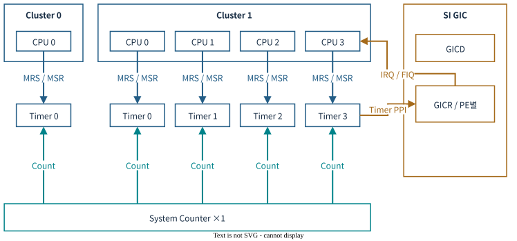

| Register 계열 | 역할 | SI에서의 구분 |
|---|---|---|
| `CNTPCT_EL0` / `CNTVCT_EL0` | Physical / virtual count 조회 | Virtual count는 offset이 적용된 시간값 |
| `CNTFRQ_EL0` | Count→시간 환산용 주파수 | QVP 초기 125MHz; 실효 count rate와 별도 |
| `CNTV_CVAL_EL0` / `CNTV_TVAL_EL0` / `CNTV_CTL_EL0` | Virtual deadline·상대값·enable/mask/status | 현재 CL1이 사용하는 CPU timer 계열 |
| `CNTP_*` / `CNTHP_*` / `CNTHPS_*` | Physical timer 계열 | 실행 EL·보안 상태에 따른 접근 조건과 QVP 출력 연결을 별도로 확인 |

**Interrupt map — HW 계약과 현재 QVP 배선**

| INTID | Zena SI TRM의 의미 | 현재 CL0·CL1 QVP 연결 |
|---|---|---|
| 27 | CNTVIRQ — virtual timer | `irq_timer_virt_out` → 각 CPU PPI27 |
| 20 | CNTHPSIRQ — Secure EL2 physical timer | `irq_timer_phys_out` → PPI20; TRM의 source와 다름 |
| 19 | Reserved | `irq_timer_hyp_out` → PPI19; TRM과 다름 |
| 29 | CNTPSIRQ — Secure PL1 physical timer | `irq_timer_sec_out` → PPI29; 현재 R82 guest의 CNTPS 정상 접근은 불가 |

현재 R82 wrapper는 QEMU timer 출력 index0–3을 노출한다. 별도 `CNTHPS` comparator(index5)는 노출하지 않으므로 **PPI20 연결을 Secure EL2 timer 구현 완료로 해석하면 안 된다.** 이 표는 TRM의 SI map과 현재 모델의 차이를 나타내며 FVP의 실제 출력 측정 결과는 아니다. [SI HW·배선 근거](SOURCES.md#si-hardware)

#### 2.3.2 ARM Generic Timer MMIO Frame

CL0 MMIO timer는 CPU system register timer와 별도의 comparator다. CPU는 load/store로 접근하며, 만료 interrupt는 PPI가 아닌 **SPI2/INTID34**로 전달된다.

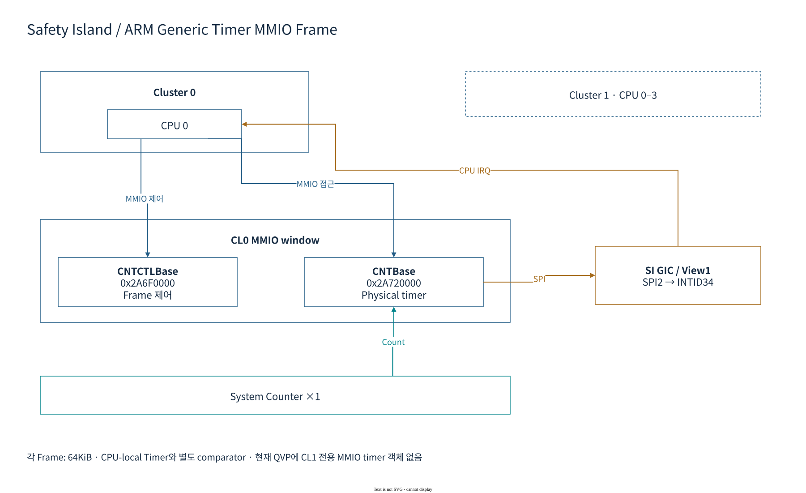

<details>
<summary>도면 상세 설명</summary>

- **CNTCTLBase**: CNTCTLBase / 0x2A6F0000 / Frame 제어
- **CNTBase**: CNTBase / 0x2A720000 / Physical timer
- **SI GIC / View1**: SI GIC / View1 / SPI2 → INTID34

</details>

| Frame | SI local base / 크기 | 역할 |
|---|---|---|
| CNTCTLBase | `0x2A6F0000` / 64KiB | Timer frame 관리 공간; QVP에서는 `host_gtimer` register 저장 영역 |
| CL0 CNTBase | `0x2A720000` / 64KiB | Counter read·physical comparator·IRQ |

| CNTBase offset | Register | 현재 QVP 동작 |
|---|---|---|
| `0x000 / 0x004` | CNTPCT low / high | CSS 공통 Counter의 현재 값 조회 |
| `0x010` | CNTFRQ | CSS reported frequency 조회 |
| `0x020 / 0x024` | CNTP_CVAL low / high | 64-bit deadline 설정; 만료 event 재계산 |
| `0x028` | CNTP_TVAL | 저장만 수행; 상대 deadline 계산 미구현 |
| `0x02C` | CNTP_CTL | ENABLE·IMASK 저장, ISTATUS 계산 |

QVP IRQ 조건은 `ENABLE && count >= CVAL && !IMASK`다. CVAL을 미래로 변경하거나 mask/disable하면 IRQ가 내려가며, GIC EOI만으로 timer의 만료 조건이 해제되지는 않는다. CNTCTL register 저장은 접근 보호·frame discovery의 완전한 구현을 뜻하지 않는다. [Register·모델 근거](SOURCES.md#si-hardware)

#### 2.3.3 System Counter

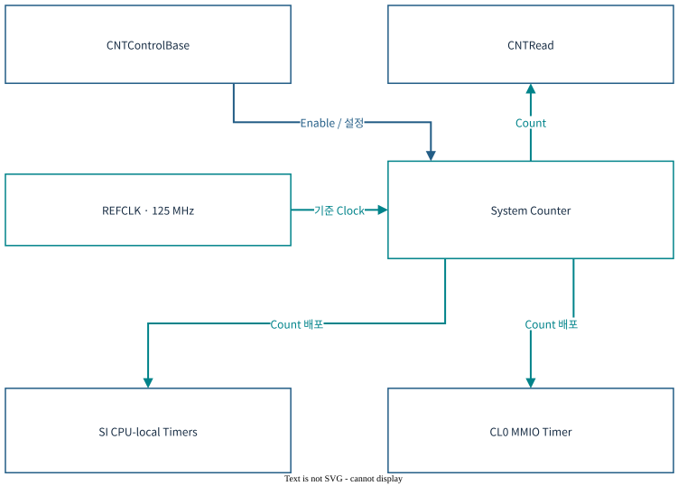

<details>
<summary>도면 상세 설명</summary>

- **CNTControlBase**: CNTControlBase / 0x02_0000_D010_0000 / Counter 제어
- **CNTRead**: CNTRead / 0x02_0000_D011_0000 / Count 조회
- **REFCLK · 125 MHz**: REFCLK / Clock frequency: 125 MHz
- **System Counter**: System Counter / Increment logic + 64-bit count
- **SI CPU-local Timers**: SI CPU-local Timers / CL0 CPU0 / CL1 CPU0–3
- **CL0 MMIO Timer**: CL0 MMIO Timer / CNTBase

</details>

HW는 **AP와 같은 System Counter를 공유**한다. 그림은 Zena CSS의 HW 구조이며, 아래 표는 QVP의 `css_system_counter` 연결을 나타낸다. CSS Counter 제어 공간과 CL0 timer frame은 주소·역할이 다르다.

| 경로 | 접근·전달 방식 |
|---|---|
| Counter 제어 | CL0 → SI ATW5 window → SMD CSS Counter control (`0x20000D0100000`) |
| CL0 MMIO timer | `host_gtimer`가 SystemC Counter를 직접 참조 |
| CL0 CPU timer | `si_cl0_cpu_counter_mirror` → CL0 QEMU CPU |
| CL1 CPU timer | `si_cl1_cpu_counter_mirror_0`–`_3` → 각 CL1 QEMU CPU |

- **초기값:** 입력 125MHz·increment 1. CNTFRQ 보고값과 실제 증가율은 별도 상태다.
- **설정 경계:** 현재 SCP의 CNTINCR 요청값은 8이지만 64-bit 쓰기가 모델에서 무시되므로, 설정 상수만으로 1GHz 동작을 단정하지 않는다.
- **동기화 경계:** CPU mirror는 snapshot을 전달한다. CSS sync frame 저장과 공통 source 사용은 chip 간 동기화 protocol이나 CL0·CL1의 동시 count 관찰을 보장하지 않는다.

[Counter·주소 근거](SOURCES.md#si-hardware) · [주파수 처리 상세](#implementation)

Multiview·FMU 구조는 [Interrupt Architecture — Safety Island](../interrupt/README.md#si-automotive-enhanced)를 참조한다.

#### 2.3.4 Safety Island Domain Timer / Counter QVP 구현

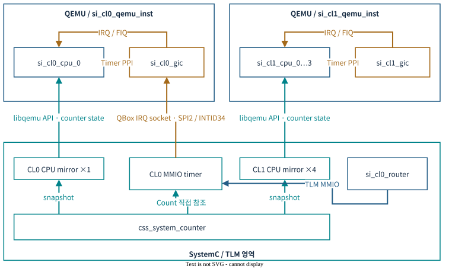

<details>
<summary>도면 상세 설명</summary>

- **si_cl0_cpu_0**: si_cl0_cpu_0 / R82 · CPU-local timer
- **si_cl0_gic**: si_cl0_gic / GIC backend
- **si_cl1_cpu_0…3**: si_cl1_cpu_0…3 / R82 · CPU-local timer
- **si_cl1_gic**: si_cl1_gic / GIC backend
- **CL0 MMIO timer**: CL0 MMIO timer / si_cl0_timer_cntbase / host_gtimer · 만료 event
- **si_cl0_router**: si_cl0_router / TLM MMIO
- **css_system_counter**: css_system_counter / 공통 count · frequency · running

</details>

**CL0 MMIO timer는 SystemC에서 만료를 계산하고, CPU-local timer는 각 QEMU instance에서 만료를 계산한다.**

| 객체 | 구현 / 소유 상태 | Interrupt 목적지 |
|---|---|---|
| `si_cl0_timer_cntctl` | SystemC `host_gtimer`; 관리 register 저장 | 없음 |
| `si_cl0_timer_cntbase` | SystemC `host_gtimer`; CVAL·CTL·만료 event | `si_cl0_gic.spi_in_2` |
| `si_cl0_cpu_0` + `si_cl0_cpu_counter_mirror` | QEMU CPU timer + SystemC snapshot 전달 | CL0 CPU별 PPI |
| `si_cl1_cpu_0`–`_3` + 각 counter mirror | QEMU CPU별 timer + SystemC snapshot 전달 | CL1 CPU별 PPI |

**모델 실행 Flow**

1. **기준 시간:** SystemC Counter가 경과 시간으로 count를 계산한다.
2. **CL0 MMIO 경로:** CVAL/CTL 쓰기 또는 Counter 변경 → `host_gtimer`의 wait 재계산 → 만료 시 SPI2 assert → CL0 GIC → CPU exception.
3. **CPU-local 경로:** 초기·변경 snapshot 전달 → QEMU virtual time으로 count 외삽 → CPU timer 만료 → 해당 PE의 PPI → CPU exception.
4. **해제·재설정:** Timer mask/disable 또는 다음 CVAL 설정으로 source level 갱신. GIC acknowledge·EOI/deactivate는 별도의 interrupt controller 처리다.

**구현 제약:** CL0 MMIO TVAL의 상대값 계산, CSS chip 간 sync protocol, SI GIC multiview의 완전한 격리 동작은 구현 완료 범위에 포함하지 않는다. SystemC와 QEMU의 시간 기준 연결만으로 interrupt latency·domain 간 skew·FVP timing 동등성을 주장하지 않는다. [모델 소스](SOURCES.md#models) · [CPU·IRQ 구성](SOURCES.md#platform)

<a id="rse-hardware"></a>

### 2.4 RSE Domain Timer / Counter

RSE는 **Cortex-M55 ×1 + NVIC** 구조다. CPU 내부의 SysTick과, CPU 밖에서 Local System Counter(LSC)를 사용하는 Timestamp TIMER0–3를 구분한다. AP·SI의 CPU-local Generic Timer/PPI 구조를 RSE에 적용하지 않는다.

| Timer 계열 | HW 시간 기준 | Interrupt | 현재 QVP |
|---|---|---|---|
| Timestamp TIMER0–3 | LSC의 64-bit `CNTVALUEB` | NVIC IRQn 3 / 4 / 5 / 27 | SSE counter + SSE timer ×4 |
| M55 Secure / Non-secure SysTick | CPU clock 또는 구현된 reference clock | 각 보안 상태의 SysTick exception 15 | 별도 SysTick ×2, CPU clock 100MHz |
| SLOWCLK Timer | SLOWCLK, 32-bit down-counter | IRQn 2 | 전용 instance·배선 미확인 |
| Zena CSS `SOC_TIMER0/1` | 별도 System Timestamp Timer 경로 | IRQn 59 / 60 | 전용 instance·배선 미확인 |

**HW 기준:** Zena programmer’s model의 주소·IRQ·전원/reset 통합 규칙과 Corstone의 Timer/Counter register 계약을 대조했다. QVP의 CSS mirror와 100/125MHz 설정은 모델 구성값이며, 실물 RSE의 clock 배선·주파수로 일반화하지 않는다. [조사 근거](SOURCES.md#rse-hardware)

#### 2.4.1 Timestamp Timer Hardware

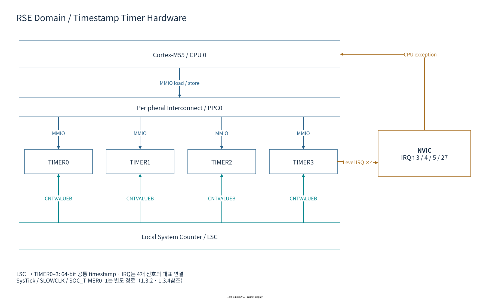

<details>
<summary>도면 상세 설명</summary>

- **NVIC**: NVIC / IRQn 3 / 4 / 5 / 27

</details>

- **Counter:** LSC 하나가 TIMER0–3에 같은 64-bit count를 배포한다.
- **Timer:** 각 IP가 독립적인 compare value·enable·mask·auto-increment 상태를 가진다. CPU와 Timer는 1:1 관계가 아니다.
- **접근:** M55의 load/store → peripheral interconnect → PPC0 → Timer register. Secure/Non-secure 주소는 같은 IP의 alias다.
- **Interrupt:** 비교 조건 만족 → level IRQ → NVIC → M55 exception. Timestamp 읽기만으로 IRQ가 발생하지 않는다.

**동작 모드**

| 모드 | 설정과 동작 | IRQ 원인 해제 |
|---|---|---|
| Compare | `CNTP_CVAL`에 deadline 설정 | 미래 CVAL 설정 또는 disable/mask |
| Relative | `CNTP_TVAL`의 signed 32-bit 값으로 `CVAL = count + sign_extend(TVAL)` 계산 | Compare와 동일 |
| Auto-increment | `CNTP_CTL.ENABLE`과 `CNTP_AIVAL_CTL.EN` 설정; RELOAD 간격으로 AIVAL 자동 갱신 | `CNTP_AIVAL_CTL.CLR`에 **0**을 써서 pending 해제; EN은 유지 |

AIVAL 모드에서는 일반 CVAL/TVAL 비교 경로를 사용하지 않는다. NVIC pending clear만으로 Timer의 level 원인이 해제되지는 않는다.

**Interrupt / Reset map**

| Source | NVIC IRQn | Exception 번호 | Power domain | Reset domain |
|---|---:|---:|---|---|
| TIMER0 | 3 | 19 | PD_AON | `nWARMRESETSYS_RSS` |
| TIMER1 | 4 | 20 | PD_AON | `nWARMRESETSYS_RSS` |
| TIMER2 | 5 | 21 | PD_AON | `nWARMRESETSYS_RSS` |
| TIMER3 | 27 | 43 | PD_AON | `nWARMRESETAON` |

네 IRQ 모두 active-high level이며 Zena interrupt 표에 EWIC 지원이 명시된다. **TIMER0–3 모두 PD_AON**인 것은 Zena의 통합 규칙이다. 일반 Corstone의 TIMER0–2 PD_SYS 설명과 다르다. [Zena HW·Timer 동작 근거](SOURCES.md#rse-hardware)

#### 2.4.2 Timestamp Timer MMIO Frame

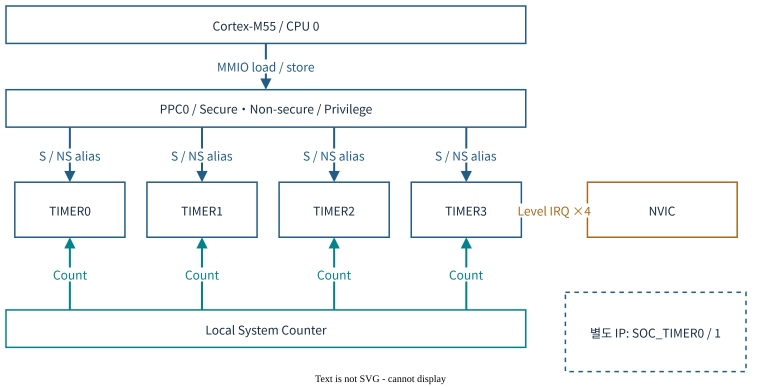

<details>
<summary>도면 상세 설명</summary>

- **TIMER0**: TIMER0 / S: 0x58000000 / NS: 0x48000000
- **TIMER1**: TIMER1 / S: 0x58001000 / NS: 0x48001000
- **TIMER2**: TIMER2 / S: 0x58002000 / NS: 0x48002000
- **TIMER3**: TIMER3 / S: 0x58003000 / NS: 0x48003000
- **NVIC**: NVIC / IRQn 3 / 4 / 5 / 27
- **별도 IP: SOC_TIMER0 / 1**: 별도 IP: SOC_TIMER0 / 1 / S: 0x50158000 / 0x50159000 / NS: 0x40158000 / 0x40159000 / IRQn 59 / 60

</details>

**Address map — RSE local address, 각 window 4KiB**

| Frame | Secure base | Non-secure alias | 용도 |
|---|---|---|---|
| TIMER0 | `0x58000000` | `0x48000000` | Timestamp timer |
| TIMER1 | `0x58001000` | `0x48001000` | Timestamp timer |
| TIMER2 | `0x58002000` | `0x48002000` | Timestamp timer |
| TIMER3 | `0x58003000` | `0x48003000` | AON reset timer |
| SOC_TIMER0 | `0x50158000` | `0x40158000` | Zena CSS System Timer 0, IRQn59 |
| SOC_TIMER1 | `0x50159000` | `0x40159000` | Zena CSS System Timer 1, IRQn60 |

PPC0의 TIMER0/1/2/3 security bit는 각각 **0/1/2/5**다. Secure/Non-secure 및 privileged 접근 정책을 적용하며, 두 alias를 독립 Timer 두 개로 세지 않는다. SOC_TIMER0/1은 TIMER0/1과 별도 IP이며 AON reset 대상이다. 조사한 문서만으로 SOC_TIMER0/1의 timestamp 입력을 LSC에 연결했다고 단정하지 않는다.

**Register map — TIMER0–3 공통**

| Offset | Register | 기능 |
|---|---|---|
| `0x000 / 0x004` | `CNTPCT_LO / HI` | 64-bit timestamp 조회 |
| `0x010` | `CNTFRQ` | SW 시간 환산용 frequency 값; 쓰기로 실제 clock이 바뀌지 않음 |
| `0x020 / 0x024` | `CNTP_CVAL_LO / HI` | 64-bit compare value |
| `0x028` | `CNTP_TVAL` | CVAL의 상대 32-bit view |
| `0x02C` | `CNTP_CTL` | ENABLE[0], IMASK[1], ISTATUS[2] |
| `0x040 / 0x044` | `CNTP_AIVAL_LO / HI` | Auto-increment deadline 조회 |
| `0x048` | `CNTP_AIVAL_RELOAD` | 다음 interval의 32-bit 간격 |
| `0x04C` | `CNTP_AIVAL_CTL` | EN[0], CLR[1]; CLR은 write-zero clear |
| `0x050` | `CNTP_CFG` | Auto-increment 구현 정보 |

AP의 `CNTCTLBase + CNTBaseN` discovery 구조와 달리 RSE는 네 Timer IP의 frame을 직접 주소화한다. [주소·register 근거](SOURCES.md#rse-hardware)

#### 2.4.3 Local System Counter

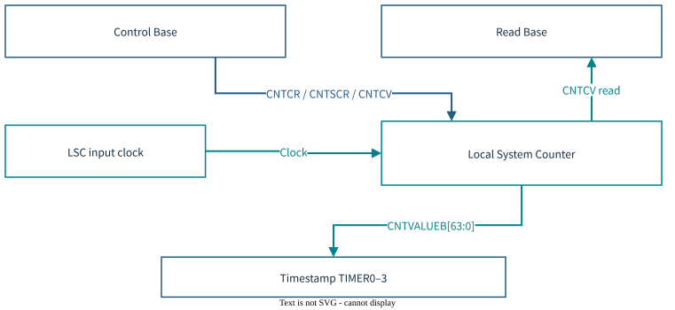

<details>
<summary>도면 상세 설명</summary>

- **Control Base**: Control Base / 0x5015A000 · S_PPC
- **Read Base**: Read Base / 0x5015B000 · Secure
- **LSC input clock**: LSC input clock / HW integration clock
- **Local System Counter**: Local System Counter / 64-bit count / Scaling logic

</details>

LSC는 **64-bit up-counter와 scaling logic**으로 timestamp를 생성한다. 내부 fractional 상태를 이용한 rate scaling과 clock 전환 기능을 제공하며, TIMER0–3는 출력 `CNTVALUEB[63:0]`를 공유한다. SysTick과 SLOWCLK Timer는 이 배포 경로에 포함되지 않는다.

| Frame / offset | Register | 역할 |
|---|---|---|
| Control `0x5015A000 + 0x000` | `CNTCR` | Counter enable, debug halt, scaling/clock 제어 |
| Control `+0x004` | `CNTSR` | Counter 상태 |
| Control `+0x008 / 0x00C` | `CNTCV_LO / HI` | Count 조회·설정 |
| Control `+0x010` | `CNTSCR` | Scaling register view |
| Control `+0x01C` | `CNTID` | Counter capability |
| Control `+0x0D0 / 0x0D4` | `CNTSCR0 / CNTSCR1` | 8.24 fixed-point scaling 값 |
| Read `0x5015B000 + 0x000 / 0x004` | `CNTCV_LO / HI` | Read-only count 조회 |

- **접근 권한:** Zena 주소 맵에서 Control은 `S_PPC`, Read는 `S`다. 일반 Counter 설명의 Non-secure read 용도를 근거로 Zena에 NS alias가 있다고 가정하지 않는다.
- **Clock 구분:** HW 그림은 LSC 입력 clock을 표시한다. 현재 full-system QVP는 CSS source를 mirror하며 초기 입력은 125MHz다.
- **Scaling 구분:** LSC의 `CNTSCR0/1`과 CSS Counter 모델의 `CNTINCR`는 별도 register 계약이다.

[LSC HW·register 근거](SOURCES.md#rse-hardware)

#### 2.4.4 Cortex-M55 SysTick / SLOWCLK Timer

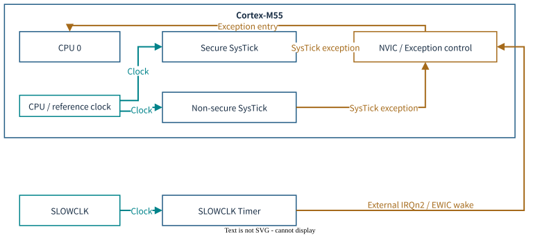

<details>
<summary>도면 상세 설명</summary>

- **Secure SysTick**: Secure SysTick / 24-bit down-counter
- **Non-secure SysTick**: Non-secure SysTick / 24-bit down-counter
- **NVIC / Exception control**: NVIC / Exception control / S / NS exception 15
- **SLOWCLK Timer**: SLOWCLK Timer / 32-bit down-counter

</details>

**SysTick:** M55 내부의 24-bit down-counter다. Security Extension에서는 Secure·Non-secure 상태별 SysTick을 가지며, 각 상태의 **exception 15**를 발생시킨다. TIMER0–3의 외부 NVIC IRQn과 구분한다. [Arm Cortex-M55 문서](https://documentation-service.arm.com/static/6622c155fabc8c11c7b534b4)

| SCS 주소 | Register | 기능 |
|---|---|---|
| `0xE000E010` | `SYST_CSR` / CTRL | ENABLE, TICKINT, CLKSOURCE, COUNTFLAG |
| `0xE000E014` | `SYST_RVR` / LOAD | 24-bit reload |
| `0xE000E018` | `SYST_CVR` / VAL | 현재 count; write 시 count·COUNTFLAG clear |
| `0xE000E01C` | `SYST_CALIB` | Calibration / reference clock 정보 |

동일 SCS 주소는 접근 security에 따라 해당 bank를 선택한다. Secure SW는 Non-secure alias `0xE002E010`부터 NS SysTick에 접근할 수 있다. `LOAD + 1` clock 주기로 reload되며, 주기 tick을 쓰려면 TICKINT와 exception 처리가 함께 설정되어야 한다.

**SLOWCLK Timer:** 외부의 32-bit CMSDK 계열 down-counter다. Secure `0x5802F000` / NS alias `0x4802F000`에 매핑되고, count zero 시 **IRQn2 → exception18**로 전달된다. PD_AON·AON reset 영역이며 EWIC wake 경로를 지원한다. Register는 CTRL(+0x0), VALUE(+0x4), RELOAD(+0x8), INTSTATUS/INTCLEAR(+0xC)다.

현재 QVP는 S/NS SysTick을 100MHz CPU clock으로 구성한다. SLOWCLK Timer의 전용 instance·IRQ 배선은 조사한 Apollo Lua에서 확인하지 못했다. [HW·QVP 근거](SOURCES.md#rse-hardware)

#### 2.4.5 RSE Domain Timer / Counter QVP 구현

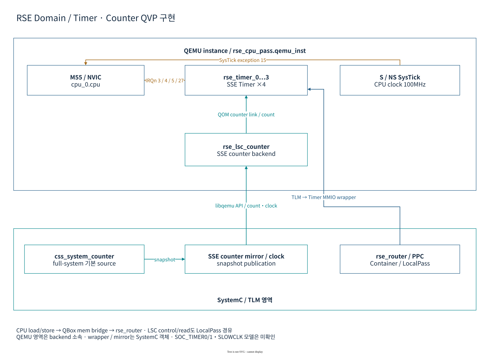

<details>
<summary>도면 상세 설명</summary>

- **M55 / NVIC**: M55 / NVIC / cpu_0.cpu
- **rse_timer_0…3**: rse_timer_0…3 / SSE Timer ×4
- **S / NS SysTick**: S / NS SysTick / CPU clock 100MHz
- **rse_lsc_counter**: rse_lsc_counter / SSE counter backend
- **css_system_counter**: css_system_counter / full-system 기본 source
- **SSE counter mirror / clock**: SSE counter mirror / clock / snapshot publication
- **rse_router / PPC**: rse_router / PPC / Container / LocalPass

</details>

**TIMER0–3·LSC·M55/NVIC·SysTick backend는 `rse_cpu_pass.qemu_inst`에 속한다.** SystemC는 Counter source·snapshot 전달·MMIO routing/PPC를 담당한다. QBox wrapper는 SystemC 객체이며, 그림의 QEMU 경계는 backend 소속을 표시한다.

| 객체 / 경로 | 구현과 역할 |
|---|---|
| `css_system_counter` | full-system 기본 mirror의 공통 source |
| `rse_lsc_counter` | `qemu_sse_counter_mirror`; QEMU SSE counter + SystemC publication thread |
| `rse_lsc_clock` | `qemu_clock_source`; snapshot의 effective rate를 QEMU clock으로 전달 |
| `rse_timer_0`–`_3` | `qemu_sse_timer`; 같은 QOM counter를 link, 독립 CVAL·AIVAL·IRQ |
| `rse_timer_N_ppc` | S/NS alias·privilege 검사 → Container → LocalPass → Timer MMIO wrapper |
| `cpu_0.cpu.nvic` | TIMER0–3 IRQn3/4/5/27과 S/NS SysTick exception 처리 |

1. **시간 전달:** 초기화·Counter 변경 → `snapshot_at(sc_time_stamp())` → clock frequency와 count/running을 libqemu API로 전달.
2. **Timer 접근:** M55 load/store → `rse_router` → PPC / LocalPass → QEMU SSE timer register.
3. **만료:** QEMU virtual time에서 compare 또는 AIVAL event 처리 → QBox IRQ socket → NVIC → M55 exception.
4. **재설정:** Guest가 Timer의 원인을 clear/mask하거나 다음 deadline을 설정한다. SysTick은 독립 CPU clock에서 동작한다.

**구현 범위와 제약**

- `rse_smd_counter_mirror=true`가 full-system 기본이다. false이면 local `arm_system_counter`를 사용하므로 HW의 LSC와 CSS source 관계를 QVP 기본값만으로 설명하지 않는다.
- SYS/RSS reset fanout은 CPU/NVIC·TIMER0–2, AON fanout은 TIMER3를 대상으로 한다. 현재 AON fanout의 입력 source는 미확인이다.
- SSE AIVAL disable 시 예약 event 삭제와 callback의 ENABLE 재검사에 제약이 있다. Reset 코드에도 명시적 IRQ deassert가 없다.
- SOC_TIMER0/1·SLOWCLK Timer 전용 모델은 미확인이다. 기존 TIMER0–3 모델이 이 IP까지 구현한다고 해석하지 않는다.

[구현 소스](SOURCES.md#rse-hardware) · [RSE 주소·reset 상세](TIMER-MAP.md)

### 2.5 Subsystem별 HW 구성 요약

| 구성 | 역할 | SW 관점 |
|---|---|---|
| System Counter | 일정한 기준으로 timestamp 증가 | `CNTPCT` 또는 MMIO count read |
| CPU timer bank | PE별 physical·virtual deadline 비교 | `CNT*_CVAL`, `CNT*_TVAL`, `CNT*_CTL`; local PPI |
| MMIO timer frame | CPU 밖의 deadline comparator | `CNTBaseN`; 공유 SPI 또는 NVIC IRQ |
| RSE Local System Counter | TIMER0–3에 공통 timestamp 제공 | timer마다 별도 CVAL·mask·AIVAL 상태 |
| SysTick | M-profile CPU 내부 24-bit down-counter | LOAD/VAL/CTRL; timestamp TIMER0–3와 별개 |

**시간 조회와 timer 만료는 별도 기능이다.** Counter read에는 IRQ가 필요 없다. Virtual count는 physical count에 offset을 적용한다. `TVAL`은 상대 deadline view이며, IRQ를 해제하려면 comparator 조건이나 mask/enable을 바꿔야 한다. [Arm Generic Timer 설명](https://documentation-service.arm.com/static/6294c39db334256d9ea8ae53?token=), [로컬 register·RSE 근거](SOURCES.md#hardware).

**현재 CL0 `host_gtimer`의 TVAL은 저장만 하며 상대 deadline 동작을 구현하지 않는다.** CPU/AP MMIO/RSE timer의 TVAL 동작과 구분한다.

#### MMIO Frame 역할

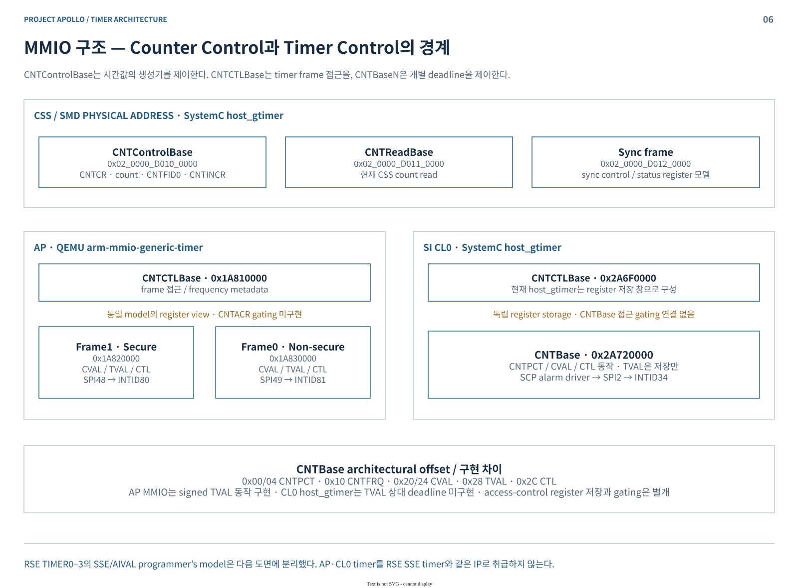

<details>
<summary>도면 상세 설명</summary>

- **CNTControlBase**: CNTControlBase / 0x02_0000_D010_0000 / CNTCR · count · CNTFID0 · CNTINCR
- **CNTReadBase**: CNTReadBase / 0x02_0000_D011_0000 / 현재 CSS count read
- **Sync frame**: Sync frame / 0x02_0000_D012_0000 / sync control / status register 모델
- **CNTCTLBase · 0x1A810000**: CNTCTLBase · 0x1A810000 / frame 접근 / frequency metadata
- **Frame1 · Secure**: Frame1 · Secure / 0x1A820000 / CVAL / TVAL / CTL / SPI48 → INTID80
- **Frame0 · Non-secure**: Frame0 · Non-secure / 0x1A830000 / CVAL / TVAL / CTL / SPI49 → INTID81
- **CNTCTLBase · 0x2A6F0000**: CNTCTLBase · 0x2A6F0000 / 현재 host_gtimer는 register 저장 창으로 구성
- **CNTBase · 0x2A720000**: CNTBase · 0x2A720000 / CNTPCT / CVAL / CTL 동작 · TVAL은 저장만 / SCP alarm driver → SPI2 → INTID34
- **CNTBase architectural offset / 구현 차이**: CNTBase architectural offset / 구현 차이 / 0x00/04 CNTPCT  ·  0x10 CNTFRQ  ·  0x20/24 CVAL  ·  0x28 TVAL  ·  0x2C CTL / AP MMIO는 signed TVAL 동작 구현 · CL0 host_gtimer는 TVAL 상대 deadline 미구현 · access-control register 저장과 gating은 별개

</details>

- **CNTControlBase**: CSS count·enable·increment 제어. SCP는 SMD physical 주소를 SI ATW window로 접근한다.
- **CNTCTLBase**: timer frame의 설정·접근 register 공간. QVP에서 register 저장과 실제 access gating은 구분해야 한다.
- **CNTBaseN**: count read와 CVAL/CTL. AP는 frame1 Secure/INTID80, frame0 NS/INTID81; CL0는 INTID34.

같은 offset `0xD0`도 CSS `host_gtimer`에서는 정수 CNTINCR, RSE SSE counter에서는 8.24 CNTSCR0다. 이름·offset만으로 같은 IP라고 판단하지 않는다. [주소·owner·IRQ 상세표](TIMER-MAP.md), [register 구현](SOURCES.md#models).

<a id="implementation"></a>

## 3. QVP Timer/Counter Implementation

이 장은 **모델이 시간 상태를 관리하고 Timer 만료를 전달하는 방식**을 설명한다. Domain별 HW·register·배선은 2장, guest driver·OS 처리는 4장에서 다룬다.

### 3.1 Implementation Overview

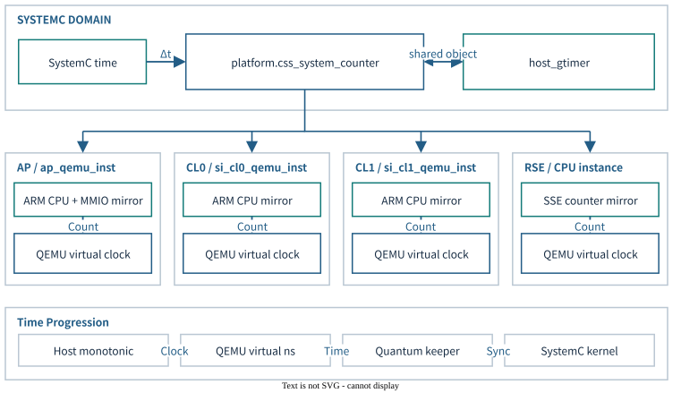

<details>
<summary>도면 상세 설명</summary>

- **SystemC time**: SystemC time / sc_time_stamp()
- **platform.css_system_counter**: platform.css_system_counter / arm_system_counter / anchor count · fractional state · generation
- **host_gtimer**: host_gtimer / CSS control / read / sync / CL0 MMIO timer · sc_event deadline
- **ARM CPU + MMIO mirror**: ARM CPU + MMIO mirror / count / running / effective Hz
- **QEMU virtual clock**: QEMU virtual clock / A720AE ×4 · per-PE timer / AP MMIO timer ×2 frame
- **ARM CPU mirror**: ARM CPU mirror / count / running / effective Hz
- **QEMU virtual clock**: QEMU virtual clock / Cortex-R82 ×1 · per-PE timer / SCP MMIO timer는 SystemC 측
- **QEMU virtual clock**: QEMU virtual clock / Cortex-R82 ×4 · per-PE timer / Zephyr virtual timer
- **SSE counter mirror**: SSE counter mirror / count / running / effective Hz
- **QEMU virtual clock**: QEMU virtual clock / M55 ×1 · LSC → TIMER0–3 / SSE timer IRQ는 같은 instance
- **Host monotonic**: Host monotonic / 실행 중 elapsed time
- **QEMU virtual ns**: QEMU virtual ns / VM 정지 시 offset 유지
- **Quantum keeper**: Quantum keeper / CPU local time ↔ kernel 조정
- **SystemC kernel**: SystemC kernel / quantum 10ms ≠ skew 상한

</details>

| 구현 영역 | 소유 상태 | 책임 |
|---|---|---|
| SystemC `arm_system_counter` | Count·소수부·input frequency·increment·enable·generation | SystemC 경과 시간으로 count 계산; clock tick마다 event를 만들지 않음 |
| SystemC `host_gtimer` | Counter control/read/sync register 또는 CL0 CVAL/CTL | 공통 Counter 참조; CL0 comparator·IRQ 계산 |
| CPU / AP MMIO mirror | Source snapshot 전달 경로 | `qemu_arm_counter_mirror` / `qemu_arm_mmio_counter_mirror`로 count·rate·running 전달 |
| QEMU CPU / AP MMIO Timer | Local anchor·comparator·CTL·expiry event | QEMU virtual time으로 count 계산, 만료 시 PPI/SPI 출력 |
| RSE Counter / Timer | LSC·shared QOM counter·TIMER0–3 상태 | SSE mirror가 clock/count 전달, Timer가 NVIC IRQ 출력 |

**소유권:** Mirror는 시간 기준을 전달한다. CPU별·frame별 comparator, mask, interrupt 상태는 각 Timer 모델이 관리한다. 공통 Counter를 사용해도 모든 Timer가 같은 deadline이나 IRQ 상태를 공유하지 않는다.

### 3.2 Time Base and Counter Propagation

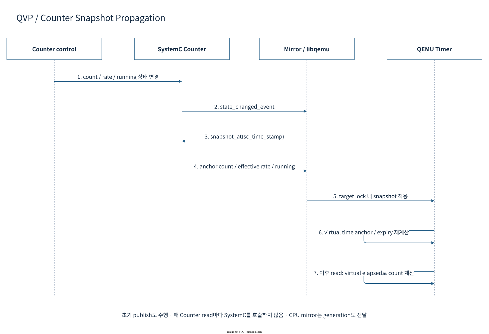

1. Counter control 쓰기가 count·rate·running 상태를 변경한다.
2. SystemC Counter의 state-change event가 mirror의 publish loop를 깨운다. 초기 publish는 별도로 수행한다.
3. Mirror가 현재 SystemC 시각의 snapshot을 요청한다.
4. Counter는 anchor count·실효 rate·running 상태를 제공한다.
5. Mirror가 target QEMU의 lock을 통해 snapshot을 전달한다. CPU 경로는 generation도 전달한다.
6. Target은 virtual time 기준 anchor를 갱신하고 Timer 만료를 재계산한다.
7. 이후 QEMU read는 snapshot 이후의 virtual elapsed를 사용한다. 매 read마다 SystemC Counter를 호출하지 않는다.

Running 상태의 기본 계산은 `count = anchor_count + floor(Δvirtual_ns × effective_Hz / 10⁹)`다. Virtual Counter에는 추가로 offset을 적용한다. 정지 상태·RSE native scaling은 해당 모델의 별도 상태에 따른다.

| 시간 기준 | 사용처 | 해석 |
|---|---|---|
| SystemC simulation time | 공통 Counter·CL0 Timer | Counter 계산·SystemC event 예약 |
| QEMU virtual time | CPU/AP MMIO/SSE Timer | Snapshot 이후 count 계산·QEMUTimer 예약 |
| Host elapsed time | 비-icount TCG 실행의 virtual time 기반 | Guest count 정확도나 Domain 간 동기화 보장과 별개 |

현재 기본 실행은 `quantum_keeper`·`multithread-freerunning`이다. **10ms quantum은 guest Timer 주기나 Domain 간 skew 상한이 아니다.** CPU 실행 budget용 timer와 guest CNTP/CNTV Timer도 구분한다. 공통 snapshot은 서로 다른 instance의 동시 read 값이 항상 같다는 보장이 아니다.

### 3.3 Timer Expiry and Interrupt Delivery

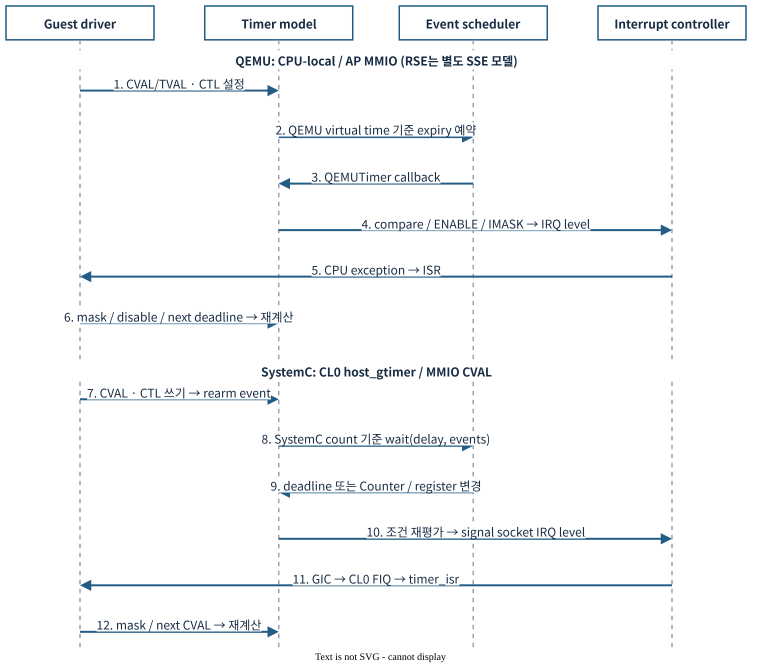

| 단계 | QEMU CPU / AP MMIO — 그림 1–6 | SystemC CL0 — 그림 7–12 |
|---|---|---|
| 설정 | Guest system-register 또는 MMIO 쓰기로 comparator·CTL 갱신 | TLM MMIO로 CVAL·CTL 갱신, rearm event 통지 |
| 예약 | QEMU virtual time 기준 만료 event 예약 | 공통 Counter에서 남은 시간을 계산해 `wait(delay, events)` |
| 재평가 | QEMUTimer callback 또는 register·mirror 변경 | Deadline 도달 또는 Counter·register 변경 event |
| 출력 | Compare·ENABLE·IMASK 조건으로 PPI/SPI level 갱신 | 같은 조건을 평가해 signal socket으로 IRQ level 갱신 |
| Guest 처리 | GIC → CPU exception → driver ISR | GIC Group0 → CL0 FIQ → SCP ISR |
| 재설정 | Mask·disable·다음 deadline 설정에 따라 IRQ와 event 재계산 | Mask·disable·다음 CVAL에 따라 IRQ와 wait 재계산 |

- **RSE 경로:** 별도 SSE Timer 모델이 shared QOM Counter와 CVAL/TVAL·AIVAL 상태로 만료를 처리하고 NVIC에 연결한다. AP Generic Timer와 같은 모델이라고 가정하지 않는다.
- **Source와 controller:** GIC EOI나 NVIC pending clear는 Timer source의 만료 조건·latch 해제를 대신하지 않는다.
- **실행 시점:** 모델의 deadline 도달, interrupt 전달, guest ISR 실행, Thread 재개는 서로 다른 단계다. Event 예약만으로 IRQ latency나 Job 완료 시각을 보장하지 않는다.

### 3.4 Frequency Configuration and Limitations

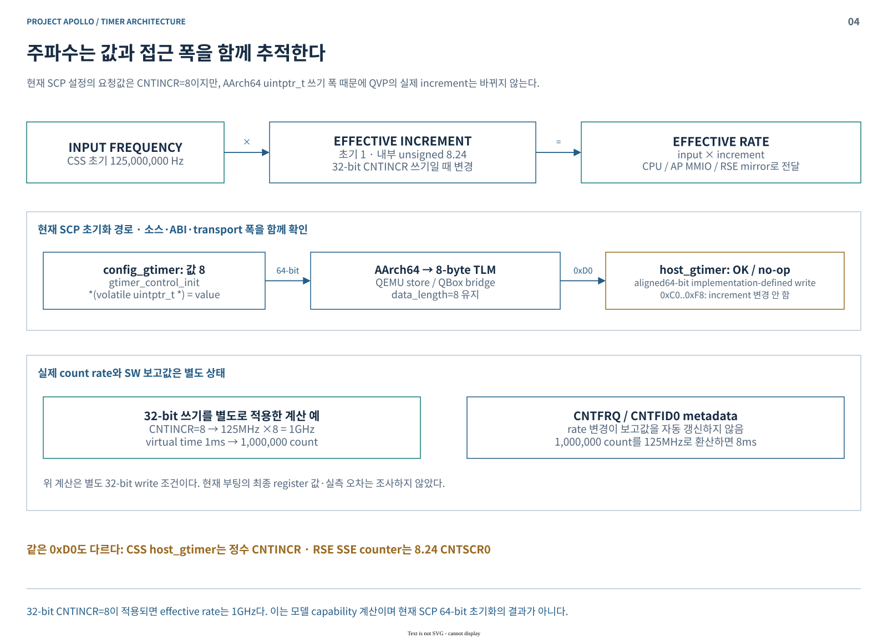

<details>
<summary>도면 상세 설명</summary>

- **INPUT FREQUENCY**: INPUT FREQUENCY / CSS 초기 125,000,000 Hz
- **EFFECTIVE INCREMENT**: EFFECTIVE INCREMENT / 초기 1 · 내부 unsigned 8.24 / 32-bit CNTINCR 쓰기일 때 변경
- **EFFECTIVE RATE**: EFFECTIVE RATE / input × increment / CPU / AP MMIO / RSE mirror로 전달
- **config_gtimer: 값 8**: config_gtimer: 값 8 / gtimer_control_init / *(volatile uintptr_t *) = value
- **AArch64 → 8-byte TLM**: AArch64 → 8-byte TLM / QEMU store / QBox bridge / data_length=8 유지
- **host_gtimer: OK / no-op**: host_gtimer: OK / no-op / aligned64-bit implementation-defined write / 0xC0..0xF8: increment 변경 안 함
- **32-bit 쓰기를 별도로 적용한 계산 예 · 125MHz**: 32-bit 쓰기를 별도로 적용한 계산 예 / CNTINCR=8 → 125MHz ×8 = 1GHz / virtual time 1ms → 1,000,000 count
- **CNTFRQ / CNTFID0 metadata · 125MHz**: CNTFRQ / CNTFID0 metadata / rate 변경이 보고값을 자동 갱신하지 않음 / 1,000,000 count를 125MHz로 환산하면 8ms
- **같은 0xD0도 다르다: CSS host_gtimer는 정수 CNTINCR**: 같은 0xD0도 다르다: CSS host_gtimer는 정수 CNTINCR · RSE SSE counter는 8.24 CNTSCR0

</details>

| 값 | 초기값 / 현재 소스 경로 | 의미 |
|---|---|---|
| CSS input Hz | 125MHz | counter 입력 기준 |
| CSS increment | 초기 1; SCP 요청값은 8이지만 현재 64-bit 쓰기는 무시 | 실제 적용값은 write 폭·model handler까지 추적 |
| Effective rate | input × 적용된 increment | CPU/AP/RSE mirror에 전달되는 rate |
| Reported frequency | CSS CNTFID0, CPU CNTFRQ, AP MMIO CNTFRQ 등 | SW의 count→시간 환산 정보; rate와 별도 |

현재 `cfg2 → fvp variant → gtimer element start → gtimer_control_init()`는 CNTINCR를 `uintptr_t`로 쓴다. **AArch64의 8-byte store는 QBox transport에서 유지되며, `host_gtimer`의 해당 64-bit 구현정의 쓰기는 성공 응답 후 무시된다.** 따라서 이 SCP 초기화가 increment를 8로 바꾼다고 설명하면 틀린다.

별도의 **32-bit `CNTINCR=8` 쓰기**를 적용하면 모델 산식은 1GHz다. 이때 보고값이 125MHz로 남으면 count를 8배 긴 시간으로 환산한다. 이는 조건부 계산이며 실제 boot의 최종 register·시간 오차 측정값이 아니다.

RSE timer의 CNTFRQ도 guest가 저장하는 metadata다. RSE native SCEN/CNTSCR scaling은 mirror가 전달하는 clock rate와 별도이므로 함께 확인해야 한다. [주파수 모델](SOURCES.md#models), [SCP 설정·초기화](SOURCES.md#scp).

| 구현 제약 | 보고서에서의 해석 |
|---|---|
| CL0 `host_gtimer` TVAL | 저장만 제공; SCP의 CVAL 경로와 구분 |
| AP MMIO virtual Timer / CNTACR | Virtual comparator·접근 제한 미구현; register 저장과 기능 지원 구분 |
| CSS sync frame | Register 저장이 chip 간 동기화 protocol 구현을 뜻하지 않음 |
| RSE AIVAL / reset | Disable 시 예약 event 처리·reset 시 IRQ deassert에 제약 |
| Frequency / timing | CNTFRQ metadata는 실제 count rate나 Domain 간 동기화를 제어하지 않음 |

<a id="software"></a>

## 4. Timer Software Architecture

| 서브 챕터 | 주요 내용 |
|---|---|
| [4.1 Overview](#software-overview) | 시간 조회·deadline·Scheduler 공통 구조 |
| [4.2 AP Domain](#ap-timer-software) | Linux·TF-A·U-Boot·OP-TEE |
| [4.3 Safety Island CL0 — SCP](#scp-timer-software) | MMIO Timer·alarm queue·FIQ callback |
| [4.4 Safety Island CL1 — Zephyr](#zephyr-timer-software) | Virtual Timer·tickless·SMP |
| [4.5 RSE Domain — TF-M](#tfm-timer-software) | BL2 timeout·조건부 Timer 시험 |

<a id="software-overview"></a>

### 4.1 Timer Software Architecture Overview

**Counter는 시간 조회, Timer는 만료 통보를 제공하고, Scheduler는 실행 가능한 Task 중 다음 Task를 선택한다.** 주기 Job은 timer로 실행 시점을 요청하며, 실제 실행 시각은 우선순위·CPU 부하·interrupt 지연의 영향을 받는다.

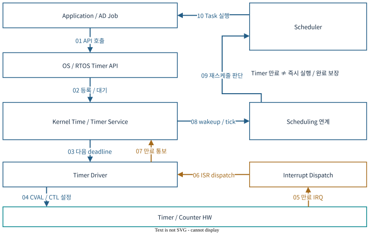

<details>
<summary>도면 상세 설명</summary>

- **Application / AD Job**: Application / AD Job / 주기 작업 · sleep · timeout · 시간 조회
- **Scheduler**: Scheduler / Ready queue · 우선순위 / 정책 / 실행 Task 선택 · 필요 시 context switch
- **OS / RTOS Timer API**: OS / RTOS Timer API / 시간 조회 · 대기 · timer 등록 / 취소
- **Kernel Time / Timer Service**: Kernel Time / Timer Service / Timekeeping · timeout queue · tick / tickless / 만료 callback · 다음 deadline 선택
- **Scheduling 연계**: Scheduling 연계 / 대기 Task → Ready (해당 timeout) / Tick 기반 실행 시간 / time slice 처리
- **Timer Driver**: Timer Driver / Counter read · deadline 설정 · IRQ 처리 / rearm
- **Interrupt Dispatch**: Interrupt Dispatch / GIC / NVIC → CPU exception → ISR
- **Timer / Counter HW**: Timer / Counter HW / Counter: 시간값 제공 · Comparator: 만료 interrupt 생성
- **Timer 만료 ≠ 즉시 실행 / 완료 보장**: Timer 만료 ≠ 즉시 실행 / 완료 보장 / Tick ≠ 매번 context switch / 시간 조회 / busy wait는 IRQ 없이 가능

</details>

그림은 Linux·Zephyr의 공통 개념도다. 01–10은 timer를 통한 Task wakeup의 대표 경로이며, 모든 timer callback이 Scheduler를 거치는 것은 아니다.

#### 계층별 역할

| 계층 | 책임 |
|---|---|
| Application / AD Job | 주기 실행·sleep·timeout 요청, timestamp 기반 경과 시간 측정 |
| OS / RTOS Timer API | 시간 조회, 대기, timer 등록·취소 인터페이스 제공 |
| Kernel Time / Timer Service | Count를 시간으로 환산, timeout 관리, 만료 처리, 다음 HW deadline 선택 |
| Scheduler | Ready queue와 우선순위·정책에 따라 Task 선택; tick 기반 실행 시간·time slice 관리와 연계 |
| Timer Driver | Counter read, CVAL/CTL 설정, timer IRQ 처리·mask·rearm |
| Timer / Counter HW | Counter로 시간값 제공; comparator로 deadline 도달을 검출하여 interrupt 발생 |

#### 시간 조회·Timeout·Scheduler 경로

- **시간 조회:** API → timekeeping/driver → Counter. Timestamp를 읽기 위해 comparator IRQ를 발생시킬 필요는 없다. Busy wait는 반복 조회하며 CPU를 점유한다.
- **대기·timeout:** API → timeout queue → 다음 deadline 설정 → IRQ → 만료 처리. 대기 해제 대상 Task가 있으면 Ready 상태로 바뀌고 Scheduler가 실행 여부를 판단한다.
- **Scheduler tick:** Timer event → 실행 시간 accounting·정책별 tick 처리 → 필요 시 reschedule. Tick마다 반드시 context switch가 발생하는 것은 아니다.
- **Tickless:** 필요한 다음 event에 맞춰 timer를 설정하여 불필요한 주기 IRQ를 줄인다. Counter와 Scheduler의 기능이 없어지는 것은 아니다.

**Deadline interrupt는 Job의 시작·완료 시간 보장이 아니다.** 실행·완료 deadline을 보장하려면 Task 우선순위, 실행 시간, 경쟁·interrupt 지연을 함께 검토해야 한다. QVP의 host 실행 시간과 guest timer 시간도 구분한다.

#### Domain별 적용

Linux는 `update_process_times()`에서 `sched_tick()`을 호출하고, sleep timer 만료는 `hrtimer_wakeup()`을 통해 Task를 깨울 수 있다. Zephyr는 `sys_clock_announce()`에서 timeout을 처리하며 `CONFIG_TIMESLICING` 설정 시 `z_time_slice()`를 호출한다. **SCP alarm callback과 TF-M의 polling·조건부 timer 시험에는 OS Scheduler 경로를 일괄 적용하지 않는다.** [Overview·Scheduler 소스 근거](SOURCES.md#software-overview)

Domain별 시간 조회와 만료 처리 경로는 다음과 같다.

| Subsystem / SW | 시간 조회·대기 | Deadline / IRQ 처리 |
|---|---|---|
| AP / TF-A | CNTFRQ 설정, CNTPCT 기반 `udelay` | Secure timer 접근 허용과 IRQ 사용은 별도 |
| AP / U-Boot | CNTPCT/CNTFRQ; EL2 이상에서는 조건부 event stream + WFE, 이후 tail polling | Event stream은 CVAL/PPI ISR이 아님 |
| AP / OP-TEE | S-EL1 구성에서 CNTPCT secure time | CNTPS callout 코드 존재; automotive_rd의 활성 초기화 호출 미확인 |
| AP / Linux | `arch_sys_counter` clocksource·sched_clock | CPU별 `arch_sys_timer` clockevent → hrtimer/tick |
| SI CL0 / SCP | MMIO count polling, `delay(us)` | sorted alarm queue → MMIO CVAL → FIQ → ISR callback |
| SI CL1 / Zephyr | CNTVCT; cycle API·busy wait | CNTV_CVAL → PPI → `sys_clock_announce` → timeout 처리 |
| RSE / TF-M | BL2 SCMI timeout은 TIMER0 count polling | Timer 시험 구성 시 AIVAL / SPM signal; 기본 periodic SysTick 사용 근거 없음 |

**Linux**는 clocksource read와 clockevent PPI를 따로 선택한다. Kernel이 HYP에서 실행되면 HYP timer, HYP 사용 불가이면서 virtual IRQ가 있으면 virtual, 나머지 ARM64는 NS physical 경로다. DT에 IRQ가 있다는 이유로 실행 중 선택을 확정하지 않는다. Highres/NOHZ의 최종 활성 상태도 runtime 확인 항목이다.

**Zephyr** board 기본값은 125MHz, 100 ticks/s, tickless, SMP 4다. `CYC_PER_TICK=1,250,000`은 이 설정의 환산값이다. 각 PE의 timer를 초기화하고 공유 lock 아래 elapsed ticks를 누적하므로 CPU 수만큼 uptime이 중복 증가하는 구조가 아니다.

**RSE**의 `APOLLO_TIMER_TEST`는 기본 OFF다. TF-M의 `plat_test.c` AIVAL hook도 SCMI/SLIH/FLIH test build 조건부이며, 일반 scheduler tick 경로가 아니다. [AP SW](SOURCES.md#ap-software) · [SCP](SOURCES.md#scp) · [Zephyr](SOURCES.md#zephyr) · [TF-M](SOURCES.md#tfm).

<a id="ap-timer-software"></a>

### 4.2 AP Domain — Linux Kernel·TF-A·U-Boot·OP-TEE

AP의 공통 Counter를 **TF-A·U-Boot는 부트 과정의 시간 조회·delay에**, **Linux는 timekeeping·timeout·Scheduler tick에**, **OP-TEE는 Secure time 조회에** 사용한다. OP-TEE의 대기는 별도 RPC 경로로 처리한다. 같은 HW를 사용해도 SW 초기화와 deadline 관리 상태는 각각 독립적이다.

#### 4.2.1 Linux Kernel Timer Architecture

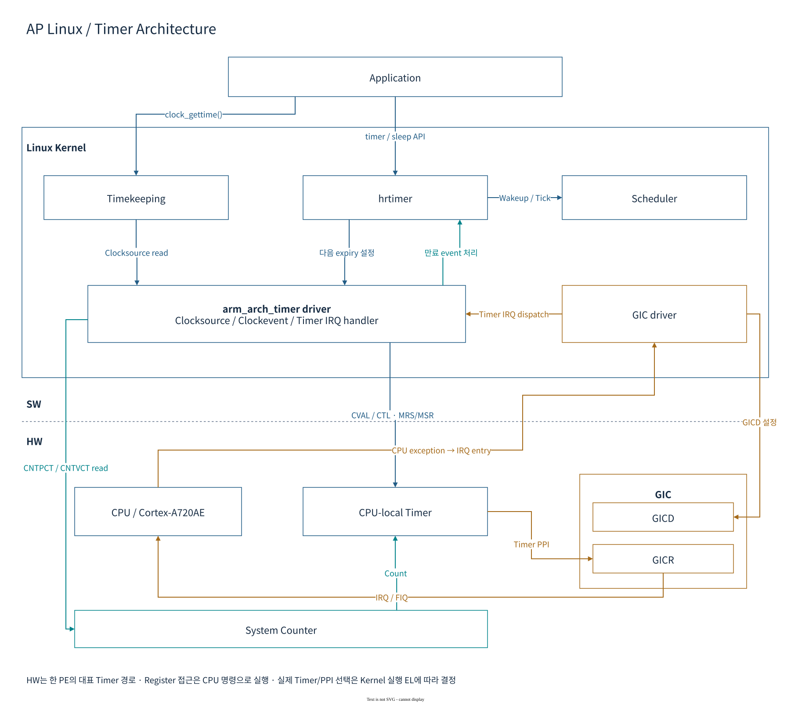

<details>
<summary>도면 상세 설명</summary>

- **arm_arch_timer driver**: arm_arch_timer driver / Clocksource / Clockevent / Timer IRQ handler

</details>

그림 위쪽은 **Application과 Linux Kernel**, 아래쪽은 **한 PE의 CPU·Timer·Counter·GIC 경로**다. 시간 조회는 Counter read, deadline 처리는 Timer interrupt로 구분한다.

##### Software 구성

| Component | 역할 | 그림의 연결 |
|---|---|---|
| Application | 시간 조회·대기·만료 event 요청 | `clock_gettime()` → Timekeeping; sleep/timer API → hrtimer |
| Timekeeping | Counter 값을 ns 단위 OS 시간으로 환산 | Clocksource read → `arm_arch_timer` |
| hrtimer | SW timer queue 관리·만료 callback·sleep wakeup | 다음 expiry 설정 / 만료 event 처리 |
| Scheduler | 실행 시간 갱신·실행할 Task 선택·preemption 판단 | Wakeup / Tick 연계 |
| `arm_arch_timer` driver | Clocksource·CPU별 clockevent 등록, Timer 설정·IRQ 처리 | Counter read, CVAL/CTL 접근, Timer IRQ handler |
| GIC driver | Interrupt 설정·acknowledge·IRQ dispatch·EOI/deactivate | CPU exception → IRQ entry → Timer IRQ dispatch |

`arm_arch_timer`의 clocksource는 `arch_sys_counter`, CPU별 clockevent는 `arch_sys_timer`다. `sched_clock`도 Counter read를 사용하며 scheduler tick IRQ와 별개다. **여러 SW timer의 다음 만료 시각을 CPU별 HW timer에 설정하므로, API마다 HW timer를 하나씩 할당하지 않는다.**

그림은 핵심 연결을 요약했다. Tick/NOHZ·generic IRQ 계층은 별도 상자로 표시하지 않았으며, `clock_gettime()`은 지원 조건에서 vDSO로 처리되어 Kernel 진입 없이 Counter를 읽을 수 있다.

##### Hardware 구성과 Driver 접점

| HW Component | 역할 | SW/HW 경계의 접근 |
|---|---|---|
| System Counter | PE들이 공유하는 증가하는 시간값 제공 | CPU가 `CNTPCT` 또는 `CNTVCT`를 읽음; virtual count에는 offset 적용 |
| CPU-local Timer | 선택 bank의 deadline 비교·enable/mask·PPI 생성 | CPU가 `MRS/MSR`로 CVAL·CTL 접근 |
| GIC | Timer PPI 수신·우선순위 판단·CPU interrupt 전달 | PPI 설정은 GICR, SPI 등 공유 설정은 GICD; acknowledge/EOI는 CPU interface |
| CPU | Driver 명령 실행·exception 진입 | Interrupt 수신 후 Kernel IRQ entry 실행 |

Driver에서 HW로 향하는 화살표는 **CPU가 실행하는 register 접근**을 나타낸다. Timer PPI는 GICR 경로를 사용한다. 그림의 `GICD 설정` 화살표는 GIC driver의 일반 역할이며, Timer PPI를 GICD에 설정한다는 의미가 아니다. Linux timer interrupt는 IRQ 경로로 처리하며 HW의 `IRQ/FIQ` 표시는 GIC 출력 종류를 나타낸다.

##### 시간 조회·Deadline·Interrupt Flow

1. **시간 조회:** Application → Timekeeping → clocksource → `CNTPCT/CNTVCT` read → OS 시간 환산. Timer IRQ를 기다리지 않는다.
2. **Deadline 설정:** hrtimer의 다음 expiry → clockevent `set_next_event()` → `CVAL = 현재 count + delta`, ENABLE=1·IMASK=0.
3. **HW 만료:** Counter 값이 Timer 조건을 만족 → Timer PPI → GICR → CPU IRQ → exception entry.
4. **IRQ 처리:** GIC driver·generic IRQ dispatch → `arch_timer_handler_*()` → ISTATUS 확인·IMASK=1 → `evt->event_handler()`.
5. **Kernel 처리:** Highres 경로는 hrtimer callback을 실행한다. Sleep 만료는 `hrtimer_wakeup()` → `wake_up_process()`로 Task를 깨우며, tick 경로는 `update_process_times()` → `sched_tick()`으로 이어진다.
6. **다음 실행:** 다음 expiry를 재설정하고 Scheduler가 우선순위·preemption·현재 문맥에 따라 실행 Task를 결정한다. IRQ 발생이 즉시 Task 전환을 뜻하지 않는다.

Timer source 해제와 GIC EOI/deactivate는 별도의 완료 단계다. Callback 문맥은 timer mode·Kernel 설정에 따라 달라진다. **NOHZ는 불필요한 tick을 줄이며 Counter를 정지시키지 않는다.**

##### 4.2.1.1 Timer Initialization

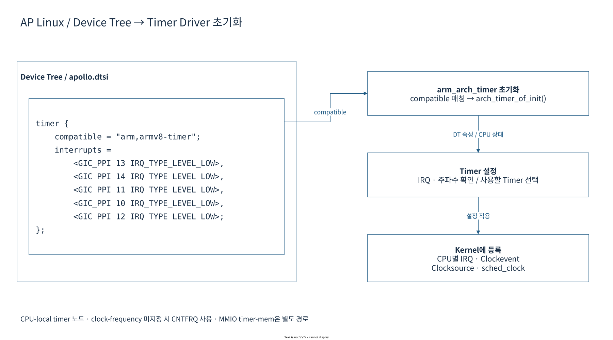

<details>
<summary>도면 상세 설명</summary>

- **timer { arm,armv8-timer }**: timer { /     compatible = "arm,armv8-timer"; /     interrupts = /         &lt;GIC_PPI 13 IRQ_TYPE_LEVEL_LOW>, /         &lt;GIC_PPI 14 IRQ_TYPE_LEVEL_LOW>, /         &lt;GIC_PPI 11 IRQ_TYPE_LEVEL_LOW>, /         &lt;GIC_PPI 10 IRQ_TYPE_LEVEL_LOW>, /         &lt;GIC_PPI 12 IRQ_TYPE_LEVEL_LOW>; / };
- **arm_arch_timer 초기화**: arm_arch_timer 초기화 / compatible 매칭 → arch_timer_of_init()
- **Timer 설정**: Timer 설정 / IRQ · 주파수 확인 / 사용할 Timer 선택
- **Kernel에 등록**: Kernel에 등록 / CPU별 IRQ · Clockevent / Clocksource · sched_clock

</details>

그림은 CPU-local `arm,armv8-timer`의 성공 경로다. `timer_probe()`가 `TIMER_OF_DECLARE`의 compatible과 매칭하여 초기화 함수를 호출한다. 일반 platform driver의 probe 경로와 구분한다.

| 현재 Apollo DTS 입력 | Driver 해석 |
|---|---|
| PPI `13 / 14 / 11 / 10 / 12`, `LEVEL_LOW` | 순서대로 Secure physical / NS physical / virtual / HYP physical / HYP virtual; INTID `29 / 30 / 27 / 26 / 28` |
| `interrupt-names` 없음 | `of_irq_get(np, index)`로 positional mapping |
| `clock-frequency` 없음 | `CNTFRQ`에서 rate 읽기; 속성이 있으면 해당 값으로 override |
| `always-on` 없음 | `arch_timer_c3stop=true`; CPU idle 정지 가능성을 clockevent capability에 반영 |

`always-on` 부재는 실제 idle 중 Counter 정지가 측정되었다는 뜻이 아니다. IRQ 속성의 trigger type은 `check_ppi_trigger()`를 거쳐 CPU별 enable에 사용한다. 아래 등록 과정에서 boot CPU는 즉시 설정하고, 추가 CPU는 CPU hotplug callback으로 설정한다.

###### Initialization Sequence

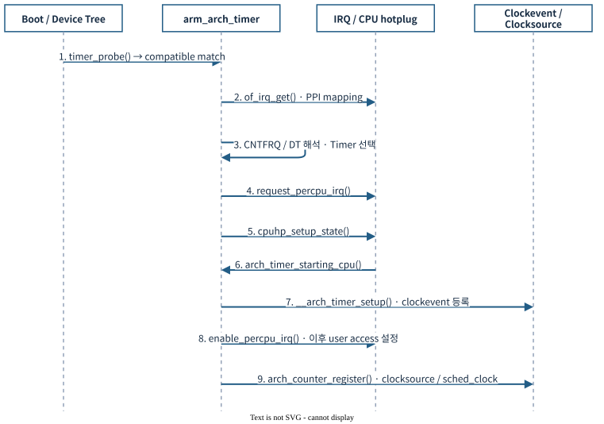

1. **Driver 진입:** `time_init()` → `timer_probe()` → compatible 매칭 → `arch_timer_of_init()` 호출.
2. **IRQ mapping:** DT의 `interrupts`를 `of_irq_get()`으로 읽고 GIC IRQ domain을 통해 Linux IRQ 번호 확보.
3. **설정 해석:** CNTFRQ·DT 속성으로 주파수와 capability를 설정하고, 실행 EL·HYP 가용성에 따라 Timer PPI 선택. 선택 IRQ가 없으면 초기화 중단.
4. **IRQ handler 등록:** `arch_timer_register()`에서 per-CPU clockevent 공간을 할당하고 `request_percpu_irq()`로 physical 또는 virtual handler 등록.
5. **CPU lifecycle 등록:** CPU PM 초기화 후 `cpuhp_setup_state()`로 CPU online/offline callback 등록.
6. **Boot CPU 설정 진입:** 등록 과정에서 `arch_timer_starting_cpu()`를 즉시 호출. 이후 추가 CPU online 때도 같은 경로 실행.
7. **Clockevent 설정:** `__arch_timer_setup()`으로 해당 CPU의 Timer·callback·주파수를 설정하고 clockevent 등록.
8. **PPI 활성화:** `enable_percpu_irq()`로 선택 PPI를 enable한 뒤 Counter의 user 접근 정책 설정.
9. **시간 조회 등록:** `arch_timer_register()` 성공 반환 후 `arch_timer_common_init()` → `arch_counter_register()`에서 Counter read 함수·clocksource·`sched_clock` 등록.

**6–8은 CPU별 처리, 9는 공통 Counter 등록이다.** Driver 초기화가 실제 Application timer 만료나 scheduler tick 실행을 입증하는 것은 아니다.

| ARM64 선택 조건 | Clockevent timer | AP의 현재 QVP 배선 |
|---|---|---|
| Kernel이 HYP mode에서 실행 | HYP physical | INTID26 |
| HYP 사용 불가 + virtual PPI 존재 | Virtual | INTID27 |
| 그 외 ARM64 | Non-secure physical | INTID30 |

그림은 CPU-local timer 경로다. AP MMIO timer의 **INTID80/81(SPI48/49)** 경로는 별도다. DT 선언만으로 부팅 시 선택된 timer를 확정하지 않으며, Highres·NOHZ·선택된 PPI·최종 주파수는 실행 중 확인해야 한다. [Linux 상세 근거](SOURCES.md#ap-software-detail)

##### 4.2.1.2 Timekeeping API

Timekeeping API는 **현재 Counter 값을 읽어 OS 시간으로 환산**한다. Timer 만료·sleep API와 달리 CVAL을 설정하거나 Timer interrupt를 기다리지 않는다.

| 시간 기준 | Application API | Kernel API | 용도·특성 |
|---|---|---|---|
| Monotonic | `clock_gettime(CLOCK_MONOTONIC, …)` | `ktime_get()` / `ktime_get_ns()` | 실행 중 경과 시간; suspend 시간 제외, 시간 보정에 따른 rate 조정 가능 |
| Realtime | `clock_gettime(CLOCK_REALTIME, …)` | `ktime_get_real*()` | 날짜·시각; 시각 설정에 따라 앞뒤로 변경 가능 |
| Boottime | `clock_gettime(CLOCK_BOOTTIME, …)` | `ktime_get_boottime*()` | suspend를 포함한 경과 시간 |
| Raw monotonic | `clock_gettime(CLOCK_MONOTONIC_RAW, …)` | `ktime_get_raw*()` | 시간 보정에 의한 rate 조정을 제외한 시간; Counter 정확도에 의존 |

일반적인 구간 측정은 Monotonic, suspend를 포함한 timeout 기준은 Boottime을 사용한다. 이 표의 `ktime_get*()`는 Kernel 내부 API이며 Application이 직접 호출하지 않는다.

###### vDSO / System Call Layered Architecture

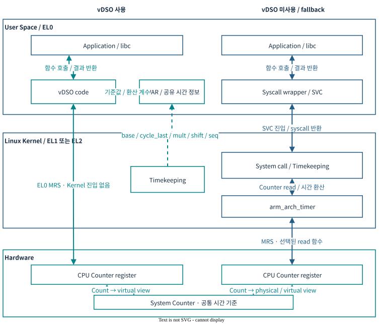

<details>
<summary>도면 상세 설명</summary>

- **Application / libc**: Application / libc / clock_gettime()
- **vDSO code**: vDSO code / Counter 조회 · 시간 환산
- **VVAR / 공유 시간 정보**: VVAR / 공유 시간 정보 / User read-only
- **Timekeeping**: Timekeeping / 공유 시간 정보 갱신
- **System call / Timekeeping**: System call / Timekeeping / clock_gettime → ktime_get_ts64()
- **arm_arch_timer**: arm_arch_timer / Clocksource read
- **CPU Counter register**: CPU Counter register / CNTVCT
- **CPU Counter register**: CPU Counter register / CNTPCT / CNTVCT

</details>

그림은 같은 `clock_gettime(CLOCK_MONOTONIC)` 요청을 **왼쪽 vDSO 경로**와 **오른쪽 syscall 경로**로 비교한다. 두 경로 모두 HW Counter를 사용하며, 시간 환산을 수행하는 계층이 다르다.

| 계층 | 왼쪽: vDSO 사용 | 오른쪽: vDSO 미사용 / fallback |
|---|---|---|
| Application / libc | vDSO 함수 호출 | syscall wrapper 호출 |
| User Space / EL0 | `CNTVCT`·VVAR를 읽고 시간 환산 | `SVC`로 Kernel 진입 |
| Linux Kernel / EL1 또는 EL2 | 공유 시간 정보를 제공; 조회 요청은 Kernel을 거치지 않음 | Timekeeping이 driver를 통해 count를 읽고 시간 환산 |
| Hardware | EL0에서 `CNTVCT` 조회 | Kernel에서 선택된 `CNTPCT/CNTVCT` 조회 |
| 결과 반환 | 사용자 공간의 함수 반환 | syscall 복귀 후 `timespec` 반환 |

**왼쪽 — vDSO 조회 순서**

1. Application의 `clock_gettime()`을 libc가 vDSO 함수로 연결한다.
2. vDSO가 읽기 전용 **VVAR**에서 기준 시간·`cycle_last`·`mult/shift`·sequence 정보를 읽는다.
3. EL0에서 `MRS`로 `CNTVCT`를 읽고, 기준 cycle과의 차이를 시간으로 환산한다.
4. 정보가 갱신되지 않았는지 sequence를 확인한다. 갱신과 겹치면 재시도하고, 일관된 결과를 Application에 반환한다.

vDSO는 **Kernel이 제공하지만 사용자 공간에서 실행하는 코드**다. 왼쪽 세로선은 Kernel 함수를 거치지 않는 Counter 접근을 뜻한다. Kernel 영역을 가로지르는 그림 배치가 privilege 전환을 의미하지 않는다.

**점선 — Kernel의 공유 시간 정보 제공**

Kernel Timekeeping은 VVAR에 기준 시간과 환산 정보를 갱신한다. 이는 Application의 조회 호출과 별개인 데이터 제공 경로다. Kernel이 code/data mapping과 user Counter 접근을 준비하지만, 성공하는 vDSO 조회마다 syscall이나 `arm_arch_timer` 함수가 실행되지는 않는다.

**오른쪽 — syscall 조회 순서**

Application → libc syscall wrapper → `SVC` → Kernel Timekeeping → `arm_arch_timer`의 clocksource read → Counter 조회 → Kernel 시간 환산 → 사용자 공간 반환 순서다. Driver는 count를 읽고, Timekeeping이 OS 시간으로 환산한다. 아래 Sequence Diagram이 이 경로를 상세히 보여준다.

vDSO를 사용하지 않거나 요청한 clock/mode가 지원되지 않으면 syscall 경로를 사용한다. 그림은 고해상도 Monotonic 조회 기준이며, coarse clock 조회는 HW Counter read 없이 저장된 시간 정보를 사용할 수 있다.

###### Timekeeping Sequence

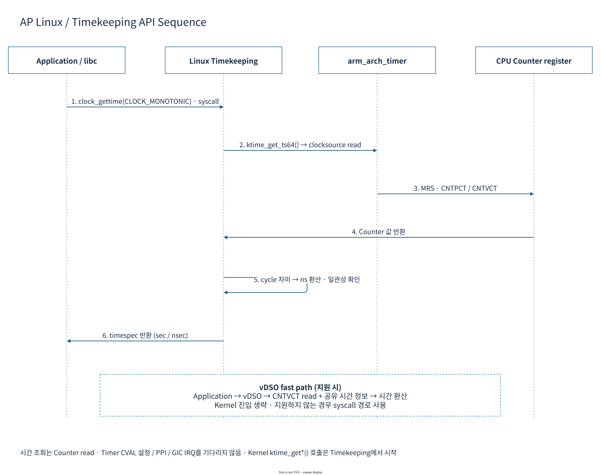

<details>
<summary>도면 상세 설명</summary>

- **vDSO fast path (지원 시)**: vDSO fast path (지원 시) / Application → vDSO → CNTVCT read + 공유 시간 정보 → 시간 환산 / Kernel 진입 생략 · 지원하지 않는 경우 syscall 경로 사용

</details>

그림의 1–6은 위 Layered Diagram **오른쪽의 syscall 경로**다. 하단 점선 상자는 왼쪽 vDSO 경로의 요약이다.

1. **시간 요청:** `clock_gettime(CLOCK_MONOTONIC)`이 syscall로 진입하면 `clockid_to_kclock()`으로 해당 clock 연산을 선택한다.
2. **Timekeeping 조회:** `posix_get_monotonic_timespec()` → `ktime_get_ts64()` → `timekeeping_get_ns()`가 등록된 clocksource read 함수를 호출한다.
3. **Counter read:** `arm_arch_timer`가 초기화 시 선택한 `CNTPCT` 또는 `CNTVCT`를 CPU의 `MRS` 명령으로 읽는다.
4. **Count 반환:** 현재 cycle 값이 Timekeeping으로 반환된다. 이 경로에는 Timer PPI나 GIC dispatch가 필요 없다.
5. **시간 환산:** 기준 cycle과의 차이에 mask·mult·shift를 적용하고 저장된 기준 시간을 더한다. 읽는 동안 timekeeper가 갱신되면 seqcount 검사로 재시도한다.
6. **결과 반환:** Monotonic time namespace offset을 적용하고 `timespec`의 초·나노초 값을 사용자 공간으로 반환한다.

**두 경로의 공통점:** Timer CVAL 설정·만료 대기·GIC IRQ 처리가 필요하지 않다. vDSO는 syscall 진입·복귀 비용을 줄이는 경로이며, 별도의 Counter나 더 높은 HW 시간 해상도를 제공하는 기능은 아니다.

**해석 범위:** ns 단위 API가 1ns HW 해상도를 의미하지는 않는다. 결과는 Counter rate·clocksource 설정·시간 보정에 의존한다. QVP의 CNTFRQ 보고값과 실제 count rate가 다르면 시간 환산도 실제 경과 시간과 달라질 수 있다. [Timekeeping 구현 근거](SOURCES.md#linux-timekeeping)

##### 4.2.1.3 Timer API

Timer/Sleep API는 **미래의 deadline을 등록하고 만료 후 대기 해제 또는 event를 통보**한다. Timekeeping API의 현재 시간 조회와 달리 Kernel의 timer queue·clockevent·interrupt 처리가 필요하다.

###### Timer / Sleep API Layered Architecture

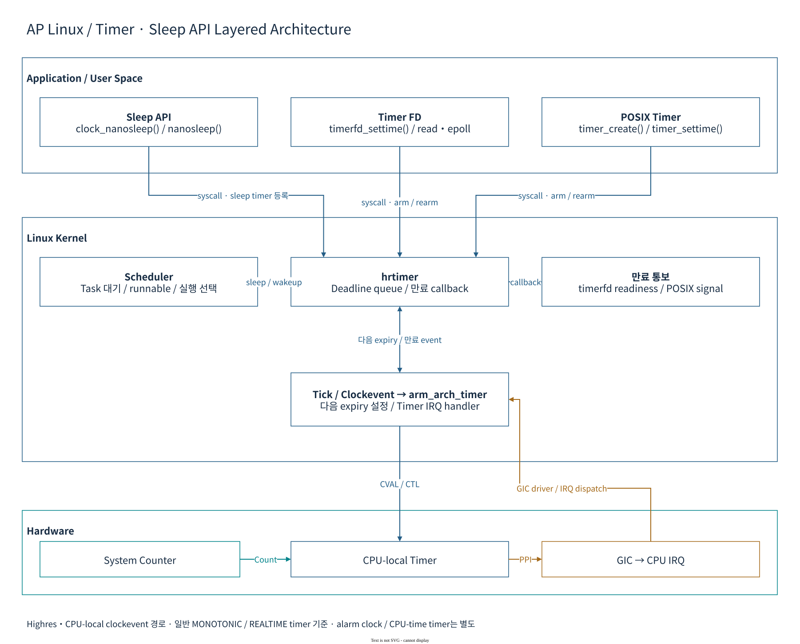

<details>
<summary>도면 상세 설명</summary>

- **Sleep API**: Sleep API / clock_nanosleep() / nanosleep()
- **Timer FD**: Timer FD / timerfd_settime() / read・epoll
- **POSIX Timer**: POSIX Timer / timer_create() / timer_settime()
- **hrtimer**: hrtimer / Deadline queue / 만료 callback
- **Scheduler**: Scheduler / Task 대기 / runnable / 실행 선택
- **만료 통보**: 만료 통보 / timerfd readiness / POSIX signal
- **Tick / Clockevent → arm_arch_timer**: Tick / Clockevent → arm_arch_timer / 다음 expiry 설정 / Timer IRQ handler

</details>

| API | 요청 | 만료 후 동작 |
|---|---|---|
| `nanosleep()` | 상대 시간만큼 호출 Task 대기 | Task wakeup 후 실행 가능 시 반환 |
| `clock_nanosleep()` | 선택 clock의 상대 시간 또는 `TIMER_ABSTIME` deadline까지 대기 | 정상 만료 또는 signal에 의해 대기 종료 |
| `timerfd_create()` / `timerfd_settime()` | FD 기반 one-shot / periodic timer 설정 | FD readable, `read()`로 만료 횟수 확인; `poll/epoll` 연계 |
| `timer_create()` / `timer_settime()` | POSIX one-shot / periodic timer 설정 | `SIGEV_SIGNAL` 등 선택한 notification 방식으로 통보 |
| Kernel `hrtimer_start*()` / `hrtimer_cancel()` | Kernel 내부 deadline·callback 등록 / 취소 | 지정 callback 실행 |

그림은 일반적인 **MONOTONIC/REALTIME + Highres + CPU-local clockevent** 경로다. Alarm clock의 suspend wake timer, POSIX CPU-time timer, low-resolution 동작은 별도 경로다. `timerfd_settime()`·`timer_settime()` 자체는 만료까지 대기하지 않는다.

- **Application → Kernel:** Sleep/Timer 설정은 syscall로 요청한다. 시간 조회용 vDSO fast path로 timer를 등록하거나 Task를 재우지는 않는다.
- **hrtimer:** 여러 SW timer를 queue로 관리한다. 가장 이른 deadline이 바뀌면 Tick/Clockevent 계층을 통해 HW를 갱신한다.
- **Timer driver → HW:** `arm_arch_timer`가 시간 간격을 cycle로 받아 CPU-local Timer의 CVAL·CTL을 설정한다. 모든 SW timer마다 HW timer가 하나씩 생기지 않는다.
- **만료 통보:** Sleep은 Task wakeup, timerfd는 FD readiness, POSIX timer는 선택한 notification으로 연결된다. Callback 문맥은 timer mode·PREEMPT_RT 등 Kernel 설정에 따라 달라진다.

###### Timer API Sequence

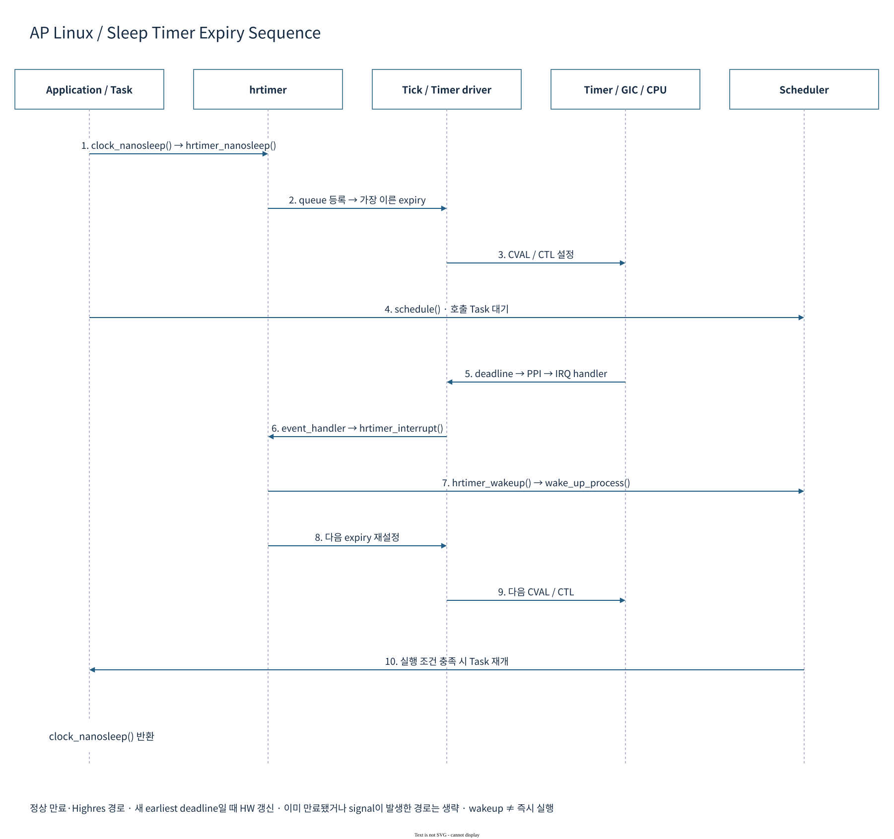

`clock_nanosleep(CLOCK_MONOTONIC, …)`이 **정상 만료하는 대표 경로**다. 그림의 2–3은 새 timer가 다음 HW expiry를 변경하는 경우를 표시한다.

1. **Sleep 요청:** syscall → clock별 `nsleep` 연산 → `hrtimer_nanosleep()`으로 sleeper를 만든다.
2. **Queue 등록:** `do_nanosleep()`이 Task를 interruptible/freezable 상태로 설정하고 sleeper timer를 시작한다. 새 earliest expiry이면 `tick_program_event()` → `clockevents_program_event()`로 전달한다.
3. **HW 설정:** `set_next_event()` → `arm_arch_timer`가 CVAL·CTL을 설정한다. System Counter는 계속 증가한다.
4. **Task 대기:** Timer가 아직 만료되지 않았다면 `schedule()`로 CPU 실행을 양보한다. 등록 직후 이미 만료된 경우 이 대기를 생략할 수 있다.
5. **Interrupt 발생:** deadline 도달 → Timer PPI → GIC → CPU exception → `arch_timer_handler_*()`. Driver가 ISTATUS를 확인하고 source를 mask한다.
6. **만료 처리:** clockevent의 `event_handler`가 Highres 경로의 `hrtimer_interrupt()`로 이어져 만료 timer를 처리한다.
7. **Task wakeup:** sleeper callback `hrtimer_wakeup()` → `wake_up_process()`로 Task를 runnable 상태로 만든다.
8. **다음 expiry 선택:** queue에 남은 다음 deadline을 선택해 clockevent에 전달한다.
9. **HW 재설정:** 다음 event가 있으면 새 CVAL·CTL을 설정한다. Timer source 처리와 GIC EOI/deactivate는 별개다.
10. **Task 재개:** Scheduler가 우선순위·preemption·경쟁 Task를 고려해 실행을 재개하면 sleep 호출이 반환한다.

**Timerfd / POSIX timer 차이:** 공통 hrtimer 만료 이후 sleeper wakeup 대신 timerfd callback의 만료 횟수 갱신·wait queue 통보, 또는 POSIX notification 처리가 실행된다. Periodic timer의 재등록·overrun 처리는 각 API 구현에 따른다.

**시간 보장 범위:** deadline 도달은 Task 실행·완료 시각의 보장이 아니다. Timer slack·IRQ 지연·Scheduler 지연에 따라 늦게 재개될 수 있고, signal은 sleep을 조기에 중단할 수 있다. 반복 Job은 고정 기준의 absolute deadline을 사용하면 상대 sleep 누적으로 생기는 drift를 줄일 수 있다. [Timer/Sleep 구현 근거](SOURCES.md#linux-timer-api)

#### 4.2.2 TF-A Timer Architecture

Apollo TF-A의 BL31은 **Generic Timer의 Physical Counter를 polling**하여 firmware delay와 timeout을 처리한다. 이 경로에는 Linux의 hrtimer queue·Scheduler·Timer PPI 처리가 없다.

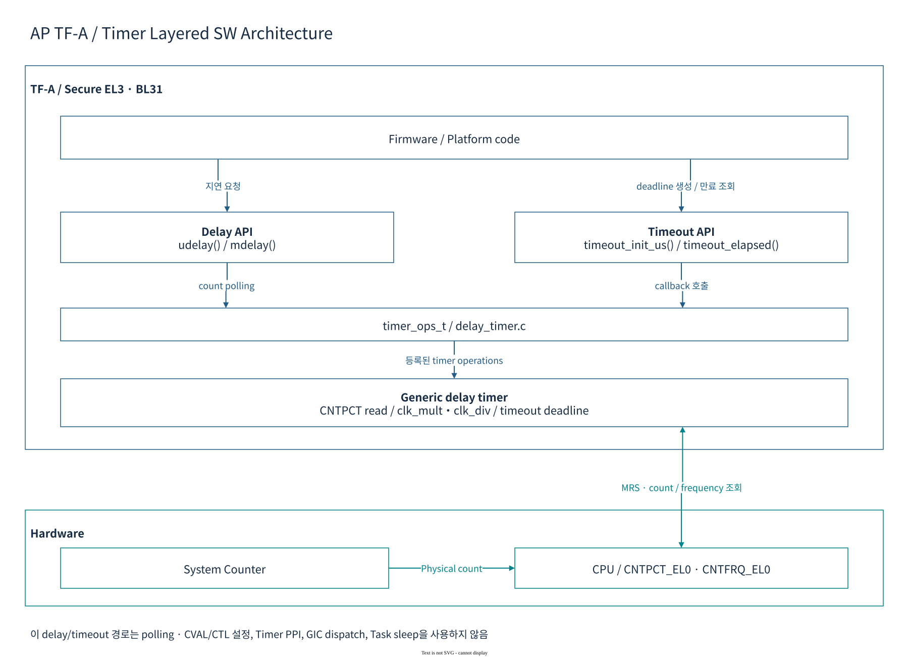

<details>
<summary>도면 상세 설명</summary>

- **Delay API**: Delay API / udelay() / mdelay()
- **Timeout API**: Timeout API / timeout_init_us() / timeout_elapsed()
- **Generic delay timer**: Generic delay timer / CNTPCT read / clk_mult・clk_div / timeout deadline

</details>

| 계층 / Component | 역할 | 연결 |
|---|---|---|
| Firmware / Platform code | 장치 초기화 지연·상태 polling의 timeout 판단 | Delay/Timeout API 호출 |
| Delay API | 요청 시간만큼 busy wait | `udelay()` / `mdelay()` |
| Timeout API | deadline 생성·만료 여부 조회 | `timeout_init_us()` / `timeout_elapsed()` |
| `timer_ops_t` | Counter read·시간 환산 계수·timeout callback 연결 | `timer_init(&ops)`로 등록 |
| Generic delay timer | Physical count 조회·deadline 계산 | `read_cntpct_el0()` / `read_cntfrq_el0()` |
| CPU / System Counter | Counter register 접근·공통 timestamp 제공 | `MRS CNTPCT_EL0`; CNTFRQ는 주파수 metadata |

그림의 SW는 **BL31의 Secure EL3 firmware**다. Delay는 CPU를 점유하고, Timeout은 caller가 만료 여부를 조회한다. 이 경로는 CPU-local Timer의 CVAL/CTL·GIC interrupt·Task sleep을 사용하지 않는다.

##### 4.2.2.1 Timer Initialization

Apollo는 Device Tree timer node를 탐색하는 대신 **platform 함수와 정적 주파수 상수**로 delay driver를 초기화한다.

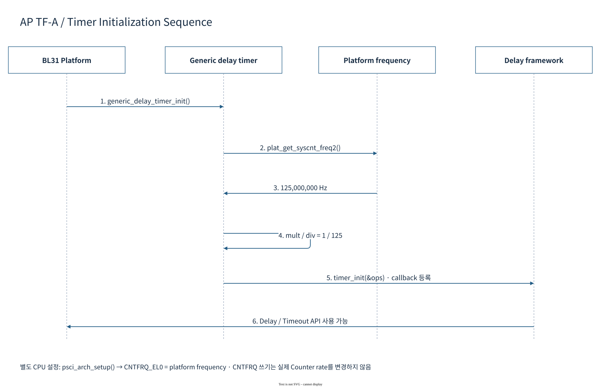

1. **초기화 호출:** `bl31_platform_setup()`에서 `generic_delay_timer_init()`을 호출한다.
2. **주파수 조회:** `plat_get_syscnt_freq2()`가 Apollo의 `SYS_COUNTER_FREQ_IN_TICKS`를 반환한다.
3. **설정값 전달:** 현재 platform 상수는 **125,000,000Hz**다.
4. **환산 계수 계산:** `mult=1,000,000`, `div=125,000,000`을 공통 10의 배수로 축약해 `mult=1`, `div=125`로 설정한다.
5. **연산 등록:** `generic_delay_timer_init_args()`가 Counter read·timeout callback을 채우고 `timer_init(&ops)`로 저장한다.
6. **API 사용:** 등록 완료 후 caller가 Delay/Timeout API를 사용할 수 있다.

| 초기화 대상 | 설정 경로 | 의미 |
|---|---|---|
| Delay 환산 계수 | `generic_delay_timer_init()` → `clk_mult/clk_div` | `udelay()`의 μs→tick 환산 |
| Timeout callback | `generic_delay_timer_init_args()` → `timer_ops_t` | deadline 생성·만료 비교 함수 |
| CPU 주파수 metadata | `psci_arch_setup()` → `write_cntfrq_el0(plat_get_syscnt_freq2())` | CPU별 CNTFRQ 설정; 위 ops 등록과 별도 경로 |

**주파수 사용 경로:** Delay는 초기화 시 등록한 `clk_mult/clk_div`, Timeout은 호출 시 읽은 CNTFRQ를 사용한다. 두 경로의 환산 기준이 일치해야 한다.

CNTFRQ에 125MHz를 쓰는 것은 실제 Counter clock을 125MHz로 변경하는 동작이 아니다. Platform 환산값·CNTFRQ·QVP의 실제 count rate가 일치해야 요청 시간과 경과 시간이 대응한다. [초기화 근거](SOURCES.md#tfa-timer-detail)

##### 4.2.2.2 Counter Read / Timeout API

TF-A의 이 경로는 Linux처럼 wall-clock·monotonic clock을 관리하지 않는다. **Counter 값과 deadline**을 사용한다.

| 함수 | 계산 / 반환 | 용도 |
|---|---|---|
| `read_cntpct_el0()` | 64-bit physical count | 경과 시간·deadline의 기준 |
| `generic_delay_get_timer_value()` | `(uint32_t)(~CNTPCT)` | Delay framework가 요구하는 32-bit down-counter view |
| `timeout_init_us(usec)` | `CNTPCT + floor(usec × CNTFRQ / 1,000,000)` | deadline count 생성 |
| `timeout_elapsed(deadline)` | `CNTPCT > deadline` | 현재 count가 deadline을 지났는지 확인 |

`timeout_init_us()`는 HW interrupt를 예약하지 않는다. Caller가 장치 상태와 `timeout_elapsed()`를 반복 확인할지 결정한다. 현재 구현의 비교 연산은 **`>`**이며, deadline과 같은 count에서는 아직 false다.

##### 4.2.2.3 Delay / Timeout Sequence

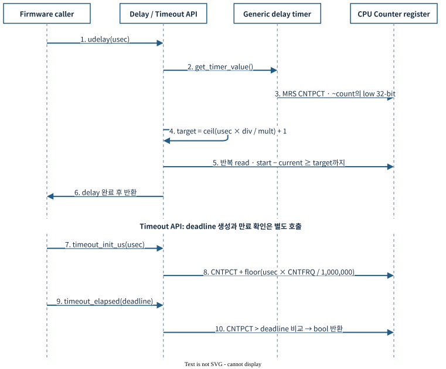

**Delay — 그림 1–6**

1. **요청:** Firmware가 `udelay(usec)`를 호출한다. `mdelay(msec)`는 μs로 변환해 같은 경로를 사용한다.
2. **시작값 저장:** `timer_ops->get_timer_value()`로 시작 count를 읽는다.
3. **Counter 조회:** Generic driver가 `CNTPCT`를 읽어 반전한 low 32-bit 값을 반환한다.
4. **목표 계산:** `ceil(usec × clk_div / clk_mult) + 1` tick을 목표로 한다. 추가 1 tick은 요청 시간보다 짧게 대기하는 것을 방지하기 위한 여유다.
5. **Polling:** Counter를 반복 조회하고 unsigned `start − current`를 계산한다. 32-bit wrap은 이 뺄셈으로 처리하되, 요청 지연은 구현의 범위 제한을 만족해야 한다.
6. **반환:** 경과 tick이 목표 이상이면 caller로 복귀한다. 대기 중 CPU 실행을 OS Scheduler에 양보하지 않는다.

**Timeout — 그림 7–10**

7. **Deadline 요청:** Caller가 `timeout_init_us(usec)`를 호출한다.
8. **Deadline 생성:** Generic callback이 CNTFRQ로 μs를 tick으로 환산하고 현재 CNTPCT에 더해 반환한다.
9. **상태 확인:** Caller가 작업·장치 상태를 확인하면서 필요할 때 `timeout_elapsed(deadline)`을 호출한다.
10. **만료 판단:** callback이 새 CNTPCT와 deadline을 비교해 bool을 반환한다. 이후 재시도·실패 처리는 caller의 책임이다.

**구현 범위:** timer operations 등록 후 API를 사용해야 한다. `udelay()`의 32-bit elapsed 범위 제한은 assert로 검사하므로 caller도 입력 범위를 지켜야 한다. 장시간 sleep 용도가 아니다.

#### 4.2.3 U-Boot Timer Architecture

Apollo U-Boot은 **ARMv8 Generic Timer의 CNTPCT/CNTFRQ**로 시간 조회와 부트·장치 초기화 지연을 처리한다. Linux의 clocksource/clockevent 등록·hrtimer queue·Timer ISR 구조와 구분한다.

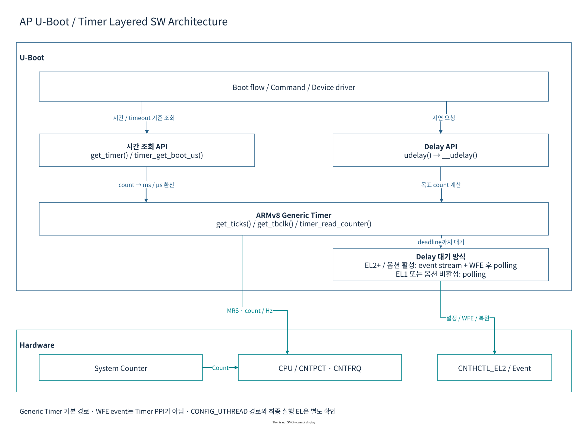

<details>
<summary>도면 상세 설명</summary>

- **시간 조회 API**: 시간 조회 API / get_timer() / timer_get_boot_us()
- **Delay API**: Delay API / udelay() → __udelay()
- **ARMv8 Generic Timer**: ARMv8 Generic Timer / get_ticks() / get_tbclk() / timer_read_counter()
- **Delay 대기 방식**: Delay 대기 방식 / EL2+ / 옵션 활성: event stream + WFE 후 polling / EL1 또는 옵션 비활성: polling

</details>

| 계층 / Component | 역할 | 연결 |
|---|---|---|
| Boot flow / Command / Device driver | 경과 시간·timeout 확인, 장치 초기화 지연 | 시간 조회·Delay API 호출 |
| Common time API | Counter 값을 시간 단위로 환산 | `get_timer()` 등 `lib/time.c` |
| Common delay API | 서비스 실행·대기 구간 분할 | `udelay()` → `schedule()` → `__udelay()` |
| ARMv8 Generic Timer | count·frequency 조회, 조건부 event-stream delay | `get_ticks()` / `get_tbclk()` / `__udelay()` |
| CPU / System Counter | Physical count와 frequency metadata 제공 | CNTPCT_EL0 / CNTFRQ_EL0 |
| CPU Event stream | 긴 polling 구간의 Counter read 빈도 감소 | 조건부 CNTHCTL_EL2 설정·WFE |

그림은 `CONFIG_SYS_ARCH_TIMER`의 ARMv8 구현과 **UTHREAD 비활성 delay 경로**를 기준으로 한다. `schedule()`은 U-Boot의 watchdog·cyclic·uthread 서비스 호출이며 Linux의 preemptive Scheduler와 같은 의미가 아니다.

##### 4.2.3.1 Timer Initialization / Counter Read

TF-A의 `timer_ops_t` 등록과 달리 ARMv8 구현은 `get_ticks()`·`get_tbclk()`를 직접 제공한다. 이 경로의 기본 `timer_init()`은 **0을 반환하는 weak 함수**이며 Timer PPI handler를 등록하지 않는다.

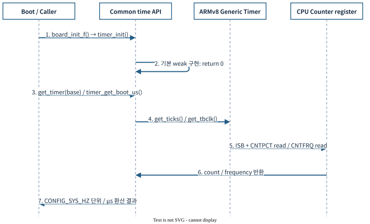

그림의 **1–2는 초기화**, **3–7은 이후 caller의 시간 조회**다. 초기화 함수가 이어서 모든 시간 API를 호출한다는 의미는 아니다.

1. **초기화 호출:** `board_init_f()`의 초기화 목록에서 `timer_init()`을 호출한다.
2. **기본 동작:** 별도 override가 없으면 `lib/time.c`의 weak 구현이 성공을 반환한다. 실제 Counter 동작과 CPU 접근 권한은 앞선 firmware 설정이 전제다.
3. **조회 요청:** Caller가 `get_timer(base)` 또는 `timer_get_boot_us()` 등 시간 API를 호출한다.
4. **ARMv8 함수 연결:** `get_ticks()`로 count, `get_tbclk()`로 frequency를 조회한다. `timer_get_boot_us()`는 ARMv8 파일에 직접 구현되어 있다.
5. **Register read:** 기본 `timer_read_counter()`는 `ISB` 후 CNTPCT를 읽고, `get_tbclk()`는 CNTFRQ를 읽는다.
6. **값 반환:** Count와 Hz를 환산 계층에 전달한다.
7. **시간 환산:** 요청한 API의 단위와 기준값을 적용해 caller에 반환한다.

| 설정 / 전제 | 소스 기준 동작 |
|---|---|
| Apollo `CONFIG_ARCH_VEXPRESS64` | defconfig에서 선택; ARMv8 timer 구현과 event-stream 기본값의 근거 |
| `CONFIG_ARMV8_UDELAY_EVENT_STREAM` | `ARCH_VEXPRESS64`이면 Kconfig 기본 y; 최종 `.config`는 별도 확인 |
| `CONFIG_COUNTER_FREQUENCY` | 값이 지정되고 highest EL에서 실행할 때 start.S가 CNTFRQ 설정 |
| `CONFIG_ARMV8_CNTFRQ_BROKEN` | 활성이고 `gd->arch.timer_rate_hz`가 있으면 CNTFRQ 대신 해당 rate 사용 |

DTS의 Linux용 `arm,armv8-timer` 노드를 U-Boot이 같은 probe/IRQ 등록 순서로 초기화한다고 해석하지 않는다. CNTFRQ 설정은 실제 Counter rate를 바꾸지 않는다. [초기화 근거](SOURCES.md#uboot-timer-detail)

##### 4.2.3.2 Counter Read / Time API

| API | 반환 / 계산 | 용도 |
|---|---|---|
| `timer_read_counter()` | CNTPCT의 현재 값 | Physical count read |
| `get_ticks()` | 현재 count; `gd->arch.tbl` 갱신 | Counter 단위 경과 시간 |
| `get_tbclk()` | Counter frequency, Hz | Tick→시간 환산 |
| `get_timer(base)` | `ticks × CONFIG_SYS_HZ / Hz − base` | `CONFIG_SYS_HZ=1000`일 때 ms 경과 시간 |
| `timer_get_boot_us()` | `ticks × 1,000,000 / Hz` | Counter 기준 μs 값 |
| `usec_to_tick(usec)` | `floor(usec × Hz / 1,000,000)` | Delay의 목표 tick 계산 |

표의 나눗셈은 정수 연산이며 소수 부분을 버린다. `CONFIG_SYS_HZ`는 API의 시간 단위이고, Counter의 실제 Hz나 scheduler tick 주파수가 아니다.

`timer_get_boot_us()`라는 이름만으로 **U-Boot 진입 순간이 0**이라고 가정하지 않는다. 이 ARMv8 구현은 현재 Counter를 직접 환산하며 별도 진입 시점 offset을 빼지 않는다. Timeout은 일반적으로 시작값을 저장하고 조회 결과의 차이를 비교하는 caller 로직으로 구성한다.

##### 4.2.3.3 Delay API Sequence

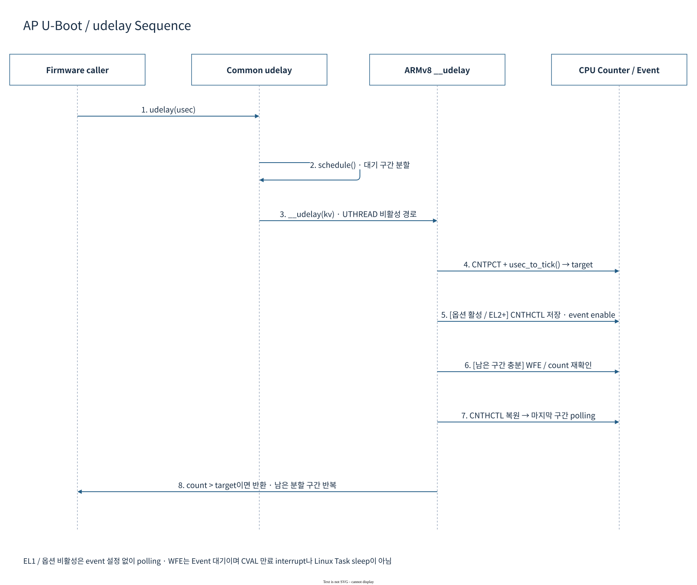

1. **지연 요청:** Caller가 `udelay(usec)`를 호출한다.
2. **공통 처리:** 각 구간 시작 시 `schedule()`로 watchdog·cyclic 등의 서비스를 수행하고, 남은 요청에서 최대 `CFG_WD_PERIOD`만큼을 선택한다.
3. **Architecture 구현 진입:** UTHREAD가 비활성이면 각 구간에 대해 `__udelay(kv)`를 호출한다.
4. **Deadline 계산:** `target = get_ticks() + usec_to_tick(kv)`로 목표 count를 만든다.
5. **조건부 Event 설정:** Event-stream 옵션이 활성이고 실행 EL≥2이면 CNTHCTL_EL2를 저장하고 EVNT_EN·EVNT_I를 설정한다. 현재 코드의 `event_period` 값은 7이다.
6. **WFE 대기:** `get_ticks() + 128 <= target`인 동안 WFE와 count 확인을 반복한다. 다른 event로 깨어나도 count를 다시 확인한다.
7. **복원·마무리:** CNTHCTL_EL2를 복원한 뒤 `get_ticks() > target`이 될 때까지 polling한다. EL1은 event 설정 없이 이 polling 경로를 사용한다.
8. **반환:** 남은 분할 구간이 있으면 반복하고, 전체 요청 시간이 지나면 caller로 반환한다.

- **옵션 비활성:** `lib/time.c`의 weak `__udelay()`가 Counter를 polling한다.
- **서비스 실행 시점:** 위 비-UTHREAD 경로의 `schedule()`은 각 구간 시작에 호출된다. `__udelay()` 내부의 WFE·polling 동안 공통 서비스가 계속 호출되는 구조는 아니다.
- **UTHREAD 활성:** Common `udelay()`는 시간 차이를 확인하며 `uthread_schedule()`을 호출하는 별도 경로를 사용한다.
- **HW 의미:** Event stream은 Counter에서 생성한 CPU event다. CVAL 만료 PPI·GIC IRQ handler·OS alarm queue를 사용한 sleep과 구분한다.
- **주파수 조건:** Counter rate와 CNTFRQ가 다르면 시간 환산·지연 정확도에 영향을 준다. [Delay 구현 근거](SOURCES.md#uboot-timer-detail)

<a id="optee-timer-software"></a>

#### 4.2.4 OP-TEE Timer Architecture

OP-TEE는 **Counter 기반 시간 조회**와 **RPC 기반 대기**를 제공한다. 이 API 경로는 TA용 주기적 scheduler tick을 설정하지 않는다. Generic Timer callout 코드는 존재하지만, Apollo 플랫폼의 초기화 호출은 확인되지 않았다.

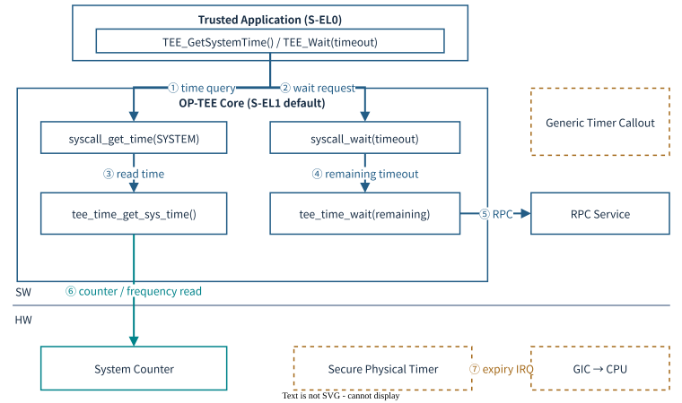

<details>
<summary>도면 상세 설명</summary>

- **tee_time_get_sys_time()**: tee_time_get_sys_time() / CNTPCT → seconds / millis
- **tee_time_wait(remaining)**: tee_time_wait(remaining) / OPTEE_RPC_CMD_SUSPEND
- **RPC Service**: RPC Service / 대기 / 실행 재개
- **Generic Timer Callout**: Generic Timer Callout / 플랫폼 초기화 호출 미확인
- **System Counter**: System Counter / CNTPCT_EL0 / CNTFRQ_EL0
- **Secure Physical Timer**: Secure Physical Timer / CNTPS_CVAL / CNTPS_CTL
- **GIC → CPU**: GIC → CPU / PPI 29

</details>

| 계층 / Component | 역할 | 연결 |
|---|---|---|
| Trusted Application (S-EL0) | 시간 조회·대기 요청 | `TEE_GetSystemTime()` / `TEE_Wait()` |
| Core syscall (기본 S-EL1) | 요청 분기·사용자 복사·취소 및 경과 시간 확인 | `syscall_get_time()` / `syscall_wait()` |
| CNTPCT time source | Counter를 seconds·millis로 환산 | `tee_time_get_sys_time()` |
| RPC wait | 남은 대기 시간을 전달하고 반환 후 재확인 | `tee_time_wait()` → `OPTEE_RPC_CMD_SUSPEND` |
| CPU / System Counter | Physical count·frequency metadata 조회 | CNTPCT_EL0 / CNTFRQ_EL0 |
| Generic Timer callout (점선) | 조건부 comparator·interrupt 기반 callback | Apollo 초기화 호출 미확인 |

**그림 해석:** ①–⑥은 시간 조회·RPC 소스 경로이며 하나의 연속 실행 순서가 아니다. ⑦ CNTPS → PPI 29는 HW 배선이다. Callout 사용에는 별도 service 초기화가 필요하다. Counter 조회에는 comparator·GIC interrupt가 필요하지 않다.

##### 4.2.4.1 Time Source 설정 / 초기화

| 설정 / 단계 | Apollo 소스에서 확인한 동작 |
|---|---|
| Platform 선택 | `plat-automotive_rd/conf.mk`가 `CFG_SECURE_TIME_SOURCE_CNTPCT=y`를 강제 |
| 실행 구성 | `CFG_ARM64_core=y`; `CFG_CORE_SEL1_SPMC ?= y`는 기본 설정이며 최종 build override와 구분 |
| Time source 구현 | `tee_time_arm_cntpct.c`의 `tee_time_get_sys_time()` 사용 |
| HW 선행 조건 | Counter가 진행하고 CNTFRQ가 실제 Counter rate와 일치해야 함 |
| API 최초 조회 | Counter와 frequency를 직접 읽음; 이 경로에서 comparator·IRQ handler를 초기화하지 않음 |

이 설정은 **시간 조회 backend 선택**이다. OP-TEE가 System Counter를 시작하거나 보드 주파수를 설정한다는 의미는 아니다. [설정·구현 근거](SOURCES.md#optee-software-detail)

##### 4.2.4.2 Secure Time API

| API / 함수 | 역할 |
|---|---|
| `TEE_GetSystemTime()` | TA에서 Counter 기반 system time 요청 |
| `syscall_get_time(UTEE_TIME_CAT_SYSTEM)` | Core time source 선택 및 사용자 버퍼 복사 |
| `tee_time_get_sys_time()` | `barrier_read_counter_timer()`·`read_cntfrq()`로 seconds·millis 계산 |
| `TEE_GetREETime()` | REE time 요청; CNTPCT 직접 조회와 별도 경로 |
| TA persistent time API | TA별 영속 시간 처리; system time과 별도 의미 |

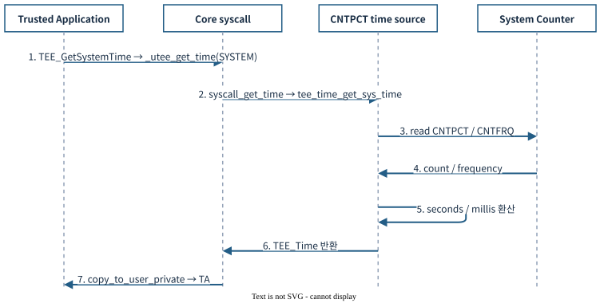

1. TA가 `TEE_GetSystemTime()`을 호출하고 `_utee_get_time(SYSTEM)`으로 진입한다.
2. `syscall_get_time()`이 `tee_time_get_sys_time()`을 호출한다.
3. Time source가 **CNTPCT count·CNTFRQ frequency**를 읽는다.
4. HW 읽기 결과를 얻는다.
5. `seconds = count / frequency`, `millis = (count % frequency) / (frequency / 1000)`로 환산한다.
6. Core에 `TEE_Time`을 반환한다.
7. `copy_to_user_private()`로 TA 버퍼에 전달한다. `TEE_GetSystemTime()`은 실패를 반환값으로 전달하지 않고 `TEE_Panic()`을 호출한다.

Counter 기반 시간은 달력 시각이나 재부팅 후 영속 시간을 뜻하지 않는다. `millis` 필드는 표현 단위이며 QVP의 실제 시간 정확도를 보장하지 않는다.

##### 4.2.4.3 Wait API Sequence

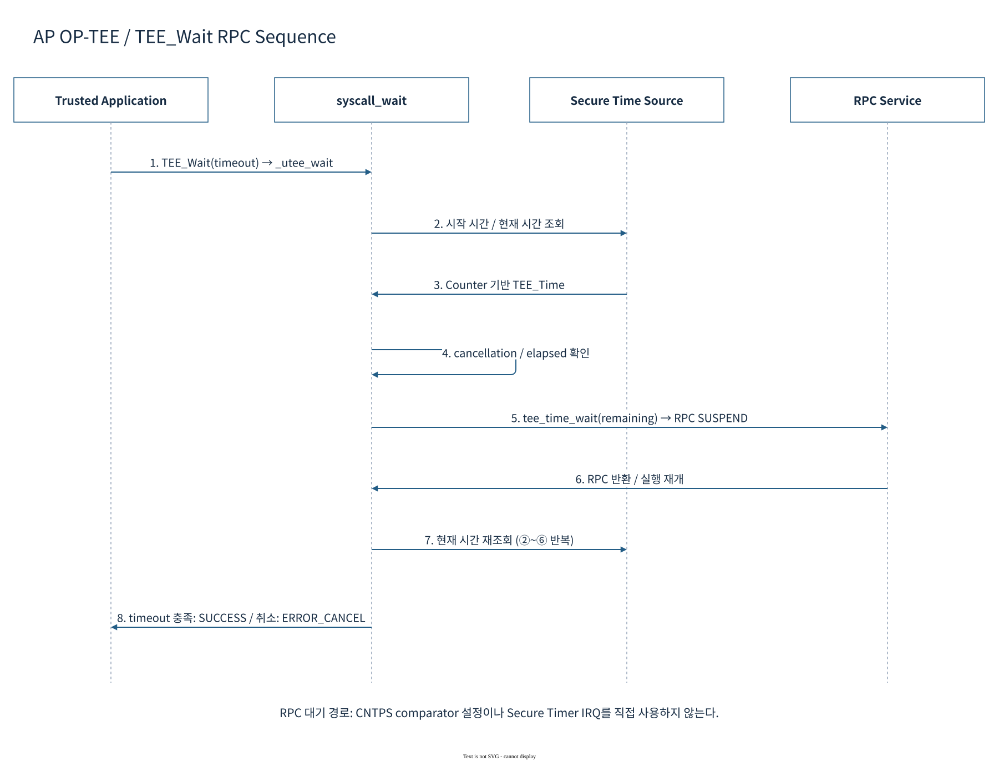

1. `TEE_Wait(timeout)`이 `_utee_wait()`를 통해 `syscall_wait()`에 진입한다.
2. 시작 시간을 한 번 저장하고, 반복마다 현재 시간을 `tee_time_get_sys_time()`으로 조회한다.
3. Counter 기반 `TEE_Time`을 받는다.
4. Cancellation이면 종료하고, 취소되지 않았으면 `elapsed >= timeout`을 확인한다.
5. 아직 시간이 남으면 `tee_time_wait(remaining)`이 `OPTEE_RPC_CMD_SUSPEND`를 요청한다.
6. RPC 처리 후 Core 실행이 재개된다.
7. 시작 시간은 유지한 채 현재 시간·cancellation을 다시 확인한다. 그림의 ②–⑥ 반복은 시작 시간을 다시 저장한다는 의미가 아니다.
8. Timeout 충족 시 `TEE_SUCCESS`, 취소 시 `TEE_ERROR_CANCEL`을 반환한다. 그 밖의 syscall 오류는 TA wrapper가 `TEE_Panic()`으로 처리한다.

**대기와 스케줄링:** 이 경로는 CNTPS를 직접 설정하지 않는다. 실제 실행 재개는 RPC 처리와 실행 환경의 스케줄링에 의존하므로 timeout 도달이 TA의 즉시 실행을 보장하지 않는다. Diagram은 RPC service를 추상화하며 transport별 wakeup 구현은 포함하지 않는다.

##### 4.2.4.4 Generic Timer Callout — 활성화 조건

| 구성 | 소스 구현 / Apollo 상태 |
|---|---|
| 코드 포함 | ARM64 core의 `generic_timer.c` 빌드 대상 포함; service 활성화와 별개 |
| 초기화 | `timer_init_callout_service()` → IRQ handler 등록·enable → `callout_service_init()` |
| Deadline | `timer_set_next()` → CVAL·CTL; 기본 S-EL1 경로는 CNTPS, SEL2 SPMC 분기는 CNTP |
| 만료 | `timer_itr_cb()` → `callout_service_cb()`; descriptor는 per-CPU |
| Apollo 적용 | `plat-automotive_rd`의 초기화 호출 미확인; 확인한 호출은 `plat-vexpress`에 존재 |

<a id="scp-timer-software"></a>

### 4.3 Safety Island CL0 — SCP Timer Architecture

SCP는 **`timer` HAL의 SW alarm queue**와 **`gtimer`의 MMIO Timer 제어**로 구성된다. 가장 이른 deadline을 하나의 comparator에 설정하고, 만료 callback은 ISR에서 직접 실행한다.

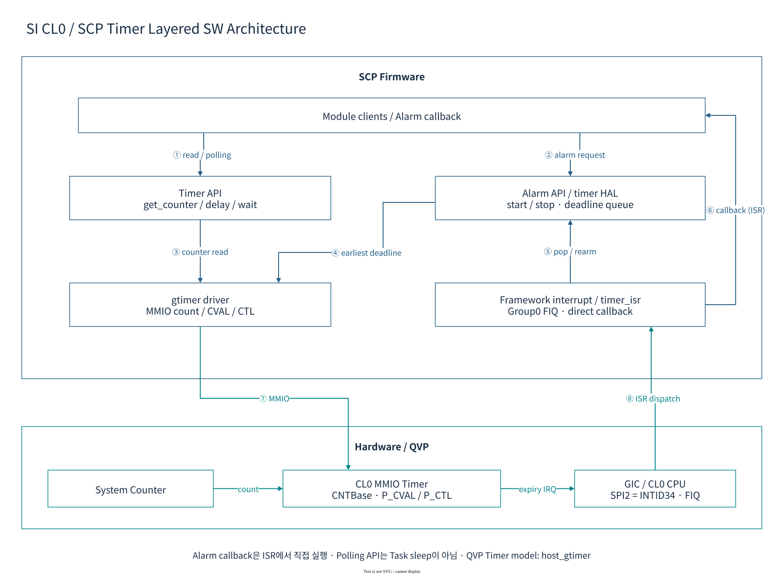

<details>
<summary>도면 상세 설명</summary>

- **Timer API**: Timer API / get_counter / delay / wait
- **Alarm API / timer HAL**: Alarm API / timer HAL / start / stop · deadline queue
- **gtimer driver**: gtimer driver / MMIO count / CVAL / CTL
- **Framework interrupt / timer_isr**: Framework interrupt / timer_isr / Group0 FIQ · direct callback
- **CL0 MMIO Timer**: CL0 MMIO Timer / CNTBase · P_CVAL / P_CTL
- **GIC / CL0 CPU**: GIC / CL0 CPU / SPI2 = INTID34 · FIQ

</details>

| 계층 / Component | 역할 | 연결 |
|---|---|---|
| SCP module clients | One-shot·periodic 작업 요청 | Alarm sub-element ID로 `start()`·`stop()` 호출 |
| Timer API | 시간 조회·polling delay·조건 대기 | `mod_timer_api` |
| Alarm API / timer HAL | Alarm pool·deadline 순 queue·periodic 재삽입 | `mod_timer_alarm_api` → 가장 이른 head 선택 |
| `gtimer` driver | Count 조회·CVAL 설정·enable/mask | `mod_timer_driver_api`, MMIO 접근 |
| Framework interrupt | Group0 FIQ·ISR dispatch | INTID34 → `timer_isr(ctx)` |
| HW / QVP | CL0 MMIO comparator·GIC·CPU | `host_gtimer` → SPI2/INTID34 → FIQ |

그림의 번호는 계층 간 연결을 구분한다. 실행 순서는 아래 Sequence를 따른다. 이 경로는 CPU-local CNTV Timer나 OS scheduler tick을 사용한 Task sleep과 구분한다.

#### 4.3.1 Timer Initialization

Linux의 Device Tree probe 대신 **정적 element 설정과 framework의 init → bind → start** 단계로 연결한다.

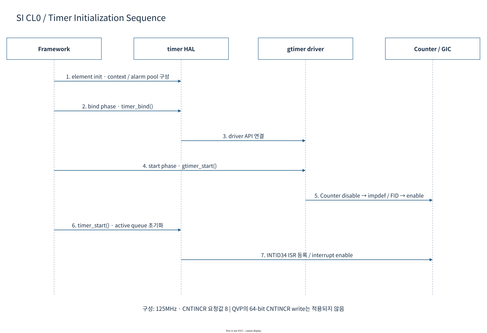

1. **Element 구성:** Framework가 timer context와 alarm pool을 구성한다. Gtimer element에도 MMIO 주소와 frequency 설정을 연결한다.
2. **Bind 진입:** `timer_bind()`가 `config_timer.c`의 driver element ID를 확인한다.
3. **Driver 연결:** `fwk_module_bind()`로 gtimer API를 받아 필수 함수들을 검사한다.
4. **Driver start:** 현재 module 목록의 gtimer → timer 순서로 start한다. `clock_id=NONE`이므로 `gtimer_start()`가 Counter control을 직접 초기화한다.
5. **Counter 설정:** `gtimer_control_init()`이 disable → 구현정의 register → FID[0] → enable 순으로 쓴다.
6. **HAL start:** `timer_start()`가 active alarm queue를 초기화한다.
7. **Interrupt 등록:** `fwk_interrupt_set_isr_param()`으로 INTID34에 `timer_isr(ctx)`를 연결하고 interrupt를 enable한다. Alarm CVAL은 이후 `start()` 요청에서 설정한다.

| 설정 | 소스 기준 값 / 의미 |
|---|---|
| CNTBase | `0x2A720000`; count·physical comparator 접근 |
| CNTCTL | `0x2A6F0000`; driver element의 counter frame 설정 |
| Counter control | SI ATW5를 통한 CSS Counter control 접근 |
| Frequency / increment | 일반 platform 분기: 125MHz / CNTINCR 요청값 8 |
| Alarm 구성 | `SI0_TIMER` → gtimer element 0; sub-element 수는 client alarm ID 구성에 따름 |

**QVP 주의:** AArch64 `uintptr_t`의 64-bit CNTINCR 쓰기는 현재 QVP 모델에서 무시된다. 요청값 8만으로 1GHz 동작을 주장하지 않으며, SW 환산 frequency와 실제 count rate를 구분한다. [주파수 구현 상세](#implementation)

#### 4.3.2 Counter Read / Polling API

| API | 계산 / 동작 | 완료 조건 |
|---|---|---|
| `get_counter()` | CNTBase의 PCTH → PCTL → PCTH를 읽고 high가 같을 때 결합 | 안정된 64-bit count 반환 |
| `get_frequency()` | Gtimer element의 설정 frequency 조회 | HW rate 측정값이 아닌 SW 설정값 |
| `time_to_timestamp()` | `floor(frequency × usec / 1,000,000)` | 기간을 tick 수로 환산 |
| `delay()` | `deadline = now + ticks` 후 count polling | `count >= deadline` |
| `wait()` | 조건 함수와 count를 반복 조회 | 조건 true면 성공; `count > deadline`에서 조건을 마지막으로 확인 후 timeout |

`delay()`·`wait()`는 comparator를 예약하지 않는 busy wait다. Driver 오류는 API 오류로 반환한다. `wait()`의 count 조회 실패는 `FWK_E_DEVICE`, 조건 미충족 timeout은 `FWK_E_TIMEOUT`이다. 시간 환산은 설정 frequency와 실제 count rate가 일치해야 한다.

#### 4.3.3 Alarm API / Expiry Sequence

| API / 구성 | 역할 / 제약 |
|---|---|
| `start(id, usec, type, callback, param)` | One-shot·periodic 등록; 이미 started이면 기존 alarm을 중지 후 재설정 |
| `stop(id)` | 해당 alarm 중지·queue 상태 갱신 |
| Alarm sub-element | Client별 SW alarm; HW timer를 개별 할당하지 않음 |
| 호출 문맥 | `start()`는 interrupt 문맥이거나 문맥 확인에 실패하면 `FWK_E_ACCESS` |

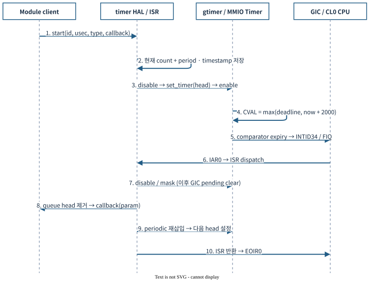

1. **요청:** Client가 alarm ID·기간·type·callback을 전달한다.
2. **Timestamp:** `alarm_start()`가 callback과 `now + period_ticks`를 저장한다. 실제 queue 삽입은 다음 단계의 timer disable 후 수행한다.
3. **Queue 갱신:** Timer disable/mask → deadline 순 삽입 → head의 `set_timer()` → enable/unmask 순으로 처리한다.
4. **HW deadline:** Gtimer는 `CVAL = max(deadline, now + 2000 ticks)`를 P_CVALL/P_CVALH에 쓴다. 이 설정은 3번 `set_timer()` 내부 동작이다.
5. **HW 만료:** CL0 comparator → SPI2/INTID34 → GIC Group0/FIQ가 발생한다.
6. **Dispatch:** GIC 경로가 IAR0를 읽고 `timer_isr(ctx)`로 전달한다.
7. **ISR 진입:** Timer disable/mask 후 GIC pending을 clear한다.
8. **Callback:** Queue head를 제거하고 `callback(param)`을 **ISR 안에서 직접 호출**한다.
9. **Rearm:** Periodic이며 started 상태이면 **이전 deadline + period**로 재삽입한다. 다음 head를 설정하며, queue가 비면 timer는 비활성 상태로 남는다.
10. **완료:** ISR 반환 후 GIC handler가 EOIR0를 기록한다.

2000 ticks의 실제 시간은 effective rate에 따라 달라진다. Periodic 재설정은 callback 완료 시각을 기준으로 하지 않으며, 이미 늦어진 deadline에는 최소 간격 보정이 적용된다.

#### 4.3.4 Callback / Scheduler 및 QVP 적용 범위

- **Callback 문맥:** Framework event로 자동 이관하지 않는다. 긴 작업은 client가 별도 처리를 요청해야 한다. ISR에서 `start()`를 다시 호출하는 대신 periodic 내부 재삽입 경로를 사용한다.
- **Scheduler 관계:** Alarm은 module callback 서비스다. Polling API도 Task를 sleep시키거나 OS Scheduler에 실행을 양보하지 않는다.
- **Client 구성:** `si0_cfgd_timer.h`에 debugger CLI·RSE recovery·watchdog rearm·PFDI monitor·DVFS·vMCU 등의 ID가 있다. 조건부 ID의 존재가 실제 alarm 사용을 입증하지 않는다.
- **QVP 구현:** `si_cl0_timer_cntbase`의 `host_gtimer`가 CVAL/CTL 만료를 계산한다. Driver는 CVAL을 사용하므로 모델의 TVAL 상대값 미구현과 구분한다.

<a id="zephyr-timer-software"></a>

### 4.4 Safety Island CL1 — Zephyr Timer Architecture

Zephyr는 **Kernel timeout queue**와 **CPU별 Virtual Timer(CNTV)**를 연결한다. Driver가 경과 tick을 Kernel에 알리면, Kernel은 만료 callback을 실행하거나 대기 Thread를 ready 상태로 전환한다.

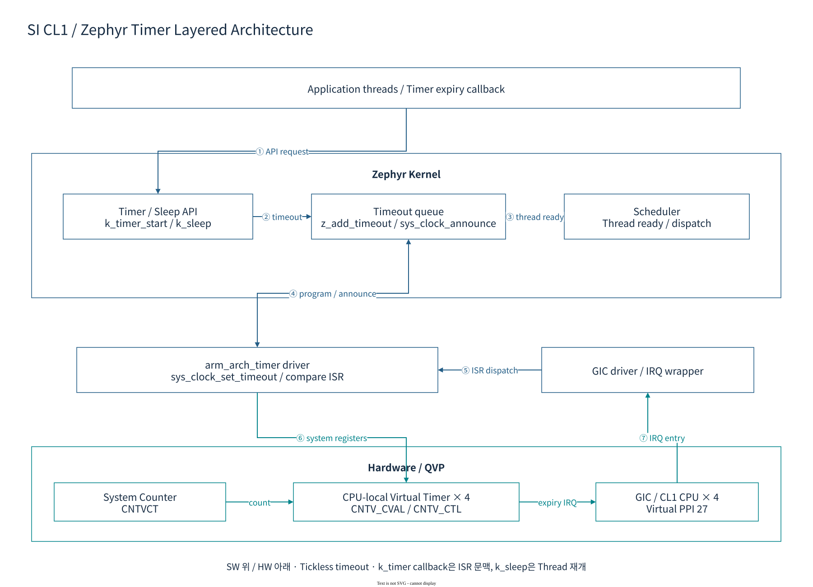

<details>
<summary>도면 상세 설명</summary>

- **Timer / Sleep API**: Timer / Sleep API / k_timer_start / k_sleep
- **Timeout queue**: Timeout queue / z_add_timeout / sys_clock_announce
- **Scheduler**: Scheduler / Thread ready / dispatch
- **arm_arch_timer driver**: arm_arch_timer driver / sys_clock_set_timeout / compare ISR
- **System Counter**: System Counter / CNTVCT
- **CPU-local Virtual Timer × 4**: CPU-local Virtual Timer × 4 / CNTV_CVAL / CNTV_CTL
- **GIC / CL1 CPU × 4**: GIC / CL1 CPU × 4 / Virtual PPI 27

</details>

| 계층 / Component | 역할 | 연결 |
|---|---|---|
| Application | 주기 작업·timeout·Thread sleep 요청 | `k_timer_start()` / `k_sleep()` |
| Kernel timeout | SW timeout 등록·만료 처리·다음 deadline 선택 | `z_add_timeout()` / `sys_clock_announce()` |
| Scheduler | Sleep Thread block·ready·실행 선택 | Thread timeout과 IRQ 복귀 경로 |
| `arm_arch_timer` | Tick↔cycle 환산·comparator 설정·ISR | `sys_clock_set_timeout()` / `arm_arch_timer_compare_isr()` |
| GIC driver / IRQ wrapper | PPI dispatch·interrupt 완료 | Virtual PPI27 → ISR → EOIR1 |
| CPU Timer / Counter | CNTVCT 조회·CNTV_CVAL 비교·CNTV_CTL 제어 | QVP QEMU CPU Timer; CL0의 MMIO gtimer와 별개 |

그림의 번호는 계층 연결을 구분한다. **Timer expiry callback은 ISR 문맥**, sleep 완료는 **Thread ready 전환**이며, 실제 Thread 실행 시점은 Scheduler가 결정한다.

#### 4.4.1 Timer Initialization

| 보드 설정 | 값 / 의미 |
|---|---|
| `CONFIG_ARM_ARCH_TIMER` | `y`; ARM64 helper는 Virtual Timer 선택 |
| `CONFIG_SYS_CLOCK_HW_CYCLES_PER_SEC` | `125000000`; SW 시간 환산 기준 |
| `CONFIG_SYS_CLOCK_TICKS_PER_SEC` | `100`; 1 tick = 10ms, 1,250,000 cycles |
| `CONFIG_TICKLESS_KERNEL` | `y`; 다음 timeout에 맞춰 CVAL 설정 |
| `CONFIG_SMP` / `CONFIG_MP_MAX_NUM_CPUS` | `y` / `4`; CPU별 Timer 초기화 |

위 값은 보드 defconfig 기준이며 최종 application `.config`와 구분한다. 100 ticks/s는 idle 중 10ms마다 interrupt가 발생한다는 의미가 아니다.

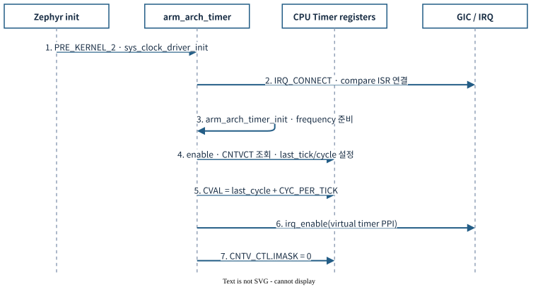

1. `SYS_INIT`의 `PRE_KERNEL_2` 단계에서 `sys_clock_driver_init()`을 실행한다.
2. `IRQ_CONNECT`로 Virtual Timer IRQ와 compare ISR을 연결한다.
3. `arm_arch_timer_init()`을 실행한다. Runtime frequency 옵션이 활성일 때 CNTFRQ를 읽고 환산 기준을 준비한다. 그렇지 않으면 설정 frequency를 사용한다.
4. Timer를 enable하고 CNTVCT에서 tick 경계에 정렬한 `last_tick`·`last_cycle`을 만든다.
5. 최초 CVAL을 `last_cycle + CYC_PER_TICK`으로 설정한다.
6. GIC의 Timer IRQ를 enable한다.
7. CNTV_CTL의 IMASK를 해제한다. Secondary CPU는 `smp_timer_init()`에서 compare·enable·IRQ enable·unmask를 수행한다.

CPU reset 경로의 CNTFRQ·CNTVOFF 설정과 위 driver 초기화는 별도 단계다. CNTFRQ metadata나 SW 설정값만으로 실제 Counter rate가 보장되지는 않는다. [초기화 소스](SOURCES.md#zephyr-software-detail)

#### 4.4.2 Timekeeping / Timer API

| API | 시간 기준 / 동작 | 실행 특성 |
|---|---|---|
| `k_uptime_get()` | Kernel tick 기반 uptime을 ms로 환산 | ms 반환 단위와 실제 tick 해상도는 별개 |
| `k_cycle_get_64()` | Driver의 `sys_clock_cycle_get_64()` → CNTVCT | Cycle API 구성 활성 시 64-bit count 조회 |
| `k_timer_start()` | Duration·period를 Kernel timeout에 등록 | 만료 시 expiry callback; periodic은 Kernel에서 재등록 |
| `k_sleep()` | 현재 Thread를 block하고 Thread timeout 등록 | 만료·명시적 wakeup 이후 Scheduler가 실행 재개 |
| `k_busy_wait()` | Busy wait; custom arch 구현 선택 시 CNTVCT polling | Thread를 sleep시키지 않음 |

Tickless의 `sys_clock_elapsed()`는 마지막 announce 이후 **완료된 tick 수**를 계산한다. Timeout은 tick 변환·정렬 규칙을 따르므로, 고해상도 Counter가 있다는 이유로 μs 단위 Thread wakeup을 보장하지 않는다.

#### 4.4.3 Timer / Sleep Expiry Sequence

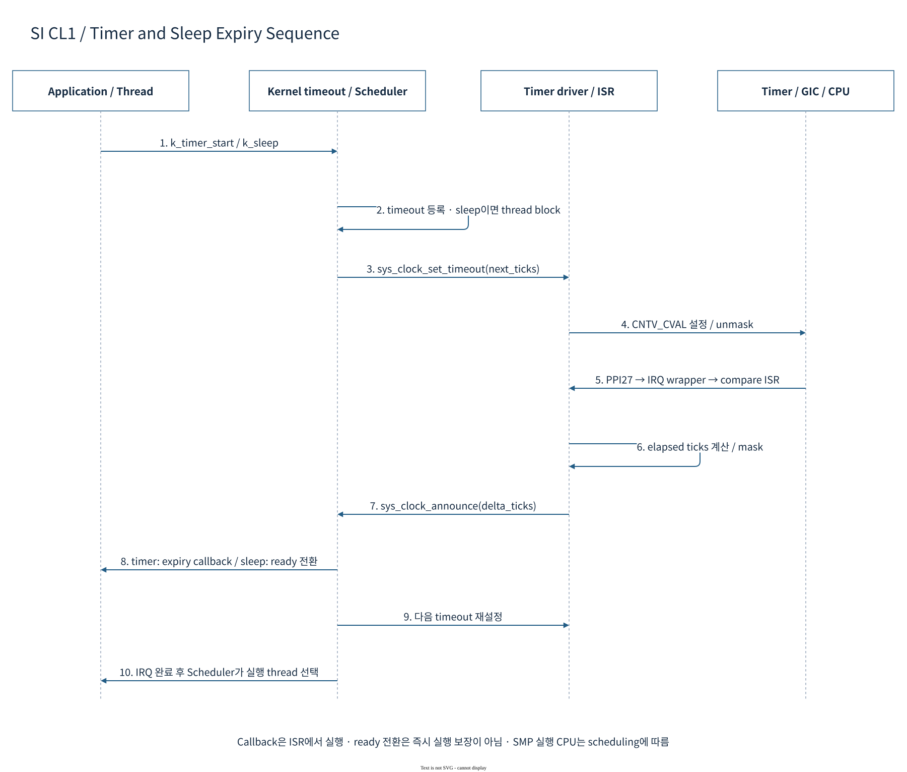

1. Application이 `k_timer_start()` 또는 `k_sleep()`을 요청한다.
2. Kernel이 timeout queue에 등록한다. Sleep 경로는 현재 Thread를 unready로 만들고 context switch한다.
3. 다음 HW deadline 갱신이 필요하면 Kernel이 `sys_clock_set_timeout()`을 호출한다.
4. Driver가 tick 기준 deadline을 cycle로 환산해 CNTV_CVAL에 쓰고 unmask한다. 범위가 크면 `CYCLES_MAX`로 제한한다.
5. Comparator 만료 → Virtual PPI27 → GIC·IRQ wrapper → `arm_arch_timer_compare_isr()` 순으로 진입한다.
6. ISR이 CNTVCT에서 경과 tick을 계산하고 `last_cycle`·`last_tick`을 갱신한다. Tickless 경로에서는 Timer IRQ를 mask한다.
7. `sys_clock_announce(delta_ticks)`가 timeout queue의 만료 항목을 처리한다.
8. **Timer:** `z_timer_expiration_handler()`가 status를 갱신하고 expiry callback을 실행한다. **Sleep:** Thread timeout 처리로 Thread가 ready 상태가 된다.
9. Kernel이 다음 timeout에 맞춰 CVAL을 재설정한다. Periodic `k_timer`는 expiry handler에서 다음 SW timeout을 등록하며, 64-bit timeout 구성에서는 예정 만료 시각 기준 absolute 재등록 경로를 사용한다.
10. IRQ 완료·복귀 시 Scheduler가 실행할 Thread를 선택한다. Ready 전환은 즉시 실행을 보장하지 않는다.

그림은 Timer와 Sleep의 공통 경로를 묶은 것이다. 모든 등록이 새 CVAL 쓰기를 유발하지 않으며, IRQ 하나가 여러 만료 timeout을 처리할 수 있다. `k_sleep(K_NO_WAIT)`는 yield이며 Timer 대기와 구분한다.

#### 4.4.4 Scheduler / SMP 및 QVP 적용 범위

- **Callback:** `k_timer` expiry callback은 ISR 문맥이므로 blocking 작업을 수행하지 않는다. 긴 작업은 workqueue 등 Thread 문맥으로 전달한다.
- **SMP:** CPU별 CNTV Timer가 있지만 driver의 시간 상태와 Kernel timeout queue는 lock으로 보호한다. CPU 4개에 독립적인 uptime을 누적하는 구조가 아니다.
- **Tickless:** `sys_clock_set_timeout()`의 idle + `K_TICKS_FOREVER` 분기는 추가 설정 없이 반환한다. 이를 모든 CPU Timer가 항상 disable된다는 뜻으로 해석하지 않는다.
- **Time slicing:** `CONFIG_TIMESLICING` 활성 시 `sys_clock_announce()` 이후 time-slice 처리가 연결된다. 보드의 SMP·tickless 설정만으로 time slicing 활성 여부를 단정하지 않는다.
- **QVP:** CPU-local CNTV comparator와 Virtual PPI 배선의 기능 경로를 설명한다. Counter drift·IRQ latency·저전력 wakeup·FVP 타이밍 동등성은 별도 측정 대상이다.

<a id="tfm-timer-software"></a>

### 4.5 RSE Domain — TF-M Timer Architecture

RSE는 **BL2 SCMI timeout의 Counter polling**과 **조건부 TIMER0 interrupt 시험 경로**를 구분한다. 공통 `systimer_armv8-m` driver가 Timestamp Timer의 MMIO register를 제어하며, Cortex-M55의 SysTick은 별도 장치다.

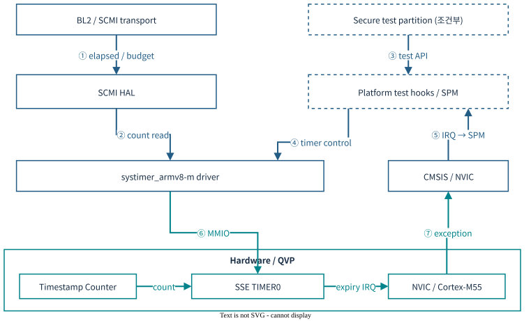

<details>
<summary>도면 상세 설명</summary>

- **BL2 / SCMI transport**: BL2 / SCMI transport / Counter polling timeout
- **Secure test partition (조건부)**: Secure test partition (조건부) / Timer start / clear / stop
- **SCMI HAL**: SCMI HAL / scmi_hal_counter_ticks / frequency
- **Platform test hooks / SPM**: Platform test hooks / SPM / TIMER0 handler · partition signal
- **systimer_armv8-m driver**: systimer_armv8-m driver / Count read / CNTFRQ / CVAL / AIVAL / CTL
- **CMSIS / NVIC**: CMSIS / NVIC / IRQ configuration
- **SSE TIMER0**: SSE TIMER0 / CNTBase / AIVAL
- **NVIC / Cortex-M55**: NVIC / Cortex-M55 / TIMER0 IRQ3

</details>

| 계층 / Component | 역할 | 연결 / 적용 범위 |
|---|---|---|
| BL2 SCMI transport | Doorbell 응답 대기·timeout 판단 | `transport_exchange()`; polling 구성 |
| SCMI HAL | Counter·환산 frequency 제공 | `scmi_hal_counter_ticks()` / `scmi_hal_counter_frequency()` |
| Secure test partition | 시험 Timer start·clear·stop | 조건부 `tfm_plat_test_secure_timer_*()` |
| Systimer driver | Count 조회·CNTFRQ·CVAL/TVAL·AIVAL 제어 | `SYSTIMER0_ARMV8_M_DEV_S` |
| Platform IRQ / SPM | TIMER0 IRQ를 partition 처리로 연결 | `TFM_TIMER0_IRQ_Handler()` → `spm_handle_interrupt()` |
| HW / QVP | Timestamp Timer·interrupt 전달 | SSE TIMER0 → NVIC IRQ3 → Cortex-M55 |

그림은 BL2와 Secure runtime의 책임을 함께 보여준다. 두 경로가 같은 firmware stage에서 동시에 실행된다는 의미는 아니다. 점선은 조건부 test 구성을 나타낸다.

#### 4.5.1 Timer Configuration / Initialization

| 경로 / 설정 | 초기화 동작 / 조건 |
|---|---|
| BL2 SCMI polling | Counter만 조회; Timer init·comparator·interrupt를 재설정하지 않음 |
| `systimer_armv8_m_init()` | 최초 호출 시 interrupt mask → autoinc disable → CNTFRQ 설정 → Timer enable → 초기화 flag 설정 |
| 공통 TIMER0 frequency | `SYSTIMER0_ARMV8M_DEFAULT_FREQ_HZ=32000000`; driver 기본 metadata |
| Apollo BL2 환산 frequency | `scmi_hal_counter_frequency()`는 `125000000` 반환 |
| `tfm_timer0_irq_init()` | Partition/IRQ 정보 저장 → priority 설정 → Secure target → NVIC disable |
| Platform test hook 빌드 | `TEST_S_SCMI_COMMS` 또는 `TFM_PARTITION_SLIH_TEST` 또는 `TFM_PARTITION_FLIH_TEST` 조건 |
| Apollo self-test | `APOLLO_TIMER_TEST=OFF`가 기본; 공통 partition test와 별도 옵션 |

`init()`의 Timer enable은 comparator 제어다. System Counter clock을 시작하거나 변경한다는 의미가 아니다. 또한 `enable_interrupt()`는 Timer의 IMASK를 해제하며 **NVIC IRQ enable과 별개**다.

공통 test hook은 `RELOAD = default_freq / 1000`으로 1ms를 의도한다. 기본 32MHz 값이면 32,000 ticks지만, 실제 Counter가 125MHz라면 256μs에 해당한다. CNTFRQ 쓰기는 QVP의 실제 clock 변경이 아니므로 **시험 주기 1ms를 확인된 값으로 인용하지 않는다.** [설정·driver 근거](SOURCES.md#tfm-software-detail)

#### 4.5.2 Counter Read / Timeout API

| API | 동작 | 의미 |
|---|---|---|
| `scmi_hal_counter_ticks()` | TIMER0의 `get_counter_value()` 호출 | BL2 timeout 기준 |
| `get_counter_value()` | CNTPCT high → low → high, high가 같을 때 결합 | Rollover를 고려한 64-bit MMIO read |
| `scmi_hal_counter_frequency()` | 125MHz 상수 반환 | 실측값이 아닌 Apollo SW 환산 계약 |
| `set_compare_value()` / `set_timer_value()` | CVAL low/high 또는 TVAL 쓰기 | Driver capability; BL2 polling에서는 호출하지 않음 |
| `scmi_hal_wait(cycles)` | NOP 반복 | 시간 단위 Timer API나 Task sleep이 아님 |

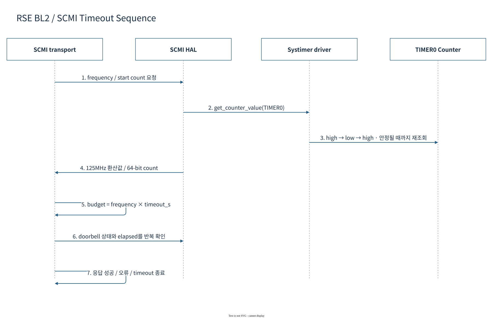

1. `transport_exchange()`가 frequency와 시작 count를 요청한다.
2. HAL이 `systimer_armv8_m_get_counter_value()`를 호출한다.
3. Driver가 TIMER0 count를 안정적으로 읽는다.
4. HAL이 count와 125MHz 환산값을 제공한다.
5. Caller가 `budget = frequency × timeout_s`를 계산한다.
6. Doorbell 상태와 `current_count − start`를 반복 확인한다. 경과 count 비교는 64-bit wrap을 고려한 뺄셈을 사용한다.
7. 유효 응답이면 성공하고, transport 오류나 budget 초과이면 오류로 종료한다.

이 경로는 IRQ wakeup을 예약하지 않는다. Counter가 진행하지 않거나 환산 frequency가 실제 rate와 다르면 timeout의 시간 계약도 성립하지 않는다.

#### 4.5.3 Conditional Timer Test / Interrupt Sequence

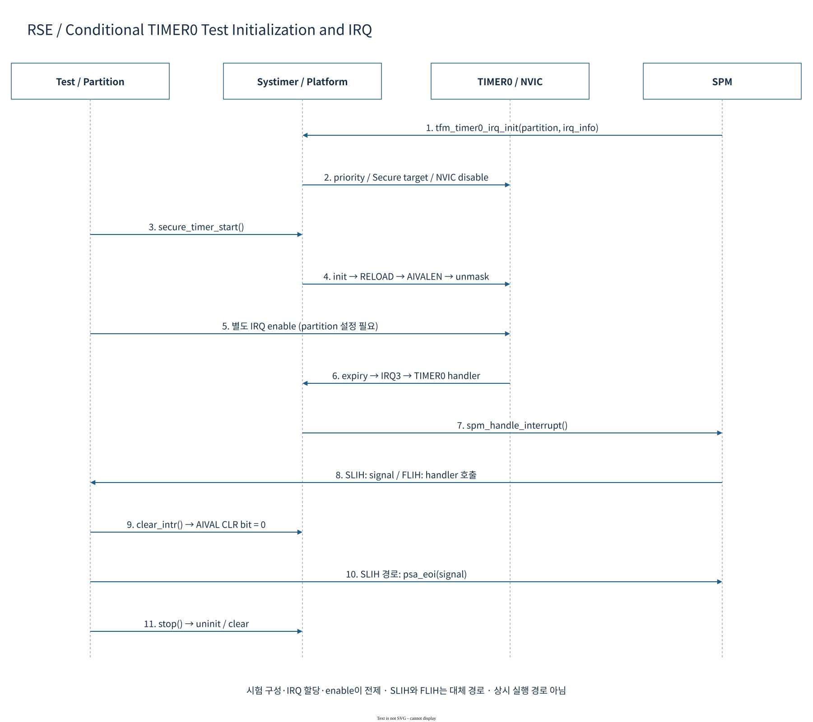

1. IRQ 할당 초기화가 `tfm_timer0_irq_init()`에 partition·IRQ 정보를 전달한다.
2. Platform은 NVIC priority·Secure target을 설정하고 IRQ를 disable 상태로 둔다.
3. Test client가 `tfm_plat_test_secure_timer_start()`를 호출한다.
4. Hook이 driver init → AIVAL RELOAD → autoinc enable → interrupt unmask 순으로 설정한다.
5. IRQ 전달에는 partition 구성에 따른 별도 enable이 필요하다. Hook 자체는 NVIC를 enable하지 않는다.
6. AIVAL 만료 시 TIMER0 IRQ3가 Cortex-M55 exception으로 진입한다.
7. `TFM_TIMER0_IRQ_Handler()`가 저장된 정보로 `spm_handle_interrupt()`를 호출한다.
8. **SLIH:** IRQ를 disable하고 partition signal을 설정한다. **FLIH:** 등록된 handler를 호출하고 결과에 따라 signal을 설정한다.
9. Test 처리 경로가 `clear_intr()`를 호출하면 AIVAL control의 **CLR bit에 0**을 써 source를 clear한다.
10. SLIH는 `psa_eoi(signal)`로 signal 해제·NVIC pending clear·IRQ 재활성화를 수행한다. FLIH에는 이 SLIH 전용 API를 적용하지 않는다.
11. Test 종료 시 `stop()`이 uninit(mask·autoinc disable·Timer disable) 후 source를 clear한다.

그림은 **조건부 API 연결 관계**를 나타낸다. 실제 enable·clear 시점과 FLIH/SLIH 선택은 test partition 설정에 따른다. NVIC pending clear와 Timer source clear는 서로 대체하지 않는다.

#### 4.5.4 Scheduler / SysTick 및 QVP 적용 범위

- **SPM 실행:** Interrupt signal 처리 후 scheduling 여부는 backend에 따른다. SFN backend는 단일 Thread이며, 다른 backend는 필요할 때 `arch_attempt_schedule()`을 요청한다. 이를 주기적인 Timer scheduler tick으로 해석하지 않는다.
- **SysTick self-test:** `APOLLO_TIMER_TEST` 활성 시 LOAD=999, core clock 선택, COUNTFLAG polling을 수행한다. TICKINT를 설정하지 않으므로 SysTick ISR·preemption 시험이 아니다. 코드의 core clock 확인값은 100MHz다.
- **TIMER0–3 self-test:** NVIC delivery를 disable한 상태에서 TVAL=1250, ISTATUS·NVIC pending을 polling한다. 이 시험은 ISR을 실행하지 않고 pending 상태를 확인한다.
- **QVP 모델:** Timestamp Timer의 CVAL/TVAL·AIVAL 구현과 reset/disable 제약은 [모델 구현](#implementation)에 따른다. Driver API 존재만으로 FVP 동작·시간 정확도와 동일하다고 판단하지 않는다.

<a id="test-verification"></a>

## 5. Test and Verification

현재 Apollo의 guest 명령, 기존 firmware 실행 경로, GDB와 Timer 시험 도구로 확인 가능한 항목을 정리한다. 전용 시험 프로그램의 신규 구현이 필요한 기능은 제외한다.

**판정:** `PASS`는 기대 결과 충족, `FAIL`은 불충족, `NOT RUN`은 미수행, `BLOCKED`는 선행 조건 문제, `N/A`는 해당 구성에 적용되지 않음을 뜻한다. 결과는 시험한 image·ELF revision과 build 설정에 연결해 기록한다.

**실행 조건:** QVP boot/login 후 해당 Domain console 또는 GDB에 연결한다. GDB 시험에는 image와 일치하는 symbol ELF가 필요하다. 초기화 함수는 해당 stage 진입 전에 breakpoint를 설정한다. Optimized-out symbol 등으로 관찰할 수 없으면 `BLOCKED`로 기록한다.

OP-TEE 전용 TA 시험은 현재 표에 포함하지 않는다. 각 항목의 `로그 / 측정값`에는 console log 또는 GDB transcript 경로와 관찰값을 기록한다.

### 5.1 AP Domain — Linux

**실행 환경:** QVP Linux console. Clocksource sysfs와 `/proc/interrupts`가 제공되는 image를 사용한다.

| Test ID | 검증 항목 / 방법 | 기대 결과 | 실제 결과 | 판정 | 로그 / 측정값 |
|---|---|---|---|---|---|
| LNX-01 | Boot log의 `arch_timer`·clocksource 등록과 `/sys/devices/system/clocksource/clocksource0/current_clocksource` 확인 | Architectural Timer 초기화·clocksource 선택 확인 | — | NOT RUN | — |
| LNX-02 | `/proc/uptime`을 `sleep 1` 전후로 조회 | Uptime 증가, sleep 후 shell 실행 재개 | — | NOT RUN | — |
| LNX-03 | `/proc/interrupts`의 `arch_timer` 행을 반복 sleep 전후 비교 | 하나 이상의 CPU에서 Timer interrupt 누적값 증가 | — | NOT RUN | — |

LNX-02는 기본 sleep·uptime 기능을 확인한다. Host stopwatch로 guest 1초의 정확도를 판정하지 않는다. LNX-03은 모든 CPU의 IRQ 수가 동일하게 증가할 것을 요구하지 않는다.

### 5.2 AP Domain — TF-A

**실행 환경:** BL31 ELF symbol과 AP GDB 연결. 초기화 breakpoint는 BL31 진입 전 설정한다.

| Test ID | 검증 항목 / 방법 | 기대 결과 | 실제 결과 | 판정 | 로그 / 측정값 |
|---|---|---|---|---|---|
| TFA-01 | Boot 중 `generic_delay_timer_init_args()` 인수와 `timer_init()` 반환 후 ops 확인 | 125MHz platform 설정에서 mult=1, div=125; Counter·timeout callback 연결 | — | NOT RUN | — |
| TFA-02 | 기존 firmware caller의 `udelay()` 진입·반환 관찰 | 유효한 ops로 polling을 수행하고 caller로 복귀 | — | NOT RUN | — |

TFA-02는 실제 호출 지점을 사용한다. 실행 경로에 호출이 없으면 `BLOCKED`로 기록하며, boot 완료만으로 PASS를 부여하지 않는다. Breakpoint로 정지한 실행은 지연 시간 측정에 사용하지 않는다.

### 5.3 AP Domain — U-Boot

**실행 환경:** U-Boot console와 AP GDB. `sleep` 명령은 `help sleep`으로 제공 여부를 확인한다.

| Test ID | 검증 항목 / 방법 | 기대 결과 | 실제 결과 | 판정 | 로그 / 측정값 |
|---|---|---|---|---|---|
| UBT-01 | 기존 시간 API 호출의 `get_ticks()`·`get_tbclk()` 반환값 관찰 | Count가 진행하고 frequency가 0이 아니며 해당 image의 환산 설정과 일치 | — | NOT RUN | — |
| UBT-02 | Console에서 `sleep 1` 실행, 필요 시 `__udelay()` 진입·반환 관찰 | 대기 후 prompt 복귀; UTHREAD 비활성 구성에서는 architecture delay 경로 진입 | — | NOT RUN | — |

`sleep` 명령은 `get_timer()`로 경과 시간을 확인하며 `udelay(100)`을 반복한다. 명령이 포함되지 않은 image에서는 UBT-02를 `N/A`로 기록한다. WFE 사용 여부는 event-stream 설정과 실행 EL을 함께 기록한다.

### 5.4 Safety Island CL0 — SCP

**실행 환경:** SCP ELF symbol·CL0 GDB·SCP UART. 기존 debugger CLI의 periodic UART polling alarm을 사용한다.

| Test ID | 검증 항목 / 방법 | 기대 결과 | 실제 결과 | 판정 | 로그 / 측정값 |
|---|---|---|---|---|---|
| SCP-01 | `timer_start()`의 반환과 `timer_isr()` 진입 관찰 | INTID34 ISR 등록 성공 및 Timer 만료 처리 진입 | — | NOT RUN | — |
| SCP-02 | Debugger CLI `alarm_callback()`을 관찰한 뒤 resume하여 재진입 확인 | Periodic alarm callback 반복 실행 | — | NOT RUN | — |
| SCP-03 | SCP UART에서 Ctrl-E 입력 | Alarm callback이 입력을 받아 framework event를 게시하고 CLI 진입 | — | NOT RUN | — |

`debugger_cli` module과 alarm 구성이 포함된 image에서 수행한다. SCP-02는 반복 동작 확인이며 breakpoint 간 host 경과 시간으로 alarm 주기를 계산하지 않는다.

### 5.5 Safety Island CL1 — Zephyr

**실행 환경:** CL1 shell과 Zephyr ELF symbol·CL1 GDB. ZEP-02는 `CONFIG_KERNEL_SHELL=y`와 `kernel uptime` 명령이 필요하다. 명령 미포함 image는 해당 항목을 `N/A`로 기록한다.

| Test ID | 검증 항목 / 방법 | 기대 결과 | 실제 결과 | 판정 | 로그 / 측정값 |
|---|---|---|---|---|---|
| ZEP-01 | `sys_clock_driver_init()`과 `smp_timer_init()` 관찰 | Primary 초기화 성공, 활성 secondary CPU별 Timer 초기화 | — | NOT RUN | — |
| ZEP-02 | `kernel uptime`을 간격을 두고 반복 조회 | Uptime이 감소하지 않고 증가 | — | NOT RUN | — |
| ZEP-03 | 기존 workload 실행 중 `arm_arch_timer_compare_isr()` → `sys_clock_announce()` 관찰 | Timer ISR에서 경과 tick 전달 및 Kernel timeout 처리 | — | NOT RUN | — |

Tickless 구성에서는 idle 상태의 고정 주기 IRQ를 기대하지 않는다. ZEP-03은 실제 timeout이 발생하는 workload에서 수행하며, 임의의 새 `k_timer` 시험은 포함하지 않는다.

### 5.6 RSE Domain — TF-M

**실행 환경:** 기존 `APOLLO_TIMER_TEST` 옵션을 활성화해 재빌드한 firmware와 RSE boot log. BL1_1·BL1_2·BL2·RUNTIME 각 stage에서 시험한다.

| Test ID | 검증 항목 / 방법 | 기대 결과 | 실제 결과 | 판정 | 로그 / 측정값 |
|---|---|---|---|---|---|
| TFM-01 | 기존 self-test의 SysTick 결과 수집 | Count 변화·COUNTFLAG 관찰, core_hz=100000000, stage별 PASS | — | NOT RUN | — |
| TFM-02 | 기존 self-test의 TIMER0–3 결과 수집 | Count 진행·ISTATUS·NVIC pending=1, CNTFRQ readback=125000000, stage별 PASS | — | NOT RUN | — |
| TFM-03 | `validate_tfm_timer_stages.py`로 RSE log 검사 | 4 stages × 5 timers = 20개 결과가 중복·누락 없이 통과 | — | NOT RUN | — |

Repository root에서 실제 RSE log 경로를 지정한다.

```sh
python3 scripts/test/validate_tfm_timer_stages.py \
  --rse-log "$RSE_LOG" \
  --output build/qbox-apollo-qvp/timer/tfm-stage-result.json
```

TFM-01은 SysTick polling, TFM-02는 NVIC delivery를 disable한 상태의 pending 관찰이다. 따라서 결과에 ISR 실행·partition signal 처리·AIVAL 주기 검증을 포함하지 않는다. `APOLLO_TIMER_TEST`는 기본 OFF이므로 일반 boot log에 시험 결과가 없는 것은 FAIL이 아니다.

관련 문서: [Interrupt Architecture](../interrupt/README.md) · [QVP Architecture](../qbox/README.md).
